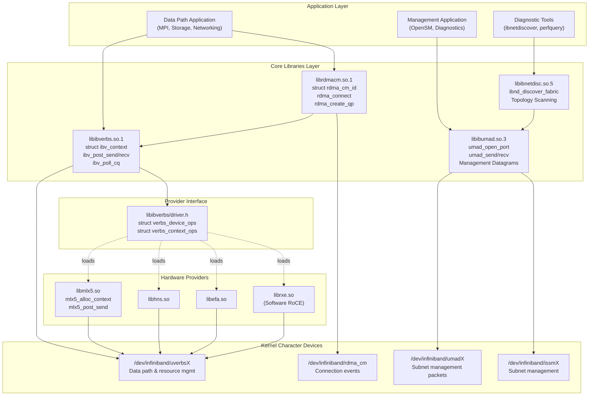
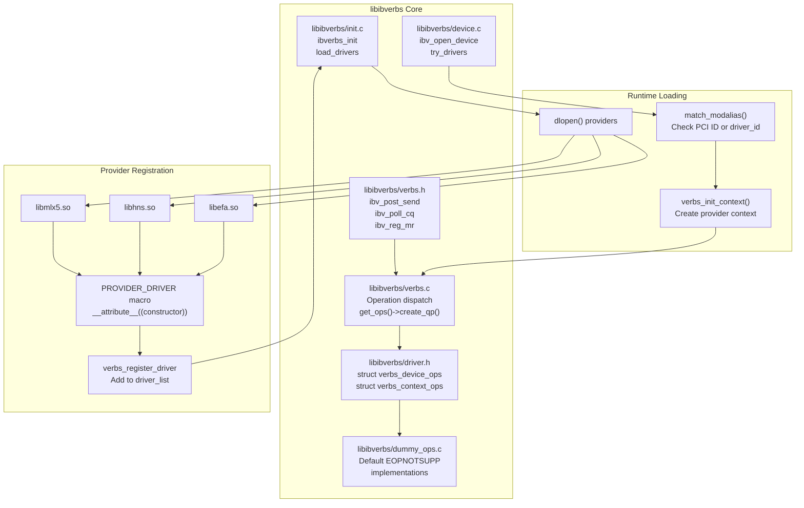
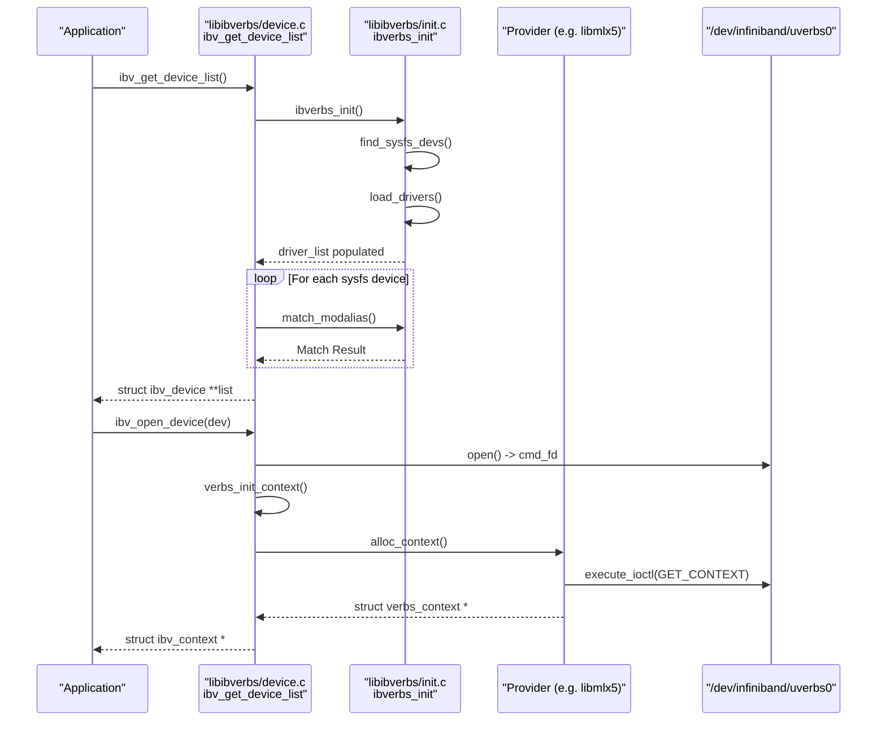

<!-- source: DeepWiki mcp.deepwiki.com · repo linux-rdma/rdma-core · page 2 Core Libraries · fetched 2026-11-11 -->

# Core Libraries

Relevant source files

The following files were used as context for generating this wiki page:

- [debian/libibnetdisc5.symbols](debian/libibnetdisc5.symbols)
- [debian/libibumad-dev.install](debian/libibumad-dev.install)
- [debian/libibverbs1.symbols](debian/libibverbs1.symbols)
- [debian/librdmacm-dev.install](debian/librdmacm-dev.install)
- [debian/librdmacm1.symbols](debian/librdmacm1.symbols)
- [infiniband-diags/CMakeLists.txt](infiniband-diags/CMakeLists.txt)
- [infiniband-diags/ibdiag_common.c](infiniband-diags/ibdiag_common.c)
- [kernel-headers/rdma/rdma_user_ioctl.h](kernel-headers/rdma/rdma_user_ioctl.h)
- [libibnetdisc/CMakeLists.txt](libibnetdisc/CMakeLists.txt)
- [libibnetdisc/chassis.c](libibnetdisc/chassis.c)
- [libibnetdisc/chassis.h](libibnetdisc/chassis.h)
- [libibnetdisc/ibnetdisc.c](libibnetdisc/ibnetdisc.c)
- [libibnetdisc/ibnetdisc_cache.c](libibnetdisc/ibnetdisc_cache.c)
- [libibnetdisc/ibnetdisc_osd.h](libibnetdisc/ibnetdisc_osd.h)
- [libibnetdisc/internal.h](libibnetdisc/internal.h)
- [libibnetdisc/libibnetdisc.map](libibnetdisc/libibnetdisc.map)
- [libibnetdisc/man/CMakeLists.txt](libibnetdisc/man/CMakeLists.txt)
- [libibverbs/CMakeLists.txt](libibverbs/CMakeLists.txt)
- [libibverbs/cmd.c](libibverbs/cmd.c)
- [libibverbs/cmd_counters.c](libibverbs/cmd_counters.c)
- [libibverbs/cmd_cq.c](libibverbs/cmd_cq.c)
- [libibverbs/cmd_dm.c](libibverbs/cmd_dm.c)
- [libibverbs/cmd_fallback.c](libibverbs/cmd_fallback.c)
- [libibverbs/cmd_flow_action.c](libibverbs/cmd_flow_action.c)
- [libibverbs/cmd_ioctl.c](libibverbs/cmd_ioctl.c)
- [libibverbs/cmd_ioctl.h](libibverbs/cmd_ioctl.h)
- [libibverbs/cmd_mr.c](libibverbs/cmd_mr.c)
- [libibverbs/cmd_write.h](libibverbs/cmd_write.h)
- [libibverbs/compat-1_0.c](libibverbs/compat-1_0.c)
- [libibverbs/device.c](libibverbs/device.c)
- [libibverbs/driver.h](libibverbs/driver.h)
- [libibverbs/dummy_ops.c](libibverbs/dummy_ops.c)
- [libibverbs/ibdev_nl.c](libibverbs/ibdev_nl.c)
- [libibverbs/ibverbs.h](libibverbs/ibverbs.h)
- [libibverbs/init.c](libibverbs/init.c)
- [libibverbs/kern-abi.h](libibverbs/kern-abi.h)
- [libibverbs/libibverbs.map.in](libibverbs/libibverbs.map.in)
- [libibverbs/man/CMakeLists.txt](libibverbs/man/CMakeLists.txt)
- [libibverbs/man/ibv_alloc_dm.3](libibverbs/man/ibv_alloc_dm.3)
- [libibverbs/man/ibv_create_flow.3](libibverbs/man/ibv_create_flow.3)
- [libibverbs/man/ibv_dm_export_dmabuf_fd.3.md](libibverbs/man/ibv_dm_export_dmabuf_fd.3.md)
- [libibverbs/man/ibv_is_fork_initialized.3.md](libibverbs/man/ibv_is_fork_initialized.3.md)
- [libibverbs/man/ibv_reg_mr.3](libibverbs/man/ibv_reg_mr.3)
- [libibverbs/memory.c](libibverbs/memory.c)
- [libibverbs/verbs.c](libibverbs/verbs.c)
- [libibverbs/verbs.h](libibverbs/verbs.h)
- [librdmacm/CMakeLists.txt](librdmacm/CMakeLists.txt)
- [librdmacm/cma.c](librdmacm/cma.c)
- [librdmacm/ib.h](librdmacm/ib.h)
- [librdmacm/librdmacm.map](librdmacm/librdmacm.map)
- [librdmacm/man/rdma_establish.3.md](librdmacm/man/rdma_establish.3.md)
- [librdmacm/man/rdma_join_multicast_ex.3](librdmacm/man/rdma_join_multicast_ex.3)
- [librdmacm/rdma_cma.h](librdmacm/rdma_cma.h)
- [librdmacm/rdma_cma_abi.h](librdmacm/rdma_cma_abi.h)
- [util/open_cdev.c](util/open_cdev.c)
- [util/rdma_nl.c](util/rdma_nl.c)
- [util/rdma_nl.h](util/rdma_nl.h)

The rdma-core project provides four primary userspace libraries that form the foundation of RDMA programming on Linux. These libraries abstract hardware specifics and kernel interfaces, providing standardized APIs for different aspects of RDMA functionality.

| Library | Shared Object | Purpose | Primary Header |
|---------|--------------|---------|----------------|
| **libibverbs** | `libibverbs.so.1` | RDMA Verbs API - core data path operations | `infiniband/verbs.h` |
| **librdmacm** | `librdmacm.so.1` | Connection management with socket-like API | `rdma/rdma_cma.h` |
| **libibumad** | `libibumad.so.3` | Management datagrams for subnet administration | `infiniband/umad.h` |
| **libibnetdisc** | `libibnetdisc.so.5` | InfiniBand network topology discovery | `infiniband/ibnetdisc.h` |

For detailed information about:
- The libibverbs Verbs API implementation and provider architecture, see [libibverbs](#2.1)
- The RDMA Connection Manager library, see [librdmacm](#2.2)
- The InfiniBand network discovery library, see [libibnetdisc](#2.3)
- Hardware-specific provider implementations, see [RDMA Providers](#3)

Sources: [libibverbs/CMakeLists.txt:1-59](), [librdmacm/CMakeLists.txt:1-50](), [libibnetdisc/CMakeLists.txt:1-40]()

## Library Architecture Overview

**Architecture: Core Libraries and Their Kernel Interfaces**

Sources: [libibverbs/verbs.h:95-113](), [libibverbs/driver.h:218-267](), [librdmacm/cma.c:101-121]()

## Core Library Descriptions

### libibverbs: Verbs API Library

The `libibverbs` library provides the fundamental RDMA Verbs API, implementing direct userspace access to RDMA hardware. It is the lowest-level library that all RDMA applications use, either directly or indirectly.

**Key Responsibilities:**
- Device enumeration and context creation (`ibv_get_device_list`, `ibv_open_device`) [libibverbs/device.c:54-96]()
- Resource allocation (Protection Domains, Memory Regions, Queue Pairs, Completion Queues) [libibverbs/verbs.h:1700-1800]()
- Data path operations (`ibv_post_send`, `ibv_post_recv`, `ibv_poll_cq`) [libibverbs/verbs.h:1850-1950]()
- Provider plugin architecture for hardware-specific implementations [libibverbs/driver.h:295-479]()
- Memory registration and management [libibverbs/cmd.c:99-138]()

**Location:** [libibverbs/]()  
**Build Artifacts:** `libibverbs.so.1.16.x` [libibverbs/CMakeLists.txt:22-24]()  
**Symbol Versioning:** IBVERBS_1.0 through IBVERBS_1.16 [libibverbs/libibverbs.map.in:1-178]()

The library uses a provider plugin system where hardware-specific implementations (e.g., `libmlx5.so`) are dynamically loaded based on detected hardware. See [libibverbs](#2.1) for detailed documentation.

Sources: [libibverbs/verbs.h:1-100](), [libibverbs/driver.h:295-324](), [libibverbs/CMakeLists.txt:1-65]()

### librdmacm: Connection Manager Library

The `librdmacm` library provides connection-oriented semantics on top of libibverbs, offering a socket-like API for RDMA connection establishment and management.

**Key Responsibilities:**
- Address resolution and binding [librdmacm/cma.c:187-205]()
- Connection establishment and event-driven management [librdmacm/cma.c:136-141]()
- Automatic Queue Pair creation and integration with Verbs [librdmacm/cma.c:113-121]()
- Support for both InfiniBand and RoCE/iWARP transports [librdmacm/cma.c:247-254]()

**Location:** [librdmacm/]()  
**Character Device:** `/dev/infiniband/rdma_cm` [librdmacm/cma.c:148-150]()

The library handles the complexities of RDMA connection setup, making it easier for applications to establish reliable connections similar to TCP sockets. See [librdmacm](#2.2) for detailed documentation.

Sources: [librdmacm/cma.c:1-254](), [librdmacm/rdma_cma.h:1-100]()

### libibnetdisc: Network Discovery Library

The `libibnetdisc` library provides InfiniBand fabric topology discovery and analysis capabilities.

**Key Responsibilities:**
- Fabric topology discovery and scanning [libibnetdisc/ibnetdisc.c:1-100]()
- Node and port iteration across the fabric
- Fabric configuration caching and chassis management [libibnetdisc/chassis.c:1-50]()

**Location:** [libibnetdisc/]()  
**Dependencies:** `libibumad.so.3`

Diagnostic tools like `ibnetdiscover` use this library to map out the complete InfiniBand network topology. See [libibnetdisc](#2.3) for detailed documentation.

Sources: [libibnetdisc/ibnetdisc.c:1-100](), [libibnetdisc/CMakeLists.txt:1-40]()

## libibverbs Provider Plugin Architecture

The libibverbs library uses a dynamic provider plugin system to support multiple hardware vendors through a common API.

**Provider Plugin Loading and Operation Dispatch**

### Provider Operation Tables

Each provider implements operation structures defined in `libibverbs/driver.h`:

- **`struct verbs_device_ops`**: Handles device matching and context allocation [libibverbs/driver.h:240-255]()
- **`struct verbs_context_ops`**: Contains the function pointers for all verbs operations (e.g., `post_send`, `poll_cq`) [libibverbs/ibverbs.h:86-88]()

Operations not implemented by a provider default to `libibverbs/dummy_ops.c` which returns `EOPNOTSUPP`. [libibverbs/verbs.c:163-172]()

Sources: [libibverbs/driver.h:218-267](), [libibverbs/init.c:240-255](), [libibverbs/device.c:230-258]()

## Library Initialization and Command Dispatch

**Device Discovery and Context Creation Flow**

### Command Dispatch Mechanisms

The core libraries communicate with the kernel via two primary methods:

1. **Legacy Write-Based Commands**: Uses `write()` syscall with fixed structures [libibverbs/cmd.c:56-57]()
2. **Modern IOCTL-Based Commands**: Uses `ioctl()` with extensible attributes [libibverbs/device.c:203-223]()

The `execute_cmd_write` and `execute_ioctl` functions abstract these kernel interfaces for the providers. [libibverbs/cmd.c:56-57](), [libibverbs/device.c:217-218]()

Sources: [libibverbs/device.c:54-96](), [libibverbs/init.c:204-238](), [libibverbs/cmd.c:50-65]()

## ABI Versioning and Compatibility

The libibverbs library uses ELF symbol versioning to maintain ABI stability. [libibverbs/libibverbs.map.in:1-183]()

- **Public API**: Symbols like `ibv_open_device` are versioned (e.g., `IBVERBS_1.1`). [libibverbs/libibverbs.map.in:53-101]()
- **Private Provider ABI (PABI)**: Internal symbols used between libibverbs and providers are versioned using `IBVERBS_PRIVATE_@IBVERBS_PABI_VERSION@`. [libibverbs/libibverbs.map.in:183-264]()
- **Fork Safety**: `ibv_fork_init()` enables `MADV_DONTFORK` handling for memory regions. [libibverbs/verbs.h:142-146]()

Sources: [libibverbs/libibverbs.map.in:1-264](), [debian/libibverbs1.symbols:1-131](), [libibverbs/kern-abi.h:48-49]()

---

