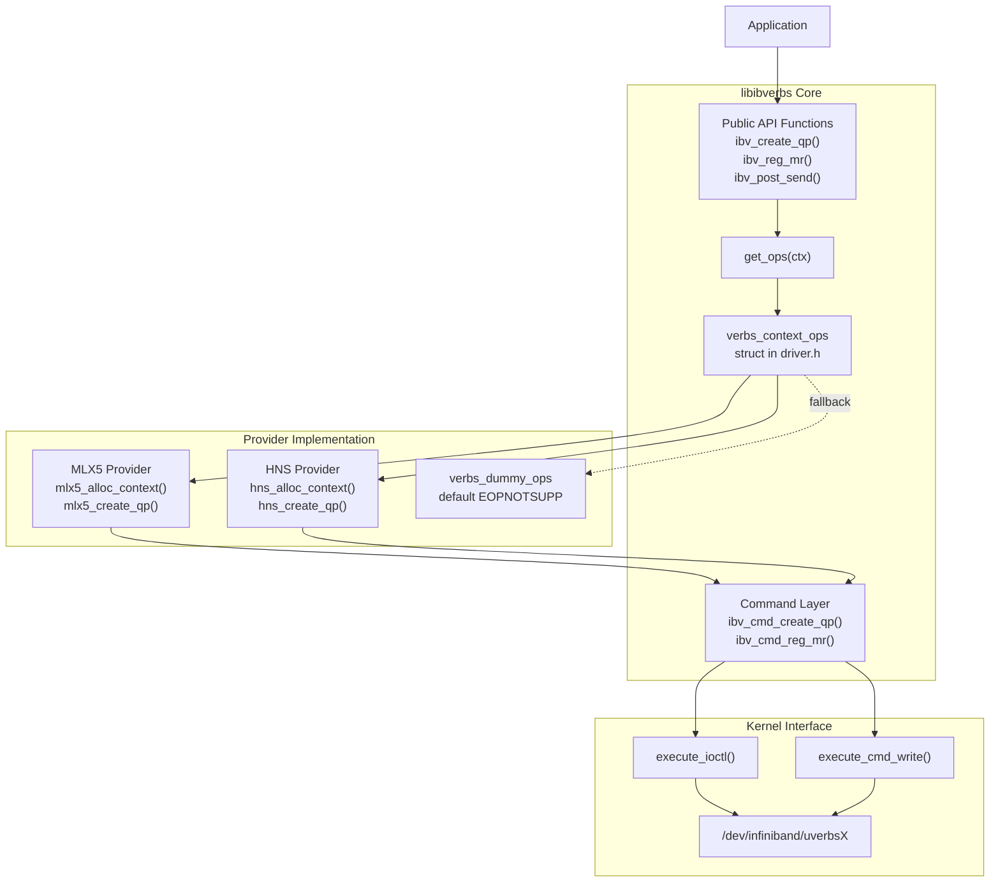
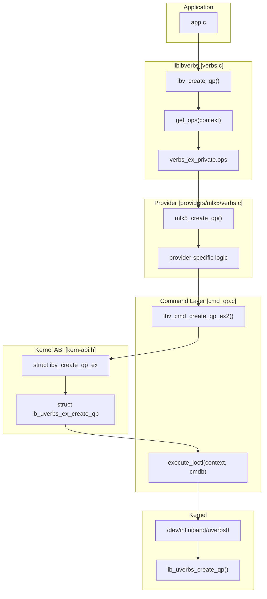
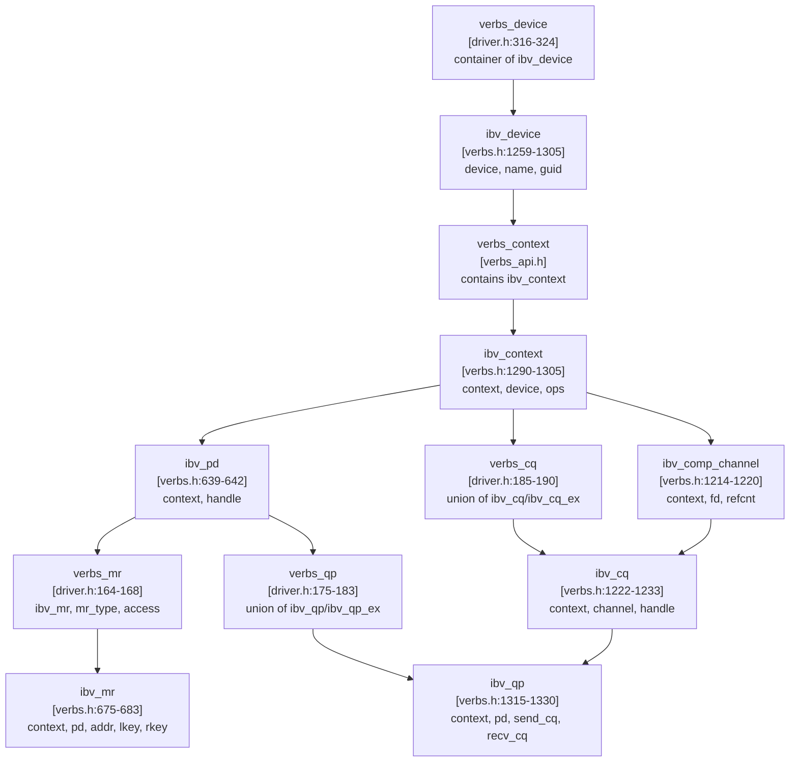
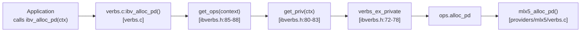
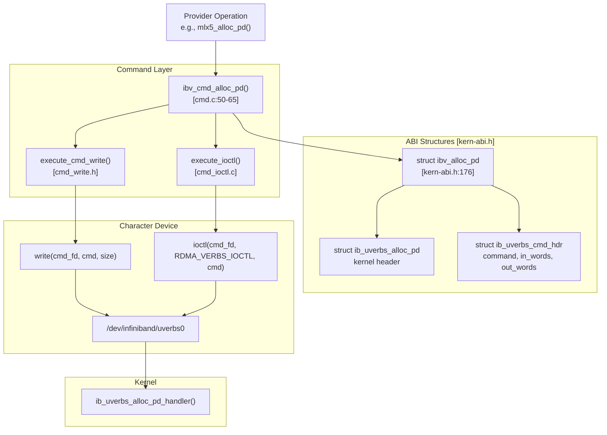

<!-- source: DeepWiki mcp.deepwiki.com · repo linux-rdma/rdma-core · page 2.1 libibverbs · fetched 2026-11-11 -->

# libibverbs

<details>
<summary>Relevant source files</summary>

The following files were used as context for generating this wiki page:

- [Documentation/tag_matching.md](Documentation/tag_matching.md)
- [buildlib/fixup-include/sys-auxv.h](buildlib/fixup-include/sys-auxv.h)
- [buildlib/fixup-include/sys-random.h](buildlib/fixup-include/sys-random.h)
- [ccan/CMakeLists.txt](ccan/CMakeLists.txt)
- [ccan/LICENSE.CCO](ccan/LICENSE.CCO)
- [ccan/array_size.h](ccan/array_size.h)
- [ccan/build_assert.h](ccan/build_assert.h)
- [ccan/check_type.h](ccan/check_type.h)
- [ccan/compiler.h](ccan/compiler.h)
- [ccan/container_of.h](ccan/container_of.h)
- [ccan/ilog.c](ccan/ilog.c)
- [ccan/ilog.h](ccan/ilog.h)
- [ccan/list.h](ccan/list.h)
- [ccan/minmax.h](ccan/minmax.h)
- [ccan/str.c](ccan/str.c)
- [ccan/str.h](ccan/str.h)
- [ccan/str_debug.h](ccan/str_debug.h)
- [debian/libibverbs1.symbols](debian/libibverbs1.symbols)
- [kernel-headers/rdma/rdma_user_ioctl.h](kernel-headers/rdma/rdma_user_ioctl.h)
- [libibverbs/CMakeLists.txt](libibverbs/CMakeLists.txt)
- [libibverbs/cmd.c](libibverbs/cmd.c)
- [libibverbs/cmd_counters.c](libibverbs/cmd_counters.c)
- [libibverbs/cmd_cq.c](libibverbs/cmd_cq.c)
- [libibverbs/cmd_device.c](libibverbs/cmd_device.c)
- [libibverbs/cmd_dm.c](libibverbs/cmd_dm.c)
- [libibverbs/cmd_fallback.c](libibverbs/cmd_fallback.c)
- [libibverbs/cmd_flow_action.c](libibverbs/cmd_flow_action.c)
- [libibverbs/cmd_ioctl.c](libibverbs/cmd_ioctl.c)
- [libibverbs/cmd_ioctl.h](libibverbs/cmd_ioctl.h)
- [libibverbs/cmd_mr.c](libibverbs/cmd_mr.c)
- [libibverbs/cmd_qp.c](libibverbs/cmd_qp.c)
- [libibverbs/cmd_srq.c](libibverbs/cmd_srq.c)
- [libibverbs/cmd_wq.c](libibverbs/cmd_wq.c)
- [libibverbs/cmd_write.h](libibverbs/cmd_write.h)
- [libibverbs/compat-1_0.c](libibverbs/compat-1_0.c)
- [libibverbs/device.c](libibverbs/device.c)
- [libibverbs/driver.h](libibverbs/driver.h)
- [libibverbs/dummy_ops.c](libibverbs/dummy_ops.c)
- [libibverbs/enum_strs.c](libibverbs/enum_strs.c)
- [libibverbs/examples/asyncwatch.c](libibverbs/examples/asyncwatch.c)
- [libibverbs/examples/devinfo.c](libibverbs/examples/devinfo.c)
- [libibverbs/examples/rc_pingpong.c](libibverbs/examples/rc_pingpong.c)
- [libibverbs/examples/srq_pingpong.c](libibverbs/examples/srq_pingpong.c)
- [libibverbs/examples/uc_pingpong.c](libibverbs/examples/uc_pingpong.c)
- [libibverbs/examples/ud_pingpong.c](libibverbs/examples/ud_pingpong.c)
- [libibverbs/examples/xsrq_pingpong.c](libibverbs/examples/xsrq_pingpong.c)
- [libibverbs/ibdev_nl.c](libibverbs/ibdev_nl.c)
- [libibverbs/ibverbs.h](libibverbs/ibverbs.h)
- [libibverbs/init.c](libibverbs/init.c)
- [libibverbs/kern-abi.h](libibverbs/kern-abi.h)
- [libibverbs/libibverbs.map.in](libibverbs/libibverbs.map.in)
- [libibverbs/man/CMakeLists.txt](libibverbs/man/CMakeLists.txt)
- [libibverbs/man/ibv_advise_mr.3.md](libibverbs/man/ibv_advise_mr.3.md)
- [libibverbs/man/ibv_alloc_dm.3](libibverbs/man/ibv_alloc_dm.3)
- [libibverbs/man/ibv_alloc_parent_domain.3](libibverbs/man/ibv_alloc_parent_domain.3)
- [libibverbs/man/ibv_bind_mw.3](libibverbs/man/ibv_bind_mw.3)
- [libibverbs/man/ibv_create_counters.3.md](libibverbs/man/ibv_create_counters.3.md)
- [libibverbs/man/ibv_create_cq_ex.3](libibverbs/man/ibv_create_cq_ex.3)
- [libibverbs/man/ibv_create_flow.3](libibverbs/man/ibv_create_flow.3)
- [libibverbs/man/ibv_create_flow_action.3.md](libibverbs/man/ibv_create_flow_action.3.md)
- [libibverbs/man/ibv_create_qp.3](libibverbs/man/ibv_create_qp.3)
- [libibverbs/man/ibv_create_qp_ex.3](libibverbs/man/ibv_create_qp_ex.3)
- [libibverbs/man/ibv_create_wq.3](libibverbs/man/ibv_create_wq.3)
- [libibverbs/man/ibv_devinfo.1](libibverbs/man/ibv_devinfo.1)
- [libibverbs/man/ibv_dm_export_dmabuf_fd.3.md](libibverbs/man/ibv_dm_export_dmabuf_fd.3.md)
- [libibverbs/man/ibv_get_async_event.3](libibverbs/man/ibv_get_async_event.3)
- [libibverbs/man/ibv_is_fork_initialized.3.md](libibverbs/man/ibv_is_fork_initialized.3.md)
- [libibverbs/man/ibv_modify_qp.3](libibverbs/man/ibv_modify_qp.3)
- [libibverbs/man/ibv_modify_qp_rate_limit.3](libibverbs/man/ibv_modify_qp_rate_limit.3)
- [libibverbs/man/ibv_modify_wq.3](libibverbs/man/ibv_modify_wq.3)
- [libibverbs/man/ibv_poll_cq.3](libibverbs/man/ibv_poll_cq.3)
- [libibverbs/man/ibv_post_send.3](libibverbs/man/ibv_post_send.3)
- [libibverbs/man/ibv_post_srq_ops.3](libibverbs/man/ibv_post_srq_ops.3)
- [libibverbs/man/ibv_query_device_ex.3](libibverbs/man/ibv_query_device_ex.3)
- [libibverbs/man/ibv_query_port.3](libibverbs/man/ibv_query_port.3)
- [libibverbs/man/ibv_query_qp.3](libibverbs/man/ibv_query_qp.3)
- [libibverbs/man/ibv_read_counters.3.md](libibverbs/man/ibv_read_counters.3.md)
- [libibverbs/man/ibv_reg_mr.3](libibverbs/man/ibv_reg_mr.3)
- [libibverbs/man/ibv_wr_post.3.md](libibverbs/man/ibv_wr_post.3.md)
- [libibverbs/memory.c](libibverbs/memory.c)
- [libibverbs/verbs.c](libibverbs/verbs.c)
- [libibverbs/verbs.h](libibverbs/verbs.h)
- [libibverbs/verbs_api.h](libibverbs/verbs_api.h)
- [providers/efa/efa_trace.h](providers/efa/efa_trace.h)
- [providers/hns/hns_roce_u_trace.h](providers/hns/hns_roce_u_trace.h)
- [providers/mlx5/man/mlx5dv_create_qp.3.md](providers/mlx5/man/mlx5dv_create_qp.3.md)
- [providers/mlx5/man/mlx5dv_flow_action_esp.3.md](providers/mlx5/man/mlx5dv_flow_action_esp.3.md)
- [providers/mlx5/man/mlx5dv_wr_post.3.md](providers/mlx5/man/mlx5dv_wr_post.3.md)
- [providers/mlx5/mlx5_trace.h](providers/mlx5/mlx5_trace.h)
- [providers/rxe/rxe_trace.h](providers/rxe/rxe_trace.h)
- [util/CMakeLists.txt](util/CMakeLists.txt)
- [util/mmio.c](util/mmio.c)
- [util/mmio.h](util/mmio.h)
- [util/open_cdev.c](util/open_cdev.c)
- [util/rdma_nl.c](util/rdma_nl.c)
- [util/rdma_nl.h](util/rdma_nl.h)
- [util/s390_mmio_insn.h](util/s390_mmio_insn.h)
- [util/udma_barrier.h](util/udma_barrier.h)
- [util/usdt.h](util/usdt.h)
- [util/util.c](util/util.c)
- [util/util.h](util/util.h)

</details>


libibverbs is the foundational userspace library for RDMA (Remote Direct Memory Access) communication in Linux. It provides the core InfiniBand verbs API that abstracts hardware-specific implementations, allowing applications to use RDMA capabilities through a common interface regardless of the underlying hardware.

This document explains the architecture and key components of libibverbs within the rdma-core project. For information about specific hardware providers that implement this API, see [RDMA Providers](#3).

## Overview

libibverbs serves as the central abstraction layer in the RDMA software stack. It provides the core InfiniBand Verbs API through public functions prefixed with `ibv_*` (defined in [libibverbs/verbs.h]()). The library uses a plugin architecture where hardware-specific providers implement the `verbs_device_ops` and `verbs_context_ops` interfaces (defined in [libibverbs/driver.h]()).

The library consists of several key layers:

| Layer | Key Files | Purpose |
|-------|-----------|---------|
| Public API | [libibverbs/verbs.h](), [libibverbs/verbs.c]() | `ibv_*` functions exposed to applications |
| Command Layer | [libibverbs/cmd.c](), [libibverbs/cmd_*.c]() | `ibv_cmd_*` functions for kernel communication |
| Provider Interface | [libibverbs/driver.h](), [libibverbs/dummy_ops.c]() | `verbs_device_ops`, `verbs_context_ops` structures |
| Device Management | [libibverbs/device.c](), [libibverbs/init.c]() | Device discovery and provider loading |

**Diagram: libibverbs Architecture with Code Entities**



Sources: [libibverbs/verbs.h:1-100](), [libibverbs/driver.h:295-314](), [libibverbs/driver.h:337-482](), [libibverbs/verbs.c:163-172](), [libibverbs/ibverbs.h:80-88](), [libibverbs/dummy_ops.c:1-50]()

## Architecture

**Diagram: Data Flow Through libibverbs**



The architecture uses function pointers in `verbs_context_ops` to dispatch operations to provider implementations. Each `ibv_context` contains a `verbs_ex_private` structure that holds the operation dispatch table.

Sources: [libibverbs/verbs.c:163-172](), [libibverbs/ibverbs.h:72-88](), [libibverbs/driver.h:337-482](), [libibverbs/cmd_qp.c:1-50]()

### Component Relationships

**Diagram: Object Hierarchy and Structure Definitions**



The `verbs_*` structures (defined in [libibverbs/driver.h]()) extend the public `ibv_*` structures (defined in [libibverbs/verbs.h]()) to add internal metadata. Providers use `container_of()` macro to access the extended structures.

Sources: [libibverbs/verbs.h:639-642](), [libibverbs/verbs.h:675-683](), [libibverbs/verbs.h:1222-1233](), [libibverbs/verbs.h:1315-1330](), [libibverbs/driver.h:164-168](), [libibverbs/driver.h:175-183](), [libibverbs/driver.h:185-190](), [libibverbs/driver.h:316-324]()

## Core Abstractions

### Devices and Contexts

A device (`ibv_device`) represents a physical RDMA device in the system. A context (`ibv_context`) represents an open connection to a device.

```c
struct ibv_device {
	struct _ibv_device_ops	ops;
	enum ibv_node_type	node_type;
	enum ibv_transport_type	transport_type;
	char			name[IBV_SYSFS_NAME_MAX];
	char			dev_name[IBV_SYSFS_NAME_MAX];
	char			dev_path[IBV_SYSFS_PATH_MAX];
	char			ibdev_path[IBV_SYSFS_PATH_MAX];
};

struct ibv_context {
	struct ibv_device      *device;
	struct _ibv_context_ops	ops;
	int			cmd_fd;
	int			async_fd;
	int			num_comp_vectors;
	pthread_mutex_t		mutex;
	void		       *abi_compat;
};
```

Key operations include:
- `ibv_get_device_list()` - Enumerate available RDMA devices [libibverbs/device.c:54-96]()
- `ibv_open_device()` - Open a device to get a context [libibverbs/libibverbs.map.in:86]()
- `ibv_close_device()` - Close a device context [libibverbs/libibverbs.map.in:59]()

Sources: [libibverbs/device.c:54-96](), [libibverbs/verbs.h:1259-1305]()

### Protection Domains

A protection domain (`ibv_pd`) is a security context within which memory regions and queue pairs are created.

```c
struct ibv_pd {
	struct ibv_context     *context;
	uint32_t		handle;
};
```

Key operations:
- `ibv_alloc_pd()` - Allocate a new protection domain [libibverbs/cmd.c:50-65]()
- `ibv_dealloc_pd()` - Deallocate a protection domain [libibverbs/libibverbs.map.in:65]()

Sources: [libibverbs/verbs.h:639-642](), [libibverbs/cmd.c:50-65]()

### Memory Regions

Memory regions (`ibv_mr`) represent application memory that has been registered for RDMA operations.

```c
struct ibv_mr {
	struct ibv_context     *context;
	struct ibv_pd	       *pd;
	void		       *addr;
	size_t			length;
	uint32_t		handle;
	uint32_t		lkey;
	uint32_t		rkey;
};
```

Key operations:
- `ibv_reg_mr()` - Register a memory region [libibverbs/cmd.c:99-138]()
- `ibv_dereg_mr()` - Deregister a memory region [libibverbs/libibverbs.map.in:66]()
- `ibv_rereg_mr()` - Re-register an existing memory region [libibverbs/cmd.c:140-167]()

Sources: [libibverbs/verbs.h:675-683](), [libibverbs/cmd.c:99-167]()

### Queue Pairs

A queue pair (`ibv_qp`) consists of a send queue and a receive queue, used for communication between RDMA endpoints.

```c
struct ibv_qp {
	struct ibv_context     *context;
	void		       *qp_context;
	struct ibv_pd	       *pd;
	struct ibv_cq	       *send_cq;
	struct ibv_cq	       *recv_cq;
	struct ibv_srq	       *srq;
	uint32_t		handle;
	uint32_t		qp_num;
	enum ibv_qp_state	state;
	enum ibv_qp_type	qp_type;
	pthread_mutex_t		mutex;
	pthread_cond_t		cond;
	uint32_t		events_completed;
};
```

Key operations:
- `ibv_create_qp()` - Create a queue pair [libibverbs/libibverbs.map.in:63]()
- `ibv_modify_qp()` - Modify queue pair attributes [libibverbs/libibverbs.map.in:83]()
- `ibv_destroy_qp()` - Destroy a queue pair [libibverbs/libibverbs.map.in:69]()

Sources: [libibverbs/verbs.h:1315-1330](), [libibverbs/cmd_qp.c:1-50]()

### Completion Queues

Completion queues (`ibv_cq`) report the completion of work requests.

```c
struct ibv_cq {
	struct ibv_context     *context;
	struct ibv_comp_channel *channel;
	void		       *cq_context;
	uint32_t		handle;
	int			cqe;
	pthread_mutex_t		mutex;
	pthread_cond_t		cond;
	uint32_t		comp_events_completed;
	uint32_t		async_events_completed;
};
```

Key operations:
- `ibv_create_cq()` - Create a completion queue [libibverbs/libibverbs.map.in:62]()
- `ibv_poll_cq()` - Poll for completions [libibverbs/cmd.c:194-238]()
- `ibv_destroy_cq()` - Destroy a completion queue [libibverbs/libibverbs.map.in:68]()

Sources: [libibverbs/verbs.h:1222-1233](), [libibverbs/cmd.c:194-238]()

### Work Requests and Completions

Work requests describe operations to be performed on queue pairs. Work completions (`ibv_wc`) report the completion status of these operations.

```c
struct ibv_wc {
	uint64_t		wr_id;
	enum ibv_wc_status	status;
	enum ibv_wc_opcode	opcode;
	uint32_t		vendor_err;
	uint32_t		byte_len;
	__be32			imm_data;
	uint32_t		qp_num;
	uint32_t		src_qp;
	int			wc_flags;
	uint16_t		pkey_index;
	uint16_t		slid;
	uint8_t			sl;
	uint8_t			dlid_path_bits;
};
```

Sources: [libibverbs/verbs.h:591-611](), [libibverbs/cmd.c:217-231]()

## Provider Architecture

### Provider Registration and Loading

Providers are loaded dynamically via `.so` files or statically for specific builds. Each provider implements `verbs_device_ops` and registers using `verbs_register_driver`.

**Diagram: Provider Registration Flow**

```mermaid
graph TD
    provider_so["libmlx5.so"]
    constructor["__attribute__((constructor))<br/>mlx5_register_driver()"]
    verbs_register_driver["verbs_register_driver()<br/>[init.c:240-255]"]
    driver_list["static LIST_HEAD(driver_list)<br/>[init.c:85]"]
    mlx5_dev_ops["mlx5_device_ops<br/>[providers/mlx5/mlx5.c]"]
    ibverbs_init["ibverbs_init()<br/>[init.c]"]
    find_sysfs_devs["find_sysfs_devs()<br/>[init.c:204-238]"]
    match_device["match_device()<br/>[init.c:337-362]"]
    alloc_device["ops->alloc_device()<br/>[driver.h:311]"]
    
    provider_so --> constructor
    constructor --> verbs_register_driver
    verbs_register_driver --> driver_list
    driver_list --> mlx5_dev_ops
    
    app_call["ibv_get_device_list()"] --> ibverbs_init
    ibverbs_init --> find_sysfs_devs
    find_sysfs_devs --> setup_sysfs_dev
    setup_sysfs_dev --> verbs_sysfs_dev
    verbs_sysfs_dev --> match_device
    match_device --> mlx5_dev_ops
    match_device --> alloc_device
```

The `verbs_device_ops` structure ([libibverbs/driver.h:295-313]()):

| Field | Purpose |
|-------|---------|
| `name` | Provider name (e.g., "mlx5") |
| `match_table` | Array of `verbs_match_ent` for device matching |
| `alloc_context` | Creates a `verbs_context` for the device |
| `alloc_device` | Allocates a `verbs_device` structure |

Sources: [libibverbs/driver.h:295-313](), [libibverbs/init.c:85-86](), [libibverbs/init.c:240-255](), [libibverbs/init.c:337-362]()

### Context Operations Dispatch

The `verbs_context_ops` structure ([libibverbs/driver.h:337-482]()) defines function pointers for all verbs operations. Each `ibv_context` contains a dispatch table.

**Key Operation Categories:**

| Category | Example Operations | Structure Fields |
|----------|-------------------|------------------|
| Device/Port | `query_device_ex`, `query_port` | [driver.h:444-452]() |
| Protection Domain | `alloc_pd`, `dealloc_pd` | [driver.h:349-353]() |
| Memory | `reg_mr`, `dereg_mr` | [driver.h:464-476]() |
| Queue Pairs | `create_qp`, `modify_qp` | [driver.h:379-383](), [driver.h:423-424]() |
| Completion Queues | `poll_cq`, `req_notify_cq` | [driver.h:435](), [driver.h:474]() |

**Operation Dispatch Mechanism:**



The `get_ops()` helper ([libibverbs/ibverbs.h:85-88]()) extracts the operations table from a context. Fallback to `verbs_dummy_ops` ([libibverbs/dummy_ops.c]()) occurs for unimplemented operations.

Sources: [libibverbs/driver.h:337-482](), [libibverbs/ibverbs.h:72-88](), [libibverbs/dummy_ops.c:1-100]()

## Kernel Interaction

### Command Layer Architecture

libibverbs communicates with the kernel via `write()` syscalls (legacy) and `ioctl()` (modern). `has_ioctl_write()` ([libibverbs/device.c:200-223]()) detects capability at runtime.

**Diagram: Kernel Communication Paths**



### ABI Version Compatibility

The kernel ABI version is checked during context initialization ([libibverbs/kern-abi.h:48-49]()):

| Constant | Value | Purpose |
|----------|-------|---------|
| `IB_USER_VERBS_MIN_ABI_VERSION` | 3 | Minimum supported kernel ABI |
| `IB_USER_VERBS_MAX_ABI_VERSION` | 6 | Maximum supported kernel ABI |

The library reads the kernel's ABI version from sysfs ([libibverbs/init.c:146-148]()).

Sources: [libibverbs/cmd.c:50-65](), [libibverbs/kern-abi.h:48-49](), [libibverbs/device.c:200-223](), [libibverbs/init.c:146-148]()

## API Usage Patterns

### Device Discovery and Initialization

`ibv_get_device_list()` ([libibverbs/device.c:54-96]()) scans `/sys/class/infiniband_verbs/` and initializes the provider list via `ibverbs_init()`.

### Context Creation

`verbs_init_context()` ([libibverbs/device.c:230-258]()) allocates the context structure, opens the command FD, and sets up the operation dispatch table via `verbs_set_ops()`.

### Resource Lifecycle Operations

| Resource | Create Function | Implementation | Kernel Command |
|----------|----------------|----------------|----------------|
| Protection Domain | `ibv_alloc_pd()` | `ops->alloc_pd` | `ibv_cmd_alloc_pd()` [cmd.c:50-65]() |
| Memory Region | `ibv_reg_mr()` | `ops->reg_mr` | `ibv_cmd_reg_mr()` [cmd.c:99-138]() |
| Completion Queue | `ibv_create_cq()` | `ops->create_cq` | `ibv_cmd_create_cq()` [cmd_cq.c]() |
| Queue Pair | `ibv_create_qp()` | `ops->create_qp` | `ibv_cmd_create_qp()` [cmd_qp.c]() |

Sources: [libibverbs/device.c:54-96](), [libibverbs/device.c:230-258](), [libibverbs/cmd.c:50-138](), [libibverbs/init.c:204-362]()

## Version Management

### Symbol Versioning

libibverbs uses ELF symbol versioning ([libibverbs/libibverbs.map.in]()) to maintain ABI compatibility.

| Version | Added In | Notable Additions |
|---------|----------|-------------------|
| IBVERBS_1.0 | 1.1.6 | Original API |
| IBVERBS_1.1 | 1.1.6 | Forking support, extended functions |
| IBVERBS_1.10 | 31 | Import/export functions |
| IBVERBS_1.15 | 59 | `ibv_alloc_dmah()`, `ibv_reg_mr_ex()` |

### Provider ABI Version

The provider interface version is embedded in the `verbs_register_driver` symbol name, ensuring providers are built against the correct libibverbs version ([libibverbs/libibverbs.map.in:261]()).

Sources: [libibverbs/libibverbs.map.in:1-264](), [libibverbs/kern-abi.h:48-49](), [libibverbs/init.c:146-148](), [debian/libibverbs1.symbols:1-132]()

---

