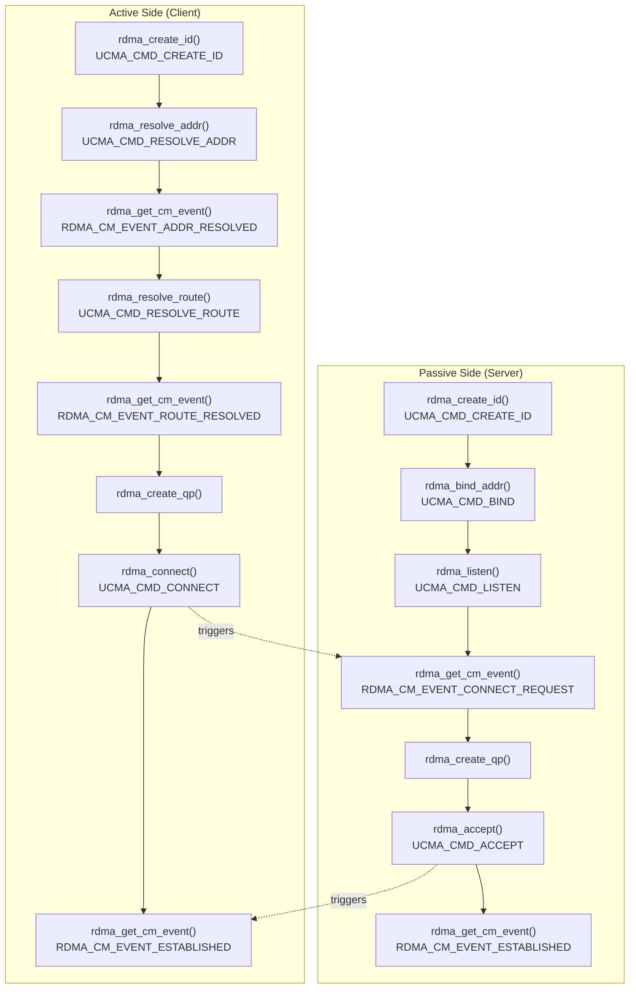
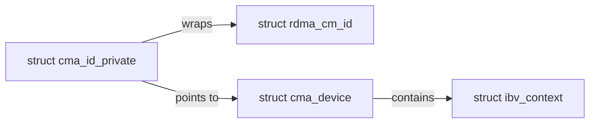
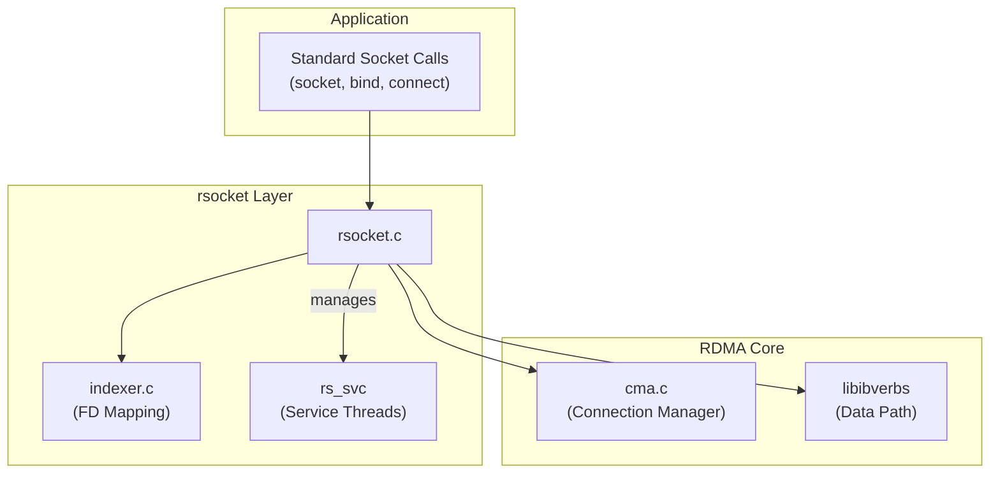

<!-- source: DeepWiki mcp.deepwiki.com · repo linux-rdma/rdma-core · page 2.2 librdmacm · fetched 2026-11-11 -->

# librdmacm

Relevant source files

The following files were used as context for generating this wiki page:

- [buildlib/config.h.in](buildlib/config.h.in)
- [buildlib/rdma_functions.cmake](buildlib/rdma_functions.cmake)
- [buildlib/template.pc.in](buildlib/template.pc.in)
- [debian/libibumad-dev.install](debian/libibumad-dev.install)
- [debian/librdmacm-dev.install](debian/librdmacm-dev.install)
- [debian/librdmacm1.symbols](debian/librdmacm1.symbols)
- [libibverbs/neigh.c](libibverbs/neigh.c)
- [libibverbs/neigh.h](libibverbs/neigh.h)
- [librdmacm/CMakeLists.txt](librdmacm/CMakeLists.txt)
- [librdmacm/acm.c](librdmacm/acm.c)
- [librdmacm/acm.h](librdmacm/acm.h)
- [librdmacm/addrinfo.c](librdmacm/addrinfo.c)
- [librdmacm/cma.c](librdmacm/cma.c)
- [librdmacm/cma.h](librdmacm/cma.h)
- [librdmacm/examples/CMakeLists.txt](librdmacm/examples/CMakeLists.txt)
- [librdmacm/examples/cmatose.c](librdmacm/examples/cmatose.c)
- [librdmacm/examples/cmtime.c](librdmacm/examples/cmtime.c)
- [librdmacm/examples/common.c](librdmacm/examples/common.c)
- [librdmacm/examples/common.h](librdmacm/examples/common.h)
- [librdmacm/examples/mckey.c](librdmacm/examples/mckey.c)
- [librdmacm/examples/rcopy.c](librdmacm/examples/rcopy.c)
- [librdmacm/examples/riostream.c](librdmacm/examples/riostream.c)
- [librdmacm/examples/rping.c](librdmacm/examples/rping.c)
- [librdmacm/examples/rstream.c](librdmacm/examples/rstream.c)
- [librdmacm/examples/udaddy.c](librdmacm/examples/udaddy.c)
- [librdmacm/examples/udpong.c](librdmacm/examples/udpong.c)
- [librdmacm/ib.h](librdmacm/ib.h)
- [librdmacm/indexer.c](librdmacm/indexer.c)
- [librdmacm/indexer.h](librdmacm/indexer.h)
- [librdmacm/librdmacm.map](librdmacm/librdmacm.map)
- [librdmacm/librspreload.map](librdmacm/librspreload.map)
- [librdmacm/man/CMakeLists.txt](librdmacm/man/CMakeLists.txt)
- [librdmacm/man/cmtime.1](librdmacm/man/cmtime.1)
- [librdmacm/man/mckey.1](librdmacm/man/mckey.1)
- [librdmacm/man/rdma_cm.7](librdmacm/man/rdma_cm.7)
- [librdmacm/man/rdma_establish.3.md](librdmacm/man/rdma_establish.3.md)
- [librdmacm/man/rdma_freeaddrinfo.3.in.rst](librdmacm/man/rdma_freeaddrinfo.3.in.rst)
- [librdmacm/man/rdma_get_cm_event.3](librdmacm/man/rdma_get_cm_event.3)
- [librdmacm/man/rdma_get_remote_ece.3.md](librdmacm/man/rdma_get_remote_ece.3.md)
- [librdmacm/man/rdma_getaddrinfo.3](librdmacm/man/rdma_getaddrinfo.3)
- [librdmacm/man/rdma_join_multicast_ex.3](librdmacm/man/rdma_join_multicast_ex.3)
- [librdmacm/man/rdma_migrate_id.3](librdmacm/man/rdma_migrate_id.3)
- [librdmacm/man/rdma_post_write.3](librdmacm/man/rdma_post_write.3)
- [librdmacm/man/rdma_post_writev.3](librdmacm/man/rdma_post_writev.3)
- [librdmacm/man/rdma_query_addrinfo.3.in.rst](librdmacm/man/rdma_query_addrinfo.3.in.rst)
- [librdmacm/man/rdma_reg_msgs.3](librdmacm/man/rdma_reg_msgs.3)
- [librdmacm/man/rdma_resolve_addrinfo.3.in.rst](librdmacm/man/rdma_resolve_addrinfo.3.in.rst)
- [librdmacm/man/rdma_set_local_ece.3.md](librdmacm/man/rdma_set_local_ece.3.md)
- [librdmacm/man/rdma_set_option.3](librdmacm/man/rdma_set_option.3)
- [librdmacm/man/rdma_write_cm_event.3.in.rst](librdmacm/man/rdma_write_cm_event.3.in.rst)
- [librdmacm/man/rping.1](librdmacm/man/rping.1)
- [librdmacm/man/ucmatose.1](librdmacm/man/ucmatose.1)
- [librdmacm/preload.c](librdmacm/preload.c)
- [librdmacm/rdma_cma.h](librdmacm/rdma_cma.h)
- [librdmacm/rdma_cma_abi.h](librdmacm/rdma_cma_abi.h)
- [librdmacm/rsocket.c](librdmacm/rsocket.c)
- [providers/ipathverbs/CMakeLists.txt](providers/ipathverbs/CMakeLists.txt)
- [providers/mlx4/CMakeLists.txt](providers/mlx4/CMakeLists.txt)
- [providers/mlx4/mlx4.conf](providers/mlx4/mlx4.conf)

## Purpose and Scope

This document covers **librdmacm**, the RDMA Connection Manager library that provides a high-level API for establishing connections over RDMA fabrics. librdmacm abstracts the complexities of RDMA connection establishment, including address resolution, route resolution, and QP state machine transitions.

librdmacm is part of the rdma-core package and is located in the `librdmacm/` directory. It provides both a traditional verbs-based connection API and a socket-like compatibility layer called **rsockets**.

---

## Overview

librdmacm simplifies RDMA connection establishment by providing:

- **Connection-oriented abstractions** similar to socket programming (passive listener, active connector).
- **Address resolution** from IP addresses/hostnames to RDMA GIDs [librdmacm/addrinfo.c:1-100]().
- **Route resolution** to determine network paths between endpoints [librdmacm/cma.c:1650-1700]().
- **QP state management** automating the INIT→RTR→RTS transitions [librdmacm/cma.c:1750-1800]().
- **Support for multiple transport types** including TCP-like (`RDMA_PS_TCP`), UDP-like (`RDMA_PS_UDP`), and IPoIB (`RDMA_PS_IPOIB`) [librdmacm/rdma_cma_abi.h:84-93]().

The library communicates with the kernel's `rdma_cm` and `rdma_ucm` modules through the `/dev/infiniband/rdma_cm` device file, handling connection state, event delivery, and QP parameter setup [librdmacm/cma.c:148-184]().

**Sources:** [librdmacm/cma.c:1-200](), [librdmacm/rdma_cma_abi.h:45-76](), [librdmacm/addrinfo.c:1-50]()

---

## Connection Model

librdmacm follows a client-server (active-passive) connection model. The state machine is managed via `rdma_cm_id` objects.

### Connection Lifecycle Diagram
This diagram maps the natural language steps of connection setup to the specific code entities and ABI commands used in `librdmacm/cma.c` and `librdmacm/rdma_cma_abi.h`.

**Sources:** [librdmacm/rdma_cma_abi.h:51-76](), [librdmacm/cma.c:101-141](), [librdmacm/examples/cmtime.c:72-91]()

---

## Core Data Structures

### rdma_cm_id and cma_id_private
The `rdma_cm_id` is the primary handle for connection management. Internally, the library wraps this in `struct cma_id_private` to track state and kernel handles.

| Field | Description | Location |
|-------|-------------|----------|
| `handle` | Kernel-side ID for the CM object | [librdmacm/cma.c:111]() |
| `cma_dev` | Pointer to the selected RDMA device | [librdmacm/cma.c:103]() |
| `qp_init_attr` | Attributes used to create the associated QP | [librdmacm/cma.c:113]() |
| `sync` | Flag for synchronous vs asynchronous operation | [librdmacm/cma.c:108]() |

### cma_device
The library maintains a list of discovered RDMA devices (`cma_dev_list`) to map connection requests to physical hardware.

**Sources:** [librdmacm/cma.c:84-121](), [librdmacm/cma.c:143]()

---

## rsocket: Socket Compatibility Layer

The **rsocket** implementation provides a socket-like API over RDMA, allowing applications to use RDMA with minimal code changes. It supports both stream and datagram semantics.

### RSocket Architecture
The following diagram illustrates how `rsocket.c` translates standard socket calls into RDMA operations.

### Key RSocket Features
- **Direct Data Placement**: Uses RDMA Write/Read for zero-copy data transfer [librdmacm/rsocket.c:156-164]().
- **Service Threads**: Background threads (`udp_svc`, `tcp_svc`, `listen_svc`) manage keepalives and connection events [librdmacm/rsocket.c:107-125]().
- **Protocol Headers**: Uses `struct rs_conn_data` to exchange credits and buffer information during the RDMA handshake [librdmacm/rsocket.c:225-234]().
- **Preload Library**: `preload.c` provides an `LD_PRELOAD` mechanism to intercept standard libc socket calls and redirect them to rsockets [librdmacm/preload.c:71-110]().

**Sources:** [librdmacm/rsocket.c:1-130](), [librdmacm/preload.c:1-115]()

---

## Implementation Details

### Address Resolution
Address resolution is handled in `addrinfo.c`, which implements `rdma_getaddrinfo`. It supports resolving hostnames and IP addresses to RDMA-specific `rdma_addrinfo` structures [librdmacm/addrinfo.c:140-200]().

### Kernel ABI Commands
Commands are initialized using the `CMA_INIT_CMD` macro and sent to the kernel via the character device `/dev/infiniband/rdma_cm` [librdmacm/cma.c:64-76]().

| ABI Command | Function |
|-------------|----------|
| `UCMA_CMD_CREATE_ID` | Creates a new user-space CM ID [librdmacm/rdma_cma_abi.h:51]() |
| `UCMA_CMD_RESOLVE_ADDR` | Starts IP-to-GID resolution [librdmacm/rdma_cma_abi.h:141]() |
| `UCMA_CMD_RESOLVE_ROUTE` | Resolves the network path (SA query) [librdmacm/rdma_cma_abi.h:154]() |
| `UCMA_CMD_CONNECT` | Sends a connection request (REQ) [librdmacm/rdma_cma_abi.h:238]() |
| `UCMA_CMD_GET_EVENT` | Retrieves asynchronous CM events [librdmacm/rdma_cma_abi.h:324]() |

### Event Handling
Events are retrieved from the kernel and wrapped in `struct cma_event`. The library handles the translation from kernel ABI event structures to the public `rdma_cm_event` structure [librdmacm/cma.c:136-141]().

**Sources:** [librdmacm/cma.c:64-76](), [librdmacm/rdma_cma_abi.h:50-76](), [librdmacm/addrinfo.c:140-200]()

---

## Build System Integration

The library is built using CMake and exports the `rdmacm` target.

- **Headers**: Public headers like `rdma_cma.h` and `rsocket.h` are published to the system [librdmacm/CMakeLists.txt:1-6]().
- **Library**: The main library is defined in `librdmacm/CMakeLists.txt` and links against `libibverbs` [librdmacm/CMakeLists.txt:12-26]().
- **Preload Module**: The `rspreload` module is built separately for use with `LD_PRELOAD` [librdmacm/CMakeLists.txt:30-38]().

**Sources:** [librdmacm/CMakeLists.txt:1-52](), [buildlib/rdma_functions.cmake:104-121]()

---

