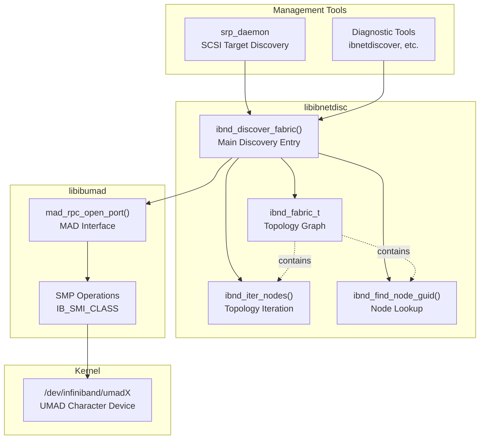
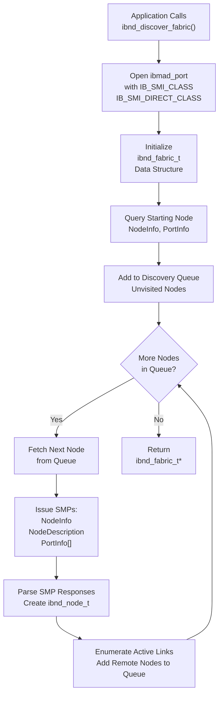
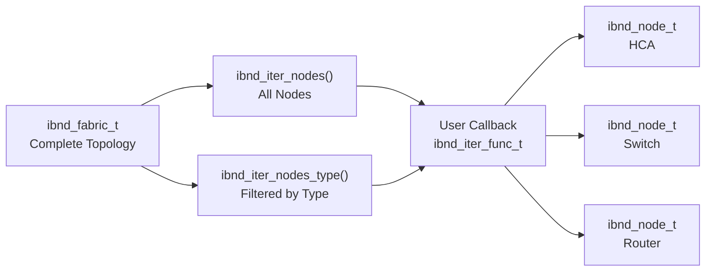
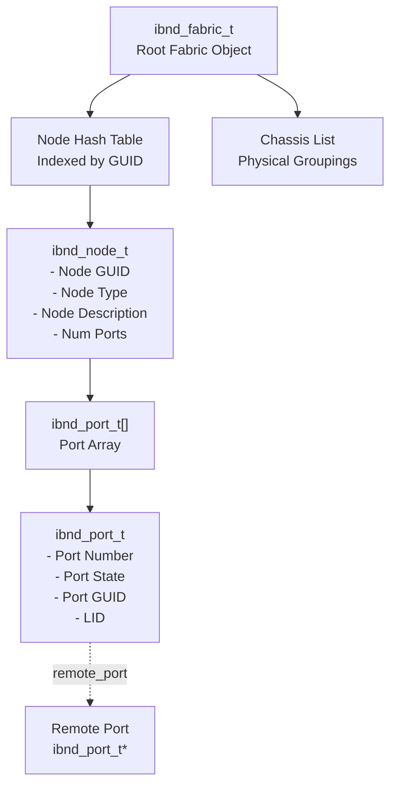

<!-- source: DeepWiki mcp.deepwiki.com · repo linux-rdma/rdma-core · page 2.3 libibnetdisc · fetched 2026-11-11 -->

# libibnetdisc

<details>
<summary>Relevant source files</summary>

The following files were used as context for generating this wiki page:

- [debian/libibmad5.symbols](debian/libibmad5.symbols)
- [debian/libibnetdisc5.symbols](debian/libibnetdisc5.symbols)
- [debian/libibumad3.symbols](debian/libibumad3.symbols)
- [ibacm/include/acm_mad.h](ibacm/include/acm_mad.h)
- [infiniband-diags/CMakeLists.txt](infiniband-diags/CMakeLists.txt)
- [infiniband-diags/ibdiag_common.c](infiniband-diags/ibdiag_common.c)
- [infiniband-diags/ibportstate.c](infiniband-diags/ibportstate.c)
- [infiniband-diags/smpquery.c](infiniband-diags/smpquery.c)
- [libibmad/CMakeLists.txt](libibmad/CMakeLists.txt)
- [libibmad/bm.c](libibmad/bm.c)
- [libibmad/cc.c](libibmad/cc.c)
- [libibmad/dump.c](libibmad/dump.c)
- [libibmad/fields.c](libibmad/fields.c)
- [libibmad/gs.c](libibmad/gs.c)
- [libibmad/iba_types.h](libibmad/iba_types.h)
- [libibmad/libibmad.map](libibmad/libibmad.map)
- [libibmad/mad.c](libibmad/mad.c)
- [libibmad/mad.h](libibmad/mad.h)
- [libibmad/register.c](libibmad/register.c)
- [libibmad/rpc.c](libibmad/rpc.c)
- [libibnetdisc/CMakeLists.txt](libibnetdisc/CMakeLists.txt)
- [libibnetdisc/chassis.c](libibnetdisc/chassis.c)
- [libibnetdisc/chassis.h](libibnetdisc/chassis.h)
- [libibnetdisc/ibnetdisc.c](libibnetdisc/ibnetdisc.c)
- [libibnetdisc/ibnetdisc.h](libibnetdisc/ibnetdisc.h)
- [libibnetdisc/ibnetdisc_cache.c](libibnetdisc/ibnetdisc_cache.c)
- [libibnetdisc/ibnetdisc_osd.h](libibnetdisc/ibnetdisc_osd.h)
- [libibnetdisc/internal.h](libibnetdisc/internal.h)
- [libibnetdisc/libibnetdisc.map](libibnetdisc/libibnetdisc.map)
- [libibnetdisc/man/CMakeLists.txt](libibnetdisc/man/CMakeLists.txt)
- [libibnetdisc/man/ibnd_discover_fabric.3](libibnetdisc/man/ibnd_discover_fabric.3)
- [libibnetdisc/man/ibnd_find_node_guid.3](libibnetdisc/man/ibnd_find_node_guid.3)
- [libibnetdisc/man/ibnd_iter_nodes.3](libibnetdisc/man/ibnd_iter_nodes.3)
- [libibumad/CMakeLists.txt](libibumad/CMakeLists.txt)
- [libibumad/libibumad.map](libibumad/libibumad.map)
- [libibumad/man/umad_free_ca_device_list.3.md](libibumad/man/umad_free_ca_device_list.3.md)
- [libibumad/man/umad_get_ca_device_list.3.md](libibumad/man/umad_get_ca_device_list.3.md)
- [libibumad/man/umad_get_smi_gsi_pair_by_ca_name.3](libibumad/man/umad_get_smi_gsi_pair_by_ca_name.3)
- [libibumad/man/umad_get_smi_gsi_pairs.3](libibumad/man/umad_get_smi_gsi_pairs.3)
- [libibumad/man/umad_sort_ca_device_list.3.md](libibumad/man/umad_sort_ca_device_list.3.md)
- [libibumad/sysfs.c](libibumad/sysfs.c)
- [libibumad/sysfs.h](libibumad/sysfs.h)
- [libibumad/tests/CMakeLists.txt](libibumad/tests/CMakeLists.txt)
- [libibumad/tests/umad_compile_test.c](libibumad/tests/umad_compile_test.c)
- [libibumad/tests/umad_reg2_compat.c](libibumad/tests/umad_reg2_compat.c)
- [libibumad/tests/umad_register2.c](libibumad/tests/umad_register2.c)
- [libibumad/tests/umad_sa_mcm_rereg_test.c](libibumad/tests/umad_sa_mcm_rereg_test.c)
- [libibumad/umad.c](libibumad/umad.c)
- [libibumad/umad.h](libibumad/umad.h)
- [libibumad/umad_cm.h](libibumad/umad_cm.h)
- [libibumad/umad_sa.h](libibumad/umad_sa.h)
- [libibumad/umad_sa_mcm.h](libibumad/umad_sa_mcm.h)
- [libibumad/umad_sm.h](libibumad/umad_sm.h)
- [libibumad/umad_str.c](libibumad/umad_str.c)
- [libibumad/umad_str.h](libibumad/umad_str.h)
- [libibumad/umad_types.h](libibumad/umad_types.h)
- [libibverbs/sa.h](libibverbs/sa.h)
- [libibverbs/tm_types.h](libibverbs/tm_types.h)
- [util/node_name_map.c](util/node_name_map.c)
- [util/node_name_map.h](util/node_name_map.h)

</details>


## Purpose and Scope

`libibnetdisc` is a core library that provides InfiniBand fabric discovery and topology mapping capabilities. It enables applications to scan and enumerate the nodes, switches, and interconnections within an InfiniBand network fabric. The library builds a complete fabric topology graph by querying subnet management agents (SMAs) through the `libibumad` interface.

This document covers the fabric discovery API, node iteration, topology lookup functions, and data structures. For information about the underlying management datagram interface used by this library, see `libibumad` documentation. For RDMA connection management, see [librdmacm](#2.2). For the core verbs API, see [libibverbs](#2.1).

Sources: [libibnetdisc/man/ibnd_discover_fabric.3:1-66]()

---

## Library Overview

`libibnetdisc` performs fabric discovery by issuing Subnet Management Packets (SMPs) to enumerate and characterize all devices in an InfiniBand network. The library constructs a graph representation of the fabric topology, including:

- **Nodes**: Host Channel Adapters (HCAs), switches, and routers with their properties.
- **Ports**: Physical ports on each node with link state and capabilities.
- **Links**: Connections between ports forming the fabric topology.
- **Chassis**: Physical enclosures grouping related nodes.

The library sits between `libibumad` (which provides the low-level MAD interface) and higher-level management tools like `srp_daemon`, which use fabric topology information to discover SCSI targets.

### Role in rdma-core Ecosystem



**Diagram: libibnetdisc in the Management Stack**

Sources: [libibnetdisc/man/ibnd_discover_fabric.3:14-18](), [libibnetdisc/ibnetdisc.c:46-50]()

---

## Fabric Discovery Architecture

The discovery process follows a directed graph traversal algorithm, starting from a local port and following links to neighboring nodes. The library issues SMP queries to each discovered node to retrieve its properties and port information, then follows active links to continue the traversal.

### Discovery Process Flow



**Diagram: Fabric Discovery Algorithm Flow**

The discovery process is implemented by the `smp_engine_t` and controlled via `ibnd_config_t`. The engine handles the state machine for SMP requests like `query_node_info` [libibnetdisc/ibnetdisc.c:64-65]() and `query_port_info` [libibnetdisc/ibnetdisc.c:66-67]().

Sources: [libibnetdisc/man/ibnd_discover_fabric.3:14-18](), [libibnetdisc/man/ibnd_discover_fabric.3:43-60](), [libibnetdisc/ibnetdisc.c:59-67]()

---

## Fabric Discovery API

### Core Discovery Functions

| Function | Purpose | Return Value |
|----------|---------|--------------|
| `ibnd_discover_fabric()` | Discover fabric topology starting from specified port | `ibnd_fabric_t*` or NULL on failure |
| `ibnd_destroy_fabric()` | Free all memory and resources for fabric object | void |
| `ibnd_debug()` | Set debug output level | void |
| `ibnd_show_progress()` | Enable progress output during discovery | void |
| `ibnd_set_max_smps_on_wire()` | Control SMP concurrency level | Previous value |

Sources: [libibnetdisc/man/ibnd_discover_fabric.3:1-42](), [debian/libibnetdisc5.symbols:6-7]()

### Discovery Function Details

#### ibnd_discover_fabric()

```c
ibnd_fabric_t *ibnd_discover_fabric(
    struct ibmad_port *ibmad_port,
    int timeout_ms,
    ib_portid_t *from,
    int hops
)
```

**Parameters:**
- `ibmad_port`: Open MAD port with `IB_SMI_CLASS` and `IB_SMI_DIRECT_CLASS` enabled.
- `timeout_ms`: Timeout for SMP operations in milliseconds.
- `from`: Optional starting node (NULL to start from local port).
- `hops`: Discovery radius from starting node (0 for entire fabric).

The implementation uses `extend_dpath` [libibnetdisc/ibnetdisc.c:117-144]() to manage the Directed Route path during the crawl and `retract_dpath` [libibnetdisc/ibnetdisc.c:97-115]() when returning from a hop.

Sources: [libibnetdisc/man/ibnd_discover_fabric.3:8-18](), [libibnetdisc/ibnetdisc.c:117-144]()

---

## Node Iteration and Lookup API

### Iteration Functions



**Diagram: Node Iteration Pattern**

#### ibnd_iter_nodes() and ibnd_iter_nodes_type()

These functions allow applications to walk the discovered topology. `ibnd_iter_nodes` [debian/libibnetdisc5.symbols:19]() processes every node, while `ibnd_iter_nodes_type` [debian/libibnetdisc5.symbols:20]() filters by `ibnd_node_type_t`.

Sources: [libibnetdisc/man/ibnd_iter_nodes.3:8-14](), [debian/libibnetdisc5.symbols:19-20]()

### Lookup Functions

| Function | Lookup Key | Purpose |
|----------|------------|---------|
| `ibnd_find_node_guid()` | Node GUID (uint64_t) | Find node by globally unique identifier |
| `ibnd_find_node_dr()` | Directed route (string) | Find node by directed route path |
| `ibnd_find_port_guid()` | Port GUID (uint64_t) | Find specific port by GUID |

Sources: [libibnetdisc/man/ibnd_find_node_guid.3:8-15](), [debian/libibnetdisc5.symbols:8-11]()

---

## Data Structures and Chassis Management

### Fabric Object Hierarchy



**Diagram: Fabric Data Structure Hierarchy**

The library also handles chassis discovery for modular switches. Functions like `ibnd_get_chassis_guid` [debian/libibnetdisc5.symbols:13]() and `ibnd_get_chassis_type` [debian/libibnetdisc5.symbols:15]() extract physical enclosure information.

Sources: [debian/libibnetdisc5.symbols:13-15](), [libibnetdisc/ibnetdisc.c:53-54]()

---

## Low-level MAD Interaction

`libibnetdisc` relies heavily on `libibumad` to perform the actual I/O. It uses `umad_open_port` [libibumad/umad.h:198]() to initialize access to the `/sys/class/infiniband_mad` [libibumad/umad.h:97]() character devices.

### System Interaction

| Entity | Code Symbol | Role |
|--------|-------------|------|
| Sysfs Path | `SYS_INFINIBAND` | Base path for IB device discovery [libibumad/umad.h:113]() |
| MAD Header | `struct umad_hdr` | Wire format for Management Datagrams [libibumad/umad_types.h:120]() |
| Port Info | `struct umad_port` | Userspace representation of an IB port [libibumad/umad.h:142]() |
| SMP Class | `UMAD_CLASS_SUBN_DIRECTED_ROUTE` | Class 0x81 used for discovery traversal [libibumad/umad_types.h:53]() |

Sources: [libibumad/umad.h:97-113](), [libibumad/umad_types.h:53-120]()

---

## Integration and Diagnostics

Management tools such as `ibportstate` [infiniband-diags/ibportstate.c:1]() use these discovery primitives to modify fabric state. `ibportstate` uses `smp_query_via` [infiniband-diags/ibportstate.c:127]() to fetch `IB_ATTR_NODE_INFO` and `IB_ATTR_PORT_INFO` [infiniband-diags/ibportstate.c:145](), mirroring the internal logic of `libibnetdisc`.

### Link Speed Handling
`libibnetdisc` provides specific helpers for extended link speeds (FDR/EDR/HDR), such as `ibnd_get_agg_linkspeedext` [debian/libibnetdisc5.symbols:24](). This is used to decode complex speed fields from `PortInfo` MADs [libibnetdisc/ibnetdisc.c:179-180]().

Sources: [infiniband-diags/ibportstate.c:127-145](), [libibnetdisc/ibnetdisc.c:179-180](), [debian/libibnetdisc5.symbols:23-30]()

---

