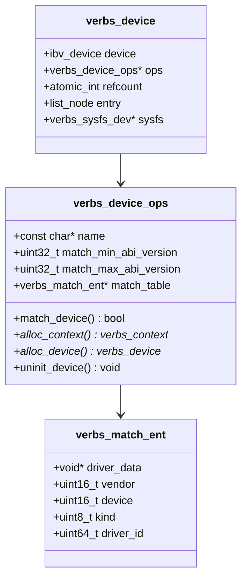
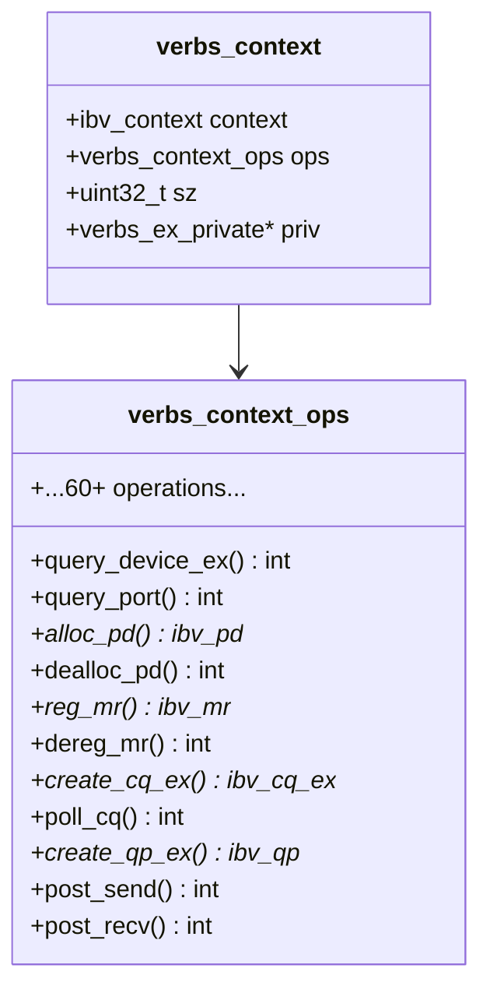
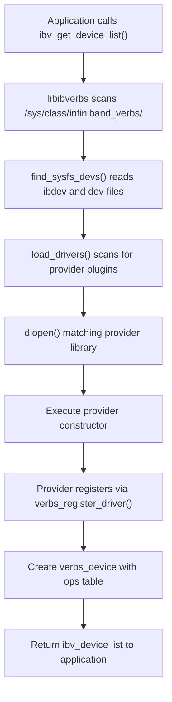
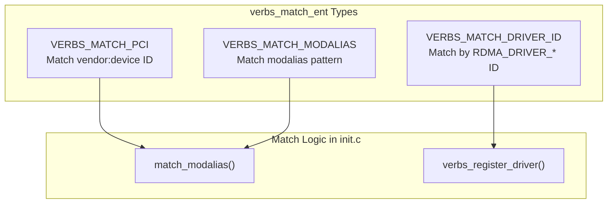

<!-- source: DeepWiki mcp.deepwiki.com · repo linux-rdma/rdma-core · page 3 RDMA Providers · fetched 2026-11-11 -->

# RDMA Providers

Relevant source files

The following files were used as context for generating this wiki page:

- [debian/libibverbs1.symbols](debian/libibverbs1.symbols)
- [kernel-headers/rdma/bnxt_re-abi.h](kernel-headers/rdma/bnxt_re-abi.h)
- [kernel-headers/rdma/cxgb4-abi.h](kernel-headers/rdma/cxgb4-abi.h)
- [kernel-headers/rdma/efa-abi.h](kernel-headers/rdma/efa-abi.h)
- [kernel-headers/rdma/erdma-abi.h](kernel-headers/rdma/erdma-abi.h)
- [kernel-headers/rdma/hfi/hfi1_user.h](kernel-headers/rdma/hfi/hfi1_user.h)
- [kernel-headers/rdma/hns-abi.h](kernel-headers/rdma/hns-abi.h)
- [kernel-headers/rdma/ib_user_mad.h](kernel-headers/rdma/ib_user_mad.h)
- [kernel-headers/rdma/ib_user_sa.h](kernel-headers/rdma/ib_user_sa.h)
- [kernel-headers/rdma/ib_user_verbs.h](kernel-headers/rdma/ib_user_verbs.h)
- [kernel-headers/rdma/irdma-abi.h](kernel-headers/rdma/irdma-abi.h)
- [kernel-headers/rdma/mana-abi.h](kernel-headers/rdma/mana-abi.h)
- [kernel-headers/rdma/mlx4-abi.h](kernel-headers/rdma/mlx4-abi.h)
- [kernel-headers/rdma/mlx5-abi.h](kernel-headers/rdma/mlx5-abi.h)
- [kernel-headers/rdma/mlx5_user_ioctl_cmds.h](kernel-headers/rdma/mlx5_user_ioctl_cmds.h)
- [kernel-headers/rdma/mlx5_user_ioctl_verbs.h](kernel-headers/rdma/mlx5_user_ioctl_verbs.h)
- [kernel-headers/rdma/mthca-abi.h](kernel-headers/rdma/mthca-abi.h)
- [kernel-headers/rdma/ocrdma-abi.h](kernel-headers/rdma/ocrdma-abi.h)
- [kernel-headers/rdma/qedr-abi.h](kernel-headers/rdma/qedr-abi.h)
- [kernel-headers/rdma/rdma_netlink.h](kernel-headers/rdma/rdma_netlink.h)
- [kernel-headers/rdma/rdma_user_cm.h](kernel-headers/rdma/rdma_user_cm.h)
- [kernel-headers/rdma/rdma_user_rxe.h](kernel-headers/rdma/rdma_user_rxe.h)
- [kernel-headers/rdma/vmw_pvrdma-abi.h](kernel-headers/rdma/vmw_pvrdma-abi.h)
- [libibverbs/CMakeLists.txt](libibverbs/CMakeLists.txt)
- [libibverbs/cmd_mr.c](libibverbs/cmd_mr.c)
- [libibverbs/compat-1_0.c](libibverbs/compat-1_0.c)
- [libibverbs/device.c](libibverbs/device.c)
- [libibverbs/driver.h](libibverbs/driver.h)
- [libibverbs/dummy_ops.c](libibverbs/dummy_ops.c)
- [libibverbs/ibdev_nl.c](libibverbs/ibdev_nl.c)
- [libibverbs/ibverbs.h](libibverbs/ibverbs.h)
- [libibverbs/init.c](libibverbs/init.c)
- [libibverbs/libibverbs.map.in](libibverbs/libibverbs.map.in)
- [libibverbs/man/CMakeLists.txt](libibverbs/man/CMakeLists.txt)
- [libibverbs/man/ibv_dm_export_dmabuf_fd.3.md](libibverbs/man/ibv_dm_export_dmabuf_fd.3.md)
- [libibverbs/man/ibv_is_fork_initialized.3.md](libibverbs/man/ibv_is_fork_initialized.3.md)
- [libibverbs/man/ibv_reg_mr.3](libibverbs/man/ibv_reg_mr.3)
- [libibverbs/memory.c](libibverbs/memory.c)
- [libibverbs/verbs.c](libibverbs/verbs.c)
- [libibverbs/verbs.h](libibverbs/verbs.h)
- [util/rdma_nl.c](util/rdma_nl.c)
- [util/rdma_nl.h](util/rdma_nl.h)

## Introduction

RDMA Providers are dynamically-loadable plugin libraries that implement hardware-specific functionality while presenting a uniform interface through `libibverbs`. Each provider library (e.g., `libmlx5.so`, `libhns.so`) contains device-specific code for a particular RDMA hardware family and registers itself using the plugin architecture defined in [libibverbs/driver.h:295-313]().

The provider system enables:
- Hardware abstraction through standardized `verbs_device_ops` and `verbs_context_ops` function tables.
- Dynamic discovery and loading via sysfs device matching and `dlopen()`.
- Hardware vendor independence for applications.
- Device-specific optimizations and extensions (e.g., MLX5 Direct Verbs).

Sources: [libibverbs/driver.h:295-313](), [libibverbs/CMakeLists.txt:67-93]()

## Provider Architecture

### Core Interfaces

The provider plugin system is built on two primary interface structures defined in [libibverbs/driver.h]():

**Device-Level Operations (`verbs_device_ops`)**

Diagram: Provider Device Operations Structure

Sources: [libibverbs/driver.h:295-313](), [libibverbs/driver.h:316-324](), [libibverbs/driver.h:225-234]()

**Context-Level Operations (`verbs_context_ops`)**

Diagram: Provider Context Operations Structure

Sources: [libibverbs/driver.h:337-527](), [libibverbs/ibverbs.h:72-78]()

### Provider Plugin Loading

Diagram: Provider Discovery and Loading Mechanism

Sources: [libibverbs/device.c:54-96](), [libibverbs/init.c:204-238](), [libibverbs/init.c:240-255]()

### Provider Library Files

| Provider | Library File | Kernel Module |
|----------|-------------|---------------|
| MLX5 | `libmlx5.so` | `mlx5_ib.ko` |
| HNS | `libhns.so` | `hns_roce.ko` |
| BNXT_RE | `libbnxt_re.so` | `bnxt_re.ko` |
| EFA | `libefa.so` | `efa.ko` |
| RXE | `librxe.so` | `rdma_rxe.ko` |
| SiW | `libsiw.so` | `siw.ko` |

Sources: [libibverbs/CMakeLists.txt:22-59](), [debian/libibverbs1.symbols:1-17]()

### Provider Registration Mechanisms

**Device Matching**

Providers define a `match_table` using `verbs_match_ent` to claim hardware based on PCI IDs or Kernel Driver IDs.

Diagram: Provider Device Matching Tables

Sources: [libibverbs/driver.h:218-234](), [libibverbs/init.c:258-269]()

**Constructor Registration**

Each provider library contains a constructor function that executes when `dlopen()` loads the library, calling `verbs_register_driver` to add its `verbs_device_ops` to the global `driver_list` [libibverbs/init.c:85]().

Sources: [libibverbs/init.c:240-255](), [libibverbs/ibverbs.h:42]()

### Operation Dispatch Mechanism

RDMA operations are dispatched through function pointers in the `verbs_context_ops` table. For example, `ibv_query_device` calls the provider's implementation via `get_ops(context)->query_device_ex` [libibverbs/verbs.c:168]().

For unimplemented operations, libibverbs provides `verbs_dummy_ops` [libibverbs/ibverbs.h:53]() to ensure pointers are never NULL.

Sources: [libibverbs/verbs.c:163-172](), [libibverbs/ibverbs.h:80-88]()

## Available Providers

The following child pages cover specific hardware implementations in detail:

- **[Mellanox MLX5 Provider](#3.1)**: Supports ConnectX-4/5/6/7/8 adapters. Includes Direct Verbs and DevX support.
- **[HiSilicon HNS RoCE Provider](#3.2)**: Supports HiSilicon RoCE hardware (v1/v2).
- **[Broadcom NetXtreme-E RoCE Provider](#3.3)**: Supports Broadcom RoCE adapters with doorbell pacing.
- **[Amazon EFA Provider](#3.4)**: Supports AWS Elastic Fabric Adapter with SRD transport.
- **[Other Hardware Providers](#3.5)**: Covers Intel (irdma), QLogic (qedr), Soft-RoCE (rxe), Soft-iWarp (siw), and others.

### Major Provider Details

**MLX5 Provider**
- Supports Mellanox/NVIDIA ConnectX-4 and newer.
- **Extensions**: MLX5 Direct Verbs (`mlx5dv`), DevX, and Direct Rules flow steering.
- **ABI**: Uses `MLX5_IB_UVERBS_ABI_VERSION` [kernel-headers/rdma/mlx5-abi.h:68]().

**Software Providers (RXE, SiW)**
- **RXE**: Software RoCE implementation over any Ethernet NIC.
- **SiW**: Software iWARP implementation over TCP/IP sockets.
- Useful for development and testing without dedicated RDMA hardware.

Sources: [kernel-headers/rdma/mlx5-abi.h](), [kernel-headers/rdma/rdma_user_rxe.h]()

## Provider Implementation Patterns

### Context Structure Extension

Providers extend the base `verbs_context` structure to store hardware-specific state. This is typically done by embedding `verbs_context` as the first member of a provider-specific context struct.

Sources: [libibverbs/driver.h:50-58](), [libibverbs/device.c:230-258]()

### Memory Registration Patterns

Providers implement `reg_mr` to pin memory and obtain local/remote keys. They often use `ibv_cmd_reg_mr` [libibverbs/libibverbs.map.in:250]() to communicate with the kernel.

Sources: [libibverbs/verbs.h:131-140](), [libibverbs/driver.h:164-168]()

### Data Path Operations

Fast path operations like `post_send` and `poll_cq` are implemented entirely in userspace to avoid the overhead of system calls. The provider writes directly to hardware-mapped memory (doorbells) or reads from hardware-filled completion queues.

Sources: [libibverbs/driver.h:337-527](), [libibverbs/verbs.h:115-140]()

## Provider Configuration

### Provider Discovery Directory

Providers are discovered through `.driver` files or by scanning standard library paths. The `load_drivers()` function handles the dynamic loading of these plugins.

Sources: [libibverbs/ibverbs.h:65-70](), [libibverbs/init.c:240-255]()

### Installation Structure

Provider libraries are typically installed as shared objects (e.g., `libmlx5-rdmav59.so`). The RDMA Provider ABI version (e.g., `59`) ensures compatibility between the core library and the plugins [debian/libibverbs1.symbols:17]().

Sources: [libibverbs/CMakeLists.txt:22-59](), [debian/libibverbs1.symbols]()

---

