<!-- source: DeepWiki mcp.deepwiki.com · repo linux-rdma/rdma-core · page 3.1 Mellanox MLX5 Provider · fetched 2026-11-11 -->

# Mellanox MLX5 Provider

<details>
<summary>Relevant source files</summary>

The following files were used as context for generating this wiki page:

- [debian/ibverbs-providers.symbols](debian/ibverbs-providers.symbols)
- [kernel-headers/rdma/efa-abi.h](kernel-headers/rdma/efa-abi.h)
- [kernel-headers/rdma/ib_user_sa.h](kernel-headers/rdma/ib_user_sa.h)
- [kernel-headers/rdma/irdma-abi.h](kernel-headers/rdma/irdma-abi.h)
- [kernel-headers/rdma/mlx5_user_ioctl_cmds.h](kernel-headers/rdma/mlx5_user_ioctl_cmds.h)
- [kernel-headers/rdma/mlx5_user_ioctl_verbs.h](kernel-headers/rdma/mlx5_user_ioctl_verbs.h)
- [kernel-headers/rdma/rdma_netlink.h](kernel-headers/rdma/rdma_netlink.h)
- [kernel-headers/rdma/rdma_user_cm.h](kernel-headers/rdma/rdma_user_cm.h)
- [providers/mlx5/CMakeLists.txt](providers/mlx5/CMakeLists.txt)
- [providers/mlx5/buf.c](providers/mlx5/buf.c)
- [providers/mlx5/cq.c](providers/mlx5/cq.c)
- [providers/mlx5/dbrec.c](providers/mlx5/dbrec.c)
- [providers/mlx5/dr_buddy.c](providers/mlx5/dr_buddy.c)
- [providers/mlx5/libmlx5.map](providers/mlx5/libmlx5.map)
- [providers/mlx5/man/CMakeLists.txt](providers/mlx5/man/CMakeLists.txt)
- [providers/mlx5/man/mlx5dv.7](providers/mlx5/man/mlx5dv.7)
- [providers/mlx5/man/mlx5dv_alloc_dm.3.md](providers/mlx5/man/mlx5dv_alloc_dm.3.md)
- [providers/mlx5/man/mlx5dv_alloc_var.3.md](providers/mlx5/man/mlx5dv_alloc_var.3.md)
- [providers/mlx5/man/mlx5dv_create_flow.3.md](providers/mlx5/man/mlx5dv_create_flow.3.md)
- [providers/mlx5/man/mlx5dv_create_flow_matcher.3.md](providers/mlx5/man/mlx5dv_create_flow_matcher.3.md)
- [providers/mlx5/man/mlx5dv_create_mkey.3.md](providers/mlx5/man/mlx5dv_create_mkey.3.md)
- [providers/mlx5/man/mlx5dv_dek_create.3.md](providers/mlx5/man/mlx5dv_dek_create.3.md)
- [providers/mlx5/man/mlx5dv_dr_flow.3.md](providers/mlx5/man/mlx5dv_dr_flow.3.md)
- [providers/mlx5/man/mlx5dv_init_obj.3](providers/mlx5/man/mlx5dv_init_obj.3)
- [providers/mlx5/man/mlx5dv_is_supported.3.md](providers/mlx5/man/mlx5dv_is_supported.3.md)
- [providers/mlx5/man/mlx5dv_query_device.3](providers/mlx5/man/mlx5dv_query_device.3)
- [providers/mlx5/man/mlx5dv_wr_mkey_configure.3.md](providers/mlx5/man/mlx5dv_wr_mkey_configure.3.md)
- [providers/mlx5/man/mlx5dv_wr_set_mkey_crypto.3.md](providers/mlx5/man/mlx5dv_wr_set_mkey_crypto.3.md)
- [providers/mlx5/man/mlx5dv_wr_set_mkey_sig_block.3.md](providers/mlx5/man/mlx5dv_wr_set_mkey_sig_block.3.md)
- [providers/mlx5/mlx5-abi.h](providers/mlx5/mlx5-abi.h)
- [providers/mlx5/mlx5.c](providers/mlx5/mlx5.c)
- [providers/mlx5/mlx5.h](providers/mlx5/mlx5.h)
- [providers/mlx5/mlx5_api.h](providers/mlx5/mlx5_api.h)
- [providers/mlx5/mlx5_vfio.c](providers/mlx5/mlx5_vfio.c)
- [providers/mlx5/mlx5_vfio.h](providers/mlx5/mlx5_vfio.h)
- [providers/mlx5/mlx5dv.h](providers/mlx5/mlx5dv.h)
- [providers/mlx5/qp.c](providers/mlx5/qp.c)
- [providers/mlx5/srq.c](providers/mlx5/srq.c)
- [providers/mlx5/verbs.c](providers/mlx5/verbs.c)
- [providers/mlx5/wqe.h](providers/mlx5/wqe.h)

</details>


## Purpose and Scope

The MLX5 provider is the userspace driver implementation for Mellanox ConnectX-4/5/6/7/8 adapters and BlueField-integrated network controllers. It implements the standard InfiniBand Verbs API defined in [libibverbs](#2.1) and provides extensive vendor-specific extensions through Direct Verbs (`mlx5dv`) for performance-critical applications. This document covers the provider's architecture, resource management, data path operations, and core extensions. For information about the MLX5 Direct Rules flow steering subsystem, see [MLX5 Direct Rules Flow Steering](#3.1.1).

The provider is loaded dynamically by libibverbs when an MLX5 device is detected, and it registers operation callbacks that override the default implementations for all major RDMA operations.

## Supported Hardware

The MLX5 provider supports all Mellanox hardware starting from ConnectX-4, identified by specific PCI device IDs defined in the hardware compatibility table.

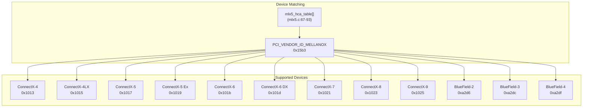

Sources: [providers/mlx5/mlx5.c:67-93](), [providers/mlx5/mlx5.h:58-60]()

## Provider Registration and Initialization

### Operation Table Registration

The provider registers its operations through a static `verbs_context_ops` structure that libibverbs uses to dispatch calls. Two operation tables are defined: common operations and CQE version 1-specific operations.

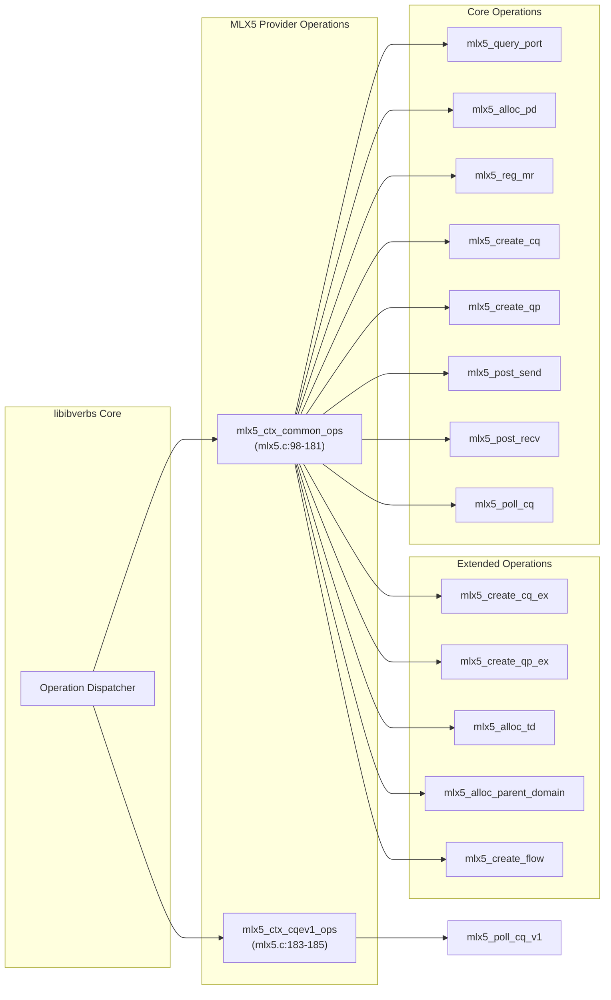

Sources: [providers/mlx5/mlx5.c:98-185]()

### Context Initialization

Device context initialization occurs when an application calls `ibv_open_device()` on an MLX5 device. The provider allocates and initializes a `mlx5_context` structure that maintains all device-specific state.

**Context Initialization Flow**

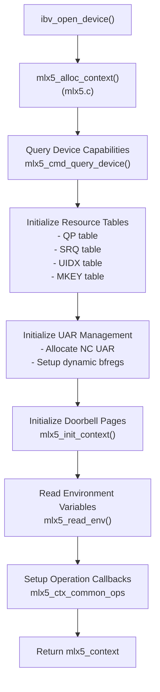

Sources: [providers/mlx5/mlx5.c:564-1193]()

## Core Data Structures

### mlx5_context

The `mlx5_context` structure is the root object for all provider state. It extends `verbs_context` and contains device capabilities, resource tables, UAR management, and configuration settings.

| Field | Type | Purpose |
|-------|------|---------|
| `ibv_ctx` | `struct verbs_context` | Base verbs context |
| `max_num_qps` | `int` | Maximum number of QPs supported |
| `bf_reg_size` | `int` | BlueFlame register size |
| `qp_table` | `struct {...}[MLX5_QP_TABLE_SIZE]` | QP lookup table with 4096 entries per bucket |
| `srq_table` | `struct {...}[MLX5_SRQ_TABLE_SIZE]` | SRQ lookup table |
| `uidx_table` | `struct {...}[MLX5_UIDX_TABLE_SIZE]` | User index table for resources |
| `mkey_table` | `struct {...}[MLX5_MKEY_TABLE_SIZE]` | MKey lookup table |
| `nc_uar` | `struct mlx5_bf *` | Non-cached UAR for doorbells |
| `hca_core_clock` | `void *` | Memory-mapped core clock |
| `vendor_cap_flags` | `uint64_t` | Vendor capability flags |
| `cqe_comp_caps` | `struct mlx5dv_cqe_comp_caps` | CQE compression capabilities |
| `packet_pacing_caps` | `struct mlx5_packet_pacing_caps` | Packet pacing capabilities |

Sources: [providers/mlx5/mlx5.h:316-429]()

### mlx5_qp

The `mlx5_qp` structure represents a Queue Pair and contains send/receive queue buffers, doorbell records, and operation state.

**Queue Pair Structure Hierarchy**

```mermaid
graph TB
    subgraph "mlx5_qp Structure"
        QP["mlx5_qp<br/>(mlx5.h:662-726)"]
        RSC["mlx5_resource rsc<br/>- type: MLX5_RSC_TYPE_QP<br/>- rsn: QP number"]
        VERBS_QP["verbs_qp verbs_qp"]
        DV_QP["mlx5dv_qp_ex dv_qp"]
        BUF["mlx5_buf buf<br/>Combined SQ+RQ buffer"]
        SQ_BUF["mlx5_buf sq_buf<br/>Separate SQ buffer"]
        BF["mlx5_bf *bf<br/>BlueFlame register"]
        SQ["mlx5_wq sq<br/>Send Queue state"]
        RQ["mlx5_wq rq<br/>Receive Queue state"]
        DB["__be32 *db<br/>Doorbell record"]
    end
    
    subgraph "mlx5_wq Structure"
        WQ_WRID["uint64_t *wrid<br/>Work request IDs"]
        WQ_HEAD["unsigned head<br/>Producer index"]
        WQ_TAIL["unsigned tail<br/>Consumer index"]
        WQ_WQE_CNT["unsigned wqe_cnt<br/>Queue capacity"]
        WQ_MAX_POST["unsigned max_post<br/>Max outstanding WRs"]
        WQ_MAX_GS["int max_gs<br/>Max scatter/gather"]
    end
    
    subgraph "mlx5_bf (UAR)"
        BF_REG["void *reg<br/>MMIO register address"]
        BF_UAR["void *uar<br/>UAR base address"]
        BF_LOCK["mlx5_spinlock lock"]
        BF_SIZE["unsigned buf_size<br/>BlueFlame buffer size"]
    end
    
    QP --> RSC
    QP --> VERBS_QP
    QP --> DV_QP
    QP --> BUF
    QP --> SQ_BUF
    QP --> BF
    QP --> SQ
    QP --> RQ
    QP --> DB
    
    SQ --> WQ_WRID
    SQ --> WQ_HEAD
    SQ --> WQ_TAIL
    SQ --> WQ_WQE_CNT
    SQ --> WQ_MAX_POST
    SQ --> WQ_MAX_GS
    
    BF --> BF_REG
    BF --> BF_UAR
    BF --> BF_LOCK
    BF --> BF_SIZE
```

Sources: [providers/mlx5/mlx5.h:662-726](), [providers/mlx5/mlx5.h:590-609](), [providers/mlx5/mlx5.h:616-640]()

### mlx5_cq

The `mlx5_cq` structure represents a Completion Queue and manages completion event processing.

| Field | Type | Purpose |
|-------|------|---------|
| `verbs_cq` | `struct verbs_cq` | Base verbs CQ |
| `buf_a` | `struct mlx5_buf` | Primary CQ buffer |
| `buf_b` | `struct mlx5_buf` | Secondary buffer (for resize) |
| `active_buf` | `struct mlx5_buf *` | Currently active buffer pointer |
| `cons_index` | `uint32_t` | Consumer index |
| `dbrec` | `__be32 *` | Doorbell record (CI and arm) |
| `cqe_sz` | `int` | CQE size (64 or 128 bytes) |
| `lock` | `struct mlx5_spinlock` | CQ lock for thread safety |
| `cqn` | `uint32_t` | CQ number |
| `flags` | `uint32_t` | CQ flags (single-threaded, DV-owned, etc.) |

Sources: [providers/mlx5/mlx5.h:494-522]()

## UAR Management

User Access Regions (UARs) provide direct hardware access for doorbell operations without kernel involvement. The MLX5 provider supports both static and dynamic UAR allocation.

### UAR Types and Allocation

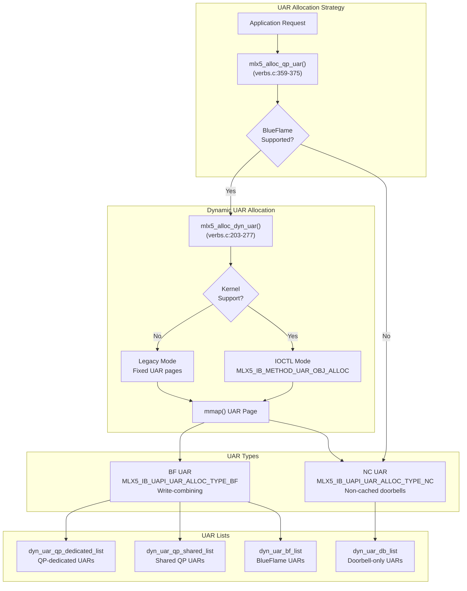

**UAR Structure Organization**

Each UAR is divided into multiple BlueFlame registers (BFREGs). The layout depends on whether it's a BlueFlame or non-cached UAR:

| UAR Type | BFREG Size | BFREGs per UAR | Usage |
|----------|------------|----------------|-------|
| BlueFlame (BF) | `bf_reg_size` (typically 256B) | 2 non-FP BFREGs | Send operations with write-combining |
| Non-Cached (NC) | `MLX5_DB_BLUEFLAME_BUFFER_SIZE` (64B) | 4 DB regions | Doorbell operations only |

Sources: [providers/mlx5/verbs.c:203-277](), [providers/mlx5/verbs.c:359-416](), [providers/mlx5/mlx5.h:616-640]()

### UAR Reference Counting and Sharing

For QPs, the provider implements a two-tier allocation strategy:

1. **Dedicated UARs**: Each QP gets its own UAR (up to `qp_max_dedicated_uuars`)
2. **Shared UARs**: Multiple QPs share a UAR with reference counting (up to `qp_max_shared_uuars`)

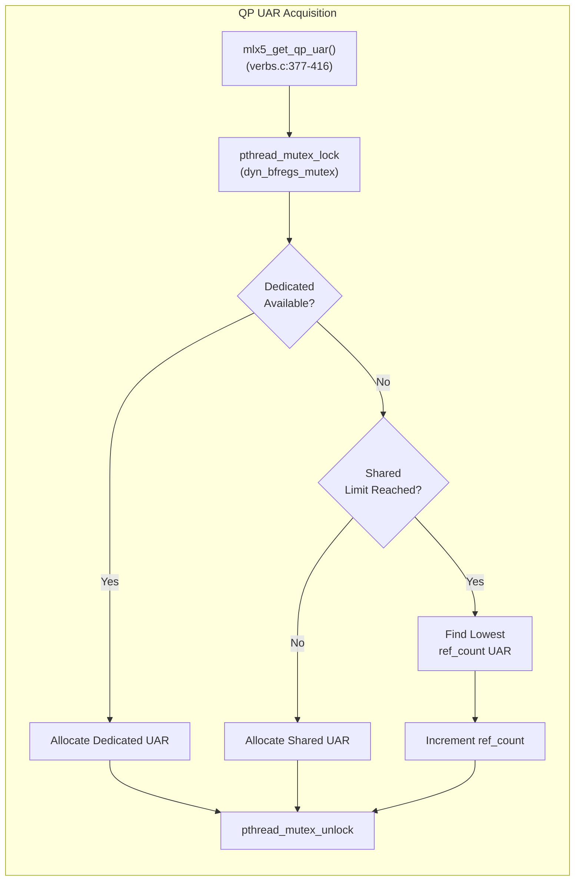

Sources: [providers/mlx5/verbs.c:377-416](), [providers/mlx5/verbs.c:345-357]()

## Protection Domain Management

Protection Domains (PDs) provide memory protection boundaries. The MLX5 provider supports standard PDs, parent domains with custom allocators, and PD import/export.

### Protection Domain Structure

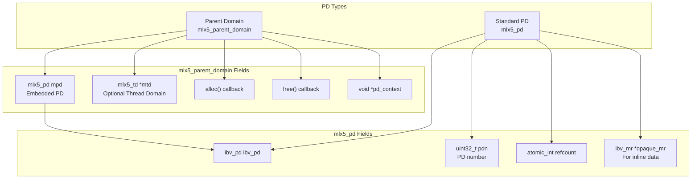

**PD Operations**

| Operation | Function | Description |
|-----------|----------|-------------|
| Allocate | `mlx5_alloc_pd()` | Allocates a standard PD via kernel |
| Allocate Parent | `mlx5_alloc_parent_domain()` | Creates parent domain with custom allocators |
| Free | `mlx5_free_pd()` | Frees PD, checks refcount |
| Import | `mlx5_import_pd()` | Imports PD from handle (cross-process) |
| Unimport | `mlx5_unimport_pd()` | Releases imported PD |

Sources: [providers/mlx5/verbs.c:154-175](), [providers/mlx5/verbs.c:541-585](), [providers/mlx5/verbs.c:601-641](), [providers/mlx5/mlx5.h:456-476]()

## Memory Region Management

Memory registration creates memory keys (MKeys) that allow hardware DMA access. The MLX5 provider supports multiple registration types and configurations.

### Memory Region Types

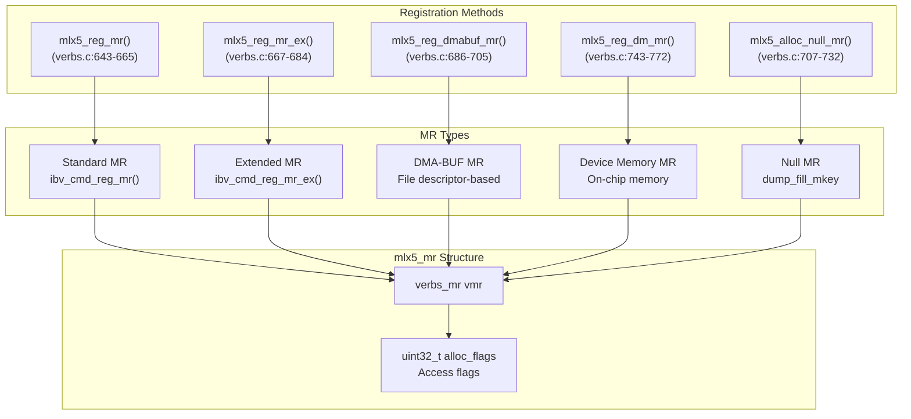

**Access Flags**

Memory regions can be registered with various access permissions:

| Flag | Value | Description |
|------|-------|-------------|
| `IBV_ACCESS_LOCAL_WRITE` | 0x1 | Local write access |
| `IBV_ACCESS_REMOTE_WRITE` | 0x2 | Remote write via RDMA |
| `IBV_ACCESS_REMOTE_READ` | 0x4 | Remote read via RDMA |
| `IBV_ACCESS_REMOTE_ATOMIC` | 0x8 | Remote atomic operations |
| `IBV_ACCESS_MW_BIND` | 0x10 | Can bind memory windows |
| `IBV_ACCESS_ZERO_BASED` | 0x20 | Zero-based addressing |
| `IBV_ACCESS_ON_DEMAND` | 0x40 | On-demand paging |

Sources: [providers/mlx5/verbs.c:643-772](), [providers/mlx5/mlx5.h:651-654]()

## Queue Pair Operations

Queue Pairs are the core data path objects. The MLX5 provider implements comprehensive QP management including creation, modification, and data path operations.

### QP Creation Flow

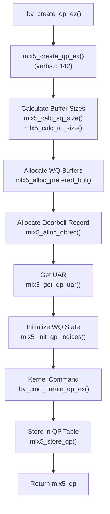

**QP Buffer Layout**

For combined SQ+RQ QPs, the buffer layout is:

```
+------------------+
|   Send Queue     |  Size: align(num_send_wqe * wqe_size)
+------------------+
|   Receive Queue  |  Size: align(num_recv_wqe * wqe_size)
+------------------+
```

For Raw Packet QPs, separate buffers are used for SQ and RQ.

Sources: [providers/mlx5/qp.c:178-185](), [providers/mlx5/verbs.c:142]()

### Send Operation

Send operations populate Work Queue Elements (WQEs) in the send queue and ring the doorbell.

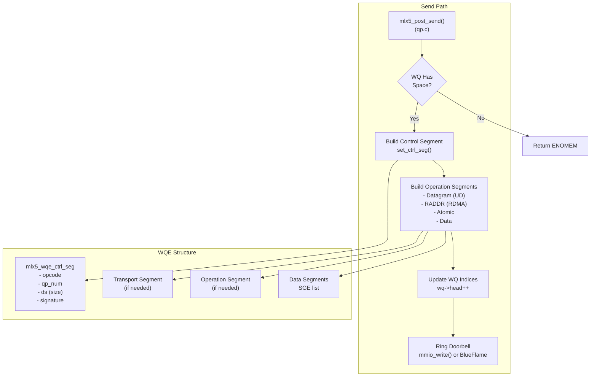

**Doorbell Mechanism**

The doorbell write notifies hardware of new work. Two methods are available:

1. **Non-Cached UAR**: Simple doorbell write to MMIO region
2. **BlueFlame**: Write-combining optimization that copies WQE data directly to UAR

Sources: [providers/mlx5/qp.c:1329-1735](), [providers/mlx5/qp.c:301-312]()

### Receive Operation

Receive operations post receive buffers to the RQ for incoming messages.

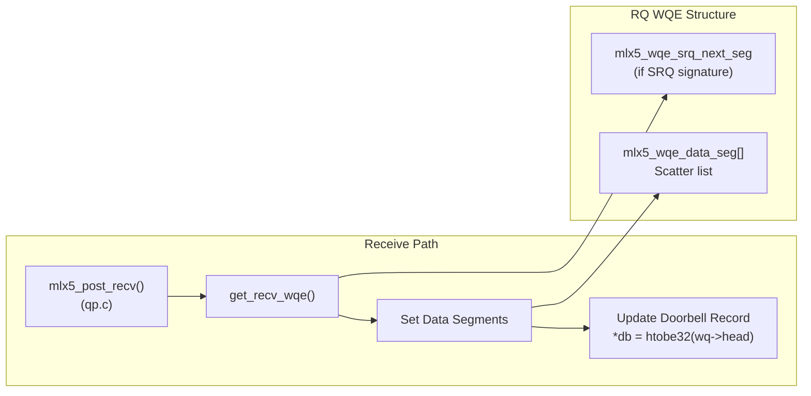

Sources: [providers/mlx5/qp.c:65-68](), [providers/mlx5/qp.c:273-279]()

## Completion Queue Operations

Completion Queues report work completion events. The MLX5 provider implements optimized polling for both standard and extended CQ interfaces.

### CQ Creation

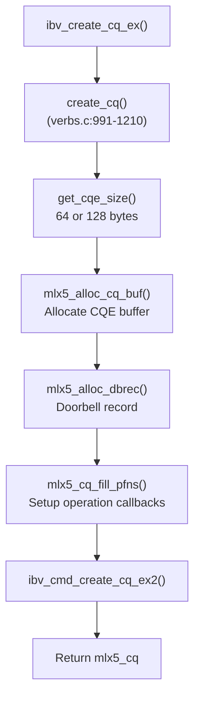

**CQE Size Selection**

CQE size can be 64 or 128 bytes based on:
- `MLX5_CQE_SIZE` environment variable
- `mlx5dv_cq_init_attr.cqe_size` parameter
- Default: 64 bytes

Sources: [providers/mlx5/verbs.c:907-929](), [providers/mlx5/verbs.c:991-1210]()

### CQ Polling

**Poll Operation Flow**

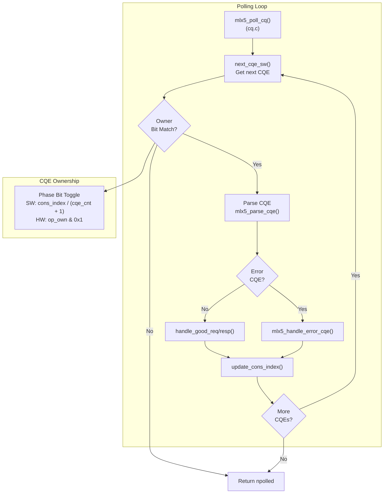

**CQE Structure**

Each CQE (Completion Queue Entry) contains:

| Field | Type | Description |
|-------|------|-------------|
| `byte_cnt` | `__be32` | Byte count of received data |
| `imm_inval_pkey` | `__be32` | Immediate data or invalidate rkey |
| `wqe_counter` | `__be16` | WQE index that completed |
| `signature` | `uint8_t` | Signature for error detection |
| `op_own` | `uint8_t` | Opcode (7:4) and owner (0) |

Sources: [providers/mlx5/cq.c:154-157](), [providers/mlx5/cq.c:577-896]()

## Shared Receive Queue (SRQ)

SRQs allow multiple QPs to share a single receive queue, reducing memory consumption for connection-oriented applications.

### SRQ Buffer Management

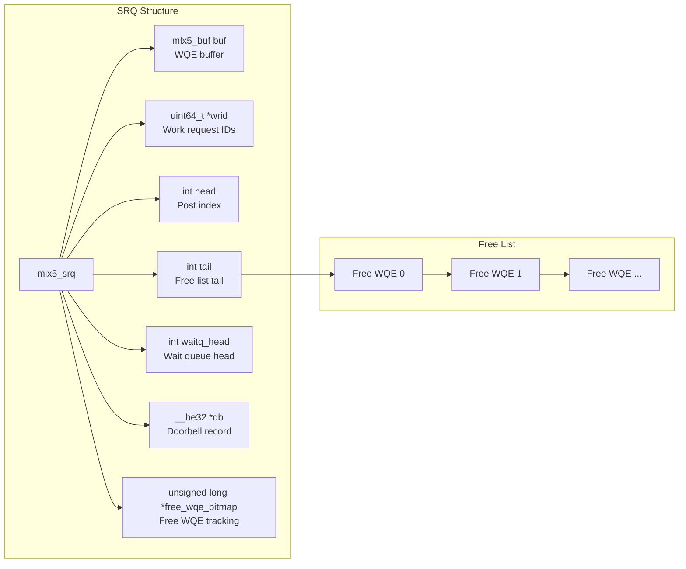

**SRQ Post Receive**

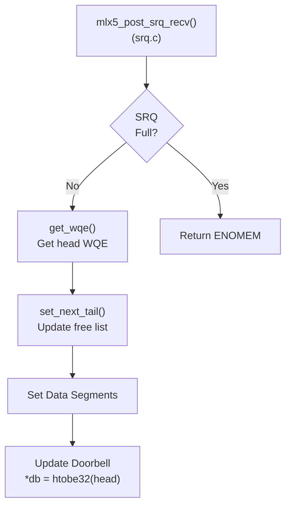

Sources: [providers/mlx5/srq.c:43-90](), [providers/mlx5/mlx5.h:540-572]()

## Direct Verbs (mlx5dv) Extensions

The MLX5 Direct Verbs API provides low-level access to hardware-specific features for performance-critical applications.

### Direct Verbs Object Types

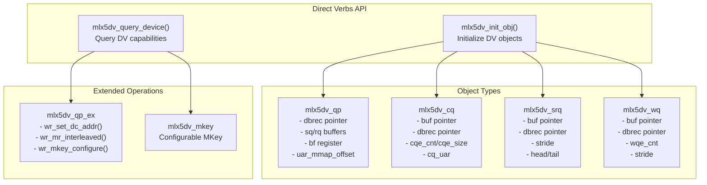

**Key Direct Verbs Features**

| Feature | Description | Header Location |
|---------|-------------|-----------------|
| Direct buffer access | Access to WQE and CQE buffers | [providers/mlx5/mlx5dv.h:228-250]() |
| BlueFlame control | Direct control over write-combining | [providers/mlx5/mlx5dv.h:459-506]() |
| MKey configuration | Advanced memory key operations | [providers/mlx5/mlx5dv.h:300-320]() |
| Flow steering | Packet steering and matching | See [MLX5 Direct Rules Flow Steering](#3.1.1) |
| DevX | Direct device commands | [providers/mlx5/mlx5dv.h:796-824]() |

Sources: [providers/mlx5/mlx5dv.h:228-250](), [providers/mlx5/mlx5dv.h:459-506](), [providers/mlx5/man/mlx5dv_init_obj.3:1-133]()

### DevX Interface

DevX (Device eXtension) allows direct submission of hardware commands, bypassing the kernel verbs layer.

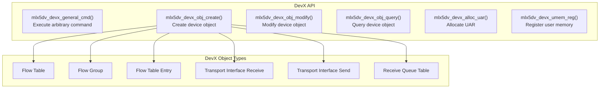

Sources: [providers/mlx5/mlx5dv.h:796-824]()

## Resource Tables and Lookups

The provider maintains hash tables for fast resource lookups in the data path, particularly for CQE processing.

### QP Table Organization

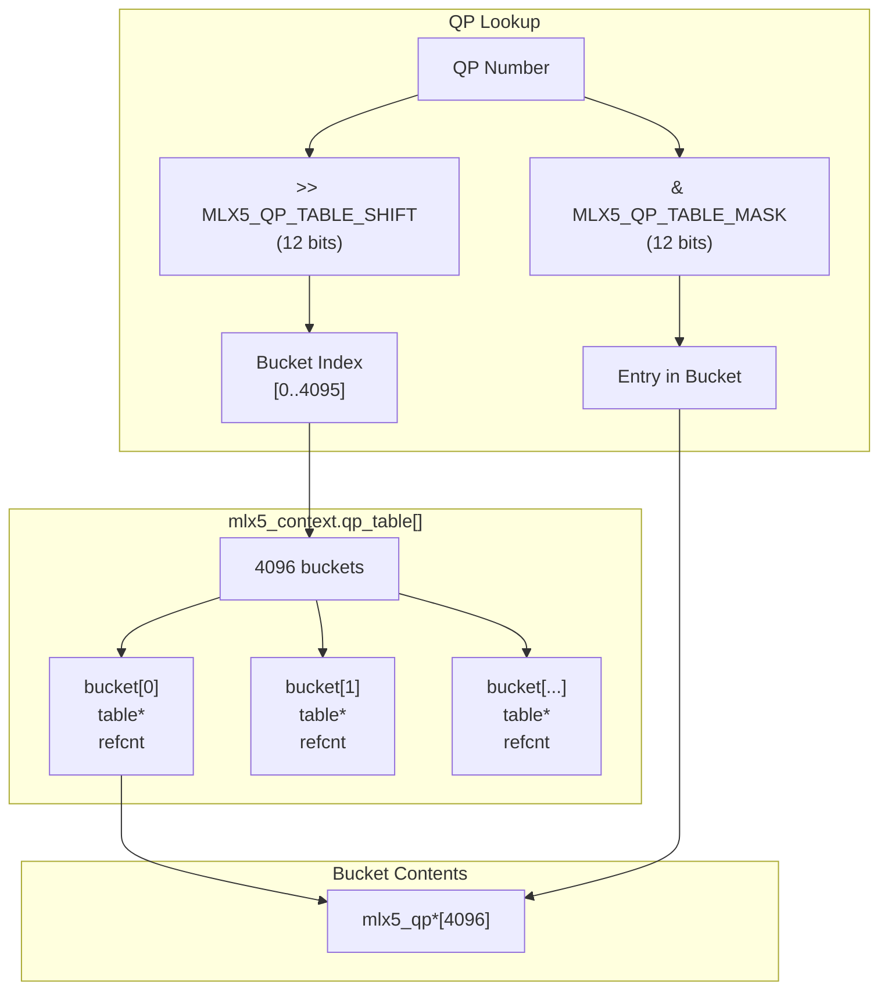

**Resource Table Functions**

| Function | Purpose |
|----------|---------|
| `mlx5_store_qp()` | Store QP in table during creation |
| `mlx5_clear_qp()` | Remove QP from table during destruction |
| `mlx5_find_qp()` | Look up QP by QPN (used in CQE processing) |
| `mlx5_store_uidx()` | Store resource by user index |
| `mlx5_clear_uidx()` | Clear user index entry |

Sources: [providers/mlx5/mlx5.h:318-350](), [providers/mlx5/mlx5.c:209-304]()

## Summary

The MLX5 provider is a comprehensive userspace driver that implements the InfiniBand Verbs API with extensive hardware-specific optimizations. Key architectural components include:

- **Context Management**: Device initialization, capability discovery, and resource table setup in [providers/mlx5/mlx5.c]().
- **UAR Management**: Dynamic allocation and sharing of User Access Regions for efficient doorbell operations in [providers/mlx5/verbs.c:195-453]().
- **Queue Pairs**: Full lifecycle management with optimized send/receive paths in [providers/mlx5/qp.c]().
- **Completion Queues**: Efficient polling with ownership bit checking and inline scatter support in [providers/mlx5/cq.c]().
- **Memory Management**: Multiple registration types with protection domains in [providers/mlx5/verbs.c:643-847]().
- **Direct Verbs**: Low-level hardware access for performance-critical applications in [providers/mlx5/mlx5dv.h]().

The provider supports all ConnectX hardware from ConnectX-4 through ConnectX-9 and BlueField integrated controllers, with the device matching table in [providers/mlx5/mlx5.c:67-93](). For advanced packet processing capabilities, refer to [MLX5 Direct Rules Flow Steering](#3.1.1).

---

