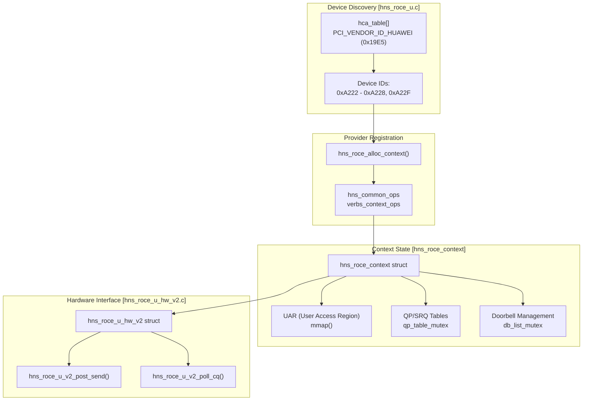
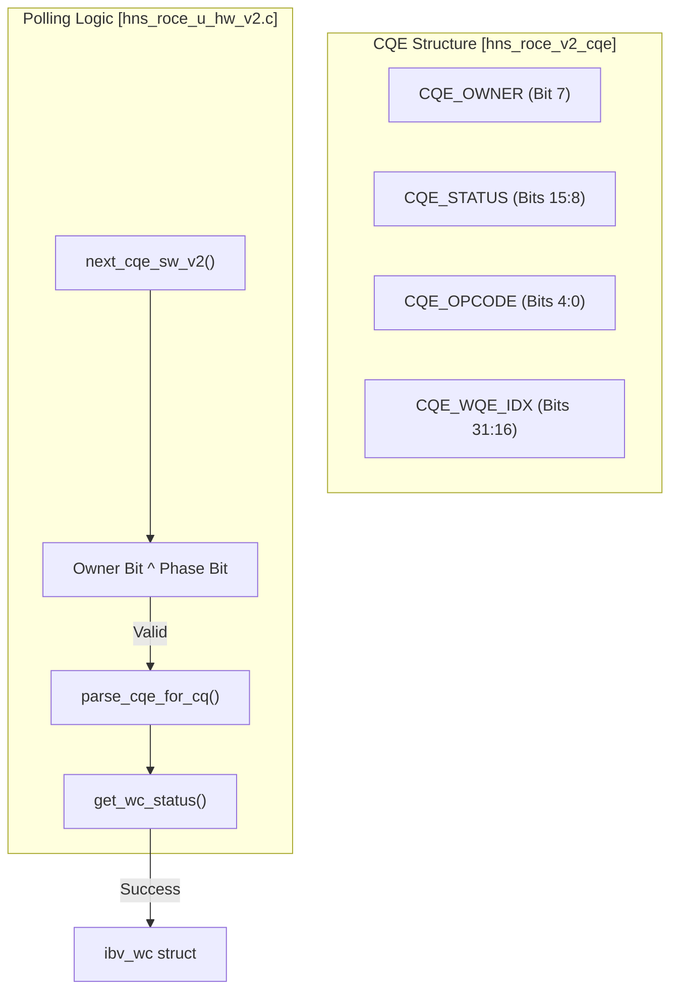
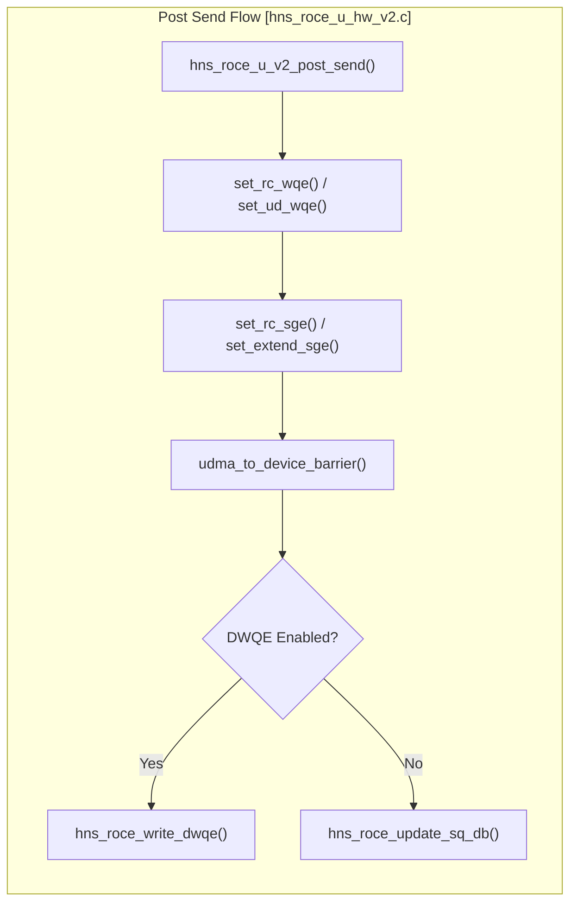

<!-- source: DeepWiki mcp.deepwiki.com · repo linux-rdma/rdma-core · page 3.2 HiSilicon HNS RoCE Provider · fetched 2026-11-11 -->

# HiSilicon HNS RoCE Provider

Relevant source files

The following files were used as context for generating this wiki page:

- [providers/hns/CMakeLists.txt](providers/hns/CMakeLists.txt)
- [providers/hns/hns_roce_u.c](providers/hns/hns_roce_u.c)
- [providers/hns/hns_roce_u.h](providers/hns/hns_roce_u.h)
- [providers/hns/hns_roce_u_abi.h](providers/hns/hns_roce_u_abi.h)
- [providers/hns/hns_roce_u_buf.c](providers/hns/hns_roce_u_buf.c)
- [providers/hns/hns_roce_u_db.c](providers/hns/hns_roce_u_db.c)
- [providers/hns/hns_roce_u_db.h](providers/hns/hns_roce_u_db.h)
- [providers/hns/hns_roce_u_hw_v2.c](providers/hns/hns_roce_u_hw_v2.c)
- [providers/hns/hns_roce_u_hw_v2.h](providers/hns/hns_roce_u_hw_v2.h)
- [providers/hns/hns_roce_u_trace.c](providers/hns/hns_roce_u_trace.c)
- [providers/hns/hns_roce_u_verbs.c](providers/hns/hns_roce_u_verbs.c)
- [providers/hns/hnsdv.h](providers/hns/hnsdv.h)
- [providers/hns/libhns.map](providers/hns/libhns.map)

## Overview

The HiSilicon HNS RoCE Provider is a userspace driver for HiSilicon RoCE (RDMA over Converged Ethernet) network adapters. This provider implements the `libibverbs` interface for HiSilicon hardware, enabling applications to perform kernel-bypass RDMA operations. The provider supports hardware version 2 (`HNS_ROCE_HW_VER2`) and version 3 (`HNS_ROCE_HW_VER3`) chipsets.

For information about the core libibverbs API and provider architecture, see [libibverbs](). For details on other hardware providers, see [RDMA Providers]().

**Key Features:**
- Support for RC (Reliable Connection), UD (Unreliable Datagram), and XRC (Extended Reliable Connection) transports. [providers/hns/hns_roce_u_verbs.c:1337-1485]()
- Direct WQE (Work Queue Entry) support for reduced latency via UAR writes. [providers/hns/hns_roce_u_hw_v2.c:290-302]()
- Inline data support for small messages to reduce memory latency. [providers/hns/hns_roce_u_hw_v2.c:1213-1250]()
- Extended SGE (Scatter-Gather Entry) management for complex memory layouts. [providers/hns/hns_roce_u_hw_v2.c:888-930]()
- Advanced congestion control (DCQCN, LDCP, HC3, DIP) via Direct Verbs extensions. [providers/hns/hnsdv.h:18-23]()

Sources: [providers/hns/hns_roce_u.c:48-91](), [providers/hns/hns_roce_u.h:50-51](), [providers/hns/hnsdv.h:1-59]()

---

## Provider Architecture

### Device Matching and Initialization

The HNS provider uses the standard `libibverbs` provider plugin architecture. Device matching occurs via PCI vendor/device IDs, mapping specific Huawei/HiSilicon hardware to the `hns_roce_u_hw_v2` operations structure.

**Key Data Structures:**

| Structure | Purpose | Location |
|-----------|---------|----------|
| `hns_roce_device` | Provider device instance including HW version. | [providers/hns/hns_roce_u.h:156-162]() |
| `hns_roce_context` | Per-process state (UAR mapping, resource tables). | [providers/hns/hns_roce_u.h:204-236]() |
| `hns_roce_u_hw` | Function pointers for version-specific HW ops. | [providers/hns/hns_roce_u.h:383-386]() |

Sources: [providers/hns/hns_roce_u.c:48-58](), [providers/hns/hns_roce_u.c:189-233](), [providers/hns/hns_roce_u.h:204-236]()

---

## Completion Queue Management

### CQ Structure and Polling

The `hns_roce_cq` structure manages the completion queue buffer and consumer state. The provider supports hardware-toggled ownership bits (`CQE_OWNER`) to determine if a CQE is ready for software processing.

**CQE Fields and Mapping:**
- **Ownership:** The provider uses a phase bit logic where `CQE_OWNER` is compared against the current consumer index cycle to detect new entries. [providers/hns/hns_roce_u_hw_v2.c:189-195]()
- **Status Mapping:** Hardware status codes (e.g., `HNS_ROCE_V2_CQE_LOCAL_LENGTH_ERR`) are mapped to standard verbs statuses (`IBV_WC_LOC_LEN_ERR`) via `get_wc_status()`. [providers/hns/hns_roce_u_hw_v2.c:152-182]()

Sources: [providers/hns/hns_roce_u_hw_v2.h:144-184](), [providers/hns/hns_roce_u_hw_v2.c:184-200]()

---

## Queue Pair and Work Queue Management

### Work Queue Layout

Each QP consists of a Send Queue (SQ) and a Receive Queue (RQ). The provider manages WQE buffers and extended SGE areas to support high-scatter counts.

| Queue Component | Purpose | Size/Shift |
|-----------------|---------|------------|
| SQ WQE | Send/RDMA/Atomic descriptors | `HNS_ROCE_SQWQE_SHIFT` (64B) |
| RQ WQE | Receive descriptors | Defined by `qp->rq.wqe_shift` |
| Extended SGE | SGEs that don't fit in WQE | `HNS_ROCE_SGE_SIZE` (16B) |

Sources: [providers/hns/hns_roce_u.h:68-71](), [providers/hns/hns_roce_u_hw_v2.c:202-215]()

### Post Send and Doorbell Mechanisms

The provider supports two primary methods for notifying hardware of new work:
1. **Standard Doorbell:** A 64-bit write to the UAR using `hns_roce_write64()`. [providers/hns/hns_roce_u_db.h:43-46]()
2. **Direct WQE (DWQE):** For low latency, the hardware can accept a 512-bit (64-byte) write containing the entire WQE directly into the doorbell register. [providers/hns/hns_roce_u_hw_v2.c:290-302]()

Sources: [providers/hns/hns_roce_u_hw_v2.c:1685-1841](), [providers/hns/hns_roce_u_hw_v2.c:309-320]()

---

## Memory and Doorbell Management

### Doorbell Page Allocation

Doorbells for QPs, CQs, and SRQs are managed in a pooled system to minimize memory overhead and context switching.

- **`hns_roce_db_page`**: Represents a physical page mapped for doorbell records. [providers/hns/hns_roce_u.h:191-197]()
- **`hns_roce_alloc_db()`**: Allocates a 4-byte slot from a managed page using a bitmap. [providers/hns/hns_roce_u_db.c:93-123]()

### Buffer Management

The provider uses `mmap` to allocate hardware-visible buffers for queues. These are protected against fork-related memory corruption using `ibv_dontfork_range()`.

Sources: [providers/hns/hns_roce_u_buf.c:39-55](), [providers/hns/hns_roce_u_db.c:47-85]()

---

## HiSilicon Direct Verbs (hnsdv)

The `hnsdv.h` header defines extensions for fine-grained hardware control, specifically for congestion control algorithms.

**Congestion Control Types (`hnsdv_qp_congest_ctrl_type`):**
- `HNSDV_QP_CREATE_ENABLE_DCQCN`: Data Center Quantized Congestion Notification.
- `HNSDV_QP_CREATE_ENABLE_LDCP`: Low Delay Congestion Protocol.
- `HNSDV_QP_CREATE_ENABLE_HC3`: HiSilicon Congestion Control v3.
- `HNSDV_QP_CREATE_ENABLE_DIP`: Dynamic IP-based congestion control.

**Key Functions:**
- `hnsdv_is_supported()`: Validates if the device supports HNS extensions. [providers/hns/hns_roce_u_verbs.c:1535-1543]()
- `hnsdv_create_qp()`: Creates a QP with specific congestion control attributes. [providers/hns/hns_roce_u_verbs.c:1545-1564]()

Sources: [providers/hns/hnsdv.h:18-53](), [providers/hns/hns_roce_u_verbs.c:1535-1564]()

---

