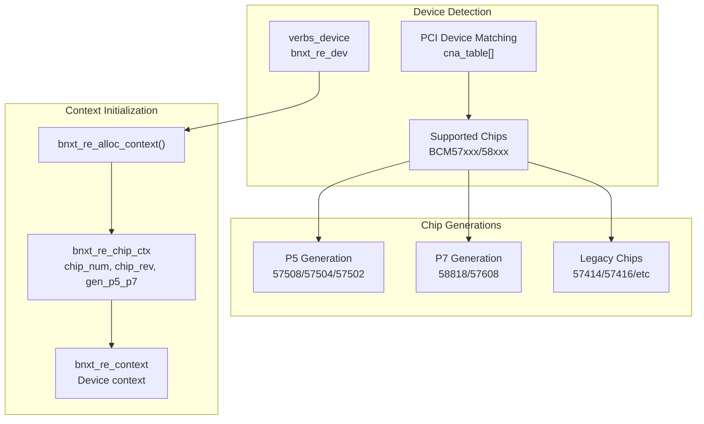
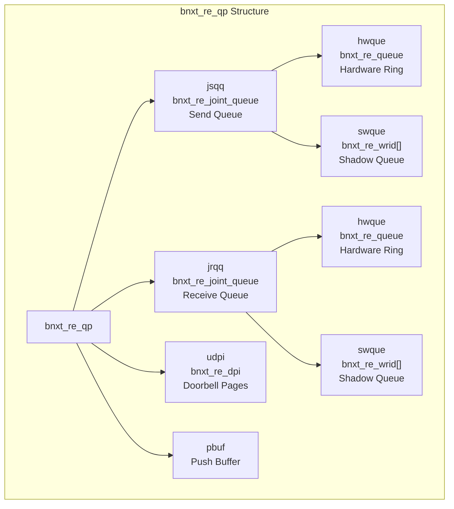
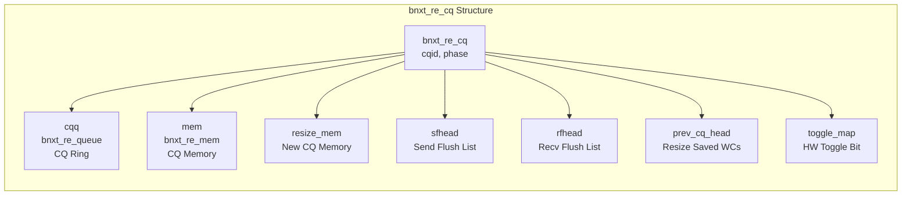
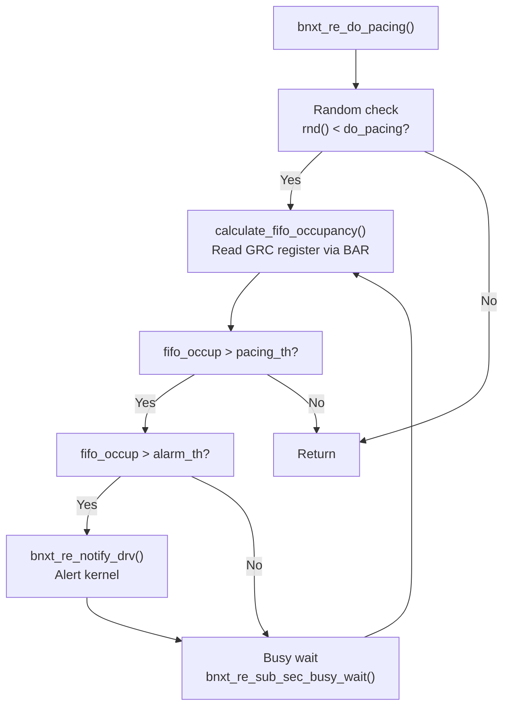
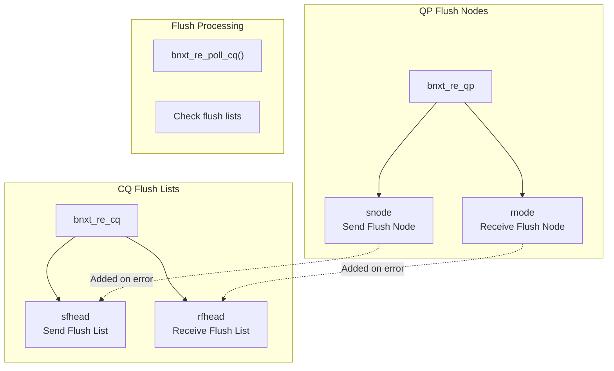

<!-- source: DeepWiki mcp.deepwiki.com · repo linux-rdma/rdma-core · page 3.3 Broadcom NetXtreme-E RoCE Provider · fetched 2026-11-11 -->

# Broadcom NetXtreme-E RoCE Provider

<details>
<summary>Relevant source files</summary>

The following files were used as context for generating this wiki page:

- [providers/bnxt_re/CMakeLists.txt](providers/bnxt_re/CMakeLists.txt)
- [providers/bnxt_re/bnxt_re-abi.h](providers/bnxt_re/bnxt_re-abi.h)
- [providers/bnxt_re/db.c](providers/bnxt_re/db.c)
- [providers/bnxt_re/flush.h](providers/bnxt_re/flush.h)
- [providers/bnxt_re/main.c](providers/bnxt_re/main.c)
- [providers/bnxt_re/main.h](providers/bnxt_re/main.h)
- [providers/bnxt_re/memory.c](providers/bnxt_re/memory.c)
- [providers/bnxt_re/memory.h](providers/bnxt_re/memory.h)
- [providers/bnxt_re/verbs.c](providers/bnxt_re/verbs.c)
- [providers/bnxt_re/verbs.h](providers/bnxt_re/verbs.h)

</details>


This document describes the Broadcom NetXtreme-E RoCE provider (`bnxt_re`), which implements userspace RoCE (RDMA over Converged Ethernet) support for Broadcom NetXtreme-E network adapters. This provider is a plugin for libibverbs and provides the hardware-specific implementation of the RDMA verbs API for Broadcom hardware.

For information about the core libibverbs API and provider plugin architecture, see [2.1](). For other hardware providers, see [3.1]() (Mellanox MLX5), [3.2]() (HiSilicon HNS), [3.4]() (Amazon EFA), and [3.5]() (Other Providers).

## Provider Overview

The `bnxt_re` provider supports several generations of Broadcom NetXtreme adapters including BCM57XXX and BCM58XXX series devices across P5, P7, and earlier chip generations. The provider implements optimizations such as push buffers for low-latency work submission, doorbell FIFO pacing to prevent hardware overrun, CQ resizing for dynamic resource management, and MSN (Message Sequence Number) tables for enhanced packet tracking.

Sources: [providers/bnxt_re/main.c:1-325](), [providers/bnxt_re/main.h:1-640]()

### Provider Device Matching



**Diagram: Device Detection and Context Initialization Flow**

Sources: [providers/bnxt_re/main.c:55-92](), [providers/bnxt_re/main.c:185-270]()

## Context Initialization and Device Setup

The provider initializes device context through `bnxt_re_alloc_context()`, which queries device capabilities, detects chip generation, maps doorbell pages, and sets up device-specific features.

### Context Structure

The `bnxt_re_context` structure maintains per-device state:

- **Device information**: Device ID, chip context (`cctx`), maximum QP/SRQ counts. [providers/bnxt_re/main.h:259-264]()
- **Doorbell pages**: Regular doorbell page (`udpi.dbpage`) and write-combining doorbell page (`udpi.wcdbpg`) for push operations. [providers/bnxt_re/main.h:80-85]()
- **Shared page**: Memory-mapped page for communication with kernel driver (`shpg`). [providers/bnxt_re/main.h:266]()
- **Push buffer support**: Array of push buffers for optimized work posting (`pbrec`). [providers/bnxt_re/main.h:269]()
- **WQE mode**: Static or variable WQE (Work Queue Element) sizing. [providers/bnxt_re/main.h:267]()
- **Feature flags**: Tracked in `comp_mask` including WC DPI enabled, doorbell pacing, and MSN table support. [providers/bnxt_re/main.h:263]()

Sources: [providers/bnxt_re/main.h:257-274](), [providers/bnxt_re/main.c:185-270]()

### Chip Detection and Generation Identification

The provider detects chip generation to enable generation-specific features:

```c
// P5 chips: 57508, 57504, 57502
static bool bnxt_re_is_chip_gen_p5(struct bnxt_re_chip_ctx *cctx)

// P7 chips: 58818, 57608  
static inline bool bnxt_re_is_chip_gen_p7(struct bnxt_re_chip_ctx *cctx)

// Combined check
static inline bool bnxt_re_is_chip_gen_p5_p7(struct bnxt_re_chip_ctx *cctx)
```

The chip context structure `bnxt_re_chip_ctx` stores chip number, revision, and generation flags used throughout the provider for conditional feature enablement. [providers/bnxt_re/main.h:72-78]()

Sources: [providers/bnxt_re/main.c:128-145](), [providers/bnxt_re/main.h:72-78]()

### Doorbell Page Mapping

During context initialization, the provider maps doorbell pages for queue operations:

1. **Regular doorbell page**: Mapped via `bnxt_re_map_db_page()` when the first PD is allocated. [providers/bnxt_re/verbs.c:104-116]()
2. **Write-combining doorbell page**: Mapped via `bnxt_re_alloc_map_push_page()` if WC DPI is enabled. [providers/bnxt_re/verbs.c:184-202]()
3. **Doorbell pacing pages**: Additional pages are mapped for FIFO monitoring (`dbr_page`) and BAR access (`bar_map`). [providers/bnxt_re/main.c:147-183]()

Sources: [providers/bnxt_re/verbs.c:104-116](), [providers/bnxt_re/verbs.c:184-202](), [providers/bnxt_re/main.c:147-183]()

## Queue Pair Management

Queue pairs are the primary data transfer mechanism, consisting of a send queue (SQ) and receive queue (RQ).

### Queue Pair Structure



**Diagram: Queue Pair Structure Layout**

Sources: [providers/bnxt_re/main.h:207-236](), [providers/bnxt_re/main.h:181-187]()

### Work Queue Entry Modes

The provider supports two WQE modes:

- **Static WQE Mode** (`BNXT_RE_WQE_MODE_STATIC`): Fixed-size WQEs.
- **Variable WQE Mode** (`BNXT_RE_WQE_MODE_VARIABLE`): Dynamic WQE sizing based on actual SGE count. [providers/bnxt_re/verbs.h:71-75]()

The mode is selected during context initialization based on device capabilities and stored in `cntx->wqe_mode`. [providers/bnxt_re/main.c:202]()

Sources: [providers/bnxt_re/verbs.h:71-75](), [providers/bnxt_re/main.c:202]()

## Completion Queue Management

### Completion Queue Structure



**Diagram: Completion Queue Structure**

Sources: [providers/bnxt_re/main.h:92-112]()

### CQ Polling

The `bnxt_re_poll_cq()` function retrieves work completions by checking the phase bit of CQEs in the ring. [providers/bnxt_re/verbs.c:58-59]()

Key aspects of CQ polling:
- **Phase bit validation**: Each CQE has a phase bit that toggles each time the CQ wraps. [providers/bnxt_re/main.h:104]()
- **CQE types**: SEND, RECV_RC, RECV_UD, TERM, and COFF (cutoff for resize). [providers/bnxt_re/bnxt_re-abi.h:88-95]()
- **Flush lists**: When a QP enters an error state, completions are generated from flush lists. [providers/bnxt_re/main.h:100-101]()

Sources: [providers/bnxt_re/verbs.c:58-59](), [providers/bnxt_re/bnxt_re-abi.h:88-95](), [providers/bnxt_re/main.h:92-112]()

## Doorbell Mechanisms

### Standard Doorbell Operation

Standard doorbells notify the hardware of new work. Each doorbell encodes an index, queue ID, and type. [providers/bnxt_re/db.c:108-115]()

Standard doorbell functions:
- `bnxt_re_ring_sq_db()`: Ring send queue doorbell. [providers/bnxt_re/db.c:132-144]()
- `bnxt_re_ring_rq_db()`: Ring receive queue doorbell. [providers/bnxt_re/db.c:117-130]()
- `bnxt_re_ring_cq_db()`: Ring completion queue doorbell. [providers/bnxt_re/db.c:192-202]()

Sources: [providers/bnxt_re/db.c:108-202](), [providers/bnxt_re/bnxt_re-abi.h:133-147]()

### Doorbell Pacing

To prevent FIFO overrun, the provider implements doorbell pacing via `bnxt_re_do_pacing()`:



**Diagram: Doorbell Pacing Algorithm**

Sources: [providers/bnxt_re/db.c:50-95](), [providers/bnxt_re/main.h:275-283]()

### Push Buffer Optimization

For low-latency applications, the provider supports push buffers that combine WQE write and doorbell into a single write-combining operation. [providers/bnxt_re/main.h:114-123]()

Sources: [providers/bnxt_re/main.h:114-139](), [providers/bnxt_re/db.c:225-360]()

## Memory Management

The provider uses a custom memory allocator via `bnxt_re_mem` structure for queue memory. [providers/bnxt_re/memory.h:46-53]()

Memory is allocated via `bnxt_re_alloc_mem()` which:
- Allocates page-aligned memory using `mmap()` with `MAP_ANONYMOUS`. [providers/bnxt_re/memory.c:67-68]()
- Applies `ibv_dontfork_range()` to prevent copy-on-write issues. [providers/bnxt_re/memory.c:72]()
- Allows bidirectional allocation via `bnxt_re_get_obj()` (from tail) and `bnxt_re_get_ring()` (from head). [providers/bnxt_re/memory.c:86-106]()

Sources: [providers/bnxt_re/memory.h:46-53](), [providers/bnxt_re/memory.c:47-106]()

## Error Handling and Flush Queues

When a QP transitions to an error state, the provider manages flush completions through flush queues. [providers/bnxt_re/flush.h:39-85]()



**Diagram: Flush Queue Architecture**

Sources: [providers/bnxt_re/main.h:220-221](), [providers/bnxt_re/flush.h:39-85]()

## Provider Operations Table

The provider registers its operations through `bnxt_re_cntx_ops`. [providers/bnxt_re/main.c:94-127]()

| Operation | Function | Description |
|-----------|----------|-------------|
| `query_device_ex` | `bnxt_re_query_device` | Query device attributes |
| `alloc_pd` | `bnxt_re_alloc_pd` | Allocate protection domain |
| `reg_mr` | `bnxt_re_reg_mr` | Register memory region |
| `create_cq` | `bnxt_re_create_cq` | Create completion queue |
| `poll_cq` | `bnxt_re_poll_cq` | Poll completion queue |
| `resize_cq` | `bnxt_re_resize_cq` | Resize completion queue |
| `create_qp` | `bnxt_re_create_qp` | Create queue pair |
| `post_send` | `bnxt_re_post_send` | Post send work request |
| `post_recv` | `bnxt_re_post_recv` | Post receive work request |

Sources: [providers/bnxt_re/main.c:94-127]()

---

