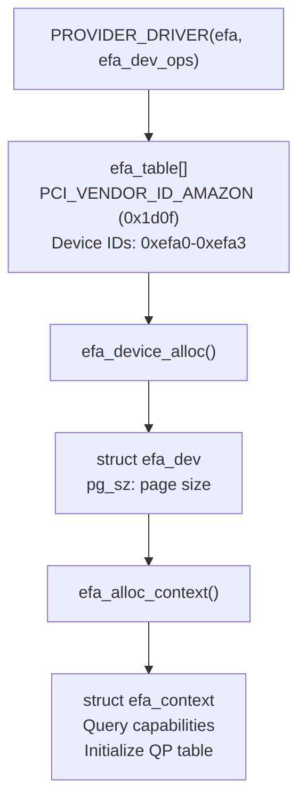
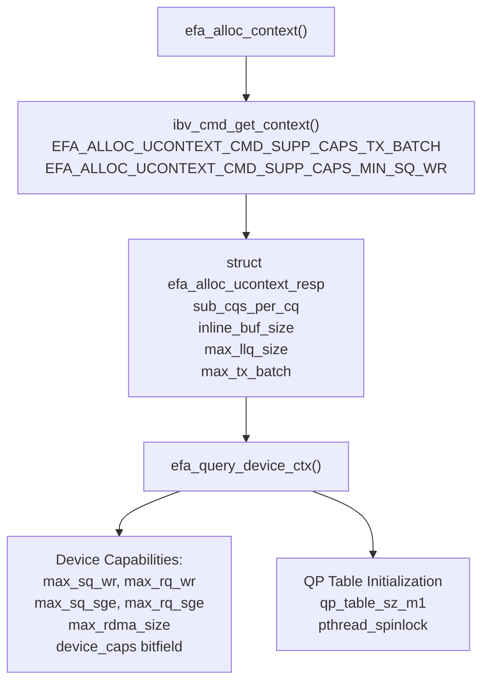
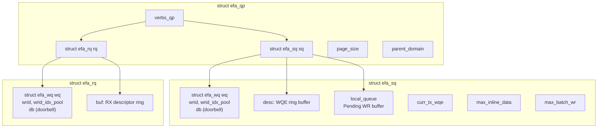
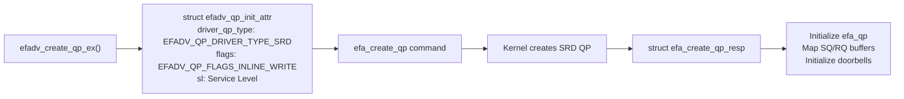
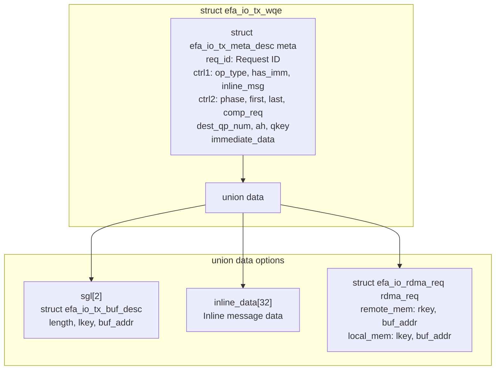
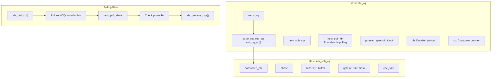

<!-- source: DeepWiki mcp.deepwiki.com · repo linux-rdma/rdma-core · page 3.4 Amazon EFA Provider · fetched 2026-11-11 -->

# Amazon EFA Provider

<details>
<summary>Relevant source files</summary>

The following files were used as context for generating this wiki page:

- [providers/efa/CMakeLists.txt](providers/efa/CMakeLists.txt)
- [providers/efa/efa-abi.h](providers/efa/efa-abi.h)
- [providers/efa/efa.c](providers/efa/efa.c)
- [providers/efa/efa.h](providers/efa/efa.h)
- [providers/efa/efa_io_defs.h](providers/efa/efa_io_defs.h)
- [providers/efa/efa_io_regs_defs.h](providers/efa/efa_io_regs_defs.h)
- [providers/efa/efadv.h](providers/efa/efadv.h)
- [providers/efa/libefa.map](providers/efa/libefa.map)
- [providers/efa/man/CMakeLists.txt](providers/efa/man/CMakeLists.txt)
- [providers/efa/man/efadv_create_cq.3.md](providers/efa/man/efadv_create_cq.3.md)
- [providers/efa/man/efadv_create_qp_ex.3.md](providers/efa/man/efadv_create_qp_ex.3.md)
- [providers/efa/man/efadv_get_rq_max_depth.3.md](providers/efa/man/efadv_get_rq_max_depth.3.md)
- [providers/efa/man/efadv_get_sq_max_depth.3.md](providers/efa/man/efadv_get_sq_max_depth.3.md)
- [providers/efa/man/efadv_query_cq.3.md](providers/efa/man/efadv_query_cq.3.md)
- [providers/efa/man/efadv_query_device.3.md](providers/efa/man/efadv_query_device.3.md)
- [providers/efa/man/efadv_query_mr.3.md](providers/efa/man/efadv_query_mr.3.md)
- [providers/efa/man/efadv_query_qp_wqs.3.md](providers/efa/man/efadv_query_qp_wqs.3.md)
- [providers/efa/verbs.c](providers/efa/verbs.c)
- [providers/efa/verbs.h](providers/efa/verbs.h)
- [pyverbs/providers/efa/efa_enums.pxd](pyverbs/providers/efa/efa_enums.pxd)
- [pyverbs/providers/efa/efadv.pxd](pyverbs/providers/efa/efadv.pxd)
- [pyverbs/providers/efa/efadv.pyx](pyverbs/providers/efa/efadv.pyx)
- [pyverbs/providers/efa/libefa.pxd](pyverbs/providers/efa/libefa.pxd)

</details>


## Purpose and Scope

This document describes the Amazon Elastic Fabric Adapter (EFA) userspace provider implementation. EFA is AWS's custom network interface designed for high-performance computing and machine learning workloads, supporting the Scalable Reliable Datagram (SRD) transport protocol. This page covers the provider's architecture, core verbs implementation, completion queue sub-CQ design, memory management, and EFA-specific Direct Verbs extensions.

For information about provider plugin architecture in general, see [RDMA Providers](#3). For the MLX5 provider (the most feature-rich provider), see [Mellanox MLX5 Provider](#3.1).

## Provider Registration and Device Matching

The EFA provider registers with the libibverbs plugin system and matches Amazon hardware devices by PCI vendor/device IDs.

**Provider Registration Flow**



Sources: [providers/efa/efa.c:18-27](), [providers/efa/efa.c:125-136](), [providers/efa/efa.c:59-113](), [providers/efa/efa.c:161-161]()

The provider uses `VERBS_DRIVER_ID(RDMA_DRIVER_EFA)` and `VERBS_PCI_MATCH` macros to register device matching criteria. Amazon's PCI vendor ID is `0x1d0f`, with device IDs ranging from `0xefa0` to `0xefa3`.

| Component | Description |
|-----------|-------------|
| `efa_dev_ops` | Provider operation table registered via `PROVIDER_DRIVER` macro |
| `efa_table[]` | Device matching table with PCI vendor/device IDs |
| `efa_device_alloc()` | Allocates `struct efa_dev` with system page size |
| `efa_alloc_context()` | Allocates and initializes `struct efa_context` |

Sources: [providers/efa/efa.c:145-153](), [providers/efa/efa.c:18-27]()

## Context Initialization and Device Capabilities

**Context Structure and Initialization**



Sources: [providers/efa/efa.c:59-113](), [providers/efa/verbs.c:105-147]()

The `struct efa_context` contains device-specific parameters and capabilities:

```c
struct efa_context {
	struct verbs_context ibvctx;
	uint32_t cmds_supp_udata_mask;
	uint16_t sub_cqs_per_cq;
	uint16_t inline_buf_size;
	uint16_t inline_buf_size_ex;
	uint32_t max_llq_size;
	uint32_t device_caps;
	uint32_t max_sq_wr;
	uint32_t max_rq_wr;
	uint16_t max_sq_sge;
	uint16_t max_rq_sge;
	uint32_t max_rdma_size;
	struct efa_qp **qp_table;
	unsigned int qp_table_sz_m1;
	pthread_spinlock_t qp_table_lock;
};
```

Sources: [providers/efa/efa.h:29-50]()

Device capabilities are queried through `efadv_query_device()` and stored in the `device_caps` bitfield:

| Capability Flag | Description |
|----------------|-------------|
| `EFADV_DEVICE_ATTR_CAPS_RDMA_READ` | RDMA read operations supported |
| `EFADV_DEVICE_ATTR_CAPS_RDMA_WRITE` | RDMA write operations supported |
| `EFADV_DEVICE_ATTR_CAPS_RNR_RETRY` | RNR retry for SRD QPs |
| `EFADV_DEVICE_ATTR_CAPS_CQ_WITH_SGID` | Source GID in completion descriptors |
| `EFADV_DEVICE_ATTR_CAPS_UNSOLICITED_WRITE_RECV` | Unsolicited RDMA write with immediate |
| `EFADV_DEVICE_ATTR_CAPS_CQ_WITH_EXT_MEM_DMABUF` | External CQ memory via dmabuf |

Sources: [providers/efa/efadv.h:19-26](), [providers/efa/verbs.c:149-201]()

## Queue Pair Architecture

### Scalable Reliable Datagram (SRD) Transport

The key differentiator of EFA is the SRD transport protocol, which provides reliable out-of-order delivery with transparent multi-path routing to reduce tail latency.

**SRD Queue Pair Structure**



Sources: [providers/efa/efa.h:173-182](), [providers/efa/efa.h:152-171](), [providers/efa/efa.h:131-135]()

The `struct efa_wq` contains common work queue state for both send and receive queues:

```c
struct efa_wq {
	uint64_t *wrid;
	uint32_t *wrid_idx_pool;
	uint32_t wqe_cnt;
	uint32_t wqe_posted;
	uint32_t wqe_completed;
	uint16_t pc; /* Producer counter */
	uint16_t desc_mask;
	uint16_t wrid_idx_pool_next;
	int max_sge;
	int phase;
	pthread_spinlock_t wqlock;
	bool need_lock;
	uint32_t *db;
	uint16_t sub_cq_idx;
};
```

Sources: [providers/efa/efa.h:107-129]()

### QP Creation and SRD-Specific Parameters



Sources: [providers/efa/efadv.h:85-101](), [providers/efa/efa-abi.h:116-146]()

SRD QPs are created using `efadv_create_qp_ex()` or `efadv_create_driver_qp()` with `EFADV_QP_DRIVER_TYPE_SRD`. Key features include:

- **Out-of-order completion**: The `wrid_idx_pool` mechanism handles out-of-order TX completions by maintaining a pool of free indices.
- **Multi-path routing**: Transparently handled by hardware.
- **Unsolicited RDMA write**: With `EFADV_QP_FLAGS_UNSOLICITED_WRITE_RECV`, RQ doesn't consume WRs for RDMA write with immediate.
- **Batched submission**: `max_batch_wr` limits the number of WRs submitted in a single doorbell ring.

Sources: [providers/efa/efadv.h:76-83](), [providers/efa/efa.h:109-113](), [providers/efa/efa.h:159-160]()

### Work Queue Entry (WQE) Structure

**Hardware TX WQE Layout**



Sources: [providers/efa/efa_io_defs.h:185-198](), [providers/efa/efa_io_defs.h:68-123]()

The TX metadata descriptor contains control flags:

- `op_type`: `EFA_IO_SEND`, `EFA_IO_RDMA_READ`, or `EFA_IO_RDMA_WRITE`.
- `inline_msg`: Indicates inline data follows (up to 32 or 80 bytes).
- `has_imm`: Immediate data is present.
- `phase`: Producer/consumer phase bit for wrap-around detection.
- `comp_req`: Completion requested flag.

Sources: [providers/efa/efa_io_defs.h:22-29](), [providers/efa/efa_io_defs.h:84-99]()

## Completion Queue Architecture

### Sub-CQ Design

EFA uses a unique sub-CQ architecture where each CQ consists of multiple sub-CQs for improved scalability.

**Sub-CQ Structure and Polling**



Sources: [providers/efa/efa.h:84-105](), [providers/efa/efa.h:75-82]()

The sub-CQ architecture provides:

1. **Fairness**: Round-robin polling via `next_poll_idx` ensures no sub-CQ is starved.
2. **Scalability**: Multiple sub-CQs reduce contention in multi-QP scenarios.
3. **Phase-based wrap**: Each sub-CQ uses a phase bit that toggles on wrap-around.

Sources: [providers/efa/efa.h:96-98](), [providers/efa/efa.h:77-77]()

### Completion Descriptor Processing

Status mapping converts hardware completion status to IBV status codes:

| Hardware Status | IBV Status |
|----------------|-----------|
| `EFA_IO_COMP_STATUS_OK` | `IBV_WC_SUCCESS` |
| `EFA_IO_COMP_STATUS_FLUSHED` | `IBV_WC_WR_FLUSH_ERR` |
| `EFA_IO_COMP_STATUS_LOCAL_ERROR_INVALID_LKEY` | `IBV_WC_LOC_PROT_ERR` |
| `EFA_IO_COMP_STATUS_REMOTE_ERROR_RNR` | `IBV_WC_RNR_RETRY_EXC_ERR` |
| `EFA_IO_COMP_STATUS_REMOTE_ERROR_BAD_ADDRESS` | `IBV_WC_REM_ACCESS_ERR` |

Sources: [providers/efa/efa_io_defs.h:31-66]()

## Memory Registration and Query

### DMA-BUF Memory Registration

EFA supports registering memory from external DMA buffers for GPU-direct scenarios:

```c
struct ibv_mr *efa_reg_dmabuf_mr(struct ibv_pd *pd, uint64_t offset,
				 size_t length, uint64_t iova, int fd, int acc);
```

Sources: [providers/efa/verbs.h:22-23]()

### Memory Region Query (Interconnect ID)

The `efadv_query_mr()` function returns interconnect IDs that identify the physical path to memory:

```c
struct efadv_mr_attr {
	uint64_t comp_mask;
	uint16_t ic_id_validity;
	uint16_t recv_ic_id;
	uint16_t rdma_read_ic_id;
	uint16_t rdma_recv_ic_id;
};
```

Sources: [providers/efa/efadv.h:178-184]()

The interconnect IDs indicate which physical interconnect the device uses to reach the memory region for different operation types (receive, RDMA read, RDMA write receive).

## Direct Verbs Extensions (efadv)

### Extended CQ Creation with External Memory

EFA supports creating CQs with external memory buffers, such as dmabuf:

```c
struct efadv_cq_init_attr {
	uint64_t comp_mask;
	uint64_t wc_flags;
	uint64_t flags;
	struct {
		uint8_t *buffer;
		uint64_t length;
		uint64_t offset;
		int32_t fd;
		uint8_t reserved[4];
	} ext_mem_dmabuf;
};
```

Sources: [providers/efa/efadv.h:131-142]()

### QP and Work Queue Query

The `efadv_query_qp_wqs()` function exposes work queue buffers and doorbells for direct access:

```c
struct efadv_wq_attr {
	uint64_t comp_mask;
	uint8_t *buffer;
	uint32_t entry_size;
	uint32_t num_entries;
	uint32_t *doorbell;
	uint32_t max_batch;
	uint8_t reserved[4];
};
```

Sources: [providers/efa/efadv.h:103-111]()

## Hardware Interface

### Doorbell Mechanism

EFA uses memory-mapped doorbells for low-latency work submission and CQ arming. The CQ doorbell contains a consumer index, a command sequence number, and an arm bit.

Sources: [providers/efa/efa.h:92-93](), [providers/efa/efa.h:127-127]()

### Work Request Posting Flow

**Send Path**

1. **Batching**: WRs are accumulated in a local queue before being flushed to the hardware descriptor ring.
2. **Out-of-order completion**: The `wrid_idx_pool` mechanism allows hardware to complete TXs out of order.
3. **Phase bits**: Used for producer/consumer synchronization.
4. **Inline optimization**: Small messages can be copied directly into the WQE (`inline_data`).

Sources: [providers/efa/efa.h:163-170](), [providers/efa/efa.h:109-113](), [providers/efa/efa_io_defs.h:193-193]()

## Verbs Operations Table

The provider implements the following standard verbs operations:

| Operation | Implementation Function |
|-----------|------------------------|
| Query Device | `efa_query_device_ex()` |
| Query Port | `efa_query_port()` |
| Alloc PD | `efa_alloc_pd()` |
| Reg MR | `efa_reg_mr()` / `efa_reg_dmabuf_mr()` |
| Create CQ | `efa_create_cq()` / `efa_create_cq_ex()` |
| Poll CQ | `efa_poll_cq()` |
| Create QP | `efa_create_qp()` / `efa_create_qp_ex()` |
| Post Send | `efa_post_send()` |
| Post Recv | `efa_post_recv()` |
| Create AH | `efa_create_ah()` |

Sources: [providers/efa/efa.c:29-57]()

---

