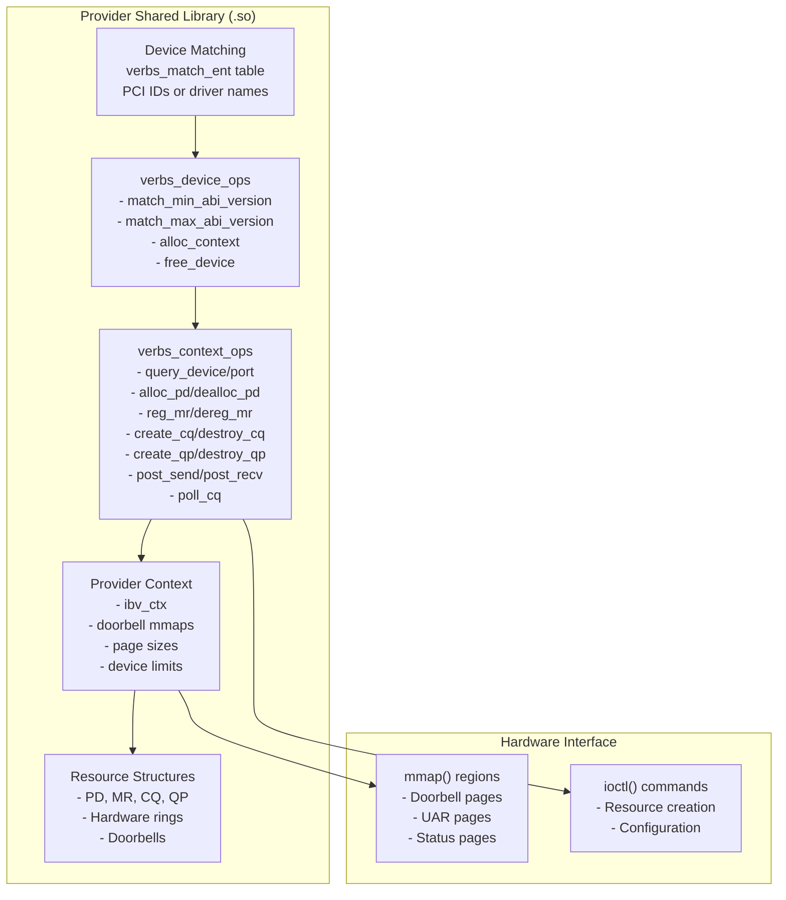
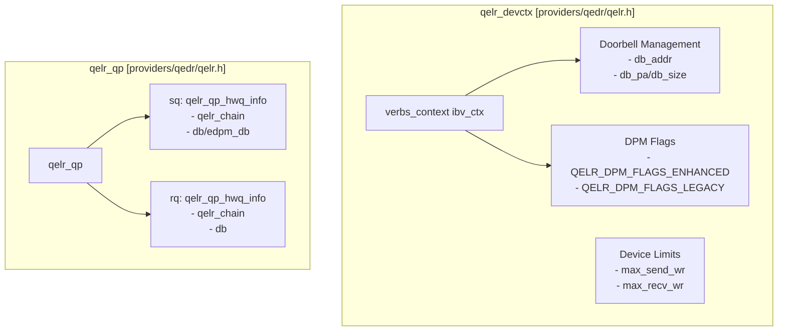
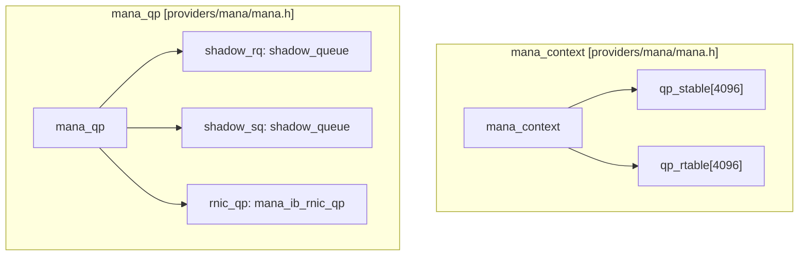

<!-- source: DeepWiki mcp.deepwiki.com · repo linux-rdma/rdma-core · page 3.5 Other Hardware Providers · fetched 2026-11-11 -->

# Other Hardware Providers

Relevant source files

The following files were used as context for generating this wiki page:

- [Documentation/rxe.md](Documentation/rxe.md)
- [providers/cxgb4/cq.c](providers/cxgb4/cq.c)
- [providers/cxgb4/cxgb4-abi.h](providers/cxgb4/cxgb4-abi.h)
- [providers/cxgb4/dev.c](providers/cxgb4/dev.c)
- [providers/cxgb4/libcxgb4.h](providers/cxgb4/libcxgb4.h)
- [providers/cxgb4/qp.c](providers/cxgb4/qp.c)
- [providers/cxgb4/t4.h](providers/cxgb4/t4.h)
- [providers/cxgb4/t4_regs.h](providers/cxgb4/t4_regs.h)
- [providers/cxgb4/t4fw_api.h](providers/cxgb4/t4fw_api.h)
- [providers/cxgb4/t4fw_ri_api.h](providers/cxgb4/t4fw_ri_api.h)
- [providers/cxgb4/verbs.c](providers/cxgb4/verbs.c)
- [providers/erdma/erdma_db.c](providers/erdma/erdma_db.c)
- [providers/erdma/erdma_db.h](providers/erdma/erdma_db.h)
- [providers/erdma/erdma_hw.h](providers/erdma/erdma_hw.h)
- [providers/erdma/erdma_verbs.c](providers/erdma/erdma_verbs.c)
- [providers/erdma/erdma_verbs.h](providers/erdma/erdma_verbs.h)
- [providers/hfi1verbs/hfiverbs.c](providers/hfi1verbs/hfiverbs.c)
- [providers/hfi1verbs/hfiverbs.h](providers/hfi1verbs/hfiverbs.h)
- [providers/hfi1verbs/verbs.c](providers/hfi1verbs/verbs.c)
- [providers/ipathverbs/ipathverbs.c](providers/ipathverbs/ipathverbs.c)
- [providers/ipathverbs/ipathverbs.h](providers/ipathverbs/ipathverbs.h)
- [providers/ipathverbs/verbs.c](providers/ipathverbs/verbs.c)
- [providers/irdma/CMakeLists.txt](providers/irdma/CMakeLists.txt)
- [providers/irdma/abi.h](providers/irdma/abi.h)
- [providers/irdma/defs.h](providers/irdma/defs.h)
- [providers/irdma/i40e_devids.h](providers/irdma/i40e_devids.h)
- [providers/irdma/i40iw_hw.h](providers/irdma/i40iw_hw.h)
- [providers/irdma/ice_devids.h](providers/irdma/ice_devids.h)
- [providers/irdma/irdma.h](providers/irdma/irdma.h)
- [providers/irdma/osdep.h](providers/irdma/osdep.h)
- [providers/irdma/uk.c](providers/irdma/uk.c)
- [providers/irdma/umain.c](providers/irdma/umain.c)
- [providers/irdma/umain.h](providers/irdma/umain.h)
- [providers/irdma/user.h](providers/irdma/user.h)
- [providers/irdma/uverbs.c](providers/irdma/uverbs.c)
- [providers/mana/CMakeLists.txt](providers/mana/CMakeLists.txt)
- [providers/mana/cq.c](providers/mana/cq.c)
- [providers/mana/doorbells.h](providers/mana/doorbells.h)
- [providers/mana/gdma.h](providers/mana/gdma.h)
- [providers/mana/mana.c](providers/mana/mana.c)
- [providers/mana/mana.h](providers/mana/mana.h)
- [providers/mana/manadv.c](providers/mana/manadv.c)
- [providers/mana/qp.c](providers/mana/qp.c)
- [providers/mana/rollback.h](providers/mana/rollback.h)
- [providers/mana/shadow_queue.h](providers/mana/shadow_queue.h)
- [providers/mana/wq.c](providers/mana/wq.c)
- [providers/mana/wr.c](providers/mana/wr.c)
- [providers/mlx4/buf.c](providers/mlx4/buf.c)
- [providers/mlx4/cq.c](providers/mlx4/cq.c)
- [providers/mlx4/dbrec.c](providers/mlx4/dbrec.c)
- [providers/mlx4/libmlx4.map](providers/mlx4/libmlx4.map)
- [providers/mlx4/man/CMakeLists.txt](providers/mlx4/man/CMakeLists.txt)
- [providers/mlx4/man/mlx4dv.7](providers/mlx4/man/mlx4dv.7)
- [providers/mlx4/man/mlx4dv_init_obj.3](providers/mlx4/man/mlx4dv_init_obj.3)
- [providers/mlx4/man/mlx4dv_query_device.3](providers/mlx4/man/mlx4dv_query_device.3)
- [providers/mlx4/man/mlx4dv_set_context_attr.3.md](providers/mlx4/man/mlx4dv_set_context_attr.3.md)
- [providers/mlx4/mlx4-abi.h](providers/mlx4/mlx4-abi.h)
- [providers/mlx4/mlx4.c](providers/mlx4/mlx4.c)
- [providers/mlx4/mlx4.h](providers/mlx4/mlx4.h)
- [providers/mlx4/mlx4dv.h](providers/mlx4/mlx4dv.h)
- [providers/mlx4/qp.c](providers/mlx4/qp.c)
- [providers/mlx4/srq.c](providers/mlx4/srq.c)
- [providers/mlx4/verbs.c](providers/mlx4/verbs.c)
- [providers/mthca/cq.c](providers/mthca/cq.c)
- [providers/mthca/doorbell.h](providers/mthca/doorbell.h)
- [providers/mthca/memfree.c](providers/mthca/memfree.c)
- [providers/mthca/mthca.c](providers/mthca/mthca.c)
- [providers/mthca/mthca.h](providers/mthca/mthca.h)
- [providers/mthca/qp.c](providers/mthca/qp.c)
- [providers/mthca/srq.c](providers/mthca/srq.c)
- [providers/mthca/verbs.c](providers/mthca/verbs.c)
- [providers/mthca/wqe.h](providers/mthca/wqe.h)
- [providers/ocrdma/ocrdma_abi.h](providers/ocrdma/ocrdma_abi.h)
- [providers/ocrdma/ocrdma_main.c](providers/ocrdma/ocrdma_main.c)
- [providers/ocrdma/ocrdma_main.h](providers/ocrdma/ocrdma_main.h)
- [providers/ocrdma/ocrdma_verbs.c](providers/ocrdma/ocrdma_verbs.c)
- [providers/qedr/common_hsi.h](providers/qedr/common_hsi.h)
- [providers/qedr/qelr.h](providers/qedr/qelr.h)
- [providers/qedr/qelr_abi.h](providers/qedr/qelr_abi.h)
- [providers/qedr/qelr_chain.c](providers/qedr/qelr_chain.c)
- [providers/qedr/qelr_chain.h](providers/qedr/qelr_chain.h)
- [providers/qedr/qelr_hsi.h](providers/qedr/qelr_hsi.h)
- [providers/qedr/qelr_hsi_rdma.h](providers/qedr/qelr_hsi_rdma.h)
- [providers/qedr/qelr_main.c](providers/qedr/qelr_main.c)
- [providers/qedr/qelr_verbs.c](providers/qedr/qelr_verbs.c)
- [providers/qedr/qelr_verbs.h](providers/qedr/qelr_verbs.h)
- [providers/qedr/rdma_common.h](providers/qedr/rdma_common.h)
- [providers/qedr/roce_common.h](providers/qedr/roce_common.h)
- [providers/rxe/CMakeLists.txt](providers/rxe/CMakeLists.txt)
- [providers/rxe/man/CMakeLists.txt](providers/rxe/man/CMakeLists.txt)
- [providers/rxe/man/rxe.7](providers/rxe/man/rxe.7)
- [providers/rxe/rxe-abi.h](providers/rxe/rxe-abi.h)
- [providers/rxe/rxe.c](providers/rxe/rxe.c)
- [providers/rxe/rxe.h](providers/rxe/rxe.h)
- [providers/rxe/rxe_queue.h](providers/rxe/rxe_queue.h)
- [providers/rxe/rxe_trace.c](providers/rxe/rxe_trace.c)
- [providers/vmw_pvrdma/CMakeLists.txt](providers/vmw_pvrdma/CMakeLists.txt)
- [providers/vmw_pvrdma/cq.c](providers/vmw_pvrdma/cq.c)
- [providers/vmw_pvrdma/pvrdma-abi.h](providers/vmw_pvrdma/pvrdma-abi.h)
- [providers/vmw_pvrdma/pvrdma.h](providers/vmw_pvrdma/pvrdma.h)
- [providers/vmw_pvrdma/pvrdma_main.c](providers/vmw_pvrdma/pvrdma_main.c)
- [providers/vmw_pvrdma/pvrdma_ring.h](providers/vmw_pvrdma/pvrdma_ring.h)
- [providers/vmw_pvrdma/qp.c](providers/vmw_pvrdma/qp.c)
- [providers/vmw_pvrdma/verbs.c](providers/vmw_pvrdma/verbs.c)

## Purpose and Scope

This page documents the additional hardware provider implementations in rdma-core beyond the major providers (MLX5, HNS, BNXT, EFA). These providers implement userspace drivers for various RDMA-capable hardware from multiple vendors, including cloud-specific adapters (MANA, ERDMA), software-based implementations (RXE, SIW), and legacy hardware (MTHCA, MLX4). Each provider is a dynamically loadable shared library that implements the libibverbs API for its specific hardware.

---

## Provider Architecture Overview

All RDMA providers in rdma-core follow a common plugin architecture pattern. Each provider implements device matching, context allocation, and verbs operations.

### Common Provider Components

**Sources:** [providers/qedr/qelr_main.c:69-111](), [providers/cxgb4/dev.c:77-99](), [providers/mlx4/mlx4.c:86-136]()

---

## QLogic Ethernet RDMA (qedr)

The `qedr` provider supports QLogic FastLinQ QL4xxxx series adapters for RoCE and iWARP.

### Device Support and Context

The `qelr` provider uses a comprehensive context structure with protocol-specific features:

**Key features:**
- **DPM (Direct Packet Mode)**: Supports enhanced and legacy DPM for optimized packet transmission [providers/qedr/qelr.h:67-71]().
- **Queue Management**: Uses a `qelr_chain` structure for queue management [providers/qedr/qelr.h:115-116]().
- **Protocol Detection**: Supports both RoCE and iWARP, detected via `IS_ROCE()` and `IS_IWARP()` macros [providers/qedr/qelr.h:60-61]().

**Sources:** [providers/qedr/qelr.h:75-96](), [providers/qedr/qelr.h:223-254](), [providers/qedr/qelr_main.c:128-220]()

---

## Microsoft Azure MANA

The `mana` provider supports the Microsoft Azure Network Adapter, optimized for high-performance networking in cloud environments.

### Resource Management

MANA utilizes "Shadow Queues" and specialized GDMA (Generic DMA) structures to manage hardware interactions.

**Implementation Details:**
- **QP Management**: Uses a global QP table in the context to track send and receive queues [providers/mana/mana.h:87-95]().
- **Doorbell**: Fast-path operations use `gdma_ring_cq_doorbell` to notify hardware [providers/mana/cq.c:231]().
- **Error Handling**: Maintains separate error lists for send and receive queues in the CQ structure [providers/mana/mana.h:186-187]().

**Sources:** [providers/mana/mana.h:126-147](), [providers/mana/qp.c:251-260](), [providers/mana/cq.c:124-183]()

---

## Intel Ethernet RDMA (irdma)

The `irdma` provider supports Intel Ethernet adapters (X722, E810) for both iWARP and RoCE.

**Key Implementation Features:**
- **Memory Registration**: Supports standard memory registration (`irdma_ureg_mr`) and dmabuf-based registration (`irdma_ureg_mr_dmabuf`) [providers/irdma/uverbs.c:128-174]().
- **Memory Windows**: Implements Type 1 Memory Windows via `irdma_ualloc_mw` and `irdma_ubind_mw` [providers/irdma/uverbs.c:219-279]().
- **Hardware Buffers**: Utilizes `irdma_calloc_hw_buf_sz` for aligned hardware buffer allocations [providers/irdma/uverbs.c:297-299]().

**Sources:** [providers/irdma/uverbs.c:39-295]()

---

## Software RDMA Providers

### Soft-RoCE (rxe)

The `rxe` provider implements RoCE in software over standard Ethernet interfaces.

**Implementation Flow:**
1. **Context**: Allocates a context via `rxe_alloc_context` and initializes device matching [providers/rxe/rxe.c:62-66]().
2. **Polling**: Implements `cq_start_poll` and `cq_next_poll` to process completions from a software-managed queue [providers/rxe/rxe.c:238-275]().
3. **Queue Management**: Uses `rxe_queue_buf` to manage the producer/consumer indices for software rings [providers/rxe/rxe.c:264-270]().

**Sources:** [providers/rxe/rxe.c:60-275]()

### Soft-iWARP (siw)

The `siw` provider implements iWARP in software using the kernel TCP/IP stack. It provides a userspace verbs interface that communicates with the `siw` kernel module.

---

## Legacy Hardware Providers

### Mellanox ConnectX-3 (mlx4)

The `mlx4` provider supports legacy Mellanox ConnectX-3 adapters.

**Key Structures:**
- **Context**: `mlx4_context` tracks the QP table, doorbell pages (UAR), and blueflame (BF) buffers [providers/mlx4/mlx4.h:102-142]().
- **QP Table**: Uses a fixed-size table `qp_table[MLX4_QP_TABLE_SIZE]` for resource tracking [providers/mlx4/mlx4.h:113-116]().
- **CQ**: Tracks consumer indices and doorbell addresses (`set_ci_db`, `arm_db`) [providers/mlx4/mlx4.h:161-175]().

**Sources:** [providers/mlx4/mlx4.c:86-136](), [providers/mlx4/mlx4.h:102-232]()

### Mellanox MTHCA (mthca)

The `mthca` provider supports the original Mellanox InfiniBand HCAs (Tavor, Arbel, Sinai). It implements the `mthca_ctx_ops` for legacy device management.

**Sources:** [providers/mthca/mthca.c:49-71]()

---

## Chelsio iWARP (cxgb4)

The `cxgb4` provider implements iWARP for Chelsio T4/T5/T6 adapters.

**Implementation Details:**
- **Status Page**: Maps a kernel-provided status page into userspace to track device state [providers/cxgb4/dev.c:136-141]().
- **Chip Versioning**: Detects T4, T5, or T6 versions to set specific operation tables (`c4iw_ctx_t4_ops`) [providers/cxgb4/dev.c:181-193]().
- **Resource Tracking**: Maintains `qpid2ptr` and `cqid2ptr` maps for fast lookup of userspace resource pointers from hardware IDs [providers/cxgb4/dev.c:164-175]().

**Sources:** [providers/cxgb4/dev.c:77-193]()

---

## Summary Table of Other Providers

| Provider | Hardware Vendor | Protocol | Implementation Type |
| :--- | :--- | :--- | :--- |
| `qedr` | QLogic/Marvell | RoCE/iWARP | Hardware |
| `irdma` | Intel | RoCE/iWARP | Hardware |
| `cxgb4` | Chelsio | iWARP | Hardware |
| `mana` | Microsoft | RoCE | Cloud/Hardware |
| `erdma` | Alibaba | iWARP | Cloud/Hardware |
| `rxe` | Software | RoCE | Software |
| `siw` | Software | iWARP | Software |
| `mlx4` | Mellanox | RoCE/IB | Legacy Hardware |
| `mthca` | Mellanox | IB | Legacy Hardware |
| `ocrdma` | Emulex/Broadcom | RoCE | Hardware |
| `vmw_pvrdma` | VMware | RoCE | Paravirtual |

**Sources:** [providers/qedr/qelr_main.c:69-84](), [providers/cxgb4/dev.c:53-64](), [providers/rxe/rxe.c:62-66](), [providers/mlx4/mlx4.c:53-84]()

---

