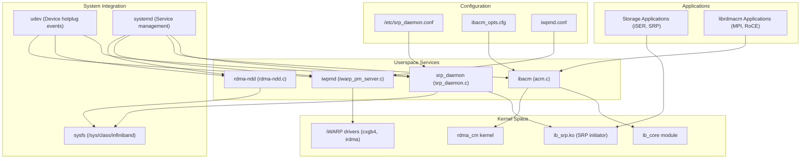
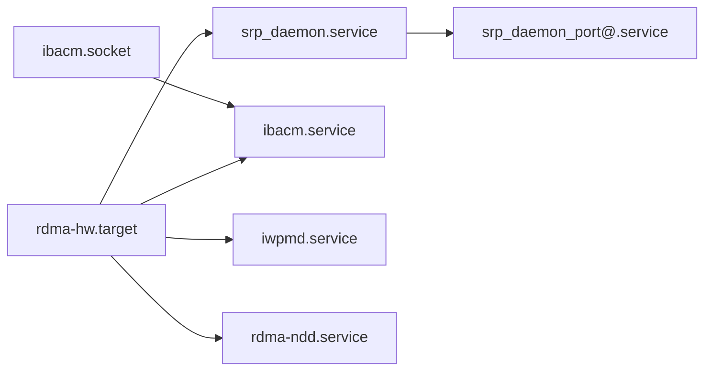

<!-- source: DeepWiki mcp.deepwiki.com · repo linux-rdma/rdma-core · page 4 Service Daemons · fetched 2026-11-11 -->

# Service Daemons

Relevant source files

The following files were used as context for generating this wiki page:

- [ibacm/ibacm.socket](ibacm/ibacm.socket)
- [ibacm/include/infiniband/acm_prov.h](ibacm/include/infiniband/acm_prov.h)
- [ibacm/linux/osd.h](ibacm/linux/osd.h)
- [ibacm/prov/acmp/src/acmp.c](ibacm/prov/acmp/src/acmp.c)
- [ibacm/src/acm.c](ibacm/src/acm.c)
- [ibacm/src/acm_util.c](ibacm/src/acm_util.c)
- [ibacm/src/acm_util.h](ibacm/src/acm_util.h)
- [ibacm/src/acme.c](ibacm/src/acme.c)
- [ibacm/src/libacm.c](ibacm/src/libacm.c)
- [ibacm/src/libacm.h](ibacm/src/libacm.h)
- [ibacm/src/parse.c](ibacm/src/parse.c)
- [iwpmd/CMakeLists.txt](iwpmd/CMakeLists.txt)
- [iwpmd/iwarp_pm.h](iwpmd/iwarp_pm.h)
- [iwpmd/iwarp_pm_common.c](iwpmd/iwarp_pm_common.c)
- [iwpmd/iwarp_pm_helper.c](iwpmd/iwarp_pm_helper.c)
- [iwpmd/iwarp_pm_server.c](iwpmd/iwarp_pm_server.c)
- [iwpmd/iwpmd.8.in](iwpmd/iwpmd.8.in)
- [iwpmd/iwpmd.conf.5.in](iwpmd/iwpmd.conf.5.in)
- [iwpmd/iwpmd.service.in](iwpmd/iwpmd.service.in)
- [rdma-ndd/CMakeLists.txt](rdma-ndd/CMakeLists.txt)
- [rdma-ndd/rdma-ndd.8.in](rdma-ndd/rdma-ndd.8.in)
- [rdma-ndd/rdma-ndd.8.in.rst](rdma-ndd/rdma-ndd.8.in.rst)
- [rdma-ndd/rdma-ndd.c](rdma-ndd/rdma-ndd.c)
- [rdma-ndd/rdma-ndd.rules](rdma-ndd/rdma-ndd.rules)
- [rdma-ndd/rdma-ndd.service.in](rdma-ndd/rdma-ndd.service.in)
- [srp_daemon/srp_daemon.c](srp_daemon/srp_daemon.c)
- [srp_daemon/srp_daemon.h](srp_daemon/srp_daemon.h)
- [srp_daemon/srp_handle_traps.c](srp_daemon/srp_handle_traps.c)
- [srp_daemon/srp_ib_types.h](srp_daemon/srp_ib_types.h)
- [srp_daemon/srp_sync.c](srp_daemon/srp_sync.c)
- [srp_daemon/srpd.in](srp_daemon/srpd.in)

This page provides an overview of the userspace service daemons that support RDMA operations, including their roles in device management, connection management, and storage protocols. These daemons run as system services and provide auxiliary functionality for RDMA subsystem operation.

**Detailed daemon documentation:**
- For comprehensive SRP daemon documentation, see [SRP Daemon (srp_daemon)](#4.1)
- For other service daemons (ibacm, iwpmd, rdma-ndd), see [Other Service Daemons](#4.2)

**Related documentation:**
- For core RDMA libraries, see [Core Libraries](#2)
- For hardware provider implementations, see [RDMA Providers](#3)

## Overview of Service Daemons

The rdma-core package provides four primary service daemons that handle different aspects of RDMA system management:

| Service | Purpose | Protocol/Hardware | Systemd Units |
|---------|---------|-------------------|---------------|
| `srp_daemon` | Discovers and connects to SCSI RDMA Protocol targets | InfiniBand | `srp_daemon.service`, `srp_daemon_port@.service` |
| `ibacm` | Caches address resolution and path records | InfiniBand | `ibacm.service`, `ibacm.socket` |
| `iwpmd` | Maps TCP ports for iWARP devices | iWARP | `iwpmd.service` |
| `rdma-ndd` | Updates node descriptions on hostname/device changes | All RDMA | `rdma-ndd.service` |

**Sources:** [srp_daemon/srp_daemon.c:2-5](), [ibacm/src/acm.c:213-226](), [iwpmd/iwarp_pm_server.c:41-50](), [rdma-ndd/rdma-ndd.c:1-20]()

## Service Architecture and Data Flow

**Sources:** [srp_daemon/srp_daemon.c:86-88](), [ibacm/src/acm.c:215-217](), [iwpmd/iwarp_pm_server.c:206-210](), [rdma-ndd/rdma-ndd.c:1-20]()

## System Integration Points

### Systemd Service Management

All service daemons integrate with systemd for lifecycle management.

**Sources:** [ibacm/ibacm.socket:1-10](), [rdma-ndd/rdma-ndd.service.in:1-15](), [iwpmd/iwpmd.service.in:1-15]()

### Udev Rules Integration

Service daemons respond to device hotplug events through udev rules:

| Rule File | Triggers | Action |
|-----------|----------|--------|
| `rdma-ndd.rules` | RDMA device add/change | Updates node description |
| `60-srp_daemon.rules` | InfiniBand device add | Start `srp_daemon_port@` instances |
| `90-iwpmd.rules` | iWARP device add | Start `iwpmd.service` |

**Sources:** [rdma-ndd/rdma-ndd.rules:1-5](), [srp_daemon/srp_daemon.c:130-152]()

### Configuration File Locations

| Daemon | Configuration File | Default Path |
|--------|-------------------|--------------|
| `ibacm` | `ibacm_opts.cfg` | `/etc/rdma/ibacm_opts.cfg` |
| `ibacm` | `ibacm_addr.cfg` | `/etc/rdma/ibacm_addr.cfg` |
| `iwpmd` | `iwpmd.conf` | `/etc/iwpmd.conf` |
| `srp_daemon` | `srp_daemon.conf` | `/etc/srp_daemon.conf` |

**Sources:** [ibacm/linux/osd.h:50-51](), [ibacm/src/acm.c:216-217](), [iwpmd/iwarp_pm_common.c:63-85](), [srp_daemon/srp_daemon.c:232]()

## Service Architecture Details

### ibacm (InfiniBand ACM)
The `ibacm` daemon provides address and route resolution services. It maintains a cache of Path Records to reduce the load on the Subnet Administrator (SA). It supports a provider architecture where `ibacmp` is the default InfiniBand provider.

- **Primary Entities:** `acmc_device` [ibacm/src/acm.c:118-124](), `acmc_port` [ibacm/src/acm.c:95-116](), `acmc_ep` [ibacm/src/acm.c:132-142]().
- **Socket Interface:** Listens on port `6125` by default [ibacm/src/acm.c:222]().

### iwpmd (iWARP Port Mapper)
The `iwpmd` daemon provides a userspace service for iWARP devices to map TCP ports to RDMA identifiers, enabling connection establishment across different network namespaces.

- **Socket Management:** Handles `pmv4_sock` and `pmv6_sock` [iwpmd/iwarp_pm_server.c:50]().
- **Netlink Interface:** Uses `NETLINK_RDMA` for kernel communication [iwpmd/iwarp_pm_common.c:218]().

### srp_daemon (SCSI RDMA Protocol)
The `srp_daemon` discovers SRP targets over InfiniBand fabrics. It handles `Trap 64` (Notice of new device) and `Trap 65` (Notice of device removal) to dynamically manage storage connections.

- **Main Loop:** Uses `wakeup_pipe` to handle signals and events [srp_daemon/srp_daemon.c:88-103]().
- **Connection Logic:** Executes connection commands based on rules in `srp_daemon.conf` [srp_daemon/srp_daemon.c:218-232]().

### rdma-ndd (Node Description Daemon)
A simple daemon that ensures the RDMA device's Node Description (visible to the fabric manager) matches the system hostname.

- **Implementation:** Moniters hostname changes and updates `node_desc` via sysfs [rdma-ndd/rdma-ndd.c:1-100]().

## Build-Time Configuration

The build system checks for dependencies and conditionally includes service subdirectories:

- **ibacm**: Requires `libnl-3` and `libnl-route-3`.
- **iwpmd**: Requires `libnl-3`.
- **rdma-ndd**: Requires `libudev`.
- **srp_daemon**: Built as part of the `srptools` suite.

**Sources:** [iwpmd/CMakeLists.txt:1-10](), [rdma-ndd/CMakeLists.txt:1-10]()

## Service Execution Context

| Service | User Context | Communication |
|---------|-------------|---------------|
| `rdma-ndd` | root | udev events, sysfs |
| `ibacm` | root | Unix domain socket, netlink |
| `iwpmd` | root | netlink, UDP/TCP sockets |
| `srp_daemon` | root | sysfs, umad (User MAD) |

**Sources:** [ibacm/src/acm.c:185-188](), [iwpmd/iwarp_pm_server.c:50](), [srp_daemon/srp_daemon.c:63-65]()

---

