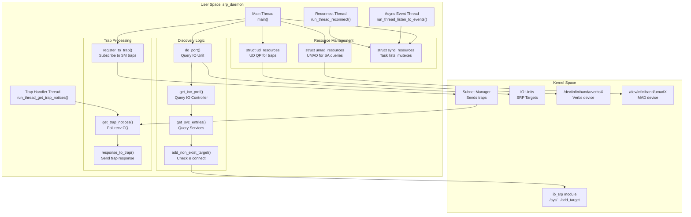
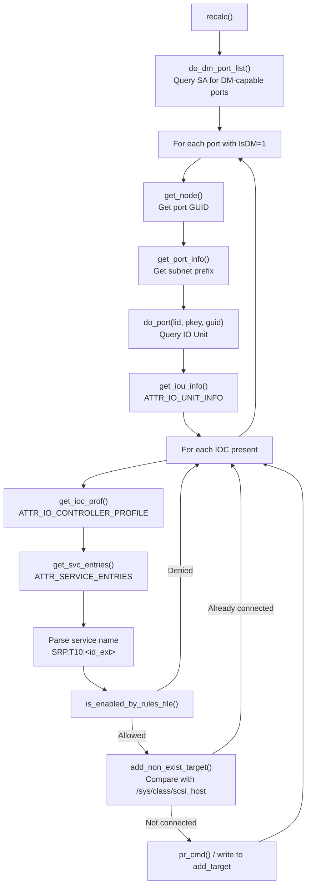
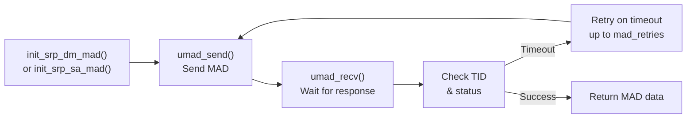
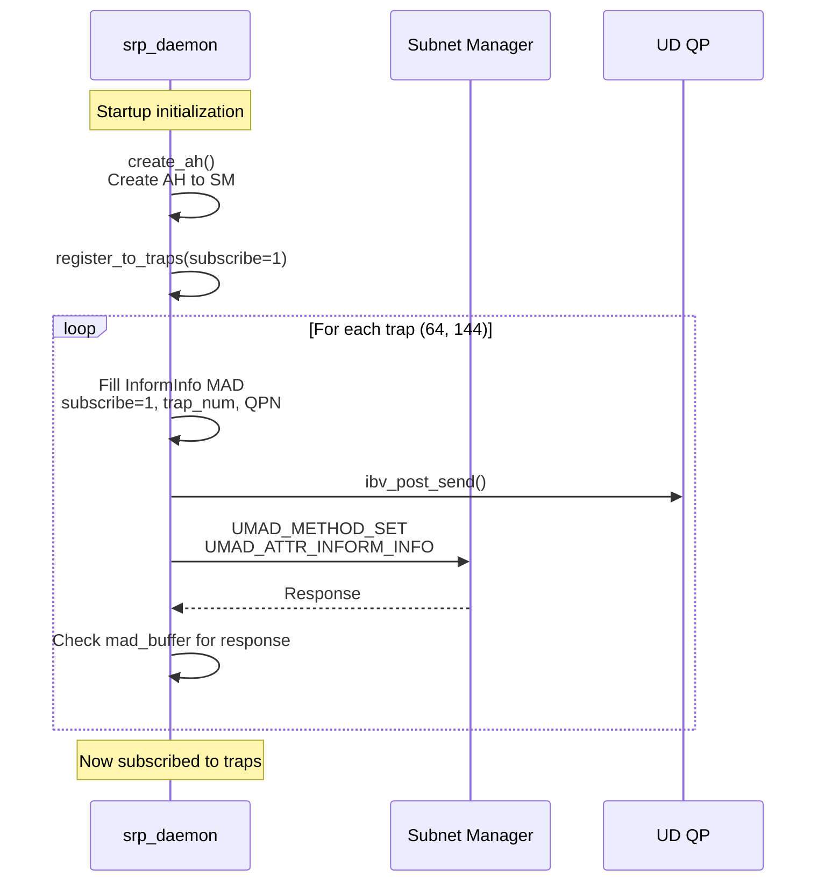
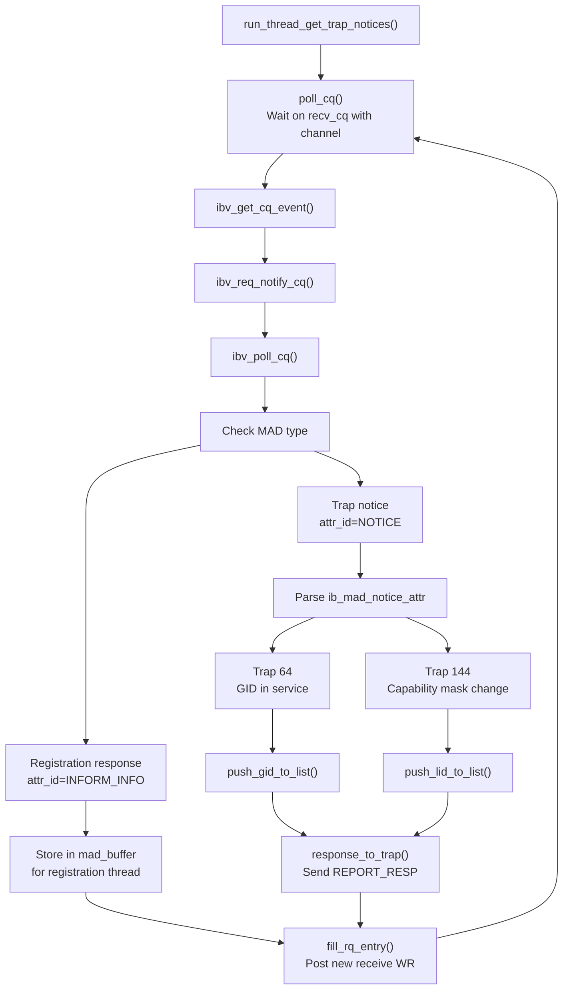
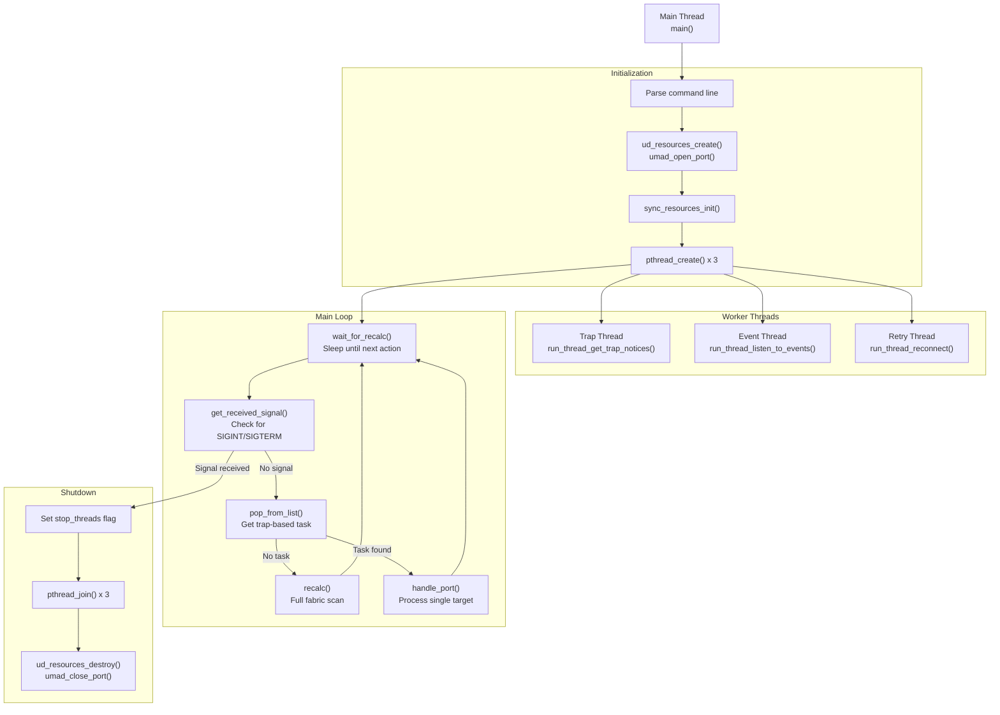

<!-- source: DeepWiki mcp.deepwiki.com · repo linux-rdma/rdma-core · page 4.1 SRP Daemon (srp_daemon) · fetched 2026-11-11 -->

# SRP Daemon (srp_daemon)

<details>
<summary>Relevant source files</summary>

The following files were used as context for generating this wiki page:

- [COPYING.md](COPYING.md)
- [ccan/LICENSE.MIT](ccan/LICENSE.MIT)
- [ccan/list.c](ccan/list.c)
- [debian/srptools.default](debian/srptools.default)
- [debian/srptools.init](debian/srptools.init)
- [debian/srptools.install](debian/srptools.install)
- [srp_daemon/CMakeLists.txt](srp_daemon/CMakeLists.txt)
- [srp_daemon/ibsrpdm.8](srp_daemon/ibsrpdm.8)
- [srp_daemon/srp_daemon.8.in](srp_daemon/srp_daemon.8.in)
- [srp_daemon/srp_daemon.c](srp_daemon/srp_daemon.c)
- [srp_daemon/srp_daemon.h](srp_daemon/srp_daemon.h)
- [srp_daemon/srp_daemon.service.in](srp_daemon/srp_daemon.service.in)
- [srp_daemon/srp_daemon_port@.service.in](srp_daemon/srp_daemon_port@.service.in)
- [srp_daemon/srp_handle_traps.c](srp_daemon/srp_handle_traps.c)
- [srp_daemon/srp_ib_types.h](srp_daemon/srp_ib_types.h)
- [srp_daemon/srp_sync.c](srp_daemon/srp_sync.c)
- [srp_daemon/srpd.in](srp_daemon/srpd.in)

</details>


The SRP daemon (`srp_daemon`) is a userspace service that automatically discovers and connects to SRP (SCSI RDMA Protocol) targets over InfiniBand fabrics. It continuously monitors the fabric for available storage targets, evaluates them against configurable rules, and creates connections via the `ib_srp` kernel module.

For information about the broader RDMA service daemon ecosystem, see [Service Daemons](#4).

---

## Purpose and Scope

The SRP daemon provides automatic storage target discovery and connection management for InfiniBand-attached SRP storage. Key responsibilities include:

- **Fabric Discovery**: Queries the subnet manager and individual IO Units (IOUs) to enumerate available SRP targets [srp_daemon/srp_daemon.c:1253-1332]().
- **Trap Handling**: Registers for and processes subnet management traps (trap 64 for GID changes, trap 144 for capability mask changes) to detect new targets in real-time [srp_daemon/srp_handle_traps.c:731-801]().
- **Target Filtering**: Applies user-defined rules to determine which discovered targets should be connected [srp_daemon/srp_daemon.c:345-400]().
- **Connection Management**: Writes connection parameters to `/sys/class/infiniband_srp/srp-<device>-<port>/add_target` to initiate kernel-side connections [srp_daemon/srp_daemon.c:264-281]().
- **Retry Logic**: Maintains a retry list for transient connection failures and periodically rescans the fabric [srp_daemon/srp_sync.c:260-289]().
- **Multi-threaded Operation**: Runs separate threads for trap reception, async event handling, and retry processing [srp_daemon/srp_daemon.h:266-273]().

Sources: [srp_daemon/srp_daemon.c:1-40](), [srp_daemon/srp_daemon.h:1-50]()

---

## System Architecture

The daemon operates as a multi-threaded userspace application that bridges subnet management operations (via UMAD) with kernel SRP initiator configuration (via sysfs).



**Diagram: SRP Daemon Architecture**

The daemon maintains three primary resource structures (`ud_resources`, `umad_resources`, `sync_resources`) that encapsulate communication channels, synchronization primitives, and task queues. The main thread orchestrates discovery while background threads handle trap reception, async events, and retry processing.

Sources: [srp_daemon/srp_daemon.h:195-274](), [srp_daemon/srp_daemon.c:1024-1134](), [srp_daemon/srp_handle_traps.c:731-801]()

---

## Core Data Structures

### Configuration: `struct config_t`

The global `config` structure defines daemon behavior and is populated from command-line arguments:

| Field | Type | Description |
|-------|------|-------------|
| `dev_name` | `char*` | InfiniBand device name (e.g., "mlx5_0") |
| `port_num` | `int` | Port number on the device |
| `add_target_file` | `char*` | Sysfs path for adding targets |
| `mad_retries` | `int` | Number of MAD send retries |
| `timeout` | `int` | MAD response timeout (milliseconds) |
| `cmd` | `int` | Print connection commands |
| `execute` | `int` | Actually execute connections |
| `once` | `int` | Run once and exit |
| `recalc_time` | `int` | Full rescan interval (seconds) |
| `retry_timeout` | `int` | Retry connection timeout (seconds) |
| `rules_file` | `const char*` | Path to rules configuration |
| `rules` | `struct rule*` | Parsed rules array |
| `tl_retry_count` | `int` | Transport layer retry count |

Sources: [srp_daemon/srp_daemon.h:195-214]()

### Resources: `struct resources`

The master structure aggregating all daemon resources:

```c
struct resources {
    struct ud_resources   *ud_res;      // UD QP for trap handling
    struct umad_resources *umad_res;    // UMAD port for SA queries
    struct sync_resources *sync_res;    // Synchronization primitives
    pthread_t trap_thread;              // Trap reception thread
    pthread_t async_ev_thread;          // Async event thread
    pthread_t reconnect_thread;         // Retry thread
};
```

Sources: [srp_daemon/srp_daemon.h:266-273]()

### UD Resources: `struct ud_resources`

Manages the Unreliable Datagram Queue Pair used for receiving trap notifications:

- **QP and CQs**: `struct ibv_qp *qp`, `struct ibv_cq *send_cq`, `struct ibv_cq *recv_cq` [srp_daemon/srp_daemon.h:222-224]().
- **Memory**: `char *recv_buf`, `char *send_buf`, `struct ibv_mr *mr` [srp_daemon/srp_daemon.h:225-228]().
- **Completion Channel**: `struct ibv_comp_channel *channel` for event-driven CQ polling [srp_daemon/srp_daemon.h:232]().
- **MAD Buffer**: `struct umad_sa_packet *mad_buffer` protected by `pthread_mutex_t *mad_buffer_mutex` for trap registration responses [srp_daemon/srp_daemon.h:233-234]().

Sources: [srp_daemon/srp_daemon.h:218-235]()

### UMAD Resources: `struct umad_resources`

Encapsulates the UMAD interface for sending management datagrams:

- **Port ID**: `int portid` returned by `umad_open_port()` [srp_daemon/srp_daemon.h:239]().
- **Agent**: `int agent` for subnet administration class [srp_daemon/srp_daemon.h:240]().
- **SM LID**: `uint16_t sm_lid` for addressing subnet manager [srp_daemon/srp_daemon.h:242]().

Sources: [srp_daemon/srp_daemon.h:237-243]()

### Target Details: `struct target_details`

Represents a discovered SRP target:

```c
struct target_details {
    uint16_t                pkey;           // Partition key
    char                    id_ext[17];     // Target identifier extension
    struct srp_dm_ioc_prof  ioc_prof;       // IO Controller profile
    uint64_t                subnet_prefix;  // Subnet prefix of DGID
    uint64_t                h_guid;         // Host-order GUID
    uint64_t                h_service_id;   // Host-order service ID
    time_t                  retry_time;     // Next retry time
    char                   *options;        // Additional connection options
    struct target_details  *next;           // Linked list pointer
};
```

Sources: [srp_daemon/srp_daemon.h:183-193]()

---

## Discovery Mechanism

The daemon employs a two-phase discovery process: **full fabric scan** and **trap-based incremental updates**.

### Full Fabric Scan



**Diagram: Full Discovery Flow**

The `recalc()` function initiates a complete fabric scan:

1. **Query SA for DM Ports**: Sends `UMAD_SA_ATTR_PORT_INFO_REC` query with `capability_mask` filter for `SRP_IS_DM` bit [srp_daemon/srp_daemon.c:1253-1332]().
2. **For Each DM Port**: Retrieves node GUID and port info via `get_node()` and `get_port_info()`.
3. **Query IO Unit**: `do_port()` sends `SRP_DM_ATTR_IO_UNIT_INFO` to get controller count [srp_daemon/srp_daemon.c:1024-1134]().
4. **For Each IO Controller**: 
   - `get_ioc_prof()` retrieves IO Controller Profile (`SRP_DM_ATTR_IO_CONTROLLER_PROFILE`) [srp_daemon/srp_daemon.c:953-991]().
   - `get_svc_entries()` retrieves service entries (`SRP_DM_ATTR_SERVICE_ENTRIES`) [srp_daemon/srp_daemon.c:993-1022]().
5. **Parse Service Names**: Extracts `id_ext` from service names matching `SRP.T10:<id_ext>` pattern.
6. **Apply Rules**: `is_enabled_by_rules_file()` checks if target matches allow/deny rules [srp_daemon/srp_daemon.c:345-400]().
7. **Check Existing Connections**: `add_non_exist_target()` scans `/sys/class/scsi_host/*/` for matching connections [srp_daemon/srp_daemon.c:447-652]().
8. **Connect**: If not connected, writes target parameters to `add_target` sysfs file [srp_daemon/srp_daemon.c:264-281]().

Sources: [srp_daemon/srp_daemon.c:1253-1332](), [srp_daemon/srp_daemon.c:1024-1134](), [srp_daemon/srp_daemon.c:447-652]()

### MAD Send/Receive

All management datagram communication uses the `send_and_get()` function:



**Diagram: MAD Transaction Flow**

The `send_and_get()` function at [srp_daemon/srp_daemon.c:654-715]() implements:
- Transaction ID (`tid`) management to match responses.
- Configurable retries (`config->mad_retries`) on timeout.
- Response validation via `umad_status()`.

Sources: [srp_daemon/srp_daemon.c:654-715](), [srp_daemon/srp_daemon.c:798-836]()

---

## Trap Handling System

The daemon uses InfiniBand subnet management traps for event-driven discovery. Two trap types are relevant:

| Trap Number | Constant | Description | Node Type |
|-------------|----------|-------------|-----------|
| 64 | `UMAD_SM_GID_IN_SERVICE_TRAP` | GID now in service | Class Manager (4) |
| 144 | `UMAD_SM_LOCAL_CHANGES_TRAP` | Local changes to port | Channel Adapter (1) |

### Trap Registration



**Diagram: Trap Registration Sequence**

The `register_to_traps()` function [srp_daemon/srp_handle_traps.c:818-834]() calls `register_to_trap()` for each trap type. Key fields in the `ib_inform_info` structure [srp_daemon/srp_ib_types.h:149-180]():

- `lid_range_begin = 0xFFFF`: Subscribe to all LIDs.
- `is_generic = 1`: Generic trap (not vendor-specific).
- `subscribe = 1`: Subscribe (set to 0 for unsubscribe).
- `trap_type`: 3 for SM traps, 4 for informational.
- `trap_num`: 64 or 144.
- `qpn_resp_time_val`: QP number for receiving traps (bits 31:8).
- `node_type_lsb`: 4 for Class Manager (trap 64), 1 for Channel Adapter (trap 144).

Sources: [srp_daemon/srp_handle_traps.c:587-694](), [srp_daemon/srp_handle_traps.c:818-834]()

### Trap Reception Thread



**Diagram: Trap Reception Flow**

The `get_trap_notices()` function [srp_daemon/srp_handle_traps.c:731-801]() runs in a dedicated thread:

1. **Wait for Completion**: Uses `ibv_get_cq_event()` on completion channel, then `ibv_poll_cq()`.
2. **Extract MAD**: Retrieves MAD from receive buffer at offset `GRH_SIZE` [srp_daemon/srp_handle_traps.c:766]().
3. **Dispatch by Type**:
   - **Registration Response** (`UMAD_METHOD_GET_RESP`, `UMAD_ATTR_INFORM_INFO`): Stores in `mad_buffer` for main thread.
   - **Trap Notice** (`UMAD_METHOD_REPORT`, `UMAD_ATTR_NOTICE`): Parses `ib_mad_notice_attr`.
4. **Process Trap**:
   - **Trap 64**: Extracts GID from `ntc_64_67.gid`, calls `push_gid_to_list()` [srp_daemon/srp_handle_traps.c:780]().
   - **Trap 144**: Extracts LID and capability mask from `ntc_144`, calls `push_lid_to_list()` if `SRP_IS_DM` bit set [srp_daemon/srp_handle_traps.c:790]().
5. **Send Response**: Calls `response_to_trap()` with `UMAD_METHOD_REPORT_RESP` [srp_daemon/srp_handle_traps.c:717-725]().
6. **Refill RQ**: Posts new receive work request via `fill_rq_entry()` [srp_daemon/srp_handle_traps.c:153-179]().

Sources: [srp_daemon/srp_handle_traps.c:731-801](), [srp_daemon/srp_handle_traps.c:700-725]()

### Task List Processing

When a trap is received, the LID or GID is added to a synchronized task list:

```c
struct sync_resources {
    struct {
        uint16_t lid;
        uint16_t pkey;
        union umad_gid gid;
    } tasks[SIZE_OF_TASKS_LIST];  // SIZE_OF_TASKS_LIST = 5
    int next_task;
    pthread_mutex_t mutex;
    // ...
};
```

The main loop processes these via `handle_port()` which performs target discovery for the specific LID/GID rather than a full rescan.

Sources: [srp_daemon/srp_daemon.h:245-264](), [srp_daemon/srp_sync.c:140-215]()

---

## Target Connection Process

### Connection Parameter Validation

The `add_non_exist_target()` function [srp_daemon/srp_daemon.c:447-652]() verifies whether a target is already connected by scanning `/sys/class/scsi_host/*/`:

**Comparison Attributes:**
- `id_ext` (mandatory): Target identifier extension.
- `ioc_guid` (mandatory): IO Controller GUID.
- `service_id` (mandatory): SRP service ID.
- `pkey` (if execute mode): Partition key.
- `orig_dgid` or `dgid`: Destination GID (subnet prefix + interface ID).
- `local_ib_device`: Local IB device name.
- `local_ib_port`: Local IB port number.

If all attributes match, the target is already connected and no action is taken.

Sources: [srp_daemon/srp_daemon.c:447-556]()

### Connection String Generation

If the target is not connected, a connection string is built:

```c
snprintf(target_config_str, sizeof(target_config_str), 
    "id_ext=%s,"
    "ioc_guid=%016llx,"
    "dgid=%016llx%016llx,"
    "pkey=%04x,"
    "service_id=%016llx",
    target->id_ext,
    (unsigned long long) be64toh(target->ioc_prof.guid),
    (unsigned long long) target->subnet_prefix,
    (unsigned long long) target->h_guid,
    target->pkey,
    (unsigned long long) target->h_service_id);
```

**Optional Parameters:**
- `io_class`: If not `SRP_REV16A_IB_IO_CLASS` (0x0100).
- `initiator_ext`: If `print_initiator_ext` flag set.
- `tl_retry_count`: Transport layer retry count.
- `max_it_iu_size`: Maximum initiator-to-target IU size.

Sources: [srp_daemon/srp_daemon.c:559-643]()

### Connection Execution

The `pr_cmd()` function [srp_daemon/srp_daemon.c:264-281]() handles output:

- **Print Mode** (`config->cmd`): Outputs connection string to stdout.
- **Execute Mode** (`config->execute` and `not_connected`): Writes to `config->add_target_file`.

The sysfs path is typically `/sys/class/infiniband_srp/srp-<device>-<port>/add_target`. The kernel `ib_srp` module parses the string and establishes the connection.

Sources: [srp_daemon/srp_daemon.c:264-281]()

---

## Rules Configuration

### Rules File Format

The daemon supports a rules file (default: `/etc/srp_daemon.conf`) to filter discovered targets. Each rule is a line with format:

```
<action> <criteria>
```

**Actions:**
- `a`: Allow (connect to matching targets).
- `d`: Disallow (skip matching targets).

**Criteria Fields:**
- `id_ext=<hex>`: Target ID extension.
- `ioc_guid=<hex>`: IO Controller GUID.
- `dgid=<hex>`: Destination GID (32 hex digits).
- `service_id=<hex>`: Service ID.
- `pkey=<hex>`: Partition key.
- `options=<string>`: Additional connection options (e.g., `queue_size=128`).

Sources: [srp_daemon/srp_daemon.h:175-178]()

### Rule Matching Logic

The `is_enabled_by_rules_file()` function [srp_daemon/srp_daemon.c:345-400]() iterates through the rules array:

```c
for (rule = 0; ; rule++) {
    // Check id_ext
    if (conf->rules[rule].id_ext[0] != '\0' &&
        strtoull(target->id_ext, NULL, 16) !=
        strtoull(conf->rules[rule].id_ext, NULL, 16))
        continue;
    
    // Check ioc_guid
    if (conf->rules[rule].ioc_guid[0] != '\0' &&
        be64toh(target->ioc_prof.guid) !=
        strtoull(conf->rules[rule].ioc_guid, NULL, 16))
        continue;
    
    // Match found
    target->options = conf->rules[rule].options;
    return conf->rules[rule].allow;
}
```

Sources: [srp_daemon/srp_daemon.c:345-400]()

---

## Threading Model

### Thread Lifecycle



**Diagram: Thread Lifecycle and Main Loop**

Sources: [srp_daemon/srp_daemon.c:1334-1534]()

### Async Event Thread (`run_thread_listen_to_events`)

- **Purpose**: Monitors InfiniBand device async events.
- **Events Handled**:
  - `IBV_EVENT_PORT_ACTIVE`: Port went active.
  - `IBV_EVENT_SM_CHANGE`: SM changed.
  - `IBV_EVENT_LID_CHANGE`: LID changed.
  - `IBV_EVENT_CLIENT_REREGISTER`: Client reregister request.
  - `IBV_EVENT_PKEY_CHANGE`: P_Key table changed.
- **Action**: Schedules immediate rescan via `schedule_rescan(res, 0)` [srp_daemon/srp_handle_traps.c:858]().
- **Fatal Events**: `IBV_EVENT_DEVICE_FATAL`, `IBV_EVENT_CQ_ERR`, `IBV_EVENT_QP_FATAL` call `raise_catastrophic_error()` [srp_daemon/srp_handle_traps.c:866-873]().

Sources: [srp_daemon/srp_handle_traps.c:836-900]()

---

## Synchronization Primitives

### Wake-up Mechanism

The daemon uses a pipe for waking the main thread from sleep:

```c
static int wakeup_pipe[2] = { -1, -1 };

void wake_up_main_loop(char ch) {
    write(wakeup_pipe[1], &ch, 1);
}
```

Used by:
- Signal handlers (`SIGINT`, `SIGTERM`, `SRP_CATAS_ERR`) [srp_daemon/srp_daemon.c:100-103]().
- Trap thread (when new task added) [srp_daemon/srp_sync.c:175]().
- Event thread (on port state changes) [srp_daemon/srp_handle_traps.c:859]().

Sources: [srp_daemon/srp_daemon.c:88-128]()

### Rescan Scheduling

The `sync_resources` structure tracks when the next full rescan should occur:

```c
struct timespec next_recalc_time;

void __schedule_rescan(struct sync_resources *res, int when) {
    clock_gettime(CLOCK_MONOTONIC, &res->next_recalc_time);
    res->next_recalc_time.tv_sec = when >= 0 ? 
        res->next_recalc_time.tv_sec + when : LONG_MAX;
}
```

Sources: [srp_daemon/srp_sync.c:49-85]()

---

## Command-Line Interface

### Key Options

| Option | Argument | Description | Default |
|--------|----------|-------------|---------|
| `-i` | device | InfiniBand device name | Required (or `-d`) |
| `-p` | port | Port number | Required with `-i` |
| `-e` | - | Execute connections (write to `add_target`) | Print only |
| `-R` | seconds | Full rescan interval | No periodic rescan |
| `-T` | seconds | Retry timeout for failed connections | No retries |
| `-l` | count | Transport layer retry count (2-7) | 2 |
| `-f` | path | Rules file path | `/etc/srp_daemon.conf` |

Sources: [srp_daemon/srp_daemon.c:216-238]()

---

## Error Handling and Recovery

### Catastrophic Errors

Certain errors trigger daemon termination via `SRP_CATAS_ERR` signal [srp_daemon/srp_daemon.h:53]():

- `IBV_EVENT_DEVICE_FATAL`: Device hardware failure.
- `IBV_EVENT_CQ_ERR`: Completion queue error.
- `IBV_EVENT_QP_FATAL`: Queue pair fatal error.

The signal handler calls `wake_up_main_loop()` which causes the main thread to check `sync_resources_error()` and exit.

Sources: [srp_daemon/srp_handle_traps.c:866-873](), [srp_daemon/srp_sync.c:87-104]()

### Process Uniqueness

The daemon prevents multiple instances on the same port via file locking [srp_daemon/srp_daemon.c:130-152]().

Sources: [srp_daemon/srp_daemon.c:130-152]()

---

## Summary of Key Functions

| Function | File | Purpose |
|----------|------|---------|
| `main()` | srp_daemon.c | Entry point, command parsing, main loop |
| `recalc()` | srp_daemon.c | Full fabric scan and target discovery |
| `do_port()` | srp_daemon.c | Query single IO Unit for controllers and services |
| `add_non_exist_target()` | srp_daemon.c | Check if target connected, initiate connection |
| `is_enabled_by_rules_file()` | srp_daemon.c | Apply rules to filter targets |
| `send_and_get()` | srp_daemon.c | Send MAD and wait for response with retries |
| `register_to_traps()` | srp_handle_traps.c | Subscribe to subnet management traps |
| `get_trap_notices()` | srp_handle_traps.c | Receive and process trap notifications |
| `run_thread_listen_to_events()` | srp_handle_traps.c | Monitor async device events |
| `push_gid_to_list()` | srp_sync.c | Add GID-based task to queue |
| `push_lid_to_list()` | srp_sync.c | Add LID-based task to queue |
| `push_to_retry_list()` | srp_sync.c | Add failed target to retry queue |
| `schedule_rescan()` | srp_sync.c | Schedule next full fabric scan |

Sources: [srp_daemon/srp_daemon.c:1-1534](), [srp_daemon/srp_handle_traps.c:1-902](), [srp_daemon/srp_sync.c:1-296]()

---

