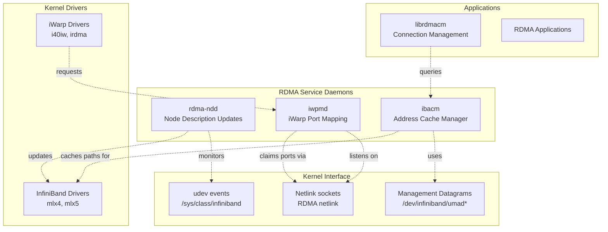
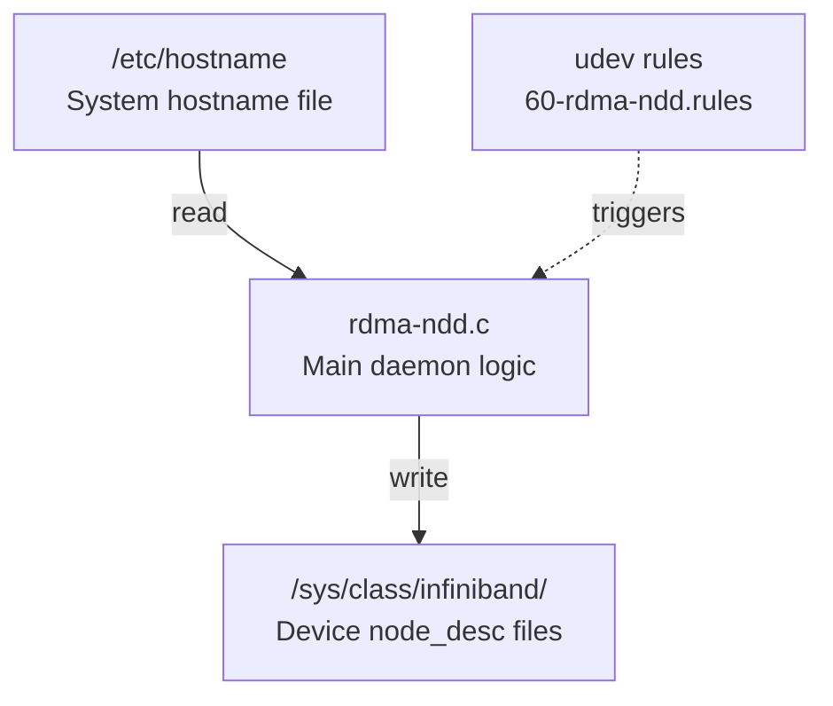
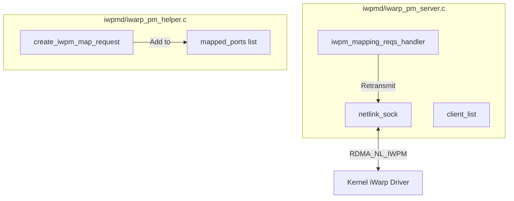
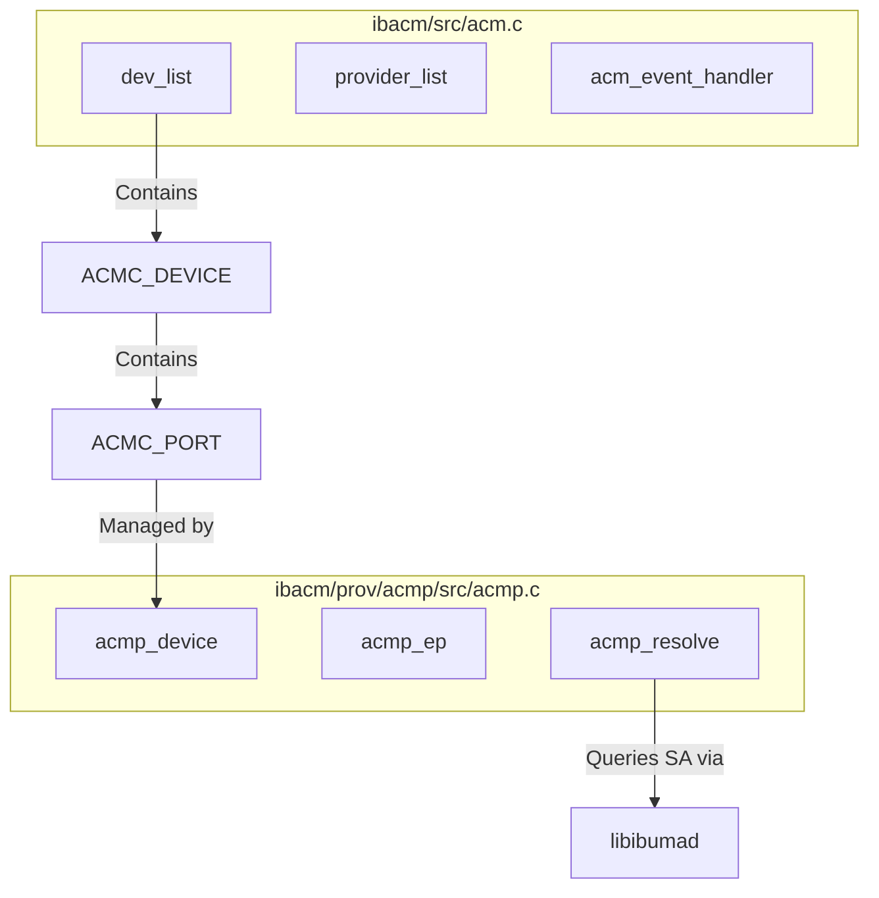

<!-- source: DeepWiki mcp.deepwiki.com · repo linux-rdma/rdma-core · page 4.2 Other Service Daemons · fetched 2026-11-11 -->

# Other Service Daemons

Relevant source files

The following files were used as context for generating this wiki page:

- [Documentation/CMakeLists.txt](Documentation/CMakeLists.txt)
- [debian/ibacm.install](debian/ibacm.install)
- [debian/ibacm.maintscript](debian/ibacm.maintscript)
- [debian/rdma-core.install](debian/rdma-core.install)
- [ibacm/CMakeLists.txt](ibacm/CMakeLists.txt)
- [ibacm/ibacm.init.in](ibacm/ibacm.init.in)
- [ibacm/ibacm.service.in](ibacm/ibacm.service.in)
- [ibacm/ibacm.socket](ibacm/ibacm.socket)
- [ibacm/include/infiniband/acm_prov.h](ibacm/include/infiniband/acm_prov.h)
- [ibacm/linux/osd.h](ibacm/linux/osd.h)
- [ibacm/man/ib_acme.1](ibacm/man/ib_acme.1)
- [ibacm/man/ibacm.7](ibacm/man/ibacm.7)
- [ibacm/man/ibacm.8](ibacm/man/ibacm.8)
- [ibacm/man/ibacm_prov.7.in](ibacm/man/ibacm_prov.7.in)
- [ibacm/prov/acmp/src/acmp.c](ibacm/prov/acmp/src/acmp.c)
- [ibacm/src/acm.c](ibacm/src/acm.c)
- [ibacm/src/acm_util.c](ibacm/src/acm_util.c)
- [ibacm/src/acm_util.h](ibacm/src/acm_util.h)
- [ibacm/src/acme.c](ibacm/src/acme.c)
- [ibacm/src/libacm.c](ibacm/src/libacm.c)
- [ibacm/src/libacm.h](ibacm/src/libacm.h)
- [ibacm/src/parse.c](ibacm/src/parse.c)
- [infiniband-diags/dump_fts.c](infiniband-diags/dump_fts.c)
- [infiniband-diags/ibdiag_sa.c](infiniband-diags/ibdiag_sa.c)
- [infiniband-diags/ibdiag_sa.h](infiniband-diags/ibdiag_sa.h)
- [infiniband-diags/ibqueryerrors.c](infiniband-diags/ibqueryerrors.c)
- [infiniband-diags/ibroute.c](infiniband-diags/ibroute.c)
- [infiniband-diags/ibstat.c](infiniband-diags/ibstat.c)
- [infiniband-diags/ibtracert.c](infiniband-diags/ibtracert.c)
- [infiniband-diags/saquery.c](infiniband-diags/saquery.c)
- [iwpmd/CMakeLists.txt](iwpmd/CMakeLists.txt)
- [iwpmd/iwarp_pm.h](iwpmd/iwarp_pm.h)
- [iwpmd/iwarp_pm_common.c](iwpmd/iwarp_pm_common.c)
- [iwpmd/iwarp_pm_helper.c](iwpmd/iwarp_pm_helper.c)
- [iwpmd/iwarp_pm_server.c](iwpmd/iwarp_pm_server.c)
- [iwpmd/iwpmd.8.in](iwpmd/iwpmd.8.in)
- [iwpmd/iwpmd.conf.5.in](iwpmd/iwpmd.conf.5.in)
- [iwpmd/iwpmd.service.in](iwpmd/iwpmd.service.in)
- [kernel-boot/CMakeLists.txt](kernel-boot/CMakeLists.txt)
- [kernel-boot/rdma-description.rules](kernel-boot/rdma-description.rules)
- [kernel-boot/rdma-hw-modules.rules](kernel-boot/rdma-hw-modules.rules)
- [kernel-boot/rdma-hw.target.in](kernel-boot/rdma-hw.target.in)
- [kernel-boot/rdma-load-modules@.service.in](kernel-boot/rdma-load-modules@.service.in)
- [kernel-boot/rdma-persistent-naming.rules](kernel-boot/rdma-persistent-naming.rules)
- [kernel-boot/rdma-ulp-modules.rules](kernel-boot/rdma-ulp-modules.rules)
- [kernel-boot/rdma_rename.c](kernel-boot/rdma_rename.c)
- [kernel-boot/rdma_topo](kernel-boot/rdma_topo)
- [rdma-ndd/CMakeLists.txt](rdma-ndd/CMakeLists.txt)
- [rdma-ndd/rdma-ndd.8.in](rdma-ndd/rdma-ndd.8.in)
- [rdma-ndd/rdma-ndd.8.in.rst](rdma-ndd/rdma-ndd.8.in.rst)
- [rdma-ndd/rdma-ndd.c](rdma-ndd/rdma-ndd.c)
- [rdma-ndd/rdma-ndd.rules](rdma-ndd/rdma-ndd.rules)
- [rdma-ndd/rdma-ndd.service.in](rdma-ndd/rdma-ndd.service.in)

## Purpose and Scope

This page documents the additional userspace service daemons in `rdma-core` that support RDMA device management and communication services. These daemons run as system services to provide infrastructure capabilities for RDMA applications and kernel drivers.

For information about the SRP daemon for SCSI-over-RDMA storage, see [SRP Daemon (srp_daemon)](#4.1).

The primary service daemons covered in this document are:

- **rdma-ndd**: Node description daemon for automatic device naming.
- **iwpmd**: iWarp port mapper for TCP port claim negotiation.
- **ibacm**: InfiniBand address cache manager for path resolution.
- **infiniband-diags**: A collection of diagnostic utilities for InfiniBand fabrics.

---

## Overview of Service Daemons

**Daemon Relationships to Kernel and Applications**

Sources: [ibacm/src/acm.c:44-60](), [iwpmd/iwarp_pm_server.c:50-63](), [rdma-ndd/rdma-ndd.c:1-50]()

---

## rdma-ndd: RDMA Node Description Daemon

### Purpose

The `rdma-ndd` daemon monitors RDMA devices and system hostname changes, automatically updating the Node Description field of RDMA devices to reflect the current hostname. This allows administrators and management tools to identify which physical machine owns each device in the fabric.

### Architecture

The daemon uses `libudev` to monitor device arrival and `inotify` or similar mechanisms to watch for hostname changes. When a change is detected, it writes the new hostname to the `node_desc` sysfs attribute of the relevant InfiniBand device.

Sources: [rdma-ndd/rdma-ndd.c:1-100](), [debian/rdma-core.install:14-16]()

---

## iwpmd: iWarp Port Mapper Daemon

### Purpose

The `iwpmd` daemon provides a userspace port mapping service for iWarp RDMA drivers. iWarp uses TCP as its transport, and the kernel needs to claim TCP ports for RDMA connections. The daemon acts as an intermediary between kernel iWarp drivers and the standard socket/port allocation system, ensuring proper port management and avoiding conflicts.

### Architecture and Implementation

`iwpmd` maintains a list of mapped ports and active clients. It communicates with the kernel via a Netlink socket (`NETLINK_RDMA`) using the `RDMA_NL_IWPM` protocol.

**Key Data Structures:**
- `iwpm_client`: Tracks connected iWarp port mapper clients [iwpmd/iwarp_pm.h:120-126]().
- `iwpm_mapped_port`: Represents a port mapping, including local and mapped addresses [iwpmd/iwarp_pm.h:136-144]().
- `iwpm_mapping_request`: Tracks pending port mapping requests with timeouts [iwpmd/iwarp_pm.h:166-178]().

Sources: [iwpmd/iwarp_pm_server.c:44-60](), [iwpmd/iwarp_pm_helper.c:36-82](), [iwpmd/iwarp_pm.h:136-178]()

### Key Functions
- `iwpm_mapping_reqs_handler`: A thread that handles mapping request timeouts and retries [iwpmd/iwarp_pm_server.c:95-142]().
- `create_netlink_socket`: Initializes the Netlink communication channel [iwpmd/iwarp_pm_common.c:209-224]().
- `get_iwpm_tcp_port`: Requests a new TCP port from the host stack by creating a temporary socket [iwpmd/iwarp_pm_helper.c:182-195]().

---

## ibacm: InfiniBand Address Cache Manager

### Purpose

The `ibacm` daemon provides an address and path record caching service for InfiniBand fabrics. It reduces the load on the Subnet Administrator (SA) by serving path record queries from a local cache.

### Implementation Details

`ibacm` is built around a provider-based architecture. The core daemon manages devices, ports, and endpoints, while specific resolution logic is offloaded to providers like `ibacmp`.

**Core Entities:**
- `acmc_device`: Represents an RDMA device [ibacm/src/acm.c:118-124]().
- `acmc_port`: Represents a physical port on a device [ibacm/src/acm.c:95-116]().
- `acmc_ep`: Represents an ACM endpoint, bound to a specific P_Key [ibacm/src/acm.c:132-142]().
- `acmc_prov`: Structure for managing provider plugins [ibacm/src/acm.c:79-84]().

Sources: [ibacm/src/acm.c:74-142](), [ibacm/prov/acmp/src/acmp.c:143-198](), [ibacm/CMakeLists.txt:12-43]()

### Resolution Flow
1. **Request Arrival**: A client (e.g., `librdmacm`) sends a resolve request via a Unix Domain Socket [ibacm/src/acm.c:185-187]().
2. **Provider Dispatch**: The core daemon identifies the correct `acmc_ep` and calls the provider's `resolve` function (e.g., `acmp_resolve`) [ibacm/prov/acmp/src/acmp.c:235]().
3. **SA Query**: If the path is not in the cache, the provider issues a Subnet Administration (SA) query using Management Datagrams (MADs) [ibacm/prov/acmp/src/acmp.c:132-140]().
4. **Caching**: The resulting `ibv_path_record` is cached for future use.

### Configuration
- `ibacm_opts.cfg`: Configures log levels, timeout values, and resolution protocols [ibacm/src/acm.c:213-227]().
- `ib_acme`: A utility used to generate configuration files and verify ACM service operation [ibacm/src/acme.c:83-114]().

---

## infiniband-diags Diagnostic Tools

The `infiniband-diags` suite provides essential tools for inspecting and troubleshooting InfiniBand fabrics.

| Tool | Purpose | Source File |
|------|---------|-------------|
| `ibstat` | Displays basic status of InfiniBand devices | [infiniband-diags/ibstat.c]() |
| `ibroute` | Displays unicast and multicast forwarding tables | [infiniband-diags/ibroute.c]() |
| `ibtracert` | Traces the path between two nodes in the fabric | [infiniband-diags/ibtracert.c]() |
| `saquery` | Queries the Subnet Administrator (SA) for records | [infiniband-diags/saquery.c]() |
| `ibqueryerrors` | Reports port counters and error thresholds | [infiniband-diags/ibqueryerrors.c]() |

Sources: [infiniband-diags/ibstat.c:1-50](), [infiniband-diags/ibroute.c:1-50](), [infiniband-diags/ibtracert.c:1-50](), [infiniband-diags/saquery.c:1-50]()

---

## Persistent Naming and Topology

The `kernel-boot` directory contains utilities and rules for stable device naming.

- **rdma_rename**: A utility that renames RDMA devices based on persistent criteria such as PCI slot, onboard index, or GUID [kernel-boot/rdma_rename.c:23-52]().
- **Naming Modes**: Supports `NAME_PCI`, `NAME_GUID`, and `NAME_ONBOARD` to ensure device names (e.g., `ibp0s12f4`) remain consistent across reboots [kernel-boot/rdma_rename.c:23-52]().

Sources: [kernel-boot/rdma_rename.c:23-52](), [debian/rdma-core.install:15-18]()

---

