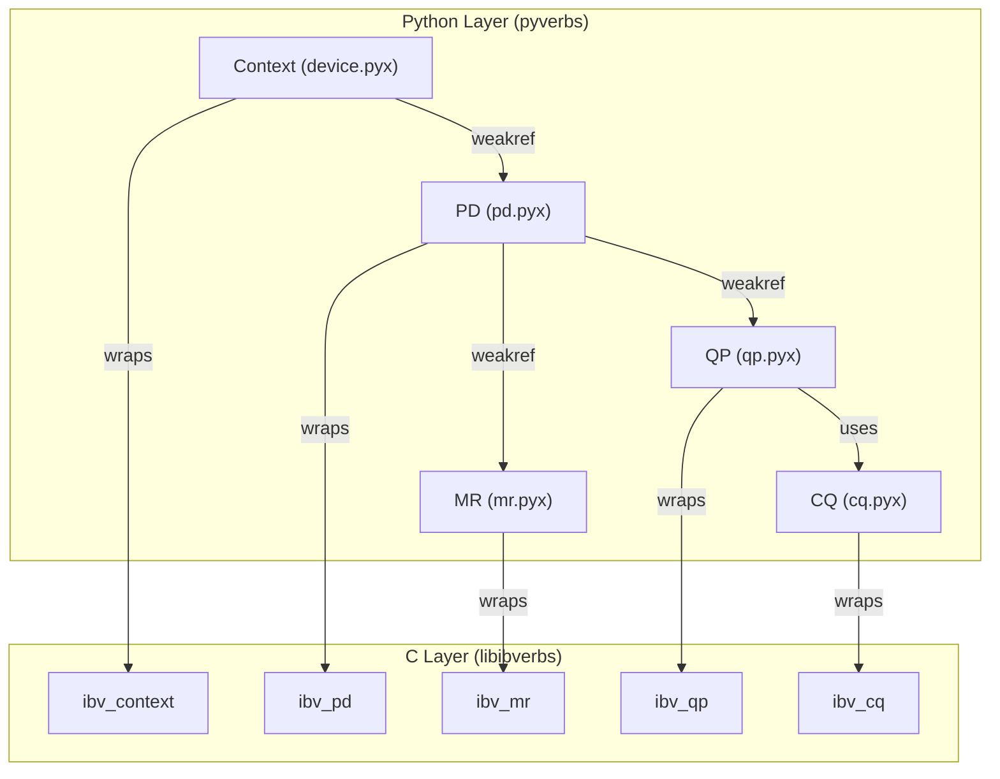

<!-- source: DeepWiki mcp.deepwiki.com · repo linux-rdma/rdma-core · page 5 Python Bindings (pyverbs) · fetched 2026-11-11 -->

# Python Bindings (pyverbs)

<details>
<summary>Relevant source files</summary>

The following files were used as context for generating this wiki page:

- [Documentation/azure-pipelines.md](Documentation/azure-pipelines.md)
- [Documentation/contributing.md](Documentation/contributing.md)
- [Documentation/librdmacm.md](Documentation/librdmacm.md)
- [Documentation/pyverbs.md](Documentation/pyverbs.md)
- [Documentation/release.md](Documentation/release.md)
- [Documentation/stable.md](Documentation/stable.md)
- [Documentation/udev.md](Documentation/udev.md)
- [Documentation/versioning.md](Documentation/versioning.md)
- [buildlib/pyverbs_functions.cmake](buildlib/pyverbs_functions.cmake)
- [pyverbs/CMakeLists.txt](pyverbs/CMakeLists.txt)
- [pyverbs/addr.pxd](pyverbs/addr.pxd)
- [pyverbs/addr.pyx](pyverbs/addr.pyx)
- [pyverbs/base.pxd](pyverbs/base.pxd)
- [pyverbs/base.pyx](pyverbs/base.pyx)
- [pyverbs/cq.pxd](pyverbs/cq.pxd)
- [pyverbs/cq.pyx](pyverbs/cq.pyx)
- [pyverbs/device.pxd](pyverbs/device.pxd)
- [pyverbs/device.pyx](pyverbs/device.pyx)
- [pyverbs/dma_util.pyx](pyverbs/dma_util.pyx)
- [pyverbs/dmabuf.pxd](pyverbs/dmabuf.pxd)
- [pyverbs/dmabuf.pyx](pyverbs/dmabuf.pyx)
- [pyverbs/dmabuf_alloc.c](pyverbs/dmabuf_alloc.c)
- [pyverbs/dmabuf_alloc.h](pyverbs/dmabuf_alloc.h)
- [pyverbs/dmabuf_alloc_stub.c](pyverbs/dmabuf_alloc_stub.c)
- [pyverbs/libibverbs.pxd](pyverbs/libibverbs.pxd)
- [pyverbs/libibverbs_enums.pxd](pyverbs/libibverbs_enums.pxd)
- [pyverbs/mem_alloc.pyx](pyverbs/mem_alloc.pyx)
- [pyverbs/mr.pxd](pyverbs/mr.pxd)
- [pyverbs/mr.pyx](pyverbs/mr.pyx)
- [pyverbs/pd.pxd](pyverbs/pd.pxd)
- [pyverbs/pd.pyx](pyverbs/pd.pyx)
- [pyverbs/qp.pxd](pyverbs/qp.pxd)
- [pyverbs/qp.pyx](pyverbs/qp.pyx)
- [pyverbs/srq.pxd](pyverbs/srq.pxd)
- [pyverbs/srq.pyx](pyverbs/srq.pyx)
- [pyverbs/xrcd.pyx](pyverbs/xrcd.pyx)

</details>


Pyverbs provides a Python API over **rdma-core**, the Linux userspace C API for the RDMA stack [Documentation/pyverbs.md:1-4](). It is implemented using Cython to wrap the underlying C structures and functions while providing a Pythonic interface that manages object lifecycles and simplifies resource initialization [Documentation/pyverbs.md:8-15]().

## Architecture and Binding Design

The architecture of pyverbs mirrors the hierarchy of `libibverbs` and `librdmacm`. It uses Cython (`.pyx` and `.pxd` files) to bridge the Python interpreter with the C headers in `infiniband/verbs.h` [pyverbs/libibverbs.pxd:11-12]().

The build system uses a specialized CMake function `rdma_cython_module` to compile these modules, linking them against `libibverbs` and `librdmacm` [buildlib/pyverbs_functions.cmake:19-21]().

### Object Hierarchy and Resource Management
Pyverbs uses a hierarchy where child objects maintain a `weakref` to their parents to ensure proper cleanup order. For instance, a `Context` tracks its Protection Domains (`PD`), Completion Queues (`CQ`), and Queue Pairs (`QP`) [pyverbs/device.pyx:111-128]().


Sources: [pyverbs/device.pyx:111-128](), [pyverbs/pd.pyx:64-72](), [pyverbs/libibverbs.pxd:26-85]()

## Core Pyverbs Bindings

The core modules provide access to standard RDMA resources. Key classes include:

*   **Context**: Represents the `ibv_context`. It is the entry point, created by providing a device name (e.g., 'mlx5_0') [pyverbs/device.pyx:79-105]().
*   **PD (Protection Domain)**: Acts as a container for MRs and QPs, providing isolation [pyverbs/pd.pyx:26-37]().
*   **MR (Memory Region)**: Handles memory registration. Pyverbs can allocate its own buffers using `mmap` or register existing user-provided addresses [pyverbs/mr.pyx:33-59]().
*   **QP (Queue Pair)**: The communication endpoint. Supports standard state transitions (Reset -> Init -> RTR -> RTS) [pyverbs/qp.pyx:450-455]().
*   **CQ (Completion Queue)**: Used to poll for work completions (`ibv_wc`) [pyverbs/cq.pyx:78-95]().

For detailed documentation on these core objects and their lifecycle, see [Core Pyverbs Bindings](#5.1).

Sources: [pyverbs/device.pyx:79-105](), [pyverbs/pd.pyx:26-37](), [pyverbs/mr.pyx:33-59](), [pyverbs/qp.pyx:101-116](), [pyverbs/cq.pyx:78-95]()

## MLX5 Python Extensions

Beyond the standard verbs, pyverbs includes hardware-specific extensions for Mellanox (MLX5) devices. These are located in `pyverbs/providers/mlx5/` [pyverbs/CMakeLists.txt:54-55]().

### Hardware-Specific Features
*   **Direct Verbs (DV)**: Access to `mlx5dv` structures for low-level hardware control.
*   **DevX**: A flexible interface to execute hardware commands directly [pyverbs/device.pyx:117-118]().
*   **Direct Rules (DR)**: High-performance flow steering and packet processing rules.

For details on hardware-specific extensions, see [MLX5 Python Extensions](#5.2).

Sources: [pyverbs/CMakeLists.txt:54-55](), [pyverbs/device.pyx:122]()

## Usage Example

The following snippet demonstrates the Pythonic flow for opening a device and querying its attributes:

```python
import pyverbs.device as d

# Open a context for the device
ctx = d.Context(name='mlx5_0')

# Query device attributes (wraps ibv_query_device)
attr = ctx.query_device()
print(f"Max QP: {attr.max_qp}")
```

Sources: [Documentation/pyverbs.md:31-44](), [pyverbs/device.pyx:83-105]()

## Related Pages
*   [Core Pyverbs Bindings](#5.1) — Detailed resource management (Context, PD, MR, QP, CQ).
*   [MLX5 Python Extensions](#5.2) — Hardware-specific DV, DevX, and Direct Rules.
*   [libibverbs](#2.1) — The underlying C library being wrapped.
*   [Testing Framework](#7) — How pyverbs is used for the rdma-core test suite.

---

