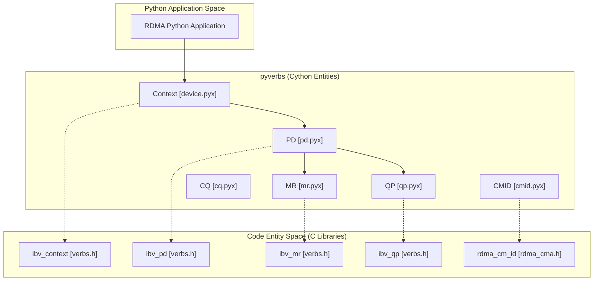
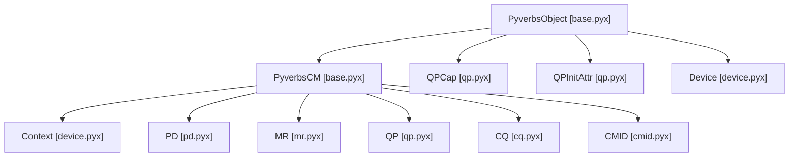
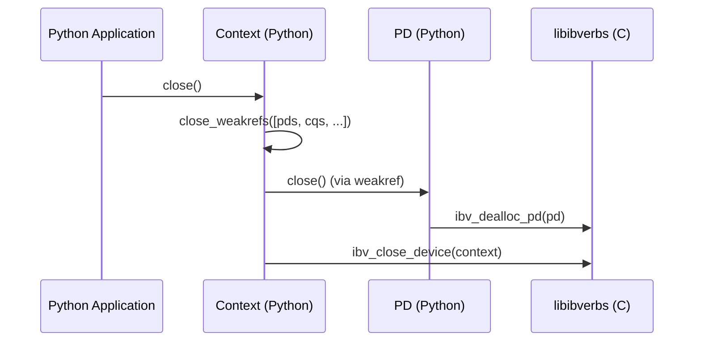

<!-- source: DeepWiki mcp.deepwiki.com · repo linux-rdma/rdma-core · page 5.1 Core Pyverbs Bindings · fetched 2026-11-11 -->

# Core Pyverbs Bindings

Relevant source files

The following files were used as context for generating this wiki page:

- [buildlib/pyverbs_functions.cmake](buildlib/pyverbs_functions.cmake)
- [pyverbs/CMakeLists.txt](pyverbs/CMakeLists.txt)
- [pyverbs/addr.pxd](pyverbs/addr.pxd)
- [pyverbs/addr.pyx](pyverbs/addr.pyx)
- [pyverbs/base.pxd](pyverbs/base.pxd)
- [pyverbs/base.pyx](pyverbs/base.pyx)
- [pyverbs/cmid.pxd](pyverbs/cmid.pxd)
- [pyverbs/cmid.pyx](pyverbs/cmid.pyx)
- [pyverbs/cq.pxd](pyverbs/cq.pxd)
- [pyverbs/cq.pyx](pyverbs/cq.pyx)
- [pyverbs/device.pxd](pyverbs/device.pxd)
- [pyverbs/device.pyx](pyverbs/device.pyx)
- [pyverbs/dma_util.pyx](pyverbs/dma_util.pyx)
- [pyverbs/dmabuf.pxd](pyverbs/dmabuf.pxd)
- [pyverbs/dmabuf.pyx](pyverbs/dmabuf.pyx)
- [pyverbs/dmabuf_alloc.c](pyverbs/dmabuf_alloc.c)
- [pyverbs/dmabuf_alloc.h](pyverbs/dmabuf_alloc.h)
- [pyverbs/dmabuf_alloc_stub.c](pyverbs/dmabuf_alloc_stub.c)
- [pyverbs/flow.pxd](pyverbs/flow.pxd)
- [pyverbs/flow.pyx](pyverbs/flow.pyx)
- [pyverbs/libibverbs.pxd](pyverbs/libibverbs.pxd)
- [pyverbs/libibverbs_enums.pxd](pyverbs/libibverbs_enums.pxd)
- [pyverbs/librdmacm.pxd](pyverbs/librdmacm.pxd)
- [pyverbs/librdmacm_enums.pxd](pyverbs/librdmacm_enums.pxd)
- [pyverbs/mem_alloc.pyx](pyverbs/mem_alloc.pyx)
- [pyverbs/mr.pxd](pyverbs/mr.pxd)
- [pyverbs/mr.pyx](pyverbs/mr.pyx)
- [pyverbs/pd.pxd](pyverbs/pd.pxd)
- [pyverbs/pd.pyx](pyverbs/pd.pyx)
- [pyverbs/qp.pxd](pyverbs/qp.pxd)
- [pyverbs/qp.pyx](pyverbs/qp.pyx)
- [pyverbs/spec.pxd](pyverbs/spec.pxd)
- [pyverbs/spec.pyx](pyverbs/spec.pyx)
- [pyverbs/srq.pxd](pyverbs/srq.pxd)
- [pyverbs/srq.pyx](pyverbs/srq.pyx)
- [pyverbs/wr.pxd](pyverbs/wr.pxd)
- [pyverbs/wr.pyx](pyverbs/wr.pyx)
- [pyverbs/xrcd.pyx](pyverbs/xrcd.pyx)

This document describes the core Python bindings (`pyverbs`) for the RDMA Core project. These bindings provide Python interfaces to the underlying C libraries (primarily libibverbs and librdmacm), enabling Python applications to interact with RDMA hardware and perform operations like memory registration, queue pair creation, and data transfer.

## Architecture Overview

The Python bindings are implemented using Cython, which provides efficient integration between Python and C code. The architecture follows a hierarchical design that closely mirrors the C libraries while adding Python-specific features like context managers, reference counting, and exception handling.

The build system uses CMake to cythonize `.pyx` files into `.c` files, which are then compiled into shared libraries linked against `libibverbs` and `librdmacm`.

Sources: [pyverbs/device.pyx:79-82](), [pyverbs/libibverbs.pxd:26-30](), [pyverbs/CMakeLists.txt:21-45](), [buildlib/pyverbs_functions.cmake:14-14]()

## Class Hierarchy

The Python bindings are built on two fundamental base classes defined in `pyverbs/base.pyx`:

1. `PyverbsObject`: The root class for most pyverbs objects, providing logging capabilities.
2. `PyverbsCM`: Inherits from `PyverbsObject` and adds context manager support (`__enter__` and `__exit__` methods).

Sources: [pyverbs/base.pyx:47-70](), [pyverbs/device.pyx:38-43](), [pyverbs/qp.pyx:35-35](), [pyverbs/qp.pyx:101-101]()

## Core Components

### Context and Device

The `Context` class represents an RDMA device handle. It wraps the `ibv_context` C structure and is responsible for opening the device.

*   **Initialization**: The `__init__` method uses `ibv_get_device_list` and `ibv_open_device` to establish a connection to the hardware [pyverbs/device.pyx:147-158]().
*   **Resource Tracking**: It maintains `WeakSet` collections for child objects like `pds`, `cqs`, and `qps` to manage lifecycle [pyverbs/device.pyx:111-128]().

Sources: [pyverbs/device.pyx:79-170](), [pyverbs/libibverbs.pxd:26-30]()

### Protection Domain (PD)

The `PD` class wraps `ibv_pd`. It is created using a `Context` or a `CMID`.

*   **Allocation**: Calls `ibv_alloc_pd` during `__init__` [pyverbs/pd.pyx:48-48]().
*   **Import/Export**: Supports `ibv_import_pd` for sharing PDs across processes [pyverbs/pd.pyx:44-44]().

Sources: [pyverbs/pd.pyx:26-61](), [pyverbs/libibverbs.pxd:73-76]()

### Memory Regions (MR)

The `MR` class manages memory registration (`ibv_mr`).

*   **Registration**: Uses `ibv_reg_mr` to register a buffer with a specific PD and access flags [pyverbs/mr.pyx:93-95]().
*   **Data Access**: Provides `read()` and `write()` methods that wrap `memcpy` for interacting with the registered memory [pyverbs/mr.pyx:145-177]().
*   **RDMA CM Integration**: Can be registered via `rdma_reg_msgs`, `rdma_reg_write`, or `rdma_reg_read` when using a `CMID` [pyverbs/mr.pyx:100-105]().

Sources: [pyverbs/mr.pyx:33-112](), [pyverbs/libibverbs.pxd:77-85]()

### Queue Pairs (QP) and Completion Queues (CQ)

These classes manage the primary data path.

*   **CQ**: Wraps `ibv_cq`. Supports `poll()` which returns a list of `WC` (Work Completion) objects [pyverbs/cq.pyx:153-177]().
*   **QP**: Wraps `ibv_qp`. Created using `QPInitAttr` which specifies the `qp_type` (e.g., `IBV_QPT_RC`) and associated CQs [pyverbs/qp.pyx:101-143]().
*   **Post Ops**: `post_send()` and `post_recv()` methods take `SendWR` and `RecvWR` objects respectively.

Sources: [pyverbs/cq.pyx:78-142](), [pyverbs/qp.pyx:509-540](), [pyverbs/libibverbs.pxd:200-206]()

## RDMA Connection Manager (CMID)

The `CMID` class wraps `rdma_cm_id` and provides high-level connection management.

*   **Address Resolution**: Uses `rdma_resolve_addr` and `rdma_resolve_route` to prepare connections [pyverbs/librdmacm.pxd:117-119]().
*   **Connection Parameters**: Uses `ConnParam` to wrap `rdma_conn_param` for configuring retry counts and responder resources [pyverbs/cmid.pyx:21-62]().

Sources: [pyverbs/cmid.pyx:1-102](), [pyverbs/librdmacm.pxd:16-31]()

## Resource Management and Cleanup

Pyverbs implements a strict resource hierarchy. When a parent object (like `Context`) is closed, it uses `close_weakrefs` to trigger the closure of all dependent child objects.

Sources: [pyverbs/device.pyx:178-188](), [pyverbs/pd.pyx:102-122](), [pyverbs/base.pyx:15-44]()

## Error Handling

Pyverbs translates C-style return codes and `errno` into Python exceptions:
- `PyverbsRDMAError`: Raised when an RDMA operation fails, often including the numeric error code [pyverbs/pyverbs_error.py]().
- `PyverbsRDMAErrno`: A specialized error that automatically captures the current system `errno` [pyverbs/base.pyx:15-16]().

Sources: [pyverbs/pyverbs_error.py](), [pyverbs/base.pyx:15-16]()

---

