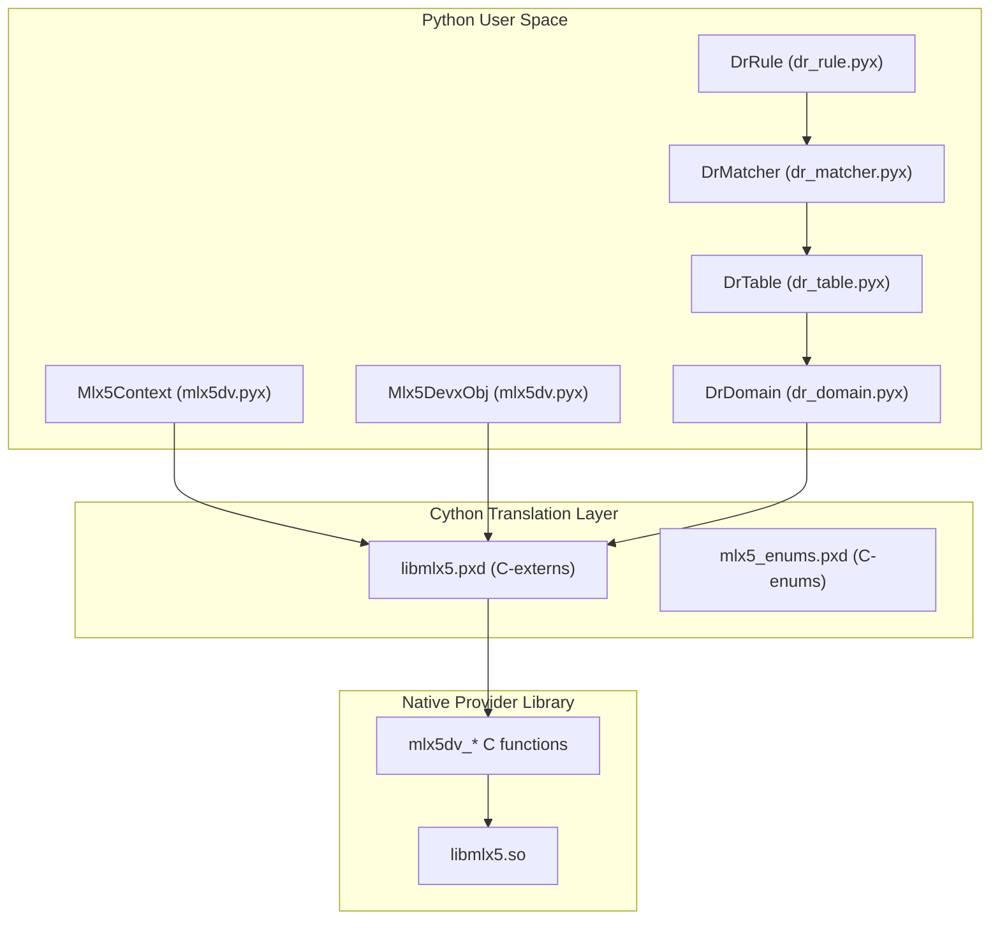
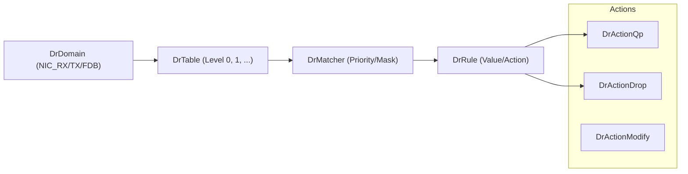
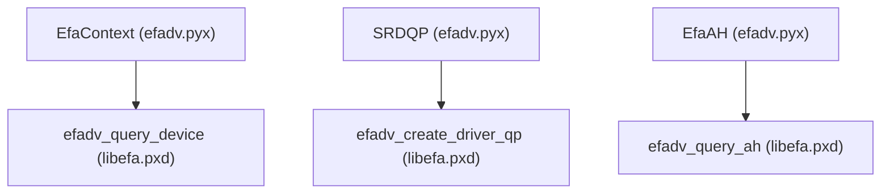

<!-- source: DeepWiki mcp.deepwiki.com · repo linux-rdma/rdma-core · page 5.2 MLX5 Python Extensions · fetched 2026-11-11 -->

# MLX5 Python Extensions

Relevant source files

The following files were used as context for generating this wiki page:

- [kernel-headers/linux/vfio.h](kernel-headers/linux/vfio.h)
- [providers/efa/CMakeLists.txt](providers/efa/CMakeLists.txt)
- [providers/efa/efadv.h](providers/efa/efadv.h)
- [providers/efa/libefa.map](providers/efa/libefa.map)
- [providers/efa/man/efadv_get_rq_max_depth.3.md](providers/efa/man/efadv_get_rq_max_depth.3.md)
- [providers/efa/man/efadv_get_sq_max_depth.3.md](providers/efa/man/efadv_get_sq_max_depth.3.md)
- [pyverbs/libibverbs.pyx](pyverbs/libibverbs.pyx)
- [pyverbs/librdmacm.pyx](pyverbs/librdmacm.pyx)
- [pyverbs/librdmacm_enums.pyx](pyverbs/librdmacm_enums.pyx)
- [pyverbs/providers/efa/CMakeLists.txt](pyverbs/providers/efa/CMakeLists.txt)
- [pyverbs/providers/efa/__init__.pxd](pyverbs/providers/efa/__init__.pxd)
- [pyverbs/providers/efa/__init__.py](pyverbs/providers/efa/__init__.py)
- [pyverbs/providers/efa/efa_enums.pxd](pyverbs/providers/efa/efa_enums.pxd)
- [pyverbs/providers/efa/efa_enums.pyx](pyverbs/providers/efa/efa_enums.pyx)
- [pyverbs/providers/efa/efadv.pxd](pyverbs/providers/efa/efadv.pxd)
- [pyverbs/providers/efa/efadv.pyx](pyverbs/providers/efa/efadv.pyx)
- [pyverbs/providers/efa/libefa.pxd](pyverbs/providers/efa/libefa.pxd)
- [pyverbs/providers/mlx5/CMakeLists.txt](pyverbs/providers/mlx5/CMakeLists.txt)
- [pyverbs/providers/mlx5/dr_action.pxd](pyverbs/providers/mlx5/dr_action.pxd)
- [pyverbs/providers/mlx5/dr_action.pyx](pyverbs/providers/mlx5/dr_action.pyx)
- [pyverbs/providers/mlx5/dr_domain.pxd](pyverbs/providers/mlx5/dr_domain.pxd)
- [pyverbs/providers/mlx5/dr_domain.pyx](pyverbs/providers/mlx5/dr_domain.pyx)
- [pyverbs/providers/mlx5/dr_matcher.pxd](pyverbs/providers/mlx5/dr_matcher.pxd)
- [pyverbs/providers/mlx5/dr_matcher.pyx](pyverbs/providers/mlx5/dr_matcher.pyx)
- [pyverbs/providers/mlx5/dr_rule.pxd](pyverbs/providers/mlx5/dr_rule.pxd)
- [pyverbs/providers/mlx5/dr_rule.pyx](pyverbs/providers/mlx5/dr_rule.pyx)
- [pyverbs/providers/mlx5/dr_table.pxd](pyverbs/providers/mlx5/dr_table.pxd)
- [pyverbs/providers/mlx5/dr_table.pyx](pyverbs/providers/mlx5/dr_table.pyx)
- [pyverbs/providers/mlx5/libmlx5.pxd](pyverbs/providers/mlx5/libmlx5.pxd)
- [pyverbs/providers/mlx5/mlx5_enums.pxd](pyverbs/providers/mlx5/mlx5_enums.pxd)
- [pyverbs/providers/mlx5/mlx5_enums.pyx](pyverbs/providers/mlx5/mlx5_enums.pyx)
- [pyverbs/providers/mlx5/mlx5_vfio.pyx](pyverbs/providers/mlx5/mlx5_vfio.pyx)
- [pyverbs/providers/mlx5/mlx5dv.pxd](pyverbs/providers/mlx5/mlx5dv.pxd)
- [pyverbs/providers/mlx5/mlx5dv.pyx](pyverbs/providers/mlx5/mlx5dv.pyx)
- [pyverbs/providers/mlx5/mlx5dv_dmabuf.pxd](pyverbs/providers/mlx5/mlx5dv_dmabuf.pxd)
- [pyverbs/providers/mlx5/mlx5dv_dmabuf.pyx](pyverbs/providers/mlx5/mlx5dv_dmabuf.pyx)
- [pyverbs/providers/mlx5/mlx5dv_event.pxd](pyverbs/providers/mlx5/mlx5dv_event.pxd)
- [pyverbs/providers/mlx5/mlx5dv_event.pyx](pyverbs/providers/mlx5/mlx5dv_event.pyx)
- [pyverbs/providers/mlx5/mlx5dv_flow.pxd](pyverbs/providers/mlx5/mlx5dv_flow.pxd)
- [pyverbs/providers/mlx5/mlx5dv_flow.pyx](pyverbs/providers/mlx5/mlx5dv_flow.pyx)
- [tests/test_srq.py](tests/test_srq.py)

This page documents the Python bindings for the MLX5 (Mellanox/NVIDIA ConnectX-4 and newer) provider in rdma-core. These bindings enable Python applications to access MLX5-specific hardware features beyond the standard verbs API, including Direct Verbs (DV), DevX, and Direct Rules (DR).

## Architecture Overview

The MLX5 Python bindings are part of the `pyverbs` package and serve as Cython-based wrappers around the MLX5 Direct Verbs (`mlx5dv.h`) C API. They enable Python applications to utilize advanced hardware capabilities specific to Mellanox/NVIDIA adapters.

### System to Code Entity Mapping

The following diagram maps high-level system components to their corresponding code entities within the MLX5 Python extension stack.

**MLX5 Python Extension Hierarchy**

Sources: [pyverbs/providers/mlx5/mlx5dv.pyx:1-30](), [pyverbs/providers/mlx5/libmlx5.pxd:15-156](), [pyverbs/providers/mlx5/CMakeLists.txt:1-21]()

## Key Components

### MLX5 Context and Device Querying
The foundation is `Mlx5Context`, which extends the base `Context` class. It allows opening a device with MLX5-specific attributes using `Mlx5DVContextAttr`.

| Class | C Structure | Purpose |
| :--- | :--- | :--- |
| `Mlx5Context` | `ibv_context` | Extended RDMA context for MLX5 devices [pyverbs/providers/mlx5/mlx5dv.pyx:275-280]() |
| `Mlx5DVContextAttr` | `mlx5dv_context_attr` | Attributes for opening a DV context [pyverbs/providers/mlx5/mlx5dv.pyx:128-135]() |
| `Mlx5DVPortAttr` | `mlx5dv_port` | Detailed hardware port capabilities [pyverbs/providers/mlx5/mlx5dv.pyx:83-88]() |

Applications can query hardware-specific capabilities such as `cqe_comp_caps` (CQE compression), `sw_parsing_caps`, and `striding_rq_caps` via the `Mlx5DVContext` structure [pyverbs/providers/mlx5/libmlx5.pxd:55-74]().

### DevX: Direct Firmware Access
DevX is a breakthrough interface that allows userspace to directly create and manage hardware objects by sending commands to the firmware (PRM - Programmer's Reference Manual).

*   **`Mlx5DevxObj`**: Represents a generic hardware object. Created via `mlx5dv_devx_obj_create` [pyverbs/providers/mlx5/mlx5dv.pyx:179-180]().
*   **Data Flow**: The application prepares a "mailbox" (input buffer) containing the PRM command. The provider executes the command and returns an output buffer [pyverbs/providers/mlx5/mlx5dv.pyx:165-191]().

Sources: [pyverbs/providers/mlx5/mlx5dv.pyx:161-210](), [pyverbs/providers/mlx5/libmlx5.pxd:156-156]()

### Direct Rules (DR) Flow Steering
Direct Rules (DR) provide a high-performance, hierarchical flow steering mechanism.

**DR Steering Data Flow**

Sources: [pyverbs/providers/mlx5/dr_domain.pyx:1-30](), [pyverbs/providers/mlx5/dr_table.pyx:1-30](), [pyverbs/providers/mlx5/dr_matcher.pyx:1-30](), [pyverbs/providers/mlx5/dr_rule.pyx:1-30]()

#### DR Actions
The `DrAction` hierarchy allows complex packet manipulation:
*   **`DrActionQp`**: Forwards packets to a specific Queue Pair [pyverbs/providers/mlx5/dr_action.pyx:50-57]().
*   **`DrActionModify`**: Performs header modification (e.g., TTL decrement, NAT) [pyverbs/providers/mlx5/dr_action.pyx:102-127]().
*   **`DrActionFlowCounter`**: Attaches a DevX flow counter to a rule [pyverbs/providers/mlx5/dr_action.pyx:68-80]().
*   **`DrActionPacketReformat`**: Encapsulation or Decapsulation (VXLAN, GRE, etc.) [pyverbs/providers/mlx5/dr_action.pxd:67-68]().

## Hardware-Specific Features

### Signature and Crypto Offloads
MLX5 supports hardware-accelerated T10-DIF signature validation and AES-GCM encryption.
*   **Signature**: Handled via `Mlx5SigBlockAttr` and `mlx5dv_mkey_init_attr` [pyverbs/providers/mlx5/libmlx5.pxd:210-240]().
*   **Crypto**: `Mlx5CryptoAttr` allows configuring hardware crypto engines [pyverbs/providers/mlx5/libmlx5.pxd:41-47]().

### Memory Key (Mkey) Management
Beyond standard Memory Regions (MR), MLX5 allows fine-grained control over Memory Keys:
*   **`Mlx5Mkey`**: Represents an internal hardware memory key [pyverbs/providers/mlx5/libmlx5.pxd:215-218]().
*   **Interleaved MR**: Supports non-contiguous memory layouts via `mlx5dv_mr_interleaved` [pyverbs/providers/mlx5/libmlx5.pxd:219-224]().

## Amazon EFA Python Extensions
While primarily an MLX5 page, the `pyverbs.providers.efa` module follows a similar pattern for AWS Elastic Fabric Adapter specific features.

| Feature | EFA Code Entity | Source |
| :--- | :--- | :--- |
| SRD Transport | `SRDQP` / `SRDQPEx` | [pyverbs/providers/efa/efadv.pyx:151-218]() |
| Device Query | `EfaContext.query_efa_device()` | [pyverbs/providers/efa/efadv.pyx:54-63]() |
| Unsolicited Write | `efadv_wc_is_unsolicited()` | [pyverbs/providers/efa/libefa.pxd:77-77]() |

**EFA Resource Mapping**

Sources: [pyverbs/providers/efa/efadv.pyx:42-163](), [pyverbs/providers/efa/libefa.pxd:61-82]()

## Implementation Details

The bindings heavily use Cython's `cdef class` to wrap C pointers and manage lifecycles.

1.  **Memory Management**: Most classes implement `__dealloc__` calling a `close()` method that invokes the corresponding `mlx5dv_*_destroy` function [pyverbs/providers/mlx5/dr_action.pyx:36-48]().
2.  **Weak References**: To prevent circular dependencies and ensure proper destruction order (e.g., a `DrRule` must be destroyed before its `DrMatcher`), `weakref.WeakSet` is used extensively [pyverbs/providers/mlx5/dr_action.pyx:25-34]().
3.  **Error Handling**: Failures in the underlying C library are converted to `PyverbsRDMAError` or `PyverbsRDMAErrno` with appropriate status codes and syndromes [pyverbs/providers/mlx5/mlx5dv.pyx:181-190]().

Sources: [pyverbs/providers/mlx5/mlx5dv.pyx:179-196](), [pyverbs/providers/mlx5/dr_action.pyx:22-48](), [pyverbs/providers/mlx5/libmlx5.pxd:1-20]()

---

