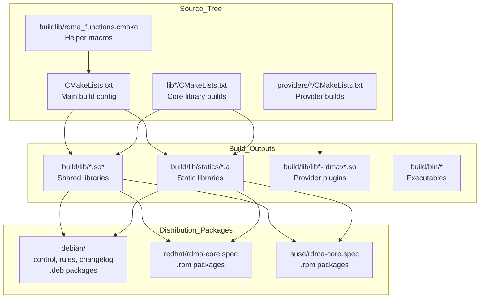
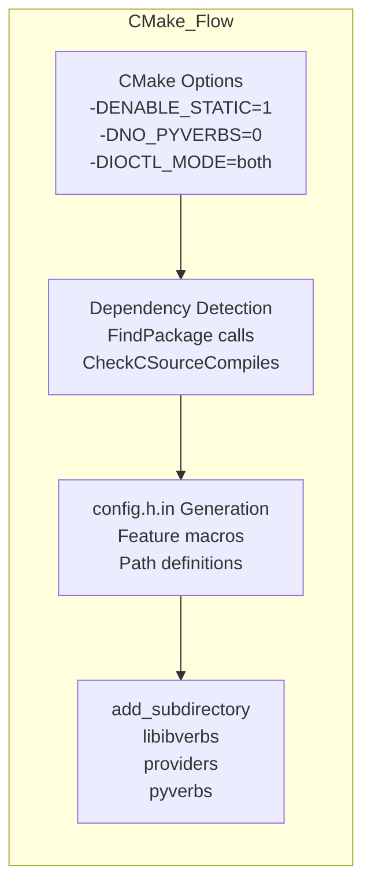
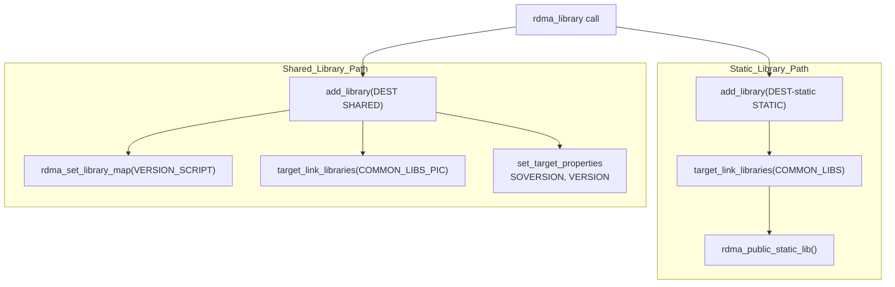

<!-- source: DeepWiki mcp.deepwiki.com · repo linux-rdma/rdma-core · page 6 Build and Distribution System · fetched 2026-11-11 -->

# Build and Distribution System

<details>
<summary>Relevant source files</summary>

The following files were used as context for generating this wiki page:

- [.mailmap](.mailmap)
- [CMakeLists.txt](CMakeLists.txt)
- [Documentation/libibverbs.md](Documentation/libibverbs.md)
- [MAINTAINERS](MAINTAINERS)
- [README.md](README.md)
- [buildlib/FindLDSymVer.cmake](buildlib/FindLDSymVer.cmake)
- [buildlib/FindUDev.cmake](buildlib/FindUDev.cmake)
- [buildlib/RDMA_BuildType.cmake](buildlib/RDMA_BuildType.cmake)
- [buildlib/RDMA_DoFixup.cmake](buildlib/RDMA_DoFixup.cmake)
- [buildlib/RDMA_EnableCStd.cmake](buildlib/RDMA_EnableCStd.cmake)
- [buildlib/azp-checkpatch](buildlib/azp-checkpatch)
- [buildlib/azure-pipelines-release.yml](buildlib/azure-pipelines-release.yml)
- [buildlib/azure-pipelines.yml](buildlib/azure-pipelines.yml)
- [buildlib/cbuild](buildlib/cbuild)
- [buildlib/check-build](buildlib/check-build)
- [buildlib/config.h.in](buildlib/config.h.in)
- [buildlib/fixup-include/stdatomic.h](buildlib/fixup-include/stdatomic.h)
- [buildlib/publish_headers.cmake](buildlib/publish_headers.cmake)
- [buildlib/rdma_functions.cmake](buildlib/rdma_functions.cmake)
- [buildlib/template.pc.in](buildlib/template.pc.in)
- [debian/changelog](debian/changelog)
- [debian/compat](debian/compat)
- [debian/control](debian/control)
- [debian/copyright](debian/copyright)
- [debian/rules](debian/rules)
- [debian/source/format](debian/source/format)
- [libibverbs/neigh.c](libibverbs/neigh.c)
- [libibverbs/neigh.h](libibverbs/neigh.h)
- [librdmacm/indexer.c](librdmacm/indexer.c)
- [librdmacm/indexer.h](librdmacm/indexer.h)
- [librdmacm/librspreload.map](librdmacm/librspreload.map)
- [librdmacm/preload.c](librdmacm/preload.c)
- [providers/ipathverbs/CMakeLists.txt](providers/ipathverbs/CMakeLists.txt)
- [providers/mlx4/CMakeLists.txt](providers/mlx4/CMakeLists.txt)
- [providers/mlx4/mlx4.conf](providers/mlx4/mlx4.conf)
- [redhat/rdma-core.spec](redhat/rdma-core.spec)
- [suse/rdma-core.spec](suse/rdma-core.spec)
- [util/symver.h](util/symver.h)

</details>


## Purpose and Scope

This document describes the build infrastructure, packaging system, and distribution mechanisms for rdma-core. It covers the CMake build system, cross-distribution packaging, Docker-based build orchestration, and the CI/CD pipeline that ensures quality across all supported Linux distributions.

For information about the testing infrastructure that validates builds, see [Testing Framework](#7). For details on specific hardware provider builds, see [RDMA Providers](#3).

---

## Overview

rdma-core uses a CMake-based build system that produces shared and static libraries, hardware provider plugins, service daemons, and Python bindings. The build system is designed to work across multiple Linux distributions (Debian, Ubuntu, Fedora, CentOS, SUSE) with varying toolchain versions and package management systems.

Title: Build System and Distribution Flow


Sources: [CMakeLists.txt:1-83](), [buildlib/rdma_functions.cmake:1-15]()

---

## CMake Build System

### Main Configuration

The top-level [CMakeLists.txt:1-163]() defines the project structure, build options, and dependencies. Key configuration variables include:

| Variable | Default | Purpose |
|----------|---------|---------|
| `PACKAGE_VERSION` | `63.0` | Version string for releases [CMakeLists.txt:83]() |
| `IBVERBS_PABI_VERSION` | `59` | Provider ABI version [CMakeLists.txt:87]() |
| `IN_PLACE` | OFF | Build for in-place execution vs installation [CMakeLists.txt:8-10]() |
| `ENABLE_STATIC` | OFF | Build static libraries [CMakeLists.txt:21-22]() |
| `ENABLE_VALGRIND` | ON | Include valgrind annotations [CMakeLists.txt:16-17]() |
| `NO_PYVERBS` | 1 | Disable Python bindings [CMakeLists.txt:45-47]() |
| `IOCTL_MODE` | both | Support ioctl and/or write syscalls [CMakeLists.txt:29-31]() |

Title: CMake Configuration and Feature Detection


The build system performs extensive feature detection to determine compiler capabilities and library availability, such as `libnl`, `systemd`, `udev`, and `valgrind` [CMakeLists.txt:16-20]().

Sources: [CMakeLists.txt:1-163](), [buildlib/config.h.in:1-50]()

### Library Building Functions

The [buildlib/rdma_functions.cmake:1-174]() file provides helper macros that standardize library building across the project:

**`rdma_library(DEST VERSION_SCRIPT SOVERSION VERSION)`** [buildlib/rdma_functions.cmake:104-121]()

Builds both shared and static versions of a library with proper symbol versioning:

Title: rdma_library Internal Workflow


**`rdma_shared_provider(DEST VERSION_SCRIPT SOVERSION VERSION)`** [buildlib/rdma_functions.cmake:140-174]()

Builds provider plugins as shared libraries that can be both dynamically loaded by `libibverbs` and linked directly:

- Creates library with standard SONAME conventions.
- Symlinks into `VERBS_PROVIDER_DIR` for dynamic loading [buildlib/rdma_functions.cmake:172-174]().
- Generates `.driver` configuration file [buildlib/rdma_functions.cmake:142-143]().

Sources: [buildlib/rdma_functions.cmake:104-121](), [buildlib/rdma_functions.cmake:140-174]()

### Provider Plugin Architecture

Provider plugins follow a specific build pattern, such as in [providers/mlx4/CMakeLists.txt:1-15]():

```cmake
rdma_shared_provider(mlx4 libmlx4.map
  1 1.0.${PACKAGE_VERSION}
  buf.c cq.c dbrec.c mlx4.c qp.c srq.c verbs.c
)
```

The build system creates:
- `libmlx4.so.1.0.63` - Full versioned shared library.
- `libmlx4-rdmav59.so` - Provider plugin symlink in `VERBS_PROVIDER_DIR` [CMakeLists.txt:87-88]().
- `mlx4.driver` - Provider configuration file [providers/mlx4/CMakeLists.txt:12]().

Sources: [providers/mlx4/CMakeLists.txt:1-15](), [buildlib/rdma_functions.cmake:140-174]()

---

## Distribution Packaging

### Debian Packaging Structure

The [debian/]() directory contains Debian package definitions.

#### Package Split

[debian/control:1-171]() defines multiple binary packages:

| Package | Contents | Purpose |
|---------|----------|---------|
| `rdma-core` | udev rules, systemd units | Base system integration [debian/control:28-51]() |
| `libibverbs1` | `libibverbs.so.*` | Core verbs library [debian/control:147-168]() |
| `ibverbs-providers` | Provider plugins | Hardware drivers [debian/control:63-107]() |
| `libibverbs-dev` | Headers, static libs | Development files [debian/control:124-145]() |

#### Build Rules

[debian/rules:1-110]() uses `dh` (debhelper) with custom overrides:

```makefile
override_dh_auto_configure:
	dh_auto_configure -- -GNinja -DCMAKE_BUILD_TYPE=Release ...
```

The build system automatically detects and excludes providers on architectures without coherent DMA support [debian/rules:11-12](), [debian/rules:64-70]():

```makefile
NON_COHERENT_DMA_ARCHS = alpha arc armel armhf hppa m68k sh4
```

Sources: [debian/control:1-171](), [debian/rules:1-110](), [debian/changelog:1-5]()

### RPM Packaging Structure

RPM packaging supports Red Hat, Fedora, CentOS, and SUSE distributions.

#### Red Hat Spec File

[redhat/rdma-core.spec:1-213]() defines the build for RHEL/Fedora/CentOS:

- **Version/Release**: `Version: 63.0` [redhat/rdma-core.spec:2]().
- **BuildRequires**: cmake, gcc, libudev-devel, ninja-build, etc. [redhat/rdma-core.spec:19-69]().
- **%build section**: Uses Ninja for consistent developer/packager builds [redhat/rdma-core.spec:65-83]().

Sources: [redhat/rdma-core.spec:1-213]()

#### SUSE Spec File

[suse/rdma-core.spec:1-196]() provides SUSE-specific packaging:

- **Library naming**: Uses major version suffixes like `libibverbs1` [suse/rdma-core.spec:52]().
- **Build conditions**: `%{with curlmini}` to avoid build dependency loops in OBS [suse/rdma-core.spec:125-130]().

Sources: [suse/rdma-core.spec:1-196]()

---

## Docker Build System (cbuild)

The `cbuild` tool [buildlib/cbuild:1-226]() orchestrates Docker-based builds for multiple distributions.

### Environment Definitions

Each distribution is defined as a Python class, such as `centos7`, `centos8`, or `fc41` [buildlib/cbuild:115-226]().

Example environment [buildlib/cbuild:223-226]():
```python
class fc41(Environment):
    docker_parent = "fedora:41";
    pkgs = centos8.pkgs | {"util-linux"}
    name = "fc41";
```

### Build Workflow

- **build-images**: Downloads base image and installs required packages [buildlib/cbuild:10-15]().
- **make**: Performs an 'in place' build inside the container [buildlib/cbuild:17-22]().
- **pkg**: Performs a full package build from a clean source tree [buildlib/cbuild:24-31]().

Sources: [buildlib/cbuild:1-226]()

---

## CI/CD Pipeline

[buildlib/azure-pipelines.yml:1-203]() defines the continuous integration workflow using Azure Pipelines.

### Job Definitions

- **Compile**: Tests compilation with `gcc-12` and `clang-15`, runs `sparse` analysis, and cross-compiles for ARM64 and PPC64EL [buildlib/azure-pipelines.yml:47-126]().
- **checkpatch**: Validates patch formatting for Pull Requests [buildlib/azure-pipelines.yml:53-59]().
- **RPM_Distros**: Matrix-based testing of RPM builds across CentOS and Fedora [buildlib/azure-pipelines.yml:167-195]().

Sources: [buildlib/azure-pipelines.yml:1-203](), [buildlib/azp-checkpatch:1-20]()

---

## Build Validation

### check-build Script

The [buildlib/check-build:1-10]() script (and associated logic in CI) performs post-build validation, including:

- **Symbol version checking**: Ensures exported symbols match defined version maps.
- **ABI compliance**: Checks for unintended ABI changes between releases.

Sources: [buildlib/check-build:1-10](), [buildlib/azure-pipelines.yml:68-75]()

---

## Summary

The rdma-core build and distribution system provides a unified CMake infrastructure that supports multiple Linux distributions, automated Docker-based packaging, and a rigorous CI/CD pipeline. This ensures that the RDMA userspace components remain portable and stable across diverse hardware and software environments.

For more details, see:
- [CMake Build System](#6.1)
- [Distribution Packaging](#6.2)
- [Docker Build System (cbuild)](#6.3)
- [CI/CD Pipeline](#6.4)

---

