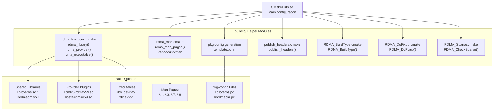
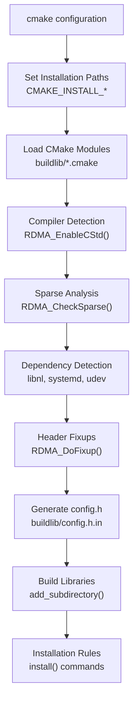
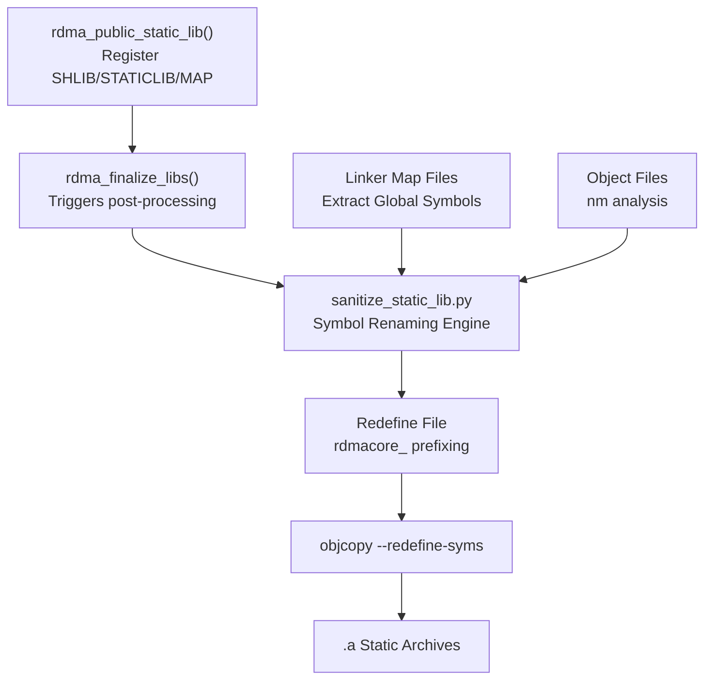

<!-- source: DeepWiki mcp.deepwiki.com · repo linux-rdma/rdma-core · page 6.1 CMake Build System · fetched 2026-11-11 -->

# CMake Build System

Relevant source files

The following files were used as context for generating this wiki page:

- [Documentation/libibverbs.md](Documentation/libibverbs.md)
- [buildlib/FindLDSymVer.cmake](buildlib/FindLDSymVer.cmake)
- [buildlib/FindUDev.cmake](buildlib/FindUDev.cmake)
- [buildlib/RDMA_BuildType.cmake](buildlib/RDMA_BuildType.cmake)
- [buildlib/RDMA_DoFixup.cmake](buildlib/RDMA_DoFixup.cmake)
- [buildlib/RDMA_EnableCStd.cmake](buildlib/RDMA_EnableCStd.cmake)
- [buildlib/RDMA_Sparse.cmake](buildlib/RDMA_Sparse.cmake)
- [buildlib/config.h.in](buildlib/config.h.in)
- [buildlib/fixup-include/stdatomic.h](buildlib/fixup-include/stdatomic.h)
- [buildlib/gen-sparse.py](buildlib/gen-sparse.py)
- [buildlib/publish_headers.cmake](buildlib/publish_headers.cmake)
- [buildlib/rdma_functions.cmake](buildlib/rdma_functions.cmake)
- [buildlib/sparse-include/23/netinet-in.h.diff](buildlib/sparse-include/23/netinet-in.h.diff)
- [buildlib/sparse-include/23/sys-socket.h.diff](buildlib/sparse-include/23/sys-socket.h.diff)
- [buildlib/sparse-include/31/bits-sysmacros.h.diff](buildlib/sparse-include/31/bits-sysmacros.h.diff)
- [buildlib/sparse-include/31/netinet-in.h.diff](buildlib/sparse-include/31/netinet-in.h.diff)
- [buildlib/sparse-include/31/stdlib.h.diff](buildlib/sparse-include/31/stdlib.h.diff)
- [buildlib/sparse-include/31/sys-socket.h.diff](buildlib/sparse-include/31/sys-socket.h.diff)
- [buildlib/sparse-include/endian.h](buildlib/sparse-include/endian.h)
- [buildlib/sparse-include/pthread.h](buildlib/sparse-include/pthread.h)
- [buildlib/sparse-include/stdatomic.h](buildlib/sparse-include/stdatomic.h)
- [buildlib/template.pc.in](buildlib/template.pc.in)
- [libibverbs/neigh.c](libibverbs/neigh.c)
- [libibverbs/neigh.h](libibverbs/neigh.h)
- [librdmacm/indexer.c](librdmacm/indexer.c)
- [librdmacm/indexer.h](librdmacm/indexer.h)
- [librdmacm/librspreload.map](librdmacm/librspreload.map)
- [librdmacm/preload.c](librdmacm/preload.c)
- [providers/ipathverbs/CMakeLists.txt](providers/ipathverbs/CMakeLists.txt)
- [providers/mlx4/CMakeLists.txt](providers/mlx4/CMakeLists.txt)
- [providers/mlx4/mlx4.conf](providers/mlx4/mlx4.conf)
- [util/compiler.h](util/compiler.h)
- [util/symver.h](util/symver.h)

## Purpose and Scope

The CMake Build System provides cross-platform build configuration for rdma-core, handling compilation, dependency detection, installation layout, and package generation. It defines custom helper functions for creating libraries and providers, manages compiler feature detection, and generates man pages from Markdown sources.

For information about Docker-based containerized builds, see [Docker Build System (cbuild)](#6.3). For distribution-specific packaging, see [6.2 Distribution Packaging](). For CI/CD automation, see [6.4 CI/CD Pipeline]().

## Build System Architecture

The CMake build system is organized around a main configuration file and several helper modules that provide custom functions for RDMA-specific build operations.

**Sources:** [buildlib/rdma_functions.cmake:4-15](), [buildlib/RDMA_BuildType.cmake:4-46](), [buildlib/publish_headers.cmake:1-10](), [buildlib/RDMA_Sparse.cmake:4-35]()

### Configuration Flow

The build process follows a well-defined sequence from configuration to installation:

**Sources:** [buildlib/RDMA_EnableCStd.cmake:39-59](), [buildlib/RDMA_Sparse.cmake:4-35](), [buildlib/config.h.in:1-81]()

## Custom CMake Functions

The build system defines specialized functions in `buildlib/rdma_functions.cmake` to simplify creation of RDMA components.

### Library Creation Functions

#### rdma_library()
Creates a shared library with GNU LD version script for symbol control.

Implementation details from [buildlib/rdma_functions.cmake:104-121]():
1. Creates static library `${DEST}-static` if `ENABLE_STATIC` is enabled.
2. Links static library with `${COMMON_LIBS}` (`ccan`, `rdma_util`).
3. Calls `rdma_public_static_lib()` to register the library for static sanitization.
4. Creates shared library `${DEST}` as `SHARED` target.
5. Applies `rdma_set_library_map()` to set version script via `-Wl,--version-script`.
6. Links shared library with `${COMMON_LIBS_PIC}` (position-independent code versions).
7. Sets `SOVERSION` and `VERSION` properties.
8. Installs to `${CMAKE_INSTALL_LIBDIR}`.

#### rdma_provider()
Creates a module-type provider plugin for dynamic loading by libibverbs.

Implementation from [buildlib/rdma_functions.cmake:173-214]():
1. Writes `${DEST}.driver` file containing `"driver ${DEST}\n"`.
2. Installs driver file to `${CONFIG_DIR}` (typically `/etc/libibverbs.d/`).
3. Appends provider info to `RDMA_PROVIDER_LIST` cache variable.
4. Creates module library `${DEST}-rdmav${IBVERBS_PABI_VERSION}` as `MODULE` target.
5. Links with `${COMMON_LIBS_PIC}`, `ibverbs`, and `${CMAKE_THREAD_LIBS_INIT}`.

#### rdma_shared_provider()
Creates a provider that acts as both a normal shared library and a plugin. Used by providers like MLX4 that expose additional Direct Verbs APIs.

Implementation from [buildlib/rdma_functions.cmake:140-185]():
1. Creates `.driver` files like `rdma_provider()`.
2. Creates shared library with full SONAME versioning (e.g., `libmlx4.so.1.0.61`).
3. Uses `buildlib/relpath` Python script to compute symlink paths.
4. Creates a symlink in `${VERBS_PROVIDER_DIR}` pointing to the versioned `.so` file in the main library directory.

### Executable Creation Functions

| Function | Destination | Links To |
|----------|-------------|----------|
| `rdma_executable()` | `CMAKE_INSTALL_BINDIR` | `COMMON_LIBS` |
| `rdma_sbin_executable()` | `CMAKE_INSTALL_SBINDIR` | `COMMON_LIBS` |
| `rdma_test_executable()` | (No Install) | `COMMON_LIBS` |

**Sources:** [buildlib/rdma_functions.cmake:217-237]()

## Compiler and Feature Detection

### Standard and Flag Detection
The system enforces `gnu11` (C11 with GNU extensions). If the compiler is older than version 3.1, it manually checks for `-std=gnu11` or falls back to `gnu99` [buildlib/RDMA_EnableCStd.cmake:39-59]().

### config.h Generation
The file `buildlib/config.h.in` is processed to generate `config.h`, defining system paths and detected features:
- `VERBS_PROVIDER_DIR`: Directory for provider plugins [buildlib/config.h.in:40]().
- `IBVERBS_PABI_VERSION`: The Provider ABI version [buildlib/config.h.in:42]().
- `HAVE_FUNC_ATTRIBUTE_IFUNC`: Support for Indirect Functions [buildlib/config.h.in:47]().
- `VERBS_IOCTL_ONLY`: Configuration for the kernel interface mode [buildlib/config.h.in:61-70]().

### Sparse Static Analysis
The build system integrates with `sparse` for static analysis.
- `RDMA_CheckSparse()`: Detects if `sparse` is being used and defines `__CHECK_ENDIAN__` [buildlib/RDMA_Sparse.cmake:4-35]().
- `gen-sparse.py`: Patches system headers (like `sys/socket.h` or `pthread.h`) with sparse annotations to provide better analysis of RDMA code [buildlib/gen-sparse.py:11-19]().

## Static Library Sanitization

Static library creation requires a sanitization pass to prevent symbol collisions when linking multiple providers into a single binary.

1. **Registration**: Libraries call `rdma_public_static_lib()` to store their target names and version scripts in the `RDMA_STATIC_LIBS` global list [buildlib/rdma_functions.cmake:16-28]().
2. **Finalization**: `rdma_finalize_libs()` prepares arguments for the sanitizer script [buildlib/rdma_functions.cmake:241-294]().
3. **Sanitization**: The `sanitize_static_lib.py` script renames all internal symbols (those not marked `global` in the version script) with a unique `rdmacore_` prefix to avoid collisions between different providers or libraries [buildlib/rdma_functions.cmake:26-28]().

**Sources:** [buildlib/rdma_functions.cmake:16-28](), [buildlib/rdma_functions.cmake:241-294]()

## pkg-config Generation

The `rdma_pkg_config()` macro generates `.pc` files from `buildlib/template.pc.in`.

### Template Variables
- `@PC_LIB_NAME@`: Library name (e.g., `ibverbs`).
- `@PC_VERSION@`: Package version.
- `@PC_LIB_PRIVATE@`: Private library dependencies (e.g., `-lpthread`).
- `@PC_REQUIRES_PRIVATE@`: Private package requirements.

**Sources:** [buildlib/template.pc.in:1-12](), [buildlib/rdma_functions.cmake:296-312]()

### Example: MLX4 Provider
The MLX4 provider generates its pkg-config file by specifying `libibverbs` as a requirement and linking thread libraries [providers/mlx4/CMakeLists.txt:18]().

## Build Types
`RDMA_BuildType.cmake` sets the default build type to `RelWithDebInfo`. It modifies standard CMake flags:
- **Release**: Forces `-O2` and `-DNDEBUG` (mirroring `RelWithDebInfo` behavior for consistency) [buildlib/RDMA_BuildType.cmake:18-26]().
- **RelWithDebInfo**: Removes `-DNDEBUG` to allow assertions while keeping optimizations [buildlib/RDMA_BuildType.cmake:28-41]().
- **Debug/RelWithDebInfo**: Defines `VERBS_DEBUG` for internal logging [buildlib/RDMA_BuildType.cmake:43-45]().

**Sources:** [buildlib/RDMA_BuildType.cmake:4-46]()

---

