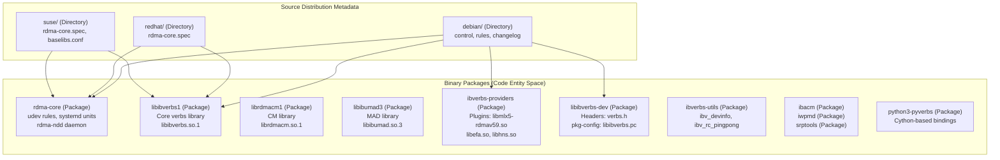
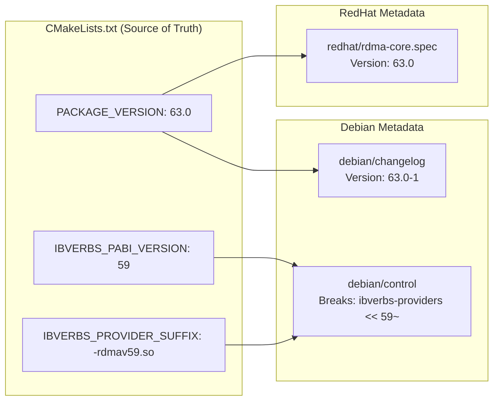

<!-- source: DeepWiki mcp.deepwiki.com · repo linux-rdma/rdma-core · page 6.2 Distribution Packaging · fetched 2026-11-11 -->

# Distribution Packaging

<details>
<summary>Relevant source files</summary>

The following files were used as context for generating this wiki page:

- [.mailmap](.mailmap)
- [CMakeLists.txt](CMakeLists.txt)
- [COPYING.md](COPYING.md)
- [MAINTAINERS](MAINTAINERS)
- [README.md](README.md)
- [ccan/LICENSE.MIT](ccan/LICENSE.MIT)
- [ccan/list.c](ccan/list.c)
- [debian/changelog](debian/changelog)
- [debian/compat](debian/compat)
- [debian/control](debian/control)
- [debian/copyright](debian/copyright)
- [debian/ibacm.lintian-overrides](debian/ibacm.lintian-overrides)
- [debian/ibverbs-providers.install](debian/ibverbs-providers.install)
- [debian/ibverbs-providers.lintian-overrides](debian/ibverbs-providers.lintian-overrides)
- [debian/infiniband-diags.lintian-overrides](debian/infiniband-diags.lintian-overrides)
- [debian/libibumad3.install](debian/libibumad3.install)
- [debian/libibverbs-dev.install](debian/libibverbs-dev.install)
- [debian/libibverbs1.install](debian/libibverbs1.install)
- [debian/libibverbs1.postinst](debian/libibverbs1.postinst)
- [debian/rdma-core.lintian-overrides](debian/rdma-core.lintian-overrides)
- [debian/rdma-core.postinst](debian/rdma-core.postinst)
- [debian/rules](debian/rules)
- [debian/source/format](debian/source/format)
- [debian/srptools.default](debian/srptools.default)
- [debian/srptools.init](debian/srptools.init)
- [debian/srptools.lintian-overrides](debian/srptools.lintian-overrides)
- [debian/srptools.postinst](debian/srptools.postinst)
- [kernel-boot/persistent-ipoib.rules.in](kernel-boot/persistent-ipoib.rules.in)
- [kernel-boot/rdma-umad.rules](kernel-boot/rdma-umad.rules)
- [rdma-sysusers.conf](rdma-sysusers.conf)
- [redhat/rdma-core.spec](redhat/rdma-core.spec)
- [suse/rdma-core.spec](suse/rdma-core.spec)

</details>


## Purpose and Scope

This document describes how `rdma-core` is packaged for distribution across multiple Linux distributions, including Debian/Ubuntu (`.deb` packages), RedHat/Fedora/CentOS (`.rpm` packages), and SUSE/openSUSE (`.rpm` packages). It covers the package split strategy, version management, dependencies, architecture-specific handling, and the distribution-specific configuration files that control package generation.

For information about the CMake build system that generates these packages, see [CMake Build System](6.1). For information about the Docker-based cross-distribution build infrastructure, see [Docker Build System](6.3).

## Overview of Package Distribution Strategy

The `rdma-core` project is split into multiple binary packages to allow users to install only the components they need. The packaging strategy follows these principles:

1.  **Core Runtime Package**: Contains essential configuration, udev rules, and daemons.
2.  **Shared Libraries**: Split by library name with versioned package names.
3.  **Provider Plugins**: Bundled together in a single package (`ibverbs-providers`).
4.  **Development Files**: Headers and static libraries in `-dev`/`-devel` packages.
5.  **Utilities**: Command-line tools separated from libraries.
6.  **Language Bindings**: Python bindings in separate packages.

## Package Split Architecture

The following diagram maps the high-level distribution packages to the source organization within the repository.

### Packaging Entity Map



**Diagram: Mapping of binary packages to distribution-specific source directories**

Sources: [debian/control:1-171](), [redhat/rdma-core.spec:1-149](), [suse/rdma-core.spec:1-196]()

## Version Management

### Package Versioning

The project uses a unified version number across all components, defined in the root `CMakeLists.txt`:

```cmake
set(PACKAGE_VERSION "63.0")
```

This version is synchronized across all distribution metadata files:
*   **Debian**: [debian/changelog:1]() (`63.0-1`)
*   **RedHat**: [redhat/rdma-core.spec:2]() (`Version: 63.0`)
*   **SUSE**: [suse/rdma-core.spec:31]() (`Version: 63.0`)

Sources: [CMakeLists.txt:83](), [debian/changelog:1](), [redhat/rdma-core.spec:2](), [suse/rdma-core.spec:31]()

### Provider ABI Version

The provider plugin interface has an independent ABI version (`IBVERBS_PABI_VERSION`) that must match between `libibverbs` and provider libraries.

```cmake
set(IBVERBS_PABI_VERSION "59")
set(IBVERBS_PROVIDER_SUFFIX "-rdmav${IBVERBS_PABI_VERSION}.so")
```

Provider plugins are named with this suffix (e.g., `libmlx5-rdmav59.so`) to ensure ABI compatibility. The `libibverbs1` package declares `Breaks: ibverbs-providers (<< 59~)` to enforce matching versions.

Sources: [CMakeLists.txt:87-88](), [debian/control:154]()

## Debian/Ubuntu Packaging

### Package Control File Structure

The [debian/control:1-171]() file defines binary packages and their relationships. It specifies build dependencies such as `debhelper`, `cmake`, `cython3`, and `libnl-3-dev`.

Key package definitions:
*   **rdma-core**: Provides basic boot support, `rdma-ndd`, and `iwpmd` [debian/control:28-51]().
*   **ibverbs-providers**: Contains user space verbs drivers including `mlx5`, `bnxt_re`, `efa`, and `mana` [debian/control:63-107]().
*   **libibverbs-dev**: Development headers and static libraries [debian/control:124-145]().

### Build Rules and Architecture Handling

The [debian/rules:1-110]() file implements the build logic. It explicitly handles architectures that do not support coherent DMA.

```makefile
NON_COHERENT_DMA_ARCHS = alpha arc armel armhf hppa m68k sh4

override_dh_auto_install:
ifeq (,$(filter-out $(NON_COHERENT_DMA_ARCHS),$(DEB_HOST_ARCH)))
    # Remove providers requiring coherent DMA on specific archs
    sed -i '/efa\|hns\|ionic\|mana\|mlx[45]/d' debian/ibverbs-providers.install
endif
```

Sources: [debian/rules:11](), [debian/rules:64-70]()

## RedHat/Fedora/CentOS Packaging

### RPM Spec File Structure

The [redhat/rdma-core.spec:1-181]() file defines the RPM package structure. It consolidates legacy standalone packages (like `libmlx4` or `libcxgb4`) into the unified `libibverbs` package using `Provides` and `Obsoletes` [redhat/rdma-core.spec:153-180]().

### Build Configuration

The spec file uses `ninja-build` by default on modern Fedora/RHEL versions for consistency with developer workflows [redhat/rdma-core.spec:67-77]().

```rpm
%if 0%{?fedora} >= 23 || 0%{?rhel} >= 8
BuildRequires: ninja-build
%define CMAKE_FLAGS -GNinja
%endif
```

Sources: [redhat/rdma-core.spec:67-70]()

## SUSE/openSUSE Packaging

### Library SO Versioning

SUSE packaging uses explicit sub-packages for each major library version to comply with shared library packaging policies.

```rpm
%define verbs_so_major  1
%define rdmacm_so_major 1
%define umad_so_major   3
%define  verbs_lname  libibverbs%{verbs_so_major}
%define  rdmacm_lname librdmacm%{rdmacm_so_major}
```

Sources: [suse/rdma-core.spec:37-57]()

## Build Process Data Flow

The following diagram illustrates how the build system variables flow into the distribution packaging metadata.

### Data Flow: CMake to Package Metadata



**Diagram: Propagation of versioning variables from CMake to distribution files**

Sources: [CMakeLists.txt:83-88](), [debian/changelog:1](), [debian/control:154](), [redhat/rdma-core.spec:2]()

## Architecture-Specific Exclusions

Providers requiring coherent DMA are excluded on specific architectures across all distributions to prevent runtime failures on hardware that cannot support the necessary memory barriers.

| Feature | Debian Architecture Filter | RedHat/SUSE Filter |
| :--- | :--- | :--- |
| **Exclude Providers** | `alpha arc armel armhf hppa m68k sh4` | `ExcludeArch: %{arm}` (RH) |
| **Logic Site** | [debian/rules:11]() | [redhat/rdma-core.spec:17]() |

Sources: [debian/rules:11](), [redhat/rdma-core.spec:17](), [suse/rdma-core.spec:59-61]()

## Summary of Configuration Files

Packages install various system-level configuration files:

*   **udev rules**: `60-rdma-ndd.rules`, `rdma-umad.rules` [kernel-boot/rdma-umad.rules:1]()
*   **modprobe configs**: `50-libmlx4.conf`, `mlx4.conf` [suse/rdma-core.spec:63]()
*   **systemd units**: `ibacm.service`, `iwpmd.service`, `rdma-ndd.service` [debian/control:44-51]()
*   **init scripts**: `srptools.init` [debian/srptools.init:1-12]()

Sources: [debian/srptools.init:12](), [suse/rdma-core.spec:63](), [debian/control:44-51]()

---

