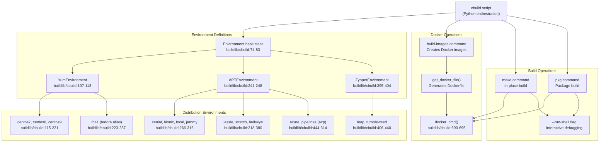
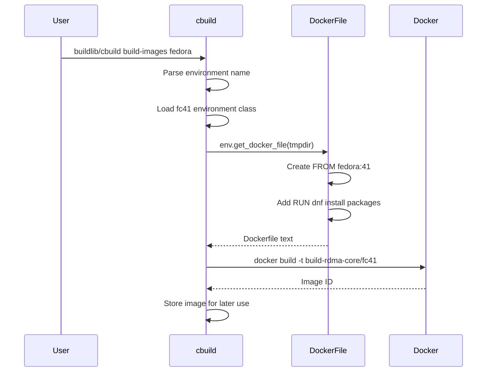
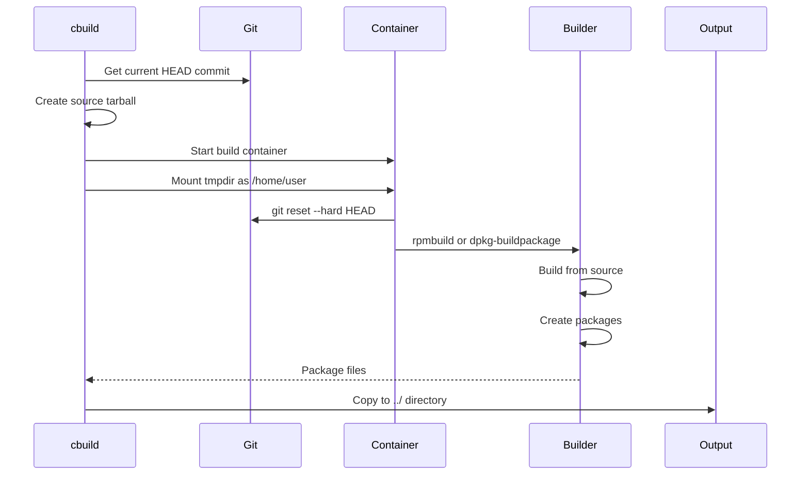

<!-- source: DeepWiki mcp.deepwiki.com · repo linux-rdma/rdma-core · page 6.3 Docker Build System (cbuild) · fetched 2026-11-11 -->

# Docker Build System (cbuild)

<details>
<summary>Relevant source files</summary>

The following files were used as context for generating this wiki page:

- [buildlib/azp-checkpatch](buildlib/azp-checkpatch)
- [buildlib/azure-pipelines-release.yml](buildlib/azure-pipelines-release.yml)
- [buildlib/azure-pipelines.yml](buildlib/azure-pipelines.yml)
- [buildlib/cbuild](buildlib/cbuild)
- [buildlib/check-build](buildlib/check-build)

</details>


## Purpose and Scope

The `cbuild` system is a Docker-based build orchestration framework that enables building `rdma-core` across multiple Linux distributions without requiring local installation of each distribution. It provides containerized, reproducible build environments for development, testing, and package creation.

For information about the CMake build system configuration, see [CMake Build System](#6.1). For distribution-specific packaging details, see [Distribution Packaging](#6.2). For CI/CD automation, see [CI/CD Pipeline](#6.4).

Sources: [buildlib/cbuild:1-37]()

## System Architecture

The `cbuild` system consists of a Python orchestration script that manages Docker containers, each configured for a specific Linux distribution. The system supports three primary workflows: building Docker images, performing in-place builds, and creating distribution packages.



Sources: [buildlib/cbuild:1-689](), [buildlib/cbuild:70-104](), [buildlib/cbuild:638-672]()

## Environment Class Hierarchy

The `cbuild` system uses an object-oriented design with base environment classes that define common behavior and distribution-specific subclasses that customize package lists and Docker configuration.

```mermaid
classDiagram
    class Environment {
        +azp_images
        +pandoc: bool
        +python_cmd: str
        +aliases: set
        +use_make: bool
        +proxy: bool
        +build_pyverbs: bool
        +docker_opts: list
        +to_azp: bool
        +image_name() str
        +get_docker_file(tmpdir)
    }
    
    class YumEnvironment {
        +is_rpm: bool
        +get_docker_file(tmpdir)
    }
    
    class APTEnvironment {
        +is_deb: bool
        +build_python: bool
        +get_docker_file(tmpdir)
        +add_source_list(tmpdir, name, content)
        +fix_https(tmpdir)
    }
    
    class ZypperEnvironment {
        +proxy: bool
        +is_rpm: bool
        +get_docker_file(tmpdir)
    }
    
    class centos7 {
        +docker_parent: "centos:7"
        +pkgs: set
        +name: "centos7"
        +use_make: True
        +pandoc: False
        +build_pyverbs: False
        +specfile: "redhat/rdma-core.spec"
        +to_azp: True
    }
    
    class fc41 {
        +docker_parent: "fedora:41"
        +pkgs: set
        +name: "fc41"
        +aliases: {"fedora"}
        +specfile: "redhat/rdma-core.spec"
        +ninja_cmd: "ninja-build"
        +is_rpm: True
        +to_azp: True
    }
    
    class bionic {
        +docker_parent: "ubuntu:18.04"
        +pkgs: set
        +name: "ubuntu-18.04"
        +aliases: {"bionic", "ubuntu"}
        +to_azp: True
    }
    
    class azure_pipelines {
        +docker_parent: "ubuntu:22.04"
        +pkgs: set (comprehensive)
        +name: "azure_pipelines"
        +aliases: {"azp"}
        +to_azp: True
        +llvm_sources: str
        +gcc12_sources: str
    }
    
    Environment <|-- YumEnvironment
    Environment <|-- APTEnvironment
    Environment <|-- ZypperEnvironment
    
    YumEnvironment <|-- centos7
    YumEnvironment <|-- fc41
    APTEnvironment <|-- bionic
    APTEnvironment <|-- azure_pipelines
```

Sources: [buildlib/cbuild:74-104](), [buildlib/cbuild:107-237](), [buildlib/cbuild:241-614]()

## Environment Definitions

Each distribution environment is defined as a Python class that specifies the base Docker image, required packages, and build configuration. The system supports various Linux families.

### Supported Distributions

| Environment Name | Class | Docker Parent | Package Manager | To AZP | Aliases |
|-----------------|-------|---------------|-----------------|--------|---------|
| centos7 | `centos7` | `centos:7` | `yum` | Yes | - |
| centos8 | `centos8` | `quay.io/centos/centos:stream8` | `dnf` | Yes | - |
| centos9 | `centos9` | `quay.io/centos/centos:stream9` | `dnf` | Yes | - |
| fc41 | `fc41` | `fedora:41` | `dnf` | Yes | `fedora` |
| amazonlinux2 | `amazonlinux2` | `amazonlinux:2` | `yum` | No | - |
| ubuntu-16.04 | `xenial` | `ubuntu:16.04` | `apt` | Yes | `xenial` |
| ubuntu-18.04 | `bionic` | `ubuntu:18.04` | `apt` | Yes | `bionic`, `ubuntu` |
| ubuntu-20.04 | `focal` | `ubuntu:20.04` | `apt` | Yes | `focal`, `ubuntu` |
| debian-11-i386 | `bullseye_i386` | `debian:11` | `apt` | Yes | `bullseye_i386` |
| opensuse-15.0 | `leap` | `opensuse/leap:15.0` | `zypper` | Yes | `leap` |
| azure_pipelines | `azure_pipelines` | `ubuntu:22.04` | `apt` | Yes | `azp` |

Sources: [buildlib/cbuild:115-440](), [buildlib/cbuild:618-636]()

### Package Requirements by Environment

Different families require specific base packages defined in the environment classes:

**RPM-based distributions (`YumEnvironment`):**
- Core: `cmake`, `gcc`, `make` or `ninja-build`, `rpm-build` [buildlib/cbuild:118-127]()
- Libraries: `libnl3-devel`, `libudev-devel`, `systemd-devel`, `valgrind-devel` [buildlib/cbuild:120-129]()
- Python: `python3`, `python3-Cython`, `python3-devel`, `python3-docutils` [buildlib/cbuild:179-182]()

**DEB-based distributions (`APTEnvironment`):**
- Core: `build-essential`, `cmake`, `debhelper`, `ninja-build` [buildlib/cbuild:271-274]()
- Libraries: `libnl-3-dev`, `libnl-route-3-dev`, `libsystemd-dev`, `libudev-dev` [buildlib/cbuild:276-279]()
- Python: `python3`, `cython3`, `python3-dev` [buildlib/cbuild:280-282]()

**Azure Pipelines special environment (`azure_pipelines`):**
- Includes cross-compilation toolchains: `gcc-12-aarch64-linux-gnu`, `gcc-12-powerpc64le-linux-gnu` [buildlib/cbuild:458-459]()
- Static analysis: `sparse`, `abi-compliance-checker`, `abi-dumper` [buildlib/cbuild:471-473]()

Sources: [buildlib/cbuild:117-130](), [buildlib/cbuild:268-286](), [buildlib/cbuild:444-494]()

## Docker Image Building

The `build-images` command creates Docker containers with all necessary build dependencies pre-installed.



Sources: [buildlib/cbuild:1-37](), [buildlib/cbuild:233-237]()

### Image Naming and Registry Integration

Images are named using the pattern `build-rdma-core/<environment_name>` for local builds and `ucfconsort.azurecr.io/rdma-core/<environment_name>:<version>` for Azure Container Registry images.

The `image_name()` method in the `Environment` class determines the appropriate name [buildlib/cbuild:95-103](). For Azure images, it cross-references [buildlib/azure-pipelines.yml:11-42]() to find the exact version tag required by the CI configuration [buildlib/cbuild:99-101]().

Sources: [buildlib/cbuild:95-103](), [buildlib/azure-pipelines.yml:11-42]()

## Build Modes

The `cbuild` system supports three primary build modes.

### Make Mode: In-Place Builds

The `make` command performs builds within the current source tree using volume mounts. This mode is ideal for iterative development.

**Characteristics:**
- Source directory is mounted read-write into the container [buildlib/cbuild:726-751]().
- Build output placed in `build-<environment>` directory.
- Container runs with the host user's UID/GID to preserve file ownership.

Sources: [buildlib/cbuild:17-22](), [buildlib/cbuild:726-751]()

### Package Mode: Full Package Builds

The `pkg` command creates distribution packages (RPM or DEB) from the current git HEAD.

**Package building workflow:**



Sources: [buildlib/cbuild:24-31](), [buildlib/cbuild:1041-1062]()

### Azure Pipelines Build Mode

The `azure_pipelines` environment allows replicating CI builds locally. It parses the `Compile` job steps from [buildlib/azure-pipelines.yml:44-126]() and executes them within the `azp` container [buildlib/cbuild:954-1040]().

This mode is used to:
- Run static analysis like `sparse` [buildlib/azure-pipelines.yml:77-90]().
- Run ABI compliance checks via `check-build` [buildlib/azure-pipelines.yml:68-74]().
- Cross-compile for ARM64 and PPC64EL [buildlib/azure-pipelines.yml:111-125]().

Sources: [buildlib/cbuild:954-1040](), [buildlib/azure-pipelines.yml:44-126]()

## Container Configuration

### Volume Mounts and Git Integration

The `map_git_args()` function handles mounting the git repository into the container [buildlib/cbuild:726-751](). It detects if the current directory is a git worktree and mounts the necessary metadata paths so that `git archive` and `git reset` work correctly inside the container [buildlib/cbuild:732-750]().

Sources: [buildlib/cbuild:726-751]()

### User and Permission Management

To maintain correct file ownership, containers often run with the host user's UID and GID. In RPM builds, `cbuild` generates a `go.py` script that creates a matching user inside the container's `/etc/passwd` before executing `rpmbuild` [buildlib/cbuild:824-857](). For Debian builds, it uses a `preexec_fn=to_user` to drop privileges during the compilation phase [buildlib/cbuild:906-925]().

Sources: [buildlib/cbuild:824-857](), [buildlib/cbuild:906-925]()

## Static Analysis and ABI Checks

The `cbuild` system integrates with `buildlib/check-build` to ensure code quality and ABI stability.

- **ABI Dumper**: Used to generate `.dump` files of the current library interface [buildlib/check-build:168-171]().
- **ABI Compliance Checker**: Compares current dumps against reference dumps in the `ABI/` directory [buildlib/check-build:177-180]().
- **Symbol Versioning**: Validates that shared library filenames match the symbol versions defined in the ELF files [buildlib/check-build:87-122]().

Sources: [buildlib/check-build:87-122](), [buildlib/check-build:160-182]()

## Common Usage Patterns

| Task | Command |
|------|---------|
| Build image | `buildlib/cbuild build-images fedora` |
| Compile in-place | `buildlib/cbuild make fedora` |
| Build RPMs | `buildlib/cbuild pkg fedora` |
| Build DEBs | `buildlib/cbuild pkg ubuntu` |
| Debug shell | `buildlib/cbuild make fedora --run-shell` |
| Run CI tests | `buildlib/cbuild pkg azp` |

Sources: [buildlib/cbuild:1-37]()

---

