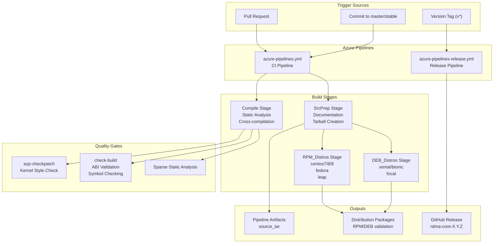
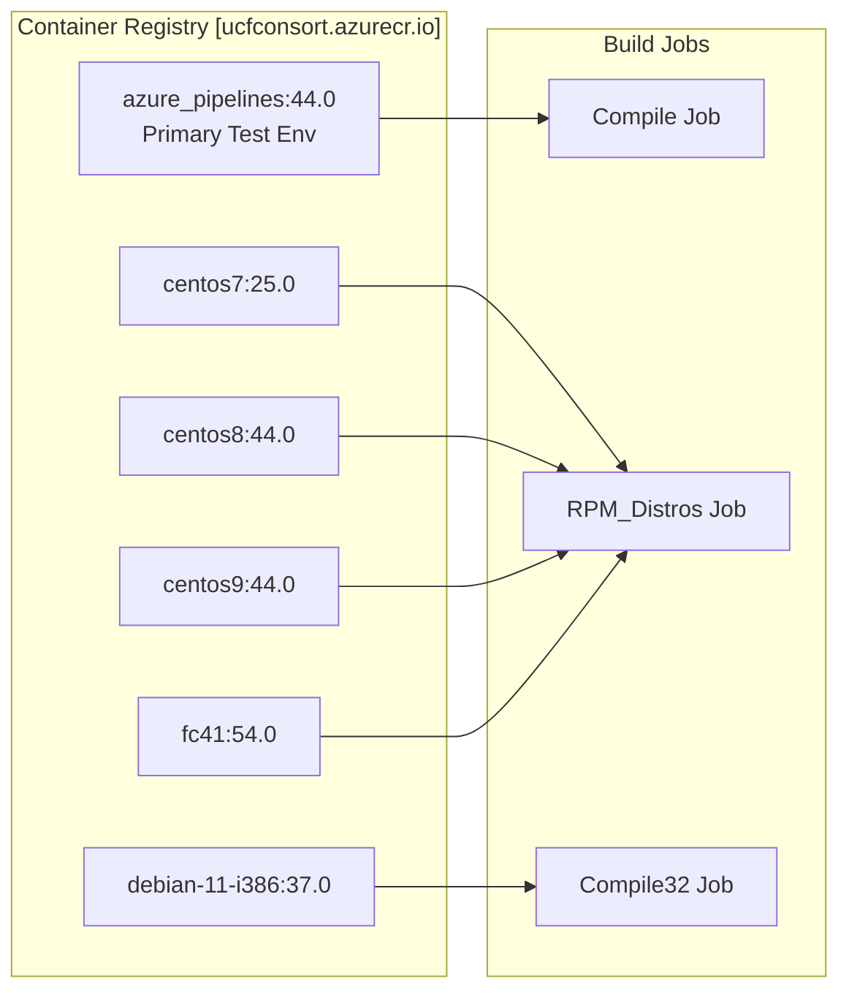
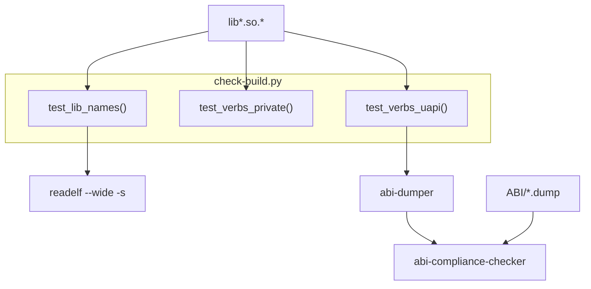

<!-- source: DeepWiki mcp.deepwiki.com · repo linux-rdma/rdma-core · page 6.4 CI/CD Pipeline · fetched 2026-11-11 -->

# CI/CD Pipeline

Relevant source files

The following files were used as context for generating this wiki page:

- [Documentation/azure-pipelines.md](Documentation/azure-pipelines.md)
- [Documentation/contributing.md](Documentation/contributing.md)
- [Documentation/librdmacm.md](Documentation/librdmacm.md)
- [Documentation/pyverbs.md](Documentation/pyverbs.md)
- [Documentation/release.md](Documentation/release.md)
- [Documentation/stable.md](Documentation/stable.md)
- [Documentation/testing.md](Documentation/testing.md)
- [Documentation/udev.md](Documentation/udev.md)
- [Documentation/versioning.md](Documentation/versioning.md)
- [buildlib/azp-checkpatch](buildlib/azp-checkpatch)
- [buildlib/azure-pipelines-release.yml](buildlib/azure-pipelines-release.yml)
- [buildlib/azure-pipelines.yml](buildlib/azure-pipelines.yml)
- [buildlib/cbuild](buildlib/cbuild)
- [buildlib/check-build](buildlib/check-build)

## Purpose and Scope

This document describes the automated Continuous Integration and Continuous Deployment (CI/CD) infrastructure for `rdma-core`, which validates code changes and produces release artifacts. The pipeline uses Azure Pipelines as the orchestration platform and Docker containers for reproducible builds across multiple Linux distributions.

The CI/CD system ensures that the userspace RDMA stack remains compatible with a wide range of distributions, architectures (x86_64, i386, ARM64, PPC64EL), and compilers (GCC, Clang) while enforcing kernel-style coding standards and ABI stability.

## Pipeline Architecture

The `rdma-core` CI/CD system consists of two primary pipelines: a continuous integration pipeline for pull requests and commits, and a release pipeline triggered by version tags.

**CI/CD Pipeline Architecture**

Sources: [buildlib/azure-pipelines.yml:1-249](), [buildlib/azure-pipelines-release.yml:1-54]()

## Azure Pipelines Configuration

### Trigger Configuration

The primary CI pipeline is configured to trigger automatically on commits to the main and stable branches, as well as on pull requests:

| Trigger Type | Branches / Tags | Configuration |
|--------------|-----------------|---------------|
| Continuous Integration | `master`, `stable-v*`, `dev/stable-v*/*` | [buildlib/azure-pipelines.yml:3-6]() |
| Pull Request | `master` | [buildlib/azure-pipelines.yml:7-8]() |
| Release | Tags matching `v*` | [buildlib/azure-pipelines-release.yml:6-9]() |

### Container Resources

The pipeline defines standardized Docker container images for each supported distribution. These containers are pre-built with all necessary build dependencies and hosted in the `ucfconsort` Azure Container Registry.

**Container Resource Mapping**

The container definitions map to `Environment` classes in the `cbuild` system. Each container includes distribution-specific build tools, compilers, and dependencies defined in the Python build script.

Sources: [buildlib/azure-pipelines.yml:10-42](), [buildlib/cbuild:74-225]()

## Compilation and Static Analysis

### Compiler Matrix and Cross-Compilation

The `Compile` job validates code across multiple compilers and configurations to ensure portability:

- **GCC 12.1**: Primary compiler with `-DENABLE_WERROR=1` and `-DENABLE_STATIC=1` [buildlib/azure-pipelines.yml:60-66]().
- **Clang 15**: Secondary compiler for alternative warning detection [buildlib/azure-pipelines.yml:92-98]().
- **ARM64/PPC64EL**: Cross-compilation using `aarch64-linux-gnu-gcc-12` and `powerpc64le-linux-gnu-gcc-12` [buildlib/azure-pipelines.yml:111-125]().
- **32-bit (i386)**: Dedicated job using a Debian 11 i386 container to catch 32-bit specific issues [buildlib/azure-pipelines.yml:127-140]().

### Static Analysis Tools

| Tool | Implementation | Purpose |
|------|----------------|---------|
| `checkpatch` | `buildlib/azp-checkpatch` | Enforces Linux kernel coding style for PRs [buildlib/azp-checkpatch:1-94](). |
| `check-build` | `buildlib/check-build` | Validates shared library symbol versions and ABI [buildlib/check-build:1-574](). |
| `sparse` | `cgcc` | Performs semantic analysis on the C source [buildlib/azure-pipelines.yml:77-90](). |

#### Checkpatch Integration
The `azp-checkpatch` script downloads the official `checkpatch.pl` from the Linux kernel tree and validates every commit in a Pull Request. It reports issues back to the Azure Pipelines UI using VSO logging commands like `##vso[task.logissue type=error]`.

Sources: [buildlib/azp-checkpatch:1-94](), [buildlib/azure-pipelines.yml:53-58]()

## ABI Compliance and Symbol Checking

The `check-build` script is a critical quality gate that prevents accidental ABI breakage. It performs the following checks:

1.  **Symbol Version Matching**: Verifies that the library filename (e.g., `libibumad.so.3.1.11`) matches the internal ELF symbol versions (e.g., `IBUMAD_1.1`) [buildlib/check-build:87-123]().
2.  **Private Symbol Verification**: Ensures that `IBVERBS_PRIVATE_N` symbols in provider libraries match the expected private ABI level [buildlib/check-build:138-157]().
3.  **ABI Dumping**: Uses `abi-dumper` and `abi-compliance-checker` to compare the current build's ABI against a baseline stored in the `ABI/` directory [buildlib/check-build:160-192]().

**ABI Validation Logic**

Sources: [buildlib/check-build:1-574](), [buildlib/azure-pipelines.yml:68-74]()

## Source Preparation and Packaging

### Source Tarball (SrcPrep)
The `SrcPrep` job creates the definitive source distribution. It pre-builds documentation using `pandoc` so that downstream package builds do not need to install complex documentation toolchains [buildlib/azure-pipelines.yml:141-165]().

### Distribution Packaging
The pipeline builds packages for multiple distributions in parallel using a strategy matrix:

- **RPM Distros**: CentOS 7, 8, 9, Fedora 41, and openSUSE Leap. These jobs use `rpmbuild` against `redhat/rdma-core.spec` or `suse/rdma-core.spec` [buildlib/azure-pipelines.yml:167-210]().
- **DEB Distros**: Ubuntu 16.04 (Xenial), 18.04 (Bionic), and 20.04 (Focal). These jobs use `dpkg-buildpackage` [buildlib/azure-pipelines.yml:212-248]().

## Release Automation

When a git tag (e.g., `v44.0.0`) is pushed, the `azure-pipelines-release.yml` pipeline is triggered.

1.  **Version Extraction**: The version is derived from the git tag [buildlib/azure-pipelines-release.yml:31-34]().
2.  **Artifact Generation**: A source tarball is created containing pre-built documentation [buildlib/azure-pipelines-release.yml:35-42]().
3.  **GitHub Release**: The `GithubRelease@1` task creates a draft release on GitHub, uploads the tarball, and automatically generates a changelog based on commit history [buildlib/azure-pipelines-release.yml:44-54]().

## Local CI with cbuild

Developers can run a build environment identical to the CI pipeline locally using the `buildlib/cbuild` script. This script orchestrates Docker to provide a consistent environment without requiring the developer to install all dependencies natively.

- **Build Images**: `buildlib/cbuild build-images azp`
- **Run Build**: `buildlib/cbuild pkg azp`

This tool manages the mapping between the Python `Environment` classes and the Docker containers used in Azure Pipelines.

Sources: [buildlib/cbuild:1-37](), [Documentation/contributing.md:25-28]()

---

