<!-- source: DeepWiki mcp.deepwiki.com · repo linux-rdma/rdma-core · page 7 Testing Framework · fetched 2026-11-11 -->

# Testing Framework

<details>
<summary>Relevant source files</summary>

The following files were used as context for generating this wiki page:

- [Documentation/testing.md](Documentation/testing.md)
- [debian/python3-pyverbs.install](debian/python3-pyverbs.install)
- [tests/CMakeLists.txt](tests/CMakeLists.txt)
- [tests/__init__.py](tests/__init__.py)
- [tests/args_parser.py](tests/args_parser.py)
- [tests/base.py](tests/base.py)
- [tests/base_rdmacm.py](tests/base_rdmacm.py)
- [tests/cuda_utils.py](tests/cuda_utils.py)
- [tests/efa_base.py](tests/efa_base.py)
- [tests/irdma_base.py](tests/irdma_base.py)
- [tests/mlx5_base.py](tests/mlx5_base.py)
- [tests/mlx5_prm_structs.py](tests/mlx5_prm_structs.py)
- [tests/rdmacm_utils.py](tests/rdmacm_utils.py)
- [tests/run_tests.py](tests/run_tests.py)
- [tests/test_addr.py](tests/test_addr.py)
- [tests/test_atomic.py](tests/test_atomic.py)
- [tests/test_cq.py](tests/test_cq.py)
- [tests/test_cqex.py](tests/test_cqex.py)
- [tests/test_cuda_dmabuf.py](tests/test_cuda_dmabuf.py)
- [tests/test_device.py](tests/test_device.py)
- [tests/test_dmah.py](tests/test_dmah.py)
- [tests/test_efa_srd.py](tests/test_efa_srd.py)
- [tests/test_efadv.py](tests/test_efadv.py)
- [tests/test_flow.py](tests/test_flow.py)
- [tests/test_mlx5_cq.py](tests/test_mlx5_cq.py)
- [tests/test_mlx5_crypto.py](tests/test_mlx5_crypto.py)
- [tests/test_mlx5_cuda_umem.py](tests/test_mlx5_cuda_umem.py)
- [tests/test_mlx5_dc.py](tests/test_mlx5_dc.py)
- [tests/test_mlx5_devx.py](tests/test_mlx5_devx.py)
- [tests/test_mlx5_dr.py](tests/test_mlx5_dr.py)
- [tests/test_mlx5_flow.py](tests/test_mlx5_flow.py)
- [tests/test_mlx5_lag_affinity.py](tests/test_mlx5_lag_affinity.py)
- [tests/test_mlx5_mkey.py](tests/test_mlx5_mkey.py)
- [tests/test_mlx5_pp.py](tests/test_mlx5_pp.py)
- [tests/test_mlx5_rdma_ctrl.py](tests/test_mlx5_rdma_ctrl.py)
- [tests/test_mlx5_rdmacm.py](tests/test_mlx5_rdmacm.py)
- [tests/test_mlx5_sched.py](tests/test_mlx5_sched.py)
- [tests/test_mlx5_uar.py](tests/test_mlx5_uar.py)
- [tests/test_mlx5_udp_sport.py](tests/test_mlx5_udp_sport.py)
- [tests/test_mlx5_var.py](tests/test_mlx5_var.py)
- [tests/test_mlx5_vfio.py](tests/test_mlx5_vfio.py)
- [tests/test_mr.py](tests/test_mr.py)
- [tests/test_odp.py](tests/test_odp.py)
- [tests/test_parent_domain.py](tests/test_parent_domain.py)
- [tests/test_pd.py](tests/test_pd.py)
- [tests/test_qp.py](tests/test_qp.py)
- [tests/test_qpex.py](tests/test_qpex.py)
- [tests/test_rdmacm.py](tests/test_rdmacm.py)
- [tests/test_relaxed_ordering.py](tests/test_relaxed_ordering.py)
- [tests/test_rss_traffic.py](tests/test_rss_traffic.py)
- [tests/test_shared_pd.py](tests/test_shared_pd.py)
- [tests/utils.py](tests/utils.py)

</details>


## Purpose and Scope

This document describes the pytest-based testing infrastructure used to validate RDMA functionality in rdma-core. The test framework provides base classes for resource management, traffic generation utilities, and comprehensive test coverage for core verbs API, provider-specific extensions, and RDMA CM operations. For information about the Python bindings used by the tests, see [Core Pyverbs Bindings](#5.1). For provider-specific functionality, see [RDMA Providers](#3).

## Test Framework Architecture

The testing infrastructure is organized around a hierarchy of base classes that manage resource lifecycle and provide common testing patterns. Tests are implemented using the pytest framework and leverage pyverbs Python bindings to exercise the underlying C RDMA libraries.

### Base Test Classes

The framework provides three primary base test classes, each designed for different testing scenarios:

**Test Class Hierarchy**

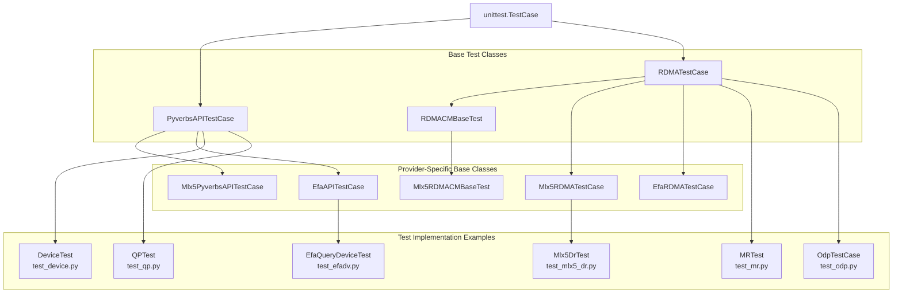

**PyverbsAPITestCase** ([tests/base.py:74-130]()) provides basic setup for testing device and context operations. It handles device selection from command-line arguments and performs device/port queries in `setUp()`.

**RDMATestCase** ([tests/base.py:132-373]()) extends PyverbsAPITestCase for traffic-oriented tests. It automatically discovers valid device/port/GID combinations, handles multiprocessing for two-node simulations, and provides the `create_players()` method to instantiate client and server resources.

**RDMACMBaseTest** ([tests/base.py:375-532]()) specializes RDMATestCase for RDMA CM testing. It adds IP address resolution and provides methods like `two_nodes_rdmacm_traffic()` for process-based connection testing with synchronization primitives.

Sources: [tests/base.py:74-532]()

### Resource Management Pattern

The framework uses resource aggregation classes that encapsulate all RDMA objects needed for testing. This pattern ensures proper resource cleanup and enables test parameterization.

**Resource Class Hierarchy**

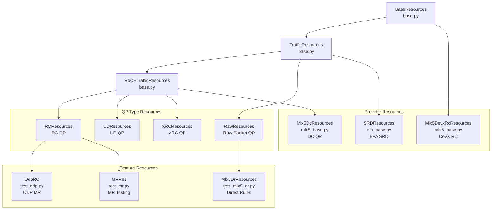

The `SkipTestMeta` metaclass ([tests/base.py:550-559]()) automatically wraps `__init__` methods to catch `unittest.SkipTest` exceptions and ensure proper resource cleanup when a test needs to be skipped.

**Resource Lifecycle**

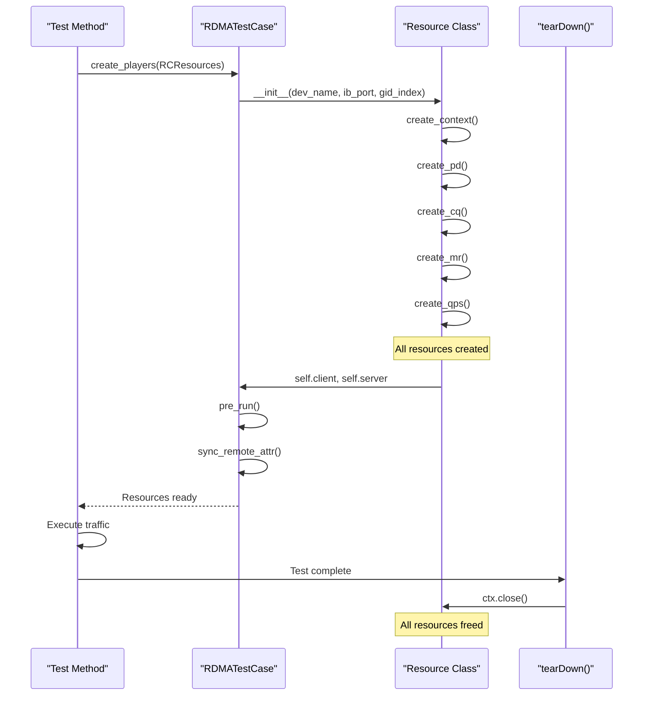

Sources: [tests/base.py:562-729](), [tests/mlx5_base.py:122-207](), [tests/efa_base.py:48-114]()

## Test Utilities

The `tests/utils.py` module provides reusable helper functions for traffic generation, resource creation, and validation. These utilities abstract common patterns to reduce test code duplication.

### Traffic Pattern Functions

**Traffic Flow Components**

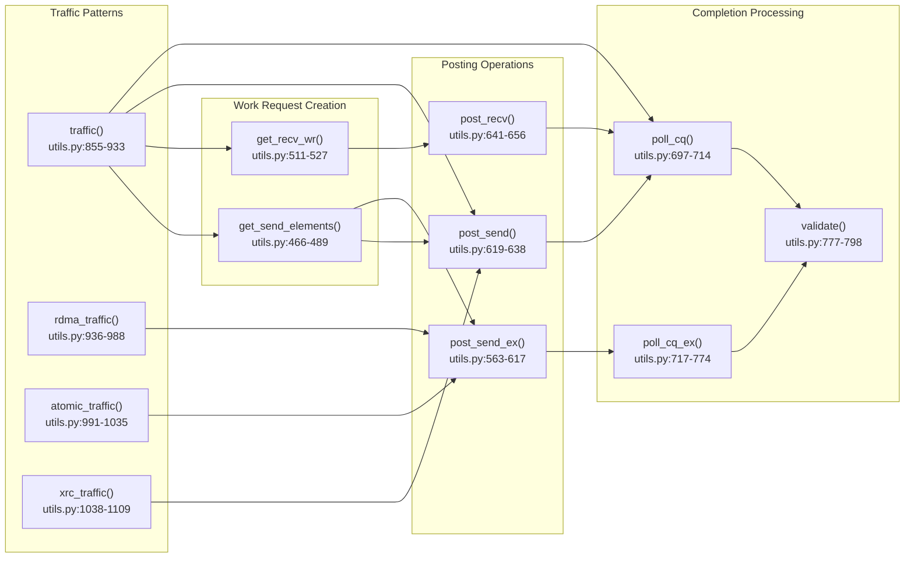

**Key Traffic Functions:**

| Function | Purpose | Key Parameters |
|----------|---------|----------------|
| `traffic()` | Basic send/recv pingpong | client, server, iters, send_op |
| `rdma_traffic()` | RDMA write/read operations | Uses rkey/raddr for remote access |
| `atomic_traffic()` | Atomic compare-and-swap or fetch-and-add | receiver_val, sender_val |
| `xrc_traffic()` | XRC QP traffic with SRQ | Uses send and recv QP lists |
| `raw_traffic()` | Raw packet QP traffic | Ethernet frame construction |

Sources: [tests/utils.py:466-1109]()

### Resource Creation Helpers

**Helper Function Categories**

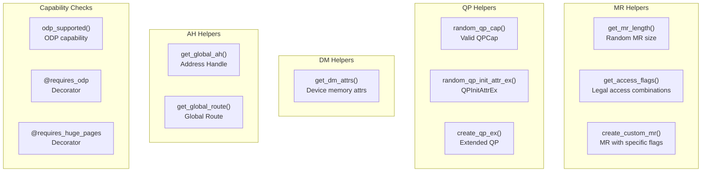

The `get_access_flags()` function ([tests/utils.py:166-196]()) generates all legal combinations of MR access flags, filtering out invalid combinations like remote operations without local write ([tests/utils.py:154-163]()).

The `random_qp_init_attr_ex()` function ([tests/utils.py:334-369]()) creates valid `QPInitAttrEx` objects with randomized parameters constrained by device capabilities, useful for fuzz-style testing.

Sources: [tests/utils.py:143-382](), [tests/utils.py:530-552]()

### Packet Construction

For Raw Packet QP tests, the framework includes packet construction utilities:

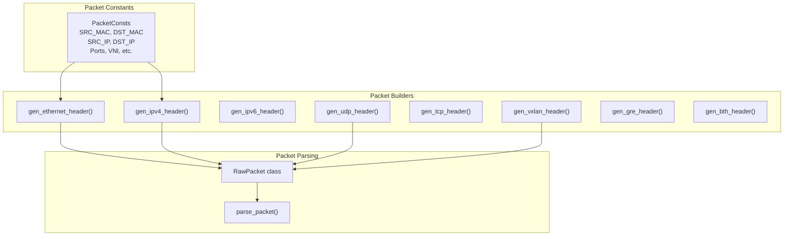

The `PacketConsts` class ([tests/utils.py:68-122]()) provides standard values for constructing test packets with known headers.

Sources: [tests/utils.py:68-122](), [tests/utils.py:1112-1494]()

## Test Organization

Tests are organized by functionality and provider, enabling targeted test execution and clear separation of concerns.

### Test Categories

**Test Organization Structure**

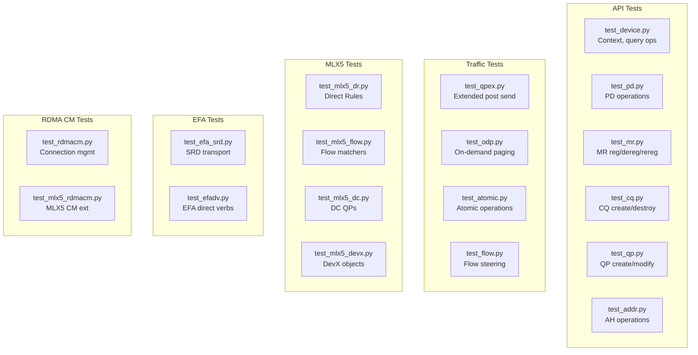

**API Tests** verify individual API operations without traffic. They use `PyverbsAPITestCase` ([tests/base.py:74]()) and focus on object creation, query, and modification operations.

**Traffic Tests** validate data plane operations. They use `RDMATestCase` ([tests/base.py:132]()) to set up two-node simulations and verify data integrity across send/recv or RDMA operations.

**Provider-Specific Tests** exercise vendor extensions and advanced features not available through standard verbs.

Sources: [tests/CMakeLists.txt:4-66]()

### Test Execution Model

**Pytest Execution Flow**

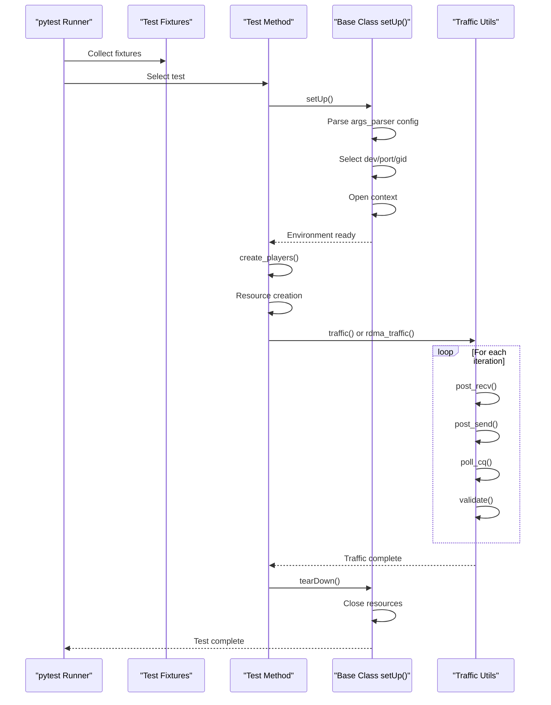

The framework uses `args_parser` ([tests/base.py:22]()) to handle command-line arguments:
- `--dev` - Device name
- `--port` - IB port number  
- `--gid` - GID index

Tests can be run selectively:
```bash
pytest tests/test_device.py  # Single file
pytest tests/test_device.py::DeviceTest::test_query_device  # Single test
pytest tests/ -k mlx5  # All MLX5 tests
```

Sources: [tests/base.py:74-108](), [tests/CMakeLists.txt:68-74]()

### RDMA CM Test Architecture

RDMA CM tests use multiprocessing to simulate active and passive connection sides:

**RDMA CM Test Flow**

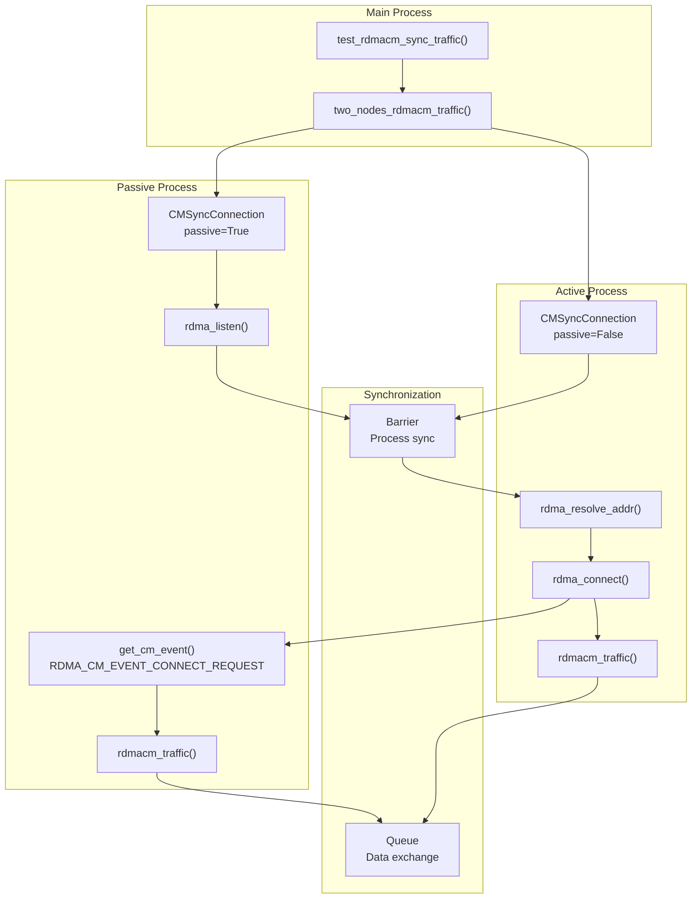

The `CMConnection` abstract base class ([tests/rdmacm_utils.py:23-96]()) defines the connection interface, with implementations:
- `CMSyncConnection` ([tests/rdmacm_utils.py:133]()) - Uses synchronous `rdma_connect()`
- `CMAsyncConnection` ([tests/rdmacm_utils.py:231]()) - Uses asynchronous event handling

Sources: [tests/base.py:375-532](), [tests/rdmacm_utils.py:23-330]()

## Provider-Specific Testing

### MLX5 Testing Infrastructure

MLX5 tests leverage DevX for direct hardware access and advanced features:

**MLX5 Test Components**

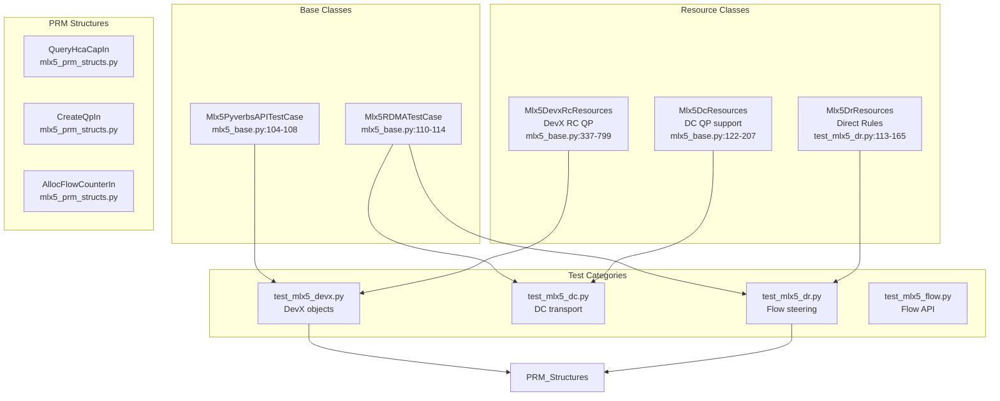

The `mlx5_prm_structs.py` module ([tests/mlx5_prm_structs.py:1-1464]()) uses scapy to define PRM (Programmer's Reference Manual) structures as Python classes, enabling DevX command construction.

**Direct Rules Testing:**

MLX5 Direct Rules tests ([tests/test_mlx5_dr.py:190-1140]()) verify hardware steering capabilities:
- Domain creation via `DrDomain` ([tests/test_mlx5_dr.py:26]())
- Table and matcher setup via `DrTable` ([tests/test_mlx5_dr.py:27]()) and `DrMatcher` ([tests/test_mlx5_dr.py:25]())
- Rule insertion with various actions via `DrRule` ([tests/test_mlx5_dr.py:28]())
- Encap/decap packet reformat via `DrActionPacketReformat` ([tests/test_mlx5_dr.py:17]())

Sources: [tests/mlx5_base.py:104-289](), [tests/test_mlx5_dr.py:113-1140](), [tests/mlx5_prm_structs.py:1-1464]()

### EFA Testing Infrastructure

EFA tests focus on the SRD (Scalable Reliable Datagram) transport:

**EFA Test Structure**

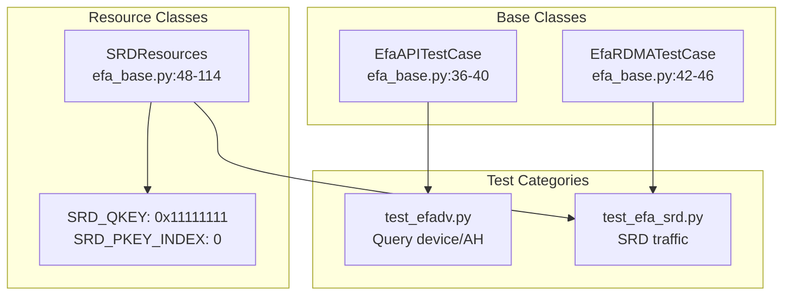

EFA tests use vendor-specific features:
- `EfaCQ` ([tests/utils.py:25]()) with scatter-gather read support
- `efadv` extensions for address resolution and device memory.

Sources: [tests/efa_base.py:1-114](), [tests/test_efa_srd.py:1-140](), [tests/test_efadv.py:1-166]()

## Running and Extending Tests

### Test Execution

Tests are installed via CMake ([tests/CMakeLists.txt:4-74]()) and can be run using pytest:

```bash
# Run all tests
pytest tests/

# Run with device specification
pytest tests/ --dev=mlx5_0 --port=1 --gid=3

# Run specific test categories
pytest tests/test_device.py tests/test_qp.py
```

The `run_tests.py` script ([tests/run_tests.py:69]()) provides a wrapper for test execution with additional filtering options.

### Skip Decorators

The framework provides decorators for conditional test skipping:

| Decorator | Purpose | Source |
|-----------|---------|--------|
| `@skip_unsupported` | Skip if operation returns EOPNOTSUPP | [tests/utils.py:1535-1548]() |
| `@requires_odp()` | Skip if ODP not supported for QP type | [tests/utils.py:1581-1598]() |
| `@requires_huge_pages()` | Skip if huge pages unavailable | [tests/utils.py:1600-1608]() |
| `@requires_root()` | Skip if not running as root | [tests/utils.py:1638-1644]() |
| `@requires_eth()` | Skip if not Ethernet link layer | [tests/utils.py:1646-1652]() |

Sources: [tests/utils.py:1535-1677]()

---

