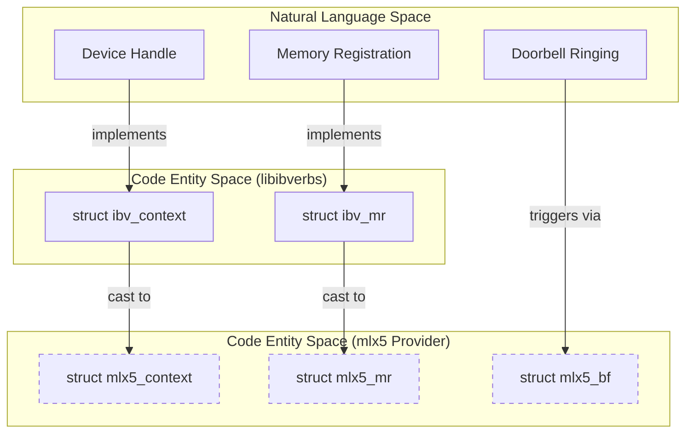
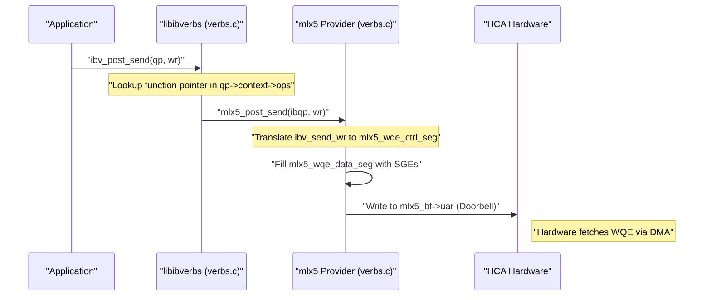

<!-- source: DeepWiki mcp.deepwiki.com · repo linux-rdma/rdma-core · page 8 Glossary · fetched 2026-11-11 -->

# Glossary

Relevant source files

The following files were used as context for generating this wiki page:

- [.mailmap](.mailmap)
- [CMakeLists.txt](CMakeLists.txt)
- [MAINTAINERS](MAINTAINERS)
- [README.md](README.md)
- [buildlib/fixup-include/sys-auxv.h](buildlib/fixup-include/sys-auxv.h)
- [debian/changelog](debian/changelog)
- [debian/compat](debian/compat)
- [debian/control](debian/control)
- [debian/copyright](debian/copyright)
- [debian/ibverbs-providers.symbols](debian/ibverbs-providers.symbols)
- [debian/libibverbs1.symbols](debian/libibverbs1.symbols)
- [debian/rules](debian/rules)
- [debian/source/format](debian/source/format)
- [ibacm/ibacm.socket](ibacm/ibacm.socket)
- [ibacm/include/infiniband/acm_prov.h](ibacm/include/infiniband/acm_prov.h)
- [ibacm/linux/osd.h](ibacm/linux/osd.h)
- [ibacm/prov/acmp/src/acmp.c](ibacm/prov/acmp/src/acmp.c)
- [ibacm/src/acm.c](ibacm/src/acm.c)
- [ibacm/src/acm_util.c](ibacm/src/acm_util.c)
- [ibacm/src/acm_util.h](ibacm/src/acm_util.h)
- [ibacm/src/acme.c](ibacm/src/acme.c)
- [ibacm/src/libacm.c](ibacm/src/libacm.c)
- [ibacm/src/libacm.h](ibacm/src/libacm.h)
- [ibacm/src/parse.c](ibacm/src/parse.c)
- [libibverbs/CMakeLists.txt](libibverbs/CMakeLists.txt)
- [libibverbs/cmd_mr.c](libibverbs/cmd_mr.c)
- [libibverbs/driver.h](libibverbs/driver.h)
- [libibverbs/dummy_ops.c](libibverbs/dummy_ops.c)
- [libibverbs/libibverbs.map.in](libibverbs/libibverbs.map.in)
- [libibverbs/man/CMakeLists.txt](libibverbs/man/CMakeLists.txt)
- [libibverbs/man/ibv_dm_export_dmabuf_fd.3.md](libibverbs/man/ibv_dm_export_dmabuf_fd.3.md)
- [libibverbs/man/ibv_reg_mr.3](libibverbs/man/ibv_reg_mr.3)
- [libibverbs/verbs.c](libibverbs/verbs.c)
- [libibverbs/verbs.h](libibverbs/verbs.h)
- [providers/bnxt_re/CMakeLists.txt](providers/bnxt_re/CMakeLists.txt)
- [providers/bnxt_re/bnxt_re-abi.h](providers/bnxt_re/bnxt_re-abi.h)
- [providers/bnxt_re/db.c](providers/bnxt_re/db.c)
- [providers/bnxt_re/flush.h](providers/bnxt_re/flush.h)
- [providers/bnxt_re/main.c](providers/bnxt_re/main.c)
- [providers/bnxt_re/main.h](providers/bnxt_re/main.h)
- [providers/bnxt_re/memory.c](providers/bnxt_re/memory.c)
- [providers/bnxt_re/memory.h](providers/bnxt_re/memory.h)
- [providers/bnxt_re/verbs.c](providers/bnxt_re/verbs.c)
- [providers/bnxt_re/verbs.h](providers/bnxt_re/verbs.h)
- [providers/efa/efa-abi.h](providers/efa/efa-abi.h)
- [providers/efa/efa.c](providers/efa/efa.c)
- [providers/efa/efa.h](providers/efa/efa.h)
- [providers/efa/efa_io_defs.h](providers/efa/efa_io_defs.h)
- [providers/efa/efa_io_regs_defs.h](providers/efa/efa_io_regs_defs.h)
- [providers/efa/man/efadv_create_cq.3.md](providers/efa/man/efadv_create_cq.3.md)
- [providers/efa/man/efadv_create_qp_ex.3.md](providers/efa/man/efadv_create_qp_ex.3.md)
- [providers/efa/man/efadv_query_device.3.md](providers/efa/man/efadv_query_device.3.md)
- [providers/efa/verbs.c](providers/efa/verbs.c)
- [providers/efa/verbs.h](providers/efa/verbs.h)
- [providers/hns/hns_roce_u.c](providers/hns/hns_roce_u.c)
- [providers/hns/hns_roce_u.h](providers/hns/hns_roce_u.h)
- [providers/hns/hns_roce_u_abi.h](providers/hns/hns_roce_u_abi.h)
- [providers/hns/hns_roce_u_buf.c](providers/hns/hns_roce_u_buf.c)
- [providers/hns/hns_roce_u_db.c](providers/hns/hns_roce_u_db.c)
- [providers/hns/hns_roce_u_db.h](providers/hns/hns_roce_u_db.h)
- [providers/hns/hns_roce_u_hw_v2.c](providers/hns/hns_roce_u_hw_v2.c)
- [providers/hns/hns_roce_u_hw_v2.h](providers/hns/hns_roce_u_hw_v2.h)
- [providers/hns/hns_roce_u_verbs.c](providers/hns/hns_roce_u_verbs.c)
- [providers/hns/hnsdv.h](providers/hns/hnsdv.h)
- [providers/hns/libhns.map](providers/hns/libhns.map)
- [providers/mlx5/CMakeLists.txt](providers/mlx5/CMakeLists.txt)
- [providers/mlx5/dr_action.c](providers/mlx5/dr_action.c)
- [providers/mlx5/dr_dbg.c](providers/mlx5/dr_dbg.c)
- [providers/mlx5/dr_devx.c](providers/mlx5/dr_devx.c)
- [providers/mlx5/dr_domain.c](providers/mlx5/dr_domain.c)
- [providers/mlx5/dr_icm_pool.c](providers/mlx5/dr_icm_pool.c)
- [providers/mlx5/dr_matcher.c](providers/mlx5/dr_matcher.c)
- [providers/mlx5/dr_rule.c](providers/mlx5/dr_rule.c)
- [providers/mlx5/dr_send.c](providers/mlx5/dr_send.c)
- [providers/mlx5/dr_ste.c](providers/mlx5/dr_ste.c)
- [providers/mlx5/dr_ste.h](providers/mlx5/dr_ste.h)
- [providers/mlx5/dr_ste_v0.c](providers/mlx5/dr_ste_v0.c)
- [providers/mlx5/dr_ste_v1.c](providers/mlx5/dr_ste_v1.c)
- [providers/mlx5/dr_table.c](providers/mlx5/dr_table.c)
- [providers/mlx5/libmlx5.map](providers/mlx5/libmlx5.map)
- [providers/mlx5/man/CMakeLists.txt](providers/mlx5/man/CMakeLists.txt)
- [providers/mlx5/man/mlx5dv_dek_create.3.md](providers/mlx5/man/mlx5dv_dek_create.3.md)
- [providers/mlx5/man/mlx5dv_dr_flow.3.md](providers/mlx5/man/mlx5dv_dr_flow.3.md)
- [providers/mlx5/man/mlx5dv_query_device.3](providers/mlx5/man/mlx5dv_query_device.3)
- [providers/mlx5/mlx5-abi.h](providers/mlx5/mlx5-abi.h)
- [providers/mlx5/mlx5.c](providers/mlx5/mlx5.c)
- [providers/mlx5/mlx5.h](providers/mlx5/mlx5.h)
- [providers/mlx5/mlx5_ifc.h](providers/mlx5/mlx5_ifc.h)
- [providers/mlx5/mlx5dv.h](providers/mlx5/mlx5dv.h)
- [providers/mlx5/mlx5dv_dr.h](providers/mlx5/mlx5dv_dr.h)
- [providers/mlx5/verbs.c](providers/mlx5/verbs.c)
- [redhat/rdma-core.spec](redhat/rdma-core.spec)
- [srp_daemon/srp_daemon.c](srp_daemon/srp_daemon.c)
- [srp_daemon/srp_daemon.h](srp_daemon/srp_daemon.h)
- [srp_daemon/srp_handle_traps.c](srp_daemon/srp_handle_traps.c)
- [srp_daemon/srp_ib_types.h](srp_daemon/srp_ib_types.h)
- [srp_daemon/srp_sync.c](srp_daemon/srp_sync.c)
- [srp_daemon/srpd.in](srp_daemon/srpd.in)
- [suse/rdma-core.spec](suse/rdma-core.spec)
- [util/mmio.c](util/mmio.c)
- [util/mmio.h](util/mmio.h)
- [util/s390_mmio_insn.h](util/s390_mmio_insn.h)
- [util/udma_barrier.h](util/udma_barrier.h)

This glossary defines codebase-specific terms, hardware-specific jargon, and domain concepts used throughout the `rdma-core` repository. It provides technical definitions and maps these concepts to specific structures and implementation files.

## Core Domain Concepts

### Verbs (libibverbs)
The fundamental RDMA programming interface. "Verbs" refer to the abstract operations (e.g., Post Send, Poll CQ) defined by the InfiniBand Architecture.
*   **Context (`struct ibv_context`)**: A handle to an opened RDMA device. It is the root object for all other resource allocations. [libibverbs/verbs.h:1754-1772]().
*   **Protection Domain (PD)**: A container that groups RDMA resources (Queue Pairs, Memory Regions) to ensure they can only interact with each other, providing a layer of isolation. [libibverbs/verbs.h:1033-1037]().
*   **Queue Pair (QP)**: The primary communication endpoint. Consists of a Send Queue (SQ) and a Receive Queue (RQ). [libibverbs/verbs.h:1200-1232]().
*   **Completion Queue (CQ)**: A queue where the hardware places Completion Queue Entries (CQEs) to notify the software that a Work Request (WR) has finished. [libibverbs/verbs.h:1161-1175]().

### Connection Management (librdmacm)
A library used to set up connections between RDMA nodes, abstracting the differences between InfiniBand (LID/GID based) and RoCE/iWARP (IP based) addressing.

### Provider
A hardware-specific userspace driver (plugin) that implements the device-specific logic for the `libibverbs` abstract interface. Providers are located in the `providers/` directory. [debian/control:63-107]().

---

## Hardware-Specific Jargon (MLX5)

The Mellanox (NVIDIA) `mlx5` provider introduces several specific terms related to its hardware architecture.

### WQE (Work Queue Element)
Pronounced "Wookie." The hardware-specific descriptor for an RDMA operation. In `mlx5`, these are represented by various structures in `providers/mlx5/wqe.h`.
*   **Control Segment**: The first part of every WQE, containing the opcode and size. [providers/mlx5/mlx5.h:592-601]().

### CQE (Completion Queue Entry)
The hardware-specific descriptor indicating the result of an operation. `mlx5` supports multiple versions (V0 and V1). [providers/mlx5/mlx5.h:69-72]().

### UAR (User Access Region)
A page of memory mapped directly from the HCA (Host Channel Adapter) hardware into the userspace process. It is used to "ring doorbells" to notify the hardware of new work. [providers/mlx5/verbs.c:177-200]().
*   **BlueFlame (BF)**: A mechanism within the UAR that allows writing the WQE directly to the doorbell register to reduce latency. [providers/mlx5/mlx5.h:160-162]().

### Direct Rules (DR)
A high-performance flow steering subsystem within the `mlx5` provider that allows userspace to manage hardware steering tables directly.
*   **STE (Steering Table Entry)**: The low-level hardware entry in a steering table. [providers/mlx5/dr_ste.c:1-50]().
*   **Matcher**: A rule template that defines which packet fields to match. [providers/mlx5/dr_matcher.c:1-40]().

---

## Technical Abbreviations

| Abbreviation | Full Name | Description |
| :--- | :--- | :--- |
| **HCA** | Host Channel Adapter | The RDMA network interface card (NIC). |
| **LID** | Local Identifier | A 16-bit address assigned to a node in an InfiniBand subnet. [srp_daemon/srp_daemon.c:82-83](). |
| **GID** | Global Identifier | A 128-bit address used for routing between subnets. [libibverbs/verbs.h:65-71](). |
| **MR** | Memory Region | A buffer registered with the HCA so the hardware can access it directly via DMA. [libibverbs/verbs.h:1046-1056](). |
| **SGE** | Scatter/Gather Element | A pointer and length pair used to describe a memory buffer in a WQE. [libibverbs/verbs.h:1241-1245](). |
| **SRQ** | Shared Receive Queue | A queue of receive buffers shared by multiple QPs. [libibverbs/verbs.h:1111-1122](). |

---

## Resource Lifecycle & Data Flow

The following diagram illustrates the relationship between standard Verbs entities and their provider-specific implementations (using `mlx5` as the example).

### Natural Language to Code Entity Mapping: Resources

**Sources:** [providers/mlx5/mlx5.h:262-315](), [providers/mlx5/verbs.c:154-175](), [libibverbs/verbs.h:1754-1772]()

### Work Submission Data Flow
This diagram tracks how a generic `ibv_post_send` call translates into hardware-specific structures.

**Sources:** [providers/mlx5/mlx5.c:98-181](), [providers/mlx5/verbs.c:125-131](), [libibverbs/verbs.h:2058-2065]()

---

## Provider Implementation Details

### HNS (HiSilicon Network Subsystem)
The `hns` provider is used for HiSilicon RoCE hardware.
*   **DB (Doorbell)**: Managed via `hns_roce_u_db.h`. [providers/hns/hns_roce_u_hw_v2.c:39]().
*   **V2 WQE**: The hardware-specific descriptor format for Hip08+ SoCs. [providers/hns/hns_roce_u_hw_v2.c:80-86]().

### EFA (Elastic Fabric Adapter)
The `efa` provider is optimized for AWS environments.
*   **LLQ (Low Latency Queue)**: A specific mode where WQEs are pushed directly to the device. [providers/efa/verbs.c:95-96]().
*   **Device Caps**: EFA-specific capabilities like `RNR_RETRY` and `CQ_WITH_SGID`. [providers/efa/verbs.c:174-186]().

### SRP (SCSI RDMA Protocol)
A protocol for accessing SCSI devices over RDMA.
*   **srp_daemon**: Discovers SRP targets and manages connections. [srp_daemon/srp_daemon.c:1-38]().
*   **MAD (Management Datagram)**: Used by the daemon to query the Subnet Administrator (SA) for target information. [srp_daemon/srp_daemon.c:63-65]().

**Sources:**
*   [providers/mlx5/verbs.c:1-100]()
*   [providers/hns/hns_roce_u_hw_v2.c:1-100]()
*   [providers/efa/verbs.c:1-150]()
*   [libibverbs/verbs.h:1-200]()
*   [srp_daemon/srp_daemon.c:1-100]()
*   [CMakeLists.txt:80-140]()