# Page: Overview

# Overview

<details>
<summary>Relevant source files</summary>

The following files were used as context for generating this wiki page:

- [.mailmap](.mailmap)
- [CMakeLists.txt](CMakeLists.txt)
- [MAINTAINERS](MAINTAINERS)
- [README.md](README.md)
- [debian/changelog](debian/changelog)
- [debian/compat](debian/compat)
- [debian/control](debian/control)
- [debian/copyright](debian/copyright)
- [debian/libibverbs1.symbols](debian/libibverbs1.symbols)
- [debian/rules](debian/rules)
- [debian/source/format](debian/source/format)
- [kernel-headers/CMakeLists.txt](kernel-headers/CMakeLists.txt)
- [kernel-headers/rdma/bnxt_re-abi.h](kernel-headers/rdma/bnxt_re-abi.h)
- [kernel-headers/rdma/cxgb4-abi.h](kernel-headers/rdma/cxgb4-abi.h)
- [kernel-headers/rdma/erdma-abi.h](kernel-headers/rdma/erdma-abi.h)
- [kernel-headers/rdma/hfi/hfi1_user.h](kernel-headers/rdma/hfi/hfi1_user.h)
- [kernel-headers/rdma/hns-abi.h](kernel-headers/rdma/hns-abi.h)
- [kernel-headers/rdma/ib_user_ioctl_cmds.h](kernel-headers/rdma/ib_user_ioctl_cmds.h)
- [kernel-headers/rdma/ib_user_ioctl_verbs.h](kernel-headers/rdma/ib_user_ioctl_verbs.h)
- [kernel-headers/rdma/ib_user_mad.h](kernel-headers/rdma/ib_user_mad.h)
- [kernel-headers/rdma/ib_user_verbs.h](kernel-headers/rdma/ib_user_verbs.h)
- [kernel-headers/rdma/ionic-abi.h](kernel-headers/rdma/ionic-abi.h)
- [kernel-headers/rdma/mana-abi.h](kernel-headers/rdma/mana-abi.h)
- [kernel-headers/rdma/mlx4-abi.h](kernel-headers/rdma/mlx4-abi.h)
- [kernel-headers/rdma/mlx5-abi.h](kernel-headers/rdma/mlx5-abi.h)
- [kernel-headers/rdma/mthca-abi.h](kernel-headers/rdma/mthca-abi.h)
- [kernel-headers/rdma/ocrdma-abi.h](kernel-headers/rdma/ocrdma-abi.h)
- [kernel-headers/rdma/qedr-abi.h](kernel-headers/rdma/qedr-abi.h)
- [kernel-headers/rdma/rdma_user_ioctl_cmds.h](kernel-headers/rdma/rdma_user_ioctl_cmds.h)
- [kernel-headers/rdma/rdma_user_rxe.h](kernel-headers/rdma/rdma_user_rxe.h)
- [kernel-headers/rdma/siw-abi.h](kernel-headers/rdma/siw-abi.h)
- [kernel-headers/rdma/vmw_pvrdma-abi.h](kernel-headers/rdma/vmw_pvrdma-abi.h)
- [libibverbs/CMakeLists.txt](libibverbs/CMakeLists.txt)
- [libibverbs/cmd_mr.c](libibverbs/cmd_mr.c)
- [libibverbs/driver.h](libibverbs/driver.h)
- [libibverbs/dummy_ops.c](libibverbs/dummy_ops.c)
- [libibverbs/libibverbs.map.in](libibverbs/libibverbs.map.in)
- [libibverbs/man/CMakeLists.txt](libibverbs/man/CMakeLists.txt)
- [libibverbs/man/ibv_dm_export_dmabuf_fd.3.md](libibverbs/man/ibv_dm_export_dmabuf_fd.3.md)
- [libibverbs/man/ibv_reg_mr.3](libibverbs/man/ibv_reg_mr.3)
- [libibverbs/verbs.c](libibverbs/verbs.c)
- [libibverbs/verbs.h](libibverbs/verbs.h)
- [providers/siw/siw.c](providers/siw/siw.c)
- [redhat/rdma-core.spec](redhat/rdma-core.spec)
- [suse/rdma-core.spec](suse/rdma-core.spec)

</details>


## Purpose and Scope

This document provides a comprehensive overview of the **rdma-core** project, which serves as the complete userspace infrastructure for the Linux kernel RDMA (Remote Direct Memory Access) subsystem. It covers the repository structure, core libraries, hardware provider plugins, service daemons, language bindings, and the build/distribution system.

rdma-core is the consolidated userspace component for the Linux kernel's `drivers/infiniband` subsystem. It provides the libraries and daemons necessary to utilize **InfiniBand**, **iWARP**, and **RoCE** (RDMA over Converged Ethernet) protocols.

The project manages userspace access to the following kernel device nodes:
- `/dev/infiniband/uverbsX` (handled by `libibverbs`) [README.md:9]()
- `/dev/infiniband/rdma_cm` (handled by `librdmacm`) [README.md:10]()
- `/dev/infiniband/umadX` (handled by `libibumad`) [README.md:11]()

**Sources:** [README.md:1-12](), [debian/control:39-50](), [libibverbs/verbs.h:1-50]()

---

## Repository Structure and Components

The rdma-core repository is organized into distinct functional areas to support a modular plugin architecture:

| Directory | Purpose | Key Components |
|-----------|---------|----------------|
| `libibverbs/` | Core Verbs API | Device management, resource allocation, and operation dispatch [libibverbs/verbs.c:1-100]() |
| `librdmacm/` | Connection Management | Address resolution and RDMA connection setup [debian/control:197-205]() |
| `libibumad/` | Management Datagrams | Interface for sending/receiving IB Management Datagrams [README.md:11]() |
| `providers/` | Hardware Drivers | Vendor-specific plugins (e.g., `mlx5`, `hns`, `efa`) [README.md:13-34]() |
| `pyverbs/` | Python Bindings | Cython-based wrappers for the RDMA stack [redhat/rdma-core.spec:33-40]() |
| `srp_daemon/` | Storage Protocol | SCSI RDMA Protocol discovery and connection daemon [README.md:37]() |
| `ibacm/` | IB CM Assistant | Name and route resolution service [debian/control:55-61]() |
| `iwpmd/` | iWARP Port Mapper | Userspace helper for iWARP TCP port claiming [debian/control:48-50]() |

**Sources:** [README.md:1-40](), [debian/control:1-150](), [CMakeLists.txt:80-130]()

---

## System Architecture: Layered Model

The architecture follows a plugin-based design where applications use a hardware-agnostic API, while hardware-specific details are encapsulated in provider plugins.

### Architecture Data Flow

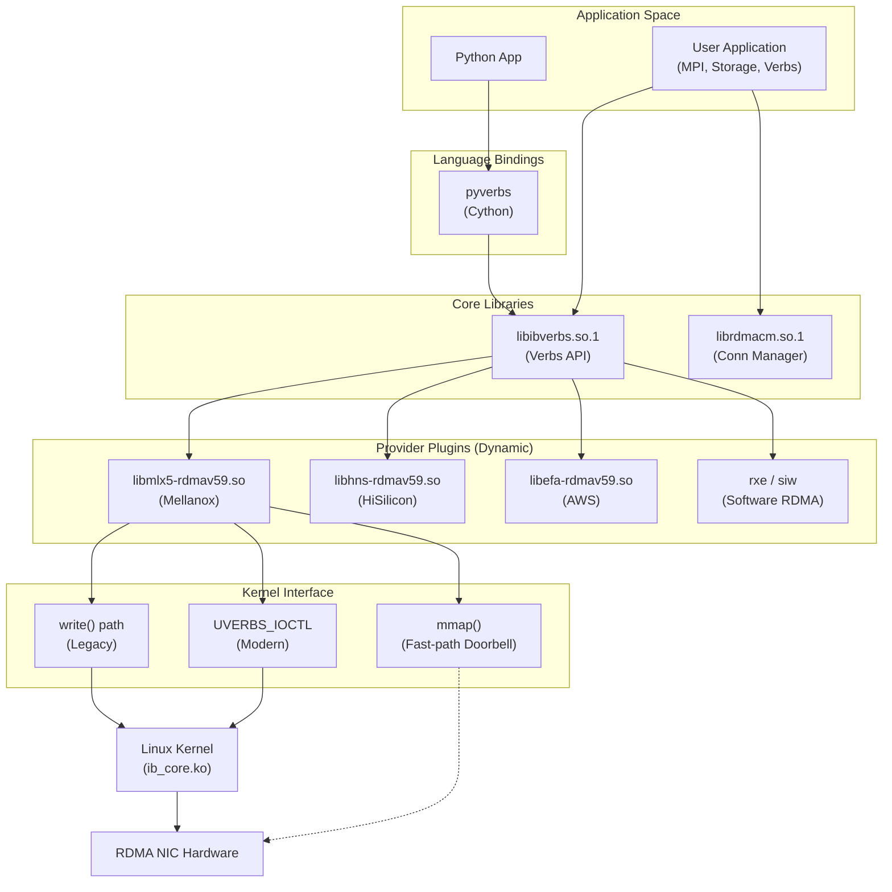

**Architecture Implementation Details**

1.  **Core Libraries**: Provide the standard API (`ibv_*` functions). They perform device discovery by scanning `/sys/class/infiniband/` [libibverbs/verbs.c:174-195]().
2.  **Provider Plugins**: Shared libraries loaded at runtime based on the device's hardware ID. They implement the `verbs_device_ops` and `verbs_context_ops` function pointer tables [libibverbs/driver.h:218-267]().
3.  **Kernel Bypass**: Performance-critical operations (Send/Receive/Poll) often bypass the kernel by writing directly to hardware-mapped memory (Doorbells) via `mmap` [libibverbs/driver.h:107-111]().
4.  **Control Path**: Resource management (creating QPs, CQs) uses either the legacy `write()` path or the modern `ioctl()` path [CMakeLists.txt:29-31]().

**Sources:** [libibverbs/verbs.h:1-150](), [libibverbs/driver.h:1-200](), [README.md:1-35](), [libibverbs/verbs.c:163-195]()

---

## Core Libraries

### libibverbs: The Foundation
`libibverbs` provides the standard "Verbs" API. It handles the lifecycle of RDMA resources.

| Entity | Code Reference | Description |
|--------|----------------|-------------|
| `ibv_context` | [libibverbs/verbs.h:171-175]() | The primary handle for an opened RDMA device. |
| `ibv_pd` | [libibverbs/verbs.h:199]() | Protection Domain; provides isolation for resources. |
| `ibv_mr` | [libibverbs/verbs.h:164-168]() | Memory Region; registered memory available for RDMA. |
| `ibv_qp` | [libibverbs/verbs.h:175-182]() | Queue Pair; the endpoint for RDMA communication. |
| `ibv_cq` | [libibverbs/verbs.h:185-190]() | Completion Queue; holds Work Completions (`ibv_wc`). |

**Sources:** [libibverbs/verbs.h:1-223](), [libibverbs/libibverbs.map.in:2-40]()

### librdmacm: Connection Management
`librdmacm` simplifies connection establishment by using IP addresses instead of GIDs/LIDs. It sits on top of `libibverbs` and handles the RDMA Connection Manager (CM) protocol [debian/control:203-205]().

---

## Hardware Provider Architecture

Providers are dynamic plugins that implement the backend for `libibverbs`. They are identified by the `IBVERBS_PROVIDER_SUFFIX` which includes the PABI version (currently 59) [CMakeLists.txt:87-88]().

### Provider Discovery and Matching

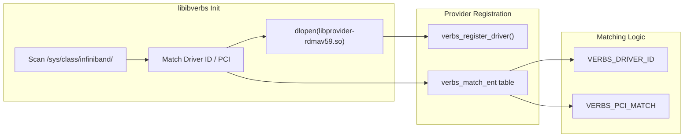

Providers use specific macros to register their hardware compatibility:
- `VERBS_DRIVER_ID`: Matches based on the kernel driver string [libibverbs/driver.h:235-238]().
- `VERBS_PCI_MATCH`: Matches based on PCI Vendor and Device IDs [libibverbs/driver.h:242-248]().

**Major Providers:**
- **mlx5**: Support for NVIDIA/Mellanox ConnectX-4 and newer [debian/control:100]().
- **hns**: Support for HiSilicon RoCE adapters [debian/control:94]().
- **efa**: Support for AWS Elastic Fabric Adapter [debian/control:91]().
- **rxe/siw**: Software implementations of RoCE and iWARP for testing [debian/control:104-105]().

**Sources:** [libibverbs/driver.h:218-267](), [README.md:13-35](), [debian/control:63-107]()

---

## Build and Distribution

rdma-core uses a **CMake** and **Ninja** based build system [CMakeLists.txt:4-5]().

### Build Configuration
The build system supports various configurations via CMake flags:
- `IN_PLACE=1`: Configures the build to run from the `build/` directory without installation [CMakeLists.txt:8-10]().
- `ENABLE_STATIC=1`: Produces static libraries in addition to shared ones [CMakeLists.txt:21-22]().
- `NO_PYVERBS=1`: Disables the compilation of Python bindings [CMakeLists.txt:45]().

### Packaging
The repository includes specifications for major Linux distributions:
- **Debian**: Metadata in `debian/` directory [debian/control:1-50]().
- **Red Hat**: Spec file at `redhat/rdma-core.spec` [redhat/rdma-core.spec:1-10]().
- **SUSE**: Spec file at `suse/rdma-core.spec` [suse/rdma-core.spec:30-35]().

On non-coherent DMA architectures (e.g., certain ARM/MIPS), specific hardware providers like `mlx5` or `hns` are automatically excluded during the build process to prevent stability issues [debian/rules:11-13](), [debian/rules:65-70]().

**Sources:** [CMakeLists.txt:1-60](), [debian/rules:1-80](), [redhat/rdma-core.spec:1-100](), [suse/rdma-core.spec:1-100]()

---

# Page: Core Libraries

# Core Libraries

<details>
<summary>Relevant source files</summary>

The following files were used as context for generating this wiki page:

- [debian/libibnetdisc5.symbols](debian/libibnetdisc5.symbols)
- [debian/libibumad-dev.install](debian/libibumad-dev.install)
- [debian/libibverbs1.symbols](debian/libibverbs1.symbols)
- [debian/librdmacm-dev.install](debian/librdmacm-dev.install)
- [debian/librdmacm1.symbols](debian/librdmacm1.symbols)
- [infiniband-diags/CMakeLists.txt](infiniband-diags/CMakeLists.txt)
- [infiniband-diags/ibdiag_common.c](infiniband-diags/ibdiag_common.c)
- [kernel-headers/rdma/rdma_user_ioctl.h](kernel-headers/rdma/rdma_user_ioctl.h)
- [libibnetdisc/CMakeLists.txt](libibnetdisc/CMakeLists.txt)
- [libibnetdisc/chassis.c](libibnetdisc/chassis.c)
- [libibnetdisc/chassis.h](libibnetdisc/chassis.h)
- [libibnetdisc/ibnetdisc.c](libibnetdisc/ibnetdisc.c)
- [libibnetdisc/ibnetdisc_cache.c](libibnetdisc/ibnetdisc_cache.c)
- [libibnetdisc/ibnetdisc_osd.h](libibnetdisc/ibnetdisc_osd.h)
- [libibnetdisc/internal.h](libibnetdisc/internal.h)
- [libibnetdisc/libibnetdisc.map](libibnetdisc/libibnetdisc.map)
- [libibnetdisc/man/CMakeLists.txt](libibnetdisc/man/CMakeLists.txt)
- [libibverbs/CMakeLists.txt](libibverbs/CMakeLists.txt)
- [libibverbs/cmd.c](libibverbs/cmd.c)
- [libibverbs/cmd_counters.c](libibverbs/cmd_counters.c)
- [libibverbs/cmd_cq.c](libibverbs/cmd_cq.c)
- [libibverbs/cmd_dm.c](libibverbs/cmd_dm.c)
- [libibverbs/cmd_fallback.c](libibverbs/cmd_fallback.c)
- [libibverbs/cmd_flow_action.c](libibverbs/cmd_flow_action.c)
- [libibverbs/cmd_ioctl.c](libibverbs/cmd_ioctl.c)
- [libibverbs/cmd_ioctl.h](libibverbs/cmd_ioctl.h)
- [libibverbs/cmd_mr.c](libibverbs/cmd_mr.c)
- [libibverbs/cmd_write.h](libibverbs/cmd_write.h)
- [libibverbs/compat-1_0.c](libibverbs/compat-1_0.c)
- [libibverbs/device.c](libibverbs/device.c)
- [libibverbs/driver.h](libibverbs/driver.h)
- [libibverbs/dummy_ops.c](libibverbs/dummy_ops.c)
- [libibverbs/ibdev_nl.c](libibverbs/ibdev_nl.c)
- [libibverbs/ibverbs.h](libibverbs/ibverbs.h)
- [libibverbs/init.c](libibverbs/init.c)
- [libibverbs/kern-abi.h](libibverbs/kern-abi.h)
- [libibverbs/libibverbs.map.in](libibverbs/libibverbs.map.in)
- [libibverbs/man/CMakeLists.txt](libibverbs/man/CMakeLists.txt)
- [libibverbs/man/ibv_alloc_dm.3](libibverbs/man/ibv_alloc_dm.3)
- [libibverbs/man/ibv_create_flow.3](libibverbs/man/ibv_create_flow.3)
- [libibverbs/man/ibv_dm_export_dmabuf_fd.3.md](libibverbs/man/ibv_dm_export_dmabuf_fd.3.md)
- [libibverbs/man/ibv_is_fork_initialized.3.md](libibverbs/man/ibv_is_fork_initialized.3.md)
- [libibverbs/man/ibv_reg_mr.3](libibverbs/man/ibv_reg_mr.3)
- [libibverbs/memory.c](libibverbs/memory.c)
- [libibverbs/verbs.c](libibverbs/verbs.c)
- [libibverbs/verbs.h](libibverbs/verbs.h)
- [librdmacm/CMakeLists.txt](librdmacm/CMakeLists.txt)
- [librdmacm/cma.c](librdmacm/cma.c)
- [librdmacm/ib.h](librdmacm/ib.h)
- [librdmacm/librdmacm.map](librdmacm/librdmacm.map)
- [librdmacm/man/rdma_establish.3.md](librdmacm/man/rdma_establish.3.md)
- [librdmacm/man/rdma_join_multicast_ex.3](librdmacm/man/rdma_join_multicast_ex.3)
- [librdmacm/rdma_cma.h](librdmacm/rdma_cma.h)
- [librdmacm/rdma_cma_abi.h](librdmacm/rdma_cma_abi.h)
- [util/open_cdev.c](util/open_cdev.c)
- [util/rdma_nl.c](util/rdma_nl.c)
- [util/rdma_nl.h](util/rdma_nl.h)

</details>


The rdma-core project provides four primary userspace libraries that form the foundation of RDMA programming on Linux. These libraries abstract hardware specifics and kernel interfaces, providing standardized APIs for different aspects of RDMA functionality.

| Library | Shared Object | Purpose | Primary Header |
|---------|--------------|---------|----------------|
| **libibverbs** | `libibverbs.so.1` | RDMA Verbs API - core data path operations | `infiniband/verbs.h` |
| **librdmacm** | `librdmacm.so.1` | Connection management with socket-like API | `rdma/rdma_cma.h` |
| **libibumad** | `libibumad.so.3` | Management datagrams for subnet administration | `infiniband/umad.h` |
| **libibnetdisc** | `libibnetdisc.so.5` | InfiniBand network topology discovery | `infiniband/ibnetdisc.h` |

For detailed information about:
- The libibverbs Verbs API implementation and provider architecture, see [libibverbs](#2.1)
- The RDMA Connection Manager library, see [librdmacm](#2.2)
- The InfiniBand network discovery library, see [libibnetdisc](#2.3)
- Hardware-specific provider implementations, see [RDMA Providers](#3)

Sources: [libibverbs/CMakeLists.txt:1-59](), [librdmacm/CMakeLists.txt:1-50](), [libibnetdisc/CMakeLists.txt:1-40]()

## Library Architecture Overview

**Architecture: Core Libraries and Their Kernel Interfaces**

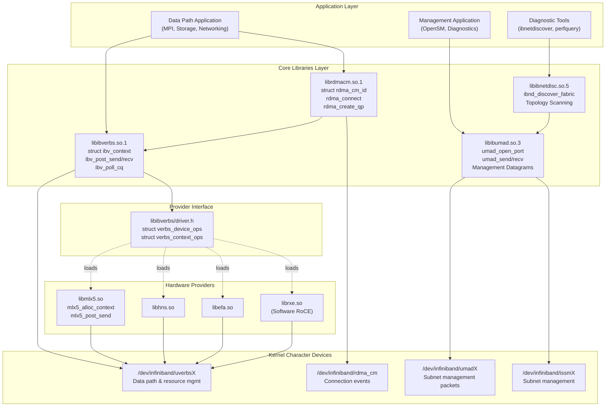

Sources: [libibverbs/verbs.h:95-113](), [libibverbs/driver.h:218-267](), [librdmacm/cma.c:101-121]()

## Core Library Descriptions

### libibverbs: Verbs API Library

The `libibverbs` library provides the fundamental RDMA Verbs API, implementing direct userspace access to RDMA hardware. It is the lowest-level library that all RDMA applications use, either directly or indirectly.

**Key Responsibilities:**
- Device enumeration and context creation (`ibv_get_device_list`, `ibv_open_device`) [libibverbs/device.c:54-96]()
- Resource allocation (Protection Domains, Memory Regions, Queue Pairs, Completion Queues) [libibverbs/verbs.h:1700-1800]()
- Data path operations (`ibv_post_send`, `ibv_post_recv`, `ibv_poll_cq`) [libibverbs/verbs.h:1850-1950]()
- Provider plugin architecture for hardware-specific implementations [libibverbs/driver.h:295-479]()
- Memory registration and management [libibverbs/cmd.c:99-138]()

**Location:** [libibverbs/]()  
**Build Artifacts:** `libibverbs.so.1.16.x` [libibverbs/CMakeLists.txt:22-24]()  
**Symbol Versioning:** IBVERBS_1.0 through IBVERBS_1.16 [libibverbs/libibverbs.map.in:1-178]()

The library uses a provider plugin system where hardware-specific implementations (e.g., `libmlx5.so`) are dynamically loaded based on detected hardware. See [libibverbs](#2.1) for detailed documentation.

Sources: [libibverbs/verbs.h:1-100](), [libibverbs/driver.h:295-324](), [libibverbs/CMakeLists.txt:1-65]()

### librdmacm: Connection Manager Library

The `librdmacm` library provides connection-oriented semantics on top of libibverbs, offering a socket-like API for RDMA connection establishment and management.

**Key Responsibilities:**
- Address resolution and binding [librdmacm/cma.c:187-205]()
- Connection establishment and event-driven management [librdmacm/cma.c:136-141]()
- Automatic Queue Pair creation and integration with Verbs [librdmacm/cma.c:113-121]()
- Support for both InfiniBand and RoCE/iWARP transports [librdmacm/cma.c:247-254]()

**Location:** [librdmacm/]()  
**Character Device:** `/dev/infiniband/rdma_cm` [librdmacm/cma.c:148-150]()

The library handles the complexities of RDMA connection setup, making it easier for applications to establish reliable connections similar to TCP sockets. See [librdmacm](#2.2) for detailed documentation.

Sources: [librdmacm/cma.c:1-254](), [librdmacm/rdma_cma.h:1-100]()

### libibnetdisc: Network Discovery Library

The `libibnetdisc` library provides InfiniBand fabric topology discovery and analysis capabilities.

**Key Responsibilities:**
- Fabric topology discovery and scanning [libibnetdisc/ibnetdisc.c:1-100]()
- Node and port iteration across the fabric
- Fabric configuration caching and chassis management [libibnetdisc/chassis.c:1-50]()

**Location:** [libibnetdisc/]()  
**Dependencies:** `libibumad.so.3`

Diagnostic tools like `ibnetdiscover` use this library to map out the complete InfiniBand network topology. See [libibnetdisc](#2.3) for detailed documentation.

Sources: [libibnetdisc/ibnetdisc.c:1-100](), [libibnetdisc/CMakeLists.txt:1-40]()

## libibverbs Provider Plugin Architecture

The libibverbs library uses a dynamic provider plugin system to support multiple hardware vendors through a common API.

**Provider Plugin Loading and Operation Dispatch**

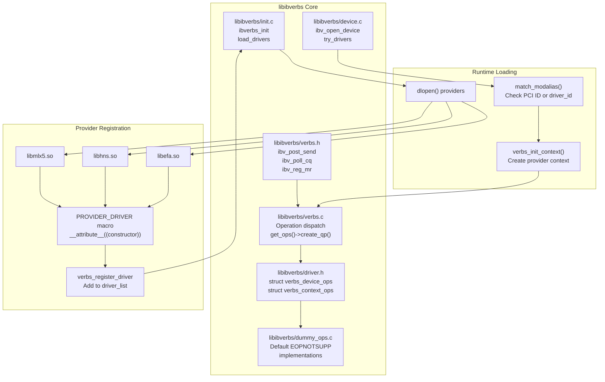

### Provider Operation Tables

Each provider implements operation structures defined in `libibverbs/driver.h`:

- **`struct verbs_device_ops`**: Handles device matching and context allocation [libibverbs/driver.h:240-255]()
- **`struct verbs_context_ops`**: Contains the function pointers for all verbs operations (e.g., `post_send`, `poll_cq`) [libibverbs/ibverbs.h:86-88]()

Operations not implemented by a provider default to `libibverbs/dummy_ops.c` which returns `EOPNOTSUPP`. [libibverbs/verbs.c:163-172]()

Sources: [libibverbs/driver.h:218-267](), [libibverbs/init.c:240-255](), [libibverbs/device.c:230-258]()

## Library Initialization and Command Dispatch

**Device Discovery and Context Creation Flow**

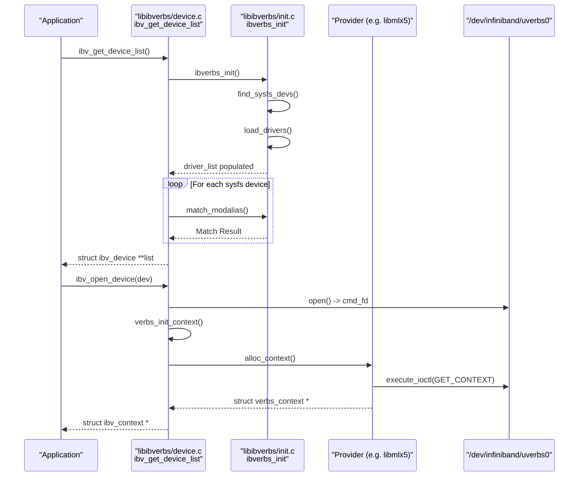

### Command Dispatch Mechanisms

The core libraries communicate with the kernel via two primary methods:

1. **Legacy Write-Based Commands**: Uses `write()` syscall with fixed structures [libibverbs/cmd.c:56-57]()
2. **Modern IOCTL-Based Commands**: Uses `ioctl()` with extensible attributes [libibverbs/device.c:203-223]()

The `execute_cmd_write` and `execute_ioctl` functions abstract these kernel interfaces for the providers. [libibverbs/cmd.c:56-57](), [libibverbs/device.c:217-218]()

Sources: [libibverbs/device.c:54-96](), [libibverbs/init.c:204-238](), [libibverbs/cmd.c:50-65]()

## ABI Versioning and Compatibility

The libibverbs library uses ELF symbol versioning to maintain ABI stability. [libibverbs/libibverbs.map.in:1-183]()

- **Public API**: Symbols like `ibv_open_device` are versioned (e.g., `IBVERBS_1.1`). [libibverbs/libibverbs.map.in:53-101]()
- **Private Provider ABI (PABI)**: Internal symbols used between libibverbs and providers are versioned using `IBVERBS_PRIVATE_@IBVERBS_PABI_VERSION@`. [libibverbs/libibverbs.map.in:183-264]()
- **Fork Safety**: `ibv_fork_init()` enables `MADV_DONTFORK` handling for memory regions. [libibverbs/verbs.h:142-146]()

Sources: [libibverbs/libibverbs.map.in:1-264](), [debian/libibverbs1.symbols:1-131](), [libibverbs/kern-abi.h:48-49]()

---

# Page: libibverbs

# libibverbs

<details>
<summary>Relevant source files</summary>

The following files were used as context for generating this wiki page:

- [Documentation/tag_matching.md](Documentation/tag_matching.md)
- [buildlib/fixup-include/sys-auxv.h](buildlib/fixup-include/sys-auxv.h)
- [buildlib/fixup-include/sys-random.h](buildlib/fixup-include/sys-random.h)
- [ccan/CMakeLists.txt](ccan/CMakeLists.txt)
- [ccan/LICENSE.CCO](ccan/LICENSE.CCO)
- [ccan/array_size.h](ccan/array_size.h)
- [ccan/build_assert.h](ccan/build_assert.h)
- [ccan/check_type.h](ccan/check_type.h)
- [ccan/compiler.h](ccan/compiler.h)
- [ccan/container_of.h](ccan/container_of.h)
- [ccan/ilog.c](ccan/ilog.c)
- [ccan/ilog.h](ccan/ilog.h)
- [ccan/list.h](ccan/list.h)
- [ccan/minmax.h](ccan/minmax.h)
- [ccan/str.c](ccan/str.c)
- [ccan/str.h](ccan/str.h)
- [ccan/str_debug.h](ccan/str_debug.h)
- [debian/libibverbs1.symbols](debian/libibverbs1.symbols)
- [kernel-headers/rdma/rdma_user_ioctl.h](kernel-headers/rdma/rdma_user_ioctl.h)
- [libibverbs/CMakeLists.txt](libibverbs/CMakeLists.txt)
- [libibverbs/cmd.c](libibverbs/cmd.c)
- [libibverbs/cmd_counters.c](libibverbs/cmd_counters.c)
- [libibverbs/cmd_cq.c](libibverbs/cmd_cq.c)
- [libibverbs/cmd_device.c](libibverbs/cmd_device.c)
- [libibverbs/cmd_dm.c](libibverbs/cmd_dm.c)
- [libibverbs/cmd_fallback.c](libibverbs/cmd_fallback.c)
- [libibverbs/cmd_flow_action.c](libibverbs/cmd_flow_action.c)
- [libibverbs/cmd_ioctl.c](libibverbs/cmd_ioctl.c)
- [libibverbs/cmd_ioctl.h](libibverbs/cmd_ioctl.h)
- [libibverbs/cmd_mr.c](libibverbs/cmd_mr.c)
- [libibverbs/cmd_qp.c](libibverbs/cmd_qp.c)
- [libibverbs/cmd_srq.c](libibverbs/cmd_srq.c)
- [libibverbs/cmd_wq.c](libibverbs/cmd_wq.c)
- [libibverbs/cmd_write.h](libibverbs/cmd_write.h)
- [libibverbs/compat-1_0.c](libibverbs/compat-1_0.c)
- [libibverbs/device.c](libibverbs/device.c)
- [libibverbs/driver.h](libibverbs/driver.h)
- [libibverbs/dummy_ops.c](libibverbs/dummy_ops.c)
- [libibverbs/enum_strs.c](libibverbs/enum_strs.c)
- [libibverbs/examples/asyncwatch.c](libibverbs/examples/asyncwatch.c)
- [libibverbs/examples/devinfo.c](libibverbs/examples/devinfo.c)
- [libibverbs/examples/rc_pingpong.c](libibverbs/examples/rc_pingpong.c)
- [libibverbs/examples/srq_pingpong.c](libibverbs/examples/srq_pingpong.c)
- [libibverbs/examples/uc_pingpong.c](libibverbs/examples/uc_pingpong.c)
- [libibverbs/examples/ud_pingpong.c](libibverbs/examples/ud_pingpong.c)
- [libibverbs/examples/xsrq_pingpong.c](libibverbs/examples/xsrq_pingpong.c)
- [libibverbs/ibdev_nl.c](libibverbs/ibdev_nl.c)
- [libibverbs/ibverbs.h](libibverbs/ibverbs.h)
- [libibverbs/init.c](libibverbs/init.c)
- [libibverbs/kern-abi.h](libibverbs/kern-abi.h)
- [libibverbs/libibverbs.map.in](libibverbs/libibverbs.map.in)
- [libibverbs/man/CMakeLists.txt](libibverbs/man/CMakeLists.txt)
- [libibverbs/man/ibv_advise_mr.3.md](libibverbs/man/ibv_advise_mr.3.md)
- [libibverbs/man/ibv_alloc_dm.3](libibverbs/man/ibv_alloc_dm.3)
- [libibverbs/man/ibv_alloc_parent_domain.3](libibverbs/man/ibv_alloc_parent_domain.3)
- [libibverbs/man/ibv_bind_mw.3](libibverbs/man/ibv_bind_mw.3)
- [libibverbs/man/ibv_create_counters.3.md](libibverbs/man/ibv_create_counters.3.md)
- [libibverbs/man/ibv_create_cq_ex.3](libibverbs/man/ibv_create_cq_ex.3)
- [libibverbs/man/ibv_create_flow.3](libibverbs/man/ibv_create_flow.3)
- [libibverbs/man/ibv_create_flow_action.3.md](libibverbs/man/ibv_create_flow_action.3.md)
- [libibverbs/man/ibv_create_qp.3](libibverbs/man/ibv_create_qp.3)
- [libibverbs/man/ibv_create_qp_ex.3](libibverbs/man/ibv_create_qp_ex.3)
- [libibverbs/man/ibv_create_wq.3](libibverbs/man/ibv_create_wq.3)
- [libibverbs/man/ibv_devinfo.1](libibverbs/man/ibv_devinfo.1)
- [libibverbs/man/ibv_dm_export_dmabuf_fd.3.md](libibverbs/man/ibv_dm_export_dmabuf_fd.3.md)
- [libibverbs/man/ibv_get_async_event.3](libibverbs/man/ibv_get_async_event.3)
- [libibverbs/man/ibv_is_fork_initialized.3.md](libibverbs/man/ibv_is_fork_initialized.3.md)
- [libibverbs/man/ibv_modify_qp.3](libibverbs/man/ibv_modify_qp.3)
- [libibverbs/man/ibv_modify_qp_rate_limit.3](libibverbs/man/ibv_modify_qp_rate_limit.3)
- [libibverbs/man/ibv_modify_wq.3](libibverbs/man/ibv_modify_wq.3)
- [libibverbs/man/ibv_poll_cq.3](libibverbs/man/ibv_poll_cq.3)
- [libibverbs/man/ibv_post_send.3](libibverbs/man/ibv_post_send.3)
- [libibverbs/man/ibv_post_srq_ops.3](libibverbs/man/ibv_post_srq_ops.3)
- [libibverbs/man/ibv_query_device_ex.3](libibverbs/man/ibv_query_device_ex.3)
- [libibverbs/man/ibv_query_port.3](libibverbs/man/ibv_query_port.3)
- [libibverbs/man/ibv_query_qp.3](libibverbs/man/ibv_query_qp.3)
- [libibverbs/man/ibv_read_counters.3.md](libibverbs/man/ibv_read_counters.3.md)
- [libibverbs/man/ibv_reg_mr.3](libibverbs/man/ibv_reg_mr.3)
- [libibverbs/man/ibv_wr_post.3.md](libibverbs/man/ibv_wr_post.3.md)
- [libibverbs/memory.c](libibverbs/memory.c)
- [libibverbs/verbs.c](libibverbs/verbs.c)
- [libibverbs/verbs.h](libibverbs/verbs.h)
- [libibverbs/verbs_api.h](libibverbs/verbs_api.h)
- [providers/efa/efa_trace.h](providers/efa/efa_trace.h)
- [providers/hns/hns_roce_u_trace.h](providers/hns/hns_roce_u_trace.h)
- [providers/mlx5/man/mlx5dv_create_qp.3.md](providers/mlx5/man/mlx5dv_create_qp.3.md)
- [providers/mlx5/man/mlx5dv_flow_action_esp.3.md](providers/mlx5/man/mlx5dv_flow_action_esp.3.md)
- [providers/mlx5/man/mlx5dv_wr_post.3.md](providers/mlx5/man/mlx5dv_wr_post.3.md)
- [providers/mlx5/mlx5_trace.h](providers/mlx5/mlx5_trace.h)
- [providers/rxe/rxe_trace.h](providers/rxe/rxe_trace.h)
- [util/CMakeLists.txt](util/CMakeLists.txt)
- [util/mmio.c](util/mmio.c)
- [util/mmio.h](util/mmio.h)
- [util/open_cdev.c](util/open_cdev.c)
- [util/rdma_nl.c](util/rdma_nl.c)
- [util/rdma_nl.h](util/rdma_nl.h)
- [util/s390_mmio_insn.h](util/s390_mmio_insn.h)
- [util/udma_barrier.h](util/udma_barrier.h)
- [util/usdt.h](util/usdt.h)
- [util/util.c](util/util.c)
- [util/util.h](util/util.h)

</details>


libibverbs is the foundational userspace library for RDMA (Remote Direct Memory Access) communication in Linux. It provides the core InfiniBand verbs API that abstracts hardware-specific implementations, allowing applications to use RDMA capabilities through a common interface regardless of the underlying hardware.

This document explains the architecture and key components of libibverbs within the rdma-core project. For information about specific hardware providers that implement this API, see [RDMA Providers](#3).

## Overview

libibverbs serves as the central abstraction layer in the RDMA software stack. It provides the core InfiniBand Verbs API through public functions prefixed with `ibv_*` (defined in [libibverbs/verbs.h]()). The library uses a plugin architecture where hardware-specific providers implement the `verbs_device_ops` and `verbs_context_ops` interfaces (defined in [libibverbs/driver.h]()).

The library consists of several key layers:

| Layer | Key Files | Purpose |
|-------|-----------|---------|
| Public API | [libibverbs/verbs.h](), [libibverbs/verbs.c]() | `ibv_*` functions exposed to applications |
| Command Layer | [libibverbs/cmd.c](), [libibverbs/cmd_*.c]() | `ibv_cmd_*` functions for kernel communication |
| Provider Interface | [libibverbs/driver.h](), [libibverbs/dummy_ops.c]() | `verbs_device_ops`, `verbs_context_ops` structures |
| Device Management | [libibverbs/device.c](), [libibverbs/init.c]() | Device discovery and provider loading |

**Diagram: libibverbs Architecture with Code Entities**

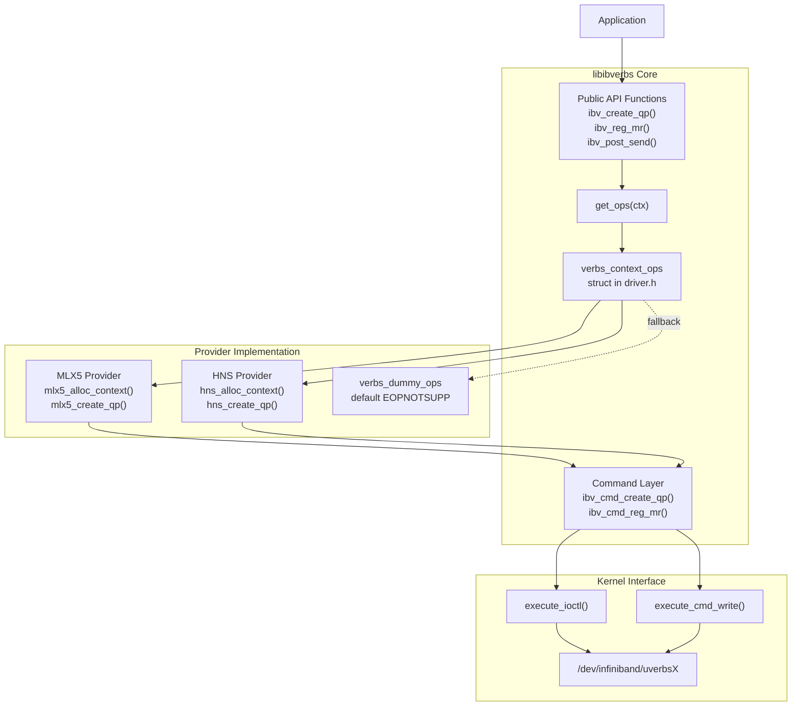

Sources: [libibverbs/verbs.h:1-100](), [libibverbs/driver.h:295-314](), [libibverbs/driver.h:337-482](), [libibverbs/verbs.c:163-172](), [libibverbs/ibverbs.h:80-88](), [libibverbs/dummy_ops.c:1-50]()

## Architecture

**Diagram: Data Flow Through libibverbs**

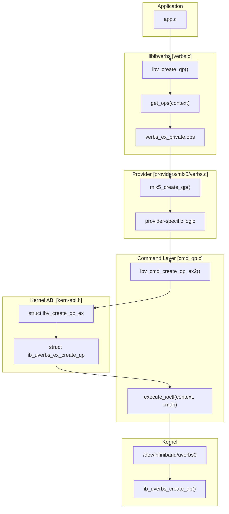

The architecture uses function pointers in `verbs_context_ops` to dispatch operations to provider implementations. Each `ibv_context` contains a `verbs_ex_private` structure that holds the operation dispatch table.

Sources: [libibverbs/verbs.c:163-172](), [libibverbs/ibverbs.h:72-88](), [libibverbs/driver.h:337-482](), [libibverbs/cmd_qp.c:1-50]()

### Component Relationships

**Diagram: Object Hierarchy and Structure Definitions**

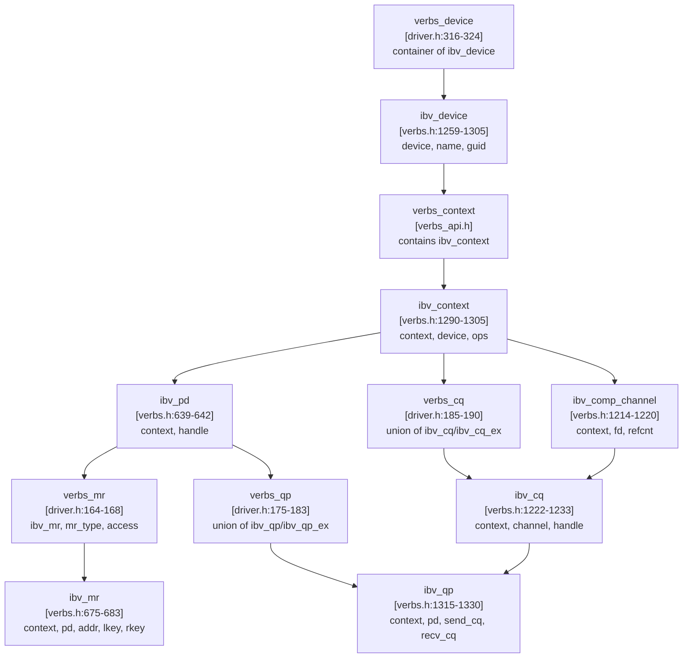

The `verbs_*` structures (defined in [libibverbs/driver.h]()) extend the public `ibv_*` structures (defined in [libibverbs/verbs.h]()) to add internal metadata. Providers use `container_of()` macro to access the extended structures.

Sources: [libibverbs/verbs.h:639-642](), [libibverbs/verbs.h:675-683](), [libibverbs/verbs.h:1222-1233](), [libibverbs/verbs.h:1315-1330](), [libibverbs/driver.h:164-168](), [libibverbs/driver.h:175-183](), [libibverbs/driver.h:185-190](), [libibverbs/driver.h:316-324]()

## Core Abstractions

### Devices and Contexts

A device (`ibv_device`) represents a physical RDMA device in the system. A context (`ibv_context`) represents an open connection to a device.

```c
struct ibv_device {
	struct _ibv_device_ops	ops;
	enum ibv_node_type	node_type;
	enum ibv_transport_type	transport_type;
	char			name[IBV_SYSFS_NAME_MAX];
	char			dev_name[IBV_SYSFS_NAME_MAX];
	char			dev_path[IBV_SYSFS_PATH_MAX];
	char			ibdev_path[IBV_SYSFS_PATH_MAX];
};

struct ibv_context {
	struct ibv_device      *device;
	struct _ibv_context_ops	ops;
	int			cmd_fd;
	int			async_fd;
	int			num_comp_vectors;
	pthread_mutex_t		mutex;
	void		       *abi_compat;
};
```

Key operations include:
- `ibv_get_device_list()` - Enumerate available RDMA devices [libibverbs/device.c:54-96]()
- `ibv_open_device()` - Open a device to get a context [libibverbs/libibverbs.map.in:86]()
- `ibv_close_device()` - Close a device context [libibverbs/libibverbs.map.in:59]()

Sources: [libibverbs/device.c:54-96](), [libibverbs/verbs.h:1259-1305]()

### Protection Domains

A protection domain (`ibv_pd`) is a security context within which memory regions and queue pairs are created.

```c
struct ibv_pd {
	struct ibv_context     *context;
	uint32_t		handle;
};
```

Key operations:
- `ibv_alloc_pd()` - Allocate a new protection domain [libibverbs/cmd.c:50-65]()
- `ibv_dealloc_pd()` - Deallocate a protection domain [libibverbs/libibverbs.map.in:65]()

Sources: [libibverbs/verbs.h:639-642](), [libibverbs/cmd.c:50-65]()

### Memory Regions

Memory regions (`ibv_mr`) represent application memory that has been registered for RDMA operations.

```c
struct ibv_mr {
	struct ibv_context     *context;
	struct ibv_pd	       *pd;
	void		       *addr;
	size_t			length;
	uint32_t		handle;
	uint32_t		lkey;
	uint32_t		rkey;
};
```

Key operations:
- `ibv_reg_mr()` - Register a memory region [libibverbs/cmd.c:99-138]()
- `ibv_dereg_mr()` - Deregister a memory region [libibverbs/libibverbs.map.in:66]()
- `ibv_rereg_mr()` - Re-register an existing memory region [libibverbs/cmd.c:140-167]()

Sources: [libibverbs/verbs.h:675-683](), [libibverbs/cmd.c:99-167]()

### Queue Pairs

A queue pair (`ibv_qp`) consists of a send queue and a receive queue, used for communication between RDMA endpoints.

```c
struct ibv_qp {
	struct ibv_context     *context;
	void		       *qp_context;
	struct ibv_pd	       *pd;
	struct ibv_cq	       *send_cq;
	struct ibv_cq	       *recv_cq;
	struct ibv_srq	       *srq;
	uint32_t		handle;
	uint32_t		qp_num;
	enum ibv_qp_state	state;
	enum ibv_qp_type	qp_type;
	pthread_mutex_t		mutex;
	pthread_cond_t		cond;
	uint32_t		events_completed;
};
```

Key operations:
- `ibv_create_qp()` - Create a queue pair [libibverbs/libibverbs.map.in:63]()
- `ibv_modify_qp()` - Modify queue pair attributes [libibverbs/libibverbs.map.in:83]()
- `ibv_destroy_qp()` - Destroy a queue pair [libibverbs/libibverbs.map.in:69]()

Sources: [libibverbs/verbs.h:1315-1330](), [libibverbs/cmd_qp.c:1-50]()

### Completion Queues

Completion queues (`ibv_cq`) report the completion of work requests.

```c
struct ibv_cq {
	struct ibv_context     *context;
	struct ibv_comp_channel *channel;
	void		       *cq_context;
	uint32_t		handle;
	int			cqe;
	pthread_mutex_t		mutex;
	pthread_cond_t		cond;
	uint32_t		comp_events_completed;
	uint32_t		async_events_completed;
};
```

Key operations:
- `ibv_create_cq()` - Create a completion queue [libibverbs/libibverbs.map.in:62]()
- `ibv_poll_cq()` - Poll for completions [libibverbs/cmd.c:194-238]()
- `ibv_destroy_cq()` - Destroy a completion queue [libibverbs/libibverbs.map.in:68]()

Sources: [libibverbs/verbs.h:1222-1233](), [libibverbs/cmd.c:194-238]()

### Work Requests and Completions

Work requests describe operations to be performed on queue pairs. Work completions (`ibv_wc`) report the completion status of these operations.

```c
struct ibv_wc {
	uint64_t		wr_id;
	enum ibv_wc_status	status;
	enum ibv_wc_opcode	opcode;
	uint32_t		vendor_err;
	uint32_t		byte_len;
	__be32			imm_data;
	uint32_t		qp_num;
	uint32_t		src_qp;
	int			wc_flags;
	uint16_t		pkey_index;
	uint16_t		slid;
	uint8_t			sl;
	uint8_t			dlid_path_bits;
};
```

Sources: [libibverbs/verbs.h:591-611](), [libibverbs/cmd.c:217-231]()

## Provider Architecture

### Provider Registration and Loading

Providers are loaded dynamically via `.so` files or statically for specific builds. Each provider implements `verbs_device_ops` and registers using `verbs_register_driver`.

**Diagram: Provider Registration Flow**

```mermaid
graph TD
    provider_so["libmlx5.so"]
    constructor["__attribute__((constructor))<br/>mlx5_register_driver()"]
    verbs_register_driver["verbs_register_driver()<br/>[init.c:240-255]"]
    driver_list["static LIST_HEAD(driver_list)<br/>[init.c:85]"]
    mlx5_dev_ops["mlx5_device_ops<br/>[providers/mlx5/mlx5.c]"]
    ibverbs_init["ibverbs_init()<br/>[init.c]"]
    find_sysfs_devs["find_sysfs_devs()<br/>[init.c:204-238]"]
    match_device["match_device()<br/>[init.c:337-362]"]
    alloc_device["ops->alloc_device()<br/>[driver.h:311]"]
    
    provider_so --> constructor
    constructor --> verbs_register_driver
    verbs_register_driver --> driver_list
    driver_list --> mlx5_dev_ops
    
    app_call["ibv_get_device_list()"] --> ibverbs_init
    ibverbs_init --> find_sysfs_devs
    find_sysfs_devs --> setup_sysfs_dev
    setup_sysfs_dev --> verbs_sysfs_dev
    verbs_sysfs_dev --> match_device
    match_device --> mlx5_dev_ops
    match_device --> alloc_device
```

The `verbs_device_ops` structure ([libibverbs/driver.h:295-313]()):

| Field | Purpose |
|-------|---------|
| `name` | Provider name (e.g., "mlx5") |
| `match_table` | Array of `verbs_match_ent` for device matching |
| `alloc_context` | Creates a `verbs_context` for the device |
| `alloc_device` | Allocates a `verbs_device` structure |

Sources: [libibverbs/driver.h:295-313](), [libibverbs/init.c:85-86](), [libibverbs/init.c:240-255](), [libibverbs/init.c:337-362]()

### Context Operations Dispatch

The `verbs_context_ops` structure ([libibverbs/driver.h:337-482]()) defines function pointers for all verbs operations. Each `ibv_context` contains a dispatch table.

**Key Operation Categories:**

| Category | Example Operations | Structure Fields |
|----------|-------------------|------------------|
| Device/Port | `query_device_ex`, `query_port` | [driver.h:444-452]() |
| Protection Domain | `alloc_pd`, `dealloc_pd` | [driver.h:349-353]() |
| Memory | `reg_mr`, `dereg_mr` | [driver.h:464-476]() |
| Queue Pairs | `create_qp`, `modify_qp` | [driver.h:379-383](), [driver.h:423-424]() |
| Completion Queues | `poll_cq`, `req_notify_cq` | [driver.h:435](), [driver.h:474]() |

**Operation Dispatch Mechanism:**

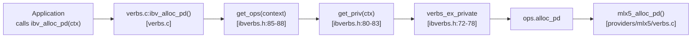

The `get_ops()` helper ([libibverbs/ibverbs.h:85-88]()) extracts the operations table from a context. Fallback to `verbs_dummy_ops` ([libibverbs/dummy_ops.c]()) occurs for unimplemented operations.

Sources: [libibverbs/driver.h:337-482](), [libibverbs/ibverbs.h:72-88](), [libibverbs/dummy_ops.c:1-100]()

## Kernel Interaction

### Command Layer Architecture

libibverbs communicates with the kernel via `write()` syscalls (legacy) and `ioctl()` (modern). `has_ioctl_write()` ([libibverbs/device.c:200-223]()) detects capability at runtime.

**Diagram: Kernel Communication Paths**

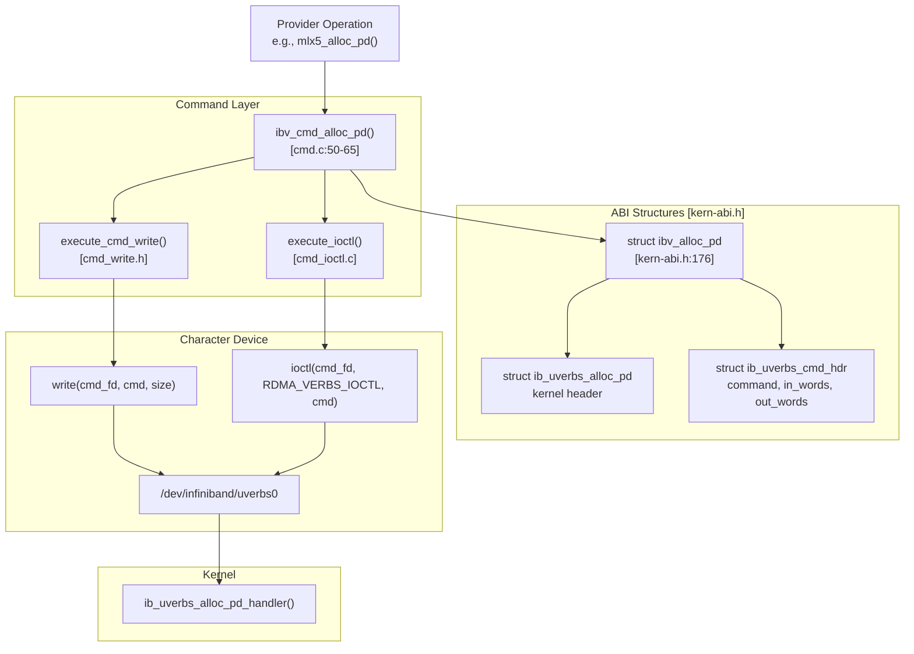

### ABI Version Compatibility

The kernel ABI version is checked during context initialization ([libibverbs/kern-abi.h:48-49]()):

| Constant | Value | Purpose |
|----------|-------|---------|
| `IB_USER_VERBS_MIN_ABI_VERSION` | 3 | Minimum supported kernel ABI |
| `IB_USER_VERBS_MAX_ABI_VERSION` | 6 | Maximum supported kernel ABI |

The library reads the kernel's ABI version from sysfs ([libibverbs/init.c:146-148]()).

Sources: [libibverbs/cmd.c:50-65](), [libibverbs/kern-abi.h:48-49](), [libibverbs/device.c:200-223](), [libibverbs/init.c:146-148]()

## API Usage Patterns

### Device Discovery and Initialization

`ibv_get_device_list()` ([libibverbs/device.c:54-96]()) scans `/sys/class/infiniband_verbs/` and initializes the provider list via `ibverbs_init()`.

### Context Creation

`verbs_init_context()` ([libibverbs/device.c:230-258]()) allocates the context structure, opens the command FD, and sets up the operation dispatch table via `verbs_set_ops()`.

### Resource Lifecycle Operations

| Resource | Create Function | Implementation | Kernel Command |
|----------|----------------|----------------|----------------|
| Protection Domain | `ibv_alloc_pd()` | `ops->alloc_pd` | `ibv_cmd_alloc_pd()` [cmd.c:50-65]() |
| Memory Region | `ibv_reg_mr()` | `ops->reg_mr` | `ibv_cmd_reg_mr()` [cmd.c:99-138]() |
| Completion Queue | `ibv_create_cq()` | `ops->create_cq` | `ibv_cmd_create_cq()` [cmd_cq.c]() |
| Queue Pair | `ibv_create_qp()` | `ops->create_qp` | `ibv_cmd_create_qp()` [cmd_qp.c]() |

Sources: [libibverbs/device.c:54-96](), [libibverbs/device.c:230-258](), [libibverbs/cmd.c:50-138](), [libibverbs/init.c:204-362]()

## Version Management

### Symbol Versioning

libibverbs uses ELF symbol versioning ([libibverbs/libibverbs.map.in]()) to maintain ABI compatibility.

| Version | Added In | Notable Additions |
|---------|----------|-------------------|
| IBVERBS_1.0 | 1.1.6 | Original API |
| IBVERBS_1.1 | 1.1.6 | Forking support, extended functions |
| IBVERBS_1.10 | 31 | Import/export functions |
| IBVERBS_1.15 | 59 | `ibv_alloc_dmah()`, `ibv_reg_mr_ex()` |

### Provider ABI Version

The provider interface version is embedded in the `verbs_register_driver` symbol name, ensuring providers are built against the correct libibverbs version ([libibverbs/libibverbs.map.in:261]()).

Sources: [libibverbs/libibverbs.map.in:1-264](), [libibverbs/kern-abi.h:48-49](), [libibverbs/init.c:146-148](), [debian/libibverbs1.symbols:1-132]()

---

# Page: librdmacm

# librdmacm

<details>
<summary>Relevant source files</summary>

The following files were used as context for generating this wiki page:

- [buildlib/config.h.in](buildlib/config.h.in)
- [buildlib/rdma_functions.cmake](buildlib/rdma_functions.cmake)
- [buildlib/template.pc.in](buildlib/template.pc.in)
- [debian/libibumad-dev.install](debian/libibumad-dev.install)
- [debian/librdmacm-dev.install](debian/librdmacm-dev.install)
- [debian/librdmacm1.symbols](debian/librdmacm1.symbols)
- [libibverbs/neigh.c](libibverbs/neigh.c)
- [libibverbs/neigh.h](libibverbs/neigh.h)
- [librdmacm/CMakeLists.txt](librdmacm/CMakeLists.txt)
- [librdmacm/acm.c](librdmacm/acm.c)
- [librdmacm/acm.h](librdmacm/acm.h)
- [librdmacm/addrinfo.c](librdmacm/addrinfo.c)
- [librdmacm/cma.c](librdmacm/cma.c)
- [librdmacm/cma.h](librdmacm/cma.h)
- [librdmacm/examples/CMakeLists.txt](librdmacm/examples/CMakeLists.txt)
- [librdmacm/examples/cmatose.c](librdmacm/examples/cmatose.c)
- [librdmacm/examples/cmtime.c](librdmacm/examples/cmtime.c)
- [librdmacm/examples/common.c](librdmacm/examples/common.c)
- [librdmacm/examples/common.h](librdmacm/examples/common.h)
- [librdmacm/examples/mckey.c](librdmacm/examples/mckey.c)
- [librdmacm/examples/rcopy.c](librdmacm/examples/rcopy.c)
- [librdmacm/examples/riostream.c](librdmacm/examples/riostream.c)
- [librdmacm/examples/rping.c](librdmacm/examples/rping.c)
- [librdmacm/examples/rstream.c](librdmacm/examples/rstream.c)
- [librdmacm/examples/udaddy.c](librdmacm/examples/udaddy.c)
- [librdmacm/examples/udpong.c](librdmacm/examples/udpong.c)
- [librdmacm/ib.h](librdmacm/ib.h)
- [librdmacm/indexer.c](librdmacm/indexer.c)
- [librdmacm/indexer.h](librdmacm/indexer.h)
- [librdmacm/librdmacm.map](librdmacm/librdmacm.map)
- [librdmacm/librspreload.map](librdmacm/librspreload.map)
- [librdmacm/man/CMakeLists.txt](librdmacm/man/CMakeLists.txt)
- [librdmacm/man/cmtime.1](librdmacm/man/cmtime.1)
- [librdmacm/man/mckey.1](librdmacm/man/mckey.1)
- [librdmacm/man/rdma_cm.7](librdmacm/man/rdma_cm.7)
- [librdmacm/man/rdma_establish.3.md](librdmacm/man/rdma_establish.3.md)
- [librdmacm/man/rdma_freeaddrinfo.3.in.rst](librdmacm/man/rdma_freeaddrinfo.3.in.rst)
- [librdmacm/man/rdma_get_cm_event.3](librdmacm/man/rdma_get_cm_event.3)
- [librdmacm/man/rdma_get_remote_ece.3.md](librdmacm/man/rdma_get_remote_ece.3.md)
- [librdmacm/man/rdma_getaddrinfo.3](librdmacm/man/rdma_getaddrinfo.3)
- [librdmacm/man/rdma_join_multicast_ex.3](librdmacm/man/rdma_join_multicast_ex.3)
- [librdmacm/man/rdma_migrate_id.3](librdmacm/man/rdma_migrate_id.3)
- [librdmacm/man/rdma_post_write.3](librdmacm/man/rdma_post_write.3)
- [librdmacm/man/rdma_post_writev.3](librdmacm/man/rdma_post_writev.3)
- [librdmacm/man/rdma_query_addrinfo.3.in.rst](librdmacm/man/rdma_query_addrinfo.3.in.rst)
- [librdmacm/man/rdma_reg_msgs.3](librdmacm/man/rdma_reg_msgs.3)
- [librdmacm/man/rdma_resolve_addrinfo.3.in.rst](librdmacm/man/rdma_resolve_addrinfo.3.in.rst)
- [librdmacm/man/rdma_set_local_ece.3.md](librdmacm/man/rdma_set_local_ece.3.md)
- [librdmacm/man/rdma_set_option.3](librdmacm/man/rdma_set_option.3)
- [librdmacm/man/rdma_write_cm_event.3.in.rst](librdmacm/man/rdma_write_cm_event.3.in.rst)
- [librdmacm/man/rping.1](librdmacm/man/rping.1)
- [librdmacm/man/ucmatose.1](librdmacm/man/ucmatose.1)
- [librdmacm/preload.c](librdmacm/preload.c)
- [librdmacm/rdma_cma.h](librdmacm/rdma_cma.h)
- [librdmacm/rdma_cma_abi.h](librdmacm/rdma_cma_abi.h)
- [librdmacm/rsocket.c](librdmacm/rsocket.c)
- [providers/ipathverbs/CMakeLists.txt](providers/ipathverbs/CMakeLists.txt)
- [providers/mlx4/CMakeLists.txt](providers/mlx4/CMakeLists.txt)
- [providers/mlx4/mlx4.conf](providers/mlx4/mlx4.conf)

</details>


## Purpose and Scope

This document covers **librdmacm**, the RDMA Connection Manager library that provides a high-level API for establishing connections over RDMA fabrics. librdmacm abstracts the complexities of RDMA connection establishment, including address resolution, route resolution, and QP state machine transitions.

librdmacm is part of the rdma-core package and is located in the `librdmacm/` directory. It provides both a traditional verbs-based connection API and a socket-like compatibility layer called **rsockets**.

---

## Overview

librdmacm simplifies RDMA connection establishment by providing:

- **Connection-oriented abstractions** similar to socket programming (passive listener, active connector).
- **Address resolution** from IP addresses/hostnames to RDMA GIDs [librdmacm/addrinfo.c:1-100]().
- **Route resolution** to determine network paths between endpoints [librdmacm/cma.c:1650-1700]().
- **QP state management** automating the INIT→RTR→RTS transitions [librdmacm/cma.c:1750-1800]().
- **Support for multiple transport types** including TCP-like (`RDMA_PS_TCP`), UDP-like (`RDMA_PS_UDP`), and IPoIB (`RDMA_PS_IPOIB`) [librdmacm/rdma_cma_abi.h:84-93]().

The library communicates with the kernel's `rdma_cm` and `rdma_ucm` modules through the `/dev/infiniband/rdma_cm` device file, handling connection state, event delivery, and QP parameter setup [librdmacm/cma.c:148-184]().

**Sources:** [librdmacm/cma.c:1-200](), [librdmacm/rdma_cma_abi.h:45-76](), [librdmacm/addrinfo.c:1-50]()

---

## Connection Model

librdmacm follows a client-server (active-passive) connection model. The state machine is managed via `rdma_cm_id` objects.

### Connection Lifecycle Diagram
This diagram maps the natural language steps of connection setup to the specific code entities and ABI commands used in `librdmacm/cma.c` and `librdmacm/rdma_cma_abi.h`.

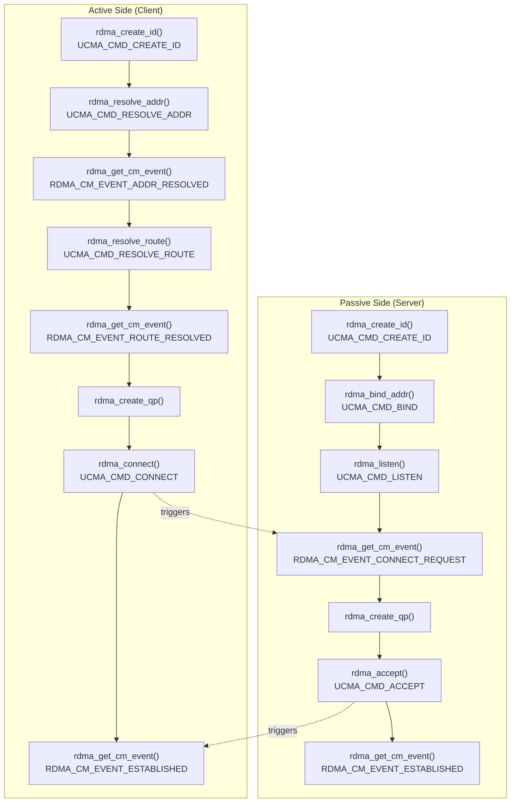

**Sources:** [librdmacm/rdma_cma_abi.h:51-76](), [librdmacm/cma.c:101-141](), [librdmacm/examples/cmtime.c:72-91]()

---

## Core Data Structures

### rdma_cm_id and cma_id_private
The `rdma_cm_id` is the primary handle for connection management. Internally, the library wraps this in `struct cma_id_private` to track state and kernel handles.

| Field | Description | Location |
|-------|-------------|----------|
| `handle` | Kernel-side ID for the CM object | [librdmacm/cma.c:111]() |
| `cma_dev` | Pointer to the selected RDMA device | [librdmacm/cma.c:103]() |
| `qp_init_attr` | Attributes used to create the associated QP | [librdmacm/cma.c:113]() |
| `sync` | Flag for synchronous vs asynchronous operation | [librdmacm/cma.c:108]() |

### cma_device
The library maintains a list of discovered RDMA devices (`cma_dev_list`) to map connection requests to physical hardware.

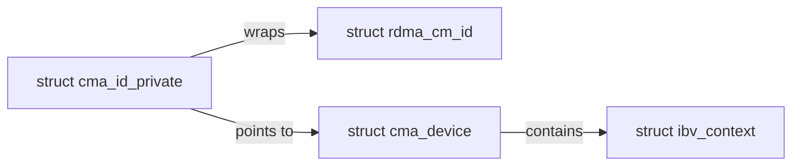

**Sources:** [librdmacm/cma.c:84-121](), [librdmacm/cma.c:143]()

---

## rsocket: Socket Compatibility Layer

The **rsocket** implementation provides a socket-like API over RDMA, allowing applications to use RDMA with minimal code changes. It supports both stream and datagram semantics.

### RSocket Architecture
The following diagram illustrates how `rsocket.c` translates standard socket calls into RDMA operations.

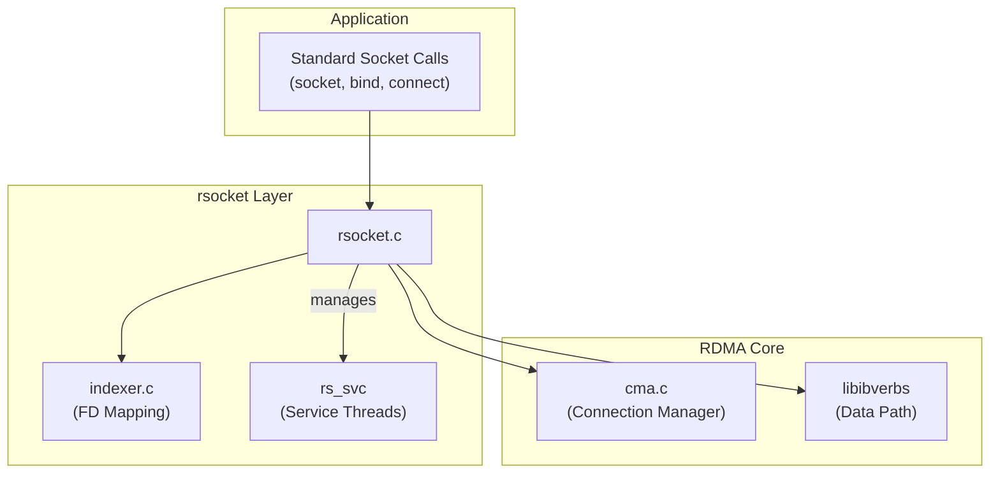

### Key RSocket Features
- **Direct Data Placement**: Uses RDMA Write/Read for zero-copy data transfer [librdmacm/rsocket.c:156-164]().
- **Service Threads**: Background threads (`udp_svc`, `tcp_svc`, `listen_svc`) manage keepalives and connection events [librdmacm/rsocket.c:107-125]().
- **Protocol Headers**: Uses `struct rs_conn_data` to exchange credits and buffer information during the RDMA handshake [librdmacm/rsocket.c:225-234]().
- **Preload Library**: `preload.c` provides an `LD_PRELOAD` mechanism to intercept standard libc socket calls and redirect them to rsockets [librdmacm/preload.c:71-110]().

**Sources:** [librdmacm/rsocket.c:1-130](), [librdmacm/preload.c:1-115]()

---

## Implementation Details

### Address Resolution
Address resolution is handled in `addrinfo.c`, which implements `rdma_getaddrinfo`. It supports resolving hostnames and IP addresses to RDMA-specific `rdma_addrinfo` structures [librdmacm/addrinfo.c:140-200]().

### Kernel ABI Commands
Commands are initialized using the `CMA_INIT_CMD` macro and sent to the kernel via the character device `/dev/infiniband/rdma_cm` [librdmacm/cma.c:64-76]().

| ABI Command | Function |
|-------------|----------|
| `UCMA_CMD_CREATE_ID` | Creates a new user-space CM ID [librdmacm/rdma_cma_abi.h:51]() |
| `UCMA_CMD_RESOLVE_ADDR` | Starts IP-to-GID resolution [librdmacm/rdma_cma_abi.h:141]() |
| `UCMA_CMD_RESOLVE_ROUTE` | Resolves the network path (SA query) [librdmacm/rdma_cma_abi.h:154]() |
| `UCMA_CMD_CONNECT` | Sends a connection request (REQ) [librdmacm/rdma_cma_abi.h:238]() |
| `UCMA_CMD_GET_EVENT` | Retrieves asynchronous CM events [librdmacm/rdma_cma_abi.h:324]() |

### Event Handling
Events are retrieved from the kernel and wrapped in `struct cma_event`. The library handles the translation from kernel ABI event structures to the public `rdma_cm_event` structure [librdmacm/cma.c:136-141]().

**Sources:** [librdmacm/cma.c:64-76](), [librdmacm/rdma_cma_abi.h:50-76](), [librdmacm/addrinfo.c:140-200]()

---

## Build System Integration

The library is built using CMake and exports the `rdmacm` target.

- **Headers**: Public headers like `rdma_cma.h` and `rsocket.h` are published to the system [librdmacm/CMakeLists.txt:1-6]().
- **Library**: The main library is defined in `librdmacm/CMakeLists.txt` and links against `libibverbs` [librdmacm/CMakeLists.txt:12-26]().
- **Preload Module**: The `rspreload` module is built separately for use with `LD_PRELOAD` [librdmacm/CMakeLists.txt:30-38]().

**Sources:** [librdmacm/CMakeLists.txt:1-52](), [buildlib/rdma_functions.cmake:104-121]()

---

# Page: libibnetdisc

# libibnetdisc

<details>
<summary>Relevant source files</summary>

The following files were used as context for generating this wiki page:

- [debian/libibmad5.symbols](debian/libibmad5.symbols)
- [debian/libibnetdisc5.symbols](debian/libibnetdisc5.symbols)
- [debian/libibumad3.symbols](debian/libibumad3.symbols)
- [ibacm/include/acm_mad.h](ibacm/include/acm_mad.h)
- [infiniband-diags/CMakeLists.txt](infiniband-diags/CMakeLists.txt)
- [infiniband-diags/ibdiag_common.c](infiniband-diags/ibdiag_common.c)
- [infiniband-diags/ibportstate.c](infiniband-diags/ibportstate.c)
- [infiniband-diags/smpquery.c](infiniband-diags/smpquery.c)
- [libibmad/CMakeLists.txt](libibmad/CMakeLists.txt)
- [libibmad/bm.c](libibmad/bm.c)
- [libibmad/cc.c](libibmad/cc.c)
- [libibmad/dump.c](libibmad/dump.c)
- [libibmad/fields.c](libibmad/fields.c)
- [libibmad/gs.c](libibmad/gs.c)
- [libibmad/iba_types.h](libibmad/iba_types.h)
- [libibmad/libibmad.map](libibmad/libibmad.map)
- [libibmad/mad.c](libibmad/mad.c)
- [libibmad/mad.h](libibmad/mad.h)
- [libibmad/register.c](libibmad/register.c)
- [libibmad/rpc.c](libibmad/rpc.c)
- [libibnetdisc/CMakeLists.txt](libibnetdisc/CMakeLists.txt)
- [libibnetdisc/chassis.c](libibnetdisc/chassis.c)
- [libibnetdisc/chassis.h](libibnetdisc/chassis.h)
- [libibnetdisc/ibnetdisc.c](libibnetdisc/ibnetdisc.c)
- [libibnetdisc/ibnetdisc.h](libibnetdisc/ibnetdisc.h)
- [libibnetdisc/ibnetdisc_cache.c](libibnetdisc/ibnetdisc_cache.c)
- [libibnetdisc/ibnetdisc_osd.h](libibnetdisc/ibnetdisc_osd.h)
- [libibnetdisc/internal.h](libibnetdisc/internal.h)
- [libibnetdisc/libibnetdisc.map](libibnetdisc/libibnetdisc.map)
- [libibnetdisc/man/CMakeLists.txt](libibnetdisc/man/CMakeLists.txt)
- [libibnetdisc/man/ibnd_discover_fabric.3](libibnetdisc/man/ibnd_discover_fabric.3)
- [libibnetdisc/man/ibnd_find_node_guid.3](libibnetdisc/man/ibnd_find_node_guid.3)
- [libibnetdisc/man/ibnd_iter_nodes.3](libibnetdisc/man/ibnd_iter_nodes.3)
- [libibumad/CMakeLists.txt](libibumad/CMakeLists.txt)
- [libibumad/libibumad.map](libibumad/libibumad.map)
- [libibumad/man/umad_free_ca_device_list.3.md](libibumad/man/umad_free_ca_device_list.3.md)
- [libibumad/man/umad_get_ca_device_list.3.md](libibumad/man/umad_get_ca_device_list.3.md)
- [libibumad/man/umad_get_smi_gsi_pair_by_ca_name.3](libibumad/man/umad_get_smi_gsi_pair_by_ca_name.3)
- [libibumad/man/umad_get_smi_gsi_pairs.3](libibumad/man/umad_get_smi_gsi_pairs.3)
- [libibumad/man/umad_sort_ca_device_list.3.md](libibumad/man/umad_sort_ca_device_list.3.md)
- [libibumad/sysfs.c](libibumad/sysfs.c)
- [libibumad/sysfs.h](libibumad/sysfs.h)
- [libibumad/tests/CMakeLists.txt](libibumad/tests/CMakeLists.txt)
- [libibumad/tests/umad_compile_test.c](libibumad/tests/umad_compile_test.c)
- [libibumad/tests/umad_reg2_compat.c](libibumad/tests/umad_reg2_compat.c)
- [libibumad/tests/umad_register2.c](libibumad/tests/umad_register2.c)
- [libibumad/tests/umad_sa_mcm_rereg_test.c](libibumad/tests/umad_sa_mcm_rereg_test.c)
- [libibumad/umad.c](libibumad/umad.c)
- [libibumad/umad.h](libibumad/umad.h)
- [libibumad/umad_cm.h](libibumad/umad_cm.h)
- [libibumad/umad_sa.h](libibumad/umad_sa.h)
- [libibumad/umad_sa_mcm.h](libibumad/umad_sa_mcm.h)
- [libibumad/umad_sm.h](libibumad/umad_sm.h)
- [libibumad/umad_str.c](libibumad/umad_str.c)
- [libibumad/umad_str.h](libibumad/umad_str.h)
- [libibumad/umad_types.h](libibumad/umad_types.h)
- [libibverbs/sa.h](libibverbs/sa.h)
- [libibverbs/tm_types.h](libibverbs/tm_types.h)
- [util/node_name_map.c](util/node_name_map.c)
- [util/node_name_map.h](util/node_name_map.h)

</details>


## Purpose and Scope

`libibnetdisc` is a core library that provides InfiniBand fabric discovery and topology mapping capabilities. It enables applications to scan and enumerate the nodes, switches, and interconnections within an InfiniBand network fabric. The library builds a complete fabric topology graph by querying subnet management agents (SMAs) through the `libibumad` interface.

This document covers the fabric discovery API, node iteration, topology lookup functions, and data structures. For information about the underlying management datagram interface used by this library, see `libibumad` documentation. For RDMA connection management, see [librdmacm](#2.2). For the core verbs API, see [libibverbs](#2.1).

Sources: [libibnetdisc/man/ibnd_discover_fabric.3:1-66]()

---

## Library Overview

`libibnetdisc` performs fabric discovery by issuing Subnet Management Packets (SMPs) to enumerate and characterize all devices in an InfiniBand network. The library constructs a graph representation of the fabric topology, including:

- **Nodes**: Host Channel Adapters (HCAs), switches, and routers with their properties.
- **Ports**: Physical ports on each node with link state and capabilities.
- **Links**: Connections between ports forming the fabric topology.
- **Chassis**: Physical enclosures grouping related nodes.

The library sits between `libibumad` (which provides the low-level MAD interface) and higher-level management tools like `srp_daemon`, which use fabric topology information to discover SCSI targets.

### Role in rdma-core Ecosystem

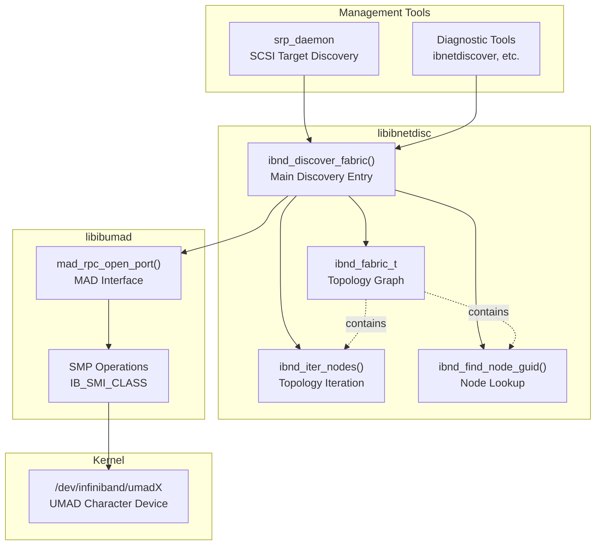

**Diagram: libibnetdisc in the Management Stack**

Sources: [libibnetdisc/man/ibnd_discover_fabric.3:14-18](), [libibnetdisc/ibnetdisc.c:46-50]()

---

## Fabric Discovery Architecture

The discovery process follows a directed graph traversal algorithm, starting from a local port and following links to neighboring nodes. The library issues SMP queries to each discovered node to retrieve its properties and port information, then follows active links to continue the traversal.

### Discovery Process Flow

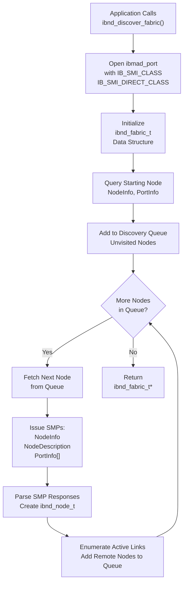

**Diagram: Fabric Discovery Algorithm Flow**

The discovery process is implemented by the `smp_engine_t` and controlled via `ibnd_config_t`. The engine handles the state machine for SMP requests like `query_node_info` [libibnetdisc/ibnetdisc.c:64-65]() and `query_port_info` [libibnetdisc/ibnetdisc.c:66-67]().

Sources: [libibnetdisc/man/ibnd_discover_fabric.3:14-18](), [libibnetdisc/man/ibnd_discover_fabric.3:43-60](), [libibnetdisc/ibnetdisc.c:59-67]()

---

## Fabric Discovery API

### Core Discovery Functions

| Function | Purpose | Return Value |
|----------|---------|--------------|
| `ibnd_discover_fabric()` | Discover fabric topology starting from specified port | `ibnd_fabric_t*` or NULL on failure |
| `ibnd_destroy_fabric()` | Free all memory and resources for fabric object | void |
| `ibnd_debug()` | Set debug output level | void |
| `ibnd_show_progress()` | Enable progress output during discovery | void |
| `ibnd_set_max_smps_on_wire()` | Control SMP concurrency level | Previous value |

Sources: [libibnetdisc/man/ibnd_discover_fabric.3:1-42](), [debian/libibnetdisc5.symbols:6-7]()

### Discovery Function Details

#### ibnd_discover_fabric()

```c
ibnd_fabric_t *ibnd_discover_fabric(
    struct ibmad_port *ibmad_port,
    int timeout_ms,
    ib_portid_t *from,
    int hops
)
```

**Parameters:**
- `ibmad_port`: Open MAD port with `IB_SMI_CLASS` and `IB_SMI_DIRECT_CLASS` enabled.
- `timeout_ms`: Timeout for SMP operations in milliseconds.
- `from`: Optional starting node (NULL to start from local port).
- `hops`: Discovery radius from starting node (0 for entire fabric).

The implementation uses `extend_dpath` [libibnetdisc/ibnetdisc.c:117-144]() to manage the Directed Route path during the crawl and `retract_dpath` [libibnetdisc/ibnetdisc.c:97-115]() when returning from a hop.

Sources: [libibnetdisc/man/ibnd_discover_fabric.3:8-18](), [libibnetdisc/ibnetdisc.c:117-144]()

---

## Node Iteration and Lookup API

### Iteration Functions

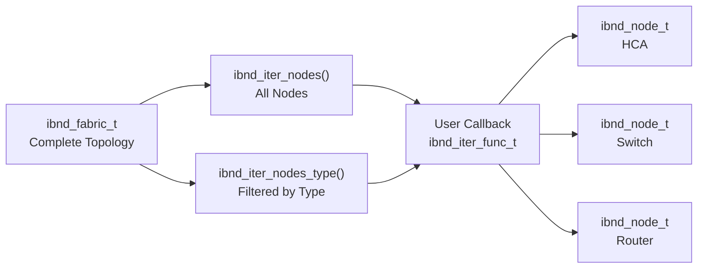

**Diagram: Node Iteration Pattern**

#### ibnd_iter_nodes() and ibnd_iter_nodes_type()

These functions allow applications to walk the discovered topology. `ibnd_iter_nodes` [debian/libibnetdisc5.symbols:19]() processes every node, while `ibnd_iter_nodes_type` [debian/libibnetdisc5.symbols:20]() filters by `ibnd_node_type_t`.

Sources: [libibnetdisc/man/ibnd_iter_nodes.3:8-14](), [debian/libibnetdisc5.symbols:19-20]()

### Lookup Functions

| Function | Lookup Key | Purpose |
|----------|------------|---------|
| `ibnd_find_node_guid()` | Node GUID (uint64_t) | Find node by globally unique identifier |
| `ibnd_find_node_dr()` | Directed route (string) | Find node by directed route path |
| `ibnd_find_port_guid()` | Port GUID (uint64_t) | Find specific port by GUID |

Sources: [libibnetdisc/man/ibnd_find_node_guid.3:8-15](), [debian/libibnetdisc5.symbols:8-11]()

---

## Data Structures and Chassis Management

### Fabric Object Hierarchy

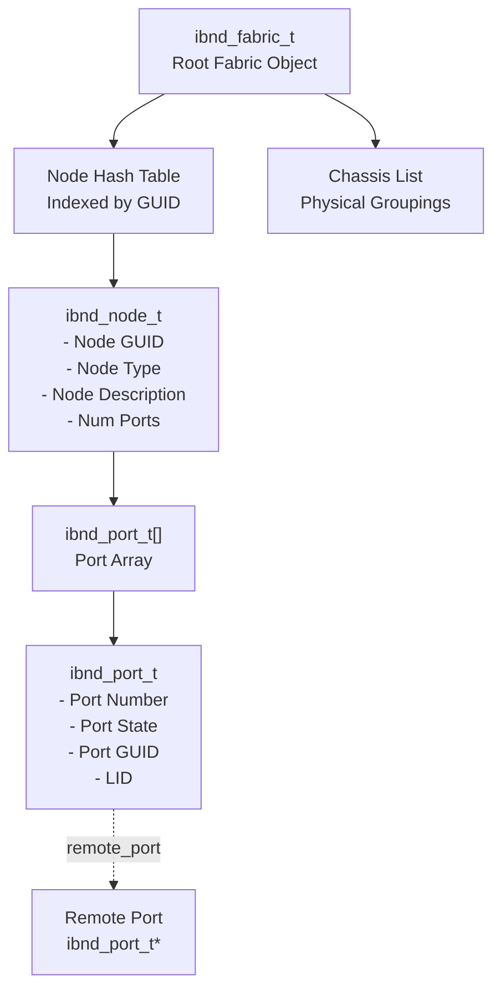

**Diagram: Fabric Data Structure Hierarchy**

The library also handles chassis discovery for modular switches. Functions like `ibnd_get_chassis_guid` [debian/libibnetdisc5.symbols:13]() and `ibnd_get_chassis_type` [debian/libibnetdisc5.symbols:15]() extract physical enclosure information.

Sources: [debian/libibnetdisc5.symbols:13-15](), [libibnetdisc/ibnetdisc.c:53-54]()

---

## Low-level MAD Interaction

`libibnetdisc` relies heavily on `libibumad` to perform the actual I/O. It uses `umad_open_port` [libibumad/umad.h:198]() to initialize access to the `/sys/class/infiniband_mad` [libibumad/umad.h:97]() character devices.

### System Interaction

| Entity | Code Symbol | Role |
|--------|-------------|------|
| Sysfs Path | `SYS_INFINIBAND` | Base path for IB device discovery [libibumad/umad.h:113]() |
| MAD Header | `struct umad_hdr` | Wire format for Management Datagrams [libibumad/umad_types.h:120]() |
| Port Info | `struct umad_port` | Userspace representation of an IB port [libibumad/umad.h:142]() |
| SMP Class | `UMAD_CLASS_SUBN_DIRECTED_ROUTE` | Class 0x81 used for discovery traversal [libibumad/umad_types.h:53]() |

Sources: [libibumad/umad.h:97-113](), [libibumad/umad_types.h:53-120]()

---

## Integration and Diagnostics

Management tools such as `ibportstate` [infiniband-diags/ibportstate.c:1]() use these discovery primitives to modify fabric state. `ibportstate` uses `smp_query_via` [infiniband-diags/ibportstate.c:127]() to fetch `IB_ATTR_NODE_INFO` and `IB_ATTR_PORT_INFO` [infiniband-diags/ibportstate.c:145](), mirroring the internal logic of `libibnetdisc`.

### Link Speed Handling
`libibnetdisc` provides specific helpers for extended link speeds (FDR/EDR/HDR), such as `ibnd_get_agg_linkspeedext` [debian/libibnetdisc5.symbols:24](). This is used to decode complex speed fields from `PortInfo` MADs [libibnetdisc/ibnetdisc.c:179-180]().

Sources: [infiniband-diags/ibportstate.c:127-145](), [libibnetdisc/ibnetdisc.c:179-180](), [debian/libibnetdisc5.symbols:23-30]()

---

# Page: RDMA Providers

# RDMA Providers

<details>
<summary>Relevant source files</summary>

The following files were used as context for generating this wiki page:

- [debian/libibverbs1.symbols](debian/libibverbs1.symbols)
- [kernel-headers/rdma/bnxt_re-abi.h](kernel-headers/rdma/bnxt_re-abi.h)
- [kernel-headers/rdma/cxgb4-abi.h](kernel-headers/rdma/cxgb4-abi.h)
- [kernel-headers/rdma/efa-abi.h](kernel-headers/rdma/efa-abi.h)
- [kernel-headers/rdma/erdma-abi.h](kernel-headers/rdma/erdma-abi.h)
- [kernel-headers/rdma/hfi/hfi1_user.h](kernel-headers/rdma/hfi/hfi1_user.h)
- [kernel-headers/rdma/hns-abi.h](kernel-headers/rdma/hns-abi.h)
- [kernel-headers/rdma/ib_user_mad.h](kernel-headers/rdma/ib_user_mad.h)
- [kernel-headers/rdma/ib_user_sa.h](kernel-headers/rdma/ib_user_sa.h)
- [kernel-headers/rdma/ib_user_verbs.h](kernel-headers/rdma/ib_user_verbs.h)
- [kernel-headers/rdma/irdma-abi.h](kernel-headers/rdma/irdma-abi.h)
- [kernel-headers/rdma/mana-abi.h](kernel-headers/rdma/mana-abi.h)
- [kernel-headers/rdma/mlx4-abi.h](kernel-headers/rdma/mlx4-abi.h)
- [kernel-headers/rdma/mlx5-abi.h](kernel-headers/rdma/mlx5-abi.h)
- [kernel-headers/rdma/mlx5_user_ioctl_cmds.h](kernel-headers/rdma/mlx5_user_ioctl_cmds.h)
- [kernel-headers/rdma/mlx5_user_ioctl_verbs.h](kernel-headers/rdma/mlx5_user_ioctl_verbs.h)
- [kernel-headers/rdma/mthca-abi.h](kernel-headers/rdma/mthca-abi.h)
- [kernel-headers/rdma/ocrdma-abi.h](kernel-headers/rdma/ocrdma-abi.h)
- [kernel-headers/rdma/qedr-abi.h](kernel-headers/rdma/qedr-abi.h)
- [kernel-headers/rdma/rdma_netlink.h](kernel-headers/rdma/rdma_netlink.h)
- [kernel-headers/rdma/rdma_user_cm.h](kernel-headers/rdma/rdma_user_cm.h)
- [kernel-headers/rdma/rdma_user_rxe.h](kernel-headers/rdma/rdma_user_rxe.h)
- [kernel-headers/rdma/vmw_pvrdma-abi.h](kernel-headers/rdma/vmw_pvrdma-abi.h)
- [libibverbs/CMakeLists.txt](libibverbs/CMakeLists.txt)
- [libibverbs/cmd_mr.c](libibverbs/cmd_mr.c)
- [libibverbs/compat-1_0.c](libibverbs/compat-1_0.c)
- [libibverbs/device.c](libibverbs/device.c)
- [libibverbs/driver.h](libibverbs/driver.h)
- [libibverbs/dummy_ops.c](libibverbs/dummy_ops.c)
- [libibverbs/ibdev_nl.c](libibverbs/ibdev_nl.c)
- [libibverbs/ibverbs.h](libibverbs/ibverbs.h)
- [libibverbs/init.c](libibverbs/init.c)
- [libibverbs/libibverbs.map.in](libibverbs/libibverbs.map.in)
- [libibverbs/man/CMakeLists.txt](libibverbs/man/CMakeLists.txt)
- [libibverbs/man/ibv_dm_export_dmabuf_fd.3.md](libibverbs/man/ibv_dm_export_dmabuf_fd.3.md)
- [libibverbs/man/ibv_is_fork_initialized.3.md](libibverbs/man/ibv_is_fork_initialized.3.md)
- [libibverbs/man/ibv_reg_mr.3](libibverbs/man/ibv_reg_mr.3)
- [libibverbs/memory.c](libibverbs/memory.c)
- [libibverbs/verbs.c](libibverbs/verbs.c)
- [libibverbs/verbs.h](libibverbs/verbs.h)
- [util/rdma_nl.c](util/rdma_nl.c)
- [util/rdma_nl.h](util/rdma_nl.h)

</details>


## Introduction

RDMA Providers are dynamically-loadable plugin libraries that implement hardware-specific functionality while presenting a uniform interface through `libibverbs`. Each provider library (e.g., `libmlx5.so`, `libhns.so`) contains device-specific code for a particular RDMA hardware family and registers itself using the plugin architecture defined in [libibverbs/driver.h:295-313]().

The provider system enables:
- Hardware abstraction through standardized `verbs_device_ops` and `verbs_context_ops` function tables.
- Dynamic discovery and loading via sysfs device matching and `dlopen()`.
- Hardware vendor independence for applications.
- Device-specific optimizations and extensions (e.g., MLX5 Direct Verbs).

Sources: [libibverbs/driver.h:295-313](), [libibverbs/CMakeLists.txt:67-93]()

## Provider Architecture

### Core Interfaces

The provider plugin system is built on two primary interface structures defined in [libibverbs/driver.h]():

**Device-Level Operations (`verbs_device_ops`)**

Diagram: Provider Device Operations Structure

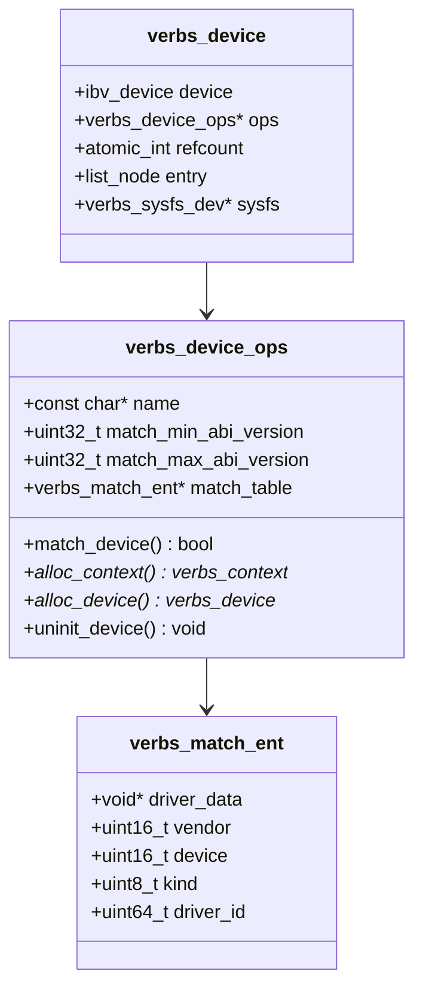

Sources: [libibverbs/driver.h:295-313](), [libibverbs/driver.h:316-324](), [libibverbs/driver.h:225-234]()

**Context-Level Operations (`verbs_context_ops`)**

Diagram: Provider Context Operations Structure

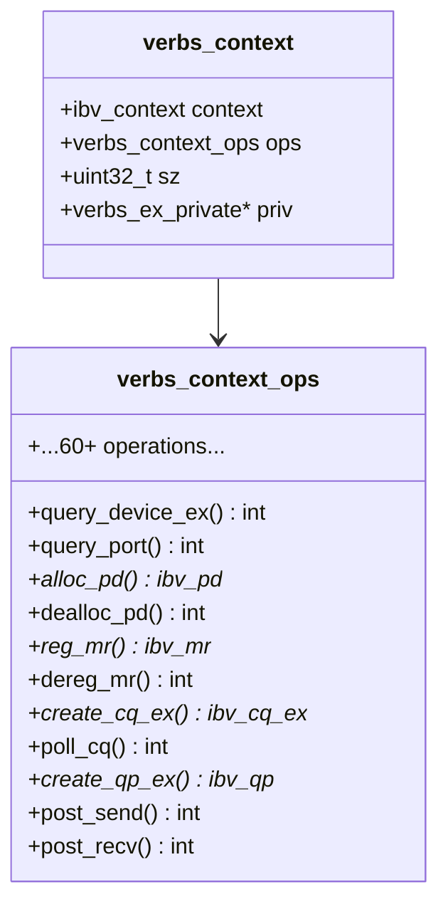

Sources: [libibverbs/driver.h:337-527](), [libibverbs/ibverbs.h:72-78]()

### Provider Plugin Loading

Diagram: Provider Discovery and Loading Mechanism

```mermaid
flowchart TD
    A["Application calls ibv_get_device_list()"] --> B["libibverbs scans /sys/class/infiniband_verbs/"]
    B --> C["find_sysfs_devs() reads ibdev and dev files"]
    C --> D["load_drivers() scans for provider plugins"]
    D --> E["dlopen() matching provider library"]
    E --> F["Execute provider constructor"]
    F --> G["Provider registers via verbs_register_driver()"]
    G --> H["Create verbs_device with ops table"]
    H --> I["Return ibv_device list to application"]
```

Sources: [libibverbs/device.c:54-96](), [libibverbs/init.c:204-238](), [libibverbs/init.c:240-255]()

### Provider Library Files

| Provider | Library File | Kernel Module |
|----------|-------------|---------------|
| MLX5 | `libmlx5.so` | `mlx5_ib.ko` |
| HNS | `libhns.so` | `hns_roce.ko` |
| BNXT_RE | `libbnxt_re.so` | `bnxt_re.ko` |
| EFA | `libefa.so` | `efa.ko` |
| RXE | `librxe.so` | `rdma_rxe.ko` |
| SiW | `libsiw.so` | `siw.ko` |

Sources: [libibverbs/CMakeLists.txt:22-59](), [debian/libibverbs1.symbols:1-17]()

### Provider Registration Mechanisms

**Device Matching**

Providers define a `match_table` using `verbs_match_ent` to claim hardware based on PCI IDs or Kernel Driver IDs.

Diagram: Provider Device Matching Tables

```mermaid
graph TB
    subgraph "verbs_match_ent Types"
        A["VERBS_MATCH_DRIVER_ID<br/>Match by RDMA_DRIVER_* ID"]
        B["VERBS_MATCH_PCI<br/>Match vendor:device ID"]
        C["VERBS_MATCH_MODALIAS<br/>Match modalias pattern"]
    end
    
    subgraph "Match Logic in init.c"
        D["match_modalias()"]
        E["verbs_register_driver()"]
    end
    
    A --> E
    B --> D
    C --> D
```

Sources: [libibverbs/driver.h:218-234](), [libibverbs/init.c:258-269]()

**Constructor Registration**

Each provider library contains a constructor function that executes when `dlopen()` loads the library, calling `verbs_register_driver` to add its `verbs_device_ops` to the global `driver_list` [libibverbs/init.c:85]().

Sources: [libibverbs/init.c:240-255](), [libibverbs/ibverbs.h:42]()

### Operation Dispatch Mechanism

RDMA operations are dispatched through function pointers in the `verbs_context_ops` table. For example, `ibv_query_device` calls the provider's implementation via `get_ops(context)->query_device_ex` [libibverbs/verbs.c:168]().

For unimplemented operations, libibverbs provides `verbs_dummy_ops` [libibverbs/ibverbs.h:53]() to ensure pointers are never NULL.

Sources: [libibverbs/verbs.c:163-172](), [libibverbs/ibverbs.h:80-88]()

## Available Providers

The following child pages cover specific hardware implementations in detail:

- **[Mellanox MLX5 Provider](#3.1)**: Supports ConnectX-4/5/6/7/8 adapters. Includes Direct Verbs and DevX support.
- **[HiSilicon HNS RoCE Provider](#3.2)**: Supports HiSilicon RoCE hardware (v1/v2).
- **[Broadcom NetXtreme-E RoCE Provider](#3.3)**: Supports Broadcom RoCE adapters with doorbell pacing.
- **[Amazon EFA Provider](#3.4)**: Supports AWS Elastic Fabric Adapter with SRD transport.
- **[Other Hardware Providers](#3.5)**: Covers Intel (irdma), QLogic (qedr), Soft-RoCE (rxe), Soft-iWarp (siw), and others.

### Major Provider Details

**MLX5 Provider**
- Supports Mellanox/NVIDIA ConnectX-4 and newer.
- **Extensions**: MLX5 Direct Verbs (`mlx5dv`), DevX, and Direct Rules flow steering.
- **ABI**: Uses `MLX5_IB_UVERBS_ABI_VERSION` [kernel-headers/rdma/mlx5-abi.h:68]().

**Software Providers (RXE, SiW)**
- **RXE**: Software RoCE implementation over any Ethernet NIC.
- **SiW**: Software iWARP implementation over TCP/IP sockets.
- Useful for development and testing without dedicated RDMA hardware.

Sources: [kernel-headers/rdma/mlx5-abi.h](), [kernel-headers/rdma/rdma_user_rxe.h]()

## Provider Implementation Patterns

### Context Structure Extension

Providers extend the base `verbs_context` structure to store hardware-specific state. This is typically done by embedding `verbs_context` as the first member of a provider-specific context struct.

Sources: [libibverbs/driver.h:50-58](), [libibverbs/device.c:230-258]()

### Memory Registration Patterns

Providers implement `reg_mr` to pin memory and obtain local/remote keys. They often use `ibv_cmd_reg_mr` [libibverbs/libibverbs.map.in:250]() to communicate with the kernel.

Sources: [libibverbs/verbs.h:131-140](), [libibverbs/driver.h:164-168]()

### Data Path Operations

Fast path operations like `post_send` and `poll_cq` are implemented entirely in userspace to avoid the overhead of system calls. The provider writes directly to hardware-mapped memory (doorbells) or reads from hardware-filled completion queues.

Sources: [libibverbs/driver.h:337-527](), [libibverbs/verbs.h:115-140]()

## Provider Configuration

### Provider Discovery Directory

Providers are discovered through `.driver` files or by scanning standard library paths. The `load_drivers()` function handles the dynamic loading of these plugins.

Sources: [libibverbs/ibverbs.h:65-70](), [libibverbs/init.c:240-255]()

### Installation Structure

Provider libraries are typically installed as shared objects (e.g., `libmlx5-rdmav59.so`). The RDMA Provider ABI version (e.g., `59`) ensures compatibility between the core library and the plugins [debian/libibverbs1.symbols:17]().

Sources: [libibverbs/CMakeLists.txt:22-59](), [debian/libibverbs1.symbols]()

---

# Page: Mellanox MLX5 Provider

# Mellanox MLX5 Provider

<details>
<summary>Relevant source files</summary>

The following files were used as context for generating this wiki page:

- [debian/ibverbs-providers.symbols](debian/ibverbs-providers.symbols)
- [kernel-headers/rdma/efa-abi.h](kernel-headers/rdma/efa-abi.h)
- [kernel-headers/rdma/ib_user_sa.h](kernel-headers/rdma/ib_user_sa.h)
- [kernel-headers/rdma/irdma-abi.h](kernel-headers/rdma/irdma-abi.h)
- [kernel-headers/rdma/mlx5_user_ioctl_cmds.h](kernel-headers/rdma/mlx5_user_ioctl_cmds.h)
- [kernel-headers/rdma/mlx5_user_ioctl_verbs.h](kernel-headers/rdma/mlx5_user_ioctl_verbs.h)
- [kernel-headers/rdma/rdma_netlink.h](kernel-headers/rdma/rdma_netlink.h)
- [kernel-headers/rdma/rdma_user_cm.h](kernel-headers/rdma/rdma_user_cm.h)
- [providers/mlx5/CMakeLists.txt](providers/mlx5/CMakeLists.txt)
- [providers/mlx5/buf.c](providers/mlx5/buf.c)
- [providers/mlx5/cq.c](providers/mlx5/cq.c)
- [providers/mlx5/dbrec.c](providers/mlx5/dbrec.c)
- [providers/mlx5/dr_buddy.c](providers/mlx5/dr_buddy.c)
- [providers/mlx5/libmlx5.map](providers/mlx5/libmlx5.map)
- [providers/mlx5/man/CMakeLists.txt](providers/mlx5/man/CMakeLists.txt)
- [providers/mlx5/man/mlx5dv.7](providers/mlx5/man/mlx5dv.7)
- [providers/mlx5/man/mlx5dv_alloc_dm.3.md](providers/mlx5/man/mlx5dv_alloc_dm.3.md)
- [providers/mlx5/man/mlx5dv_alloc_var.3.md](providers/mlx5/man/mlx5dv_alloc_var.3.md)
- [providers/mlx5/man/mlx5dv_create_flow.3.md](providers/mlx5/man/mlx5dv_create_flow.3.md)
- [providers/mlx5/man/mlx5dv_create_flow_matcher.3.md](providers/mlx5/man/mlx5dv_create_flow_matcher.3.md)
- [providers/mlx5/man/mlx5dv_create_mkey.3.md](providers/mlx5/man/mlx5dv_create_mkey.3.md)
- [providers/mlx5/man/mlx5dv_dek_create.3.md](providers/mlx5/man/mlx5dv_dek_create.3.md)
- [providers/mlx5/man/mlx5dv_dr_flow.3.md](providers/mlx5/man/mlx5dv_dr_flow.3.md)
- [providers/mlx5/man/mlx5dv_init_obj.3](providers/mlx5/man/mlx5dv_init_obj.3)
- [providers/mlx5/man/mlx5dv_is_supported.3.md](providers/mlx5/man/mlx5dv_is_supported.3.md)
- [providers/mlx5/man/mlx5dv_query_device.3](providers/mlx5/man/mlx5dv_query_device.3)
- [providers/mlx5/man/mlx5dv_wr_mkey_configure.3.md](providers/mlx5/man/mlx5dv_wr_mkey_configure.3.md)
- [providers/mlx5/man/mlx5dv_wr_set_mkey_crypto.3.md](providers/mlx5/man/mlx5dv_wr_set_mkey_crypto.3.md)
- [providers/mlx5/man/mlx5dv_wr_set_mkey_sig_block.3.md](providers/mlx5/man/mlx5dv_wr_set_mkey_sig_block.3.md)
- [providers/mlx5/mlx5-abi.h](providers/mlx5/mlx5-abi.h)
- [providers/mlx5/mlx5.c](providers/mlx5/mlx5.c)
- [providers/mlx5/mlx5.h](providers/mlx5/mlx5.h)
- [providers/mlx5/mlx5_api.h](providers/mlx5/mlx5_api.h)
- [providers/mlx5/mlx5_vfio.c](providers/mlx5/mlx5_vfio.c)
- [providers/mlx5/mlx5_vfio.h](providers/mlx5/mlx5_vfio.h)
- [providers/mlx5/mlx5dv.h](providers/mlx5/mlx5dv.h)
- [providers/mlx5/qp.c](providers/mlx5/qp.c)
- [providers/mlx5/srq.c](providers/mlx5/srq.c)
- [providers/mlx5/verbs.c](providers/mlx5/verbs.c)
- [providers/mlx5/wqe.h](providers/mlx5/wqe.h)

</details>


## Purpose and Scope

The MLX5 provider is the userspace driver implementation for Mellanox ConnectX-4/5/6/7/8 adapters and BlueField-integrated network controllers. It implements the standard InfiniBand Verbs API defined in [libibverbs](#2.1) and provides extensive vendor-specific extensions through Direct Verbs (`mlx5dv`) for performance-critical applications. This document covers the provider's architecture, resource management, data path operations, and core extensions. For information about the MLX5 Direct Rules flow steering subsystem, see [MLX5 Direct Rules Flow Steering](#3.1.1).

The provider is loaded dynamically by libibverbs when an MLX5 device is detected, and it registers operation callbacks that override the default implementations for all major RDMA operations.

## Supported Hardware

The MLX5 provider supports all Mellanox hardware starting from ConnectX-4, identified by specific PCI device IDs defined in the hardware compatibility table.

```mermaid
graph TB
    subgraph "Device Matching"
        HCA_TABLE["mlx5_hca_table[]<br/>(mlx5.c:67-93)"]
        VENDOR_ID["PCI_VENDOR_ID_MELLANOX<br/>0x15b3"]
    end
    
    subgraph "Supported Devices"
        CX4["ConnectX-4<br/>0x1013"]
        CX4LX["ConnectX-4LX<br/>0x1015"]
        CX5["ConnectX-5<br/>0x1017"]
        CX5EX["ConnectX-5 Ex<br/>0x1019"]
        CX6["ConnectX-6<br/>0x101b"]
        CX6DX["ConnectX-6 DX<br/>0x101d"]
        CX7["ConnectX-7<br/>0x1021"]
        CX8["ConnectX-8<br/>0x1023"]
        CX9["ConnectX-9<br/>0x1025"]
        BF2["BlueField-2<br/>0xa2d6"]
        BF3["BlueField-3<br/>0xa2dc"]
        BF4["BlueField-4<br/>0xa2df"]
    end
    
    HCA_TABLE --> VENDOR_ID
    VENDOR_ID --> CX4
    VENDOR_ID --> CX4LX
    VENDOR_ID --> CX5
    VENDOR_ID --> CX5EX
    VENDOR_ID --> CX6
    VENDOR_ID --> CX6DX
    VENDOR_ID --> CX7
    VENDOR_ID --> CX8
    VENDOR_ID --> CX9
    VENDOR_ID --> BF2
    VENDOR_ID --> BF3
    VENDOR_ID --> BF4
```

Sources: [providers/mlx5/mlx5.c:67-93](), [providers/mlx5/mlx5.h:58-60]()

## Provider Registration and Initialization

### Operation Table Registration

The provider registers its operations through a static `verbs_context_ops` structure that libibverbs uses to dispatch calls. Two operation tables are defined: common operations and CQE version 1-specific operations.

```mermaid
graph LR
    subgraph "libibverbs Core"
        DISPATCH["Operation Dispatcher"]
    end
    
    subgraph "MLX5 Provider Operations"
        COMMON["mlx5_ctx_common_ops<br/>(mlx5.c:98-181)"]
        CQEV1["mlx5_ctx_cqev1_ops<br/>(mlx5.c:183-185)"]
    end
    
    subgraph "Core Operations"
        QUERY_PORT["mlx5_query_port"]
        ALLOC_PD["mlx5_alloc_pd"]
        REG_MR["mlx5_reg_mr"]
        CREATE_CQ["mlx5_create_cq"]
        CREATE_QP["mlx5_create_qp"]
        POST_SEND["mlx5_post_send"]
        POST_RECV["mlx5_post_recv"]
        POLL_CQ["mlx5_poll_cq"]
    end
    
    subgraph "Extended Operations"
        CREATE_CQ_EX["mlx5_create_cq_ex"]
        CREATE_QP_EX["mlx5_create_qp_ex"]
        ALLOC_TD["mlx5_alloc_td"]
        ALLOC_PARENT_DOMAIN["mlx5_alloc_parent_domain"]
        CREATE_FLOW["mlx5_create_flow"]
    end
    
    DISPATCH --> COMMON
    DISPATCH --> CQEV1
    
    COMMON --> QUERY_PORT
    COMMON --> ALLOC_PD
    COMMON --> REG_MR
    COMMON --> CREATE_CQ
    COMMON --> CREATE_QP
    COMMON --> POST_SEND
    COMMON --> POST_RECV
    COMMON --> POLL_CQ
    COMMON --> CREATE_CQ_EX
    COMMON --> CREATE_QP_EX
    COMMON --> ALLOC_TD
    COMMON --> ALLOC_PARENT_DOMAIN
    COMMON --> CREATE_FLOW
    
    CQEV1 --> POLL_CQ_V1["mlx5_poll_cq_v1"]
```

Sources: [providers/mlx5/mlx5.c:98-185]()

### Context Initialization

Device context initialization occurs when an application calls `ibv_open_device()` on an MLX5 device. The provider allocates and initializes a `mlx5_context` structure that maintains all device-specific state.

**Context Initialization Flow**

```mermaid
graph TD
    START["ibv_open_device()"] --> ALLOC_CTX["mlx5_alloc_context()<br/>(mlx5.c)"]
    ALLOC_CTX --> QUERY_DEV["Query Device Capabilities<br/>mlx5_cmd_query_device()"]
    QUERY_DEV --> INIT_TABLES["Initialize Resource Tables<br/>- QP table<br/>- SRQ table<br/>- UIDX table<br/>- MKEY table"]
    INIT_TABLES --> INIT_UAR["Initialize UAR Management<br/>- Allocate NC UAR<br/>- Setup dynamic bfregs"]
    INIT_UAR --> INIT_DB["Initialize Doorbell Pages<br/>mlx5_init_context()"]
    INIT_DB --> READ_ENV["Read Environment Variables<br/>mlx5_read_env()"]
    READ_ENV --> SETUP_OPS["Setup Operation Callbacks<br/>mlx5_ctx_common_ops"]
    SETUP_OPS --> RETURN["Return mlx5_context"]
```

Sources: [providers/mlx5/mlx5.c:564-1193]()

## Core Data Structures

### mlx5_context

The `mlx5_context` structure is the root object for all provider state. It extends `verbs_context` and contains device capabilities, resource tables, UAR management, and configuration settings.

| Field | Type | Purpose |
|-------|------|---------|
| `ibv_ctx` | `struct verbs_context` | Base verbs context |
| `max_num_qps` | `int` | Maximum number of QPs supported |
| `bf_reg_size` | `int` | BlueFlame register size |
| `qp_table` | `struct {...}[MLX5_QP_TABLE_SIZE]` | QP lookup table with 4096 entries per bucket |
| `srq_table` | `struct {...}[MLX5_SRQ_TABLE_SIZE]` | SRQ lookup table |
| `uidx_table` | `struct {...}[MLX5_UIDX_TABLE_SIZE]` | User index table for resources |
| `mkey_table` | `struct {...}[MLX5_MKEY_TABLE_SIZE]` | MKey lookup table |
| `nc_uar` | `struct mlx5_bf *` | Non-cached UAR for doorbells |
| `hca_core_clock` | `void *` | Memory-mapped core clock |
| `vendor_cap_flags` | `uint64_t` | Vendor capability flags |
| `cqe_comp_caps` | `struct mlx5dv_cqe_comp_caps` | CQE compression capabilities |
| `packet_pacing_caps` | `struct mlx5_packet_pacing_caps` | Packet pacing capabilities |

Sources: [providers/mlx5/mlx5.h:316-429]()

### mlx5_qp

The `mlx5_qp` structure represents a Queue Pair and contains send/receive queue buffers, doorbell records, and operation state.

**Queue Pair Structure Hierarchy**

```mermaid
graph TB
    subgraph "mlx5_qp Structure"
        QP["mlx5_qp<br/>(mlx5.h:662-726)"]
        RSC["mlx5_resource rsc<br/>- type: MLX5_RSC_TYPE_QP<br/>- rsn: QP number"]
        VERBS_QP["verbs_qp verbs_qp"]
        DV_QP["mlx5dv_qp_ex dv_qp"]
        BUF["mlx5_buf buf<br/>Combined SQ+RQ buffer"]
        SQ_BUF["mlx5_buf sq_buf<br/>Separate SQ buffer"]
        BF["mlx5_bf *bf<br/>BlueFlame register"]
        SQ["mlx5_wq sq<br/>Send Queue state"]
        RQ["mlx5_wq rq<br/>Receive Queue state"]
        DB["__be32 *db<br/>Doorbell record"]
    end
    
    subgraph "mlx5_wq Structure"
        WQ_WRID["uint64_t *wrid<br/>Work request IDs"]
        WQ_HEAD["unsigned head<br/>Producer index"]
        WQ_TAIL["unsigned tail<br/>Consumer index"]
        WQ_WQE_CNT["unsigned wqe_cnt<br/>Queue capacity"]
        WQ_MAX_POST["unsigned max_post<br/>Max outstanding WRs"]
        WQ_MAX_GS["int max_gs<br/>Max scatter/gather"]
    end
    
    subgraph "mlx5_bf (UAR)"
        BF_REG["void *reg<br/>MMIO register address"]
        BF_UAR["void *uar<br/>UAR base address"]
        BF_LOCK["mlx5_spinlock lock"]
        BF_SIZE["unsigned buf_size<br/>BlueFlame buffer size"]
    end
    
    QP --> RSC
    QP --> VERBS_QP
    QP --> DV_QP
    QP --> BUF
    QP --> SQ_BUF
    QP --> BF
    QP --> SQ
    QP --> RQ
    QP --> DB
    
    SQ --> WQ_WRID
    SQ --> WQ_HEAD
    SQ --> WQ_TAIL
    SQ --> WQ_WQE_CNT
    SQ --> WQ_MAX_POST
    SQ --> WQ_MAX_GS
    
    BF --> BF_REG
    BF --> BF_UAR
    BF --> BF_LOCK
    BF --> BF_SIZE
```

Sources: [providers/mlx5/mlx5.h:662-726](), [providers/mlx5/mlx5.h:590-609](), [providers/mlx5/mlx5.h:616-640]()

### mlx5_cq

The `mlx5_cq` structure represents a Completion Queue and manages completion event processing.

| Field | Type | Purpose |
|-------|------|---------|
| `verbs_cq` | `struct verbs_cq` | Base verbs CQ |
| `buf_a` | `struct mlx5_buf` | Primary CQ buffer |
| `buf_b` | `struct mlx5_buf` | Secondary buffer (for resize) |
| `active_buf` | `struct mlx5_buf *` | Currently active buffer pointer |
| `cons_index` | `uint32_t` | Consumer index |
| `dbrec` | `__be32 *` | Doorbell record (CI and arm) |
| `cqe_sz` | `int` | CQE size (64 or 128 bytes) |
| `lock` | `struct mlx5_spinlock` | CQ lock for thread safety |
| `cqn` | `uint32_t` | CQ number |
| `flags` | `uint32_t` | CQ flags (single-threaded, DV-owned, etc.) |

Sources: [providers/mlx5/mlx5.h:494-522]()

## UAR Management

User Access Regions (UARs) provide direct hardware access for doorbell operations without kernel involvement. The MLX5 provider supports both static and dynamic UAR allocation.

### UAR Types and Allocation

```mermaid
graph TB
    subgraph "UAR Allocation Strategy"
        APP["Application Request"]
        ALLOC["mlx5_alloc_qp_uar()<br/>(verbs.c:359-375)"]
        TYPE_CHECK{"BlueFlame<br/>Supported?"}
        
        APP --> ALLOC
        ALLOC --> TYPE_CHECK
    end
    
    subgraph "Dynamic UAR Allocation"
        DYN_ALLOC["mlx5_alloc_dyn_uar()<br/>(verbs.c:203-277)"]
        KERN_CHECK{"Kernel<br/>Support?"}
        LEGACY["Legacy Mode<br/>Fixed UAR pages"]
        IOCTL["IOCTL Mode<br/>MLX5_IB_METHOD_UAR_OBJ_ALLOC"]
        MMAP["mmap() UAR Page"]
    end
    
    subgraph "UAR Types"
        BF_UAR["BF UAR<br/>MLX5_IB_UAPI_UAR_ALLOC_TYPE_BF<br/>Write-combining"]
        NC_UAR["NC UAR<br/>MLX5_IB_UAPI_UAR_ALLOC_TYPE_NC<br/>Non-cached doorbells"]
    end
    
    subgraph "UAR Lists"
        QP_DED["dyn_uar_qp_dedicated_list<br/>QP-dedicated UARs"]
        QP_SHARED["dyn_uar_qp_shared_list<br/>Shared QP UARs"]
        BF_LIST["dyn_uar_bf_list<br/>BlueFlame UARs"]
        DB_LIST["dyn_uar_db_list<br/>Doorbell-only UARs"]
    end
    
    TYPE_CHECK -->|Yes| DYN_ALLOC
    TYPE_CHECK -->|No| NC_UAR
    
    DYN_ALLOC --> KERN_CHECK
    KERN_CHECK -->|No| LEGACY
    KERN_CHECK -->|Yes| IOCTL
    IOCTL --> MMAP
    LEGACY --> MMAP
    
    MMAP --> BF_UAR
    MMAP --> NC_UAR
    
    BF_UAR --> QP_DED
    BF_UAR --> QP_SHARED
    BF_UAR --> BF_LIST
    NC_UAR --> DB_LIST
```

**UAR Structure Organization**

Each UAR is divided into multiple BlueFlame registers (BFREGs). The layout depends on whether it's a BlueFlame or non-cached UAR:

| UAR Type | BFREG Size | BFREGs per UAR | Usage |
|----------|------------|----------------|-------|
| BlueFlame (BF) | `bf_reg_size` (typically 256B) | 2 non-FP BFREGs | Send operations with write-combining |
| Non-Cached (NC) | `MLX5_DB_BLUEFLAME_BUFFER_SIZE` (64B) | 4 DB regions | Doorbell operations only |

Sources: [providers/mlx5/verbs.c:203-277](), [providers/mlx5/verbs.c:359-416](), [providers/mlx5/mlx5.h:616-640]()

### UAR Reference Counting and Sharing

For QPs, the provider implements a two-tier allocation strategy:

1. **Dedicated UARs**: Each QP gets its own UAR (up to `qp_max_dedicated_uuars`)
2. **Shared UARs**: Multiple QPs share a UAR with reference counting (up to `qp_max_shared_uuars`)

```mermaid
graph LR
    subgraph "QP UAR Acquisition"
        GET["mlx5_get_qp_uar()<br/>(verbs.c:377-416)"]
        LOCK["pthread_mutex_lock<br/>(dyn_bfregs_mutex)"]
        CHECK_DED{"Dedicated<br/>Available?"}
        CHECK_SHARED{"Shared<br/>Limit Reached?"}
        FIND_SHARED["Find Lowest<br/>ref_count UAR"]
        ALLOC_DED["Allocate Dedicated UAR"]
        ALLOC_SHARED["Allocate Shared UAR"]
        INC_COUNT["Increment ref_count"]
        UNLOCK["pthread_mutex_unlock"]
    end
    
    GET --> LOCK
    LOCK --> CHECK_DED
    CHECK_DED -->|Yes| ALLOC_DED
    CHECK_DED -->|No| CHECK_SHARED
    CHECK_SHARED -->|No| ALLOC_SHARED
    CHECK_SHARED -->|Yes| FIND_SHARED
    FIND_SHARED --> INC_COUNT
    ALLOC_DED --> UNLOCK
    ALLOC_SHARED --> UNLOCK
    INC_COUNT --> UNLOCK
```

Sources: [providers/mlx5/verbs.c:377-416](), [providers/mlx5/verbs.c:345-357]()

## Protection Domain Management

Protection Domains (PDs) provide memory protection boundaries. The MLX5 provider supports standard PDs, parent domains with custom allocators, and PD import/export.

### Protection Domain Structure

```mermaid
graph TB
    subgraph "PD Types"
        STANDARD["Standard PD<br/>mlx5_pd"]
        PARENT["Parent Domain<br/>mlx5_parent_domain"]
    end
    
    subgraph "mlx5_pd Fields"
        PD_IBV["ibv_pd ibv_pd"]
        PD_PDN["uint32_t pdn<br/>PD number"]
        PD_REFCNT["atomic_int refcount"]
        PD_OPAQUE_MR["ibv_mr *opaque_mr<br/>For inline data"]
    end
    
    subgraph "mlx5_parent_domain Fields"
        PARENT_MPD["mlx5_pd mpd<br/>Embedded PD"]
        PARENT_TD["mlx5_td *mtd<br/>Optional Thread Domain"]
        PARENT_ALLOC["alloc() callback"]
        PARENT_FREE["free() callback"]
        PARENT_CTX["void *pd_context"]
    end
    
    STANDARD --> PD_IBV
    STANDARD --> PD_PDN
    STANDARD --> PD_REFCNT
    STANDARD --> PD_OPAQUE_MR
    
    PARENT --> PARENT_MPD
    PARENT --> PARENT_TD
    PARENT --> PARENT_ALLOC
    PARENT --> PARENT_FREE
    PARENT --> PARENT_CTX
    
    PARENT_MPD --> PD_IBV
```

**PD Operations**

| Operation | Function | Description |
|-----------|----------|-------------|
| Allocate | `mlx5_alloc_pd()` | Allocates a standard PD via kernel |
| Allocate Parent | `mlx5_alloc_parent_domain()` | Creates parent domain with custom allocators |
| Free | `mlx5_free_pd()` | Frees PD, checks refcount |
| Import | `mlx5_import_pd()` | Imports PD from handle (cross-process) |
| Unimport | `mlx5_unimport_pd()` | Releases imported PD |

Sources: [providers/mlx5/verbs.c:154-175](), [providers/mlx5/verbs.c:541-585](), [providers/mlx5/verbs.c:601-641](), [providers/mlx5/mlx5.h:456-476]()

## Memory Region Management

Memory registration creates memory keys (MKeys) that allow hardware DMA access. The MLX5 provider supports multiple registration types and configurations.

### Memory Region Types

```mermaid
graph TB
    subgraph "Registration Methods"
        REG["mlx5_reg_mr()<br/>(verbs.c:643-665)"]
        REG_EX["mlx5_reg_mr_ex()<br/>(verbs.c:667-684)"]
        REG_DMABUF["mlx5_reg_dmabuf_mr()<br/>(verbs.c:686-705)"]
        REG_DM["mlx5_reg_dm_mr()<br/>(verbs.c:743-772)"]
        ALLOC_NULL["mlx5_alloc_null_mr()<br/>(verbs.c:707-732)"]
    end
    
    subgraph "MR Types"
        STANDARD["Standard MR<br/>ibv_cmd_reg_mr()"]
        EXTENDED["Extended MR<br/>ibv_cmd_reg_mr_ex()"]
        DMABUF["DMA-BUF MR<br/>File descriptor-based"]
        DEVICE_MEM["Device Memory MR<br/>On-chip memory"]
        NULL_MR["Null MR<br/>dump_fill_mkey"]
    end
    
    subgraph "mlx5_mr Structure"
        VMR["verbs_mr vmr"]
        FLAGS["uint32_t alloc_flags<br/>Access flags"]
    end
    
    REG --> STANDARD
    REG_EX --> EXTENDED
    REG_DMABUF --> DMABUF
    REG_DM --> DEVICE_MEM
    ALLOC_NULL --> NULL_MR
    
    STANDARD --> VMR
    EXTENDED --> VMR
    DMABUF --> VMR
    DEVICE_MEM --> VMR
    NULL_MR --> VMR
    
    VMR --> FLAGS
```

**Access Flags**

Memory regions can be registered with various access permissions:

| Flag | Value | Description |
|------|-------|-------------|
| `IBV_ACCESS_LOCAL_WRITE` | 0x1 | Local write access |
| `IBV_ACCESS_REMOTE_WRITE` | 0x2 | Remote write via RDMA |
| `IBV_ACCESS_REMOTE_READ` | 0x4 | Remote read via RDMA |
| `IBV_ACCESS_REMOTE_ATOMIC` | 0x8 | Remote atomic operations |
| `IBV_ACCESS_MW_BIND` | 0x10 | Can bind memory windows |
| `IBV_ACCESS_ZERO_BASED` | 0x20 | Zero-based addressing |
| `IBV_ACCESS_ON_DEMAND` | 0x40 | On-demand paging |

Sources: [providers/mlx5/verbs.c:643-772](), [providers/mlx5/mlx5.h:651-654]()

## Queue Pair Operations

Queue Pairs are the core data path objects. The MLX5 provider implements comprehensive QP management including creation, modification, and data path operations.

### QP Creation Flow

```mermaid
graph TD
    START["ibv_create_qp_ex()"] --> CREATE["mlx5_create_qp_ex()<br/>(verbs.c:142)"]
    CREATE --> CALC_SIZE["Calculate Buffer Sizes<br/>mlx5_calc_sq_size()<br/>mlx5_calc_rq_size()"]
    CALC_SIZE --> ALLOC_BUF["Allocate WQ Buffers<br/>mlx5_alloc_prefered_buf()"]
    ALLOC_BUF --> ALLOC_DB["Allocate Doorbell Record<br/>mlx5_alloc_dbrec()"]
    ALLOC_DB --> GET_UAR["Get UAR<br/>mlx5_get_qp_uar()"]
    GET_UAR --> INIT_WQ["Initialize WQ State<br/>mlx5_init_qp_indices()"]
    INIT_WQ --> CMD["Kernel Command<br/>ibv_cmd_create_qp_ex()"]
    CMD --> STORE["Store in QP Table<br/>mlx5_store_qp()"]
    STORE --> RETURN["Return mlx5_qp"]
```

**QP Buffer Layout**

For combined SQ+RQ QPs, the buffer layout is:

```
+------------------+
|   Send Queue     |  Size: align(num_send_wqe * wqe_size)
+------------------+
|   Receive Queue  |  Size: align(num_recv_wqe * wqe_size)
+------------------+
```

For Raw Packet QPs, separate buffers are used for SQ and RQ.

Sources: [providers/mlx5/qp.c:178-185](), [providers/mlx5/verbs.c:142]()

### Send Operation

Send operations populate Work Queue Elements (WQEs) in the send queue and ring the doorbell.

```mermaid
graph TB
    subgraph "Send Path"
        POST["mlx5_post_send()<br/>(qp.c)"]
        CHECK_ROOM{"WQ Has<br/>Space?"}
        BUILD_CTRL["Build Control Segment<br/>set_ctrl_seg()"]
        BUILD_SEG["Build Operation Segments<br/>- Datagram (UD)<br/>- RADDR (RDMA)<br/>- Atomic<br/>- Data"]
        UPDATE_WQ["Update WQ Indices<br/>wq->head++"]
        DOORBELL["Ring Doorbell<br/>mmio_write() or BlueFlame"]
    end
    
    subgraph "WQE Structure"
        WQE_CTRL["mlx5_wqe_ctrl_seg<br/>- opcode<br/>- qp_num<br/>- ds (size)<br/>- signature"]
        WQE_SEG1["Transport Segment<br/>(if needed)"]
        WQE_SEG2["Operation Segment<br/>(if needed)"]
        WQE_DATA["Data Segments<br/>SGE list"]
    end
    
    POST --> CHECK_ROOM
    CHECK_ROOM -->|No| ERROR["Return ENOMEM"]
    CHECK_ROOM -->|Yes| BUILD_CTRL
    BUILD_CTRL --> BUILD_SEG
    BUILD_SEG --> UPDATE_WQ
    UPDATE_WQ --> DOORBELL
    
    BUILD_CTRL --> WQE_CTRL
    BUILD_SEG --> WQE_SEG1
    BUILD_SEG --> WQE_SEG2
    BUILD_SEG --> WQE_DATA
```

**Doorbell Mechanism**

The doorbell write notifies hardware of new work. Two methods are available:

1. **Non-Cached UAR**: Simple doorbell write to MMIO region
2. **BlueFlame**: Write-combining optimization that copies WQE data directly to UAR

Sources: [providers/mlx5/qp.c:1329-1735](), [providers/mlx5/qp.c:301-312]()

### Receive Operation

Receive operations post receive buffers to the RQ for incoming messages.

```mermaid
graph LR
    subgraph "Receive Path"
        POST_RECV["mlx5_post_recv()<br/>(qp.c)"]
        GET_WQE["get_recv_wqe()"]
        SET_DATA["Set Data Segments"]
        UPDATE_DB["Update Doorbell Record<br/>*db = htobe32(wq->head)"]
    end
    
    subgraph "RQ WQE Structure"
        NEXT_SEG["mlx5_wqe_srq_next_seg<br/>(if SRQ signature)"]
        DATA_SEG["mlx5_wqe_data_seg[]<br/>Scatter list"]
    end
    
    POST_RECV --> GET_WQE
    GET_WQE --> SET_DATA
    SET_DATA --> UPDATE_DB
    
    GET_WQE --> NEXT_SEG
    SET_DATA --> DATA_SEG
```

Sources: [providers/mlx5/qp.c:65-68](), [providers/mlx5/qp.c:273-279]()

## Completion Queue Operations

Completion Queues report work completion events. The MLX5 provider implements optimized polling for both standard and extended CQ interfaces.

### CQ Creation

```mermaid
graph TD
    START["ibv_create_cq_ex()"] --> CREATE["create_cq()<br/>(verbs.c:991-1210)"]
    CREATE --> GET_CQE_SIZE["get_cqe_size()<br/>64 or 128 bytes"]
    GET_CQE_SIZE --> ALLOC_BUF["mlx5_alloc_cq_buf()<br/>Allocate CQE buffer"]
    ALLOC_BUF --> ALLOC_DB["mlx5_alloc_dbrec()<br/>Doorbell record"]
    ALLOC_DB --> SETUP_OPS["mlx5_cq_fill_pfns()<br/>Setup operation callbacks"]
    SETUP_OPS --> CMD["ibv_cmd_create_cq_ex2()"]
    CMD --> RETURN["Return mlx5_cq"]
```

**CQE Size Selection**

CQE size can be 64 or 128 bytes based on:
- `MLX5_CQE_SIZE` environment variable
- `mlx5dv_cq_init_attr.cqe_size` parameter
- Default: 64 bytes

Sources: [providers/mlx5/verbs.c:907-929](), [providers/mlx5/verbs.c:991-1210]()

### CQ Polling

**Poll Operation Flow**

```mermaid
graph TB
    subgraph "Polling Loop"
        POLL["mlx5_poll_cq()<br/>(cq.c)"]
        GET_CQE["next_cqe_sw()<br/>Get next CQE"]
        CHECK_OWN{"Owner<br/>Bit Match?"}
        PARSE["Parse CQE<br/>mlx5_parse_cqe()"]
        CHECK_ERR{"Error<br/>CQE?"}
        HANDLE_GOOD["handle_good_req/resp()"]
        HANDLE_ERR["mlx5_handle_error_cqe()"]
        UPDATE_CI["update_cons_index()"]
        NEXT{"More<br/>CQEs?"}
    end
    
    subgraph "CQE Ownership"
        PHASE["Phase Bit Toggle<br/>SW: cons_index / (cqe_cnt + 1)<br/>HW: op_own & 0x1"]
    end
    
    POLL --> GET_CQE
    GET_CQE --> CHECK_OWN
    CHECK_OWN -->|No| DONE["Return npolled"]
    CHECK_OWN -->|Yes| PARSE
    PARSE --> CHECK_ERR
    CHECK_ERR -->|No| HANDLE_GOOD
    CHECK_ERR -->|Yes| HANDLE_ERR
    HANDLE_GOOD --> UPDATE_CI
    HANDLE_ERR --> UPDATE_CI
    UPDATE_CI --> NEXT
    NEXT -->|Yes| GET_CQE
    NEXT -->|No| DONE
    
    CHECK_OWN --> PHASE
```

**CQE Structure**

Each CQE (Completion Queue Entry) contains:

| Field | Type | Description |
|-------|------|-------------|
| `byte_cnt` | `__be32` | Byte count of received data |
| `imm_inval_pkey` | `__be32` | Immediate data or invalidate rkey |
| `wqe_counter` | `__be16` | WQE index that completed |
| `signature` | `uint8_t` | Signature for error detection |
| `op_own` | `uint8_t` | Opcode (7:4) and owner (0) |

Sources: [providers/mlx5/cq.c:154-157](), [providers/mlx5/cq.c:577-896]()

## Shared Receive Queue (SRQ)

SRQs allow multiple QPs to share a single receive queue, reducing memory consumption for connection-oriented applications.

### SRQ Buffer Management

```mermaid
graph LR
    subgraph "SRQ Structure"
        SRQ["mlx5_srq"]
        BUF["mlx5_buf buf<br/>WQE buffer"]
        WRID["uint64_t *wrid<br/>Work request IDs"]
        HEAD["int head<br/>Post index"]
        TAIL["int tail<br/>Free list tail"]
        WAITQ_HEAD["int waitq_head<br/>Wait queue head"]
        DB["__be32 *db<br/>Doorbell record"]
        BITMAP["unsigned long *free_wqe_bitmap<br/>Free WQE tracking"]
    end
    
    subgraph "Free List"
        FREE1["Free WQE 0"]
        FREE2["Free WQE 1"]
        FREE3["Free WQE ..."]
    end
    
    SRQ --> BUF
    SRQ --> WRID
    SRQ --> HEAD
    SRQ --> TAIL
    SRQ --> WAITQ_HEAD
    SRQ --> DB
    SRQ --> BITMAP
    
    TAIL --> FREE1
    FREE1 --> FREE2
    FREE2 --> FREE3
```

**SRQ Post Receive**

```mermaid
graph TD
    POST["mlx5_post_srq_recv()<br/>(srq.c)"]
    CHECK_FULL{"SRQ<br/>Full?"}
    GET_WQE["get_wqe()<br/>Get head WQE"]
    SET_NEXT["set_next_tail()<br/>Update free list"]
    SET_DATA["Set Data Segments"]
    UPDATE_DB["Update Doorbell<br/>*db = htobe32(head)"]
    
    POST --> CHECK_FULL
    CHECK_FULL -->|Yes| ERROR["Return ENOMEM"]
    CHECK_FULL -->|No| GET_WQE
    GET_WQE --> SET_NEXT
    SET_NEXT --> SET_DATA
    SET_DATA --> UPDATE_DB
```

Sources: [providers/mlx5/srq.c:43-90](), [providers/mlx5/mlx5.h:540-572]()

## Direct Verbs (mlx5dv) Extensions

The MLX5 Direct Verbs API provides low-level access to hardware-specific features for performance-critical applications.

### Direct Verbs Object Types

```mermaid
graph TB
    subgraph "Direct Verbs API"
        INIT["mlx5dv_init_obj()<br/>Initialize DV objects"]
        QUERY["mlx5dv_query_device()<br/>Query DV capabilities"]
    end
    
    subgraph "Object Types"
        QP_DV["mlx5dv_qp<br/>- dbrec pointer<br/>- sq/rq buffers<br/>- bf register<br/>- uar_mmap_offset"]
        CQ_DV["mlx5dv_cq<br/>- buf pointer<br/>- dbrec pointer<br/>- cqe_cnt/cqe_size<br/>- cq_uar"]
        SRQ_DV["mlx5dv_srq<br/>- buf pointer<br/>- dbrec pointer<br/>- stride<br/>- head/tail"]
        WQ_DV["mlx5dv_wq<br/>- buf pointer<br/>- dbrec pointer<br/>- wqe_cnt<br/>- stride"]
    end
    
    subgraph "Extended Operations"
        QP_EX["mlx5dv_qp_ex<br/>- wr_set_dc_addr()<br/>- wr_mr_interleaved()<br/>- wr_mkey_configure()"]
        MKEY["mlx5dv_mkey<br/>Configurable MKey"]
    end
    
    INIT --> QP_DV
    INIT --> CQ_DV
    INIT --> SRQ_DV
    INIT --> WQ_DV
    QUERY --> QP_EX
    QUERY --> MKEY
```

**Key Direct Verbs Features**

| Feature | Description | Header Location |
|---------|-------------|-----------------|
| Direct buffer access | Access to WQE and CQE buffers | [providers/mlx5/mlx5dv.h:228-250]() |
| BlueFlame control | Direct control over write-combining | [providers/mlx5/mlx5dv.h:459-506]() |
| MKey configuration | Advanced memory key operations | [providers/mlx5/mlx5dv.h:300-320]() |
| Flow steering | Packet steering and matching | See [MLX5 Direct Rules Flow Steering](#3.1.1) |
| DevX | Direct device commands | [providers/mlx5/mlx5dv.h:796-824]() |

Sources: [providers/mlx5/mlx5dv.h:228-250](), [providers/mlx5/mlx5dv.h:459-506](), [providers/mlx5/man/mlx5dv_init_obj.3:1-133]()

### DevX Interface

DevX (Device eXtension) allows direct submission of hardware commands, bypassing the kernel verbs layer.

```mermaid
graph TB
    subgraph "DevX API"
        GENERAL["mlx5dv_devx_general_cmd()<br/>Execute arbitrary command"]
        OBJ_CREATE["mlx5dv_devx_obj_create()<br/>Create device object"]
        OBJ_MODIFY["mlx5dv_devx_obj_modify()<br/>Modify device object"]
        OBJ_QUERY["mlx5dv_devx_obj_query()<br/>Query device object"]
        UAR_ALLOC["mlx5dv_devx_alloc_uar()<br/>Allocate UAR"]
        UMEM_REG["mlx5dv_devx_umem_reg()<br/>Register user memory"]
    end
    
    subgraph "DevX Object Types"
        FLOW_TBL["Flow Table"]
        FLOW_GROUP["Flow Group"]
        FLOW_ENTRY["Flow Table Entry"]
        TIR["Transport Interface Receive"]
        TIS["Transport Interface Send"]
        RQT["Receive Queue Table"]
    end
    
    OBJ_CREATE --> FLOW_TBL
    OBJ_CREATE --> FLOW_GROUP
    OBJ_CREATE --> FLOW_ENTRY
    OBJ_CREATE --> TIR
    OBJ_CREATE --> TIS
    OBJ_CREATE --> RQT
```

Sources: [providers/mlx5/mlx5dv.h:796-824]()

## Resource Tables and Lookups

The provider maintains hash tables for fast resource lookups in the data path, particularly for CQE processing.

### QP Table Organization

```mermaid
graph TB
    subgraph "QP Lookup"
        QPN["QP Number"]
        SHIFT[">> MLX5_QP_TABLE_SHIFT<br/>(12 bits)"]
        BUCKET["Bucket Index<br/>[0..4095]"]
        MASK["& MLX5_QP_TABLE_MASK<br/>(12 bits)"]
        ENTRY["Entry in Bucket"]
    end
    
    subgraph "mlx5_context.qp_table[]"
        TABLE["4096 buckets"]
        BUCKET0["bucket[0]<br/>table*<br/>refcnt"]
        BUCKET1["bucket[1]<br/>table*<br/>refcnt"]
        BUCKETN["bucket[...]<br/>table*<br/>refcnt"]
    end
    
    subgraph "Bucket Contents"
        SUBTABLE["mlx5_qp*[4096]"]
    end
    
    QPN --> SHIFT
    SHIFT --> BUCKET
    BUCKET --> TABLE
    QPN --> MASK
    MASK --> ENTRY
    
    TABLE --> BUCKET0
    TABLE --> BUCKET1
    TABLE --> BUCKETN
    
    BUCKET0 --> SUBTABLE
    ENTRY --> SUBTABLE
```

**Resource Table Functions**

| Function | Purpose |
|----------|---------|
| `mlx5_store_qp()` | Store QP in table during creation |
| `mlx5_clear_qp()` | Remove QP from table during destruction |
| `mlx5_find_qp()` | Look up QP by QPN (used in CQE processing) |
| `mlx5_store_uidx()` | Store resource by user index |
| `mlx5_clear_uidx()` | Clear user index entry |

Sources: [providers/mlx5/mlx5.h:318-350](), [providers/mlx5/mlx5.c:209-304]()

## Summary

The MLX5 provider is a comprehensive userspace driver that implements the InfiniBand Verbs API with extensive hardware-specific optimizations. Key architectural components include:

- **Context Management**: Device initialization, capability discovery, and resource table setup in [providers/mlx5/mlx5.c]().
- **UAR Management**: Dynamic allocation and sharing of User Access Regions for efficient doorbell operations in [providers/mlx5/verbs.c:195-453]().
- **Queue Pairs**: Full lifecycle management with optimized send/receive paths in [providers/mlx5/qp.c]().
- **Completion Queues**: Efficient polling with ownership bit checking and inline scatter support in [providers/mlx5/cq.c]().
- **Memory Management**: Multiple registration types with protection domains in [providers/mlx5/verbs.c:643-847]().
- **Direct Verbs**: Low-level hardware access for performance-critical applications in [providers/mlx5/mlx5dv.h]().

The provider supports all ConnectX hardware from ConnectX-4 through ConnectX-9 and BlueField integrated controllers, with the device matching table in [providers/mlx5/mlx5.c:67-93](). For advanced packet processing capabilities, refer to [MLX5 Direct Rules Flow Steering](#3.1.1).

---

# Page: MLX5 Direct Rules Flow Steering

# MLX5 Direct Rules Flow Steering

<details>
<summary>Relevant source files</summary>

The following files were used as context for generating this wiki page:

- [providers/mlx5/dr_action.c](providers/mlx5/dr_action.c)
- [providers/mlx5/dr_arg.c](providers/mlx5/dr_arg.c)
- [providers/mlx5/dr_dbg.c](providers/mlx5/dr_dbg.c)
- [providers/mlx5/dr_devx.c](providers/mlx5/dr_devx.c)
- [providers/mlx5/dr_domain.c](providers/mlx5/dr_domain.c)
- [providers/mlx5/dr_icm_pool.c](providers/mlx5/dr_icm_pool.c)
- [providers/mlx5/dr_matcher.c](providers/mlx5/dr_matcher.c)
- [providers/mlx5/dr_ptrn.c](providers/mlx5/dr_ptrn.c)
- [providers/mlx5/dr_rule.c](providers/mlx5/dr_rule.c)
- [providers/mlx5/dr_send.c](providers/mlx5/dr_send.c)
- [providers/mlx5/dr_ste.c](providers/mlx5/dr_ste.c)
- [providers/mlx5/dr_ste.h](providers/mlx5/dr_ste.h)
- [providers/mlx5/dr_ste_v0.c](providers/mlx5/dr_ste_v0.c)
- [providers/mlx5/dr_ste_v1.c](providers/mlx5/dr_ste_v1.c)
- [providers/mlx5/dr_table.c](providers/mlx5/dr_table.c)
- [providers/mlx5/mlx5_ifc.h](providers/mlx5/mlx5_ifc.h)
- [providers/mlx5/mlx5dv_dr.h](providers/mlx5/mlx5dv_dr.h)

</details>


The MLX5 Direct Rules (DR) flow steering subsystem provides software-based packet steering for Mellanox ConnectX-4/5/6/7/8 adapters. Unlike hardware-based flow steering (where the kernel/firmware programs flow tables), DR implements flow steering logic entirely in userspace by directly programming Steering Table Entries (STEs) into device memory. This enables more flexible and performant packet classification and action processing.

The DR subsystem is part of the MLX5 Direct Verbs extensions and operates by writing STE entries directly to Internal Coherent Memory (ICM) on the device using RDMA write operations via dedicated send rings.

## Architecture Overview

The DR flow steering architecture consists of five hierarchical layers: domains, tables, matchers, rules, and actions. At the lowest level, the system generates Steering Table Entries (STEs) that are written to ICM memory via RDMA operations.

### Hierarchical Object Model

The following diagram illustrates the relationship between the high-level API objects and the underlying hardware steering entities.

Title: DR Object Hierarchy and Code Entities
```mermaid
graph TD
    app["Application"] --> domain["mlx5dv_dr_domain"]
    domain --> table["mlx5dv_dr_table"]
    table --> matcher["mlx5dv_dr_matcher"]
    matcher --> rule["mlx5dv_dr_rule"]
    rule --> action["mlx5dv_dr_action"]
    
    domain --> ste_ctx["dr_ste_ctx\n(HW format)"]
    domain --> send_ring["dr_send_ring[14]\n(dr_send.c)"]
    domain --> icm_pools["dr_icm_pool"]
    
    icm_pools --> ste_pool["DR_ICM_TYPE_STE"]
    icm_pools --> action_pool["DR_ICM_TYPE_MODIFY_ACTION"]
    icm_pools --> encap_pool["DR_ICM_TYPE_ENCAP"]
    
    matcher --> ste_builder["dr_ste_build[]"]
    rule --> ste_arr["dr_ste[]\n(HW entries)"]
    ste_arr --> icm_chunk["dr_icm_chunk"]
```

**Key Data Structures:**
- `struct mlx5dv_dr_domain`: Top-level context containing ICM pools and send rings [providers/mlx5/mlx5dv_dr.h:1079-1093]().
- `struct mlx5dv_dr_table`: Flow table with RX/TX direction [providers/mlx5/mlx5dv_dr.h:1095-1103]().
- `struct mlx5dv_dr_matcher`: Match criteria container [providers/mlx5/mlx5dv_dr.h:1105-1124]().
- `struct mlx5dv_dr_rule`: Specific rule instance with match values and actions [providers/mlx5/mlx5dv_dr.h:1126-1133]().
- `struct dr_ste`: Single steering table entry [providers/mlx5/mlx5dv_dr.h:232-251]().

Sources:
- [providers/mlx5/mlx5dv_dr.h:1079-1133]()
- [providers/mlx5/mlx5dv_dr.h:232-251]()
- [providers/mlx5/dr_domain.c:78-171]()

## Key Components

### Domains

Domains represent the context in which packet steering occurs. The MLX5 DR system supports three types of domains:
- **NIC RX (Receive)**: For handling incoming packets.
- **NIC TX (Transmit)**: For handling outgoing packets.
- **FDB (Filtering Database)**: For switching/routing decisions on the adapter (E-Switch).

Each domain type has specific capabilities and limitations, and can contain multiple tables.

Sources:
- [providers/mlx5/mlx5dv_dr.h:1080-1093]()
- [providers/mlx5/dr_domain.c:78-171]()

### Tables

Tables (`struct mlx5dv_dr_table`) organize matchers within a domain. Each table has a level (0-max) that determines priority. Tables contain separate RX/TX components (`dr_table_rx_tx`) which include anchor STE tables (`s_anchor`, `e_anchor`) that serve as entry and exit points for the table logic.

Sources:
- [providers/mlx5/mlx5dv_dr.h:1095-1103]()
- [providers/mlx5/dr_table.c]()

### Matchers

Matchers (`struct mlx5dv_dr_matcher`) define match criteria using a mask structure (`dr_match_param`). During matcher creation, the system builds an array of STE builders (`dr_ste_build[]`) that program specific packet fields into hardware format.

**Matcher Criteria Support:**
- **Outer/Inner Headers**: MAC addresses, VLAN, IPv4/v6, TCP/UDP ports [providers/mlx5/dr_matcher.c:41-122]().
- **Misc Fields**: VXLAN VNI, MPLS labels, metadata [providers/mlx5/dr_matcher.c:87-146]().
- **Tunnel Headers**: GRE, VXLAN-GPE, GENEVE, GTPU [providers/mlx5/dr_matcher.c:128-222]().

Sources:
- [providers/mlx5/mlx5dv_dr.h:1105-1124]()
- [providers/mlx5/dr_matcher.c:175-309]()

### Rules

Rules (`struct mlx5dv_dr_rule`) combine specific match values with actions. Rule creation involves:
1. Building an STE array using `dr_ste_build_ste_arr()` [providers/mlx5/dr_ste.c:504-507]().
2. Building action STEs using `dr_actions_build_ste_arr()` [providers/mlx5/dr_action.c:683-690]().
3. Finding or creating STE hash table entries via `dr_rule_create_rule_nic()` [providers/mlx5/dr_rule.c:433-482]().
4. Writing STEs to ICM via dedicated send rings.

Sources:
- [providers/mlx5/mlx5dv_dr.h:1126-1133]()
- [providers/mlx5/dr_rule.c:193-685]()

### Actions

Actions define operations to perform on matched packets. DR supports a wide range of actions defined in `enum dr_action_type` [providers/mlx5/mlx5dv_dr.h:173-196]().

| Action Type | Description | Code Constant |
|:---|:---|:---|
| **Drop** | Discard the packet | `DR_ACTION_TYP_DROP` |
| **Forward** | Forward to QP or Flow Table | `DR_ACTION_TYP_QP`, `DR_ACTION_TYP_FT` |
| **Modify Header** | Rewrite packet fields | `DR_ACTION_TYP_MODIFY_HDR` |
| **Encap/Decap** | Tunneling operations | `DR_ACTION_TYP_L2_TO_TNL_L2`, `DR_ACTION_TYP_TNL_L2_TO_L2` |
| **VLAN** | Push or Pop VLAN tags | `DR_ACTION_TYP_PUSH_VLAN`, `DR_ACTION_TYP_POP_VLAN` |
| **ASO** | Advanced Steering Operations (Meter, CT) | `DR_ACTION_TYP_ASO_FLOW_METER`, `DR_ACTION_TYP_ASO_CT` |

Sources:
- [providers/mlx5/mlx5dv_dr.h:173-196]()
- [providers/mlx5/dr_action.c:60-196]()

## STE (Steering Table Entry) Engine

The STE engine is the core of DR flow steering. Each STE is a 64-byte hardware structure written to ICM memory.

### STE Structure and Format

Title: STE Data Flow and Hardware Mapping
```mermaid
graph TD
    subgraph "dr_ste (Software Entity)"
        hw_ste_ptr["hw_ste (uint8_t*)"]
        refcount["refcount (atomic_int)"]
        htbl["htbl (dr_ste_htbl*)"]
        rule_ptr["rule_rx_tx (dr_rule_rx_tx*)"]
    end
    
    hw_ste_ptr --> hw_format["dr_hw_ste_format (dr_ste.c)"]
    
    subgraph "Hardware Format (64 Bytes)"
        ctrl["Control (32B)"]
        tag["Tag (16B)"]
        mask["Mask (16B)"]
    end
    
    hw_format --> ctrl
    hw_format --> tag
    hw_format --> mask
```

**STE Versions:**
- **v0**: Legacy hardware support (ConnectX-5) [providers/mlx5/dr_ste_v0.c]().
- **v1**: Modern hardware support (ConnectX-6DX and newer) [providers/mlx5/dr_ste_v1.c]().

The `dr_ste_ctx` structure abstracts these versions, providing function pointers for operations like `set_miss_addr` and `set_hit_addr` [providers/mlx5/dr_ste.c:121-149]().

Sources:
- [providers/mlx5/mlx5dv_dr.h:232-251]()
- [providers/mlx5/dr_ste.c:36-40]()
- [providers/mlx5/dr_ste_v0.c]()
- [providers/mlx5/dr_ste_v1.c]()

### Hash Tables and Collision Handling

STEs are organized into hash tables (`dr_ste_htbl`) with collision lists.
- **Hash Calculation**: Uses CRC32 on the packet tag to determine the index in the ICM chunk [providers/mlx5/dr_ste.c:42-79]().
- **Collision Management**: If multiple rules hash to the same index, they are linked in a `miss_list` [providers/mlx5/dr_ste.c:167-187]().
- **Collision Entries**: The system creates collision entries and redirects the "miss" address of the preceding STE to the new collision STE [providers/mlx5/dr_rule.c:40-69]().

Sources:
- [providers/mlx5/mlx5dv_dr.h:268-283]()
- [providers/mlx5/dr_ste.c:42-79]()
- [providers/mlx5/dr_rule.c:40-133]()

## ICM Memory Management

Internal Coherent Memory (ICM) is device memory used to store STEs and actions. The DR subsystem manages ICM through a pool and buddy allocator system.

### ICM Pool Architecture

Title: ICM Pool and Buddy Allocator Mapping
```mermaid
graph TD
    domain["mlx5dv_dr_domain"] --> pool["dr_icm_pool"]
    pool --> buddy_mem["dr_icm_buddy_mem"]
    buddy_mem --> icm_mr["dr_icm_mr"]
    
    subgraph "Memory Resources"
        dm["ibv_dm (Device Memory)"]
        mr["ibv_mr (Memory Region)"]
    end
    
    icm_mr --> dm
    icm_mr --> mr
    
    subgraph "Allocated Chunks"
        chunk["dr_icm_chunk"]
    end
    
    buddy_mem --> chunk
```

**ICM Types:**
- `DR_ICM_TYPE_STE`: Steering table entries [providers/mlx5/mlx5dv_dr.h:98]().
- `DR_ICM_TYPE_MODIFY_ACTION`: Header modification actions [providers/mlx5/mlx5dv_dr.h:99]().
- `DR_ICM_TYPE_ENCAP`: Encapsulation data [providers/mlx5/mlx5dv_dr.h:101]().

Sources:
- [providers/mlx5/mlx5dv_dr.h:67-103]()
- [providers/mlx5/dr_icm_pool.c]()
- [providers/mlx5/dr_domain.c:49-70]()

## Hardware Synchronization via Send Rings

DR uses dedicated RDMA Queue Pairs (QPs), referred to as "send rings", to perform RDMA Write operations that program STEs into hardware ICM.

### Send Ring Mechanism

- **Parallelism**: Up to 14 send rings are used to maximize performance [providers/mlx5/mlx5dv_dr.h:48]().
- **Queueing**: Each ring has a queue size of 128 [providers/mlx5/dr_send.c:40]().
- **Post-Send**: STEs are written using `dr_send_postsend_ste()` which builds a WQE and rings the doorbell [providers/mlx5/dr_send.c:151-160]().
- **Polling**: Completion Queues (CQs) are polled via `dr_poll_cq()` to confirm hardware has received the updates [providers/mlx5/dr_send.c:135-148]().

### Hardware Synchronization Flow

1. **Rule Creation**: User calls `mlx5dv_dr_rule_create`.
2. **STE Preparation**: `dr_ste_prepare_for_postsend` prepares the 64-byte buffer [providers/mlx5/dr_ste.c:435-440]().
3. **RDMA Write**: `dr_postsend_write` issues an RDMA Write to the ICM address [providers/mlx5/dr_send.c]().
4. **Completion**: The system polls the CQ to ensure the hardware steering engine is synchronized with the new rule.

Sources:
- [providers/mlx5/mlx5dv_dr.h:48-49]()
- [providers/mlx5/dr_send.c:40-202]()
- [providers/mlx5/dr_domain.c:148-155]()

---

# Page: HiSilicon HNS RoCE Provider

# HiSilicon HNS RoCE Provider

<details>
<summary>Relevant source files</summary>

The following files were used as context for generating this wiki page:

- [providers/hns/CMakeLists.txt](providers/hns/CMakeLists.txt)
- [providers/hns/hns_roce_u.c](providers/hns/hns_roce_u.c)
- [providers/hns/hns_roce_u.h](providers/hns/hns_roce_u.h)
- [providers/hns/hns_roce_u_abi.h](providers/hns/hns_roce_u_abi.h)
- [providers/hns/hns_roce_u_buf.c](providers/hns/hns_roce_u_buf.c)
- [providers/hns/hns_roce_u_db.c](providers/hns/hns_roce_u_db.c)
- [providers/hns/hns_roce_u_db.h](providers/hns/hns_roce_u_db.h)
- [providers/hns/hns_roce_u_hw_v2.c](providers/hns/hns_roce_u_hw_v2.c)
- [providers/hns/hns_roce_u_hw_v2.h](providers/hns/hns_roce_u_hw_v2.h)
- [providers/hns/hns_roce_u_trace.c](providers/hns/hns_roce_u_trace.c)
- [providers/hns/hns_roce_u_verbs.c](providers/hns/hns_roce_u_verbs.c)
- [providers/hns/hnsdv.h](providers/hns/hnsdv.h)
- [providers/hns/libhns.map](providers/hns/libhns.map)

</details>


## Overview

The HiSilicon HNS RoCE Provider is a userspace driver for HiSilicon RoCE (RDMA over Converged Ethernet) network adapters. This provider implements the `libibverbs` interface for HiSilicon hardware, enabling applications to perform kernel-bypass RDMA operations. The provider supports hardware version 2 (`HNS_ROCE_HW_VER2`) and version 3 (`HNS_ROCE_HW_VER3`) chipsets.

For information about the core libibverbs API and provider architecture, see [libibverbs](). For details on other hardware providers, see [RDMA Providers]().

**Key Features:**
- Support for RC (Reliable Connection), UD (Unreliable Datagram), and XRC (Extended Reliable Connection) transports. [providers/hns/hns_roce_u_verbs.c:1337-1485]()
- Direct WQE (Work Queue Entry) support for reduced latency via UAR writes. [providers/hns/hns_roce_u_hw_v2.c:290-302]()
- Inline data support for small messages to reduce memory latency. [providers/hns/hns_roce_u_hw_v2.c:1213-1250]()
- Extended SGE (Scatter-Gather Entry) management for complex memory layouts. [providers/hns/hns_roce_u_hw_v2.c:888-930]()
- Advanced congestion control (DCQCN, LDCP, HC3, DIP) via Direct Verbs extensions. [providers/hns/hnsdv.h:18-23]()

Sources: [providers/hns/hns_roce_u.c:48-91](), [providers/hns/hns_roce_u.h:50-51](), [providers/hns/hnsdv.h:1-59]()

---

## Provider Architecture

### Device Matching and Initialization

The HNS provider uses the standard `libibverbs` provider plugin architecture. Device matching occurs via PCI vendor/device IDs, mapping specific Huawei/HiSilicon hardware to the `hns_roce_u_hw_v2` operations structure.

```mermaid
graph TB
    subgraph "Device Discovery [hns_roce_u.c]"
        HCA_TABLE["hca_table[]<br/>PCI_VENDOR_ID_HUAWEI (0x19E5)"]
        PCI_IDS["Device IDs:<br/>0xA222 - 0xA228, 0xA22F"]
    end
    
    subgraph "Provider Registration"
        DEV_OPS["hns_common_ops<br/>verbs_context_ops"]
        ALLOC_CTX["hns_roce_alloc_context()"]
    end
    
    subgraph "Context State [hns_roce_context]"
        CONTEXT["hns_roce_context struct"]
        UAR_MAP["UAR (User Access Region)<br/>mmap()"]
        TABLES["QP/SRQ Tables<br/>qp_table_mutex"]
        DB_MGMT["Doorbell Management<br/>db_list_mutex"]
    end
    
    subgraph "Hardware Interface [hns_roce_u_hw_v2.c]"
        HW_OPS["hns_roce_u_hw_v2 struct"]
        POST_SEND["hns_roce_u_v2_post_send()"]
        POLL_CQ["hns_roce_u_v2_poll_cq()"]
    end
    
    HCA_TABLE --> PCI_IDS
    PCI_IDS --> ALLOC_CTX
    ALLOC_CTX --> DEV_OPS
    DEV_OPS --> CONTEXT
    CONTEXT --> UAR_MAP
    CONTEXT --> TABLES
    CONTEXT --> DB_MGMT
    CONTEXT --> HW_OPS
    HW_OPS --> POST_SEND
    HW_OPS --> POLL_CQ
```

**Key Data Structures:**

| Structure | Purpose | Location |
|-----------|---------|----------|
| `hns_roce_device` | Provider device instance including HW version. | [providers/hns/hns_roce_u.h:156-162]() |
| `hns_roce_context` | Per-process state (UAR mapping, resource tables). | [providers/hns/hns_roce_u.h:204-236]() |
| `hns_roce_u_hw` | Function pointers for version-specific HW ops. | [providers/hns/hns_roce_u.h:383-386]() |

Sources: [providers/hns/hns_roce_u.c:48-58](), [providers/hns/hns_roce_u.c:189-233](), [providers/hns/hns_roce_u.h:204-236]()

---

## Completion Queue Management

### CQ Structure and Polling

The `hns_roce_cq` structure manages the completion queue buffer and consumer state. The provider supports hardware-toggled ownership bits (`CQE_OWNER`) to determine if a CQE is ready for software processing.

```mermaid
graph TB
    subgraph "CQE Structure [hns_roce_v2_cqe]"
        CQE_OWNER["CQE_OWNER (Bit 7)"]
        CQE_STATUS["CQE_STATUS (Bits 15:8)"]
        CQE_OPCODE["CQE_OPCODE (Bits 4:0)"]
        CQE_WQE_IDX["CQE_WQE_IDX (Bits 31:16)"]
    end

    subgraph "Polling Logic [hns_roce_u_hw_v2.c]"
        NEXT_CQE["next_cqe_sw_v2()"]
        OWNER_XOR["Owner Bit ^ Phase Bit"]
        PARSE["parse_cqe_for_cq()"]
        WC_STATUS["get_wc_status()"]
    end

    NEXT_CQE --> OWNER_XOR
    OWNER_XOR -->|Valid| PARSE
    PARSE --> WC_STATUS
    WC_STATUS -->|Success| IBV_WC["ibv_wc struct"]
```

**CQE Fields and Mapping:**
- **Ownership:** The provider uses a phase bit logic where `CQE_OWNER` is compared against the current consumer index cycle to detect new entries. [providers/hns/hns_roce_u_hw_v2.c:189-195]()
- **Status Mapping:** Hardware status codes (e.g., `HNS_ROCE_V2_CQE_LOCAL_LENGTH_ERR`) are mapped to standard verbs statuses (`IBV_WC_LOC_LEN_ERR`) via `get_wc_status()`. [providers/hns/hns_roce_u_hw_v2.c:152-182]()

Sources: [providers/hns/hns_roce_u_hw_v2.h:144-184](), [providers/hns/hns_roce_u_hw_v2.c:184-200]()

---

## Queue Pair and Work Queue Management

### Work Queue Layout

Each QP consists of a Send Queue (SQ) and a Receive Queue (RQ). The provider manages WQE buffers and extended SGE areas to support high-scatter counts.

| Queue Component | Purpose | Size/Shift |
|-----------------|---------|------------|
| SQ WQE | Send/RDMA/Atomic descriptors | `HNS_ROCE_SQWQE_SHIFT` (64B) |
| RQ WQE | Receive descriptors | Defined by `qp->rq.wqe_shift` |
| Extended SGE | SGEs that don't fit in WQE | `HNS_ROCE_SGE_SIZE` (16B) |

Sources: [providers/hns/hns_roce_u.h:68-71](), [providers/hns/hns_roce_u_hw_v2.c:202-215]()

### Post Send and Doorbell Mechanisms

The provider supports two primary methods for notifying hardware of new work:
1. **Standard Doorbell:** A 64-bit write to the UAR using `hns_roce_write64()`. [providers/hns/hns_roce_u_db.h:43-46]()
2. **Direct WQE (DWQE):** For low latency, the hardware can accept a 512-bit (64-byte) write containing the entire WQE directly into the doorbell register. [providers/hns/hns_roce_u_hw_v2.c:290-302]()

```mermaid
graph LR
    subgraph "Post Send Flow [hns_roce_u_hw_v2.c]"
        POST["hns_roce_u_v2_post_send()"]
        SET_WQE["set_rc_wqe() / set_ud_wqe()"]
        FILL_SGE["set_rc_sge() / set_extend_sge()"]
        BARRIER["udma_to_device_barrier()"]
        DB_TYPE{"DWQE Enabled?"}
        DWQE_WRITE["hns_roce_write_dwqe()"]
        STD_DB["hns_roce_update_sq_db()"]
    end

    POST --> SET_WQE
    SET_WQE --> FILL_SGE
    FILL_SGE --> BARRIER
    BARRIER --> DB_TYPE
    DB_TYPE -->|Yes| DWQE_WRITE
    DB_TYPE -->|No| STD_DB
```

Sources: [providers/hns/hns_roce_u_hw_v2.c:1685-1841](), [providers/hns/hns_roce_u_hw_v2.c:309-320]()

---

## Memory and Doorbell Management

### Doorbell Page Allocation

Doorbells for QPs, CQs, and SRQs are managed in a pooled system to minimize memory overhead and context switching.

- **`hns_roce_db_page`**: Represents a physical page mapped for doorbell records. [providers/hns/hns_roce_u.h:191-197]()
- **`hns_roce_alloc_db()`**: Allocates a 4-byte slot from a managed page using a bitmap. [providers/hns/hns_roce_u_db.c:93-123]()

### Buffer Management

The provider uses `mmap` to allocate hardware-visible buffers for queues. These are protected against fork-related memory corruption using `ibv_dontfork_range()`.

Sources: [providers/hns/hns_roce_u_buf.c:39-55](), [providers/hns/hns_roce_u_db.c:47-85]()

---

## HiSilicon Direct Verbs (hnsdv)

The `hnsdv.h` header defines extensions for fine-grained hardware control, specifically for congestion control algorithms.

**Congestion Control Types (`hnsdv_qp_congest_ctrl_type`):**
- `HNSDV_QP_CREATE_ENABLE_DCQCN`: Data Center Quantized Congestion Notification.
- `HNSDV_QP_CREATE_ENABLE_LDCP`: Low Delay Congestion Protocol.
- `HNSDV_QP_CREATE_ENABLE_HC3`: HiSilicon Congestion Control v3.
- `HNSDV_QP_CREATE_ENABLE_DIP`: Dynamic IP-based congestion control.

**Key Functions:**
- `hnsdv_is_supported()`: Validates if the device supports HNS extensions. [providers/hns/hns_roce_u_verbs.c:1535-1543]()
- `hnsdv_create_qp()`: Creates a QP with specific congestion control attributes. [providers/hns/hns_roce_u_verbs.c:1545-1564]()

Sources: [providers/hns/hnsdv.h:18-53](), [providers/hns/hns_roce_u_verbs.c:1535-1564]()

---

# Page: Broadcom NetXtreme-E RoCE Provider

# Broadcom NetXtreme-E RoCE Provider

<details>
<summary>Relevant source files</summary>

The following files were used as context for generating this wiki page:

- [providers/bnxt_re/CMakeLists.txt](providers/bnxt_re/CMakeLists.txt)
- [providers/bnxt_re/bnxt_re-abi.h](providers/bnxt_re/bnxt_re-abi.h)
- [providers/bnxt_re/db.c](providers/bnxt_re/db.c)
- [providers/bnxt_re/flush.h](providers/bnxt_re/flush.h)
- [providers/bnxt_re/main.c](providers/bnxt_re/main.c)
- [providers/bnxt_re/main.h](providers/bnxt_re/main.h)
- [providers/bnxt_re/memory.c](providers/bnxt_re/memory.c)
- [providers/bnxt_re/memory.h](providers/bnxt_re/memory.h)
- [providers/bnxt_re/verbs.c](providers/bnxt_re/verbs.c)
- [providers/bnxt_re/verbs.h](providers/bnxt_re/verbs.h)

</details>


This document describes the Broadcom NetXtreme-E RoCE provider (`bnxt_re`), which implements userspace RoCE (RDMA over Converged Ethernet) support for Broadcom NetXtreme-E network adapters. This provider is a plugin for libibverbs and provides the hardware-specific implementation of the RDMA verbs API for Broadcom hardware.

For information about the core libibverbs API and provider plugin architecture, see [2.1](). For other hardware providers, see [3.1]() (Mellanox MLX5), [3.2]() (HiSilicon HNS), [3.4]() (Amazon EFA), and [3.5]() (Other Providers).

## Provider Overview

The `bnxt_re` provider supports several generations of Broadcom NetXtreme adapters including BCM57XXX and BCM58XXX series devices across P5, P7, and earlier chip generations. The provider implements optimizations such as push buffers for low-latency work submission, doorbell FIFO pacing to prevent hardware overrun, CQ resizing for dynamic resource management, and MSN (Message Sequence Number) tables for enhanced packet tracking.

Sources: [providers/bnxt_re/main.c:1-325](), [providers/bnxt_re/main.h:1-640]()

### Provider Device Matching

```mermaid
graph TB
    subgraph "Device Detection"
        VDEV["verbs_device<br/>bnxt_re_dev"]
        MATCH["PCI Device Matching<br/>cna_table[]"]
        CHIPS["Supported Chips<br/>BCM57xxx/58xxx"]
    end
    
    subgraph "Chip Generations"
        P5["P5 Generation<br/>57508/57504/57502"]
        P7["P7 Generation<br/>58818/57608"]
        LEGACY["Legacy Chips<br/>57414/57416/etc"]
    end
    
    subgraph "Context Initialization"
        ALLOC["bnxt_re_alloc_context()"]
        CHIP_CTX["bnxt_re_chip_ctx<br/>chip_num, chip_rev, gen_p5_p7"]
        UCNTX["bnxt_re_context<br/>Device context"]
    end
    
    MATCH --> CHIPS
    CHIPS --> P5
    CHIPS --> P7
    CHIPS --> LEGACY
    
    VDEV --> ALLOC
    ALLOC --> CHIP_CTX
    CHIP_CTX --> UCNTX
```

**Diagram: Device Detection and Context Initialization Flow**

Sources: [providers/bnxt_re/main.c:55-92](), [providers/bnxt_re/main.c:185-270]()

## Context Initialization and Device Setup

The provider initializes device context through `bnxt_re_alloc_context()`, which queries device capabilities, detects chip generation, maps doorbell pages, and sets up device-specific features.

### Context Structure

The `bnxt_re_context` structure maintains per-device state:

- **Device information**: Device ID, chip context (`cctx`), maximum QP/SRQ counts. [providers/bnxt_re/main.h:259-264]()
- **Doorbell pages**: Regular doorbell page (`udpi.dbpage`) and write-combining doorbell page (`udpi.wcdbpg`) for push operations. [providers/bnxt_re/main.h:80-85]()
- **Shared page**: Memory-mapped page for communication with kernel driver (`shpg`). [providers/bnxt_re/main.h:266]()
- **Push buffer support**: Array of push buffers for optimized work posting (`pbrec`). [providers/bnxt_re/main.h:269]()
- **WQE mode**: Static or variable WQE (Work Queue Element) sizing. [providers/bnxt_re/main.h:267]()
- **Feature flags**: Tracked in `comp_mask` including WC DPI enabled, doorbell pacing, and MSN table support. [providers/bnxt_re/main.h:263]()

Sources: [providers/bnxt_re/main.h:257-274](), [providers/bnxt_re/main.c:185-270]()

### Chip Detection and Generation Identification

The provider detects chip generation to enable generation-specific features:

```c
// P5 chips: 57508, 57504, 57502
static bool bnxt_re_is_chip_gen_p5(struct bnxt_re_chip_ctx *cctx)

// P7 chips: 58818, 57608  
static inline bool bnxt_re_is_chip_gen_p7(struct bnxt_re_chip_ctx *cctx)

// Combined check
static inline bool bnxt_re_is_chip_gen_p5_p7(struct bnxt_re_chip_ctx *cctx)
```

The chip context structure `bnxt_re_chip_ctx` stores chip number, revision, and generation flags used throughout the provider for conditional feature enablement. [providers/bnxt_re/main.h:72-78]()

Sources: [providers/bnxt_re/main.c:128-145](), [providers/bnxt_re/main.h:72-78]()

### Doorbell Page Mapping

During context initialization, the provider maps doorbell pages for queue operations:

1. **Regular doorbell page**: Mapped via `bnxt_re_map_db_page()` when the first PD is allocated. [providers/bnxt_re/verbs.c:104-116]()
2. **Write-combining doorbell page**: Mapped via `bnxt_re_alloc_map_push_page()` if WC DPI is enabled. [providers/bnxt_re/verbs.c:184-202]()
3. **Doorbell pacing pages**: Additional pages are mapped for FIFO monitoring (`dbr_page`) and BAR access (`bar_map`). [providers/bnxt_re/main.c:147-183]()

Sources: [providers/bnxt_re/verbs.c:104-116](), [providers/bnxt_re/verbs.c:184-202](), [providers/bnxt_re/main.c:147-183]()

## Queue Pair Management

Queue pairs are the primary data transfer mechanism, consisting of a send queue (SQ) and receive queue (RQ).

### Queue Pair Structure

```mermaid
graph TB
    subgraph "bnxt_re_qp Structure"
        QP["bnxt_re_qp"]
        
        SQ_JQQ["jsqq<br/>bnxt_re_joint_queue<br/>Send Queue"]
        RQ_JQQ["jrqq<br/>bnxt_re_joint_queue<br/>Receive Queue"]
        
        SQ_HW["hwque<br/>bnxt_re_queue<br/>Hardware Ring"]
        SQ_SW["swque<br/>bnxt_re_wrid[]<br/>Shadow Queue"]
        
        RQ_HW["hwque<br/>bnxt_re_queue<br/>Hardware Ring"]
        RQ_SW["swque<br/>bnxt_re_wrid[]<br/>Shadow Queue"]
        
        UDPI["udpi<br/>bnxt_re_dpi<br/>Doorbell Pages"]
        PBUF["pbuf<br/>Push Buffer"]
        
        QP --> SQ_JQQ
        QP --> RQ_JQQ
        QP --> UDPI
        QP --> PBUF
        
        SQ_JQQ --> SQ_HW
        SQ_JQQ --> SQ_SW
        
        RQ_JQQ --> RQ_HW
        RQ_JQQ --> RQ_SW
    end
```

**Diagram: Queue Pair Structure Layout**

Sources: [providers/bnxt_re/main.h:207-236](), [providers/bnxt_re/main.h:181-187]()

### Work Queue Entry Modes

The provider supports two WQE modes:

- **Static WQE Mode** (`BNXT_RE_WQE_MODE_STATIC`): Fixed-size WQEs.
- **Variable WQE Mode** (`BNXT_RE_WQE_MODE_VARIABLE`): Dynamic WQE sizing based on actual SGE count. [providers/bnxt_re/verbs.h:71-75]()

The mode is selected during context initialization based on device capabilities and stored in `cntx->wqe_mode`. [providers/bnxt_re/main.c:202]()

Sources: [providers/bnxt_re/verbs.h:71-75](), [providers/bnxt_re/main.c:202]()

## Completion Queue Management

### Completion Queue Structure

```mermaid
graph LR
    subgraph "bnxt_re_cq Structure"
        CQ["bnxt_re_cq<br/>cqid, phase"]
        CQQ["cqq<br/>bnxt_re_queue<br/>CQ Ring"]
        MEM["mem<br/>bnxt_re_mem<br/>CQ Memory"]
        RESIZE_MEM["resize_mem<br/>New CQ Memory"]
        SFHEAD["sfhead<br/>Send Flush List"]
        RFHEAD["rfhead<br/>Recv Flush List"]
        PREV_HEAD["prev_cq_head<br/>Resize Saved WCs"]
        TOGGLE_MAP["toggle_map<br/>HW Toggle Bit"]
    end
    
    CQ --> CQQ
    CQ --> MEM
    CQ --> RESIZE_MEM
    CQ --> SFHEAD
    CQ --> RFHEAD
    CQ --> PREV_HEAD
    CQ --> TOGGLE_MAP
```

**Diagram: Completion Queue Structure**

Sources: [providers/bnxt_re/main.h:92-112]()

### CQ Polling

The `bnxt_re_poll_cq()` function retrieves work completions by checking the phase bit of CQEs in the ring. [providers/bnxt_re/verbs.c:58-59]()

Key aspects of CQ polling:
- **Phase bit validation**: Each CQE has a phase bit that toggles each time the CQ wraps. [providers/bnxt_re/main.h:104]()
- **CQE types**: SEND, RECV_RC, RECV_UD, TERM, and COFF (cutoff for resize). [providers/bnxt_re/bnxt_re-abi.h:88-95]()
- **Flush lists**: When a QP enters an error state, completions are generated from flush lists. [providers/bnxt_re/main.h:100-101]()

Sources: [providers/bnxt_re/verbs.c:58-59](), [providers/bnxt_re/bnxt_re-abi.h:88-95](), [providers/bnxt_re/main.h:92-112]()

## Doorbell Mechanisms

### Standard Doorbell Operation

Standard doorbells notify the hardware of new work. Each doorbell encodes an index, queue ID, and type. [providers/bnxt_re/db.c:108-115]()

Standard doorbell functions:
- `bnxt_re_ring_sq_db()`: Ring send queue doorbell. [providers/bnxt_re/db.c:132-144]()
- `bnxt_re_ring_rq_db()`: Ring receive queue doorbell. [providers/bnxt_re/db.c:117-130]()
- `bnxt_re_ring_cq_db()`: Ring completion queue doorbell. [providers/bnxt_re/db.c:192-202]()

Sources: [providers/bnxt_re/db.c:108-202](), [providers/bnxt_re/bnxt_re-abi.h:133-147]()

### Doorbell Pacing

To prevent FIFO overrun, the provider implements doorbell pacing via `bnxt_re_do_pacing()`:

```mermaid
graph TD
    DO_PACING["bnxt_re_do_pacing()"]
    RAND_CHECK["Random check<br/>rnd() < do_pacing?"]
    
    CALC_OCCUP["calculate_fifo_occupancy()<br/>Read GRC register via BAR"]
    CHECK_TH["fifo_occup > pacing_th?"]
    
    ALARM_CHECK["fifo_occup > alarm_th?"]
    NOTIFY["bnxt_re_notify_drv()<br/>Alert kernel"]
    
    WAIT["Busy wait<br/>bnxt_re_sub_sec_busy_wait()"]
    
    DO_PACING --> RAND_CHECK
    RAND_CHECK -->|Yes| CALC_OCCUP
    RAND_CHECK -->|No| DONE[Return]
    
    CALC_OCCUP --> CHECK_TH
    CHECK_TH -->|Yes| ALARM_CHECK
    CHECK_TH -->|No| DONE
    
    ALARM_CHECK -->|Yes| NOTIFY
    ALARM_CHECK -->|No| WAIT
    NOTIFY --> WAIT
    
    WAIT --> CALC_OCCUP
```

**Diagram: Doorbell Pacing Algorithm**

Sources: [providers/bnxt_re/db.c:50-95](), [providers/bnxt_re/main.h:275-283]()

### Push Buffer Optimization

For low-latency applications, the provider supports push buffers that combine WQE write and doorbell into a single write-combining operation. [providers/bnxt_re/main.h:114-123]()

Sources: [providers/bnxt_re/main.h:114-139](), [providers/bnxt_re/db.c:225-360]()

## Memory Management

The provider uses a custom memory allocator via `bnxt_re_mem` structure for queue memory. [providers/bnxt_re/memory.h:46-53]()

Memory is allocated via `bnxt_re_alloc_mem()` which:
- Allocates page-aligned memory using `mmap()` with `MAP_ANONYMOUS`. [providers/bnxt_re/memory.c:67-68]()
- Applies `ibv_dontfork_range()` to prevent copy-on-write issues. [providers/bnxt_re/memory.c:72]()
- Allows bidirectional allocation via `bnxt_re_get_obj()` (from tail) and `bnxt_re_get_ring()` (from head). [providers/bnxt_re/memory.c:86-106]()

Sources: [providers/bnxt_re/memory.h:46-53](), [providers/bnxt_re/memory.c:47-106]()

## Error Handling and Flush Queues

When a QP transitions to an error state, the provider manages flush completions through flush queues. [providers/bnxt_re/flush.h:39-85]()

```mermaid
graph TB
    subgraph "CQ Flush Lists"
        CQ["bnxt_re_cq"]
        SFHEAD["sfhead<br/>Send Flush List"]
        RFHEAD["rfhead<br/>Receive Flush List"]
    end
    
    subgraph "QP Flush Nodes"
        QP["bnxt_re_qp"]
        SNODE["snode<br/>Send Flush Node"]
        RNODE["rnode<br/>Receive Flush Node"]
    end
    
    subgraph "Flush Processing"
        POLL["bnxt_re_poll_cq()"]
        CHECK["Check flush lists"]
    end
    
    CQ --> SFHEAD
    CQ --> RFHEAD
    QP --> SNODE
    QP --> RNODE
    
    SNODE -.->|Added on error| SFHEAD
    RNODE -.->|Added on error| RFHEAD
```

**Diagram: Flush Queue Architecture**

Sources: [providers/bnxt_re/main.h:220-221](), [providers/bnxt_re/flush.h:39-85]()

## Provider Operations Table

The provider registers its operations through `bnxt_re_cntx_ops`. [providers/bnxt_re/main.c:94-127]()

| Operation | Function | Description |
|-----------|----------|-------------|
| `query_device_ex` | `bnxt_re_query_device` | Query device attributes |
| `alloc_pd` | `bnxt_re_alloc_pd` | Allocate protection domain |
| `reg_mr` | `bnxt_re_reg_mr` | Register memory region |
| `create_cq` | `bnxt_re_create_cq` | Create completion queue |
| `poll_cq` | `bnxt_re_poll_cq` | Poll completion queue |
| `resize_cq` | `bnxt_re_resize_cq` | Resize completion queue |
| `create_qp` | `bnxt_re_create_qp` | Create queue pair |
| `post_send` | `bnxt_re_post_send` | Post send work request |
| `post_recv` | `bnxt_re_post_recv` | Post receive work request |

Sources: [providers/bnxt_re/main.c:94-127]()

---

# Page: Amazon EFA Provider

# Amazon EFA Provider

<details>
<summary>Relevant source files</summary>

The following files were used as context for generating this wiki page:

- [providers/efa/CMakeLists.txt](providers/efa/CMakeLists.txt)
- [providers/efa/efa-abi.h](providers/efa/efa-abi.h)
- [providers/efa/efa.c](providers/efa/efa.c)
- [providers/efa/efa.h](providers/efa/efa.h)
- [providers/efa/efa_io_defs.h](providers/efa/efa_io_defs.h)
- [providers/efa/efa_io_regs_defs.h](providers/efa/efa_io_regs_defs.h)
- [providers/efa/efadv.h](providers/efa/efadv.h)
- [providers/efa/libefa.map](providers/efa/libefa.map)
- [providers/efa/man/CMakeLists.txt](providers/efa/man/CMakeLists.txt)
- [providers/efa/man/efadv_create_cq.3.md](providers/efa/man/efadv_create_cq.3.md)
- [providers/efa/man/efadv_create_qp_ex.3.md](providers/efa/man/efadv_create_qp_ex.3.md)
- [providers/efa/man/efadv_get_rq_max_depth.3.md](providers/efa/man/efadv_get_rq_max_depth.3.md)
- [providers/efa/man/efadv_get_sq_max_depth.3.md](providers/efa/man/efadv_get_sq_max_depth.3.md)
- [providers/efa/man/efadv_query_cq.3.md](providers/efa/man/efadv_query_cq.3.md)
- [providers/efa/man/efadv_query_device.3.md](providers/efa/man/efadv_query_device.3.md)
- [providers/efa/man/efadv_query_mr.3.md](providers/efa/man/efadv_query_mr.3.md)
- [providers/efa/man/efadv_query_qp_wqs.3.md](providers/efa/man/efadv_query_qp_wqs.3.md)
- [providers/efa/verbs.c](providers/efa/verbs.c)
- [providers/efa/verbs.h](providers/efa/verbs.h)
- [pyverbs/providers/efa/efa_enums.pxd](pyverbs/providers/efa/efa_enums.pxd)
- [pyverbs/providers/efa/efadv.pxd](pyverbs/providers/efa/efadv.pxd)
- [pyverbs/providers/efa/efadv.pyx](pyverbs/providers/efa/efadv.pyx)
- [pyverbs/providers/efa/libefa.pxd](pyverbs/providers/efa/libefa.pxd)

</details>


## Purpose and Scope

This document describes the Amazon Elastic Fabric Adapter (EFA) userspace provider implementation. EFA is AWS's custom network interface designed for high-performance computing and machine learning workloads, supporting the Scalable Reliable Datagram (SRD) transport protocol. This page covers the provider's architecture, core verbs implementation, completion queue sub-CQ design, memory management, and EFA-specific Direct Verbs extensions.

For information about provider plugin architecture in general, see [RDMA Providers](#3). For the MLX5 provider (the most feature-rich provider), see [Mellanox MLX5 Provider](#3.1).

## Provider Registration and Device Matching

The EFA provider registers with the libibverbs plugin system and matches Amazon hardware devices by PCI vendor/device IDs.

**Provider Registration Flow**

```mermaid
graph TB
    DRIVER["PROVIDER_DRIVER(efa, efa_dev_ops)"]
    MATCH["efa_table[]<br/>PCI_VENDOR_ID_AMAZON (0x1d0f)<br/>Device IDs: 0xefa0-0xefa3"]
    ALLOC["efa_device_alloc()"]
    DEVSTRUCT["struct efa_dev<br/>pg_sz: page size"]
    CTX_ALLOC["efa_alloc_context()"]
    CTX_INIT["struct efa_context<br/>Query capabilities<br/>Initialize QP table"]
    
    DRIVER --> MATCH
    MATCH --> ALLOC
    ALLOC --> DEVSTRUCT
    DEVSTRUCT --> CTX_ALLOC
    CTX_ALLOC --> CTX_INIT
```

Sources: [providers/efa/efa.c:18-27](), [providers/efa/efa.c:125-136](), [providers/efa/efa.c:59-113](), [providers/efa/efa.c:161-161]()

The provider uses `VERBS_DRIVER_ID(RDMA_DRIVER_EFA)` and `VERBS_PCI_MATCH` macros to register device matching criteria. Amazon's PCI vendor ID is `0x1d0f`, with device IDs ranging from `0xefa0` to `0xefa3`.

| Component | Description |
|-----------|-------------|
| `efa_dev_ops` | Provider operation table registered via `PROVIDER_DRIVER` macro |
| `efa_table[]` | Device matching table with PCI vendor/device IDs |
| `efa_device_alloc()` | Allocates `struct efa_dev` with system page size |
| `efa_alloc_context()` | Allocates and initializes `struct efa_context` |

Sources: [providers/efa/efa.c:145-153](), [providers/efa/efa.c:18-27]()

## Context Initialization and Device Capabilities

**Context Structure and Initialization**

```mermaid
graph TB
    ALLOC["efa_alloc_context()"]
    CMD["ibv_cmd_get_context()<br/>EFA_ALLOC_UCONTEXT_CMD_SUPP_CAPS_TX_BATCH<br/>EFA_ALLOC_UCONTEXT_CMD_SUPP_CAPS_MIN_SQ_WR"]
    RESP["struct efa_alloc_ucontext_resp<br/>sub_cqs_per_cq<br/>inline_buf_size<br/>max_llq_size<br/>max_tx_batch"]
    QUERY["efa_query_device_ctx()"]
    CAPS["Device Capabilities:<br/>max_sq_wr, max_rq_wr<br/>max_sq_sge, max_rq_sge<br/>max_rdma_size<br/>device_caps bitfield"]
    QPTABLE["QP Table Initialization<br/>qp_table_sz_m1<br/>pthread_spinlock"]
    
    ALLOC --> CMD
    CMD --> RESP
    RESP --> QUERY
    QUERY --> CAPS
    QUERY --> QPTABLE
```

Sources: [providers/efa/efa.c:59-113](), [providers/efa/verbs.c:105-147]()

The `struct efa_context` contains device-specific parameters and capabilities:

```c
struct efa_context {
	struct verbs_context ibvctx;
	uint32_t cmds_supp_udata_mask;
	uint16_t sub_cqs_per_cq;
	uint16_t inline_buf_size;
	uint16_t inline_buf_size_ex;
	uint32_t max_llq_size;
	uint32_t device_caps;
	uint32_t max_sq_wr;
	uint32_t max_rq_wr;
	uint16_t max_sq_sge;
	uint16_t max_rq_sge;
	uint32_t max_rdma_size;
	struct efa_qp **qp_table;
	unsigned int qp_table_sz_m1;
	pthread_spinlock_t qp_table_lock;
};
```

Sources: [providers/efa/efa.h:29-50]()

Device capabilities are queried through `efadv_query_device()` and stored in the `device_caps` bitfield:

| Capability Flag | Description |
|----------------|-------------|
| `EFADV_DEVICE_ATTR_CAPS_RDMA_READ` | RDMA read operations supported |
| `EFADV_DEVICE_ATTR_CAPS_RDMA_WRITE` | RDMA write operations supported |
| `EFADV_DEVICE_ATTR_CAPS_RNR_RETRY` | RNR retry for SRD QPs |
| `EFADV_DEVICE_ATTR_CAPS_CQ_WITH_SGID` | Source GID in completion descriptors |
| `EFADV_DEVICE_ATTR_CAPS_UNSOLICITED_WRITE_RECV` | Unsolicited RDMA write with immediate |
| `EFADV_DEVICE_ATTR_CAPS_CQ_WITH_EXT_MEM_DMABUF` | External CQ memory via dmabuf |

Sources: [providers/efa/efadv.h:19-26](), [providers/efa/verbs.c:149-201]()

## Queue Pair Architecture

### Scalable Reliable Datagram (SRD) Transport

The key differentiator of EFA is the SRD transport protocol, which provides reliable out-of-order delivery with transparent multi-path routing to reduce tail latency.

**SRD Queue Pair Structure**

```mermaid
graph TB
    subgraph "struct efa_qp"
        VERBS["verbs_qp"]
        SQ["struct efa_sq sq"]
        RQ["struct efa_rq rq"]
        PAGESIZE["page_size"]
        PARENT["parent_domain"]
    end
    
    subgraph "struct efa_sq"
        SQWQ["struct efa_wq wq<br/>wrid, wrid_idx_pool<br/>db (doorbell)"]
        DESC["desc: WQE ring buffer"]
        LOCAL["local_queue<br/>Pending WR buffer"]
        CURR["curr_tx_wqe"]
        MAXINLINE["max_inline_data"]
        MAXBATCH["max_batch_wr"]
    end
    
    subgraph "struct efa_rq"
        RQWQ["struct efa_wq wq<br/>wrid, wrid_idx_pool<br/>db (doorbell)"]
        RQBUF["buf: RX descriptor ring"]
    end
    
    VERBS --> SQ
    VERBS --> RQ
    SQ --> SQWQ
    SQ --> DESC
    SQ --> LOCAL
    RQ --> RQWQ
    RQ --> RQBUF
```

Sources: [providers/efa/efa.h:173-182](), [providers/efa/efa.h:152-171](), [providers/efa/efa.h:131-135]()

The `struct efa_wq` contains common work queue state for both send and receive queues:

```c
struct efa_wq {
	uint64_t *wrid;
	uint32_t *wrid_idx_pool;
	uint32_t wqe_cnt;
	uint32_t wqe_posted;
	uint32_t wqe_completed;
	uint16_t pc; /* Producer counter */
	uint16_t desc_mask;
	uint16_t wrid_idx_pool_next;
	int max_sge;
	int phase;
	pthread_spinlock_t wqlock;
	bool need_lock;
	uint32_t *db;
	uint16_t sub_cq_idx;
};
```

Sources: [providers/efa/efa.h:107-129]()

### QP Creation and SRD-Specific Parameters

```mermaid
graph LR
    CREATE["efadv_create_qp_ex()"]
    ATTR["struct efadv_qp_init_attr<br/>driver_qp_type: EFADV_QP_DRIVER_TYPE_SRD<br/>flags: EFADV_QP_FLAGS_INLINE_WRITE<br/>sl: Service Level"]
    CMD["efa_create_qp command"]
    KERNEL["Kernel creates SRD QP"]
    RESP["struct efa_create_qp_resp"]
    INIT["Initialize efa_qp<br/>Map SQ/RQ buffers<br/>Initialize doorbells"]
    
    CREATE --> ATTR
    ATTR --> CMD
    CMD --> KERNEL
    KERNEL --> RESP
    RESP --> INIT
```

Sources: [providers/efa/efadv.h:85-101](), [providers/efa/efa-abi.h:116-146]()

SRD QPs are created using `efadv_create_qp_ex()` or `efadv_create_driver_qp()` with `EFADV_QP_DRIVER_TYPE_SRD`. Key features include:

- **Out-of-order completion**: The `wrid_idx_pool` mechanism handles out-of-order TX completions by maintaining a pool of free indices.
- **Multi-path routing**: Transparently handled by hardware.
- **Unsolicited RDMA write**: With `EFADV_QP_FLAGS_UNSOLICITED_WRITE_RECV`, RQ doesn't consume WRs for RDMA write with immediate.
- **Batched submission**: `max_batch_wr` limits the number of WRs submitted in a single doorbell ring.

Sources: [providers/efa/efadv.h:76-83](), [providers/efa/efa.h:109-113](), [providers/efa/efa.h:159-160]()

### Work Queue Entry (WQE) Structure

**Hardware TX WQE Layout**

```mermaid
graph TB
    subgraph "struct efa_io_tx_wqe"
        META["struct efa_io_tx_meta_desc meta<br/>req_id: Request ID<br/>ctrl1: op_type, has_imm, inline_msg<br/>ctrl2: phase, first, last, comp_req<br/>dest_qp_num, ah, qkey<br/>immediate_data"]
        
        DATA["union data"]
    end
    
    subgraph "union data options"
        SGL["sgl[2]<br/>struct efa_io_tx_buf_desc<br/>length, lkey, buf_addr"]
        INLINE["inline_data[32]<br/>Inline message data"]
        RDMA["struct efa_io_rdma_req rdma_req<br/>remote_mem: rkey, buf_addr<br/>local_mem: lkey, buf_addr"]
    end
    
    META --> DATA
    DATA --> SGL
    DATA --> INLINE
    DATA --> RDMA
```

Sources: [providers/efa/efa_io_defs.h:185-198](), [providers/efa/efa_io_defs.h:68-123]()

The TX metadata descriptor contains control flags:

- `op_type`: `EFA_IO_SEND`, `EFA_IO_RDMA_READ`, or `EFA_IO_RDMA_WRITE`.
- `inline_msg`: Indicates inline data follows (up to 32 or 80 bytes).
- `has_imm`: Immediate data is present.
- `phase`: Producer/consumer phase bit for wrap-around detection.
- `comp_req`: Completion requested flag.

Sources: [providers/efa/efa_io_defs.h:22-29](), [providers/efa/efa_io_defs.h:84-99]()

## Completion Queue Architecture

### Sub-CQ Design

EFA uses a unique sub-CQ architecture where each CQ consists of multiple sub-CQs for improved scalability.

**Sub-CQ Structure and Polling**

```mermaid
graph TB
    subgraph "struct efa_cq"
        VERBS["verbs_cq"]
        SUBCQS["struct efa_sub_cq sub_cq_arr[]"]
        NUMSUBCQS["num_sub_cqs"]
        NEXTPOLL["next_poll_idx<br/>Round-robin polling"]
        LOCK["pthread_spinlock_t lock"]
        DB["db: Doorbell pointer"]
        CC["cc: Consumer counter"]
    end
    
    subgraph "struct efa_sub_cq"
        CONSUMED["consumed_cnt"]
        PHASE["phase"]
        BUF["buf: CQE buffer"]
        QMASK["qmask: Size mask"]
        CQESIZE["cqe_size"]
    end
    
    subgraph "Polling Flow"
        START["efa_poll_cq()"]
        LOOP["Poll sub-CQs round-robin"]
        GETIDX["next_poll_idx++"]
        CHECK["Check phase bit"]
        PROCESS["efa_process_cqe()"]
    end
    
    VERBS --> SUBCQS
    SUBCQS --> CONSUMED
    START --> LOOP
    LOOP --> GETIDX
    GETIDX --> CHECK
    CHECK --> PROCESS
```

Sources: [providers/efa/efa.h:84-105](), [providers/efa/efa.h:75-82]()

The sub-CQ architecture provides:

1. **Fairness**: Round-robin polling via `next_poll_idx` ensures no sub-CQ is starved.
2. **Scalability**: Multiple sub-CQs reduce contention in multi-QP scenarios.
3. **Phase-based wrap**: Each sub-CQ uses a phase bit that toggles on wrap-around.

Sources: [providers/efa/efa.h:96-98](), [providers/efa/efa.h:77-77]()

### Completion Descriptor Processing

Status mapping converts hardware completion status to IBV status codes:

| Hardware Status | IBV Status |
|----------------|-----------|
| `EFA_IO_COMP_STATUS_OK` | `IBV_WC_SUCCESS` |
| `EFA_IO_COMP_STATUS_FLUSHED` | `IBV_WC_WR_FLUSH_ERR` |
| `EFA_IO_COMP_STATUS_LOCAL_ERROR_INVALID_LKEY` | `IBV_WC_LOC_PROT_ERR` |
| `EFA_IO_COMP_STATUS_REMOTE_ERROR_RNR` | `IBV_WC_RNR_RETRY_EXC_ERR` |
| `EFA_IO_COMP_STATUS_REMOTE_ERROR_BAD_ADDRESS` | `IBV_WC_REM_ACCESS_ERR` |

Sources: [providers/efa/efa_io_defs.h:31-66]()

## Memory Registration and Query

### DMA-BUF Memory Registration

EFA supports registering memory from external DMA buffers for GPU-direct scenarios:

```c
struct ibv_mr *efa_reg_dmabuf_mr(struct ibv_pd *pd, uint64_t offset,
				 size_t length, uint64_t iova, int fd, int acc);
```

Sources: [providers/efa/verbs.h:22-23]()

### Memory Region Query (Interconnect ID)

The `efadv_query_mr()` function returns interconnect IDs that identify the physical path to memory:

```c
struct efadv_mr_attr {
	uint64_t comp_mask;
	uint16_t ic_id_validity;
	uint16_t recv_ic_id;
	uint16_t rdma_read_ic_id;
	uint16_t rdma_recv_ic_id;
};
```

Sources: [providers/efa/efadv.h:178-184]()

The interconnect IDs indicate which physical interconnect the device uses to reach the memory region for different operation types (receive, RDMA read, RDMA write receive).

## Direct Verbs Extensions (efadv)

### Extended CQ Creation with External Memory

EFA supports creating CQs with external memory buffers, such as dmabuf:

```c
struct efadv_cq_init_attr {
	uint64_t comp_mask;
	uint64_t wc_flags;
	uint64_t flags;
	struct {
		uint8_t *buffer;
		uint64_t length;
		uint64_t offset;
		int32_t fd;
		uint8_t reserved[4];
	} ext_mem_dmabuf;
};
```

Sources: [providers/efa/efadv.h:131-142]()

### QP and Work Queue Query

The `efadv_query_qp_wqs()` function exposes work queue buffers and doorbells for direct access:

```c
struct efadv_wq_attr {
	uint64_t comp_mask;
	uint8_t *buffer;
	uint32_t entry_size;
	uint32_t num_entries;
	uint32_t *doorbell;
	uint32_t max_batch;
	uint8_t reserved[4];
};
```

Sources: [providers/efa/efadv.h:103-111]()

## Hardware Interface

### Doorbell Mechanism

EFA uses memory-mapped doorbells for low-latency work submission and CQ arming. The CQ doorbell contains a consumer index, a command sequence number, and an arm bit.

Sources: [providers/efa/efa.h:92-93](), [providers/efa/efa.h:127-127]()

### Work Request Posting Flow

**Send Path**

1. **Batching**: WRs are accumulated in a local queue before being flushed to the hardware descriptor ring.
2. **Out-of-order completion**: The `wrid_idx_pool` mechanism allows hardware to complete TXs out of order.
3. **Phase bits**: Used for producer/consumer synchronization.
4. **Inline optimization**: Small messages can be copied directly into the WQE (`inline_data`).

Sources: [providers/efa/efa.h:163-170](), [providers/efa/efa.h:109-113](), [providers/efa/efa_io_defs.h:193-193]()

## Verbs Operations Table

The provider implements the following standard verbs operations:

| Operation | Implementation Function |
|-----------|------------------------|
| Query Device | `efa_query_device_ex()` |
| Query Port | `efa_query_port()` |
| Alloc PD | `efa_alloc_pd()` |
| Reg MR | `efa_reg_mr()` / `efa_reg_dmabuf_mr()` |
| Create CQ | `efa_create_cq()` / `efa_create_cq_ex()` |
| Poll CQ | `efa_poll_cq()` |
| Create QP | `efa_create_qp()` / `efa_create_qp_ex()` |
| Post Send | `efa_post_send()` |
| Post Recv | `efa_post_recv()` |
| Create AH | `efa_create_ah()` |

Sources: [providers/efa/efa.c:29-57]()

---

# Page: Other Hardware Providers

# Other Hardware Providers

<details>
<summary>Relevant source files</summary>

The following files were used as context for generating this wiki page:

- [Documentation/rxe.md](Documentation/rxe.md)
- [providers/cxgb4/cq.c](providers/cxgb4/cq.c)
- [providers/cxgb4/cxgb4-abi.h](providers/cxgb4/cxgb4-abi.h)
- [providers/cxgb4/dev.c](providers/cxgb4/dev.c)
- [providers/cxgb4/libcxgb4.h](providers/cxgb4/libcxgb4.h)
- [providers/cxgb4/qp.c](providers/cxgb4/qp.c)
- [providers/cxgb4/t4.h](providers/cxgb4/t4.h)
- [providers/cxgb4/t4_regs.h](providers/cxgb4/t4_regs.h)
- [providers/cxgb4/t4fw_api.h](providers/cxgb4/t4fw_api.h)
- [providers/cxgb4/t4fw_ri_api.h](providers/cxgb4/t4fw_ri_api.h)
- [providers/cxgb4/verbs.c](providers/cxgb4/verbs.c)
- [providers/erdma/erdma_db.c](providers/erdma/erdma_db.c)
- [providers/erdma/erdma_db.h](providers/erdma/erdma_db.h)
- [providers/erdma/erdma_hw.h](providers/erdma/erdma_hw.h)
- [providers/erdma/erdma_verbs.c](providers/erdma/erdma_verbs.c)
- [providers/erdma/erdma_verbs.h](providers/erdma/erdma_verbs.h)
- [providers/hfi1verbs/hfiverbs.c](providers/hfi1verbs/hfiverbs.c)
- [providers/hfi1verbs/hfiverbs.h](providers/hfi1verbs/hfiverbs.h)
- [providers/hfi1verbs/verbs.c](providers/hfi1verbs/verbs.c)
- [providers/ipathverbs/ipathverbs.c](providers/ipathverbs/ipathverbs.c)
- [providers/ipathverbs/ipathverbs.h](providers/ipathverbs/ipathverbs.h)
- [providers/ipathverbs/verbs.c](providers/ipathverbs/verbs.c)
- [providers/irdma/CMakeLists.txt](providers/irdma/CMakeLists.txt)
- [providers/irdma/abi.h](providers/irdma/abi.h)
- [providers/irdma/defs.h](providers/irdma/defs.h)
- [providers/irdma/i40e_devids.h](providers/irdma/i40e_devids.h)
- [providers/irdma/i40iw_hw.h](providers/irdma/i40iw_hw.h)
- [providers/irdma/ice_devids.h](providers/irdma/ice_devids.h)
- [providers/irdma/irdma.h](providers/irdma/irdma.h)
- [providers/irdma/osdep.h](providers/irdma/osdep.h)
- [providers/irdma/uk.c](providers/irdma/uk.c)
- [providers/irdma/umain.c](providers/irdma/umain.c)
- [providers/irdma/umain.h](providers/irdma/umain.h)
- [providers/irdma/user.h](providers/irdma/user.h)
- [providers/irdma/uverbs.c](providers/irdma/uverbs.c)
- [providers/mana/CMakeLists.txt](providers/mana/CMakeLists.txt)
- [providers/mana/cq.c](providers/mana/cq.c)
- [providers/mana/doorbells.h](providers/mana/doorbells.h)
- [providers/mana/gdma.h](providers/mana/gdma.h)
- [providers/mana/mana.c](providers/mana/mana.c)
- [providers/mana/mana.h](providers/mana/mana.h)
- [providers/mana/manadv.c](providers/mana/manadv.c)
- [providers/mana/qp.c](providers/mana/qp.c)
- [providers/mana/rollback.h](providers/mana/rollback.h)
- [providers/mana/shadow_queue.h](providers/mana/shadow_queue.h)
- [providers/mana/wq.c](providers/mana/wq.c)
- [providers/mana/wr.c](providers/mana/wr.c)
- [providers/mlx4/buf.c](providers/mlx4/buf.c)
- [providers/mlx4/cq.c](providers/mlx4/cq.c)
- [providers/mlx4/dbrec.c](providers/mlx4/dbrec.c)
- [providers/mlx4/libmlx4.map](providers/mlx4/libmlx4.map)
- [providers/mlx4/man/CMakeLists.txt](providers/mlx4/man/CMakeLists.txt)
- [providers/mlx4/man/mlx4dv.7](providers/mlx4/man/mlx4dv.7)
- [providers/mlx4/man/mlx4dv_init_obj.3](providers/mlx4/man/mlx4dv_init_obj.3)
- [providers/mlx4/man/mlx4dv_query_device.3](providers/mlx4/man/mlx4dv_query_device.3)
- [providers/mlx4/man/mlx4dv_set_context_attr.3.md](providers/mlx4/man/mlx4dv_set_context_attr.3.md)
- [providers/mlx4/mlx4-abi.h](providers/mlx4/mlx4-abi.h)
- [providers/mlx4/mlx4.c](providers/mlx4/mlx4.c)
- [providers/mlx4/mlx4.h](providers/mlx4/mlx4.h)
- [providers/mlx4/mlx4dv.h](providers/mlx4/mlx4dv.h)
- [providers/mlx4/qp.c](providers/mlx4/qp.c)
- [providers/mlx4/srq.c](providers/mlx4/srq.c)
- [providers/mlx4/verbs.c](providers/mlx4/verbs.c)
- [providers/mthca/cq.c](providers/mthca/cq.c)
- [providers/mthca/doorbell.h](providers/mthca/doorbell.h)
- [providers/mthca/memfree.c](providers/mthca/memfree.c)
- [providers/mthca/mthca.c](providers/mthca/mthca.c)
- [providers/mthca/mthca.h](providers/mthca/mthca.h)
- [providers/mthca/qp.c](providers/mthca/qp.c)
- [providers/mthca/srq.c](providers/mthca/srq.c)
- [providers/mthca/verbs.c](providers/mthca/verbs.c)
- [providers/mthca/wqe.h](providers/mthca/wqe.h)
- [providers/ocrdma/ocrdma_abi.h](providers/ocrdma/ocrdma_abi.h)
- [providers/ocrdma/ocrdma_main.c](providers/ocrdma/ocrdma_main.c)
- [providers/ocrdma/ocrdma_main.h](providers/ocrdma/ocrdma_main.h)
- [providers/ocrdma/ocrdma_verbs.c](providers/ocrdma/ocrdma_verbs.c)
- [providers/qedr/common_hsi.h](providers/qedr/common_hsi.h)
- [providers/qedr/qelr.h](providers/qedr/qelr.h)
- [providers/qedr/qelr_abi.h](providers/qedr/qelr_abi.h)
- [providers/qedr/qelr_chain.c](providers/qedr/qelr_chain.c)
- [providers/qedr/qelr_chain.h](providers/qedr/qelr_chain.h)
- [providers/qedr/qelr_hsi.h](providers/qedr/qelr_hsi.h)
- [providers/qedr/qelr_hsi_rdma.h](providers/qedr/qelr_hsi_rdma.h)
- [providers/qedr/qelr_main.c](providers/qedr/qelr_main.c)
- [providers/qedr/qelr_verbs.c](providers/qedr/qelr_verbs.c)
- [providers/qedr/qelr_verbs.h](providers/qedr/qelr_verbs.h)
- [providers/qedr/rdma_common.h](providers/qedr/rdma_common.h)
- [providers/qedr/roce_common.h](providers/qedr/roce_common.h)
- [providers/rxe/CMakeLists.txt](providers/rxe/CMakeLists.txt)
- [providers/rxe/man/CMakeLists.txt](providers/rxe/man/CMakeLists.txt)
- [providers/rxe/man/rxe.7](providers/rxe/man/rxe.7)
- [providers/rxe/rxe-abi.h](providers/rxe/rxe-abi.h)
- [providers/rxe/rxe.c](providers/rxe/rxe.c)
- [providers/rxe/rxe.h](providers/rxe/rxe.h)
- [providers/rxe/rxe_queue.h](providers/rxe/rxe_queue.h)
- [providers/rxe/rxe_trace.c](providers/rxe/rxe_trace.c)
- [providers/vmw_pvrdma/CMakeLists.txt](providers/vmw_pvrdma/CMakeLists.txt)
- [providers/vmw_pvrdma/cq.c](providers/vmw_pvrdma/cq.c)
- [providers/vmw_pvrdma/pvrdma-abi.h](providers/vmw_pvrdma/pvrdma-abi.h)
- [providers/vmw_pvrdma/pvrdma.h](providers/vmw_pvrdma/pvrdma.h)
- [providers/vmw_pvrdma/pvrdma_main.c](providers/vmw_pvrdma/pvrdma_main.c)
- [providers/vmw_pvrdma/pvrdma_ring.h](providers/vmw_pvrdma/pvrdma_ring.h)
- [providers/vmw_pvrdma/qp.c](providers/vmw_pvrdma/qp.c)
- [providers/vmw_pvrdma/verbs.c](providers/vmw_pvrdma/verbs.c)

</details>


## Purpose and Scope

This page documents the additional hardware provider implementations in rdma-core beyond the major providers (MLX5, HNS, BNXT, EFA). These providers implement userspace drivers for various RDMA-capable hardware from multiple vendors, including cloud-specific adapters (MANA, ERDMA), software-based implementations (RXE, SIW), and legacy hardware (MTHCA, MLX4). Each provider is a dynamically loadable shared library that implements the libibverbs API for its specific hardware.

---

## Provider Architecture Overview

All RDMA providers in rdma-core follow a common plugin architecture pattern. Each provider implements device matching, context allocation, and verbs operations.

### Common Provider Components

```mermaid
graph TB
    subgraph "Provider Shared Library (.so)"
        DEV_OPS["verbs_device_ops<br/>- match_min_abi_version<br/>- match_max_abi_version<br/>- alloc_context<br/>- free_device"]
        CTX_OPS["verbs_context_ops<br/>- query_device/port<br/>- alloc_pd/dealloc_pd<br/>- reg_mr/dereg_mr<br/>- create_cq/destroy_cq<br/>- create_qp/destroy_qp<br/>- post_send/post_recv<br/>- poll_cq"]
        MATCH["Device Matching<br/>verbs_match_ent table<br/>PCI IDs or driver names"]
        CTX_STRUCT["Provider Context<br/>- ibv_ctx<br/>- doorbell mmaps<br/>- page sizes<br/>- device limits"]
        RESOURCES["Resource Structures<br/>- PD, MR, CQ, QP<br/>- Hardware rings<br/>- Doorbells"]
    end
    
    subgraph "Hardware Interface"
        MMAP["mmap() regions<br/>- Doorbell pages<br/>- UAR pages<br/>- Status pages"]
        IOCTL["ioctl() commands<br/>- Resource creation<br/>- Configuration"]
    end
    
    MATCH --> DEV_OPS
    DEV_OPS --> CTX_OPS
    CTX_OPS --> CTX_STRUCT
    CTX_STRUCT --> RESOURCES
    CTX_STRUCT --> MMAP
    CTX_OPS --> IOCTL
```

**Sources:** [providers/qedr/qelr_main.c:69-111](), [providers/cxgb4/dev.c:77-99](), [providers/mlx4/mlx4.c:86-136]()

---

## QLogic Ethernet RDMA (qedr)

The `qedr` provider supports QLogic FastLinQ QL4xxxx series adapters for RoCE and iWARP.

### Device Support and Context

The `qelr` provider uses a comprehensive context structure with protocol-specific features:

```mermaid
graph TB
    subgraph "qelr_devctx [providers/qedr/qelr.h]"
        CTX["verbs_context ibv_ctx"]
        DB["Doorbell Management<br/>- db_addr<br/>- db_pa/db_size"]
        DPM["DPM Flags<br/>- QELR_DPM_FLAGS_ENHANCED<br/>- QELR_DPM_FLAGS_LEGACY"]
        LIMITS["Device Limits<br/>- max_send_wr<br/>- max_recv_wr"]
    end
    
    subgraph "qelr_qp [providers/qedr/qelr.h]"
        QP["qelr_qp"]
        SQ["sq: qelr_qp_hwq_info<br/>- qelr_chain<br/>- db/edpm_db"]
        RQ["rq: qelr_qp_hwq_info<br/>- qelr_chain<br/>- db"]
    end
    
    CTX --> DB
    CTX --> DPM
    QP --> SQ
    QP --> RQ
```

**Key features:**
- **DPM (Direct Packet Mode)**: Supports enhanced and legacy DPM for optimized packet transmission [providers/qedr/qelr.h:67-71]().
- **Queue Management**: Uses a `qelr_chain` structure for queue management [providers/qedr/qelr.h:115-116]().
- **Protocol Detection**: Supports both RoCE and iWARP, detected via `IS_ROCE()` and `IS_IWARP()` macros [providers/qedr/qelr.h:60-61]().

**Sources:** [providers/qedr/qelr.h:75-96](), [providers/qedr/qelr.h:223-254](), [providers/qedr/qelr_main.c:128-220]()

---

## Microsoft Azure MANA

The `mana` provider supports the Microsoft Azure Network Adapter, optimized for high-performance networking in cloud environments.

### Resource Management

MANA utilizes "Shadow Queues" and specialized GDMA (Generic DMA) structures to manage hardware interactions.

```mermaid
graph TB
    subgraph "mana_context [providers/mana/mana.h]"
        M_CTX["mana_context"]
        STBL["qp_stable[4096]"]
        RTBL["qp_rtable[4096]"]
    end
    
    subgraph "mana_qp [providers/mana/mana.h]"
        M_QP["mana_qp"]
        S_RQ["shadow_rq: shadow_queue"]
        S_SQ["shadow_sq: shadow_queue"]
        RNIC["rnic_qp: mana_ib_rnic_qp"]
    end

    M_CTX --> STBL
    M_CTX --> RTBL
    M_QP --> S_RQ
    M_QP --> S_SQ
    M_QP --> RNIC
```

**Implementation Details:**
- **QP Management**: Uses a global QP table in the context to track send and receive queues [providers/mana/mana.h:87-95]().
- **Doorbell**: Fast-path operations use `gdma_ring_cq_doorbell` to notify hardware [providers/mana/cq.c:231]().
- **Error Handling**: Maintains separate error lists for send and receive queues in the CQ structure [providers/mana/mana.h:186-187]().

**Sources:** [providers/mana/mana.h:126-147](), [providers/mana/qp.c:251-260](), [providers/mana/cq.c:124-183]()

---

## Intel Ethernet RDMA (irdma)

The `irdma` provider supports Intel Ethernet adapters (X722, E810) for both iWARP and RoCE.

**Key Implementation Features:**
- **Memory Registration**: Supports standard memory registration (`irdma_ureg_mr`) and dmabuf-based registration (`irdma_ureg_mr_dmabuf`) [providers/irdma/uverbs.c:128-174]().
- **Memory Windows**: Implements Type 1 Memory Windows via `irdma_ualloc_mw` and `irdma_ubind_mw` [providers/irdma/uverbs.c:219-279]().
- **Hardware Buffers**: Utilizes `irdma_calloc_hw_buf_sz` for aligned hardware buffer allocations [providers/irdma/uverbs.c:297-299]().

**Sources:** [providers/irdma/uverbs.c:39-295]()

---

## Software RDMA Providers

### Soft-RoCE (rxe)

The `rxe` provider implements RoCE in software over standard Ethernet interfaces.

**Implementation Flow:**
1. **Context**: Allocates a context via `rxe_alloc_context` and initializes device matching [providers/rxe/rxe.c:62-66]().
2. **Polling**: Implements `cq_start_poll` and `cq_next_poll` to process completions from a software-managed queue [providers/rxe/rxe.c:238-275]().
3. **Queue Management**: Uses `rxe_queue_buf` to manage the producer/consumer indices for software rings [providers/rxe/rxe.c:264-270]().

**Sources:** [providers/rxe/rxe.c:60-275]()

### Soft-iWARP (siw)

The `siw` provider implements iWARP in software using the kernel TCP/IP stack. It provides a userspace verbs interface that communicates with the `siw` kernel module.

---

## Legacy Hardware Providers

### Mellanox ConnectX-3 (mlx4)

The `mlx4` provider supports legacy Mellanox ConnectX-3 adapters.

**Key Structures:**
- **Context**: `mlx4_context` tracks the QP table, doorbell pages (UAR), and blueflame (BF) buffers [providers/mlx4/mlx4.h:102-142]().
- **QP Table**: Uses a fixed-size table `qp_table[MLX4_QP_TABLE_SIZE]` for resource tracking [providers/mlx4/mlx4.h:113-116]().
- **CQ**: Tracks consumer indices and doorbell addresses (`set_ci_db`, `arm_db`) [providers/mlx4/mlx4.h:161-175]().

**Sources:** [providers/mlx4/mlx4.c:86-136](), [providers/mlx4/mlx4.h:102-232]()

### Mellanox MTHCA (mthca)

The `mthca` provider supports the original Mellanox InfiniBand HCAs (Tavor, Arbel, Sinai). It implements the `mthca_ctx_ops` for legacy device management.

**Sources:** [providers/mthca/mthca.c:49-71]()

---

## Chelsio iWARP (cxgb4)

The `cxgb4` provider implements iWARP for Chelsio T4/T5/T6 adapters.

**Implementation Details:**
- **Status Page**: Maps a kernel-provided status page into userspace to track device state [providers/cxgb4/dev.c:136-141]().
- **Chip Versioning**: Detects T4, T5, or T6 versions to set specific operation tables (`c4iw_ctx_t4_ops`) [providers/cxgb4/dev.c:181-193]().
- **Resource Tracking**: Maintains `qpid2ptr` and `cqid2ptr` maps for fast lookup of userspace resource pointers from hardware IDs [providers/cxgb4/dev.c:164-175]().

**Sources:** [providers/cxgb4/dev.c:77-193]()

---

## Summary Table of Other Providers

| Provider | Hardware Vendor | Protocol | Implementation Type |
| :--- | :--- | :--- | :--- |
| `qedr` | QLogic/Marvell | RoCE/iWARP | Hardware |
| `irdma` | Intel | RoCE/iWARP | Hardware |
| `cxgb4` | Chelsio | iWARP | Hardware |
| `mana` | Microsoft | RoCE | Cloud/Hardware |
| `erdma` | Alibaba | iWARP | Cloud/Hardware |
| `rxe` | Software | RoCE | Software |
| `siw` | Software | iWARP | Software |
| `mlx4` | Mellanox | RoCE/IB | Legacy Hardware |
| `mthca` | Mellanox | IB | Legacy Hardware |
| `ocrdma` | Emulex/Broadcom | RoCE | Hardware |
| `vmw_pvrdma` | VMware | RoCE | Paravirtual |

**Sources:** [providers/qedr/qelr_main.c:69-84](), [providers/cxgb4/dev.c:53-64](), [providers/rxe/rxe.c:62-66](), [providers/mlx4/mlx4.c:53-84]()

---

# Page: Service Daemons

# Service Daemons

<details>
<summary>Relevant source files</summary>

The following files were used as context for generating this wiki page:

- [ibacm/ibacm.socket](ibacm/ibacm.socket)
- [ibacm/include/infiniband/acm_prov.h](ibacm/include/infiniband/acm_prov.h)
- [ibacm/linux/osd.h](ibacm/linux/osd.h)
- [ibacm/prov/acmp/src/acmp.c](ibacm/prov/acmp/src/acmp.c)
- [ibacm/src/acm.c](ibacm/src/acm.c)
- [ibacm/src/acm_util.c](ibacm/src/acm_util.c)
- [ibacm/src/acm_util.h](ibacm/src/acm_util.h)
- [ibacm/src/acme.c](ibacm/src/acme.c)
- [ibacm/src/libacm.c](ibacm/src/libacm.c)
- [ibacm/src/libacm.h](ibacm/src/libacm.h)
- [ibacm/src/parse.c](ibacm/src/parse.c)
- [iwpmd/CMakeLists.txt](iwpmd/CMakeLists.txt)
- [iwpmd/iwarp_pm.h](iwpmd/iwarp_pm.h)
- [iwpmd/iwarp_pm_common.c](iwpmd/iwarp_pm_common.c)
- [iwpmd/iwarp_pm_helper.c](iwpmd/iwarp_pm_helper.c)
- [iwpmd/iwarp_pm_server.c](iwpmd/iwarp_pm_server.c)
- [iwpmd/iwpmd.8.in](iwpmd/iwpmd.8.in)
- [iwpmd/iwpmd.conf.5.in](iwpmd/iwpmd.conf.5.in)
- [iwpmd/iwpmd.service.in](iwpmd/iwpmd.service.in)
- [rdma-ndd/CMakeLists.txt](rdma-ndd/CMakeLists.txt)
- [rdma-ndd/rdma-ndd.8.in](rdma-ndd/rdma-ndd.8.in)
- [rdma-ndd/rdma-ndd.8.in.rst](rdma-ndd/rdma-ndd.8.in.rst)
- [rdma-ndd/rdma-ndd.c](rdma-ndd/rdma-ndd.c)
- [rdma-ndd/rdma-ndd.rules](rdma-ndd/rdma-ndd.rules)
- [rdma-ndd/rdma-ndd.service.in](rdma-ndd/rdma-ndd.service.in)
- [srp_daemon/srp_daemon.c](srp_daemon/srp_daemon.c)
- [srp_daemon/srp_daemon.h](srp_daemon/srp_daemon.h)
- [srp_daemon/srp_handle_traps.c](srp_daemon/srp_handle_traps.c)
- [srp_daemon/srp_ib_types.h](srp_daemon/srp_ib_types.h)
- [srp_daemon/srp_sync.c](srp_daemon/srp_sync.c)
- [srp_daemon/srpd.in](srp_daemon/srpd.in)

</details>


This page provides an overview of the userspace service daemons that support RDMA operations, including their roles in device management, connection management, and storage protocols. These daemons run as system services and provide auxiliary functionality for RDMA subsystem operation.

**Detailed daemon documentation:**
- For comprehensive SRP daemon documentation, see [SRP Daemon (srp_daemon)](#4.1)
- For other service daemons (ibacm, iwpmd, rdma-ndd), see [Other Service Daemons](#4.2)

**Related documentation:**
- For core RDMA libraries, see [Core Libraries](#2)
- For hardware provider implementations, see [RDMA Providers](#3)

## Overview of Service Daemons

The rdma-core package provides four primary service daemons that handle different aspects of RDMA system management:

| Service | Purpose | Protocol/Hardware | Systemd Units |
|---------|---------|-------------------|---------------|
| `srp_daemon` | Discovers and connects to SCSI RDMA Protocol targets | InfiniBand | `srp_daemon.service`, `srp_daemon_port@.service` |
| `ibacm` | Caches address resolution and path records | InfiniBand | `ibacm.service`, `ibacm.socket` |
| `iwpmd` | Maps TCP ports for iWARP devices | iWARP | `iwpmd.service` |
| `rdma-ndd` | Updates node descriptions on hostname/device changes | All RDMA | `rdma-ndd.service` |

**Sources:** [srp_daemon/srp_daemon.c:2-5](), [ibacm/src/acm.c:213-226](), [iwpmd/iwarp_pm_server.c:41-50](), [rdma-ndd/rdma-ndd.c:1-20]()

## Service Architecture and Data Flow

```mermaid
graph TB
    subgraph "Kernel Space"
        IB_CORE["ib_core module"]
        IB_SRP["ib_srp.ko (SRP initiator)"]
        IWARP_DRIVERS["iWARP drivers (cxgb4, irdma)"]
        RDMA_CM_KERN["rdma_cm kernel"]
    end
    
    subgraph "Userspace Services"
        SRP_DAEMON["srp_daemon (srp_daemon.c)"]
        IBACM["ibacm (acm.c)"]
        IWPMD["iwpmd (iwarp_pm_server.c)"]
        RDMA_NDD["rdma-ndd (rdma-ndd.c)"]
    end
    
    subgraph "System Integration"
        UDEV["udev (Device hotplug events)"]
        SYSTEMD["systemd (Service management)"]
        SYSFS["sysfs (/sys/class/infiniband)"]
    end
    
    subgraph "Applications"
        STORAGE_APP["Storage Applications (iSER, SRP)"]
        RDMACM_APP["librdmacm Applications (MPI, RoCE)"]
    end
    
    subgraph "Configuration"
        SRP_CONF["/etc/srp_daemon.conf"]
        IBACM_CONF["ibacm_opts.cfg"]
        IWPMD_CONF["iwpmd.conf"]
    end
    
    UDEV --> SRP_DAEMON
    UDEV --> RDMA_NDD
    UDEV --> IWPMD
    
    SYSTEMD --> SRP_DAEMON
    SYSTEMD --> IBACM
    SYSTEMD --> IWPMD
    SYSTEMD --> RDMA_NDD
    
    SRP_DAEMON --> IB_SRP
    SRP_DAEMON --> SYSFS
    
    IBACM --> IB_CORE
    IBACM --> RDMA_CM_KERN
    
    IWPMD --> IWARP_DRIVERS
    
    RDMA_NDD --> SYSFS
    
    RDMACM_APP --> IBACM
    STORAGE_APP --> IB_SRP
    
    SRP_CONF --> SRP_DAEMON
    IBACM_CONF --> IBACM
    IWPMD_CONF --> IWPMD
```

**Sources:** [srp_daemon/srp_daemon.c:86-88](), [ibacm/src/acm.c:215-217](), [iwpmd/iwarp_pm_server.c:206-210](), [rdma-ndd/rdma-ndd.c:1-20]()

## System Integration Points

### Systemd Service Management

All service daemons integrate with systemd for lifecycle management.

```mermaid
graph LR
    RDMA_HW_TARGET["rdma-hw.target"]
    
    SRP_SERVICE["srp_daemon.service"]
    SRP_PORT["srp_daemon_port@.service"]
    
    IBACM_SERVICE["ibacm.service"]
    IBACM_SOCKET["ibacm.socket"]
    
    IWPMD_SERVICE["iwpmd.service"]
    RDMA_NDD_SERVICE["rdma-ndd.service"]
    
    RDMA_HW_TARGET --> SRP_SERVICE
    RDMA_HW_TARGET --> IBACM_SERVICE
    RDMA_HW_TARGET --> IWPMD_SERVICE
    RDMA_HW_TARGET --> RDMA_NDD_SERVICE
    
    SRP_SERVICE --> SRP_PORT
    IBACM_SOCKET --> IBACM_SERVICE
```

**Sources:** [ibacm/ibacm.socket:1-10](), [rdma-ndd/rdma-ndd.service.in:1-15](), [iwpmd/iwpmd.service.in:1-15]()

### Udev Rules Integration

Service daemons respond to device hotplug events through udev rules:

| Rule File | Triggers | Action |
|-----------|----------|--------|
| `rdma-ndd.rules` | RDMA device add/change | Updates node description |
| `60-srp_daemon.rules` | InfiniBand device add | Start `srp_daemon_port@` instances |
| `90-iwpmd.rules` | iWARP device add | Start `iwpmd.service` |

**Sources:** [rdma-ndd/rdma-ndd.rules:1-5](), [srp_daemon/srp_daemon.c:130-152]()

### Configuration File Locations

| Daemon | Configuration File | Default Path |
|--------|-------------------|--------------|
| `ibacm` | `ibacm_opts.cfg` | `/etc/rdma/ibacm_opts.cfg` |
| `ibacm` | `ibacm_addr.cfg` | `/etc/rdma/ibacm_addr.cfg` |
| `iwpmd` | `iwpmd.conf` | `/etc/iwpmd.conf` |
| `srp_daemon` | `srp_daemon.conf` | `/etc/srp_daemon.conf` |

**Sources:** [ibacm/linux/osd.h:50-51](), [ibacm/src/acm.c:216-217](), [iwpmd/iwarp_pm_common.c:63-85](), [srp_daemon/srp_daemon.c:232]()

## Service Architecture Details

### ibacm (InfiniBand ACM)
The `ibacm` daemon provides address and route resolution services. It maintains a cache of Path Records to reduce the load on the Subnet Administrator (SA). It supports a provider architecture where `ibacmp` is the default InfiniBand provider.

- **Primary Entities:** `acmc_device` [ibacm/src/acm.c:118-124](), `acmc_port` [ibacm/src/acm.c:95-116](), `acmc_ep` [ibacm/src/acm.c:132-142]().
- **Socket Interface:** Listens on port `6125` by default [ibacm/src/acm.c:222]().

### iwpmd (iWARP Port Mapper)
The `iwpmd` daemon provides a userspace service for iWARP devices to map TCP ports to RDMA identifiers, enabling connection establishment across different network namespaces.

- **Socket Management:** Handles `pmv4_sock` and `pmv6_sock` [iwpmd/iwarp_pm_server.c:50]().
- **Netlink Interface:** Uses `NETLINK_RDMA` for kernel communication [iwpmd/iwarp_pm_common.c:218]().

### srp_daemon (SCSI RDMA Protocol)
The `srp_daemon` discovers SRP targets over InfiniBand fabrics. It handles `Trap 64` (Notice of new device) and `Trap 65` (Notice of device removal) to dynamically manage storage connections.

- **Main Loop:** Uses `wakeup_pipe` to handle signals and events [srp_daemon/srp_daemon.c:88-103]().
- **Connection Logic:** Executes connection commands based on rules in `srp_daemon.conf` [srp_daemon/srp_daemon.c:218-232]().

### rdma-ndd (Node Description Daemon)
A simple daemon that ensures the RDMA device's Node Description (visible to the fabric manager) matches the system hostname.

- **Implementation:** Moniters hostname changes and updates `node_desc` via sysfs [rdma-ndd/rdma-ndd.c:1-100]().

## Build-Time Configuration

The build system checks for dependencies and conditionally includes service subdirectories:

- **ibacm**: Requires `libnl-3` and `libnl-route-3`.
- **iwpmd**: Requires `libnl-3`.
- **rdma-ndd**: Requires `libudev`.
- **srp_daemon**: Built as part of the `srptools` suite.

**Sources:** [iwpmd/CMakeLists.txt:1-10](), [rdma-ndd/CMakeLists.txt:1-10]()

## Service Execution Context

| Service | User Context | Communication |
|---------|-------------|---------------|
| `rdma-ndd` | root | udev events, sysfs |
| `ibacm` | root | Unix domain socket, netlink |
| `iwpmd` | root | netlink, UDP/TCP sockets |
| `srp_daemon` | root | sysfs, umad (User MAD) |

**Sources:** [ibacm/src/acm.c:185-188](), [iwpmd/iwarp_pm_server.c:50](), [srp_daemon/srp_daemon.c:63-65]()

---

# Page: SRP Daemon (srp_daemon)

# SRP Daemon (srp_daemon)

<details>
<summary>Relevant source files</summary>

The following files were used as context for generating this wiki page:

- [COPYING.md](COPYING.md)
- [ccan/LICENSE.MIT](ccan/LICENSE.MIT)
- [ccan/list.c](ccan/list.c)
- [debian/srptools.default](debian/srptools.default)
- [debian/srptools.init](debian/srptools.init)
- [debian/srptools.install](debian/srptools.install)
- [srp_daemon/CMakeLists.txt](srp_daemon/CMakeLists.txt)
- [srp_daemon/ibsrpdm.8](srp_daemon/ibsrpdm.8)
- [srp_daemon/srp_daemon.8.in](srp_daemon/srp_daemon.8.in)
- [srp_daemon/srp_daemon.c](srp_daemon/srp_daemon.c)
- [srp_daemon/srp_daemon.h](srp_daemon/srp_daemon.h)
- [srp_daemon/srp_daemon.service.in](srp_daemon/srp_daemon.service.in)
- [srp_daemon/srp_daemon_port@.service.in](srp_daemon/srp_daemon_port@.service.in)
- [srp_daemon/srp_handle_traps.c](srp_daemon/srp_handle_traps.c)
- [srp_daemon/srp_ib_types.h](srp_daemon/srp_ib_types.h)
- [srp_daemon/srp_sync.c](srp_daemon/srp_sync.c)
- [srp_daemon/srpd.in](srp_daemon/srpd.in)

</details>


The SRP daemon (`srp_daemon`) is a userspace service that automatically discovers and connects to SRP (SCSI RDMA Protocol) targets over InfiniBand fabrics. It continuously monitors the fabric for available storage targets, evaluates them against configurable rules, and creates connections via the `ib_srp` kernel module.

For information about the broader RDMA service daemon ecosystem, see [Service Daemons](#4).

---

## Purpose and Scope

The SRP daemon provides automatic storage target discovery and connection management for InfiniBand-attached SRP storage. Key responsibilities include:

- **Fabric Discovery**: Queries the subnet manager and individual IO Units (IOUs) to enumerate available SRP targets [srp_daemon/srp_daemon.c:1253-1332]().
- **Trap Handling**: Registers for and processes subnet management traps (trap 64 for GID changes, trap 144 for capability mask changes) to detect new targets in real-time [srp_daemon/srp_handle_traps.c:731-801]().
- **Target Filtering**: Applies user-defined rules to determine which discovered targets should be connected [srp_daemon/srp_daemon.c:345-400]().
- **Connection Management**: Writes connection parameters to `/sys/class/infiniband_srp/srp-<device>-<port>/add_target` to initiate kernel-side connections [srp_daemon/srp_daemon.c:264-281]().
- **Retry Logic**: Maintains a retry list for transient connection failures and periodically rescans the fabric [srp_daemon/srp_sync.c:260-289]().
- **Multi-threaded Operation**: Runs separate threads for trap reception, async event handling, and retry processing [srp_daemon/srp_daemon.h:266-273]().

Sources: [srp_daemon/srp_daemon.c:1-40](), [srp_daemon/srp_daemon.h:1-50]()

---

## System Architecture

The daemon operates as a multi-threaded userspace application that bridges subnet management operations (via UMAD) with kernel SRP initiator configuration (via sysfs).

```mermaid
graph TB
    subgraph "User Space: srp_daemon"
        MAIN["Main Thread<br/>main()"]
        TRAP_THREAD["Trap Handler Thread<br/>run_thread_get_trap_notices()"]
        EVENT_THREAD["Async Event Thread<br/>run_thread_listen_to_events()"]
        RETRY_THREAD["Reconnect Thread<br/>run_thread_reconnect()"]
        
        subgraph "Resource Management"
            UD_RES["struct ud_resources<br/>UD QP for traps"]
            UMAD_RES["struct umad_resources<br/>UMAD for SA queries"]
            SYNC_RES["struct sync_resources<br/>Task lists, mutexes"]
        end
        
        subgraph "Discovery Logic"
            DO_PORT["do_port()<br/>Query IO Unit"]
            GET_IOC["get_ioc_prof()<br/>Query IO Controller"]
            GET_SVC["get_svc_entries()<br/>Query Services"]
            ADD_TARGET["add_non_exist_target()<br/>Check & connect"]
        end
        
        subgraph "Trap Processing"
            TRAP_REG["register_to_trap()<br/>Subscribe to SM traps"]
            TRAP_RECV["get_trap_notices()<br/>Poll recv CQ"]
            TRAP_RESP["response_to_trap()<br/>Send trap response"]
        end
    end
    
    subgraph "Kernel Space"
        SM["Subnet Manager<br/>Sends traps"]
        IOU["IO Units<br/>SRP Targets"]
        IB_SRP["ib_srp module<br/>/sys/.../add_target"]
        UVERBS["/dev/infiniband/uverbsX<br/>Verbs device"]
        UMAD["/dev/infiniband/umadX<br/>MAD device"]
    end
    
    MAIN --> UD_RES
    MAIN --> UMAD_RES
    MAIN --> SYNC_RES
    
    MAIN --> DO_PORT
    DO_PORT --> GET_IOC
    GET_IOC --> GET_SVC
    GET_SVC --> ADD_TARGET
    
    TRAP_THREAD --> TRAP_RECV
    TRAP_RECV --> TRAP_RESP
    EVENT_THREAD --> SYNC_RES
    RETRY_THREAD --> SYNC_RES
    
    MAIN --> TRAP_REG
    TRAP_REG --> SM
    SM --> TRAP_RECV
    
    UD_RES --> UVERBS
    UMAD_RES --> UMAD
    
    DO_PORT --> IOU
    ADD_TARGET --> IB_SRP
```

**Diagram: SRP Daemon Architecture**

The daemon maintains three primary resource structures (`ud_resources`, `umad_resources`, `sync_resources`) that encapsulate communication channels, synchronization primitives, and task queues. The main thread orchestrates discovery while background threads handle trap reception, async events, and retry processing.

Sources: [srp_daemon/srp_daemon.h:195-274](), [srp_daemon/srp_daemon.c:1024-1134](), [srp_daemon/srp_handle_traps.c:731-801]()

---

## Core Data Structures

### Configuration: `struct config_t`

The global `config` structure defines daemon behavior and is populated from command-line arguments:

| Field | Type | Description |
|-------|------|-------------|
| `dev_name` | `char*` | InfiniBand device name (e.g., "mlx5_0") |
| `port_num` | `int` | Port number on the device |
| `add_target_file` | `char*` | Sysfs path for adding targets |
| `mad_retries` | `int` | Number of MAD send retries |
| `timeout` | `int` | MAD response timeout (milliseconds) |
| `cmd` | `int` | Print connection commands |
| `execute` | `int` | Actually execute connections |
| `once` | `int` | Run once and exit |
| `recalc_time` | `int` | Full rescan interval (seconds) |
| `retry_timeout` | `int` | Retry connection timeout (seconds) |
| `rules_file` | `const char*` | Path to rules configuration |
| `rules` | `struct rule*` | Parsed rules array |
| `tl_retry_count` | `int` | Transport layer retry count |

Sources: [srp_daemon/srp_daemon.h:195-214]()

### Resources: `struct resources`

The master structure aggregating all daemon resources:

```c
struct resources {
    struct ud_resources   *ud_res;      // UD QP for trap handling
    struct umad_resources *umad_res;    // UMAD port for SA queries
    struct sync_resources *sync_res;    // Synchronization primitives
    pthread_t trap_thread;              // Trap reception thread
    pthread_t async_ev_thread;          // Async event thread
    pthread_t reconnect_thread;         // Retry thread
};
```

Sources: [srp_daemon/srp_daemon.h:266-273]()

### UD Resources: `struct ud_resources`

Manages the Unreliable Datagram Queue Pair used for receiving trap notifications:

- **QP and CQs**: `struct ibv_qp *qp`, `struct ibv_cq *send_cq`, `struct ibv_cq *recv_cq` [srp_daemon/srp_daemon.h:222-224]().
- **Memory**: `char *recv_buf`, `char *send_buf`, `struct ibv_mr *mr` [srp_daemon/srp_daemon.h:225-228]().
- **Completion Channel**: `struct ibv_comp_channel *channel` for event-driven CQ polling [srp_daemon/srp_daemon.h:232]().
- **MAD Buffer**: `struct umad_sa_packet *mad_buffer` protected by `pthread_mutex_t *mad_buffer_mutex` for trap registration responses [srp_daemon/srp_daemon.h:233-234]().

Sources: [srp_daemon/srp_daemon.h:218-235]()

### UMAD Resources: `struct umad_resources`

Encapsulates the UMAD interface for sending management datagrams:

- **Port ID**: `int portid` returned by `umad_open_port()` [srp_daemon/srp_daemon.h:239]().
- **Agent**: `int agent` for subnet administration class [srp_daemon/srp_daemon.h:240]().
- **SM LID**: `uint16_t sm_lid` for addressing subnet manager [srp_daemon/srp_daemon.h:242]().

Sources: [srp_daemon/srp_daemon.h:237-243]()

### Target Details: `struct target_details`

Represents a discovered SRP target:

```c
struct target_details {
    uint16_t                pkey;           // Partition key
    char                    id_ext[17];     // Target identifier extension
    struct srp_dm_ioc_prof  ioc_prof;       // IO Controller profile
    uint64_t                subnet_prefix;  // Subnet prefix of DGID
    uint64_t                h_guid;         // Host-order GUID
    uint64_t                h_service_id;   // Host-order service ID
    time_t                  retry_time;     // Next retry time
    char                   *options;        // Additional connection options
    struct target_details  *next;           // Linked list pointer
};
```

Sources: [srp_daemon/srp_daemon.h:183-193]()

---

## Discovery Mechanism

The daemon employs a two-phase discovery process: **full fabric scan** and **trap-based incremental updates**.

### Full Fabric Scan

```mermaid
graph TD
    START["recalc()"]
    QUERY_DM["do_dm_port_list()<br/>Query SA for DM-capable ports"]
    LOOP_PORTS["For each port with IsDM=1"]
    QUERY_NODE["get_node()<br/>Get port GUID"]
    QUERY_PORT["get_port_info()<br/>Get subnet prefix"]
    DO_PORT["do_port(lid, pkey, guid)<br/>Query IO Unit"]
    
    GET_IOU["get_iou_info()<br/>ATTR_IO_UNIT_INFO"]
    LOOP_IOC["For each IOC present"]
    GET_PROF["get_ioc_prof()<br/>ATTR_IO_CONTROLLER_PROFILE"]
    GET_SVC["get_svc_entries()<br/>ATTR_SERVICE_ENTRIES"]
    
    PARSE_SVC["Parse service name<br/>SRP.T10:&lt;id_ext&gt;"]
    FILTER["is_enabled_by_rules_file()"]
    CHECK_EXIST["add_non_exist_target()<br/>Compare with /sys/class/scsi_host"]
    CONNECT["pr_cmd() / write to add_target"]
    
    START --> QUERY_DM
    QUERY_DM --> LOOP_PORTS
    LOOP_PORTS --> QUERY_NODE
    QUERY_NODE --> QUERY_PORT
    QUERY_PORT --> DO_PORT
    
    DO_PORT --> GET_IOU
    GET_IOU --> LOOP_IOC
    LOOP_IOC --> GET_PROF
    GET_PROF --> GET_SVC
    GET_SVC --> PARSE_SVC
    
    PARSE_SVC --> FILTER
    FILTER -->|Allowed| CHECK_EXIST
    FILTER -->|Denied| LOOP_IOC
    CHECK_EXIST -->|Not connected| CONNECT
    CHECK_EXIST -->|Already connected| LOOP_IOC
    CONNECT --> LOOP_IOC
    
    LOOP_IOC --> LOOP_PORTS
```

**Diagram: Full Discovery Flow**

The `recalc()` function initiates a complete fabric scan:

1. **Query SA for DM Ports**: Sends `UMAD_SA_ATTR_PORT_INFO_REC` query with `capability_mask` filter for `SRP_IS_DM` bit [srp_daemon/srp_daemon.c:1253-1332]().
2. **For Each DM Port**: Retrieves node GUID and port info via `get_node()` and `get_port_info()`.
3. **Query IO Unit**: `do_port()` sends `SRP_DM_ATTR_IO_UNIT_INFO` to get controller count [srp_daemon/srp_daemon.c:1024-1134]().
4. **For Each IO Controller**: 
   - `get_ioc_prof()` retrieves IO Controller Profile (`SRP_DM_ATTR_IO_CONTROLLER_PROFILE`) [srp_daemon/srp_daemon.c:953-991]().
   - `get_svc_entries()` retrieves service entries (`SRP_DM_ATTR_SERVICE_ENTRIES`) [srp_daemon/srp_daemon.c:993-1022]().
5. **Parse Service Names**: Extracts `id_ext` from service names matching `SRP.T10:<id_ext>` pattern.
6. **Apply Rules**: `is_enabled_by_rules_file()` checks if target matches allow/deny rules [srp_daemon/srp_daemon.c:345-400]().
7. **Check Existing Connections**: `add_non_exist_target()` scans `/sys/class/scsi_host/*/` for matching connections [srp_daemon/srp_daemon.c:447-652]().
8. **Connect**: If not connected, writes target parameters to `add_target` sysfs file [srp_daemon/srp_daemon.c:264-281]().

Sources: [srp_daemon/srp_daemon.c:1253-1332](), [srp_daemon/srp_daemon.c:1024-1134](), [srp_daemon/srp_daemon.c:447-652]()

### MAD Send/Receive

All management datagram communication uses the `send_and_get()` function:

```mermaid
graph LR
    INIT["init_srp_dm_mad()<br/>or init_srp_sa_mad()"]
    SEND["umad_send()<br/>Send MAD"]
    RECV["umad_recv()<br/>Wait for response"]
    CHECK["Check TID<br/>& status"]
    RETRY["Retry on timeout<br/>up to mad_retries"]
    
    INIT --> SEND
    SEND --> RECV
    RECV --> CHECK
    CHECK -->|Timeout| RETRY
    CHECK -->|Success| DONE["Return MAD data"]
    RETRY --> SEND
```

**Diagram: MAD Transaction Flow**

The `send_and_get()` function at [srp_daemon/srp_daemon.c:654-715]() implements:
- Transaction ID (`tid`) management to match responses.
- Configurable retries (`config->mad_retries`) on timeout.
- Response validation via `umad_status()`.

Sources: [srp_daemon/srp_daemon.c:654-715](), [srp_daemon/srp_daemon.c:798-836]()

---

## Trap Handling System

The daemon uses InfiniBand subnet management traps for event-driven discovery. Two trap types are relevant:

| Trap Number | Constant | Description | Node Type |
|-------------|----------|-------------|-----------|
| 64 | `UMAD_SM_GID_IN_SERVICE_TRAP` | GID now in service | Class Manager (4) |
| 144 | `UMAD_SM_LOCAL_CHANGES_TRAP` | Local changes to port | Channel Adapter (1) |

### Trap Registration

```mermaid
sequenceDiagram
    participant Daemon as srp_daemon
    participant SM as Subnet Manager
    participant QP as UD QP
    
    Note over Daemon: Startup initialization
    Daemon->>Daemon: create_ah()<br/>Create AH to SM
    Daemon->>Daemon: register_to_traps(subscribe=1)
    
    loop For each trap (64, 144)
        Daemon->>Daemon: Fill InformInfo MAD<br/>subscribe=1, trap_num, QPN
        Daemon->>QP: ibv_post_send()
        Daemon->>SM: UMAD_METHOD_SET<br/>UMAD_ATTR_INFORM_INFO
        SM-->>Daemon: Response
        Daemon->>Daemon: Check mad_buffer for response
    end
    
    Note over Daemon: Now subscribed to traps
```

**Diagram: Trap Registration Sequence**

The `register_to_traps()` function [srp_daemon/srp_handle_traps.c:818-834]() calls `register_to_trap()` for each trap type. Key fields in the `ib_inform_info` structure [srp_daemon/srp_ib_types.h:149-180]():

- `lid_range_begin = 0xFFFF`: Subscribe to all LIDs.
- `is_generic = 1`: Generic trap (not vendor-specific).
- `subscribe = 1`: Subscribe (set to 0 for unsubscribe).
- `trap_type`: 3 for SM traps, 4 for informational.
- `trap_num`: 64 or 144.
- `qpn_resp_time_val`: QP number for receiving traps (bits 31:8).
- `node_type_lsb`: 4 for Class Manager (trap 64), 1 for Channel Adapter (trap 144).

Sources: [srp_daemon/srp_handle_traps.c:587-694](), [srp_daemon/srp_handle_traps.c:818-834]()

### Trap Reception Thread

```mermaid
graph TB
    START["run_thread_get_trap_notices()"]
    WAIT["poll_cq()<br/>Wait on recv_cq with channel"]
    EVENT["ibv_get_cq_event()"]
    NOTIFY["ibv_req_notify_cq()"]
    POLL["ibv_poll_cq()"]
    
    CHECK_TYPE["Check MAD type"]
    REG_RESP["Registration response<br/>attr_id=INFORM_INFO"]
    TRAP_NOTICE["Trap notice<br/>attr_id=NOTICE"]
    
    STORE["Store in mad_buffer<br/>for registration thread"]
    PARSE_TRAP["Parse ib_mad_notice_attr"]
    TRAP64["Trap 64<br/>GID in service"]
    TRAP144["Trap 144<br/>Capability mask change"]
    
    PUSH_GID["push_gid_to_list()"]
    PUSH_LID["push_lid_to_list()"]
    RESPONSE["response_to_trap()<br/>Send REPORT_RESP"]
    REFILL["fill_rq_entry()<br/>Post new receive WR"]
    
    START --> WAIT
    WAIT --> EVENT
    EVENT --> NOTIFY
    NOTIFY --> POLL
    POLL --> CHECK_TYPE
    
    CHECK_TYPE --> REG_RESP
    CHECK_TYPE --> TRAP_NOTICE
    
    REG_RESP --> STORE
    STORE --> REFILL
    
    TRAP_NOTICE --> PARSE_TRAP
    PARSE_TRAP --> TRAP64
    PARSE_TRAP --> TRAP144
    
    TRAP64 --> PUSH_GID
    TRAP144 --> PUSH_LID
    
    PUSH_GID --> RESPONSE
    PUSH_LID --> RESPONSE
    RESPONSE --> REFILL
    
    REFILL --> WAIT
```

**Diagram: Trap Reception Flow**

The `get_trap_notices()` function [srp_daemon/srp_handle_traps.c:731-801]() runs in a dedicated thread:

1. **Wait for Completion**: Uses `ibv_get_cq_event()` on completion channel, then `ibv_poll_cq()`.
2. **Extract MAD**: Retrieves MAD from receive buffer at offset `GRH_SIZE` [srp_daemon/srp_handle_traps.c:766]().
3. **Dispatch by Type**:
   - **Registration Response** (`UMAD_METHOD_GET_RESP`, `UMAD_ATTR_INFORM_INFO`): Stores in `mad_buffer` for main thread.
   - **Trap Notice** (`UMAD_METHOD_REPORT`, `UMAD_ATTR_NOTICE`): Parses `ib_mad_notice_attr`.
4. **Process Trap**:
   - **Trap 64**: Extracts GID from `ntc_64_67.gid`, calls `push_gid_to_list()` [srp_daemon/srp_handle_traps.c:780]().
   - **Trap 144**: Extracts LID and capability mask from `ntc_144`, calls `push_lid_to_list()` if `SRP_IS_DM` bit set [srp_daemon/srp_handle_traps.c:790]().
5. **Send Response**: Calls `response_to_trap()` with `UMAD_METHOD_REPORT_RESP` [srp_daemon/srp_handle_traps.c:717-725]().
6. **Refill RQ**: Posts new receive work request via `fill_rq_entry()` [srp_daemon/srp_handle_traps.c:153-179]().

Sources: [srp_daemon/srp_handle_traps.c:731-801](), [srp_daemon/srp_handle_traps.c:700-725]()

### Task List Processing

When a trap is received, the LID or GID is added to a synchronized task list:

```c
struct sync_resources {
    struct {
        uint16_t lid;
        uint16_t pkey;
        union umad_gid gid;
    } tasks[SIZE_OF_TASKS_LIST];  // SIZE_OF_TASKS_LIST = 5
    int next_task;
    pthread_mutex_t mutex;
    // ...
};
```

The main loop processes these via `handle_port()` which performs target discovery for the specific LID/GID rather than a full rescan.

Sources: [srp_daemon/srp_daemon.h:245-264](), [srp_daemon/srp_sync.c:140-215]()

---

## Target Connection Process

### Connection Parameter Validation

The `add_non_exist_target()` function [srp_daemon/srp_daemon.c:447-652]() verifies whether a target is already connected by scanning `/sys/class/scsi_host/*/`:

**Comparison Attributes:**
- `id_ext` (mandatory): Target identifier extension.
- `ioc_guid` (mandatory): IO Controller GUID.
- `service_id` (mandatory): SRP service ID.
- `pkey` (if execute mode): Partition key.
- `orig_dgid` or `dgid`: Destination GID (subnet prefix + interface ID).
- `local_ib_device`: Local IB device name.
- `local_ib_port`: Local IB port number.

If all attributes match, the target is already connected and no action is taken.

Sources: [srp_daemon/srp_daemon.c:447-556]()

### Connection String Generation

If the target is not connected, a connection string is built:

```c
snprintf(target_config_str, sizeof(target_config_str), 
    "id_ext=%s,"
    "ioc_guid=%016llx,"
    "dgid=%016llx%016llx,"
    "pkey=%04x,"
    "service_id=%016llx",
    target->id_ext,
    (unsigned long long) be64toh(target->ioc_prof.guid),
    (unsigned long long) target->subnet_prefix,
    (unsigned long long) target->h_guid,
    target->pkey,
    (unsigned long long) target->h_service_id);
```

**Optional Parameters:**
- `io_class`: If not `SRP_REV16A_IB_IO_CLASS` (0x0100).
- `initiator_ext`: If `print_initiator_ext` flag set.
- `tl_retry_count`: Transport layer retry count.
- `max_it_iu_size`: Maximum initiator-to-target IU size.

Sources: [srp_daemon/srp_daemon.c:559-643]()

### Connection Execution

The `pr_cmd()` function [srp_daemon/srp_daemon.c:264-281]() handles output:

- **Print Mode** (`config->cmd`): Outputs connection string to stdout.
- **Execute Mode** (`config->execute` and `not_connected`): Writes to `config->add_target_file`.

The sysfs path is typically `/sys/class/infiniband_srp/srp-<device>-<port>/add_target`. The kernel `ib_srp` module parses the string and establishes the connection.

Sources: [srp_daemon/srp_daemon.c:264-281]()

---

## Rules Configuration

### Rules File Format

The daemon supports a rules file (default: `/etc/srp_daemon.conf`) to filter discovered targets. Each rule is a line with format:

```
<action> <criteria>
```

**Actions:**
- `a`: Allow (connect to matching targets).
- `d`: Disallow (skip matching targets).

**Criteria Fields:**
- `id_ext=<hex>`: Target ID extension.
- `ioc_guid=<hex>`: IO Controller GUID.
- `dgid=<hex>`: Destination GID (32 hex digits).
- `service_id=<hex>`: Service ID.
- `pkey=<hex>`: Partition key.
- `options=<string>`: Additional connection options (e.g., `queue_size=128`).

Sources: [srp_daemon/srp_daemon.h:175-178]()

### Rule Matching Logic

The `is_enabled_by_rules_file()` function [srp_daemon/srp_daemon.c:345-400]() iterates through the rules array:

```c
for (rule = 0; ; rule++) {
    // Check id_ext
    if (conf->rules[rule].id_ext[0] != '\0' &&
        strtoull(target->id_ext, NULL, 16) !=
        strtoull(conf->rules[rule].id_ext, NULL, 16))
        continue;
    
    // Check ioc_guid
    if (conf->rules[rule].ioc_guid[0] != '\0' &&
        be64toh(target->ioc_prof.guid) !=
        strtoull(conf->rules[rule].ioc_guid, NULL, 16))
        continue;
    
    // Match found
    target->options = conf->rules[rule].options;
    return conf->rules[rule].allow;
}
```

Sources: [srp_daemon/srp_daemon.c:345-400]()

---

## Threading Model

### Thread Lifecycle

```mermaid
graph TB
    MAIN["Main Thread<br/>main()"]
    
    subgraph "Initialization"
        PARSE["Parse command line"]
        INIT_RES["ud_resources_create()<br/>umad_open_port()"]
        INIT_SYNC["sync_resources_init()"]
        CREATE_THREADS["pthread_create() x 3"]
    end
    
    subgraph "Worker Threads"
        TRAP["Trap Thread<br/>run_thread_get_trap_notices()"]
        EVENT["Event Thread<br/>run_thread_listen_to_events()"]
        RETRY["Retry Thread<br/>run_thread_reconnect()"]
    end
    
    subgraph "Main Loop"
        WAIT["wait_for_recalc()<br/>Sleep until next action"]
        CHECK_SIGNAL["get_received_signal()<br/>Check for SIGINT/SIGTERM"]
        POP_TASK["pop_from_list()<br/>Get trap-based task"]
        DO_RESCAN["recalc()<br/>Full fabric scan"]
        HANDLE["handle_port()<br/>Process single target"]
    end
    
    subgraph "Shutdown"
        STOP["Set stop_threads flag"]
        JOIN["pthread_join() x 3"]
        CLEANUP["ud_resources_destroy()<br/>umad_close_port()"]
    end
    
    MAIN --> PARSE
    PARSE --> INIT_RES
    INIT_RES --> INIT_SYNC
    INIT_SYNC --> CREATE_THREADS
    
    CREATE_THREADS --> TRAP
    CREATE_THREADS --> EVENT
    CREATE_THREADS --> RETRY
    
    CREATE_THREADS --> WAIT
    WAIT --> CHECK_SIGNAL
    CHECK_SIGNAL -->|Signal received| STOP
    CHECK_SIGNAL -->|No signal| POP_TASK
    POP_TASK -->|Task found| HANDLE
    POP_TASK -->|No task| DO_RESCAN
    HANDLE --> WAIT
    DO_RESCAN --> WAIT
    
    STOP --> JOIN
    JOIN --> CLEANUP
```

**Diagram: Thread Lifecycle and Main Loop**

Sources: [srp_daemon/srp_daemon.c:1334-1534]()

### Async Event Thread (`run_thread_listen_to_events`)

- **Purpose**: Monitors InfiniBand device async events.
- **Events Handled**:
  - `IBV_EVENT_PORT_ACTIVE`: Port went active.
  - `IBV_EVENT_SM_CHANGE`: SM changed.
  - `IBV_EVENT_LID_CHANGE`: LID changed.
  - `IBV_EVENT_CLIENT_REREGISTER`: Client reregister request.
  - `IBV_EVENT_PKEY_CHANGE`: P_Key table changed.
- **Action**: Schedules immediate rescan via `schedule_rescan(res, 0)` [srp_daemon/srp_handle_traps.c:858]().
- **Fatal Events**: `IBV_EVENT_DEVICE_FATAL`, `IBV_EVENT_CQ_ERR`, `IBV_EVENT_QP_FATAL` call `raise_catastrophic_error()` [srp_daemon/srp_handle_traps.c:866-873]().

Sources: [srp_daemon/srp_handle_traps.c:836-900]()

---

## Synchronization Primitives

### Wake-up Mechanism

The daemon uses a pipe for waking the main thread from sleep:

```c
static int wakeup_pipe[2] = { -1, -1 };

void wake_up_main_loop(char ch) {
    write(wakeup_pipe[1], &ch, 1);
}
```

Used by:
- Signal handlers (`SIGINT`, `SIGTERM`, `SRP_CATAS_ERR`) [srp_daemon/srp_daemon.c:100-103]().
- Trap thread (when new task added) [srp_daemon/srp_sync.c:175]().
- Event thread (on port state changes) [srp_daemon/srp_handle_traps.c:859]().

Sources: [srp_daemon/srp_daemon.c:88-128]()

### Rescan Scheduling

The `sync_resources` structure tracks when the next full rescan should occur:

```c
struct timespec next_recalc_time;

void __schedule_rescan(struct sync_resources *res, int when) {
    clock_gettime(CLOCK_MONOTONIC, &res->next_recalc_time);
    res->next_recalc_time.tv_sec = when >= 0 ? 
        res->next_recalc_time.tv_sec + when : LONG_MAX;
}
```

Sources: [srp_daemon/srp_sync.c:49-85]()

---

## Command-Line Interface

### Key Options

| Option | Argument | Description | Default |
|--------|----------|-------------|---------|
| `-i` | device | InfiniBand device name | Required (or `-d`) |
| `-p` | port | Port number | Required with `-i` |
| `-e` | - | Execute connections (write to `add_target`) | Print only |
| `-R` | seconds | Full rescan interval | No periodic rescan |
| `-T` | seconds | Retry timeout for failed connections | No retries |
| `-l` | count | Transport layer retry count (2-7) | 2 |
| `-f` | path | Rules file path | `/etc/srp_daemon.conf` |

Sources: [srp_daemon/srp_daemon.c:216-238]()

---

## Error Handling and Recovery

### Catastrophic Errors

Certain errors trigger daemon termination via `SRP_CATAS_ERR` signal [srp_daemon/srp_daemon.h:53]():

- `IBV_EVENT_DEVICE_FATAL`: Device hardware failure.
- `IBV_EVENT_CQ_ERR`: Completion queue error.
- `IBV_EVENT_QP_FATAL`: Queue pair fatal error.

The signal handler calls `wake_up_main_loop()` which causes the main thread to check `sync_resources_error()` and exit.

Sources: [srp_daemon/srp_handle_traps.c:866-873](), [srp_daemon/srp_sync.c:87-104]()

### Process Uniqueness

The daemon prevents multiple instances on the same port via file locking [srp_daemon/srp_daemon.c:130-152]().

Sources: [srp_daemon/srp_daemon.c:130-152]()

---

## Summary of Key Functions

| Function | File | Purpose |
|----------|------|---------|
| `main()` | srp_daemon.c | Entry point, command parsing, main loop |
| `recalc()` | srp_daemon.c | Full fabric scan and target discovery |
| `do_port()` | srp_daemon.c | Query single IO Unit for controllers and services |
| `add_non_exist_target()` | srp_daemon.c | Check if target connected, initiate connection |
| `is_enabled_by_rules_file()` | srp_daemon.c | Apply rules to filter targets |
| `send_and_get()` | srp_daemon.c | Send MAD and wait for response with retries |
| `register_to_traps()` | srp_handle_traps.c | Subscribe to subnet management traps |
| `get_trap_notices()` | srp_handle_traps.c | Receive and process trap notifications |
| `run_thread_listen_to_events()` | srp_handle_traps.c | Monitor async device events |
| `push_gid_to_list()` | srp_sync.c | Add GID-based task to queue |
| `push_lid_to_list()` | srp_sync.c | Add LID-based task to queue |
| `push_to_retry_list()` | srp_sync.c | Add failed target to retry queue |
| `schedule_rescan()` | srp_sync.c | Schedule next full fabric scan |

Sources: [srp_daemon/srp_daemon.c:1-1534](), [srp_daemon/srp_handle_traps.c:1-902](), [srp_daemon/srp_sync.c:1-296]()

---

# Page: Other Service Daemons

# Other Service Daemons

<details>
<summary>Relevant source files</summary>

The following files were used as context for generating this wiki page:

- [Documentation/CMakeLists.txt](Documentation/CMakeLists.txt)
- [debian/ibacm.install](debian/ibacm.install)
- [debian/ibacm.maintscript](debian/ibacm.maintscript)
- [debian/rdma-core.install](debian/rdma-core.install)
- [ibacm/CMakeLists.txt](ibacm/CMakeLists.txt)
- [ibacm/ibacm.init.in](ibacm/ibacm.init.in)
- [ibacm/ibacm.service.in](ibacm/ibacm.service.in)
- [ibacm/ibacm.socket](ibacm/ibacm.socket)
- [ibacm/include/infiniband/acm_prov.h](ibacm/include/infiniband/acm_prov.h)
- [ibacm/linux/osd.h](ibacm/linux/osd.h)
- [ibacm/man/ib_acme.1](ibacm/man/ib_acme.1)
- [ibacm/man/ibacm.7](ibacm/man/ibacm.7)
- [ibacm/man/ibacm.8](ibacm/man/ibacm.8)
- [ibacm/man/ibacm_prov.7.in](ibacm/man/ibacm_prov.7.in)
- [ibacm/prov/acmp/src/acmp.c](ibacm/prov/acmp/src/acmp.c)
- [ibacm/src/acm.c](ibacm/src/acm.c)
- [ibacm/src/acm_util.c](ibacm/src/acm_util.c)
- [ibacm/src/acm_util.h](ibacm/src/acm_util.h)
- [ibacm/src/acme.c](ibacm/src/acme.c)
- [ibacm/src/libacm.c](ibacm/src/libacm.c)
- [ibacm/src/libacm.h](ibacm/src/libacm.h)
- [ibacm/src/parse.c](ibacm/src/parse.c)
- [infiniband-diags/dump_fts.c](infiniband-diags/dump_fts.c)
- [infiniband-diags/ibdiag_sa.c](infiniband-diags/ibdiag_sa.c)
- [infiniband-diags/ibdiag_sa.h](infiniband-diags/ibdiag_sa.h)
- [infiniband-diags/ibqueryerrors.c](infiniband-diags/ibqueryerrors.c)
- [infiniband-diags/ibroute.c](infiniband-diags/ibroute.c)
- [infiniband-diags/ibstat.c](infiniband-diags/ibstat.c)
- [infiniband-diags/ibtracert.c](infiniband-diags/ibtracert.c)
- [infiniband-diags/saquery.c](infiniband-diags/saquery.c)
- [iwpmd/CMakeLists.txt](iwpmd/CMakeLists.txt)
- [iwpmd/iwarp_pm.h](iwpmd/iwarp_pm.h)
- [iwpmd/iwarp_pm_common.c](iwpmd/iwarp_pm_common.c)
- [iwpmd/iwarp_pm_helper.c](iwpmd/iwarp_pm_helper.c)
- [iwpmd/iwarp_pm_server.c](iwpmd/iwarp_pm_server.c)
- [iwpmd/iwpmd.8.in](iwpmd/iwpmd.8.in)
- [iwpmd/iwpmd.conf.5.in](iwpmd/iwpmd.conf.5.in)
- [iwpmd/iwpmd.service.in](iwpmd/iwpmd.service.in)
- [kernel-boot/CMakeLists.txt](kernel-boot/CMakeLists.txt)
- [kernel-boot/rdma-description.rules](kernel-boot/rdma-description.rules)
- [kernel-boot/rdma-hw-modules.rules](kernel-boot/rdma-hw-modules.rules)
- [kernel-boot/rdma-hw.target.in](kernel-boot/rdma-hw.target.in)
- [kernel-boot/rdma-load-modules@.service.in](kernel-boot/rdma-load-modules@.service.in)
- [kernel-boot/rdma-persistent-naming.rules](kernel-boot/rdma-persistent-naming.rules)
- [kernel-boot/rdma-ulp-modules.rules](kernel-boot/rdma-ulp-modules.rules)
- [kernel-boot/rdma_rename.c](kernel-boot/rdma_rename.c)
- [kernel-boot/rdma_topo](kernel-boot/rdma_topo)
- [rdma-ndd/CMakeLists.txt](rdma-ndd/CMakeLists.txt)
- [rdma-ndd/rdma-ndd.8.in](rdma-ndd/rdma-ndd.8.in)
- [rdma-ndd/rdma-ndd.8.in.rst](rdma-ndd/rdma-ndd.8.in.rst)
- [rdma-ndd/rdma-ndd.c](rdma-ndd/rdma-ndd.c)
- [rdma-ndd/rdma-ndd.rules](rdma-ndd/rdma-ndd.rules)
- [rdma-ndd/rdma-ndd.service.in](rdma-ndd/rdma-ndd.service.in)

</details>


## Purpose and Scope

This page documents the additional userspace service daemons in `rdma-core` that support RDMA device management and communication services. These daemons run as system services to provide infrastructure capabilities for RDMA applications and kernel drivers.

For information about the SRP daemon for SCSI-over-RDMA storage, see [SRP Daemon (srp_daemon)](#4.1).

The primary service daemons covered in this document are:

- **rdma-ndd**: Node description daemon for automatic device naming.
- **iwpmd**: iWarp port mapper for TCP port claim negotiation.
- **ibacm**: InfiniBand address cache manager for path resolution.
- **infiniband-diags**: A collection of diagnostic utilities for InfiniBand fabrics.

---

## Overview of Service Daemons

```mermaid
graph TB
    subgraph "RDMA Service Daemons"
        RDMANDD["rdma-ndd<br/>Node Description Updates"]
        IWPMD["iwpmd<br/>iWarp Port Mapping"]
        IBACM["ibacm<br/>Address Cache Manager"]
    end
    
    subgraph "Kernel Interface"
        UDEV["udev events<br/>/sys/class/infiniband"]
        NETLINK["Netlink sockets<br/>RDMA netlink"]
        UMAD["Management Datagrams<br/>/dev/infiniband/umad*"]
    end
    
    subgraph "Kernel Drivers"
        IWARP["iWarp Drivers<br/>i40iw, irdma"]
        IB["InfiniBand Drivers<br/>mlx4, mlx5"]
    end
    
    subgraph "Applications"
        LIBRDMACM["librdmacm<br/>Connection Management"]
        APPS["RDMA Applications"]
    end
    
    RDMANDD -.monitors.-> UDEV
    RDMANDD -.updates.-> IB
    
    IWPMD -.listens on.-> NETLINK
    IWARP -.requests.-> IWPMD
    IWPMD -.claims ports via.-> NETLINK
    
    LIBRDMACM -.queries.-> IBACM
    IBACM -.uses.-> UMAD
    IBACM -.caches paths for.-> IB
```

**Daemon Relationships to Kernel and Applications**

Sources: [ibacm/src/acm.c:44-60](), [iwpmd/iwarp_pm_server.c:50-63](), [rdma-ndd/rdma-ndd.c:1-50]()

---

## rdma-ndd: RDMA Node Description Daemon

### Purpose

The `rdma-ndd` daemon monitors RDMA devices and system hostname changes, automatically updating the Node Description field of RDMA devices to reflect the current hostname. This allows administrators and management tools to identify which physical machine owns each device in the fabric.

### Architecture

The daemon uses `libudev` to monitor device arrival and `inotify` or similar mechanisms to watch for hostname changes. When a change is detected, it writes the new hostname to the `node_desc` sysfs attribute of the relevant InfiniBand device.

```mermaid
graph TB
    HOSTNAME["/etc/hostname<br/>System hostname file"]
    UDEV_RULES["udev rules<br/>60-rdma-ndd.rules"]
    
    RDMANDD_BIN["rdma-ndd.c<br/>Main daemon logic"]
    
    SYSFS_IB["/sys/class/infiniband/<br/>Device node_desc files"]
    
    HOSTNAME -->|read| RDMANDD_BIN
    RDMANDD_BIN -->|write| SYSFS_IB
    UDEV_RULES -.triggers.-> RDMANDD_BIN
```

Sources: [rdma-ndd/rdma-ndd.c:1-100](), [debian/rdma-core.install:14-16]()

---

## iwpmd: iWarp Port Mapper Daemon

### Purpose

The `iwpmd` daemon provides a userspace port mapping service for iWarp RDMA drivers. iWarp uses TCP as its transport, and the kernel needs to claim TCP ports for RDMA connections. The daemon acts as an intermediary between kernel iWarp drivers and the standard socket/port allocation system, ensuring proper port management and avoiding conflicts.

### Architecture and Implementation

`iwpmd` maintains a list of mapped ports and active clients. It communicates with the kernel via a Netlink socket (`NETLINK_RDMA`) using the `RDMA_NL_IWPM` protocol.

**Key Data Structures:**
- `iwpm_client`: Tracks connected iWarp port mapper clients [iwpmd/iwarp_pm.h:120-126]().
- `iwpm_mapped_port`: Represents a port mapping, including local and mapped addresses [iwpmd/iwarp_pm.h:136-144]().
- `iwpm_mapping_request`: Tracks pending port mapping requests with timeouts [iwpmd/iwarp_pm.h:166-178]().

```mermaid
graph TB
    subgraph "iwpmd/iwarp_pm_server.c"
        NETLINK_SOCK["netlink_sock"]
        CLIENT_LIST["client_list"]
        REQ_HANDLER["iwpm_mapping_reqs_handler"]
    end
    
    subgraph "iwpmd/iwarp_pm_helper.c"
        MAPPED_PORTS["mapped_ports list"]
        CREATE_MAP["create_iwpm_map_request"]
    end

    NETLINK_SOCK <-->|RDMA_NL_IWPM| KERNEL["Kernel iWarp Driver"]
    REQ_HANDLER -->|Retransmit| NETLINK_SOCK
    CREATE_MAP -->|Add to| MAPPED_PORTS
```

Sources: [iwpmd/iwarp_pm_server.c:44-60](), [iwpmd/iwarp_pm_helper.c:36-82](), [iwpmd/iwarp_pm.h:136-178]()

### Key Functions
- `iwpm_mapping_reqs_handler`: A thread that handles mapping request timeouts and retries [iwpmd/iwarp_pm_server.c:95-142]().
- `create_netlink_socket`: Initializes the Netlink communication channel [iwpmd/iwarp_pm_common.c:209-224]().
- `get_iwpm_tcp_port`: Requests a new TCP port from the host stack by creating a temporary socket [iwpmd/iwarp_pm_helper.c:182-195]().

---

## ibacm: InfiniBand Address Cache Manager

### Purpose

The `ibacm` daemon provides an address and path record caching service for InfiniBand fabrics. It reduces the load on the Subnet Administrator (SA) by serving path record queries from a local cache.

### Implementation Details

`ibacm` is built around a provider-based architecture. The core daemon manages devices, ports, and endpoints, while specific resolution logic is offloaded to providers like `ibacmp`.

**Core Entities:**
- `acmc_device`: Represents an RDMA device [ibacm/src/acm.c:118-124]().
- `acmc_port`: Represents a physical port on a device [ibacm/src/acm.c:95-116]().
- `acmc_ep`: Represents an ACM endpoint, bound to a specific P_Key [ibacm/src/acm.c:132-142]().
- `acmc_prov`: Structure for managing provider plugins [ibacm/src/acm.c:79-84]().

```mermaid
graph TD
    subgraph "ibacm/src/acm.c"
        DEV_LIST["dev_list"]
        PROV_LIST["provider_list"]
        ACM_EVENT["acm_event_handler"]
    end
    
    subgraph "ibacm/prov/acmp/src/acmp.c"
        ACMP_DEV["acmp_device"]
        ACMP_EP["acmp_ep"]
        ACMP_RESOLVE["acmp_resolve"]
    end

    DEV_LIST -->|Contains| ACMC_DEVICE
    ACMC_DEVICE -->|Contains| ACMC_PORT
    ACMC_PORT -->|Managed by| ACMP_DEV
    ACMP_RESOLVE -->|Queries SA via| UMAD["libibumad"]
```

Sources: [ibacm/src/acm.c:74-142](), [ibacm/prov/acmp/src/acmp.c:143-198](), [ibacm/CMakeLists.txt:12-43]()

### Resolution Flow
1. **Request Arrival**: A client (e.g., `librdmacm`) sends a resolve request via a Unix Domain Socket [ibacm/src/acm.c:185-187]().
2. **Provider Dispatch**: The core daemon identifies the correct `acmc_ep` and calls the provider's `resolve` function (e.g., `acmp_resolve`) [ibacm/prov/acmp/src/acmp.c:235]().
3. **SA Query**: If the path is not in the cache, the provider issues a Subnet Administration (SA) query using Management Datagrams (MADs) [ibacm/prov/acmp/src/acmp.c:132-140]().
4. **Caching**: The resulting `ibv_path_record` is cached for future use.

### Configuration
- `ibacm_opts.cfg`: Configures log levels, timeout values, and resolution protocols [ibacm/src/acm.c:213-227]().
- `ib_acme`: A utility used to generate configuration files and verify ACM service operation [ibacm/src/acme.c:83-114]().

---

## infiniband-diags Diagnostic Tools

The `infiniband-diags` suite provides essential tools for inspecting and troubleshooting InfiniBand fabrics.

| Tool | Purpose | Source File |
|------|---------|-------------|
| `ibstat` | Displays basic status of InfiniBand devices | [infiniband-diags/ibstat.c]() |
| `ibroute` | Displays unicast and multicast forwarding tables | [infiniband-diags/ibroute.c]() |
| `ibtracert` | Traces the path between two nodes in the fabric | [infiniband-diags/ibtracert.c]() |
| `saquery` | Queries the Subnet Administrator (SA) for records | [infiniband-diags/saquery.c]() |
| `ibqueryerrors` | Reports port counters and error thresholds | [infiniband-diags/ibqueryerrors.c]() |

Sources: [infiniband-diags/ibstat.c:1-50](), [infiniband-diags/ibroute.c:1-50](), [infiniband-diags/ibtracert.c:1-50](), [infiniband-diags/saquery.c:1-50]()

---

## Persistent Naming and Topology

The `kernel-boot` directory contains utilities and rules for stable device naming.

- **rdma_rename**: A utility that renames RDMA devices based on persistent criteria such as PCI slot, onboard index, or GUID [kernel-boot/rdma_rename.c:23-52]().
- **Naming Modes**: Supports `NAME_PCI`, `NAME_GUID`, and `NAME_ONBOARD` to ensure device names (e.g., `ibp0s12f4`) remain consistent across reboots [kernel-boot/rdma_rename.c:23-52]().

Sources: [kernel-boot/rdma_rename.c:23-52](), [debian/rdma-core.install:15-18]()

---

# Page: Python Bindings (pyverbs)

# Python Bindings (pyverbs)

<details>
<summary>Relevant source files</summary>

The following files were used as context for generating this wiki page:

- [Documentation/azure-pipelines.md](Documentation/azure-pipelines.md)
- [Documentation/contributing.md](Documentation/contributing.md)
- [Documentation/librdmacm.md](Documentation/librdmacm.md)
- [Documentation/pyverbs.md](Documentation/pyverbs.md)
- [Documentation/release.md](Documentation/release.md)
- [Documentation/stable.md](Documentation/stable.md)
- [Documentation/udev.md](Documentation/udev.md)
- [Documentation/versioning.md](Documentation/versioning.md)
- [buildlib/pyverbs_functions.cmake](buildlib/pyverbs_functions.cmake)
- [pyverbs/CMakeLists.txt](pyverbs/CMakeLists.txt)
- [pyverbs/addr.pxd](pyverbs/addr.pxd)
- [pyverbs/addr.pyx](pyverbs/addr.pyx)
- [pyverbs/base.pxd](pyverbs/base.pxd)
- [pyverbs/base.pyx](pyverbs/base.pyx)
- [pyverbs/cq.pxd](pyverbs/cq.pxd)
- [pyverbs/cq.pyx](pyverbs/cq.pyx)
- [pyverbs/device.pxd](pyverbs/device.pxd)
- [pyverbs/device.pyx](pyverbs/device.pyx)
- [pyverbs/dma_util.pyx](pyverbs/dma_util.pyx)
- [pyverbs/dmabuf.pxd](pyverbs/dmabuf.pxd)
- [pyverbs/dmabuf.pyx](pyverbs/dmabuf.pyx)
- [pyverbs/dmabuf_alloc.c](pyverbs/dmabuf_alloc.c)
- [pyverbs/dmabuf_alloc.h](pyverbs/dmabuf_alloc.h)
- [pyverbs/dmabuf_alloc_stub.c](pyverbs/dmabuf_alloc_stub.c)
- [pyverbs/libibverbs.pxd](pyverbs/libibverbs.pxd)
- [pyverbs/libibverbs_enums.pxd](pyverbs/libibverbs_enums.pxd)
- [pyverbs/mem_alloc.pyx](pyverbs/mem_alloc.pyx)
- [pyverbs/mr.pxd](pyverbs/mr.pxd)
- [pyverbs/mr.pyx](pyverbs/mr.pyx)
- [pyverbs/pd.pxd](pyverbs/pd.pxd)
- [pyverbs/pd.pyx](pyverbs/pd.pyx)
- [pyverbs/qp.pxd](pyverbs/qp.pxd)
- [pyverbs/qp.pyx](pyverbs/qp.pyx)
- [pyverbs/srq.pxd](pyverbs/srq.pxd)
- [pyverbs/srq.pyx](pyverbs/srq.pyx)
- [pyverbs/xrcd.pyx](pyverbs/xrcd.pyx)

</details>


Pyverbs provides a Python API over **rdma-core**, the Linux userspace C API for the RDMA stack [Documentation/pyverbs.md:1-4](). It is implemented using Cython to wrap the underlying C structures and functions while providing a Pythonic interface that manages object lifecycles and simplifies resource initialization [Documentation/pyverbs.md:8-15]().

## Architecture and Binding Design

The architecture of pyverbs mirrors the hierarchy of `libibverbs` and `librdmacm`. It uses Cython (`.pyx` and `.pxd` files) to bridge the Python interpreter with the C headers in `infiniband/verbs.h` [pyverbs/libibverbs.pxd:11-12]().

The build system uses a specialized CMake function `rdma_cython_module` to compile these modules, linking them against `libibverbs` and `librdmacm` [buildlib/pyverbs_functions.cmake:19-21]().

### Object Hierarchy and Resource Management
Pyverbs uses a hierarchy where child objects maintain a `weakref` to their parents to ensure proper cleanup order. For instance, a `Context` tracks its Protection Domains (`PD`), Completion Queues (`CQ`), and Queue Pairs (`QP`) [pyverbs/device.pyx:111-128]().

```mermaid
graph TD
    subgraph "Python Layer (pyverbs)"
        PyCtx["Context (device.pyx)"]
        PyPD["PD (pd.pyx)"]
        PyMR["MR (mr.pyx)"]
        PyQP["QP (qp.pyx)"]
        PyCQ["CQ (cq.pyx)"]
    end

    subgraph "C Layer (libibverbs)"
        CCtx["ibv_context"]
        CPD["ibv_pd"]
        CMR["ibv_mr"]
        CQP["ibv_qp"]
        CCQ["ibv_cq"]
    end

    PyCtx -- wraps --> CCtx
    PyPD -- wraps --> CPD
    PyMR -- wraps --> CMR
    PyQP -- wraps --> CQP
    PyCQ -- wraps --> CCQ

    PyCtx -- "weakref" --> PyPD
    PyPD -- "weakref" --> PyMR
    PyPD -- "weakref" --> PyQP
    PyQP -- "uses" --> PyCQ
```
Sources: [pyverbs/device.pyx:111-128](), [pyverbs/pd.pyx:64-72](), [pyverbs/libibverbs.pxd:26-85]()

## Core Pyverbs Bindings

The core modules provide access to standard RDMA resources. Key classes include:

*   **Context**: Represents the `ibv_context`. It is the entry point, created by providing a device name (e.g., 'mlx5_0') [pyverbs/device.pyx:79-105]().
*   **PD (Protection Domain)**: Acts as a container for MRs and QPs, providing isolation [pyverbs/pd.pyx:26-37]().
*   **MR (Memory Region)**: Handles memory registration. Pyverbs can allocate its own buffers using `mmap` or register existing user-provided addresses [pyverbs/mr.pyx:33-59]().
*   **QP (Queue Pair)**: The communication endpoint. Supports standard state transitions (Reset -> Init -> RTR -> RTS) [pyverbs/qp.pyx:450-455]().
*   **CQ (Completion Queue)**: Used to poll for work completions (`ibv_wc`) [pyverbs/cq.pyx:78-95]().

For detailed documentation on these core objects and their lifecycle, see [Core Pyverbs Bindings](#5.1).

Sources: [pyverbs/device.pyx:79-105](), [pyverbs/pd.pyx:26-37](), [pyverbs/mr.pyx:33-59](), [pyverbs/qp.pyx:101-116](), [pyverbs/cq.pyx:78-95]()

## MLX5 Python Extensions

Beyond the standard verbs, pyverbs includes hardware-specific extensions for Mellanox (MLX5) devices. These are located in `pyverbs/providers/mlx5/` [pyverbs/CMakeLists.txt:54-55]().

### Hardware-Specific Features
*   **Direct Verbs (DV)**: Access to `mlx5dv` structures for low-level hardware control.
*   **DevX**: A flexible interface to execute hardware commands directly [pyverbs/device.pyx:117-118]().
*   **Direct Rules (DR)**: High-performance flow steering and packet processing rules.

For details on hardware-specific extensions, see [MLX5 Python Extensions](#5.2).

Sources: [pyverbs/CMakeLists.txt:54-55](), [pyverbs/device.pyx:122]()

## Usage Example

The following snippet demonstrates the Pythonic flow for opening a device and querying its attributes:

```python
import pyverbs.device as d

# Open a context for the device
ctx = d.Context(name='mlx5_0')

# Query device attributes (wraps ibv_query_device)
attr = ctx.query_device()
print(f"Max QP: {attr.max_qp}")
```

Sources: [Documentation/pyverbs.md:31-44](), [pyverbs/device.pyx:83-105]()

## Related Pages
*   [Core Pyverbs Bindings](#5.1) — Detailed resource management (Context, PD, MR, QP, CQ).
*   [MLX5 Python Extensions](#5.2) — Hardware-specific DV, DevX, and Direct Rules.
*   [libibverbs](#2.1) — The underlying C library being wrapped.
*   [Testing Framework](#7) — How pyverbs is used for the rdma-core test suite.

---

# Page: Core Pyverbs Bindings

# Core Pyverbs Bindings

<details>
<summary>Relevant source files</summary>

The following files were used as context for generating this wiki page:

- [buildlib/pyverbs_functions.cmake](buildlib/pyverbs_functions.cmake)
- [pyverbs/CMakeLists.txt](pyverbs/CMakeLists.txt)
- [pyverbs/addr.pxd](pyverbs/addr.pxd)
- [pyverbs/addr.pyx](pyverbs/addr.pyx)
- [pyverbs/base.pxd](pyverbs/base.pxd)
- [pyverbs/base.pyx](pyverbs/base.pyx)
- [pyverbs/cmid.pxd](pyverbs/cmid.pxd)
- [pyverbs/cmid.pyx](pyverbs/cmid.pyx)
- [pyverbs/cq.pxd](pyverbs/cq.pxd)
- [pyverbs/cq.pyx](pyverbs/cq.pyx)
- [pyverbs/device.pxd](pyverbs/device.pxd)
- [pyverbs/device.pyx](pyverbs/device.pyx)
- [pyverbs/dma_util.pyx](pyverbs/dma_util.pyx)
- [pyverbs/dmabuf.pxd](pyverbs/dmabuf.pxd)
- [pyverbs/dmabuf.pyx](pyverbs/dmabuf.pyx)
- [pyverbs/dmabuf_alloc.c](pyverbs/dmabuf_alloc.c)
- [pyverbs/dmabuf_alloc.h](pyverbs/dmabuf_alloc.h)
- [pyverbs/dmabuf_alloc_stub.c](pyverbs/dmabuf_alloc_stub.c)
- [pyverbs/flow.pxd](pyverbs/flow.pxd)
- [pyverbs/flow.pyx](pyverbs/flow.pyx)
- [pyverbs/libibverbs.pxd](pyverbs/libibverbs.pxd)
- [pyverbs/libibverbs_enums.pxd](pyverbs/libibverbs_enums.pxd)
- [pyverbs/librdmacm.pxd](pyverbs/librdmacm.pxd)
- [pyverbs/librdmacm_enums.pxd](pyverbs/librdmacm_enums.pxd)
- [pyverbs/mem_alloc.pyx](pyverbs/mem_alloc.pyx)
- [pyverbs/mr.pxd](pyverbs/mr.pxd)
- [pyverbs/mr.pyx](pyverbs/mr.pyx)
- [pyverbs/pd.pxd](pyverbs/pd.pxd)
- [pyverbs/pd.pyx](pyverbs/pd.pyx)
- [pyverbs/qp.pxd](pyverbs/qp.pxd)
- [pyverbs/qp.pyx](pyverbs/qp.pyx)
- [pyverbs/spec.pxd](pyverbs/spec.pxd)
- [pyverbs/spec.pyx](pyverbs/spec.pyx)
- [pyverbs/srq.pxd](pyverbs/srq.pxd)
- [pyverbs/srq.pyx](pyverbs/srq.pyx)
- [pyverbs/wr.pxd](pyverbs/wr.pxd)
- [pyverbs/wr.pyx](pyverbs/wr.pyx)
- [pyverbs/xrcd.pyx](pyverbs/xrcd.pyx)

</details>


This document describes the core Python bindings (`pyverbs`) for the RDMA Core project. These bindings provide Python interfaces to the underlying C libraries (primarily libibverbs and librdmacm), enabling Python applications to interact with RDMA hardware and perform operations like memory registration, queue pair creation, and data transfer.

## Architecture Overview

The Python bindings are implemented using Cython, which provides efficient integration between Python and C code. The architecture follows a hierarchical design that closely mirrors the C libraries while adding Python-specific features like context managers, reference counting, and exception handling.

The build system uses CMake to cythonize `.pyx` files into `.c` files, which are then compiled into shared libraries linked against `libibverbs` and `librdmacm`.

```mermaid
graph TD
    subgraph "Python Application Space"
        app["RDMA Python Application"]
    end
    
    subgraph "pyverbs (Cython Entities)"
        context["Context [device.pyx]"]
        pd["PD [pd.pyx]"]
        mr["MR [mr.pyx]"]
        qp["QP [qp.pyx]"]
        cq["CQ [cq.pyx]"]
        cmid["CMID [cmid.pyx]"]
    end
    
    subgraph "Code Entity Space (C Libraries)"
        ibv_ctx["ibv_context [verbs.h]"]
        ibv_pd["ibv_pd [verbs.h]"]
        ibv_mr["ibv_mr [verbs.h]"]
        ibv_qp["ibv_qp [verbs.h]"]
        rdma_id["rdma_cm_id [rdma_cma.h]"]
    end
    
    app --> context
    context --> pd
    pd --> mr
    pd --> qp
    
    context -.-> ibv_ctx
    pd -.-> ibv_pd
    mr -.-> ibv_mr
    qp -.-> ibv_qp
    cmid -.-> rdma_id
```

Sources: [pyverbs/device.pyx:79-82](), [pyverbs/libibverbs.pxd:26-30](), [pyverbs/CMakeLists.txt:21-45](), [buildlib/pyverbs_functions.cmake:14-14]()

## Class Hierarchy

The Python bindings are built on two fundamental base classes defined in `pyverbs/base.pyx`:

1. `PyverbsObject`: The root class for most pyverbs objects, providing logging capabilities.
2. `PyverbsCM`: Inherits from `PyverbsObject` and adds context manager support (`__enter__` and `__exit__` methods).

```mermaid
graph TD
    PyverbsObject["PyverbsObject [base.pyx]"] --> PyverbsCM["PyverbsCM [base.pyx]"]
    PyverbsCM --> Context["Context [device.pyx]"]
    PyverbsCM --> PD["PD [pd.pyx]"]
    PyverbsCM --> MR["MR [mr.pyx]"]
    PyverbsCM --> QP["QP [qp.pyx]"]
    PyverbsCM --> CQ["CQ [cq.pyx]"]
    PyverbsCM --> CMID["CMID [cmid.pyx]"]
    
    PyverbsObject --> QPCap["QPCap [qp.pyx]"]
    PyverbsObject --> QPInitAttr["QPInitAttr [qp.pyx]"]
    PyverbsObject --> Device["Device [device.pyx]"]
```

Sources: [pyverbs/base.pyx:47-70](), [pyverbs/device.pyx:38-43](), [pyverbs/qp.pyx:35-35](), [pyverbs/qp.pyx:101-101]()

## Core Components

### Context and Device

The `Context` class represents an RDMA device handle. It wraps the `ibv_context` C structure and is responsible for opening the device.

*   **Initialization**: The `__init__` method uses `ibv_get_device_list` and `ibv_open_device` to establish a connection to the hardware [pyverbs/device.pyx:147-158]().
*   **Resource Tracking**: It maintains `WeakSet` collections for child objects like `pds`, `cqs`, and `qps` to manage lifecycle [pyverbs/device.pyx:111-128]().

Sources: [pyverbs/device.pyx:79-170](), [pyverbs/libibverbs.pxd:26-30]()

### Protection Domain (PD)

The `PD` class wraps `ibv_pd`. It is created using a `Context` or a `CMID`.

*   **Allocation**: Calls `ibv_alloc_pd` during `__init__` [pyverbs/pd.pyx:48-48]().
*   **Import/Export**: Supports `ibv_import_pd` for sharing PDs across processes [pyverbs/pd.pyx:44-44]().

Sources: [pyverbs/pd.pyx:26-61](), [pyverbs/libibverbs.pxd:73-76]()

### Memory Regions (MR)

The `MR` class manages memory registration (`ibv_mr`).

*   **Registration**: Uses `ibv_reg_mr` to register a buffer with a specific PD and access flags [pyverbs/mr.pyx:93-95]().
*   **Data Access**: Provides `read()` and `write()` methods that wrap `memcpy` for interacting with the registered memory [pyverbs/mr.pyx:145-177]().
*   **RDMA CM Integration**: Can be registered via `rdma_reg_msgs`, `rdma_reg_write`, or `rdma_reg_read` when using a `CMID` [pyverbs/mr.pyx:100-105]().

Sources: [pyverbs/mr.pyx:33-112](), [pyverbs/libibverbs.pxd:77-85]()

### Queue Pairs (QP) and Completion Queues (CQ)

These classes manage the primary data path.

*   **CQ**: Wraps `ibv_cq`. Supports `poll()` which returns a list of `WC` (Work Completion) objects [pyverbs/cq.pyx:153-177]().
*   **QP**: Wraps `ibv_qp`. Created using `QPInitAttr` which specifies the `qp_type` (e.g., `IBV_QPT_RC`) and associated CQs [pyverbs/qp.pyx:101-143]().
*   **Post Ops**: `post_send()` and `post_recv()` methods take `SendWR` and `RecvWR` objects respectively.

Sources: [pyverbs/cq.pyx:78-142](), [pyverbs/qp.pyx:509-540](), [pyverbs/libibverbs.pxd:200-206]()

## RDMA Connection Manager (CMID)

The `CMID` class wraps `rdma_cm_id` and provides high-level connection management.

*   **Address Resolution**: Uses `rdma_resolve_addr` and `rdma_resolve_route` to prepare connections [pyverbs/librdmacm.pxd:117-119]().
*   **Connection Parameters**: Uses `ConnParam` to wrap `rdma_conn_param` for configuring retry counts and responder resources [pyverbs/cmid.pyx:21-62]().

Sources: [pyverbs/cmid.pyx:1-102](), [pyverbs/librdmacm.pxd:16-31]()

## Resource Management and Cleanup

Pyverbs implements a strict resource hierarchy. When a parent object (like `Context`) is closed, it uses `close_weakrefs` to trigger the closure of all dependent child objects.

```mermaid
sequenceDiagram
    participant App as Python Application
    participant PyCtx as Context (Python)
    participant PyPD as PD (Python)
    participant LibV as libibverbs (C)

    App->>PyCtx: close()
    PyCtx->>PyCtx: close_weakrefs([pds, cqs, ...])
    PyCtx->>PyPD: close() (via weakref)
    PyPD->>LibV: ibv_dealloc_pd(pd)
    PyCtx->>LibV: ibv_close_device(context)
```

Sources: [pyverbs/device.pyx:178-188](), [pyverbs/pd.pyx:102-122](), [pyverbs/base.pyx:15-44]()

## Error Handling

Pyverbs translates C-style return codes and `errno` into Python exceptions:
- `PyverbsRDMAError`: Raised when an RDMA operation fails, often including the numeric error code [pyverbs/pyverbs_error.py]().
- `PyverbsRDMAErrno`: A specialized error that automatically captures the current system `errno` [pyverbs/base.pyx:15-16]().

Sources: [pyverbs/pyverbs_error.py](), [pyverbs/base.pyx:15-16]()

---

# Page: MLX5 Python Extensions

# MLX5 Python Extensions

<details>
<summary>Relevant source files</summary>

The following files were used as context for generating this wiki page:

- [kernel-headers/linux/vfio.h](kernel-headers/linux/vfio.h)
- [providers/efa/CMakeLists.txt](providers/efa/CMakeLists.txt)
- [providers/efa/efadv.h](providers/efa/efadv.h)
- [providers/efa/libefa.map](providers/efa/libefa.map)
- [providers/efa/man/efadv_get_rq_max_depth.3.md](providers/efa/man/efadv_get_rq_max_depth.3.md)
- [providers/efa/man/efadv_get_sq_max_depth.3.md](providers/efa/man/efadv_get_sq_max_depth.3.md)
- [pyverbs/libibverbs.pyx](pyverbs/libibverbs.pyx)
- [pyverbs/librdmacm.pyx](pyverbs/librdmacm.pyx)
- [pyverbs/librdmacm_enums.pyx](pyverbs/librdmacm_enums.pyx)
- [pyverbs/providers/efa/CMakeLists.txt](pyverbs/providers/efa/CMakeLists.txt)
- [pyverbs/providers/efa/__init__.pxd](pyverbs/providers/efa/__init__.pxd)
- [pyverbs/providers/efa/__init__.py](pyverbs/providers/efa/__init__.py)
- [pyverbs/providers/efa/efa_enums.pxd](pyverbs/providers/efa/efa_enums.pxd)
- [pyverbs/providers/efa/efa_enums.pyx](pyverbs/providers/efa/efa_enums.pyx)
- [pyverbs/providers/efa/efadv.pxd](pyverbs/providers/efa/efadv.pxd)
- [pyverbs/providers/efa/efadv.pyx](pyverbs/providers/efa/efadv.pyx)
- [pyverbs/providers/efa/libefa.pxd](pyverbs/providers/efa/libefa.pxd)
- [pyverbs/providers/mlx5/CMakeLists.txt](pyverbs/providers/mlx5/CMakeLists.txt)
- [pyverbs/providers/mlx5/dr_action.pxd](pyverbs/providers/mlx5/dr_action.pxd)
- [pyverbs/providers/mlx5/dr_action.pyx](pyverbs/providers/mlx5/dr_action.pyx)
- [pyverbs/providers/mlx5/dr_domain.pxd](pyverbs/providers/mlx5/dr_domain.pxd)
- [pyverbs/providers/mlx5/dr_domain.pyx](pyverbs/providers/mlx5/dr_domain.pyx)
- [pyverbs/providers/mlx5/dr_matcher.pxd](pyverbs/providers/mlx5/dr_matcher.pxd)
- [pyverbs/providers/mlx5/dr_matcher.pyx](pyverbs/providers/mlx5/dr_matcher.pyx)
- [pyverbs/providers/mlx5/dr_rule.pxd](pyverbs/providers/mlx5/dr_rule.pxd)
- [pyverbs/providers/mlx5/dr_rule.pyx](pyverbs/providers/mlx5/dr_rule.pyx)
- [pyverbs/providers/mlx5/dr_table.pxd](pyverbs/providers/mlx5/dr_table.pxd)
- [pyverbs/providers/mlx5/dr_table.pyx](pyverbs/providers/mlx5/dr_table.pyx)
- [pyverbs/providers/mlx5/libmlx5.pxd](pyverbs/providers/mlx5/libmlx5.pxd)
- [pyverbs/providers/mlx5/mlx5_enums.pxd](pyverbs/providers/mlx5/mlx5_enums.pxd)
- [pyverbs/providers/mlx5/mlx5_enums.pyx](pyverbs/providers/mlx5/mlx5_enums.pyx)
- [pyverbs/providers/mlx5/mlx5_vfio.pyx](pyverbs/providers/mlx5/mlx5_vfio.pyx)
- [pyverbs/providers/mlx5/mlx5dv.pxd](pyverbs/providers/mlx5/mlx5dv.pxd)
- [pyverbs/providers/mlx5/mlx5dv.pyx](pyverbs/providers/mlx5/mlx5dv.pyx)
- [pyverbs/providers/mlx5/mlx5dv_dmabuf.pxd](pyverbs/providers/mlx5/mlx5dv_dmabuf.pxd)
- [pyverbs/providers/mlx5/mlx5dv_dmabuf.pyx](pyverbs/providers/mlx5/mlx5dv_dmabuf.pyx)
- [pyverbs/providers/mlx5/mlx5dv_event.pxd](pyverbs/providers/mlx5/mlx5dv_event.pxd)
- [pyverbs/providers/mlx5/mlx5dv_event.pyx](pyverbs/providers/mlx5/mlx5dv_event.pyx)
- [pyverbs/providers/mlx5/mlx5dv_flow.pxd](pyverbs/providers/mlx5/mlx5dv_flow.pxd)
- [pyverbs/providers/mlx5/mlx5dv_flow.pyx](pyverbs/providers/mlx5/mlx5dv_flow.pyx)
- [tests/test_srq.py](tests/test_srq.py)

</details>


This page documents the Python bindings for the MLX5 (Mellanox/NVIDIA ConnectX-4 and newer) provider in rdma-core. These bindings enable Python applications to access MLX5-specific hardware features beyond the standard verbs API, including Direct Verbs (DV), DevX, and Direct Rules (DR).

## Architecture Overview

The MLX5 Python bindings are part of the `pyverbs` package and serve as Cython-based wrappers around the MLX5 Direct Verbs (`mlx5dv.h`) C API. They enable Python applications to utilize advanced hardware capabilities specific to Mellanox/NVIDIA adapters.

### System to Code Entity Mapping

The following diagram maps high-level system components to their corresponding code entities within the MLX5 Python extension stack.

**MLX5 Python Extension Hierarchy**
```mermaid
graph TD
    subgraph "Python User Space"
        Mlx5Context["Mlx5Context (mlx5dv.pyx)"]
        Mlx5DevxObj["Mlx5DevxObj (mlx5dv.pyx)"]
        DrDomain["DrDomain (dr_domain.pyx)"]
        DrTable["DrTable (dr_table.pyx)"]
        DrMatcher["DrMatcher (dr_matcher.pyx)"]
        DrRule["DrRule (dr_rule.pyx)"]
    end

    subgraph "Cython Translation Layer"
        libmlx5_pxd["libmlx5.pxd (C-externs)"]
        mlx5_enums_pxd["mlx5_enums.pxd (C-enums)"]
    end

    subgraph "Native Provider Library"
        libmlx5["libmlx5.so"]
        mlx5dv_api["mlx5dv_* C functions"]
    end

    Mlx5Context --> libmlx5_pxd
    Mlx5DevxObj --> libmlx5_pxd
    DrDomain --> libmlx5_pxd
    DrRule --> DrMatcher
    DrMatcher --> DrTable
    DrTable --> DrDomain
    libmlx5_pxd --> mlx5dv_api
    mlx5dv_api --> libmlx5
```
Sources: [pyverbs/providers/mlx5/mlx5dv.pyx:1-30](), [pyverbs/providers/mlx5/libmlx5.pxd:15-156](), [pyverbs/providers/mlx5/CMakeLists.txt:1-21]()

## Key Components

### MLX5 Context and Device Querying
The foundation is `Mlx5Context`, which extends the base `Context` class. It allows opening a device with MLX5-specific attributes using `Mlx5DVContextAttr`.

| Class | C Structure | Purpose |
| :--- | :--- | :--- |
| `Mlx5Context` | `ibv_context` | Extended RDMA context for MLX5 devices [pyverbs/providers/mlx5/mlx5dv.pyx:275-280]() |
| `Mlx5DVContextAttr` | `mlx5dv_context_attr` | Attributes for opening a DV context [pyverbs/providers/mlx5/mlx5dv.pyx:128-135]() |
| `Mlx5DVPortAttr` | `mlx5dv_port` | Detailed hardware port capabilities [pyverbs/providers/mlx5/mlx5dv.pyx:83-88]() |

Applications can query hardware-specific capabilities such as `cqe_comp_caps` (CQE compression), `sw_parsing_caps`, and `striding_rq_caps` via the `Mlx5DVContext` structure [pyverbs/providers/mlx5/libmlx5.pxd:55-74]().

### DevX: Direct Firmware Access
DevX is a breakthrough interface that allows userspace to directly create and manage hardware objects by sending commands to the firmware (PRM - Programmer's Reference Manual).

*   **`Mlx5DevxObj`**: Represents a generic hardware object. Created via `mlx5dv_devx_obj_create` [pyverbs/providers/mlx5/mlx5dv.pyx:179-180]().
*   **Data Flow**: The application prepares a "mailbox" (input buffer) containing the PRM command. The provider executes the command and returns an output buffer [pyverbs/providers/mlx5/mlx5dv.pyx:165-191]().

Sources: [pyverbs/providers/mlx5/mlx5dv.pyx:161-210](), [pyverbs/providers/mlx5/libmlx5.pxd:156-156]()

### Direct Rules (DR) Flow Steering
Direct Rules (DR) provide a high-performance, hierarchical flow steering mechanism.

**DR Steering Data Flow**
```mermaid
graph LR
    Domain["DrDomain (NIC_RX/TX/FDB)"] --> Table["DrTable (Level 0, 1, ...)"]
    Table --> Matcher["DrMatcher (Priority/Mask)"]
    Matcher --> Rule["DrRule (Value/Action)"]
    
    subgraph "Actions"
        ActionQp["DrActionQp"]
        ActionDrop["DrActionDrop"]
        ActionModify["DrActionModify"]
    end
    
    Rule --> ActionQp
    Rule --> ActionDrop
```
Sources: [pyverbs/providers/mlx5/dr_domain.pyx:1-30](), [pyverbs/providers/mlx5/dr_table.pyx:1-30](), [pyverbs/providers/mlx5/dr_matcher.pyx:1-30](), [pyverbs/providers/mlx5/dr_rule.pyx:1-30]()

#### DR Actions
The `DrAction` hierarchy allows complex packet manipulation:
*   **`DrActionQp`**: Forwards packets to a specific Queue Pair [pyverbs/providers/mlx5/dr_action.pyx:50-57]().
*   **`DrActionModify`**: Performs header modification (e.g., TTL decrement, NAT) [pyverbs/providers/mlx5/dr_action.pyx:102-127]().
*   **`DrActionFlowCounter`**: Attaches a DevX flow counter to a rule [pyverbs/providers/mlx5/dr_action.pyx:68-80]().
*   **`DrActionPacketReformat`**: Encapsulation or Decapsulation (VXLAN, GRE, etc.) [pyverbs/providers/mlx5/dr_action.pxd:67-68]().

## Hardware-Specific Features

### Signature and Crypto Offloads
MLX5 supports hardware-accelerated T10-DIF signature validation and AES-GCM encryption.
*   **Signature**: Handled via `Mlx5SigBlockAttr` and `mlx5dv_mkey_init_attr` [pyverbs/providers/mlx5/libmlx5.pxd:210-240]().
*   **Crypto**: `Mlx5CryptoAttr` allows configuring hardware crypto engines [pyverbs/providers/mlx5/libmlx5.pxd:41-47]().

### Memory Key (Mkey) Management
Beyond standard Memory Regions (MR), MLX5 allows fine-grained control over Memory Keys:
*   **`Mlx5Mkey`**: Represents an internal hardware memory key [pyverbs/providers/mlx5/libmlx5.pxd:215-218]().
*   **Interleaved MR**: Supports non-contiguous memory layouts via `mlx5dv_mr_interleaved` [pyverbs/providers/mlx5/libmlx5.pxd:219-224]().

## Amazon EFA Python Extensions
While primarily an MLX5 page, the `pyverbs.providers.efa` module follows a similar pattern for AWS Elastic Fabric Adapter specific features.

| Feature | EFA Code Entity | Source |
| :--- | :--- | :--- |
| SRD Transport | `SRDQP` / `SRDQPEx` | [pyverbs/providers/efa/efadv.pyx:151-218]() |
| Device Query | `EfaContext.query_efa_device()` | [pyverbs/providers/efa/efadv.pyx:54-63]() |
| Unsolicited Write | `efadv_wc_is_unsolicited()` | [pyverbs/providers/efa/libefa.pxd:77-77]() |

**EFA Resource Mapping**
```mermaid
graph TD
    EfaContext["EfaContext (efadv.pyx)"] --> efadv_query_device["efadv_query_device (libefa.pxd)"]
    SRDQP["SRDQP (efadv.pyx)"] --> efadv_create_driver_qp["efadv_create_driver_qp (libefa.pxd)"]
    EfaAH["EfaAH (efadv.pyx)"] --> efadv_query_ah["efadv_query_ah (libefa.pxd)"]
```
Sources: [pyverbs/providers/efa/efadv.pyx:42-163](), [pyverbs/providers/efa/libefa.pxd:61-82]()

## Implementation Details

The bindings heavily use Cython's `cdef class` to wrap C pointers and manage lifecycles.

1.  **Memory Management**: Most classes implement `__dealloc__` calling a `close()` method that invokes the corresponding `mlx5dv_*_destroy` function [pyverbs/providers/mlx5/dr_action.pyx:36-48]().
2.  **Weak References**: To prevent circular dependencies and ensure proper destruction order (e.g., a `DrRule` must be destroyed before its `DrMatcher`), `weakref.WeakSet` is used extensively [pyverbs/providers/mlx5/dr_action.pyx:25-34]().
3.  **Error Handling**: Failures in the underlying C library are converted to `PyverbsRDMAError` or `PyverbsRDMAErrno` with appropriate status codes and syndromes [pyverbs/providers/mlx5/mlx5dv.pyx:181-190]().

Sources: [pyverbs/providers/mlx5/mlx5dv.pyx:179-196](), [pyverbs/providers/mlx5/dr_action.pyx:22-48](), [pyverbs/providers/mlx5/libmlx5.pxd:1-20]()

---

# Page: Build and Distribution System

# Build and Distribution System

<details>
<summary>Relevant source files</summary>

The following files were used as context for generating this wiki page:

- [.mailmap](.mailmap)
- [CMakeLists.txt](CMakeLists.txt)
- [Documentation/libibverbs.md](Documentation/libibverbs.md)
- [MAINTAINERS](MAINTAINERS)
- [README.md](README.md)
- [buildlib/FindLDSymVer.cmake](buildlib/FindLDSymVer.cmake)
- [buildlib/FindUDev.cmake](buildlib/FindUDev.cmake)
- [buildlib/RDMA_BuildType.cmake](buildlib/RDMA_BuildType.cmake)
- [buildlib/RDMA_DoFixup.cmake](buildlib/RDMA_DoFixup.cmake)
- [buildlib/RDMA_EnableCStd.cmake](buildlib/RDMA_EnableCStd.cmake)
- [buildlib/azp-checkpatch](buildlib/azp-checkpatch)
- [buildlib/azure-pipelines-release.yml](buildlib/azure-pipelines-release.yml)
- [buildlib/azure-pipelines.yml](buildlib/azure-pipelines.yml)
- [buildlib/cbuild](buildlib/cbuild)
- [buildlib/check-build](buildlib/check-build)
- [buildlib/config.h.in](buildlib/config.h.in)
- [buildlib/fixup-include/stdatomic.h](buildlib/fixup-include/stdatomic.h)
- [buildlib/publish_headers.cmake](buildlib/publish_headers.cmake)
- [buildlib/rdma_functions.cmake](buildlib/rdma_functions.cmake)
- [buildlib/template.pc.in](buildlib/template.pc.in)
- [debian/changelog](debian/changelog)
- [debian/compat](debian/compat)
- [debian/control](debian/control)
- [debian/copyright](debian/copyright)
- [debian/rules](debian/rules)
- [debian/source/format](debian/source/format)
- [libibverbs/neigh.c](libibverbs/neigh.c)
- [libibverbs/neigh.h](libibverbs/neigh.h)
- [librdmacm/indexer.c](librdmacm/indexer.c)
- [librdmacm/indexer.h](librdmacm/indexer.h)
- [librdmacm/librspreload.map](librdmacm/librspreload.map)
- [librdmacm/preload.c](librdmacm/preload.c)
- [providers/ipathverbs/CMakeLists.txt](providers/ipathverbs/CMakeLists.txt)
- [providers/mlx4/CMakeLists.txt](providers/mlx4/CMakeLists.txt)
- [providers/mlx4/mlx4.conf](providers/mlx4/mlx4.conf)
- [redhat/rdma-core.spec](redhat/rdma-core.spec)
- [suse/rdma-core.spec](suse/rdma-core.spec)
- [util/symver.h](util/symver.h)

</details>


## Purpose and Scope

This document describes the build infrastructure, packaging system, and distribution mechanisms for rdma-core. It covers the CMake build system, cross-distribution packaging, Docker-based build orchestration, and the CI/CD pipeline that ensures quality across all supported Linux distributions.

For information about the testing infrastructure that validates builds, see [Testing Framework](#7). For details on specific hardware provider builds, see [RDMA Providers](#3).

---

## Overview

rdma-core uses a CMake-based build system that produces shared and static libraries, hardware provider plugins, service daemons, and Python bindings. The build system is designed to work across multiple Linux distributions (Debian, Ubuntu, Fedora, CentOS, SUSE) with varying toolchain versions and package management systems.

Title: Build System and Distribution Flow
```mermaid
graph TB
    subgraph "Source_Tree"
        CMAKE["CMakeLists.txt<br/>Main build config"]
        RDMA_FUNCS["buildlib/rdma_functions.cmake<br/>Helper macros"]
        PROVIDERS["providers/*/CMakeLists.txt<br/>Provider builds"]
        LIBS["lib*/CMakeLists.txt<br/>Core library builds"]
    end
    
    subgraph "Build_Outputs"
        SHARED["build/lib/*.so*<br/>Shared libraries"]
        STATIC["build/lib/statics/*.a<br/>Static libraries"]
        PROVIDERS_OUT["build/lib/lib*-rdmav*.so<br/>Provider plugins"]
        BINS["build/bin/*<br/>Executables"]
    end
    
    subgraph "Distribution_Packages"
        DEB["debian/<br/>control, rules, changelog<br/>.deb packages"]
        RPM_RH["redhat/rdma-core.spec<br/>.rpm packages"]
        RPM_SUSE["suse/rdma-core.spec<br/>.rpm packages"]
    end
    
    CMAKE --> SHARED
    CMAKE --> STATIC
    RDMA_FUNCS --> CMAKE
    PROVIDERS --> PROVIDERS_OUT
    LIBS --> SHARED
    LIBS --> STATIC
    
    SHARED --> DEB
    SHARED --> RPM_RH
    SHARED --> RPM_SUSE
    
    STATIC --> DEB
    STATIC --> RPM_RH
    STATIC --> RPM_SUSE
```

Sources: [CMakeLists.txt:1-83](), [buildlib/rdma_functions.cmake:1-15]()

---

## CMake Build System

### Main Configuration

The top-level [CMakeLists.txt:1-163]() defines the project structure, build options, and dependencies. Key configuration variables include:

| Variable | Default | Purpose |
|----------|---------|---------|
| `PACKAGE_VERSION` | `63.0` | Version string for releases [CMakeLists.txt:83]() |
| `IBVERBS_PABI_VERSION` | `59` | Provider ABI version [CMakeLists.txt:87]() |
| `IN_PLACE` | OFF | Build for in-place execution vs installation [CMakeLists.txt:8-10]() |
| `ENABLE_STATIC` | OFF | Build static libraries [CMakeLists.txt:21-22]() |
| `ENABLE_VALGRIND` | ON | Include valgrind annotations [CMakeLists.txt:16-17]() |
| `NO_PYVERBS` | 1 | Disable Python bindings [CMakeLists.txt:45-47]() |
| `IOCTL_MODE` | both | Support ioctl and/or write syscalls [CMakeLists.txt:29-31]() |

Title: CMake Configuration and Feature Detection
```mermaid
graph LR
    subgraph "CMake_Flow"
        OPTIONS["CMake Options<br/>-DENABLE_STATIC=1<br/>-DNO_PYVERBS=0<br/>-DIOCTL_MODE=both"]
        DETECT["Dependency Detection<br/>FindPackage calls<br/>CheckCSourceCompiles"]
        CONFIG["config.h.in Generation<br/>Feature macros<br/>Path definitions"]
        SUBDIRS["add_subdirectory<br/>libibverbs<br/>providers<br/>pyverbs"]
    end
    
    OPTIONS --> DETECT
    DETECT --> CONFIG
    CONFIG --> SUBDIRS
```

The build system performs extensive feature detection to determine compiler capabilities and library availability, such as `libnl`, `systemd`, `udev`, and `valgrind` [CMakeLists.txt:16-20]().

Sources: [CMakeLists.txt:1-163](), [buildlib/config.h.in:1-50]()

### Library Building Functions

The [buildlib/rdma_functions.cmake:1-174]() file provides helper macros that standardize library building across the project:

**`rdma_library(DEST VERSION_SCRIPT SOVERSION VERSION)`** [buildlib/rdma_functions.cmake:104-121]()

Builds both shared and static versions of a library with proper symbol versioning:

Title: rdma_library Internal Workflow
```mermaid
graph TB
    RDMA_LIB["rdma_library call"]
    
    subgraph "Static_Library_Path"
        STATIC_TARGET["add_library(DEST-static STATIC)"]
        STATIC_LINK["target_link_libraries(COMMON_LIBS)"]
        STATIC_REG["rdma_public_static_lib()"]
    end
    
    subgraph "Shared_Library_Path"
        SHARED_TARGET["add_library(DEST SHARED)"]
        VERSION_MAP["rdma_set_library_map(VERSION_SCRIPT)"]
        SHARED_LINK["target_link_libraries(COMMON_LIBS_PIC)"]
        SONAME["set_target_properties<br/>SOVERSION, VERSION"]
    end
    
    RDMA_LIB --> STATIC_TARGET
    RDMA_LIB --> SHARED_TARGET
    STATIC_TARGET --> STATIC_LINK
    STATIC_LINK --> STATIC_REG
    SHARED_TARGET --> VERSION_MAP
    SHARED_TARGET --> SHARED_LINK
    SHARED_TARGET --> SONAME
```

**`rdma_shared_provider(DEST VERSION_SCRIPT SOVERSION VERSION)`** [buildlib/rdma_functions.cmake:140-174]()

Builds provider plugins as shared libraries that can be both dynamically loaded by `libibverbs` and linked directly:

- Creates library with standard SONAME conventions.
- Symlinks into `VERBS_PROVIDER_DIR` for dynamic loading [buildlib/rdma_functions.cmake:172-174]().
- Generates `.driver` configuration file [buildlib/rdma_functions.cmake:142-143]().

Sources: [buildlib/rdma_functions.cmake:104-121](), [buildlib/rdma_functions.cmake:140-174]()

### Provider Plugin Architecture

Provider plugins follow a specific build pattern, such as in [providers/mlx4/CMakeLists.txt:1-15]():

```cmake
rdma_shared_provider(mlx4 libmlx4.map
  1 1.0.${PACKAGE_VERSION}
  buf.c cq.c dbrec.c mlx4.c qp.c srq.c verbs.c
)
```

The build system creates:
- `libmlx4.so.1.0.63` - Full versioned shared library.
- `libmlx4-rdmav59.so` - Provider plugin symlink in `VERBS_PROVIDER_DIR` [CMakeLists.txt:87-88]().
- `mlx4.driver` - Provider configuration file [providers/mlx4/CMakeLists.txt:12]().

Sources: [providers/mlx4/CMakeLists.txt:1-15](), [buildlib/rdma_functions.cmake:140-174]()

---

## Distribution Packaging

### Debian Packaging Structure

The [debian/]() directory contains Debian package definitions.

#### Package Split

[debian/control:1-171]() defines multiple binary packages:

| Package | Contents | Purpose |
|---------|----------|---------|
| `rdma-core` | udev rules, systemd units | Base system integration [debian/control:28-51]() |
| `libibverbs1` | `libibverbs.so.*` | Core verbs library [debian/control:147-168]() |
| `ibverbs-providers` | Provider plugins | Hardware drivers [debian/control:63-107]() |
| `libibverbs-dev` | Headers, static libs | Development files [debian/control:124-145]() |

#### Build Rules

[debian/rules:1-110]() uses `dh` (debhelper) with custom overrides:

```makefile
override_dh_auto_configure:
	dh_auto_configure -- -GNinja -DCMAKE_BUILD_TYPE=Release ...
```

The build system automatically detects and excludes providers on architectures without coherent DMA support [debian/rules:11-12](), [debian/rules:64-70]():

```makefile
NON_COHERENT_DMA_ARCHS = alpha arc armel armhf hppa m68k sh4
```

Sources: [debian/control:1-171](), [debian/rules:1-110](), [debian/changelog:1-5]()

### RPM Packaging Structure

RPM packaging supports Red Hat, Fedora, CentOS, and SUSE distributions.

#### Red Hat Spec File

[redhat/rdma-core.spec:1-213]() defines the build for RHEL/Fedora/CentOS:

- **Version/Release**: `Version: 63.0` [redhat/rdma-core.spec:2]().
- **BuildRequires**: cmake, gcc, libudev-devel, ninja-build, etc. [redhat/rdma-core.spec:19-69]().
- **%build section**: Uses Ninja for consistent developer/packager builds [redhat/rdma-core.spec:65-83]().

Sources: [redhat/rdma-core.spec:1-213]()

#### SUSE Spec File

[suse/rdma-core.spec:1-196]() provides SUSE-specific packaging:

- **Library naming**: Uses major version suffixes like `libibverbs1` [suse/rdma-core.spec:52]().
- **Build conditions**: `%{with curlmini}` to avoid build dependency loops in OBS [suse/rdma-core.spec:125-130]().

Sources: [suse/rdma-core.spec:1-196]()

---

## Docker Build System (cbuild)

The `cbuild` tool [buildlib/cbuild:1-226]() orchestrates Docker-based builds for multiple distributions.

### Environment Definitions

Each distribution is defined as a Python class, such as `centos7`, `centos8`, or `fc41` [buildlib/cbuild:115-226]().

Example environment [buildlib/cbuild:223-226]():
```python
class fc41(Environment):
    docker_parent = "fedora:41";
    pkgs = centos8.pkgs | {"util-linux"}
    name = "fc41";
```

### Build Workflow

- **build-images**: Downloads base image and installs required packages [buildlib/cbuild:10-15]().
- **make**: Performs an 'in place' build inside the container [buildlib/cbuild:17-22]().
- **pkg**: Performs a full package build from a clean source tree [buildlib/cbuild:24-31]().

Sources: [buildlib/cbuild:1-226]()

---

## CI/CD Pipeline

[buildlib/azure-pipelines.yml:1-203]() defines the continuous integration workflow using Azure Pipelines.

### Job Definitions

- **Compile**: Tests compilation with `gcc-12` and `clang-15`, runs `sparse` analysis, and cross-compiles for ARM64 and PPC64EL [buildlib/azure-pipelines.yml:47-126]().
- **checkpatch**: Validates patch formatting for Pull Requests [buildlib/azure-pipelines.yml:53-59]().
- **RPM_Distros**: Matrix-based testing of RPM builds across CentOS and Fedora [buildlib/azure-pipelines.yml:167-195]().

Sources: [buildlib/azure-pipelines.yml:1-203](), [buildlib/azp-checkpatch:1-20]()

---

## Build Validation

### check-build Script

The [buildlib/check-build:1-10]() script (and associated logic in CI) performs post-build validation, including:

- **Symbol version checking**: Ensures exported symbols match defined version maps.
- **ABI compliance**: Checks for unintended ABI changes between releases.

Sources: [buildlib/check-build:1-10](), [buildlib/azure-pipelines.yml:68-75]()

---

## Summary

The rdma-core build and distribution system provides a unified CMake infrastructure that supports multiple Linux distributions, automated Docker-based packaging, and a rigorous CI/CD pipeline. This ensures that the RDMA userspace components remain portable and stable across diverse hardware and software environments.

For more details, see:
- [CMake Build System](#6.1)
- [Distribution Packaging](#6.2)
- [Docker Build System (cbuild)](#6.3)
- [CI/CD Pipeline](#6.4)

---

# Page: CMake Build System

# CMake Build System

<details>
<summary>Relevant source files</summary>

The following files were used as context for generating this wiki page:

- [Documentation/libibverbs.md](Documentation/libibverbs.md)
- [buildlib/FindLDSymVer.cmake](buildlib/FindLDSymVer.cmake)
- [buildlib/FindUDev.cmake](buildlib/FindUDev.cmake)
- [buildlib/RDMA_BuildType.cmake](buildlib/RDMA_BuildType.cmake)
- [buildlib/RDMA_DoFixup.cmake](buildlib/RDMA_DoFixup.cmake)
- [buildlib/RDMA_EnableCStd.cmake](buildlib/RDMA_EnableCStd.cmake)
- [buildlib/RDMA_Sparse.cmake](buildlib/RDMA_Sparse.cmake)
- [buildlib/config.h.in](buildlib/config.h.in)
- [buildlib/fixup-include/stdatomic.h](buildlib/fixup-include/stdatomic.h)
- [buildlib/gen-sparse.py](buildlib/gen-sparse.py)
- [buildlib/publish_headers.cmake](buildlib/publish_headers.cmake)
- [buildlib/rdma_functions.cmake](buildlib/rdma_functions.cmake)
- [buildlib/sparse-include/23/netinet-in.h.diff](buildlib/sparse-include/23/netinet-in.h.diff)
- [buildlib/sparse-include/23/sys-socket.h.diff](buildlib/sparse-include/23/sys-socket.h.diff)
- [buildlib/sparse-include/31/bits-sysmacros.h.diff](buildlib/sparse-include/31/bits-sysmacros.h.diff)
- [buildlib/sparse-include/31/netinet-in.h.diff](buildlib/sparse-include/31/netinet-in.h.diff)
- [buildlib/sparse-include/31/stdlib.h.diff](buildlib/sparse-include/31/stdlib.h.diff)
- [buildlib/sparse-include/31/sys-socket.h.diff](buildlib/sparse-include/31/sys-socket.h.diff)
- [buildlib/sparse-include/endian.h](buildlib/sparse-include/endian.h)
- [buildlib/sparse-include/pthread.h](buildlib/sparse-include/pthread.h)
- [buildlib/sparse-include/stdatomic.h](buildlib/sparse-include/stdatomic.h)
- [buildlib/template.pc.in](buildlib/template.pc.in)
- [libibverbs/neigh.c](libibverbs/neigh.c)
- [libibverbs/neigh.h](libibverbs/neigh.h)
- [librdmacm/indexer.c](librdmacm/indexer.c)
- [librdmacm/indexer.h](librdmacm/indexer.h)
- [librdmacm/librspreload.map](librdmacm/librspreload.map)
- [librdmacm/preload.c](librdmacm/preload.c)
- [providers/ipathverbs/CMakeLists.txt](providers/ipathverbs/CMakeLists.txt)
- [providers/mlx4/CMakeLists.txt](providers/mlx4/CMakeLists.txt)
- [providers/mlx4/mlx4.conf](providers/mlx4/mlx4.conf)
- [util/compiler.h](util/compiler.h)
- [util/symver.h](util/symver.h)

</details>


## Purpose and Scope

The CMake Build System provides cross-platform build configuration for rdma-core, handling compilation, dependency detection, installation layout, and package generation. It defines custom helper functions for creating libraries and providers, manages compiler feature detection, and generates man pages from Markdown sources.

For information about Docker-based containerized builds, see [Docker Build System (cbuild)](#6.3). For distribution-specific packaging, see [6.2 Distribution Packaging](). For CI/CD automation, see [6.4 CI/CD Pipeline]().

## Build System Architecture

The CMake build system is organized around a main configuration file and several helper modules that provide custom functions for RDMA-specific build operations.

```mermaid
graph TB
    CMakeLists["CMakeLists.txt<br/>Main configuration"]
    
    subgraph "buildlib/ Helper Modules"
        RDMAFUNC["rdma_functions.cmake<br/>rdma_library()<br/>rdma_provider()<br/>rdma_executable()"]
        RDMAMAN["rdma_man.cmake<br/>rdma_man_pages()<br/>Pandoc/rst2man"]
        PKGCONFIG["pkg-config generation<br/>template.pc.in"]
        PUBHEADERS["publish_headers.cmake<br/>publish_headers()"]
        BUILDTYPE["RDMA_BuildType.cmake<br/>RDMA_BuildType()"]
        DOFIX["RDMA_DoFixup.cmake<br/>RDMA_DoFixup()"]
        SPARSE["RDMA_Sparse.cmake<br/>RDMA_CheckSparse()"]
    end
    
    subgraph "Build Outputs"
        LIBS["Shared Libraries<br/>libibverbs.so.1<br/>librdmacm.so.1"]
        PROVIDERS["Provider Plugins<br/>libmlx5-rdmav59.so<br/>libefa-rdmav59.so"]
        BINS["Executables<br/>ibv_devinfo<br/>rdma-ndd"]
        MANS["Man Pages<br/>*.1, *.3, *.7, *.8"]
        PKGFILES["pkg-config Files<br/>libibverbs.pc<br/>librdmacm.pc"]
    end
    
    CMakeLists --> RDMAFUNC
    CMakeLists --> RDMAMAN
    CMakeLists --> PKGCONFIG
    CMakeLists --> PUBHEADERS
    CMakeLists --> BUILDTYPE
    CMakeLists --> DOFIX
    CMakeLists --> SPARSE
    
    RDMAFUNC --> LIBS
    RDMAFUNC --> PROVIDERS
    RDMAFUNC --> BINS
    RDMAMAN --> MANS
    PKGCONFIG --> PKGFILES
```

**Sources:** [buildlib/rdma_functions.cmake:4-15](), [buildlib/RDMA_BuildType.cmake:4-46](), [buildlib/publish_headers.cmake:1-10](), [buildlib/RDMA_Sparse.cmake:4-35]()

### Configuration Flow

The build process follows a well-defined sequence from configuration to installation:

```mermaid
graph TB
    START["cmake configuration"]
    
    PATHS["Set Installation Paths<br/>CMAKE_INSTALL_*"]
    MODULES["Load CMake Modules<br/>buildlib/*.cmake"]
    COMPILER["Compiler Detection<br/>RDMA_EnableCStd()"]
    SPARSE_CHECK["Sparse Analysis<br/>RDMA_CheckSparse()"]
    DEPS["Dependency Detection<br/>libnl, systemd, udev"]
    FIXUPS["Header Fixups<br/>RDMA_DoFixup()"]
    CONFIG["Generate config.h<br/>buildlib/config.h.in"]
    
    BUILD["Build Libraries<br/>add_subdirectory()"]
    INSTALL["Installation Rules<br/>install() commands"]
    
    START --> PATHS
    PATHS --> MODULES
    MODULES --> COMPILER
    COMPILER --> SPARSE_CHECK
    SPARSE_CHECK --> DEPS
    DEPS --> FIXUPS
    FIXUPS --> CONFIG
    CONFIG --> BUILD
    BUILD --> INSTALL
```

**Sources:** [buildlib/RDMA_EnableCStd.cmake:39-59](), [buildlib/RDMA_Sparse.cmake:4-35](), [buildlib/config.h.in:1-81]()

## Custom CMake Functions

The build system defines specialized functions in `buildlib/rdma_functions.cmake` to simplify creation of RDMA components.

### Library Creation Functions

#### rdma_library()
Creates a shared library with GNU LD version script for symbol control.

Implementation details from [buildlib/rdma_functions.cmake:104-121]():
1. Creates static library `${DEST}-static` if `ENABLE_STATIC` is enabled.
2. Links static library with `${COMMON_LIBS}` (`ccan`, `rdma_util`).
3. Calls `rdma_public_static_lib()` to register the library for static sanitization.
4. Creates shared library `${DEST}` as `SHARED` target.
5. Applies `rdma_set_library_map()` to set version script via `-Wl,--version-script`.
6. Links shared library with `${COMMON_LIBS_PIC}` (position-independent code versions).
7. Sets `SOVERSION` and `VERSION` properties.
8. Installs to `${CMAKE_INSTALL_LIBDIR}`.

#### rdma_provider()
Creates a module-type provider plugin for dynamic loading by libibverbs.

Implementation from [buildlib/rdma_functions.cmake:173-214]():
1. Writes `${DEST}.driver` file containing `"driver ${DEST}\n"`.
2. Installs driver file to `${CONFIG_DIR}` (typically `/etc/libibverbs.d/`).
3. Appends provider info to `RDMA_PROVIDER_LIST` cache variable.
4. Creates module library `${DEST}-rdmav${IBVERBS_PABI_VERSION}` as `MODULE` target.
5. Links with `${COMMON_LIBS_PIC}`, `ibverbs`, and `${CMAKE_THREAD_LIBS_INIT}`.

#### rdma_shared_provider()
Creates a provider that acts as both a normal shared library and a plugin. Used by providers like MLX4 that expose additional Direct Verbs APIs.

Implementation from [buildlib/rdma_functions.cmake:140-185]():
1. Creates `.driver` files like `rdma_provider()`.
2. Creates shared library with full SONAME versioning (e.g., `libmlx4.so.1.0.61`).
3. Uses `buildlib/relpath` Python script to compute symlink paths.
4. Creates a symlink in `${VERBS_PROVIDER_DIR}` pointing to the versioned `.so` file in the main library directory.

### Executable Creation Functions

| Function | Destination | Links To |
|----------|-------------|----------|
| `rdma_executable()` | `CMAKE_INSTALL_BINDIR` | `COMMON_LIBS` |
| `rdma_sbin_executable()` | `CMAKE_INSTALL_SBINDIR` | `COMMON_LIBS` |
| `rdma_test_executable()` | (No Install) | `COMMON_LIBS` |

**Sources:** [buildlib/rdma_functions.cmake:217-237]()

## Compiler and Feature Detection

### Standard and Flag Detection
The system enforces `gnu11` (C11 with GNU extensions). If the compiler is older than version 3.1, it manually checks for `-std=gnu11` or falls back to `gnu99` [buildlib/RDMA_EnableCStd.cmake:39-59]().

### config.h Generation
The file `buildlib/config.h.in` is processed to generate `config.h`, defining system paths and detected features:
- `VERBS_PROVIDER_DIR`: Directory for provider plugins [buildlib/config.h.in:40]().
- `IBVERBS_PABI_VERSION`: The Provider ABI version [buildlib/config.h.in:42]().
- `HAVE_FUNC_ATTRIBUTE_IFUNC`: Support for Indirect Functions [buildlib/config.h.in:47]().
- `VERBS_IOCTL_ONLY`: Configuration for the kernel interface mode [buildlib/config.h.in:61-70]().

### Sparse Static Analysis
The build system integrates with `sparse` for static analysis.
- `RDMA_CheckSparse()`: Detects if `sparse` is being used and defines `__CHECK_ENDIAN__` [buildlib/RDMA_Sparse.cmake:4-35]().
- `gen-sparse.py`: Patches system headers (like `sys/socket.h` or `pthread.h`) with sparse annotations to provide better analysis of RDMA code [buildlib/gen-sparse.py:11-19]().

## Static Library Sanitization

Static library creation requires a sanitization pass to prevent symbol collisions when linking multiple providers into a single binary.

```mermaid
graph TB
    REG["rdma_public_static_lib()<br/>Register SHLIB/STATICLIB/MAP"]
    FIN["rdma_finalize_libs()<br/>Triggers post-processing"]
    SAN["sanitize_static_lib.py<br/>Symbol Renaming Engine"]
    
    MAPS["Linker Map Files<br/>Extract Global Symbols"]
    OBJ["Object Files<br/>nm analysis"]
    
    REDEFINE["Redefine File<br/>rdmacore_ prefixing"]
    OBJCOPY["objcopy --redefine-syms"]
    
    REG --> FIN
    FIN --> SAN
    MAPS --> SAN
    OBJ --> SAN
    SAN --> REDEFINE
    REDEFINE --> OBJCOPY
    OBJCOPY --> OUTPUT[".a Static Archives"]
```

1. **Registration**: Libraries call `rdma_public_static_lib()` to store their target names and version scripts in the `RDMA_STATIC_LIBS` global list [buildlib/rdma_functions.cmake:16-28]().
2. **Finalization**: `rdma_finalize_libs()` prepares arguments for the sanitizer script [buildlib/rdma_functions.cmake:241-294]().
3. **Sanitization**: The `sanitize_static_lib.py` script renames all internal symbols (those not marked `global` in the version script) with a unique `rdmacore_` prefix to avoid collisions between different providers or libraries [buildlib/rdma_functions.cmake:26-28]().

**Sources:** [buildlib/rdma_functions.cmake:16-28](), [buildlib/rdma_functions.cmake:241-294]()

## pkg-config Generation

The `rdma_pkg_config()` macro generates `.pc` files from `buildlib/template.pc.in`.

### Template Variables
- `@PC_LIB_NAME@`: Library name (e.g., `ibverbs`).
- `@PC_VERSION@`: Package version.
- `@PC_LIB_PRIVATE@`: Private library dependencies (e.g., `-lpthread`).
- `@PC_REQUIRES_PRIVATE@`: Private package requirements.

**Sources:** [buildlib/template.pc.in:1-12](), [buildlib/rdma_functions.cmake:296-312]()

### Example: MLX4 Provider
The MLX4 provider generates its pkg-config file by specifying `libibverbs` as a requirement and linking thread libraries [providers/mlx4/CMakeLists.txt:18]().

## Build Types
`RDMA_BuildType.cmake` sets the default build type to `RelWithDebInfo`. It modifies standard CMake flags:
- **Release**: Forces `-O2` and `-DNDEBUG` (mirroring `RelWithDebInfo` behavior for consistency) [buildlib/RDMA_BuildType.cmake:18-26]().
- **RelWithDebInfo**: Removes `-DNDEBUG` to allow assertions while keeping optimizations [buildlib/RDMA_BuildType.cmake:28-41]().
- **Debug/RelWithDebInfo**: Defines `VERBS_DEBUG` for internal logging [buildlib/RDMA_BuildType.cmake:43-45]().

**Sources:** [buildlib/RDMA_BuildType.cmake:4-46]()

---

# Page: Distribution Packaging

# Distribution Packaging

<details>
<summary>Relevant source files</summary>

The following files were used as context for generating this wiki page:

- [.mailmap](.mailmap)
- [CMakeLists.txt](CMakeLists.txt)
- [COPYING.md](COPYING.md)
- [MAINTAINERS](MAINTAINERS)
- [README.md](README.md)
- [ccan/LICENSE.MIT](ccan/LICENSE.MIT)
- [ccan/list.c](ccan/list.c)
- [debian/changelog](debian/changelog)
- [debian/compat](debian/compat)
- [debian/control](debian/control)
- [debian/copyright](debian/copyright)
- [debian/ibacm.lintian-overrides](debian/ibacm.lintian-overrides)
- [debian/ibverbs-providers.install](debian/ibverbs-providers.install)
- [debian/ibverbs-providers.lintian-overrides](debian/ibverbs-providers.lintian-overrides)
- [debian/infiniband-diags.lintian-overrides](debian/infiniband-diags.lintian-overrides)
- [debian/libibumad3.install](debian/libibumad3.install)
- [debian/libibverbs-dev.install](debian/libibverbs-dev.install)
- [debian/libibverbs1.install](debian/libibverbs1.install)
- [debian/libibverbs1.postinst](debian/libibverbs1.postinst)
- [debian/rdma-core.lintian-overrides](debian/rdma-core.lintian-overrides)
- [debian/rdma-core.postinst](debian/rdma-core.postinst)
- [debian/rules](debian/rules)
- [debian/source/format](debian/source/format)
- [debian/srptools.default](debian/srptools.default)
- [debian/srptools.init](debian/srptools.init)
- [debian/srptools.lintian-overrides](debian/srptools.lintian-overrides)
- [debian/srptools.postinst](debian/srptools.postinst)
- [kernel-boot/persistent-ipoib.rules.in](kernel-boot/persistent-ipoib.rules.in)
- [kernel-boot/rdma-umad.rules](kernel-boot/rdma-umad.rules)
- [rdma-sysusers.conf](rdma-sysusers.conf)
- [redhat/rdma-core.spec](redhat/rdma-core.spec)
- [suse/rdma-core.spec](suse/rdma-core.spec)

</details>


## Purpose and Scope

This document describes how `rdma-core` is packaged for distribution across multiple Linux distributions, including Debian/Ubuntu (`.deb` packages), RedHat/Fedora/CentOS (`.rpm` packages), and SUSE/openSUSE (`.rpm` packages). It covers the package split strategy, version management, dependencies, architecture-specific handling, and the distribution-specific configuration files that control package generation.

For information about the CMake build system that generates these packages, see [CMake Build System](6.1). For information about the Docker-based cross-distribution build infrastructure, see [Docker Build System](6.3).

## Overview of Package Distribution Strategy

The `rdma-core` project is split into multiple binary packages to allow users to install only the components they need. The packaging strategy follows these principles:

1.  **Core Runtime Package**: Contains essential configuration, udev rules, and daemons.
2.  **Shared Libraries**: Split by library name with versioned package names.
3.  **Provider Plugins**: Bundled together in a single package (`ibverbs-providers`).
4.  **Development Files**: Headers and static libraries in `-dev`/`-devel` packages.
5.  **Utilities**: Command-line tools separated from libraries.
6.  **Language Bindings**: Python bindings in separate packages.

## Package Split Architecture

The following diagram maps the high-level distribution packages to the source organization within the repository.

### Packaging Entity Map

```mermaid
graph TB
    subgraph "Binary Packages (Code Entity Space)"
        CORE["rdma-core (Package)<br/>udev rules, systemd units<br/>rdma-ndd daemon"]
        
        IBVERBS_LIB["libibverbs1 (Package)<br/>Core verbs library<br/>libibverbs.so.1"]
        RDMACM_LIB["librdmacm1 (Package)<br/>CM library<br/>librdmacm.so.1"]
        UMAD_LIB["libibumad3 (Package)<br/>MAD library<br/>libibumad.so.3"]
        
        PROVIDERS["ibverbs-providers (Package)<br/>Plugins: libmlx5-rdmav59.so<br/>libefa.so, libhns.so"]
        
        DEV["libibverbs-dev (Package)<br/>Headers: verbs.h<br/>pkg-config: libibverbs.pc"]
        
        UTILS["ibverbs-utils (Package)<br/>ibv_devinfo, ibv_rc_pingpong"]
        
        DAEMONS["ibacm (Package)<br/>iwpmd (Package)<br/>srptools (Package)"]
        
        PYVERBS["python3-pyverbs (Package)<br/>Cython-based bindings"]
    end
    
    subgraph "Source Distribution Metadata"
        DEBIAN["debian/ (Directory)<br/>control, rules, changelog"]
        REDHAT["redhat/ (Directory)<br/>rdma-core.spec"]
        SUSE["suse/ (Directory)<br/>rdma-core.spec, baselibs.conf"]
    end
    
    DEBIAN --> CORE
    DEBIAN --> IBVERBS_LIB
    DEBIAN --> PROVIDERS
    DEBIAN --> DEV
    
    REDHAT --> CORE
    REDHAT --> IBVERBS_LIB
    SUSE --> CORE
    SUSE --> IBVERBS_LIB
```

**Diagram: Mapping of binary packages to distribution-specific source directories**

Sources: [debian/control:1-171](), [redhat/rdma-core.spec:1-149](), [suse/rdma-core.spec:1-196]()

## Version Management

### Package Versioning

The project uses a unified version number across all components, defined in the root `CMakeLists.txt`:

```cmake
set(PACKAGE_VERSION "63.0")
```

This version is synchronized across all distribution metadata files:
*   **Debian**: [debian/changelog:1]() (`63.0-1`)
*   **RedHat**: [redhat/rdma-core.spec:2]() (`Version: 63.0`)
*   **SUSE**: [suse/rdma-core.spec:31]() (`Version: 63.0`)

Sources: [CMakeLists.txt:83](), [debian/changelog:1](), [redhat/rdma-core.spec:2](), [suse/rdma-core.spec:31]()

### Provider ABI Version

The provider plugin interface has an independent ABI version (`IBVERBS_PABI_VERSION`) that must match between `libibverbs` and provider libraries.

```cmake
set(IBVERBS_PABI_VERSION "59")
set(IBVERBS_PROVIDER_SUFFIX "-rdmav${IBVERBS_PABI_VERSION}.so")
```

Provider plugins are named with this suffix (e.g., `libmlx5-rdmav59.so`) to ensure ABI compatibility. The `libibverbs1` package declares `Breaks: ibverbs-providers (<< 59~)` to enforce matching versions.

Sources: [CMakeLists.txt:87-88](), [debian/control:154]()

## Debian/Ubuntu Packaging

### Package Control File Structure

The [debian/control:1-171]() file defines binary packages and their relationships. It specifies build dependencies such as `debhelper`, `cmake`, `cython3`, and `libnl-3-dev`.

Key package definitions:
*   **rdma-core**: Provides basic boot support, `rdma-ndd`, and `iwpmd` [debian/control:28-51]().
*   **ibverbs-providers**: Contains user space verbs drivers including `mlx5`, `bnxt_re`, `efa`, and `mana` [debian/control:63-107]().
*   **libibverbs-dev**: Development headers and static libraries [debian/control:124-145]().

### Build Rules and Architecture Handling

The [debian/rules:1-110]() file implements the build logic. It explicitly handles architectures that do not support coherent DMA.

```makefile
NON_COHERENT_DMA_ARCHS = alpha arc armel armhf hppa m68k sh4

override_dh_auto_install:
ifeq (,$(filter-out $(NON_COHERENT_DMA_ARCHS),$(DEB_HOST_ARCH)))
    # Remove providers requiring coherent DMA on specific archs
    sed -i '/efa\|hns\|ionic\|mana\|mlx[45]/d' debian/ibverbs-providers.install
endif
```

Sources: [debian/rules:11](), [debian/rules:64-70]()

## RedHat/Fedora/CentOS Packaging

### RPM Spec File Structure

The [redhat/rdma-core.spec:1-181]() file defines the RPM package structure. It consolidates legacy standalone packages (like `libmlx4` or `libcxgb4`) into the unified `libibverbs` package using `Provides` and `Obsoletes` [redhat/rdma-core.spec:153-180]().

### Build Configuration

The spec file uses `ninja-build` by default on modern Fedora/RHEL versions for consistency with developer workflows [redhat/rdma-core.spec:67-77]().

```rpm
%if 0%{?fedora} >= 23 || 0%{?rhel} >= 8
BuildRequires: ninja-build
%define CMAKE_FLAGS -GNinja
%endif
```

Sources: [redhat/rdma-core.spec:67-70]()

## SUSE/openSUSE Packaging

### Library SO Versioning

SUSE packaging uses explicit sub-packages for each major library version to comply with shared library packaging policies.

```rpm
%define verbs_so_major  1
%define rdmacm_so_major 1
%define umad_so_major   3
%define  verbs_lname  libibverbs%{verbs_so_major}
%define  rdmacm_lname librdmacm%{rdmacm_so_major}
```

Sources: [suse/rdma-core.spec:37-57]()

## Build Process Data Flow

The following diagram illustrates how the build system variables flow into the distribution packaging metadata.

### Data Flow: CMake to Package Metadata

```mermaid
graph LR
    subgraph "CMakeLists.txt (Source of Truth)"
        PV["PACKAGE_VERSION: 63.0"]
        PABI["IBVERBS_PABI_VERSION: 59"]
        PSUFFIX["IBVERBS_PROVIDER_SUFFIX: -rdmav59.so"]
    end

    subgraph "Debian Metadata"
        D_CHANGELOG["debian/changelog<br/>Version: 63.0-1"]
        D_CONTROL["debian/control<br/>Breaks: ibverbs-providers << 59~"]
    end

    subgraph "RedHat Metadata"
        RH_SPEC["redhat/rdma-core.spec<br/>Version: 63.0"]
    end

    PV --> D_CHANGELOG
    PV --> RH_SPEC
    PABI --> D_CONTROL
    PSUFFIX --> D_CONTROL
```

**Diagram: Propagation of versioning variables from CMake to distribution files**

Sources: [CMakeLists.txt:83-88](), [debian/changelog:1](), [debian/control:154](), [redhat/rdma-core.spec:2]()

## Architecture-Specific Exclusions

Providers requiring coherent DMA are excluded on specific architectures across all distributions to prevent runtime failures on hardware that cannot support the necessary memory barriers.

| Feature | Debian Architecture Filter | RedHat/SUSE Filter |
| :--- | :--- | :--- |
| **Exclude Providers** | `alpha arc armel armhf hppa m68k sh4` | `ExcludeArch: %{arm}` (RH) |
| **Logic Site** | [debian/rules:11]() | [redhat/rdma-core.spec:17]() |

Sources: [debian/rules:11](), [redhat/rdma-core.spec:17](), [suse/rdma-core.spec:59-61]()

## Summary of Configuration Files

Packages install various system-level configuration files:

*   **udev rules**: `60-rdma-ndd.rules`, `rdma-umad.rules` [kernel-boot/rdma-umad.rules:1]()
*   **modprobe configs**: `50-libmlx4.conf`, `mlx4.conf` [suse/rdma-core.spec:63]()
*   **systemd units**: `ibacm.service`, `iwpmd.service`, `rdma-ndd.service` [debian/control:44-51]()
*   **init scripts**: `srptools.init` [debian/srptools.init:1-12]()

Sources: [debian/srptools.init:12](), [suse/rdma-core.spec:63](), [debian/control:44-51]()

---

# Page: Docker Build System (cbuild)

# Docker Build System (cbuild)

<details>
<summary>Relevant source files</summary>

The following files were used as context for generating this wiki page:

- [buildlib/azp-checkpatch](buildlib/azp-checkpatch)
- [buildlib/azure-pipelines-release.yml](buildlib/azure-pipelines-release.yml)
- [buildlib/azure-pipelines.yml](buildlib/azure-pipelines.yml)
- [buildlib/cbuild](buildlib/cbuild)
- [buildlib/check-build](buildlib/check-build)

</details>


## Purpose and Scope

The `cbuild` system is a Docker-based build orchestration framework that enables building `rdma-core` across multiple Linux distributions without requiring local installation of each distribution. It provides containerized, reproducible build environments for development, testing, and package creation.

For information about the CMake build system configuration, see [CMake Build System](#6.1). For distribution-specific packaging details, see [Distribution Packaging](#6.2). For CI/CD automation, see [CI/CD Pipeline](#6.4).

Sources: [buildlib/cbuild:1-37]()

## System Architecture

The `cbuild` system consists of a Python orchestration script that manages Docker containers, each configured for a specific Linux distribution. The system supports three primary workflows: building Docker images, performing in-place builds, and creating distribution packages.

```mermaid
graph TB
    CBUILD["cbuild script<br/>(Python orchestration)"]
    
    subgraph "Environment Definitions"
        ENV_BASE["Environment base class<br/>buildlib/cbuild:74-83"]
        YUM["YumEnvironment<br/>buildlib/cbuild:107-113"]
        APT["APTEnvironment<br/>buildlib/cbuild:241-248"]
        ZYPPER["ZypperEnvironment<br/>buildlib/cbuild:395-404"]
    end
    
    subgraph "Distribution Environments"
        CENTOS["centos7, centos8, centos9<br/>buildlib/cbuild:115-221"]
        FEDORA["fc41 (fedora alias)<br/>buildlib/cbuild:223-237"]
        UBUNTU["xenial, bionic, focal, jammy<br/>buildlib/cbuild:266-316"]
        DEBIAN["jessie, stretch, bullseye<br/>buildlib/cbuild:318-380"]
        SUSE["leap, tumbleweed<br/>buildlib/cbuild:406-440"]
        AZP["azure_pipelines (azp)<br/>buildlib/cbuild:444-614"]
    end
    
    subgraph "Docker Operations"
        BUILD_IMG["build-images command<br/>Creates Docker images"]
        DOCKERFILE["get_docker_file()<br/>Generates Dockerfile"]
        DOCKER_CMD["docker_cmd()<br/>buildlib/cbuild:690-695"]
    end
    
    subgraph "Build Operations"
        MAKE_CMD["make command<br/>In-place build"]
        PKG_CMD["pkg command<br/>Package build"]
        RUN_SHELL["--run-shell flag<br/>Interactive debugging"]
    end
    
    CBUILD --> ENV_BASE
    ENV_BASE --> YUM
    ENV_BASE --> APT
    ENV_BASE --> ZYPPER
    
    YUM --> CENTOS
    YUM --> FEDORA
    APT --> UBUNTU
    APT --> DEBIAN
    ZYPPER --> SUSE
    APT --> AZP
    
    CBUILD --> BUILD_IMG
    CBUILD --> MAKE_CMD
    CBUILD --> PKG_CMD
    
    BUILD_IMG --> DOCKERFILE
    DOCKERFILE --> DOCKER_CMD
    
    MAKE_CMD --> DOCKER_CMD
    PKG_CMD --> DOCKER_CMD
    
    MAKE_CMD --> RUN_SHELL
    PKG_CMD --> RUN_SHELL
```

Sources: [buildlib/cbuild:1-689](), [buildlib/cbuild:70-104](), [buildlib/cbuild:638-672]()

## Environment Class Hierarchy

The `cbuild` system uses an object-oriented design with base environment classes that define common behavior and distribution-specific subclasses that customize package lists and Docker configuration.

```mermaid
classDiagram
    class Environment {
        +azp_images
        +pandoc: bool
        +python_cmd: str
        +aliases: set
        +use_make: bool
        +proxy: bool
        +build_pyverbs: bool
        +docker_opts: list
        +to_azp: bool
        +image_name() str
        +get_docker_file(tmpdir)
    }
    
    class YumEnvironment {
        +is_rpm: bool
        +get_docker_file(tmpdir)
    }
    
    class APTEnvironment {
        +is_deb: bool
        +build_python: bool
        +get_docker_file(tmpdir)
        +add_source_list(tmpdir, name, content)
        +fix_https(tmpdir)
    }
    
    class ZypperEnvironment {
        +proxy: bool
        +is_rpm: bool
        +get_docker_file(tmpdir)
    }
    
    class centos7 {
        +docker_parent: "centos:7"
        +pkgs: set
        +name: "centos7"
        +use_make: True
        +pandoc: False
        +build_pyverbs: False
        +specfile: "redhat/rdma-core.spec"
        +to_azp: True
    }
    
    class fc41 {
        +docker_parent: "fedora:41"
        +pkgs: set
        +name: "fc41"
        +aliases: {"fedora"}
        +specfile: "redhat/rdma-core.spec"
        +ninja_cmd: "ninja-build"
        +is_rpm: True
        +to_azp: True
    }
    
    class bionic {
        +docker_parent: "ubuntu:18.04"
        +pkgs: set
        +name: "ubuntu-18.04"
        +aliases: {"bionic", "ubuntu"}
        +to_azp: True
    }
    
    class azure_pipelines {
        +docker_parent: "ubuntu:22.04"
        +pkgs: set (comprehensive)
        +name: "azure_pipelines"
        +aliases: {"azp"}
        +to_azp: True
        +llvm_sources: str
        +gcc12_sources: str
    }
    
    Environment <|-- YumEnvironment
    Environment <|-- APTEnvironment
    Environment <|-- ZypperEnvironment
    
    YumEnvironment <|-- centos7
    YumEnvironment <|-- fc41
    APTEnvironment <|-- bionic
    APTEnvironment <|-- azure_pipelines
```

Sources: [buildlib/cbuild:74-104](), [buildlib/cbuild:107-237](), [buildlib/cbuild:241-614]()

## Environment Definitions

Each distribution environment is defined as a Python class that specifies the base Docker image, required packages, and build configuration. The system supports various Linux families.

### Supported Distributions

| Environment Name | Class | Docker Parent | Package Manager | To AZP | Aliases |
|-----------------|-------|---------------|-----------------|--------|---------|
| centos7 | `centos7` | `centos:7` | `yum` | Yes | - |
| centos8 | `centos8` | `quay.io/centos/centos:stream8` | `dnf` | Yes | - |
| centos9 | `centos9` | `quay.io/centos/centos:stream9` | `dnf` | Yes | - |
| fc41 | `fc41` | `fedora:41` | `dnf` | Yes | `fedora` |
| amazonlinux2 | `amazonlinux2` | `amazonlinux:2` | `yum` | No | - |
| ubuntu-16.04 | `xenial` | `ubuntu:16.04` | `apt` | Yes | `xenial` |
| ubuntu-18.04 | `bionic` | `ubuntu:18.04` | `apt` | Yes | `bionic`, `ubuntu` |
| ubuntu-20.04 | `focal` | `ubuntu:20.04` | `apt` | Yes | `focal`, `ubuntu` |
| debian-11-i386 | `bullseye_i386` | `debian:11` | `apt` | Yes | `bullseye_i386` |
| opensuse-15.0 | `leap` | `opensuse/leap:15.0` | `zypper` | Yes | `leap` |
| azure_pipelines | `azure_pipelines` | `ubuntu:22.04` | `apt` | Yes | `azp` |

Sources: [buildlib/cbuild:115-440](), [buildlib/cbuild:618-636]()

### Package Requirements by Environment

Different families require specific base packages defined in the environment classes:

**RPM-based distributions (`YumEnvironment`):**
- Core: `cmake`, `gcc`, `make` or `ninja-build`, `rpm-build` [buildlib/cbuild:118-127]()
- Libraries: `libnl3-devel`, `libudev-devel`, `systemd-devel`, `valgrind-devel` [buildlib/cbuild:120-129]()
- Python: `python3`, `python3-Cython`, `python3-devel`, `python3-docutils` [buildlib/cbuild:179-182]()

**DEB-based distributions (`APTEnvironment`):**
- Core: `build-essential`, `cmake`, `debhelper`, `ninja-build` [buildlib/cbuild:271-274]()
- Libraries: `libnl-3-dev`, `libnl-route-3-dev`, `libsystemd-dev`, `libudev-dev` [buildlib/cbuild:276-279]()
- Python: `python3`, `cython3`, `python3-dev` [buildlib/cbuild:280-282]()

**Azure Pipelines special environment (`azure_pipelines`):**
- Includes cross-compilation toolchains: `gcc-12-aarch64-linux-gnu`, `gcc-12-powerpc64le-linux-gnu` [buildlib/cbuild:458-459]()
- Static analysis: `sparse`, `abi-compliance-checker`, `abi-dumper` [buildlib/cbuild:471-473]()

Sources: [buildlib/cbuild:117-130](), [buildlib/cbuild:268-286](), [buildlib/cbuild:444-494]()

## Docker Image Building

The `build-images` command creates Docker containers with all necessary build dependencies pre-installed.

```mermaid
sequenceDiagram
    participant User
    participant cbuild
    participant DockerFile
    participant Docker
    
    User->>cbuild: buildlib/cbuild build-images fedora
    cbuild->>cbuild: Parse environment name
    cbuild->>cbuild: Load fc41 environment class
    cbuild->>DockerFile: env.get_docker_file(tmpdir)
    DockerFile->>DockerFile: Create FROM fedora:41
    DockerFile->>DockerFile: Add RUN dnf install packages
    DockerFile-->>cbuild: Dockerfile text
    cbuild->>Docker: docker build -t build-rdma-core/fc41
    Docker-->>cbuild: Image ID
    cbuild->>cbuild: Store image for later use
```

Sources: [buildlib/cbuild:1-37](), [buildlib/cbuild:233-237]()

### Image Naming and Registry Integration

Images are named using the pattern `build-rdma-core/<environment_name>` for local builds and `ucfconsort.azurecr.io/rdma-core/<environment_name>:<version>` for Azure Container Registry images.

The `image_name()` method in the `Environment` class determines the appropriate name [buildlib/cbuild:95-103](). For Azure images, it cross-references [buildlib/azure-pipelines.yml:11-42]() to find the exact version tag required by the CI configuration [buildlib/cbuild:99-101]().

Sources: [buildlib/cbuild:95-103](), [buildlib/azure-pipelines.yml:11-42]()

## Build Modes

The `cbuild` system supports three primary build modes.

### Make Mode: In-Place Builds

The `make` command performs builds within the current source tree using volume mounts. This mode is ideal for iterative development.

**Characteristics:**
- Source directory is mounted read-write into the container [buildlib/cbuild:726-751]().
- Build output placed in `build-<environment>` directory.
- Container runs with the host user's UID/GID to preserve file ownership.

Sources: [buildlib/cbuild:17-22](), [buildlib/cbuild:726-751]()

### Package Mode: Full Package Builds

The `pkg` command creates distribution packages (RPM or DEB) from the current git HEAD.

**Package building workflow:**

```mermaid
sequenceDiagram
    participant cbuild
    participant Git
    participant Container
    participant Builder
    participant Output
    
    cbuild->>Git: Get current HEAD commit
    cbuild->>cbuild: Create source tarball
    cbuild->>Container: Start build container
    cbuild->>Container: Mount tmpdir as /home/user
    Container->>Git: git reset --hard HEAD
    Container->>Builder: rpmbuild or dpkg-buildpackage
    Builder->>Builder: Build from source
    Builder->>Builder: Create packages
    Builder-->>cbuild: Package files
    cbuild->>Output: Copy to ../ directory
```

Sources: [buildlib/cbuild:24-31](), [buildlib/cbuild:1041-1062]()

### Azure Pipelines Build Mode

The `azure_pipelines` environment allows replicating CI builds locally. It parses the `Compile` job steps from [buildlib/azure-pipelines.yml:44-126]() and executes them within the `azp` container [buildlib/cbuild:954-1040]().

This mode is used to:
- Run static analysis like `sparse` [buildlib/azure-pipelines.yml:77-90]().
- Run ABI compliance checks via `check-build` [buildlib/azure-pipelines.yml:68-74]().
- Cross-compile for ARM64 and PPC64EL [buildlib/azure-pipelines.yml:111-125]().

Sources: [buildlib/cbuild:954-1040](), [buildlib/azure-pipelines.yml:44-126]()

## Container Configuration

### Volume Mounts and Git Integration

The `map_git_args()` function handles mounting the git repository into the container [buildlib/cbuild:726-751](). It detects if the current directory is a git worktree and mounts the necessary metadata paths so that `git archive` and `git reset` work correctly inside the container [buildlib/cbuild:732-750]().

Sources: [buildlib/cbuild:726-751]()

### User and Permission Management

To maintain correct file ownership, containers often run with the host user's UID and GID. In RPM builds, `cbuild` generates a `go.py` script that creates a matching user inside the container's `/etc/passwd` before executing `rpmbuild` [buildlib/cbuild:824-857](). For Debian builds, it uses a `preexec_fn=to_user` to drop privileges during the compilation phase [buildlib/cbuild:906-925]().

Sources: [buildlib/cbuild:824-857](), [buildlib/cbuild:906-925]()

## Static Analysis and ABI Checks

The `cbuild` system integrates with `buildlib/check-build` to ensure code quality and ABI stability.

- **ABI Dumper**: Used to generate `.dump` files of the current library interface [buildlib/check-build:168-171]().
- **ABI Compliance Checker**: Compares current dumps against reference dumps in the `ABI/` directory [buildlib/check-build:177-180]().
- **Symbol Versioning**: Validates that shared library filenames match the symbol versions defined in the ELF files [buildlib/check-build:87-122]().

Sources: [buildlib/check-build:87-122](), [buildlib/check-build:160-182]()

## Common Usage Patterns

| Task | Command |
|------|---------|
| Build image | `buildlib/cbuild build-images fedora` |
| Compile in-place | `buildlib/cbuild make fedora` |
| Build RPMs | `buildlib/cbuild pkg fedora` |
| Build DEBs | `buildlib/cbuild pkg ubuntu` |
| Debug shell | `buildlib/cbuild make fedora --run-shell` |
| Run CI tests | `buildlib/cbuild pkg azp` |

Sources: [buildlib/cbuild:1-37]()

---

# Page: CI/CD Pipeline

# CI/CD Pipeline

<details>
<summary>Relevant source files</summary>

The following files were used as context for generating this wiki page:

- [Documentation/azure-pipelines.md](Documentation/azure-pipelines.md)
- [Documentation/contributing.md](Documentation/contributing.md)
- [Documentation/librdmacm.md](Documentation/librdmacm.md)
- [Documentation/pyverbs.md](Documentation/pyverbs.md)
- [Documentation/release.md](Documentation/release.md)
- [Documentation/stable.md](Documentation/stable.md)
- [Documentation/testing.md](Documentation/testing.md)
- [Documentation/udev.md](Documentation/udev.md)
- [Documentation/versioning.md](Documentation/versioning.md)
- [buildlib/azp-checkpatch](buildlib/azp-checkpatch)
- [buildlib/azure-pipelines-release.yml](buildlib/azure-pipelines-release.yml)
- [buildlib/azure-pipelines.yml](buildlib/azure-pipelines.yml)
- [buildlib/cbuild](buildlib/cbuild)
- [buildlib/check-build](buildlib/check-build)

</details>


## Purpose and Scope

This document describes the automated Continuous Integration and Continuous Deployment (CI/CD) infrastructure for `rdma-core`, which validates code changes and produces release artifacts. The pipeline uses Azure Pipelines as the orchestration platform and Docker containers for reproducible builds across multiple Linux distributions.

The CI/CD system ensures that the userspace RDMA stack remains compatible with a wide range of distributions, architectures (x86_64, i386, ARM64, PPC64EL), and compilers (GCC, Clang) while enforcing kernel-style coding standards and ABI stability.

## Pipeline Architecture

The `rdma-core` CI/CD system consists of two primary pipelines: a continuous integration pipeline for pull requests and commits, and a release pipeline triggered by version tags.

```mermaid
graph TB
    subgraph "Trigger Sources"
        PR["Pull Request"]
        COMMIT["Commit to master/stable"]
        TAG["Version Tag (v*)"]
    end
    
    subgraph "Azure Pipelines"
        AZP_CI["azure-pipelines.yml<br/>CI Pipeline"]
        AZP_REL["azure-pipelines-release.yml<br/>Release Pipeline"]
    end
    
    subgraph "Build Stages"
        COMPILE["Compile Stage<br/>Static Analysis<br/>Cross-compilation"]
        SRCPREP["SrcPrep Stage<br/>Documentation<br/>Tarball Creation"]
        RPMBUILD["RPM_Distros Stage<br/>centos7/8/9<br/>fedora<br/>leap"]
        DEBBUILD["DEB_Distros Stage<br/>xenial/bionic<br/>focal"]
    end
    
    subgraph "Quality Gates"
        CHECKPATCH["azp-checkpatch<br/>Kernel Style Check"]
        CHECKBUILD["check-build<br/>ABI Validation<br/>Symbol Checking"]
        SPARSE["Sparse Static Analysis"]
    end
    
    subgraph "Outputs"
        ARTIFACTS["Pipeline Artifacts<br/>source_tar"]
        PACKAGES["Distribution Packages<br/>RPM/DEB validation"]
        GITHUB["GitHub Release<br/>rdma-core-X.Y.Z"]
    end
    
    PR --> AZP_CI
    COMMIT --> AZP_CI
    TAG --> AZP_REL
    
    AZP_CI --> COMPILE
    AZP_CI --> SRCPREP
    
    COMPILE --> CHECKPATCH
    COMPILE --> CHECKBUILD
    COMPILE --> SPARSE
    
    SRCPREP --> RPMBUILD
    SRCPREP --> DEBBUILD
    
    RPMBUILD --> PACKAGES
    DEBBUILD --> PACKAGES
    
    SRCPREP --> ARTIFACTS
    AZP_REL --> GITHUB
```

**CI/CD Pipeline Architecture**

Sources: [buildlib/azure-pipelines.yml:1-249](), [buildlib/azure-pipelines-release.yml:1-54]()

## Azure Pipelines Configuration

### Trigger Configuration

The primary CI pipeline is configured to trigger automatically on commits to the main and stable branches, as well as on pull requests:

| Trigger Type | Branches / Tags | Configuration |
|--------------|-----------------|---------------|
| Continuous Integration | `master`, `stable-v*`, `dev/stable-v*/*` | [buildlib/azure-pipelines.yml:3-6]() |
| Pull Request | `master` | [buildlib/azure-pipelines.yml:7-8]() |
| Release | Tags matching `v*` | [buildlib/azure-pipelines-release.yml:6-9]() |

### Container Resources

The pipeline defines standardized Docker container images for each supported distribution. These containers are pre-built with all necessary build dependencies and hosted in the `ucfconsort` Azure Container Registry.

```mermaid
graph LR
    subgraph "Container Registry [ucfconsort.azurecr.io]"
        AZP["azure_pipelines:44.0<br/>Primary Test Env"]
        C7["centos7:25.0"]
        C8["centos8:44.0"]
        C9["centos9:44.0"]
        FC["fc41:54.0"]
        I386["debian-11-i386:37.0"]
    end
    
    subgraph "Build Jobs"
        COMPILE_JOB["Compile Job"]
        RPM_JOB["RPM_Distros Job"]
        I386_JOB["Compile32 Job"]
    end

    AZP --> COMPILE_JOB
    C7 --> RPM_JOB
    C8 --> RPM_JOB
    C9 --> RPM_JOB
    FC --> RPM_JOB
    I386 --> I386_JOB
```

**Container Resource Mapping**

The container definitions map to `Environment` classes in the `cbuild` system. Each container includes distribution-specific build tools, compilers, and dependencies defined in the Python build script.

Sources: [buildlib/azure-pipelines.yml:10-42](), [buildlib/cbuild:74-225]()

## Compilation and Static Analysis

### Compiler Matrix and Cross-Compilation

The `Compile` job validates code across multiple compilers and configurations to ensure portability:

- **GCC 12.1**: Primary compiler with `-DENABLE_WERROR=1` and `-DENABLE_STATIC=1` [buildlib/azure-pipelines.yml:60-66]().
- **Clang 15**: Secondary compiler for alternative warning detection [buildlib/azure-pipelines.yml:92-98]().
- **ARM64/PPC64EL**: Cross-compilation using `aarch64-linux-gnu-gcc-12` and `powerpc64le-linux-gnu-gcc-12` [buildlib/azure-pipelines.yml:111-125]().
- **32-bit (i386)**: Dedicated job using a Debian 11 i386 container to catch 32-bit specific issues [buildlib/azure-pipelines.yml:127-140]().

### Static Analysis Tools

| Tool | Implementation | Purpose |
|------|----------------|---------|
| `checkpatch` | `buildlib/azp-checkpatch` | Enforces Linux kernel coding style for PRs [buildlib/azp-checkpatch:1-94](). |
| `check-build` | `buildlib/check-build` | Validates shared library symbol versions and ABI [buildlib/check-build:1-574](). |
| `sparse` | `cgcc` | Performs semantic analysis on the C source [buildlib/azure-pipelines.yml:77-90](). |

#### Checkpatch Integration
The `azp-checkpatch` script downloads the official `checkpatch.pl` from the Linux kernel tree and validates every commit in a Pull Request. It reports issues back to the Azure Pipelines UI using VSO logging commands like `##vso[task.logissue type=error]`.

Sources: [buildlib/azp-checkpatch:1-94](), [buildlib/azure-pipelines.yml:53-58]()

## ABI Compliance and Symbol Checking

The `check-build` script is a critical quality gate that prevents accidental ABI breakage. It performs the following checks:

1.  **Symbol Version Matching**: Verifies that the library filename (e.g., `libibumad.so.3.1.11`) matches the internal ELF symbol versions (e.g., `IBUMAD_1.1`) [buildlib/check-build:87-123]().
2.  **Private Symbol Verification**: Ensures that `IBVERBS_PRIVATE_N` symbols in provider libraries match the expected private ABI level [buildlib/check-build:138-157]().
3.  **ABI Dumping**: Uses `abi-dumper` and `abi-compliance-checker` to compare the current build's ABI against a baseline stored in the `ABI/` directory [buildlib/check-build:160-192]().

```mermaid
graph TD
    subgraph "check-build.py"
        SYM_CHECK["test_lib_names()"]
        PRIVATE_CHECK["test_verbs_private()"]
        ABI_CHECK["test_verbs_uapi()"]
    end

    ELF_FILE["lib*.so.*"] --> SYM_CHECK
    ELF_FILE --> PRIVATE_CHECK
    ELF_FILE --> ABI_CHECK

    SYM_CHECK --> READELF["readelf --wide -s"]
    ABI_CHECK --> DUMPER["abi-dumper"]
    DUMPER --> COMPLIANCE["abi-compliance-checker"]
    BASELINE["ABI/*.dump"] --> COMPLIANCE
```

**ABI Validation Logic**

Sources: [buildlib/check-build:1-574](), [buildlib/azure-pipelines.yml:68-74]()

## Source Preparation and Packaging

### Source Tarball (SrcPrep)
The `SrcPrep` job creates the definitive source distribution. It pre-builds documentation using `pandoc` so that downstream package builds do not need to install complex documentation toolchains [buildlib/azure-pipelines.yml:141-165]().

### Distribution Packaging
The pipeline builds packages for multiple distributions in parallel using a strategy matrix:

- **RPM Distros**: CentOS 7, 8, 9, Fedora 41, and openSUSE Leap. These jobs use `rpmbuild` against `redhat/rdma-core.spec` or `suse/rdma-core.spec` [buildlib/azure-pipelines.yml:167-210]().
- **DEB Distros**: Ubuntu 16.04 (Xenial), 18.04 (Bionic), and 20.04 (Focal). These jobs use `dpkg-buildpackage` [buildlib/azure-pipelines.yml:212-248]().

## Release Automation

When a git tag (e.g., `v44.0.0`) is pushed, the `azure-pipelines-release.yml` pipeline is triggered.

1.  **Version Extraction**: The version is derived from the git tag [buildlib/azure-pipelines-release.yml:31-34]().
2.  **Artifact Generation**: A source tarball is created containing pre-built documentation [buildlib/azure-pipelines-release.yml:35-42]().
3.  **GitHub Release**: The `GithubRelease@1` task creates a draft release on GitHub, uploads the tarball, and automatically generates a changelog based on commit history [buildlib/azure-pipelines-release.yml:44-54]().

## Local CI with cbuild

Developers can run a build environment identical to the CI pipeline locally using the `buildlib/cbuild` script. This script orchestrates Docker to provide a consistent environment without requiring the developer to install all dependencies natively.

- **Build Images**: `buildlib/cbuild build-images azp`
- **Run Build**: `buildlib/cbuild pkg azp`

This tool manages the mapping between the Python `Environment` classes and the Docker containers used in Azure Pipelines.

Sources: [buildlib/cbuild:1-37](), [Documentation/contributing.md:25-28]()

---

# Page: Testing Framework

# Testing Framework

<details>
<summary>Relevant source files</summary>

The following files were used as context for generating this wiki page:

- [Documentation/testing.md](Documentation/testing.md)
- [debian/python3-pyverbs.install](debian/python3-pyverbs.install)
- [tests/CMakeLists.txt](tests/CMakeLists.txt)
- [tests/__init__.py](tests/__init__.py)
- [tests/args_parser.py](tests/args_parser.py)
- [tests/base.py](tests/base.py)
- [tests/base_rdmacm.py](tests/base_rdmacm.py)
- [tests/cuda_utils.py](tests/cuda_utils.py)
- [tests/efa_base.py](tests/efa_base.py)
- [tests/irdma_base.py](tests/irdma_base.py)
- [tests/mlx5_base.py](tests/mlx5_base.py)
- [tests/mlx5_prm_structs.py](tests/mlx5_prm_structs.py)
- [tests/rdmacm_utils.py](tests/rdmacm_utils.py)
- [tests/run_tests.py](tests/run_tests.py)
- [tests/test_addr.py](tests/test_addr.py)
- [tests/test_atomic.py](tests/test_atomic.py)
- [tests/test_cq.py](tests/test_cq.py)
- [tests/test_cqex.py](tests/test_cqex.py)
- [tests/test_cuda_dmabuf.py](tests/test_cuda_dmabuf.py)
- [tests/test_device.py](tests/test_device.py)
- [tests/test_dmah.py](tests/test_dmah.py)
- [tests/test_efa_srd.py](tests/test_efa_srd.py)
- [tests/test_efadv.py](tests/test_efadv.py)
- [tests/test_flow.py](tests/test_flow.py)
- [tests/test_mlx5_cq.py](tests/test_mlx5_cq.py)
- [tests/test_mlx5_crypto.py](tests/test_mlx5_crypto.py)
- [tests/test_mlx5_cuda_umem.py](tests/test_mlx5_cuda_umem.py)
- [tests/test_mlx5_dc.py](tests/test_mlx5_dc.py)
- [tests/test_mlx5_devx.py](tests/test_mlx5_devx.py)
- [tests/test_mlx5_dr.py](tests/test_mlx5_dr.py)
- [tests/test_mlx5_flow.py](tests/test_mlx5_flow.py)
- [tests/test_mlx5_lag_affinity.py](tests/test_mlx5_lag_affinity.py)
- [tests/test_mlx5_mkey.py](tests/test_mlx5_mkey.py)
- [tests/test_mlx5_pp.py](tests/test_mlx5_pp.py)
- [tests/test_mlx5_rdma_ctrl.py](tests/test_mlx5_rdma_ctrl.py)
- [tests/test_mlx5_rdmacm.py](tests/test_mlx5_rdmacm.py)
- [tests/test_mlx5_sched.py](tests/test_mlx5_sched.py)
- [tests/test_mlx5_uar.py](tests/test_mlx5_uar.py)
- [tests/test_mlx5_udp_sport.py](tests/test_mlx5_udp_sport.py)
- [tests/test_mlx5_var.py](tests/test_mlx5_var.py)
- [tests/test_mlx5_vfio.py](tests/test_mlx5_vfio.py)
- [tests/test_mr.py](tests/test_mr.py)
- [tests/test_odp.py](tests/test_odp.py)
- [tests/test_parent_domain.py](tests/test_parent_domain.py)
- [tests/test_pd.py](tests/test_pd.py)
- [tests/test_qp.py](tests/test_qp.py)
- [tests/test_qpex.py](tests/test_qpex.py)
- [tests/test_rdmacm.py](tests/test_rdmacm.py)
- [tests/test_relaxed_ordering.py](tests/test_relaxed_ordering.py)
- [tests/test_rss_traffic.py](tests/test_rss_traffic.py)
- [tests/test_shared_pd.py](tests/test_shared_pd.py)
- [tests/utils.py](tests/utils.py)

</details>


## Purpose and Scope

This document describes the pytest-based testing infrastructure used to validate RDMA functionality in rdma-core. The test framework provides base classes for resource management, traffic generation utilities, and comprehensive test coverage for core verbs API, provider-specific extensions, and RDMA CM operations. For information about the Python bindings used by the tests, see [Core Pyverbs Bindings](#5.1). For provider-specific functionality, see [RDMA Providers](#3).

## Test Framework Architecture

The testing infrastructure is organized around a hierarchy of base classes that manage resource lifecycle and provide common testing patterns. Tests are implemented using the pytest framework and leverage pyverbs Python bindings to exercise the underlying C RDMA libraries.

### Base Test Classes

The framework provides three primary base test classes, each designed for different testing scenarios:

**Test Class Hierarchy**

```mermaid
graph TB
    unittest["unittest.TestCase"]
    
    subgraph "Base Test Classes"
        PyverbsAPITestCase["PyverbsAPITestCase"]
        RDMATestCase["RDMATestCase"]
        RDMACMBaseTest["RDMACMBaseTest"]
    end
    
    subgraph "Provider-Specific Base Classes"
        Mlx5PyverbsAPITestCase["Mlx5PyverbsAPITestCase"]
        Mlx5RDMATestCase["Mlx5RDMATestCase"]
        Mlx5RDMACMBaseTest["Mlx5RDMACMBaseTest"]
        EfaAPITestCase["EfaAPITestCase"]
        EfaRDMATestCase["EfaRDMATestCase"]
    end
    
    subgraph "Test Implementation Examples"
        DeviceTest["DeviceTest<br/>test_device.py"]
        QPTest["QPTest<br/>test_qp.py"]
        MRTest["MRTest<br/>test_mr.py"]
        OdpTestCase["OdpTestCase<br/>test_odp.py"]
        Mlx5DrTest["Mlx5DrTest<br/>test_mlx5_dr.py"]
        EfaQueryDeviceTest["EfaQueryDeviceTest<br/>test_efadv.py"]
    end
    
    unittest --> PyverbsAPITestCase
    unittest --> RDMATestCase
    RDMATestCase --> RDMACMBaseTest
    
    PyverbsAPITestCase --> Mlx5PyverbsAPITestCase
    RDMATestCase --> Mlx5RDMATestCase
    RDMACMBaseTest --> Mlx5RDMACMBaseTest
    PyverbsAPITestCase --> EfaAPITestCase
    RDMATestCase --> EfaRDMATestCase
    
    PyverbsAPITestCase --> DeviceTest
    PyverbsAPITestCase --> QPTest
    RDMATestCase --> MRTest
    RDMATestCase --> OdpTestCase
    Mlx5RDMATestCase --> Mlx5DrTest
    EfaAPITestCase --> EfaQueryDeviceTest
```

**PyverbsAPITestCase** ([tests/base.py:74-130]()) provides basic setup for testing device and context operations. It handles device selection from command-line arguments and performs device/port queries in `setUp()`.

**RDMATestCase** ([tests/base.py:132-373]()) extends PyverbsAPITestCase for traffic-oriented tests. It automatically discovers valid device/port/GID combinations, handles multiprocessing for two-node simulations, and provides the `create_players()` method to instantiate client and server resources.

**RDMACMBaseTest** ([tests/base.py:375-532]()) specializes RDMATestCase for RDMA CM testing. It adds IP address resolution and provides methods like `two_nodes_rdmacm_traffic()` for process-based connection testing with synchronization primitives.

Sources: [tests/base.py:74-532]()

### Resource Management Pattern

The framework uses resource aggregation classes that encapsulate all RDMA objects needed for testing. This pattern ensures proper resource cleanup and enables test parameterization.

**Resource Class Hierarchy**

```mermaid
graph TB
    BaseResources["BaseResources<br/>base.py"]
    TrafficResources["TrafficResources<br/>base.py"]
    RoCETrafficResources["RoCETrafficResources<br/>base.py"]
    
    subgraph "QP Type Resources"
        RCResources["RCResources<br/>RC QP"]
        UDResources["UDResources<br/>UD QP"]
        XRCResources["XRCResources<br/>XRC QP"]
        RawResources["RawResources<br/>Raw Packet QP"]
    end
    
    subgraph "Provider Resources"
        Mlx5DcResources["Mlx5DcResources<br/>mlx5_base.py<br/>DC QP"]
        Mlx5DevxRcResources["Mlx5DevxRcResources<br/>mlx5_base.py<br/>DevX RC"]
        SRDResources["SRDResources<br/>efa_base.py<br/>EFA SRD"]
    end
    
    subgraph "Feature Resources"
        OdpRC["OdpRC<br/>test_odp.py<br/>ODP MR"]
        Mlx5DrResources["Mlx5DrResources<br/>test_mlx5_dr.py<br/>Direct Rules"]
        MRRes["MRRes<br/>test_mr.py<br/>MR Testing"]
    end
    
    BaseResources --> TrafficResources
    TrafficResources --> RoCETrafficResources
    RoCETrafficResources --> RCResources
    RoCETrafficResources --> UDResources
    RoCETrafficResources --> XRCResources
    TrafficResources --> RawResources
    
    RoCETrafficResources --> Mlx5DcResources
    BaseResources --> Mlx5DevxRcResources
    TrafficResources --> SRDResources
    
    RCResources --> OdpRC
    RawResources --> Mlx5DrResources
    RCResources --> MRRes
```

The `SkipTestMeta` metaclass ([tests/base.py:550-559]()) automatically wraps `__init__` methods to catch `unittest.SkipTest` exceptions and ensure proper resource cleanup when a test needs to be skipped.

**Resource Lifecycle**

```mermaid
sequenceDiagram
    participant Test as "Test Method"
    participant Base as "RDMATestCase"
    participant Resource as "Resource Class"
    participant Cleanup as "tearDown()"
    
    Test->>Base: create_players(RCResources)
    Base->>Resource: __init__(dev_name, ib_port, gid_index)
    Resource->>Resource: create_context()
    Resource->>Resource: create_pd()
    Resource->>Resource: create_cq()
    Resource->>Resource: create_mr()
    Resource->>Resource: create_qps()
    Note over Resource: All resources created
    Resource->>Base: self.client, self.server
    Base->>Base: pre_run()
    Base->>Base: sync_remote_attr()
    Base-->>Test: Resources ready
    
    Test->>Test: Execute traffic
    Test->>Cleanup: Test complete
    Cleanup->>Resource: ctx.close()
    Note over Resource: All resources freed
```

Sources: [tests/base.py:562-729](), [tests/mlx5_base.py:122-207](), [tests/efa_base.py:48-114]()

## Test Utilities

The `tests/utils.py` module provides reusable helper functions for traffic generation, resource creation, and validation. These utilities abstract common patterns to reduce test code duplication.

### Traffic Pattern Functions

**Traffic Flow Components**

```mermaid
graph LR
    subgraph "Work Request Creation"
        get_send_elements["get_send_elements()<br/>utils.py:466-489"]
        get_recv_wr["get_recv_wr()<br/>utils.py:511-527"]
    end
    
    subgraph "Posting Operations"
        post_send["post_send()<br/>utils.py:619-638"]
        post_send_ex["post_send_ex()<br/>utils.py:563-617"]
        post_recv["post_recv()<br/>utils.py:641-656"]
    end
    
    subgraph "Completion Processing"
        poll_cq["poll_cq()<br/>utils.py:697-714"]
        poll_cq_ex["poll_cq_ex()<br/>utils.py:717-774"]
        validate["validate()<br/>utils.py:777-798"]
    end
    
    subgraph "Traffic Patterns"
        traffic["traffic()<br/>utils.py:855-933"]
        rdma_traffic["rdma_traffic()<br/>utils.py:936-988"]
        atomic_traffic["atomic_traffic()<br/>utils.py:991-1035"]
        xrc_traffic["xrc_traffic()<br/>utils.py:1038-1109"]
    end
    
    get_send_elements --> post_send
    get_send_elements --> post_send_ex
    get_recv_wr --> post_recv
    
    post_send --> poll_cq
    post_send_ex --> poll_cq_ex
    post_recv --> poll_cq
    
    poll_cq --> validate
    poll_cq_ex --> validate
    
    traffic --> get_send_elements
    traffic --> get_recv_wr
    traffic --> post_send
    traffic --> poll_cq
    
    rdma_traffic --> post_send_ex
    atomic_traffic --> post_send_ex
    xrc_traffic --> post_send
```

**Key Traffic Functions:**

| Function | Purpose | Key Parameters |
|----------|---------|----------------|
| `traffic()` | Basic send/recv pingpong | client, server, iters, send_op |
| `rdma_traffic()` | RDMA write/read operations | Uses rkey/raddr for remote access |
| `atomic_traffic()` | Atomic compare-and-swap or fetch-and-add | receiver_val, sender_val |
| `xrc_traffic()` | XRC QP traffic with SRQ | Uses send and recv QP lists |
| `raw_traffic()` | Raw packet QP traffic | Ethernet frame construction |

Sources: [tests/utils.py:466-1109]()

### Resource Creation Helpers

**Helper Function Categories**

```mermaid
graph TB
    subgraph "MR Helpers"
        get_mr_length["get_mr_length()<br/>Random MR size"]
        get_access_flags["get_access_flags()<br/>Legal access combinations"]
        create_custom_mr["create_custom_mr()<br/>MR with specific flags"]
    end
    
    subgraph "QP Helpers"
        random_qp_cap["random_qp_cap()<br/>Valid QPCap"]
        random_qp_init_attr_ex["random_qp_init_attr_ex()<br/>QPInitAttrEx"]
        create_qp_ex["create_qp_ex()<br/>Extended QP"]
    end
    
    subgraph "DM Helpers"
        get_dm_attrs["get_dm_attrs()<br/>Device memory attrs"]
    end
    
    subgraph "AH Helpers"
        get_global_ah["get_global_ah()<br/>Address Handle"]
        get_global_route["get_global_route()<br/>Global Route"]
    end
    
    subgraph "Capability Checks"
        odp_supported["odp_supported()<br/>ODP capability"]
        requires_odp["@requires_odp<br/>Decorator"]
        requires_huge_pages["@requires_huge_pages<br/>Decorator"]
    end
```

The `get_access_flags()` function ([tests/utils.py:166-196]()) generates all legal combinations of MR access flags, filtering out invalid combinations like remote operations without local write ([tests/utils.py:154-163]()).

The `random_qp_init_attr_ex()` function ([tests/utils.py:334-369]()) creates valid `QPInitAttrEx` objects with randomized parameters constrained by device capabilities, useful for fuzz-style testing.

Sources: [tests/utils.py:143-382](), [tests/utils.py:530-552]()

### Packet Construction

For Raw Packet QP tests, the framework includes packet construction utilities:

```mermaid
graph TB
    subgraph "Packet Builders"
        gen_ethernet_header["gen_ethernet_header()"]
        gen_ipv4_header["gen_ipv4_header()"]
        gen_ipv6_header["gen_ipv6_header()"]
        gen_udp_header["gen_udp_header()"]
        gen_tcp_header["gen_tcp_header()"]
        gen_vxlan_header["gen_vxlan_header()"]
        gen_gre_header["gen_gre_header()"]
        gen_bth_header["gen_bth_header()"]
    end
    
    subgraph "Packet Parsing"
        RawPacket["RawPacket class"]
        parse_packet["parse_packet()"]
    end
    
    subgraph "Packet Constants"
        PacketConsts["PacketConsts<br/>SRC_MAC, DST_MAC<br/>SRC_IP, DST_IP<br/>Ports, VNI, etc."]
    end
    
    gen_ethernet_header --> RawPacket
    gen_ipv4_header --> RawPacket
    gen_udp_header --> RawPacket
    gen_vxlan_header --> RawPacket
    
    RawPacket --> parse_packet
    PacketConsts --> gen_ethernet_header
    PacketConsts --> gen_ipv4_header
```

The `PacketConsts` class ([tests/utils.py:68-122]()) provides standard values for constructing test packets with known headers.

Sources: [tests/utils.py:68-122](), [tests/utils.py:1112-1494]()

## Test Organization

Tests are organized by functionality and provider, enabling targeted test execution and clear separation of concerns.

### Test Categories

**Test Organization Structure**

```mermaid
graph TB
    subgraph "API Tests"
        test_device["test_device.py<br/>Context, query ops"]
        test_pd["test_pd.py<br/>PD operations"]
        test_mr["test_mr.py<br/>MR reg/dereg/rereg"]
        test_cq["test_cq.py<br/>CQ create/destroy"]
        test_qp["test_qp.py<br/>QP create/modify"]
        test_addr["test_addr.py<br/>AH operations"]
    end
    
    subgraph "Traffic Tests"
        test_qpex["test_qpex.py<br/>Extended post send"]
        test_odp["test_odp.py<br/>On-demand paging"]
        test_atomic["test_atomic.py<br/>Atomic operations"]
        test_flow["test_flow.py<br/>Flow steering"]
    end
    
    subgraph "MLX5 Tests"
        test_mlx5_dr["test_mlx5_dr.py<br/>Direct Rules"]
        test_mlx5_flow["test_mlx5_flow.py<br/>Flow matchers"]
        test_mlx5_dc["test_mlx5_dc.py<br/>DC QPs"]
        test_mlx5_devx["test_mlx5_devx.py<br/>DevX objects"]
    end
    
    subgraph "EFA Tests"
        test_efa_srd["test_efa_srd.py<br/>SRD transport"]
        test_efadv["test_efadv.py<br/>EFA direct verbs"]
    end
    
    subgraph "RDMA CM Tests"
        test_rdmacm["test_rdmacm.py<br/>Connection mgmt"]
        test_mlx5_rdmacm["test_mlx5_rdmacm.py<br/>MLX5 CM ext"]
    end
```

**API Tests** verify individual API operations without traffic. They use `PyverbsAPITestCase` ([tests/base.py:74]()) and focus on object creation, query, and modification operations.

**Traffic Tests** validate data plane operations. They use `RDMATestCase` ([tests/base.py:132]()) to set up two-node simulations and verify data integrity across send/recv or RDMA operations.

**Provider-Specific Tests** exercise vendor extensions and advanced features not available through standard verbs.

Sources: [tests/CMakeLists.txt:4-66]()

### Test Execution Model

**Pytest Execution Flow**

```mermaid
sequenceDiagram
    participant pytest as "pytest Runner"
    participant fixture as "Test Fixtures"
    participant test as "Test Method"
    participant base as "Base Class setUp()"
    participant traffic as "Traffic Utils"
    
    pytest->>fixture: Collect fixtures
    pytest->>test: Select test
    test->>base: setUp()
    base->>base: Parse args_parser config
    base->>base: Select dev/port/gid
    base->>base: Open context
    base-->>test: Environment ready
    
    test->>test: create_players()
    test->>test: Resource creation
    
    test->>traffic: traffic() or rdma_traffic()
    loop For each iteration
        traffic->>traffic: post_recv()
        traffic->>traffic: post_send()
        traffic->>traffic: poll_cq()
        traffic->>traffic: validate()
    end
    traffic-->>test: Traffic complete
    
    test->>base: tearDown()
    base->>base: Close resources
    base-->>pytest: Test complete
```

The framework uses `args_parser` ([tests/base.py:22]()) to handle command-line arguments:
- `--dev` - Device name
- `--port` - IB port number  
- `--gid` - GID index

Tests can be run selectively:
```bash
pytest tests/test_device.py  # Single file
pytest tests/test_device.py::DeviceTest::test_query_device  # Single test
pytest tests/ -k mlx5  # All MLX5 tests
```

Sources: [tests/base.py:74-108](), [tests/CMakeLists.txt:68-74]()

### RDMA CM Test Architecture

RDMA CM tests use multiprocessing to simulate active and passive connection sides:

**RDMA CM Test Flow**

```mermaid
graph TB
    subgraph "Main Process"
        test_method["test_rdmacm_sync_traffic()"]
        two_nodes["two_nodes_rdmacm_traffic()"]
    end
    
    subgraph "Passive Process"
        passive_init["CMSyncConnection<br/>passive=True"]
        passive_listen["rdma_listen()"]
        passive_accept["get_cm_event()<br/>RDMA_CM_EVENT_CONNECT_REQUEST"]
        passive_traffic["rdmacm_traffic()"]
    end
    
    subgraph "Active Process"
        active_init["CMSyncConnection<br/>passive=False"]
        active_resolve["rdma_resolve_addr()"]
        active_connect["rdma_connect()"]
        active_traffic["rdmacm_traffic()"]
    end
    
    subgraph "Synchronization"
        syncer["Barrier<br/>Process sync"]
        notifier["Queue<br/>Data exchange"]
    end
    
    test_method --> two_nodes
    two_nodes --> passive_init
    two_nodes --> active_init
    
    passive_init --> passive_listen
    passive_listen --> syncer
    
    active_init --> syncer
    syncer --> active_resolve
    active_resolve --> active_connect
    active_connect --> passive_accept
    
    passive_accept --> passive_traffic
    active_connect --> active_traffic
    
    passive_traffic --> notifier
    active_traffic --> notifier
```

The `CMConnection` abstract base class ([tests/rdmacm_utils.py:23-96]()) defines the connection interface, with implementations:
- `CMSyncConnection` ([tests/rdmacm_utils.py:133]()) - Uses synchronous `rdma_connect()`
- `CMAsyncConnection` ([tests/rdmacm_utils.py:231]()) - Uses asynchronous event handling

Sources: [tests/base.py:375-532](), [tests/rdmacm_utils.py:23-330]()

## Provider-Specific Testing

### MLX5 Testing Infrastructure

MLX5 tests leverage DevX for direct hardware access and advanced features:

**MLX5 Test Components**

```mermaid
graph TB
    subgraph "Base Classes"
        Mlx5PyverbsAPITestCase["Mlx5PyverbsAPITestCase<br/>mlx5_base.py:104-108"]
        Mlx5RDMATestCase["Mlx5RDMATestCase<br/>mlx5_base.py:110-114"]
    end
    
    subgraph "Resource Classes"
        Mlx5DcResources["Mlx5DcResources<br/>DC QP support<br/>mlx5_base.py:122-207"]
        Mlx5DevxRcResources["Mlx5DevxRcResources<br/>DevX RC QP<br/>mlx5_base.py:337-799"]
        Mlx5DrResources["Mlx5DrResources<br/>Direct Rules<br/>test_mlx5_dr.py:113-165"]
    end
    
    subgraph "PRM Structures"
        QueryHcaCapIn["QueryHcaCapIn<br/>mlx5_prm_structs.py"]
        CreateQpIn["CreateQpIn<br/>mlx5_prm_structs.py"]
        AllocFlowCounterIn["AllocFlowCounterIn<br/>mlx5_prm_structs.py"]
    end
    
    subgraph "Test Categories"
        test_mlx5_dr["test_mlx5_dr.py<br/>Flow steering"]
        test_mlx5_dc["test_mlx5_dc.py<br/>DC transport"]
        test_mlx5_devx["test_mlx5_devx.py<br/>DevX objects"]
        test_mlx5_flow["test_mlx5_flow.py<br/>Flow API"]
    end
    
    Mlx5PyverbsAPITestCase --> test_mlx5_devx
    Mlx5RDMATestCase --> test_mlx5_dr
    Mlx5RDMATestCase --> test_mlx5_dc
    
    Mlx5DcResources --> test_mlx5_dc
    Mlx5DevxRcResources --> test_mlx5_devx
    Mlx5DrResources --> test_mlx5_dr
    
    test_mlx5_devx --> PRM_Structures
    test_mlx5_dr --> PRM_Structures
```

The `mlx5_prm_structs.py` module ([tests/mlx5_prm_structs.py:1-1464]()) uses scapy to define PRM (Programmer's Reference Manual) structures as Python classes, enabling DevX command construction.

**Direct Rules Testing:**

MLX5 Direct Rules tests ([tests/test_mlx5_dr.py:190-1140]()) verify hardware steering capabilities:
- Domain creation via `DrDomain` ([tests/test_mlx5_dr.py:26]())
- Table and matcher setup via `DrTable` ([tests/test_mlx5_dr.py:27]()) and `DrMatcher` ([tests/test_mlx5_dr.py:25]())
- Rule insertion with various actions via `DrRule` ([tests/test_mlx5_dr.py:28]())
- Encap/decap packet reformat via `DrActionPacketReformat` ([tests/test_mlx5_dr.py:17]())

Sources: [tests/mlx5_base.py:104-289](), [tests/test_mlx5_dr.py:113-1140](), [tests/mlx5_prm_structs.py:1-1464]()

### EFA Testing Infrastructure

EFA tests focus on the SRD (Scalable Reliable Datagram) transport:

**EFA Test Structure**

```mermaid
graph TB
    subgraph "Base Classes"
        EfaAPITestCase["EfaAPITestCase<br/>efa_base.py:36-40"]
        EfaRDMATestCase["EfaRDMATestCase<br/>efa_base.py:42-46"]
    end
    
    subgraph "Resource Classes"
        SRDResources["SRDResources<br/>efa_base.py:48-114"]
        SRDQPConfig["SRD_QKEY: 0x11111111<br/>SRD_PKEY_INDEX: 0"]
    end
    
    subgraph "Test Categories"
        test_efadv["test_efadv.py<br/>Query device/AH"]
        test_efa_srd["test_efa_srd.py<br/>SRD traffic"]
    end
    
    EfaAPITestCase --> test_efadv
    EfaRDMATestCase --> test_efa_srd
    SRDResources --> test_efa_srd
    SRDResources --> SRDQPConfig
```

EFA tests use vendor-specific features:
- `EfaCQ` ([tests/utils.py:25]()) with scatter-gather read support
- `efadv` extensions for address resolution and device memory.

Sources: [tests/efa_base.py:1-114](), [tests/test_efa_srd.py:1-140](), [tests/test_efadv.py:1-166]()

## Running and Extending Tests

### Test Execution

Tests are installed via CMake ([tests/CMakeLists.txt:4-74]()) and can be run using pytest:

```bash
# Run all tests
pytest tests/

# Run with device specification
pytest tests/ --dev=mlx5_0 --port=1 --gid=3

# Run specific test categories
pytest tests/test_device.py tests/test_qp.py
```

The `run_tests.py` script ([tests/run_tests.py:69]()) provides a wrapper for test execution with additional filtering options.

### Skip Decorators

The framework provides decorators for conditional test skipping:

| Decorator | Purpose | Source |
|-----------|---------|--------|
| `@skip_unsupported` | Skip if operation returns EOPNOTSUPP | [tests/utils.py:1535-1548]() |
| `@requires_odp()` | Skip if ODP not supported for QP type | [tests/utils.py:1581-1598]() |
| `@requires_huge_pages()` | Skip if huge pages unavailable | [tests/utils.py:1600-1608]() |
| `@requires_root()` | Skip if not running as root | [tests/utils.py:1638-1644]() |
| `@requires_eth()` | Skip if not Ethernet link layer | [tests/utils.py:1646-1652]() |

Sources: [tests/utils.py:1535-1677]()

---

# Page: Glossary

# Glossary

<details>
<summary>Relevant source files</summary>

The following files were used as context for generating this wiki page:

- [.mailmap](.mailmap)
- [CMakeLists.txt](CMakeLists.txt)
- [MAINTAINERS](MAINTAINERS)
- [README.md](README.md)
- [buildlib/fixup-include/sys-auxv.h](buildlib/fixup-include/sys-auxv.h)
- [debian/changelog](debian/changelog)
- [debian/compat](debian/compat)
- [debian/control](debian/control)
- [debian/copyright](debian/copyright)
- [debian/ibverbs-providers.symbols](debian/ibverbs-providers.symbols)
- [debian/libibverbs1.symbols](debian/libibverbs1.symbols)
- [debian/rules](debian/rules)
- [debian/source/format](debian/source/format)
- [ibacm/ibacm.socket](ibacm/ibacm.socket)
- [ibacm/include/infiniband/acm_prov.h](ibacm/include/infiniband/acm_prov.h)
- [ibacm/linux/osd.h](ibacm/linux/osd.h)
- [ibacm/prov/acmp/src/acmp.c](ibacm/prov/acmp/src/acmp.c)
- [ibacm/src/acm.c](ibacm/src/acm.c)
- [ibacm/src/acm_util.c](ibacm/src/acm_util.c)
- [ibacm/src/acm_util.h](ibacm/src/acm_util.h)
- [ibacm/src/acme.c](ibacm/src/acme.c)
- [ibacm/src/libacm.c](ibacm/src/libacm.c)
- [ibacm/src/libacm.h](ibacm/src/libacm.h)
- [ibacm/src/parse.c](ibacm/src/parse.c)
- [libibverbs/CMakeLists.txt](libibverbs/CMakeLists.txt)
- [libibverbs/cmd_mr.c](libibverbs/cmd_mr.c)
- [libibverbs/driver.h](libibverbs/driver.h)
- [libibverbs/dummy_ops.c](libibverbs/dummy_ops.c)
- [libibverbs/libibverbs.map.in](libibverbs/libibverbs.map.in)
- [libibverbs/man/CMakeLists.txt](libibverbs/man/CMakeLists.txt)
- [libibverbs/man/ibv_dm_export_dmabuf_fd.3.md](libibverbs/man/ibv_dm_export_dmabuf_fd.3.md)
- [libibverbs/man/ibv_reg_mr.3](libibverbs/man/ibv_reg_mr.3)
- [libibverbs/verbs.c](libibverbs/verbs.c)
- [libibverbs/verbs.h](libibverbs/verbs.h)
- [providers/bnxt_re/CMakeLists.txt](providers/bnxt_re/CMakeLists.txt)
- [providers/bnxt_re/bnxt_re-abi.h](providers/bnxt_re/bnxt_re-abi.h)
- [providers/bnxt_re/db.c](providers/bnxt_re/db.c)
- [providers/bnxt_re/flush.h](providers/bnxt_re/flush.h)
- [providers/bnxt_re/main.c](providers/bnxt_re/main.c)
- [providers/bnxt_re/main.h](providers/bnxt_re/main.h)
- [providers/bnxt_re/memory.c](providers/bnxt_re/memory.c)
- [providers/bnxt_re/memory.h](providers/bnxt_re/memory.h)
- [providers/bnxt_re/verbs.c](providers/bnxt_re/verbs.c)
- [providers/bnxt_re/verbs.h](providers/bnxt_re/verbs.h)
- [providers/efa/efa-abi.h](providers/efa/efa-abi.h)
- [providers/efa/efa.c](providers/efa/efa.c)
- [providers/efa/efa.h](providers/efa/efa.h)
- [providers/efa/efa_io_defs.h](providers/efa/efa_io_defs.h)
- [providers/efa/efa_io_regs_defs.h](providers/efa/efa_io_regs_defs.h)
- [providers/efa/man/efadv_create_cq.3.md](providers/efa/man/efadv_create_cq.3.md)
- [providers/efa/man/efadv_create_qp_ex.3.md](providers/efa/man/efadv_create_qp_ex.3.md)
- [providers/efa/man/efadv_query_device.3.md](providers/efa/man/efadv_query_device.3.md)
- [providers/efa/verbs.c](providers/efa/verbs.c)
- [providers/efa/verbs.h](providers/efa/verbs.h)
- [providers/hns/hns_roce_u.c](providers/hns/hns_roce_u.c)
- [providers/hns/hns_roce_u.h](providers/hns/hns_roce_u.h)
- [providers/hns/hns_roce_u_abi.h](providers/hns/hns_roce_u_abi.h)
- [providers/hns/hns_roce_u_buf.c](providers/hns/hns_roce_u_buf.c)
- [providers/hns/hns_roce_u_db.c](providers/hns/hns_roce_u_db.c)
- [providers/hns/hns_roce_u_db.h](providers/hns/hns_roce_u_db.h)
- [providers/hns/hns_roce_u_hw_v2.c](providers/hns/hns_roce_u_hw_v2.c)
- [providers/hns/hns_roce_u_hw_v2.h](providers/hns/hns_roce_u_hw_v2.h)
- [providers/hns/hns_roce_u_verbs.c](providers/hns/hns_roce_u_verbs.c)
- [providers/hns/hnsdv.h](providers/hns/hnsdv.h)
- [providers/hns/libhns.map](providers/hns/libhns.map)
- [providers/mlx5/CMakeLists.txt](providers/mlx5/CMakeLists.txt)
- [providers/mlx5/dr_action.c](providers/mlx5/dr_action.c)
- [providers/mlx5/dr_dbg.c](providers/mlx5/dr_dbg.c)
- [providers/mlx5/dr_devx.c](providers/mlx5/dr_devx.c)
- [providers/mlx5/dr_domain.c](providers/mlx5/dr_domain.c)
- [providers/mlx5/dr_icm_pool.c](providers/mlx5/dr_icm_pool.c)
- [providers/mlx5/dr_matcher.c](providers/mlx5/dr_matcher.c)
- [providers/mlx5/dr_rule.c](providers/mlx5/dr_rule.c)
- [providers/mlx5/dr_send.c](providers/mlx5/dr_send.c)
- [providers/mlx5/dr_ste.c](providers/mlx5/dr_ste.c)
- [providers/mlx5/dr_ste.h](providers/mlx5/dr_ste.h)
- [providers/mlx5/dr_ste_v0.c](providers/mlx5/dr_ste_v0.c)
- [providers/mlx5/dr_ste_v1.c](providers/mlx5/dr_ste_v1.c)
- [providers/mlx5/dr_table.c](providers/mlx5/dr_table.c)
- [providers/mlx5/libmlx5.map](providers/mlx5/libmlx5.map)
- [providers/mlx5/man/CMakeLists.txt](providers/mlx5/man/CMakeLists.txt)
- [providers/mlx5/man/mlx5dv_dek_create.3.md](providers/mlx5/man/mlx5dv_dek_create.3.md)
- [providers/mlx5/man/mlx5dv_dr_flow.3.md](providers/mlx5/man/mlx5dv_dr_flow.3.md)
- [providers/mlx5/man/mlx5dv_query_device.3](providers/mlx5/man/mlx5dv_query_device.3)
- [providers/mlx5/mlx5-abi.h](providers/mlx5/mlx5-abi.h)
- [providers/mlx5/mlx5.c](providers/mlx5/mlx5.c)
- [providers/mlx5/mlx5.h](providers/mlx5/mlx5.h)
- [providers/mlx5/mlx5_ifc.h](providers/mlx5/mlx5_ifc.h)
- [providers/mlx5/mlx5dv.h](providers/mlx5/mlx5dv.h)
- [providers/mlx5/mlx5dv_dr.h](providers/mlx5/mlx5dv_dr.h)
- [providers/mlx5/verbs.c](providers/mlx5/verbs.c)
- [redhat/rdma-core.spec](redhat/rdma-core.spec)
- [srp_daemon/srp_daemon.c](srp_daemon/srp_daemon.c)
- [srp_daemon/srp_daemon.h](srp_daemon/srp_daemon.h)
- [srp_daemon/srp_handle_traps.c](srp_daemon/srp_handle_traps.c)
- [srp_daemon/srp_ib_types.h](srp_daemon/srp_ib_types.h)
- [srp_daemon/srp_sync.c](srp_daemon/srp_sync.c)
- [srp_daemon/srpd.in](srp_daemon/srpd.in)
- [suse/rdma-core.spec](suse/rdma-core.spec)
- [util/mmio.c](util/mmio.c)
- [util/mmio.h](util/mmio.h)
- [util/s390_mmio_insn.h](util/s390_mmio_insn.h)
- [util/udma_barrier.h](util/udma_barrier.h)

</details>


This glossary defines codebase-specific terms, hardware-specific jargon, and domain concepts used throughout the `rdma-core` repository. It provides technical definitions and maps these concepts to specific structures and implementation files.

## Core Domain Concepts

### Verbs (libibverbs)
The fundamental RDMA programming interface. "Verbs" refer to the abstract operations (e.g., Post Send, Poll CQ) defined by the InfiniBand Architecture.
*   **Context (`struct ibv_context`)**: A handle to an opened RDMA device. It is the root object for all other resource allocations. [libibverbs/verbs.h:1754-1772]().
*   **Protection Domain (PD)**: A container that groups RDMA resources (Queue Pairs, Memory Regions) to ensure they can only interact with each other, providing a layer of isolation. [libibverbs/verbs.h:1033-1037]().
*   **Queue Pair (QP)**: The primary communication endpoint. Consists of a Send Queue (SQ) and a Receive Queue (RQ). [libibverbs/verbs.h:1200-1232]().
*   **Completion Queue (CQ)**: A queue where the hardware places Completion Queue Entries (CQEs) to notify the software that a Work Request (WR) has finished. [libibverbs/verbs.h:1161-1175]().

### Connection Management (librdmacm)
A library used to set up connections between RDMA nodes, abstracting the differences between InfiniBand (LID/GID based) and RoCE/iWARP (IP based) addressing.

### Provider
A hardware-specific userspace driver (plugin) that implements the device-specific logic for the `libibverbs` abstract interface. Providers are located in the `providers/` directory. [debian/control:63-107]().

---

## Hardware-Specific Jargon (MLX5)

The Mellanox (NVIDIA) `mlx5` provider introduces several specific terms related to its hardware architecture.

### WQE (Work Queue Element)
Pronounced "Wookie." The hardware-specific descriptor for an RDMA operation. In `mlx5`, these are represented by various structures in `providers/mlx5/wqe.h`.
*   **Control Segment**: The first part of every WQE, containing the opcode and size. [providers/mlx5/mlx5.h:592-601]().

### CQE (Completion Queue Entry)
The hardware-specific descriptor indicating the result of an operation. `mlx5` supports multiple versions (V0 and V1). [providers/mlx5/mlx5.h:69-72]().

### UAR (User Access Region)
A page of memory mapped directly from the HCA (Host Channel Adapter) hardware into the userspace process. It is used to "ring doorbells" to notify the hardware of new work. [providers/mlx5/verbs.c:177-200]().
*   **BlueFlame (BF)**: A mechanism within the UAR that allows writing the WQE directly to the doorbell register to reduce latency. [providers/mlx5/mlx5.h:160-162]().

### Direct Rules (DR)
A high-performance flow steering subsystem within the `mlx5` provider that allows userspace to manage hardware steering tables directly.
*   **STE (Steering Table Entry)**: The low-level hardware entry in a steering table. [providers/mlx5/dr_ste.c:1-50]().
*   **Matcher**: A rule template that defines which packet fields to match. [providers/mlx5/dr_matcher.c:1-40]().

---

## Technical Abbreviations

| Abbreviation | Full Name | Description |
| :--- | :--- | :--- |
| **HCA** | Host Channel Adapter | The RDMA network interface card (NIC). |
| **LID** | Local Identifier | A 16-bit address assigned to a node in an InfiniBand subnet. [srp_daemon/srp_daemon.c:82-83](). |
| **GID** | Global Identifier | A 128-bit address used for routing between subnets. [libibverbs/verbs.h:65-71](). |
| **MR** | Memory Region | A buffer registered with the HCA so the hardware can access it directly via DMA. [libibverbs/verbs.h:1046-1056](). |
| **SGE** | Scatter/Gather Element | A pointer and length pair used to describe a memory buffer in a WQE. [libibverbs/verbs.h:1241-1245](). |
| **SRQ** | Shared Receive Queue | A queue of receive buffers shared by multiple QPs. [libibverbs/verbs.h:1111-1122](). |

---

## Resource Lifecycle & Data Flow

The following diagram illustrates the relationship between standard Verbs entities and their provider-specific implementations (using `mlx5` as the example).

### Natural Language to Code Entity Mapping: Resources
```mermaid
graph TD
    subgraph "Natural Language Space"
        A["Device Handle"]
        B["Memory Registration"]
        C["Doorbell Ringing"]
    end

    subgraph "Code Entity Space (libibverbs)"
        A1["struct ibv_context"]
        B1["struct ibv_mr"]
    end

    subgraph "Code Entity Space (mlx5 Provider)"
        A2["struct mlx5_context"]
        B2["struct mlx5_mr"]
        C2["struct mlx5_bf"]
    end

    A -- "implements" --> A1
    A1 -- "cast to" --> A2
    B -- "implements" --> B1
    B1 -- "cast to" --> B2
    C -- "triggers via" --> C2

    style A2 stroke-dasharray: 5 5
    style B2 stroke-dasharray: 5 5
    style C2 stroke-dasharray: 5 5
```
**Sources:** [providers/mlx5/mlx5.h:262-315](), [providers/mlx5/verbs.c:154-175](), [libibverbs/verbs.h:1754-1772]()

### Work Submission Data Flow
This diagram tracks how a generic `ibv_post_send` call translates into hardware-specific structures.

```mermaid
sequenceDiagram
    participant App as "Application"
    participant Verbs as "libibverbs (verbs.c)"
    participant Prov as "mlx5 Provider (verbs.c)"
    participant HW as "HCA Hardware"

    App->>Verbs: "ibv_post_send(qp, wr)"
    Note over Verbs: "Lookup function pointer in qp->context->ops"
    Verbs->>Prov: "mlx5_post_send(ibqp, wr)"
    Note over Prov: "Translate ibv_send_wr to mlx5_wqe_ctrl_seg"
    Prov->>Prov: "Fill mlx5_wqe_data_seg with SGEs"
    Prov->>HW: "Write to mlx5_bf->uar (Doorbell)"
    Note right of HW: "Hardware fetches WQE via DMA"
```
**Sources:** [providers/mlx5/mlx5.c:98-181](), [providers/mlx5/verbs.c:125-131](), [libibverbs/verbs.h:2058-2065]()

---

## Provider Implementation Details

### HNS (HiSilicon Network Subsystem)
The `hns` provider is used for HiSilicon RoCE hardware.
*   **DB (Doorbell)**: Managed via `hns_roce_u_db.h`. [providers/hns/hns_roce_u_hw_v2.c:39]().
*   **V2 WQE**: The hardware-specific descriptor format for Hip08+ SoCs. [providers/hns/hns_roce_u_hw_v2.c:80-86]().

### EFA (Elastic Fabric Adapter)
The `efa` provider is optimized for AWS environments.
*   **LLQ (Low Latency Queue)**: A specific mode where WQEs are pushed directly to the device. [providers/efa/verbs.c:95-96]().
*   **Device Caps**: EFA-specific capabilities like `RNR_RETRY` and `CQ_WITH_SGID`. [providers/efa/verbs.c:174-186]().

### SRP (SCSI RDMA Protocol)
A protocol for accessing SCSI devices over RDMA.
*   **srp_daemon**: Discovers SRP targets and manages connections. [srp_daemon/srp_daemon.c:1-38]().
*   **MAD (Management Datagram)**: Used by the daemon to query the Subnet Administrator (SA) for target information. [srp_daemon/srp_daemon.c:63-65]().

**Sources:**
*   [providers/mlx5/verbs.c:1-100]()
*   [providers/hns/hns_roce_u_hw_v2.c:1-100]()
*   [providers/efa/verbs.c:1-150]()
*   [libibverbs/verbs.h:1-200]()
*   [srp_daemon/srp_daemon.c:1-100]()
*   [CMakeLists.txt:80-140]()