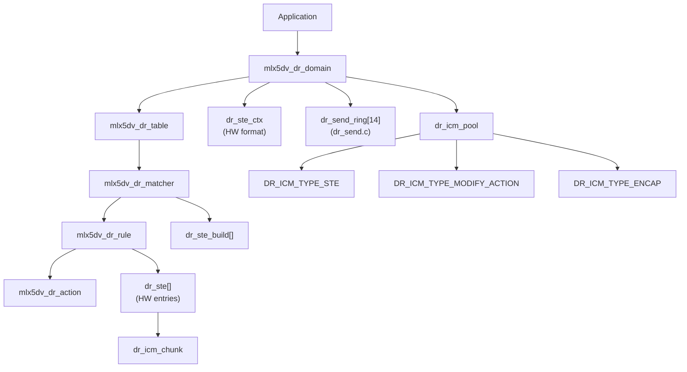
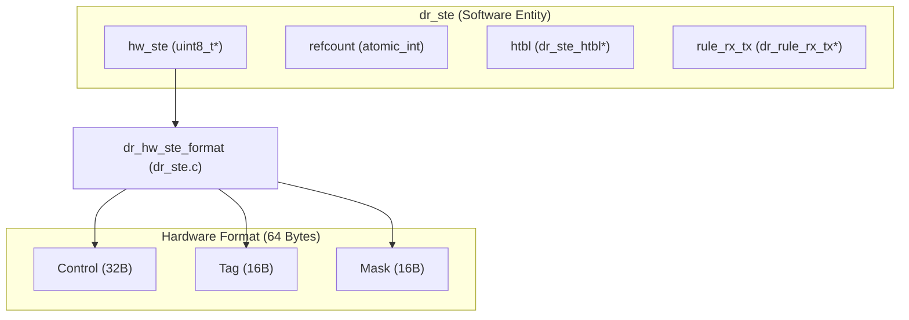
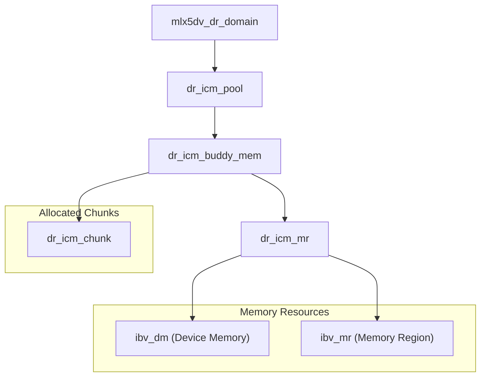

<!-- source: DeepWiki mcp.deepwiki.com · repo linux-rdma/rdma-core · extra page MLX5 Direct Rules Flow Steering · fetched 2026-11-11 -->

# MLX5 Direct Rules Flow Steering

Relevant source files

The following files were used as context for generating this wiki page:

- [providers/mlx5/dr_action.c](providers/mlx5/dr_action.c)
- [providers/mlx5/dr_arg.c](providers/mlx5/dr_arg.c)
- [providers/mlx5/dr_dbg.c](providers/mlx5/dr_dbg.c)
- [providers/mlx5/dr_devx.c](providers/mlx5/dr_devx.c)
- [providers/mlx5/dr_domain.c](providers/mlx5/dr_domain.c)
- [providers/mlx5/dr_icm_pool.c](providers/mlx5/dr_icm_pool.c)
- [providers/mlx5/dr_matcher.c](providers/mlx5/dr_matcher.c)
- [providers/mlx5/dr_ptrn.c](providers/mlx5/dr_ptrn.c)
- [providers/mlx5/dr_rule.c](providers/mlx5/dr_rule.c)
- [providers/mlx5/dr_send.c](providers/mlx5/dr_send.c)
- [providers/mlx5/dr_ste.c](providers/mlx5/dr_ste.c)
- [providers/mlx5/dr_ste.h](providers/mlx5/dr_ste.h)
- [providers/mlx5/dr_ste_v0.c](providers/mlx5/dr_ste_v0.c)
- [providers/mlx5/dr_ste_v1.c](providers/mlx5/dr_ste_v1.c)
- [providers/mlx5/dr_table.c](providers/mlx5/dr_table.c)
- [providers/mlx5/mlx5_ifc.h](providers/mlx5/mlx5_ifc.h)
- [providers/mlx5/mlx5dv_dr.h](providers/mlx5/mlx5dv_dr.h)

The MLX5 Direct Rules (DR) flow steering subsystem provides software-based packet steering for Mellanox ConnectX-4/5/6/7/8 adapters. Unlike hardware-based flow steering (where the kernel/firmware programs flow tables), DR implements flow steering logic entirely in userspace by directly programming Steering Table Entries (STEs) into device memory. This enables more flexible and performant packet classification and action processing.

The DR subsystem is part of the MLX5 Direct Verbs extensions and operates by writing STE entries directly to Internal Coherent Memory (ICM) on the device using RDMA write operations via dedicated send rings.

## Architecture Overview

The DR flow steering architecture consists of five hierarchical layers: domains, tables, matchers, rules, and actions. At the lowest level, the system generates Steering Table Entries (STEs) that are written to ICM memory via RDMA operations.

### Hierarchical Object Model

The following diagram illustrates the relationship between the high-level API objects and the underlying hardware steering entities.

Title: DR Object Hierarchy and Code Entities

**Key Data Structures:**
- `struct mlx5dv_dr_domain`: Top-level context containing ICM pools and send rings [providers/mlx5/mlx5dv_dr.h:1079-1093]().
- `struct mlx5dv_dr_table`: Flow table with RX/TX direction [providers/mlx5/mlx5dv_dr.h:1095-1103]().
- `struct mlx5dv_dr_matcher`: Match criteria container [providers/mlx5/mlx5dv_dr.h:1105-1124]().
- `struct mlx5dv_dr_rule`: Specific rule instance with match values and actions [providers/mlx5/mlx5dv_dr.h:1126-1133]().
- `struct dr_ste`: Single steering table entry [providers/mlx5/mlx5dv_dr.h:232-251]().

Sources:
- [providers/mlx5/mlx5dv_dr.h:1079-1133]()
- [providers/mlx5/mlx5dv_dr.h:232-251]()
- [providers/mlx5/dr_domain.c:78-171]()

## Key Components

### Domains

Domains represent the context in which packet steering occurs. The MLX5 DR system supports three types of domains:
- **NIC RX (Receive)**: For handling incoming packets.
- **NIC TX (Transmit)**: For handling outgoing packets.
- **FDB (Filtering Database)**: For switching/routing decisions on the adapter (E-Switch).

Each domain type has specific capabilities and limitations, and can contain multiple tables.

Sources:
- [providers/mlx5/mlx5dv_dr.h:1080-1093]()
- [providers/mlx5/dr_domain.c:78-171]()

### Tables

Tables (`struct mlx5dv_dr_table`) organize matchers within a domain. Each table has a level (0-max) that determines priority. Tables contain separate RX/TX components (`dr_table_rx_tx`) which include anchor STE tables (`s_anchor`, `e_anchor`) that serve as entry and exit points for the table logic.

Sources:
- [providers/mlx5/mlx5dv_dr.h:1095-1103]()
- [providers/mlx5/dr_table.c]()

### Matchers

Matchers (`struct mlx5dv_dr_matcher`) define match criteria using a mask structure (`dr_match_param`). During matcher creation, the system builds an array of STE builders (`dr_ste_build[]`) that program specific packet fields into hardware format.

**Matcher Criteria Support:**
- **Outer/Inner Headers**: MAC addresses, VLAN, IPv4/v6, TCP/UDP ports [providers/mlx5/dr_matcher.c:41-122]().
- **Misc Fields**: VXLAN VNI, MPLS labels, metadata [providers/mlx5/dr_matcher.c:87-146]().
- **Tunnel Headers**: GRE, VXLAN-GPE, GENEVE, GTPU [providers/mlx5/dr_matcher.c:128-222]().

Sources:
- [providers/mlx5/mlx5dv_dr.h:1105-1124]()
- [providers/mlx5/dr_matcher.c:175-309]()

### Rules

Rules (`struct mlx5dv_dr_rule`) combine specific match values with actions. Rule creation involves:
1. Building an STE array using `dr_ste_build_ste_arr()` [providers/mlx5/dr_ste.c:504-507]().
2. Building action STEs using `dr_actions_build_ste_arr()` [providers/mlx5/dr_action.c:683-690]().
3. Finding or creating STE hash table entries via `dr_rule_create_rule_nic()` [providers/mlx5/dr_rule.c:433-482]().
4. Writing STEs to ICM via dedicated send rings.

Sources:
- [providers/mlx5/mlx5dv_dr.h:1126-1133]()
- [providers/mlx5/dr_rule.c:193-685]()

### Actions

Actions define operations to perform on matched packets. DR supports a wide range of actions defined in `enum dr_action_type` [providers/mlx5/mlx5dv_dr.h:173-196]().

| Action Type | Description | Code Constant |
|:---|:---|:---|
| **Drop** | Discard the packet | `DR_ACTION_TYP_DROP` |
| **Forward** | Forward to QP or Flow Table | `DR_ACTION_TYP_QP`, `DR_ACTION_TYP_FT` |
| **Modify Header** | Rewrite packet fields | `DR_ACTION_TYP_MODIFY_HDR` |
| **Encap/Decap** | Tunneling operations | `DR_ACTION_TYP_L2_TO_TNL_L2`, `DR_ACTION_TYP_TNL_L2_TO_L2` |
| **VLAN** | Push or Pop VLAN tags | `DR_ACTION_TYP_PUSH_VLAN`, `DR_ACTION_TYP_POP_VLAN` |
| **ASO** | Advanced Steering Operations (Meter, CT) | `DR_ACTION_TYP_ASO_FLOW_METER`, `DR_ACTION_TYP_ASO_CT` |

Sources:
- [providers/mlx5/mlx5dv_dr.h:173-196]()
- [providers/mlx5/dr_action.c:60-196]()

## STE (Steering Table Entry) Engine

The STE engine is the core of DR flow steering. Each STE is a 64-byte hardware structure written to ICM memory.

### STE Structure and Format

Title: STE Data Flow and Hardware Mapping

**STE Versions:**
- **v0**: Legacy hardware support (ConnectX-5) [providers/mlx5/dr_ste_v0.c]().
- **v1**: Modern hardware support (ConnectX-6DX and newer) [providers/mlx5/dr_ste_v1.c]().

The `dr_ste_ctx` structure abstracts these versions, providing function pointers for operations like `set_miss_addr` and `set_hit_addr` [providers/mlx5/dr_ste.c:121-149]().

Sources:
- [providers/mlx5/mlx5dv_dr.h:232-251]()
- [providers/mlx5/dr_ste.c:36-40]()
- [providers/mlx5/dr_ste_v0.c]()
- [providers/mlx5/dr_ste_v1.c]()

### Hash Tables and Collision Handling

STEs are organized into hash tables (`dr_ste_htbl`) with collision lists.
- **Hash Calculation**: Uses CRC32 on the packet tag to determine the index in the ICM chunk [providers/mlx5/dr_ste.c:42-79]().
- **Collision Management**: If multiple rules hash to the same index, they are linked in a `miss_list` [providers/mlx5/dr_ste.c:167-187]().
- **Collision Entries**: The system creates collision entries and redirects the "miss" address of the preceding STE to the new collision STE [providers/mlx5/dr_rule.c:40-69]().

Sources:
- [providers/mlx5/mlx5dv_dr.h:268-283]()
- [providers/mlx5/dr_ste.c:42-79]()
- [providers/mlx5/dr_rule.c:40-133]()

## ICM Memory Management

Internal Coherent Memory (ICM) is device memory used to store STEs and actions. The DR subsystem manages ICM through a pool and buddy allocator system.

### ICM Pool Architecture

Title: ICM Pool and Buddy Allocator Mapping

**ICM Types:**
- `DR_ICM_TYPE_STE`: Steering table entries [providers/mlx5/mlx5dv_dr.h:98]().
- `DR_ICM_TYPE_MODIFY_ACTION`: Header modification actions [providers/mlx5/mlx5dv_dr.h:99]().
- `DR_ICM_TYPE_ENCAP`: Encapsulation data [providers/mlx5/mlx5dv_dr.h:101]().

Sources:
- [providers/mlx5/mlx5dv_dr.h:67-103]()
- [providers/mlx5/dr_icm_pool.c]()
- [providers/mlx5/dr_domain.c:49-70]()

## Hardware Synchronization via Send Rings

DR uses dedicated RDMA Queue Pairs (QPs), referred to as "send rings", to perform RDMA Write operations that program STEs into hardware ICM.

### Send Ring Mechanism

- **Parallelism**: Up to 14 send rings are used to maximize performance [providers/mlx5/mlx5dv_dr.h:48]().
- **Queueing**: Each ring has a queue size of 128 [providers/mlx5/dr_send.c:40]().
- **Post-Send**: STEs are written using `dr_send_postsend_ste()` which builds a WQE and rings the doorbell [providers/mlx5/dr_send.c:151-160]().
- **Polling**: Completion Queues (CQs) are polled via `dr_poll_cq()` to confirm hardware has received the updates [providers/mlx5/dr_send.c:135-148]().

### Hardware Synchronization Flow

1. **Rule Creation**: User calls `mlx5dv_dr_rule_create`.
2. **STE Preparation**: `dr_ste_prepare_for_postsend` prepares the 64-byte buffer [providers/mlx5/dr_ste.c:435-440]().
3. **RDMA Write**: `dr_postsend_write` issues an RDMA Write to the ICM address [providers/mlx5/dr_send.c]().
4. **Completion**: The system polls the CQ to ensure the hardware steering engine is synchronized with the new rule.

Sources:
- [providers/mlx5/mlx5dv_dr.h:48-49]()
- [providers/mlx5/dr_send.c:40-202]()
- [providers/mlx5/dr_domain.c:148-155]()

---

