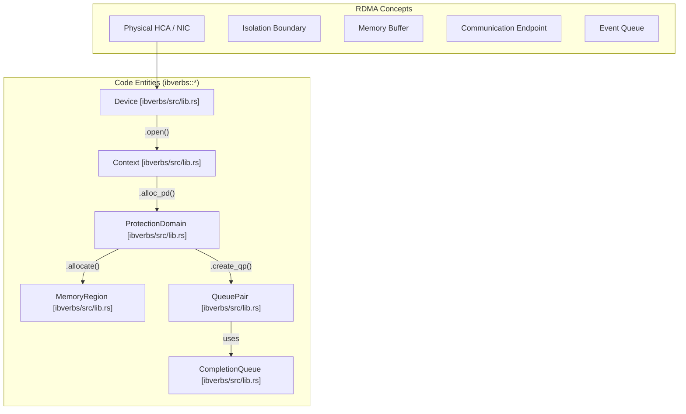
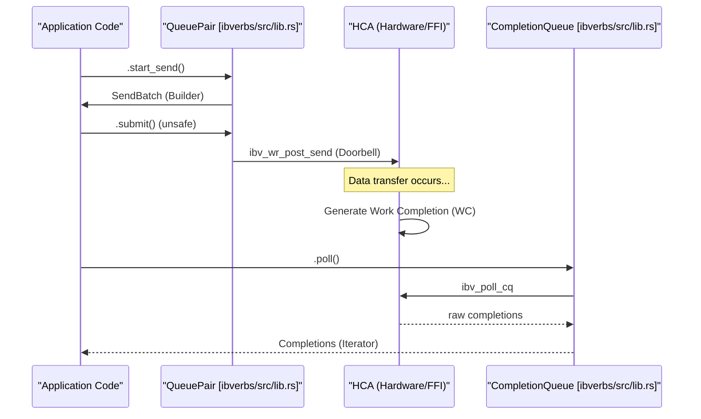

<!-- source: DeepWiki mcp.deepwiki.com · repo jonhoo/rust-ibverbs · page 1 Overview · fetched 2026-11-11 -->

# Overview

<details>
<summary>Relevant source files</summary>

The following files were used as context for generating this wiki page:

- [.gitmodules](.gitmodules)
- [Cargo.toml](Cargo.toml)
- [README.md](README.md)
- [ibverbs/src/lib.rs](ibverbs/src/lib.rs)

</details>


`rust-ibverbs` provides a safe, idiomatic Rust API for RDMA (Remote Direct Memory Access) over InfiniBand, RoCE, and iWARP transports. It wraps the low-level `libibverbs` library from the `rdma-core` project, enabling userspace applications to perform high-throughput, zero-copy network operations without kernel involvement on the data path [ibverbs/src/lib.rs:1-7]().

The library manages the full RDMA lifecycle:
*   **Control Path:** Discovering devices, opening contexts, allocating protection domains, and configuring queue pairs [ibverbs/src/lib.rs:5-7]().
*   **Data Path:** Registering memory regions, posting work requests (Sends, Writes, Reads, Atomics) via doorbell batching, and reaping completions [ibverbs/src/lib.rs:7-8]().

### System Architecture and Code Entities

The following diagram illustrates how high-level RDMA concepts map to specific Rust structs and traits within the codebase.

**Concept to Code Mapping**

**Sources:** [ibverbs/src/lib.rs:14-17](), [ibverbs/src/lib.rs:107-112]().

---

### Two-Crate Architecture

The project is structured as a Cargo workspace containing two primary crates [Cargo.toml:1-6]():

1.  **`ibverbs-sys`**: The FFI layer. It vendors `rdma-core` as a git submodule and uses `bindgen` to generate raw Rust bindings [ibverbs-sys/vendor/rdma-core](), [.gitmodules:1-3](). It handles the complexities of linking against `libibverbs`, `librdmacm`, and `libefa` [ibverbs/src/lib.rs:88-98]().
2.  **`ibverbs`**: The safe wrapper. It consumes the raw bindings and exposes a type-safe API that enforces RDMA safety invariants at compile time. It re-exports the raw bindings as `ibverbs::ffi` for advanced use cases [ibverbs/src/lib.rs:8-10]().

For a deep dive into the build system and module structure, see **[Crate Architecture](#2)**.

---

### Safety Model and Design Philosophy

RDMA programming is notoriously difficult due to complex lifetime requirements and transport-specific rules. `rust-ibverbs` addresses these through:

*   **Typed Transports:** Queue pairs are generic over a `Transport` trait (e.g., `Rc`, `Uc`, `Ud`). Operations like RDMA Read are only available on `Rc` (Reliable Connection) queue pairs, preventing invalid operations at compile time [ibverbs/src/lib.rs:107-115]().
*   **Resource Lifetimes:** The crate uses internal reference counting (e.g., `Arc`). A `QueuePair` keeps its associated `CompletionQueue` and `ProtectionDomain` alive, preventing use-after-free bugs common in C [ibverbs/src/lib.rs:127-133]().
*   **Posting Contract:** While the library provides safe wrappers, posting work requests remains `unsafe` because the hardware may continue to access the memory buffers until a completion is reaped [ibverbs/src/lib.rs:42-50]().

For details on how these rules are implemented, see **[Safety Model and Design Philosophy](#1.2)**.

---

### Quick Start Example

The typical workflow involves opening a device, setting up resources, and performing a loopback transfer.

```rust
// 1. Open a device context
let ctx = ibverbs::devices()?.iter().next().expect("no device").open()?;

// 2. Setup Completion Queue and Protection Domain
let cq = ctx.create_cq(16).build()?;
let pd = ctx.alloc_pd()?;

// 3. Build and handshake a Queue Pair (RC Transport)
let prepared = pd.create_qp::<ibverbs::Rc>(&cq, &cq, 1)?.build()?;
let endpoint = prepared.endpoint()?;
let mut qp = prepared.handshake(endpoint)?;

// 4. Register memory and post operations
let mut recv = pd.allocate(4096, ibverbs::AccessFlags::PERMISSIVE)?;
let mut send = pd.allocate(4096, ibverbs::AccessFlags::PERMISSIVE)?;
unsafe {
    qp.post_recv([ibverbs::RecvRequest::new(1, &[recv.slice(..)])])?;
    qp.start_send().op().signaled().send(2, &[send.slice(..5)]).submit()?;
}

// 5. Poll for completion
while let Some(mut completions) = cq.poll()? {
    while let Some(wc) = completions.next() {
        wc.ok().expect("success");
    }
}
```
**Sources:** [ibverbs/src/lib.rs:19-65](), [README.md:17-60]().

For instructions on environment setup, including `SoftRoCE` for hardware-less testing, see **[Getting Started](#1.1)**.

---

### Data Path Flow

The diagram below shows the interaction between the `QueuePair`, `CompletionQueue`, and the underlying hardware during a data transfer.

**Work Request Lifecycle**

**Sources:** [ibverbs/src/lib.rs:42-61](), [README.md:80-87]().

---

### Feature Support

*   **`rdmacm`**: Optional feature for connection management over IP (TCP-like handshake) [ibverbs/src/lib.rs:81-84]().
*   **`efa`**: Support for AWS Elastic Fabric Adapter and the Scalable Reliable Datagram (`Srd`) transport [ibverbs/src/lib.rs:85-87]().

For more information on these specific features, see **[Optional Features](#6)**.

---

