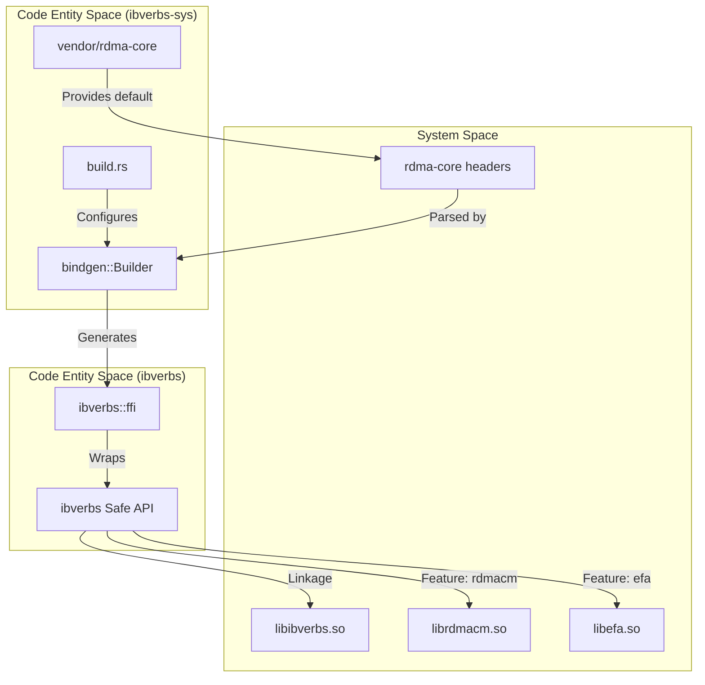
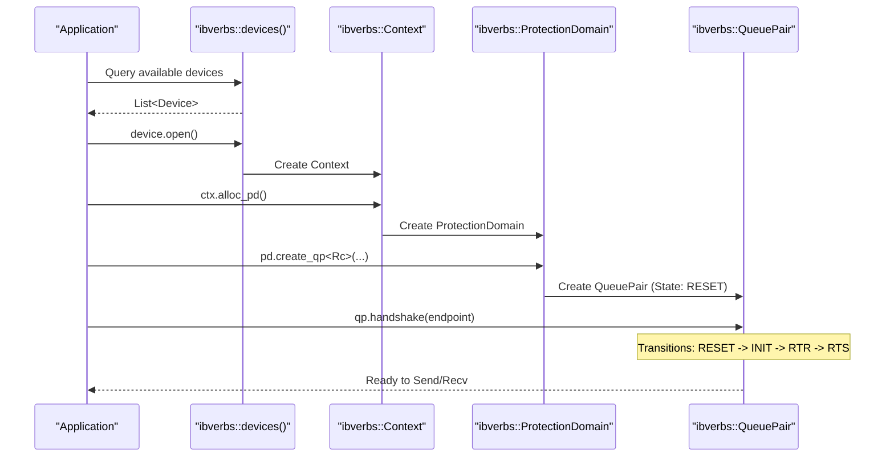

<!-- source: DeepWiki mcp.deepwiki.com · repo jonhoo/rust-ibverbs · page 1.1 Getting Started · fetched 2026-11-11 -->

# Getting Started

<details>
<summary>Relevant source files</summary>

The following files were used as context for generating this wiki page:

- [Cargo.lock](Cargo.lock)
- [README.md](README.md)
- [configure-ci.sh](configure-ci.sh)
- [ibverbs-sys/build.rs](ibverbs-sys/build.rs)
- [ibverbs/Cargo.toml](ibverbs/Cargo.toml)

</details>


This page provides a step-by-step guide for setting up your environment, building the `rust-ibverbs` crate, and running your first RDMA programs. The crate provides a safe wrapper around `libibverbs`, enabling high-performance, zero-copy networking with single-digit microsecond latencies [README.md:8-11]().

## System Requirements

To build and run `rust-ibverbs`, your system must meet the following requirements:

*   **Operating System**: Linux (RDMA verbs are a Linux-specific subsystem).
*   **Rust Toolchain**: Minimum Supported Rust Version (MSRV) is **1.82** [ibverbs/Cargo.toml:5-5]().
*   **C Toolchain**: `cmake` and a C compiler (e.g., `clang` or `gcc`) are required to generate bindings from the vendored `rdma-core` source [ibverbs-sys/build.rs:5-27]().
*   **System Libraries**: You must have `libibverbs` installed to link the final binary. For optional features, `librdmacm` and `libefa` are also required [README.md:121-125]().

### Installing Dependencies (Debian/Ubuntu)

```bash
sudo apt-get update
sudo apt-get install libibverbs1 libibverbs-dev librdmacm1 librdmacm-dev clang cmake
```
*Sources: [configure-ci.sh:5-11]()*

## Building the Crate

The project uses a two-crate architecture: `ibverbs-sys` (low-level FFI) and `ibverbs` (safe API) [ibverbs/Cargo.toml:27-27]().

### Default Build (Vendored Headers)
By default, the build script in `ibverbs-sys` will:
1.  Initialize the `rdma-core` git submodule [ibverbs-sys/build.rs:29-44]().
2.  Run `cmake` to configure the source and generate the necessary header tree [ibverbs-sys/build.rs:5-27]().
3.  Use `bindgen` to create Rust FFI definitions from `verbs.h` [ibverbs-sys/build.rs:88-91]().
4.  Link against the system's `libibverbs` [ibverbs-sys/build.rs:47-47]().

### Custom Header and Library Paths
If you wish to use specific pre-built headers or libraries instead of the vendored submodule, set the following environment variables:

| Variable | Purpose |
| :--- | :--- |
| `RDMA_CORE_INCLUDE_DIR` | Path to the `rdma-core` include directory (containing `infiniband/verbs.h`). |
| `RDMA_CORE_LIB_DIR` | Path to the directory containing `libibverbs.so`. |

*Sources: [ibverbs-sys/build.rs:61-69]()*

## Cargo Features

The crate provides optional functionality through Cargo features. These are disabled by default to minimize dependencies [ibverbs/Cargo.toml:32-33]().

| Feature | Description | Linkage |
| :--- | :--- | :--- |
| `rdmacm` | Enables the RDMA Connection Manager for IP-based connection setup [ibverbs/Cargo.toml:37-37](). | `-lrdmacm` [ibverbs-sys/build.rs:58-58]() |
| `efa` | Enables AWS Elastic Fabric Adapter SRD queue pairs [ibverbs/Cargo.toml:35-35](). | `-lefa` [ibverbs-sys/build.rs:52-52]() |

To enable a feature, add it to your `Cargo.toml`:
```toml
[dependencies]
ibverbs = { version = "0.9.2", features = ["rdmacm"] }
```

## Data Flow and Component Architecture

The following diagram illustrates the relationship between the system libraries, the FFI layer, and the safe Rust API.

### Build and Linkage Architecture
"Code Entity Space" mapping to "System Space".


*Sources: [ibverbs-sys/build.rs:46-60](), [ibverbs-sys/build.rs:88-115](), [ibverbs/Cargo.toml:27-27]()*

## Testing Without Hardware (SoftRoCE)

If you do not have RDMA-capable hardware (like NVIDIA/Mellanox ConnectX or AWS EFA), you can use **SoftRoCE (`rdma_rxe`)**. This is a software implementation of RoCE v2 that runs over standard Ethernet interfaces.

### Setting up SoftRoCE
1.  **Load the kernel module**:
    ```bash
    sudo modprobe rdma_rxe
    ```
2.  **Create a virtual device**:
    Identify your ethernet interface (e.g., `eth0`) and map a new RXE device to it:
    ```bash
    sudo rdma link add rxe0 type rxe netdev eth0
    ```
3.  **Verify the device**:
    The device should now appear in the list of available verbs devices:
    ```bash
    ibv_devinfo
    ```

### Running Examples
Once the device is set up, you can run the provided examples. Use the `IBVERBS_TEST_DEVICE` environment variable to specify which device to use if multiple are present.

```bash
# Run the basic loopback example
cargo run --example loopback

# Run the RDMA CM example (requires rdmacm feature)
cargo run --features rdmacm --example rdmacm_connect
```
*Sources: [README.md:62-66](), [ibverbs/Cargo.toml:39-46]()*

## Resource Lifecycle Overview

The crate uses `Arc`-based reference counting to manage the complex lifetime requirements of RDMA resources [README.md:98-100]().

### Initialization Sequence
The following diagram shows the typical flow for initializing an RDMA connection.


*Sources: [README.md:20-37](), [README.md:74-76]()*

### Key Initialization Code Entities
*   `ibverbs::devices()`: Entry point to discover hardware [README.md:21-21]().
*   `Context`: A handle to an opened RDMA device [README.md:21-21]().
*   `ProtectionDomain`: A container that isolates Memory Regions and Queue Pairs [README.md:24-24]().
*   `QueuePairBuilder`: A type-safe builder for configuring transport-specific QPs (RC, UC, UD, or SRD) [README.md:28-31]().

*Sources: [README.md:20-40](), [README.md:69-73]()*

---

