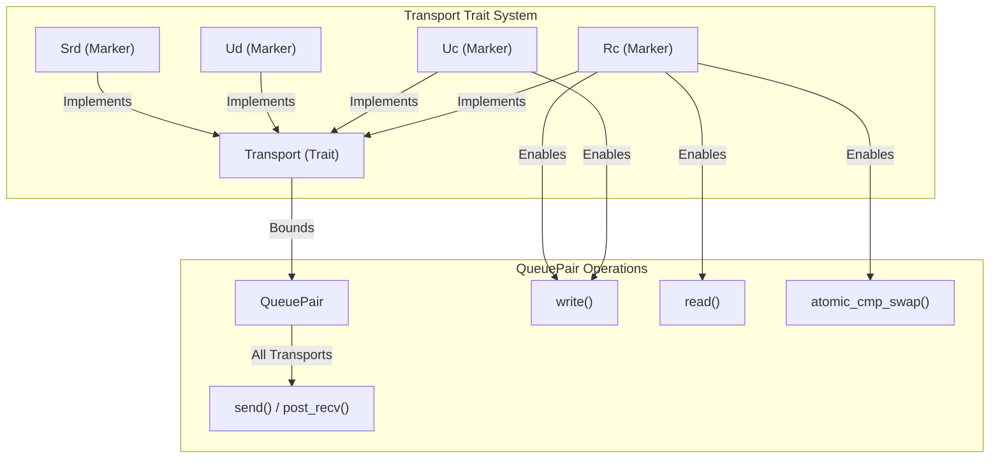
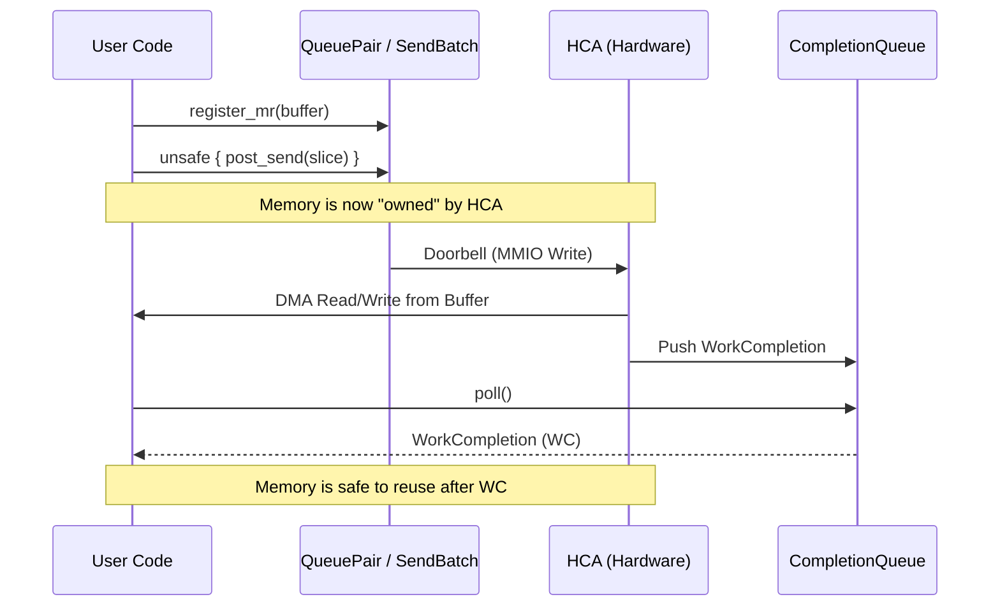

<!-- source: DeepWiki mcp.deepwiki.com · repo jonhoo/rust-ibverbs · page 1.2 Safety Model and Design Philosophy · fetched 2026-11-11 -->

# Safety Model and Design Philosophy

Relevant source files

The following files were used as context for generating this wiki page:

- [ibverbs-sys/src/lib.rs](ibverbs-sys/src/lib.rs)
- [ibverbs/src/error.rs](ibverbs/src/error.rs)
- [ibverbs/src/lib.rs](ibverbs/src/lib.rs)

The `rust-ibverbs` crate provides a safe abstraction over the RDMA "verbs" API (`libibverbs`). The design philosophy focuses on encoding the complex, often implicit, contracts of RDMA into Rust's type system to prevent common pitfalls such as use-after-free, data races, and invalid state transitions, while maintaining the zero-overhead performance required for high-throughput networking [ibverbs/src/lib.rs:1-10]().

## Transport-Typed Queue Pairs

RDMA supports multiple transport protocols (Reliable Connected, Unreliable Datagram, etc.), each supporting a different subset of operations. `rust-ibverbs` uses the `Transport` trait and marker types to ensure that only valid operations can be called on a specific `QueuePair` at compile time [ibverbs/src/lib.rs:107-116]().

| Transport Type | Supported Operations | Code Entity |
| :--- | :--- | :--- |
| **RC** (Reliable Connected) | Send/Recv, RDMA Read/Write, Atomics | `ibverbs::Rc` |
| **UC** (Unreliable Connected) | Send/Recv, RDMA Write | `ibverbs::Uc` |
| **UD** (Unreliable Datagram) | Datagram Send/Recv | `ibverbs::Ud` |
| **SRD** (Scalable Reliable Datagram) | Reliable Datagram (EFA specific) | `ibverbs::Srd` |

### Code Entity Mapping: Transport Operations
The following diagram illustrates how the `QueuePair` methods are gated by the `Transport` trait implementations.

Sources: [ibverbs/src/lib.rs:107-116](), [ibverbs/src/error.rs:109-115]()

## Resource Lifetimes and Reference Counting

RDMA resources have strict hierarchical dependencies. For example, a `QueuePair` (QP) cannot be destroyed before its associated `CompletionQueue` (CQ), and a CQ cannot be destroyed before the `Context` that created it. `rust-ibverbs` manages these lifetimes using `Arc`-based internal reference counting [ibverbs/src/lib.rs:127-133]().

- **Automatic Cleanup**: Resources implement `Drop` to return handles to the device [ibverbs/src/lib.rs:129-130]().
- **Dependency Ordering**: Internal pointers ensure that parent resources (like `ProtectionDomain`) outlive their children (like `MemoryRegion`) [ibverbs/src/lib.rs:129-131]().
- **Panic on Failure**: If the device rejects a teardown (typically due to leaked raw handles), the crate panics to prevent silent resource leaks [ibverbs/src/lib.rs:131-133]().

## The Unsafe Posting Contract

While the control path is largely safe, the data path involves `unsafe` contracts due to the asynchronous nature of RDMA hardware. When a user posts a Work Request (WR), the hardware takes ownership of the memory buffers until a corresponding Work Completion (WC) is reaped from the `CompletionQueue` [ibverbs/src/lib.rs:42-50]().

The crate marks `post_recv` and `batch.submit()` as `unsafe` because the compiler cannot verify that the user won't modify the underlying memory while the HCA (Host Channel Adapter) is accessing it [ibverbs/src/lib.rs:47-50]().

Sources: [ibverbs/src/lib.rs:42-61](), [ibverbs-sys/src/lib.rs:78-85]()

## Design Patterns

### Flags Newtype Macro
The crate uses a `flags_newtype!` macro to provide type-safe bitflags for various ibverbs constants (e.g., `AccessFlags`, `QueuePairAttributeMask`). This prevents passing incorrect bitmasks to FFI functions and provides a clean API for bitwise operations [ibverbs/src/error.rs:3-4](), [ibverbs/src/error.rs:130-138]().

### The Escape Hatch Pattern
Every safe wrapper in the crate provides an `as_raw` method, and the underlying `ibverbs::ffi` (from `ibverbs-sys`) is re-exported [ibverbs/src/lib.rs:8-10](). This allows users to:
1. Access hardware-specific features not yet wrapped by the safe API.
2. Interface with other C libraries that expect raw `ibv_*` pointers.
3. Perform manual resource management when the `Arc`-based model is too restrictive.

### Error Handling
Errors are unified into a single `Error` enum that wraps `io::Error` (errno) and provides context-specific variants like `Unsupported` or `InvalidQueuePairTransition` [ibverbs/src/error.rs:22-28](), [ibverbs/src/error.rs:123-128]().

Sources: [ibverbs/src/lib.rs:1-10](), [ibverbs/src/error.rs:1-180](), [ibverbs-sys/src/lib.rs:1-55]()

---

