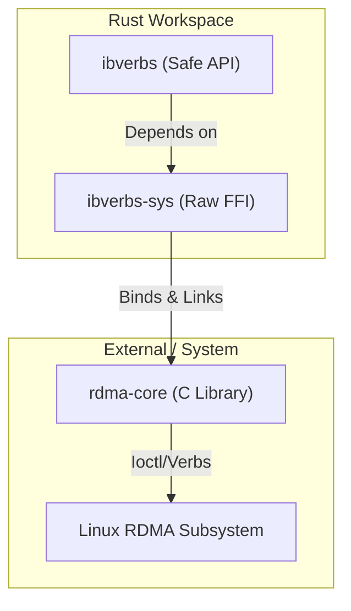
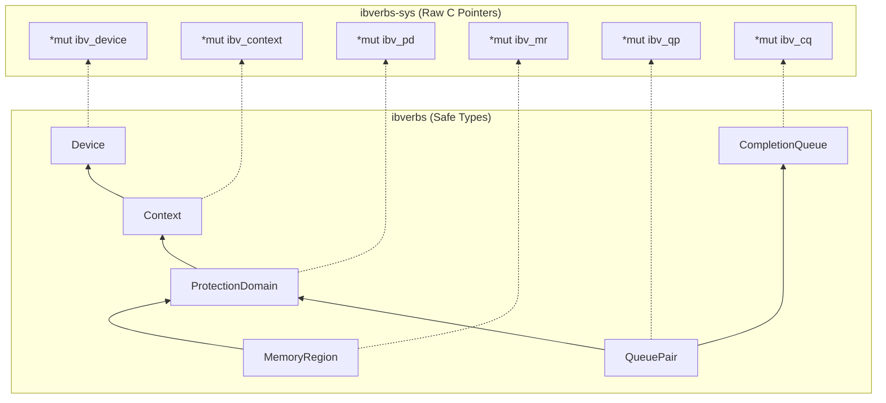

<!-- source: DeepWiki mcp.deepwiki.com · repo jonhoo/rust-ibverbs · page 2 Crate Architecture · fetched 2026-11-11 -->

# Crate Architecture

Relevant source files

The following files were used as context for generating this wiki page:

- [.gitmodules](.gitmodules)
- [Cargo.lock](Cargo.lock)
- [Cargo.toml](Cargo.toml)
- [ibverbs-sys/Cargo.toml](ibverbs-sys/Cargo.toml)
- [ibverbs/Cargo.toml](ibverbs/Cargo.toml)

The `rust-ibverbs` project is structured as a Cargo workspace consisting of two primary crates: `ibverbs-sys` and `ibverbs`. This separation follows the standard Rust idiom for FFI bindings, isolating the unsafe, low-level C interface from the safe, idiomatic Rust wrapper.

### Workspace Structure

The project uses a two-tier architecture to bridge the gap between the Linux kernel's RDMA subsystem and safe Rust code.

| Crate | Role | Description |
| :--- | :--- | :--- |
| `ibverbs-sys` | **FFI Layer** | Raw, unsafe bindings generated from `rdma-core`. Handles linking and C header mapping. |
| `ibverbs` | **Safe API Layer** | High-level Rust abstractions, resource management (RAII), and type-safe RDMA operations. |

**Sources:** [Cargo.toml:1-6](), [ibverbs/Cargo.toml:27-27]()

---

### ibverbs-sys: FFI Bindings Layer

The `ibverbs-sys` crate provides the foundational bindings to the `libibverbs` library and its providers. It vendors `rdma-core` as a git submodule to ensure reproducible builds and consistent header availability.

*   **Build Process**: The `build.rs` script utilizes `bindgen` to generate Rust definitions from C headers and `cmake` to potentially compile parts of the vendored library.
*   **Feature Gating**: Optional components like `librdmacm` (Connection Manager) and `libefa` (AWS EFA provider) are gated behind Cargo features to minimize dependency bloat for users who do not require them.
*   **Submodule**: The source of truth for the C headers is located at `ibverbs-sys/vendor/rdma-core`.

For details, see [ibverbs-sys: FFI Bindings Layer](#2.1).

**Sources:** [ibverbs-sys/Cargo.toml:13-14](), [ibverbs-sys/Cargo.toml:30-36](), [.gitmodules:1-4]()

---

### ibverbs: Safe API Layer

The `ibverbs` crate wraps the raw pointers and unsafe functions from `ibverbs-sys` into a cohesive, type-safe hierarchy. It is designed around the "Control-Path vs. Data-Path" split:

1.  **Control-Path**: Uses Rust's ownership model (`Arc`, `Drop`) to manage the complex lifecycle of RDMA resources (Devices, Contexts, Protection Domains).
2.  **Data-Path**: Provides optimized interfaces for posting Work Requests (WR) and polling Completion Queues (CQ), minimizing overhead while maintaining memory safety.

#### Module Organization
The crate is organized into modules that correspond to RDMA entities:
*   `device` & `context`: Hardware discovery and entry points.
*   `pd` & `mr`: Memory protection and registration.
*   `qp` & `srq`: Communication endpoints and shared receive queues.
*   `completion`: Polling and event-driven work completion.
*   `rdmacm` & `efa`: Optional extensions for connection management and specialized hardware.

For details, see [ibverbs: Safe API Layer](#2.2).

**Sources:** [ibverbs/Cargo.toml:32-37](), [ibverbs/Cargo.toml:27-27]()

---

### Resource Dependency Graph

The following diagram illustrates how the safe Rust entities in `ibverbs` relate to one another and the underlying raw types in `ibverbs-sys`.

**Sources:** [ibverbs/Cargo.toml:2-7](), [ibverbs-sys/Cargo.toml:2-7]()

---

