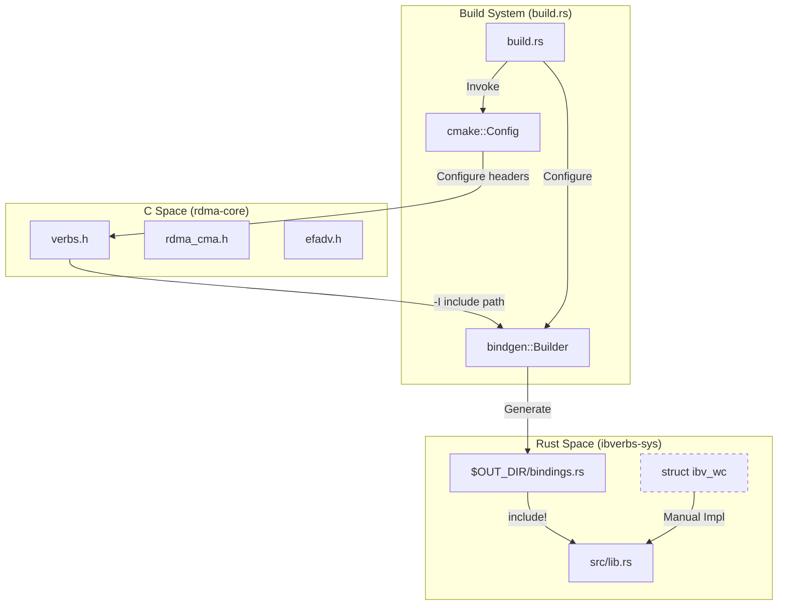
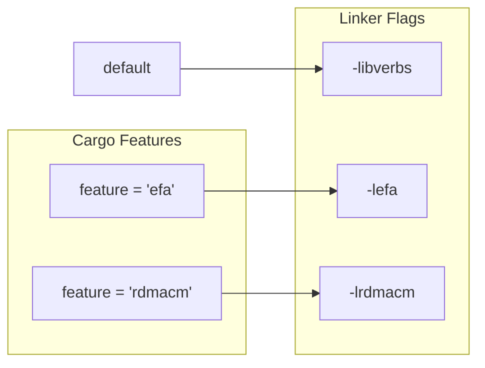

<!-- source: DeepWiki mcp.deepwiki.com · repo jonhoo/rust-ibverbs · page 2.1 ibverbs-sys: FFI Bindings Layer · fetched 2026-11-11 -->

# ibverbs-sys: FFI Bindings Layer

Relevant source files

The following files were used as context for generating this wiki page:

- [configure-ci.sh](configure-ci.sh)
- [ibverbs-sys/Cargo.toml](ibverbs-sys/Cargo.toml)
- [ibverbs-sys/build.rs](ibverbs-sys/build.rs)
- [ibverbs-sys/empty.c](ibverbs-sys/empty.c)
- [ibverbs-sys/src/lib.rs](ibverbs-sys/src/lib.rs)

The `ibverbs-sys` crate provides the low-level Foreign Function Interface (FFI) bindings to the `rdma-core` userspace libraries. It serves as the foundational layer for the `ibverbs` crate, translating C-style headers into Rust-compatible types and function signatures.

## Purpose and Scope

`ibverbs-sys` is responsible for:
1.  **Binding Generation**: Using `bindgen` to create Rust representations of `libibverbs`, `librdmacm`, and `libefa`.
2.  **Vendoring**: Maintaining a specific version of `rdma-core` via a git submodule to ensure header consistency [ibverbs-sys/Cargo.toml:24-24]().
3.  **Linkage Management**: Handling the linking of system or vendored libraries based on environment variables and Cargo features [ibverbs-sys/build.rs:46-77]().

## Build Process and Bindgen Strategy

The crate uses a `build.rs` script to orchestrate the generation of bindings. It supports two primary modes: using system-installed headers/libraries or building against the vendored `rdma-core` submodule.

### Build Workflow

The build script follows a specific logic to locate headers and libraries:
1.  **Submodule Initialization**: If the vendored source is missing and a `.git` directory exists, it initializes the `rdma-core` submodule [ibverbs-sys/build.rs:29-44]().
2.  **Header Discovery**: It checks for `RDMA_CORE_INCLUDE_DIR`. If not set, it defaults to the build directory of the vendored submodule [ibverbs-sys/build.rs:61-77]().
3.  **CMake Configuration**: When using the vendored source, `cmake` is invoked to generate the include tree. The script sets `CMAKE_INSTALL_PREFIX` to `/usr` to avoid path length limitations on certain platforms (like docs.rs) [ibverbs-sys/build.rs:7-22]().

### Bindgen Configuration

The `bindgen::Builder` is configured with strict allowlists to prevent pollution of the global namespace while ensuring all necessary RDMA types are available.

| Strategy | Target Pattern / Entity | Reasoning |
| :--- | :--- | :--- |
| **Allowlist Function** | `ibv_.*`, `_ibv_.*` | Captures all standard ibverbs entry points [ibverbs-sys/build.rs:91-92](). |
| **Allowlist Type** | `ibv_.*`, `verbs_context` | `verbs_context` is required for dispatching through provider op tables [ibverbs-sys/build.rs:93-96](). |
| **Blocklist Type** | `ibv_wc` | Blocked to allow a manual, more ergonomic implementation in `src/lib.rs` [ibverbs-sys/build.rs:125-125](). |
| **Bitfield Enums** | `ibv_access_flags`, `ibv_send_flags`, etc. | Forces `bindgen` to treat these as bitfields rather than strict enums [ibverbs-sys/build.rs:101-117](). |

### C-to-Rust Entity Mapping

The following diagram illustrates how the build system bridges the gap between the C source files in `rdma-core` and the generated Rust code.

**Binding Generation Data Flow**

**Sources:** [ibverbs-sys/build.rs:88-154](), [ibverbs-sys/src/lib.rs:8-13]()

## Feature-Gated Linkage

`ibverbs-sys` supports optional RDMA extensions through Cargo features. These features affect both the generated bindings and the final linker flags.

*   **`efa`**: Enables AWS Elastic Fabric Adapter support. It includes `<infiniband/efadv.h>` and links against `libefa` [ibverbs-sys/build.rs:49-53](), [ibverbs-sys/build.rs:128-136]().
*   **`rdmacm`**: Enables the RDMA Connection Manager. It includes `<rdma/rdma_cma.h>` and links against `librdmacm` [ibverbs-sys/build.rs:55-59](), [ibverbs-sys/build.rs:138-145]().

**Linkage Logic**

**Sources:** [ibverbs-sys/build.rs:47-59](), [ibverbs-sys/Cargo.toml:30-36]()

## Manual Implementation: `ibv_wc`

While most types are generated, `ibv_wc` (Work Completion) is manually defined in `src/lib.rs` [ibverbs-sys/src/lib.rs:13-55](). This is done to provide a stable, documented, and more "Rust-friendly" interface for the performance-critical data path.

The manual implementation includes:
*   **`wr_id()`**: Accessor for the 64-bit work request ID [ibverbs-sys/src/lib.rs:60-62]().
*   **`len()`**: Returns the number of bytes transferred, accounting for the 40-byte GRH header in UD QPs [ibverbs-sys/src/lib.rs:74-76]().
*   **`is_valid()`**: Helper to check for `IBV_WC_SUCCESS` [ibverbs-sys/src/lib.rs:83-85]().

## CI Hybrid Approach: `configure-ci.sh`

In Continuous Integration environments, the project uses a "hybrid" approach to ensure both header correctness and linkage compatibility. The `configure-ci.sh` script automates this setup.

1.  **System Library Installation**: It installs `libibverbs-dev` and `librdmacm-dev` to provide the shared libraries for linking [configure-ci.sh:8-8]().
2.  **Vendored Header Configuration**: It runs `cmake` on the submodule to generate the `rdma-core` header tree [configure-ci.sh:22-23]().
3.  **Environment Mapping**: It sets `RDMA_CORE_INCLUDE_DIR` to point to the **vendored** build path, but sets `RDMA_CORE_LIB_DIR` to the **system** library path (`/usr/lib/x86_64-linux-gnu`) [configure-ci.sh:35-36]().

This ensures that the crate is tested against the specific version of headers it vendors while remaining compatible with the host's dynamic linker environment.

**Sources:** [configure-ci.sh:1-38]()

---

