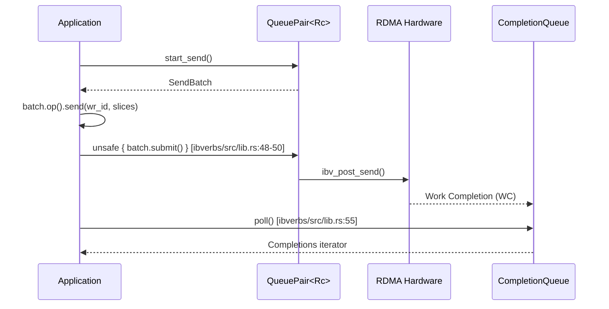

<!-- source: DeepWiki mcp.deepwiki.com · repo jonhoo/rust-ibverbs · page 2.2 ibverbs: Safe API Layer · fetched 2026-11-11 -->

# ibverbs: Safe API Layer

<details>
<summary>Relevant source files</summary>

The following files were used as context for generating this wiki page:

- [ibverbs/src/context.rs](ibverbs/src/context.rs)
- [ibverbs/src/device.rs](ibverbs/src/device.rs)
- [ibverbs/src/error.rs](ibverbs/src/error.rs)
- [ibverbs/src/lib.rs](ibverbs/src/lib.rs)

</details>


The `ibverbs` crate provides a high-level, memory-safe abstraction over the RDMA control and data paths. While the underlying `ibverbs-sys` crate exposes raw C bindings, the safe API layer uses Rust's type system to enforce RDMA resource lifetimes, transport-specific operation rules, and thread-safety contracts.

### Module Structure and Responsibility

The crate is organized into modules that correspond to RDMA resources and concepts. Every resource wrapper provides an `as_raw` method to access the underlying FFI handle, and the crate re-exports `ibverbs::ffi` for direct access to the raw bindings [ibverbs/src/lib.rs:9-10]().

| Module | Primary Responsibility | Key Entities |
| :--- | :--- | :--- |
| `device` | Discovery and enumeration of HCA hardware. | `Device`, `DeviceList` |
| `context` | Opening a device and querying its global state. | `Context` |
| `pd` | Memory protection and resource isolation. | `ProtectionDomain` |
| `mr` | Memory registration and slice management. | `MemoryRegion`, `LocalMemorySlice` |
| `qp` | Connection state machine and data path. | `QueuePair`, `QueuePairBuilder` |
| `completion` | Handling work completions (polling/events). | `CompletionQueue`, `CompletionChannel` |
| `address` | GID/LID routing and UD address handles. | `Gid`, `AddressHandle` |
| `srq` | Shared receive resource management. | `SharedReceiveQueue` |
| `error` | Specialized RDMA error types and errno mapping. | `Error`, `Result` |
| `efa` | AWS-specific SRD transport extensions. | `Srd` transport marker |
| `rdmacm` | IP-based connection management (optional). | `CmId`, `Connector`, `Acceptor` |

**Sources:** [ibverbs/src/lib.rs:5-10](), [ibverbs/src/lib.rs:80-87]()

### Resource Hierarchy and Dependency Flow

RDMA resources follow a strict hierarchical ownership model. The safe API uses `Arc` and internal reference counting to ensure that parent resources (like a `Context`) are not dropped before their children (like a `QueuePair`).

#### System Entity Mapping: Resource Lifecycle
The following diagram maps RDMA system resources to their corresponding Rust structs and illustrates the creation flow.

```mermaid
graph TD
    subgraph "Hardware/OS Space"
        DEV_LIST["ibv_device** (List)"]
        DEV["ibv_device*"]
        RAW_CTX["ibv_context*"]
    end

    subgraph "Code Entity Space (ibverbs crate)"
        DL["DeviceList"]
        D["Device"]
        C["Context"]
        PD["ProtectionDomain"]
        CQ["CompletionQueue"]
        QP["QueuePair<T>"]
        MR["MemoryRegion"]
    end

    DL -- "iter()" --> D
    D -- "open()" --> C [ibverbs/src/device.rs:188-190]
    C -- "alloc_pd()" --> PD [ibverbs/src/context.rs:218-220]
    C -- "create_cq()" --> CQ [ibverbs/src/context.rs:174-180]
    PD -- "create_qp()" --> QP [ibverbs/src/pd.rs:114-118]
    PD -- "allocate()" --> MR [ibverbs/src/pd.rs:152-154]

    DEV_LIST -. "wraps" .-> DL
    DEV -. "wraps" .-> D
    RAW_CTX -. "wraps" .-> C
```
**Sources:** [ibverbs/src/device.rs:188-190](), [ibverbs/src/context.rs:218-220](), [ibverbs/src/pd.rs:114-118](), [ibverbs/src/pd.rs:152-154]()

### Transport-Typed Queue Pairs

A key safety feature of the crate is the use of marker traits to type `QueuePair` instances by their transport protocol (RC, UC, UD, or SRD). This prevents calling RDMA Read on a UD transport at compile time.

*   **`Rc` (Reliable Connected):** Supports Send/Recv, RDMA Read/Write, and Atomics [ibverbs/src/lib.rs:109-110]().
*   **`Uc` (Unreliable Connected):** Supports Send/Recv and RDMA Write [ibverbs/src/lib.rs:110-111]().
*   **`Ud` (Unreliable Datagram):** Supports Send/Recv using `AddressHandle` [ibverbs/src/lib.rs:110-111]().
*   **`Srd` (Scalable Reliable Datagram):** Specific to AWS EFA hardware [ibverbs/src/lib.rs:110-112]().

### Error Handling and Diagnostics

The `ibverbs::Error` enum provides structured access to failures. It distinguishes between standard OS `errno` returns and high-level RDMA logic errors, such as invalid state transitions or mismatched GID configurations.

| Error Variant | Cause | Wrapped FFI Call |
| :--- | :--- | :--- |
| `Unsupported` | Feature not provided by HCA. | `EOPNOTSUPP` |
| `PortNotActive` | Port state is not ARMED/ACTIVE. | `ibv_query_port` [ibverbs/src/context.rs:64-70]() |
| `InvalidQueuePairTransition` | Illegal QP state change. | `ibv_modify_qp` [ibverbs/src/error.rs:122-128]() |
| `PostSend` / `PostReceive` | Failure to enqueue work. | `ibv_post_send` / `ibv_post_recv` [ibverbs/src/error.rs:161-167]() |

**Sources:** [ibverbs/src/error.rs:24-176](), [ibverbs/src/context.rs:64-70]()

### Implementation Detail: The Data Path

The data path is designed for zero-overhead performance while maintaining safety. Posting work requests is `unsafe` because the user must guarantee the underlying memory remains valid until the completion is reaped.

#### Entity Interaction: Posting and Polling
This diagram shows the flow of work requests from the `QueuePair` to the `CompletionQueue`.


**Sources:** [ibverbs/src/lib.rs:42-61](), [ibverbs/src/error.rs:161-171]()

### Thread Safety and Ownership

*   **`Send` / `Sync`:** Handles like `Context`, `ProtectionDomain`, and `CompletionQueue` are thread-safe and can be shared [ibverbs/src/lib.rs:119-121]().
*   **Mutable Access:** Posting to a `QueuePair` requires `&mut QueuePair`, ensuring that only one thread can post to a specific queue at a time without external synchronization [ibverbs/src/lib.rs:122-123]().
*   **Lifetime Constraints:** `WorkCompletion` objects and `Completions` iterators borrow the `CompletionQueue`, preventing the queue from being dropped while results are being processed [ibverbs/src/lib.rs:124-126]().

**Sources:** [ibverbs/src/lib.rs:117-126](), [ibverbs/src/context.rs:91-92]()

---

