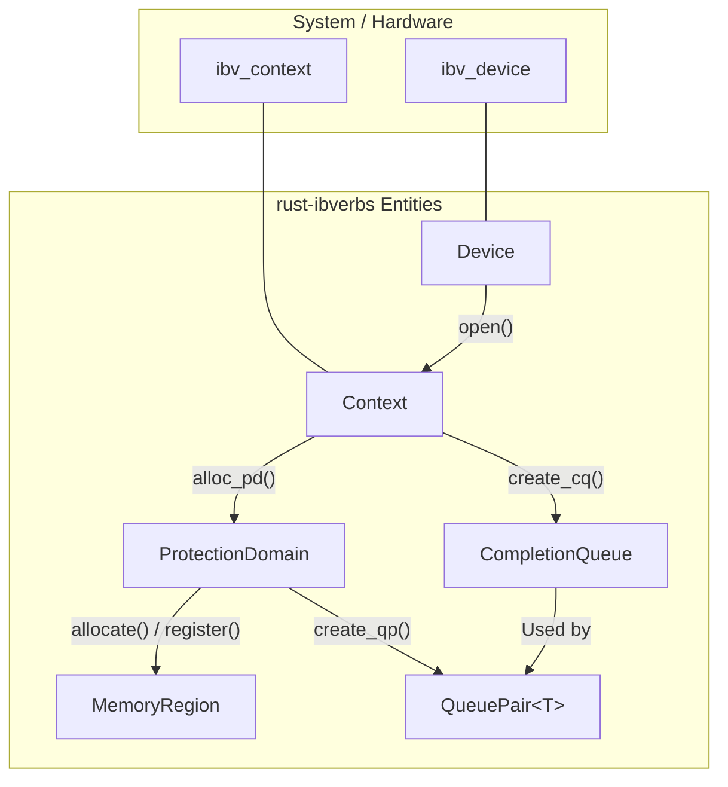
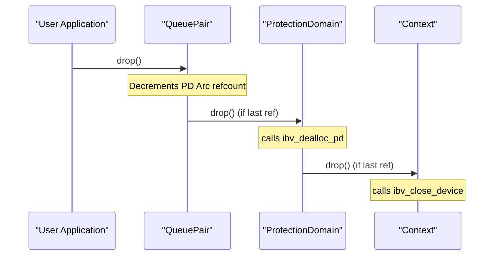

<!-- source: DeepWiki mcp.deepwiki.com · repo jonhoo/rust-ibverbs · page 3 Core RDMA Concepts and Resource Lifecycle · fetched 2026-11-11 -->

# Core RDMA Concepts and Resource Lifecycle

Relevant source files

The following files were used as context for generating this wiki page:

- [ibverbs/src/context.rs](ibverbs/src/context.rs)
- [ibverbs/src/device.rs](ibverbs/src/device.rs)
- [ibverbs/src/lib.rs](ibverbs/src/lib.rs)

This page explains the fundamental RDMA resource hierarchy and how `rust-ibverbs` manages the lifecycle of these resources. The crate uses a reference-counted architecture to ensure that hardware resources are released in the correct order, preventing use-after-free bugs and hardware hangs.

## Resource Hierarchy

RDMA resources are organized in a strict parent-child hierarchy. Every resource depends on its parent remaining valid. In `rust-ibverbs`, this is enforced through `Arc`-based reference counting and the Rust ownership model.

### Code Entity Relationship

The following diagram illustrates how the logical RDMA hierarchy maps to specific types within the `ibverbs` crate.

**RDMA Resource Mapping**

**Sources:**
- `ibverbs/src/lib.rs:14-17`
- `ibverbs/src/device.rs:89-90`
- `ibverbs/src/context.rs:94-102`
- `ibverbs/src/pd.rs:37-41`

---

## Device Discovery and Context

The entry point to any RDMA application is discovering hardware via `ibverbs::devices()` and opening a `Context`. A `Context` represents a specific user-space connection to an RDMA device.

- **Discovery**: `DeviceList` provides an iterator over available `Device` handles.
- **Context**: Opening a `Device` produces a `Context`, which is the root of the resource tree.
- **Attributes**: The `Context` allows querying device capabilities (e.g., `query_device`, `query_port`) and handling asynchronous hardware events.

For details, see [Device Discovery and Context](#3.1).

**Sources:**
- `ibverbs/src/device.rs:14-27`
- `ibverbs/src/context.rs:118-135`
- `ibverbs/src/context.rs:242-246`

---

## Protection Domains and Memory Regions

A `ProtectionDomain` (PD) acts as a container that groups RDMA resources (Queue Pairs, Memory Regions) to control access.

- **Memory Isolation**: A `MemoryRegion` (MR) must be registered with a `ProtectionDomain`. The hardware will only allow RDMA operations on memory if the MR and the Queue Pair (QP) share the same PD.
- **Registration**: Memory must be "pinned" and registered with the HCA before it can be used for zero-copy transfers.

For details, see [Protection Domain and Memory Regions](#3.2).

**Sources:**
- `ibverbs/src/pd.rs:80-84`
- `ibverbs/src/pd.rs:175-180`
- `ibverbs/src/lib.rs:42-45`

---

## Addressing and GIDs

RDMA uses specialized addressing schemes to route traffic across the fabric, especially for RoCE (RDMA over Converged Ethernet).

- **GIDs**: Global Identifiers used for routing. The `Context` provides access to the `gid_table`.
- **Address Handles**: For connectionless transports (UD/SRD), an `AddressHandle` must be created to define the destination for each packet.

For details, see [Addressing: GIDs, LIDs, and Address Handles](#3.3).

**Sources:**
- `ibverbs/src/context.rs:462-466`
- `ibverbs/src/address.rs:11-20`

---

## Lifecycle and Drop Ordering

RDMA hardware is sensitive to the order in which resources are destroyed. For example, a `ProtectionDomain` cannot be deallocated while a `MemoryRegion` still references it.

### Automatic Teardown Logic

`rust-ibverbs` manages this using `Arc<Inner>` patterns. When you create a child resource (like a `QueuePair`), it holds an `Arc` to its parent (the `ProtectionDomain` and `CompletionQueue`).

**Resource Lifetime Flow**

- **Drop Order**: Resources are returned to the device in dependency order.
- **Safety**: If the device rejects a teardown (usually due to raw handles still being held via `as_raw` escape hatches), the crate will `panic!` rather than risk a silent memory leak or hardware corruption.

**Sources:**
- `ibverbs/src/lib.rs:127-133`
- `ibverbs/src/context.rs:74-89`
- `ibverbs/src/pd.rs:56-69`

---

