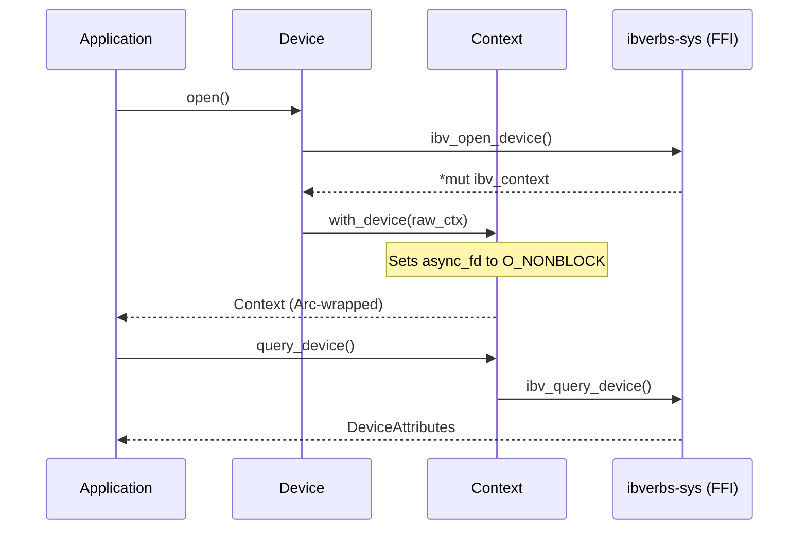

<!-- source: DeepWiki mcp.deepwiki.com · repo jonhoo/rust-ibverbs · page 3.1 Device Discovery and Context · fetched 2026-11-11 -->

# Device Discovery and Context

<details>
<summary>Relevant source files</summary>

The following files were used as context for generating this wiki page:

- [ibverbs/src/address.rs](ibverbs/src/address.rs)
- [ibverbs/src/context.rs](ibverbs/src/context.rs)
- [ibverbs/src/device.rs](ibverbs/src/device.rs)

</details>


This page details the initial phase of any RDMA application: discovering hardware and establishing a communication context. In `rust-ibverbs`, this involves iterating through system devices, opening a persistent context, and querying the specific capabilities of the hardware and its ports.

## Device Discovery

The entry point for discovery is the `ibverbs::devices()` function, which returns a `DeviceList`. This list is a thin wrapper around the array of `ibv_device` pointers returned by the kernel.

### The Discovery Workflow

1.  **Enumerate**: `ibverbs::devices()` calls the underlying FFI `ibv_get_device_list` [ibverbs/src/device.rs:14-16]().
2.  **Iterate**: The `DeviceList` provides an iterator over `Device` objects [ibverbs/src/device.rs:44-46]().
3.  **Identify**: Each `Device` can be identified by its name (e.g., "mlx5_0") or its globally unique identifier (`Guid`) [ibverbs/src/device.rs:192-201]().
4.  **Cleanup**: When `DeviceList` is dropped, it automatically calls `ibv_free_device_list` to prevent memory leaks [ibverbs/src/device.rs:36-40]().

### Discovery Entity Mapping

The following diagram maps the high-level discovery concepts to the specific code entities in the `device` module.

```mermaid
graph TD
    subgraph "System Space"
        Kernel["RDMA Kernel Drivers"]
        Hardware["Physical HCA / SoftRoCE"]
    end

    subgraph "Code Entity Space (ibverbs/src/device.rs)"
        devices_fn["devices()"]
        DList["DeviceList"]
        DObj["Device"]
        DGuid["Guid"]
    end

    Kernel -->|ibv_get_device_list| devices_fn
    devices_fn -->|Returns| DList
    DList -->|Iterates| DObj
    DObj -->|Query Name| CStr["CStr (name)"]
    DObj -->|Query GUID| DGuid
    DGuid -->|Vendor OUI| OUI["oui()"]
end
```
Sources: [ibverbs/src/device.rs:8-31](), [ibverbs/src/device.rs:111-135]()

## The Verbs Context

A `Context` represents an open handle to an RDMA device. It is the root of the resource hierarchy; Protection Domains, Completion Queues, and Queue Pairs are all derived from a `Context`.

### Opening and Ownership
A `Context` is created by calling `Device::open()` [ibverbs/src/device.rs:188-190](). Internally, the crate uses an `Arc<ContextInner>` to manage the lifetime of the underlying `ibv_context` [ibverbs/src/context.rs:99-102]().

The crate handles two types of ownership via the `ContextOwnership` enum [ibverbs/src/context.rs:26-36]():
*   **Owned**: The context was opened directly via `ibverbs`. Dropping the last reference calls `ibv_close_device` [ibverbs/src/context.rs:77-83]().
*   **Borrowed**: (Requires `rdmacm` feature) The context is owned by an `rdma_cm_id`. The `Context` struct keeps the owner alive via an `Arc<dyn Send + Sync>` but does not close the device itself on drop [ibverbs/src/context.rs:85-87]().

### Context Data Flow


Sources: [ibverbs/src/context.rs:118-135](), [ibverbs/src/context.rs:162-172](), [ibverbs/src/context.rs:207-213]()

## Querying Attributes

Once a `Context` is established, the application must query the hardware to understand its limits (e.g., maximum number of Queue Pairs, maximum scatter/gather elements).

### Device Attributes
`context.query_device()` returns basic attributes, while `query_device_ex()` returns extended attributes (like Timestamp support) using the `ibv_query_device_ex` FFI [ibverbs/src/context.rs:207-233]().

### Port Attributes and GIDs
RDMA devices can have multiple ports. `context.query_port(port_num)` retrieves the current state (e.g., `IBV_PORT_ACTIVE`) and speed of a specific port [ibverbs/src/context.rs:39-72]().

Critical for RoCE (RDMA over Converged Ethernet) is the **GID Table**. A GID (Global Identifier) functions like an IPv6 address for RDMA.
*   **`gid_table()`**: Returns an iterator of `GidEntry` [ibverbs/src/context.rs:271-292]().
*   **`GidEntry`**: Contains the `Gid`, its index in the hardware table, the port number, and the `GidType` (IB, RoCEv1, or RoCEv2) [ibverbs/src/address.rs:171-185]().
*   **IPv4 Mapping**: For RoCEv2, `Gid::is_ipv4_mapped()` helps identify the GID entry corresponding to the system's IPv4 address [ibverbs/src/address.rs:58-60]().

Sources: [ibverbs/src/context.rs:39-72](), [ibverbs/src/address.rs:129-154](), [ibverbs/src/address.rs:171-185]()

## Asynchronous Event Handling

The `Context` manages a file descriptor (`async_fd`) used by the kernel to notify the user of hardware events (e.g., port state changes, fatal errors, or SRQ limit reached).

*   **Non-blocking Setup**: Upon creation, the crate automatically sets the `async_fd` to `O_NONBLOCK` [ibverbs/src/context.rs:162-172]().
*   **`wait_async_event()`**: This method polls the file descriptor. If an event is available, it retrieves it via `ibv_get_async_event` and immediately acknowledges it via `ibv_ack_async_event` to prevent resource leaks [ibverbs/src/context.rs:308-333]().
*   **Event Types**: Events are returned as an `AsyncEvent` enum, wrapping the raw `ibv_event_type` [ibverbs/src/context.rs:356-371]().

| Method | Description |
| :--- | :--- |
| `poll_async_event()` | Checks for an event; returns `None` immediately if none are pending [ibverbs/src/context.rs:302-305](). |
| `wait_async_event()` | Blocks (or yields in an async reactor) until an event arrives [ibverbs/src/context.rs:308-310](). |

Sources: [ibverbs/src/context.rs:162-172](), [ibverbs/src/context.rs:302-340]()

---

