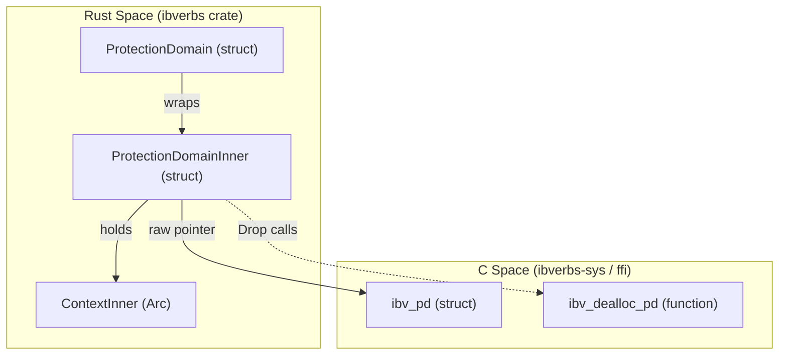

<!-- source: DeepWiki mcp.deepwiki.com · repo jonhoo/rust-ibverbs · page 3.2 Protection Domain and Memory Regions · fetched 2026-11-11 -->

# Protection Domain and Memory Regions

<details>
<summary>Relevant source files</summary>

The following files were used as context for generating this wiki page:

- [ibverbs/src/efa.rs](ibverbs/src/efa.rs)
- [ibverbs/src/mr.rs](ibverbs/src/mr.rs)
- [ibverbs/src/pd.rs](ibverbs/src/pd.rs)

</details>


Protection Domains (PDs) and Memory Regions (MRs) form the isolation and security foundation of the RDMA stack. A Protection Domain acts as a container that associates Queue Pairs (QPs) with Memory Regions, ensuring that a QP can only access memory registered within the same domain.

## Protection Domain (PD)

A `ProtectionDomain` is created via a `Context` and serves as the factory for most RDMA resources. It manages the lifecycle of the underlying `ibv_pd` through an `Arc`-based `ProtectionDomainInner` to ensure the domain is only deallocated after all associated resources (MRs, QPs, SRQs) are dropped [ibverbs/src/pd.rs:131-154]().

### Resource Creation
The `ProtectionDomain` provides methods to initialize various RDMA objects:
*   **Queue Pairs**: `create_qp` (generic) and `create_srd_qp` (EFA specific) [ibverbs/src/pd.rs:215-225](), [ibverbs/src/efa.rs:47-55]().
*   **Shared Receive Queues**: `create_srq` [ibverbs/src/pd.rs:242-253]().
*   **Address Handles**: `create_address_handle` for UD/SRD addressing [ibverbs/src/pd.rs:175-186]().
*   **Memory Regions**: `allocate`, `register_from_raw`, and `register_dmabuf` [ibverbs/src/pd.rs:269-340]().

### Implementation Mapping
The following diagram illustrates how the `ProtectionDomain` bridges the safe Rust API to the underlying `libibverbs` structures.

**Protection Domain Entity Relationship**

Sources: [ibverbs/src/pd.rs:131-154](), [ibverbs/src/pd.rs:136-144]()

---

## Memory Regions (MR)

Memory Regions represent buffers that have been pinned and registered with the HCA (Host Channel Adapter). Registration provides the HCA with the virtual-to-physical address mapping, allowing it to perform DMA without CPU intervention.

### Registration Methods
`rust-ibverbs` supports three primary ways to register memory:
1.  **`allocate<T>`**: Allocates a new `Vec<u8>` and registers it. The `MemoryRegion` owns the buffer [ibverbs/src/pd.rs:269-281]().
2.  **`register_from_raw<O>`**: Registers an existing buffer that implements `Deref<Target = [u8]>`. The `MemoryRegion` takes ownership of the container `O` [ibverbs/src/pd.rs:296-311]().
3.  **`register_dmabuf`**: Registers a Linux dma-buf file descriptor, useful for GPU-Direct RDMA or zero-copy storage [ibverbs/src/pd.rs:328-340]().

### Access Control
Access is governed by `AccessFlags`, which are defined using the `flags_newtype!` macro to wrap `ffi::ibv_access_flags` [ibverbs/src/mr.rs:12-41]().

| Flag | Description |
| :--- | :--- |
| `LOCAL_WRITE` | Required for the HCA to write into the buffer (e.g., `post_recv`) |
| `REMOTE_READ` | Allows remote peers to read via RDMA Read |
| `REMOTE_WRITE` | Allows remote peers to write via RDMA Write |
| `REMOTE_ATOMIC` | Allows remote atomic operations (CSWAP/FETCH_ADD) |
| `ON_DEMAND` | Enables On-Demand Paging (ODP) |

Sources: [ibverbs/src/mr.rs:17-40](), [ibverbs/src/mr.rs:47-53]()

---

## Slices and Addressing

Once memory is registered, it is accessed through slices that carry the necessary keys for the HCA.

### Local vs. Remote Slices
*   **`LocalMemorySlice`**: Wraps `ffi::ibv_sge` (Scatter/Gather Entry). It contains the local address, length, and `lkey`. Used for `post_send` and `post_recv` operations [ibverbs/src/mr.rs:170-172]().
*   **`RemoteMemorySlice`**: Contains the virtual address, length, and `rkey`. This is what a local node sends to a remote peer to enable one-sided RDMA operations [ibverbs/src/mr.rs:194-200]().

**Memory Slice Data Flow**
```mermaid
graph LR
    subgraph "Local Node"
        MR["MemoryRegion&lt;Vec&lt;u8&gt;&gt;"]
        LKey["lkey (u32)"]
        LSlice["LocalMemorySlice (ibv_sge)"]
    end

    subgraph "Remote Node"
        RSlice["RemoteMemorySlice"]
        RKey["rkey (u32)"]
    end

    MR -->|slice()| LSlice
    MR -->|remote()| RSlice
    RSlice -.->|Network Transfer| RKey
    LSlice -->|Used in| PostRecv["QueuePair::post_recv"]
    RKey -->|Used in| RDMA_Op["QueuePair::start_send().write(..., remote)"]
```
Sources: [ibverbs/src/mr.rs:87-95](), [ibverbs/src/mr.rs:107-113](), [ibverbs/src/mr.rs:129-141]()

---

## Memory Advice and ODP

For devices supporting On-Demand Paging (ODP), the `advise_mr` function allows the application to provide hints to the kernel about expected memory usage patterns [ibverbs/src/pd.rs:203-213]().

### MrAdvice and AdviseFlags
*   **`MrAdvice`**: An enum mapping to `IBV_ADVISE_MR_ADVICE_*` values, including `Prefetch`, `PrefetchWrite`, and `PrefetchNoFault` [ibverbs/src/pd.rs:21-29]().
*   **`MrAdviseFlags`**: Currently supports `FLUSHABLE`, which forces the call to be synchronous [ibverbs/src/pd.rs:54-60]().

### Implementation Details
The `advise_mr` call takes a list of `LocalMemorySlice` (acting as a scatter/gather list of ranges) and applies the advice to the underlying pages [ibverbs/src/pd.rs:203-213]().

Sources: [ibverbs/src/pd.rs:31-51](), [ibverbs/src/pd.rs:188-202]()

---

