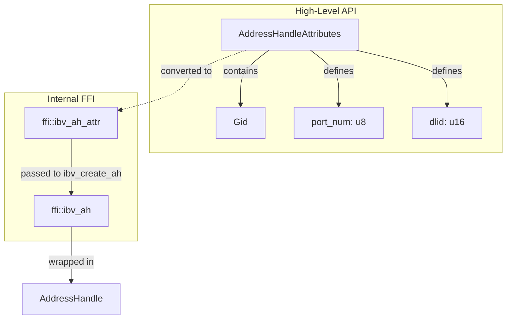
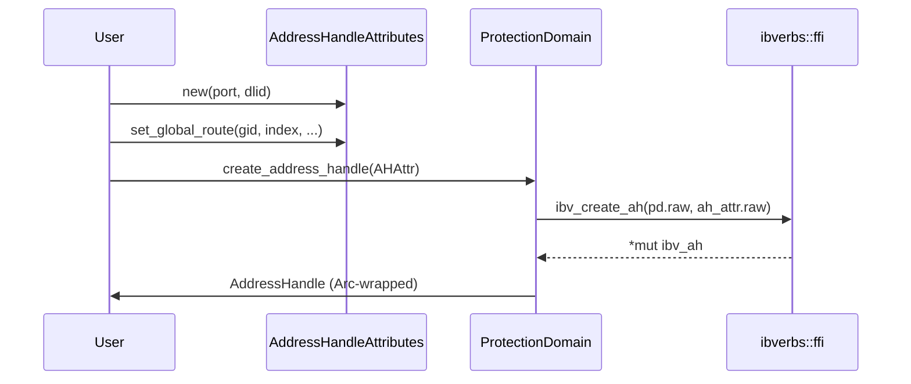

<!-- source: DeepWiki mcp.deepwiki.com · repo jonhoo/rust-ibverbs · page 3.3 Addressing: GIDs, LIDs, and Address Handles · fetched 2026-11-11 -->

# Addressing: GIDs, LIDs, and Address Handles

Relevant source files

The following files were used as context for generating this wiki page:

- [ibverbs/src/address.rs](ibverbs/src/address.rs)
- [ibverbs/src/lib.rs](ibverbs/src/lib.rs)

This page covers the mechanisms used to identify and route traffic between RDMA endpoints. It details the structures for Global Identifiers (GIDs) used in RoCE and InfiniBand subnets, Local Identifiers (LIDs) for InfiniBand switching, and the `AddressHandle` required for Unreliable Datagram (UD) communication.

## Global Identifiers (GIDs)

A `Gid` is a 128-bit identifier for an RDMA device port, functionally equivalent to an IPv6 address [ibverbs/src/address.rs:12-35](). In the `rust-ibverbs` crate, `Gid` wraps the underlying `ffi::ibv_gid` union to provide a safe, printable, and comparable interface [ibverbs/src/address.rs:31-35]().

### Gid Structure and Conversion
The `Gid` struct provides methods to access the two 64-bit components of the address:
*   **Subnet Prefix**: Accessed via `subnet_prefix()` [ibverbs/src/address.rs:41-43]().
*   **Interface ID**: Accessed via `interface_id()` [ibverbs/src/address.rs:48-50]().

Because RoCE GIDs mirror the IP addresses of the underlying network interface, `Gid` implements `From<std::net::Ipv6Addr>` and `Into<std::net::Ipv6Addr>` [ibverbs/src/address.rs:65-75](). It also includes a helper `is_ipv4_mapped()` to identify GIDs representing IPv4 addresses (formatted as `::ffff:a.b.c.d`) [ibverbs/src/address.rs:58-60]().

### GID Table Queries
Devices maintain a GID table containing multiple entries. Users can query this table using `Context::gid_table()`, which returns a vector of `GidEntry` structs [ibverbs/src/address.rs:167-172]().

| Field | Type | Description |
| :--- | :--- | :--- |
| `gid` | `Gid` | The 128-bit identifier [ibverbs/src/address.rs:174](). |
| `gid_index` | `u32` | The index in the hardware table [ibverbs/src/address.rs:176](). |
| `port_num` | `u8` | The physical port number (1-based) [ibverbs/src/address.rs:178](). |
| `gid_type` | `GidType` | The framing protocol (IB, RoceV1, RoceV2) [ibverbs/src/address.rs:180](). |
| `ndev_ifindex` | `u32` | The Linux network interface index associated with this GID [ibverbs/src/address.rs:184](). |

**Sources:** [ibverbs/src/address.rs:12-61](), [ibverbs/src/address.rs:131-200]()

## Address Handles and UD Sends

While connected transports (RC, UC) store destination information within the Queue Pair (QP) state, Unreliable Datagram (`Ud`) transports are connectionless. Every send operation on a `Ud` QP must specify a destination via an `AddressHandle` [ibverbs/src/lib.rs:109-112]().

### Creating an Address Handle
An `AddressHandle` is created within a `ProtectionDomain` using `AddressHandleAttributes`. These attributes define how the packet should be routed.

#### Addressing Entity Mapping
The following diagram illustrates the relationship between the high-level addressing attributes and the internal FFI structures.

**Title: Addressing Attribute Mapping**

**Sources:** [ibverbs/src/address.rs:248-270](), [ibverbs/src/address.rs:395-405]()

### Routing: LIDs vs GIDs
The `AddressHandleAttributes` must be configured based on the network topology:
1.  **LID-based Routing**: In pure InfiniBand subnets, the Destination LID (`dlid`) is used for local switching [ibverbs/src/address.rs:252]().
2.  **GID-based Routing (GRH)**: For RoCE or inter-subnet InfiniBand, a Global Routing Header (GRH) is required. This is configured via `set_global_route()` [ibverbs/src/address.rs:326-335]().

### RoCEv2 and GID Selection
For RoCEv2, selecting the correct GID index is critical for routing.
*   The `gid_index` in `AddressHandleAttributes` (or `QueuePairBuilder` for RC/UC) refers to the index in the device's GID table [ibverbs/src/address.rs:332]().
*   On plain Ethernet IPv4 networks, users typically look for a `GidEntry` where `is_ipv4_mapped()` is true and `gid_type` is `GidType::RoceV2` [ibverbs/src/address.rs:52-60]().

**Sources:** [ibverbs/src/address.rs:52-60](), [ibverbs/src/address.rs:248-350](), [ibverbs/src/lib.rs:30-34]()

## Implementation Details

The `AddressHandle` lifecycle is managed by the `ProtectionDomain`. Dropping an `AddressHandle` triggers `ibv_destroy_ah` via the internal `Arc<AddressHandleInner>` [ibverbs/src/address.rs:410-425]().

### Data Flow: Address Handle Creation
The process of moving from user-defined attributes to a hardware-usable handle is shown below.

**Title: Address Handle Creation Flow**

**Sources:** [ibverbs/src/address.rs:248-270](), [ibverbs/src/address.rs:395-408]()

### Summary of Key Types
| Type | Role |
| :--- | :--- |
| `Gid` | 128-bit identifier, mirrors `ibv_gid` [ibverbs/src/address.rs:33](). |
| `GidEntry` | Metadata about a GID in the device table (index, type, netdev) [ibverbs/src/address.rs:172](). |
| `AddressHandleAttributes` | Configuration for creating a destination handle [ibverbs/src/address.rs:248](). |
| `AddressHandle` | Opaque handle used in `Ud` post_send operations to specify destination [ibverbs/src/address.rs:395](). |

**Sources:** [ibverbs/src/address.rs:33-395]()

---

