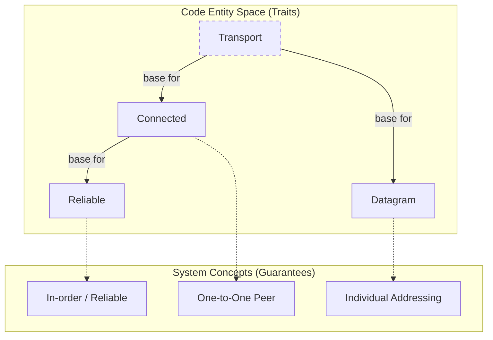
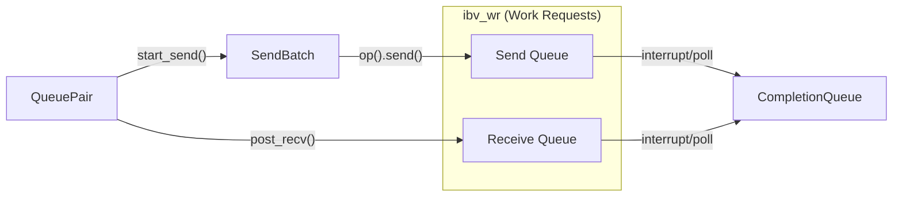

<!-- source: DeepWiki mcp.deepwiki.com · repo jonhoo/rust-ibverbs · page 4 Queue Pairs · fetched 2026-11-11 -->

# Queue Pairs

Relevant source files

The following files were used as context for generating this wiki page:

- [ibverbs/src/lib.rs](ibverbs/src/lib.rs)
- [ibverbs/src/qp.rs](ibverbs/src/qp.rs)

A **Queue Pair (QP)** is the fundamental unit of communication in RDMA. Each QP consists of a **Send Queue** and a **Receive Queue**. The `rust-ibverbs` crate provides a type-safe abstraction for QPs, using Rust's trait system to enforce transport-specific rules at compile time and a state-machine-driven lifecycle to ensure safe transitions from creation to data transfer.

## Transport Types

RDMA supports multiple transport modes, each offering different guarantees regarding reliability, connectivity, and supported operations. In this crate, these are represented by marker types that implement the `Transport` trait [ibverbs/src/qp.rs:106-146]().

| Transport Marker | `QueuePairType` | Connectivity | Reliability | Key Operations |
|:---|:---|:---|:---|:---|
| `Rc` | `ReliableConnection` | Connected | Reliable | Send, Read, Write, Atomics |
| `Uc` | `UnreliableConnection` | Connected | Unreliable | Send, Write |
| `Ud` | `UnreliableDatagram` | Connectionless | Unreliable | Send (with `AddressHandle`) |
| `Srd` | `Driver` (EFA) | Connectionless | Reliable | Send (AWS EFA specific) |

The use of these markers prevents developers from calling unsupported methods (e.g., attempting an RDMA Read on a `Ud` transport) via compile-time errors [ibverbs/src/qp.rs:116-145]().

For details on specific transport behaviors and the EFA-specific `Srd` type, see **[Transport Types and QueuePair Lifecycle](#4.1)**.

### Entity Mapping: Transport Traits

Sources: [ibverbs/src/qp.rs:146-158]()

---

## The Builder Pattern and Lifecycle

Queue Pairs are created through a multi-stage process to ensure all hardware resources and connection parameters are correctly initialized. This process follows a strict state machine (Reset → Init → Ready to Receive (RTR) → Ready to Send (RTS)).

1.  **`QueuePairBuilder`**: Used to configure hardware limits (e.g., `max_send_wr`) and transport settings [ibverbs/src/qp.rs:182-192]().
2.  **`PreparedQueuePair`**: Represents a QP that has been allocated but not yet connected. It provides a `QueuePairEndpoint` containing the necessary wire information (LID, QPN, GID) to share with a peer [ibverbs/src/qp.rs:664-672]().
3.  **Activation/Handshake**: 
    *   **Connected transports (`Rc`, `Uc`)** use `handshake(endpoint)` to transition to RTS [ibverbs/src/qp.rs:728-735]().
    *   **Datagram transports (`Ud`)** use `activate()` since they do not have a fixed remote endpoint [ibverbs/src/qp.rs:807-812]().

For details on configuring GID indices, MTU settings, and manual state transitions, see **[Transport Types and QueuePair Lifecycle](#4.1)**.

Sources: [ibverbs/src/lib.rs:31-40](), [ibverbs/src/qp.rs:658-672]()

---

## Data-Path Operations

Once a `QueuePair` is in the `RTS` state, it can perform data-path operations. The crate distinguishes between **Receiving** (pre-posting buffers) and **Sending** (initiating transfers).

### Post Receive
Buffers must be posted to the Receive Queue before the peer initiates a Send. This is done via `post_recv`, which takes an iterator of `RecvRequest` objects [ibverbs/src/lib.rs:47]().

### Send Batching and Doorbell Batching
To minimize overhead, the crate uses a `SendBatch` builder pattern. This allows multiple Work Requests (WRs) to be chained together and submitted to the hardware in a single "doorbell" ring, significantly reducing CPU-to-NIC synchronization costs [ibverbs/src/lib.rs:48-50]().

### Operation Types
*   **Two-sided**: `send` (requires a matching `post_recv` at the peer).
*   **One-sided**: `write` and `read` (directly accesses peer memory; peer CPU is not involved).
*   **Atomics**: `atomic_cmp_swap` and `atomic_fetch_add` (only supported on `Rc`).

For details on scatter/gather lists, signaled vs. unsignaled completions, and doorbell performance, see **[Sending, Receiving, and Doorbell Batching](#4.2)**.

Sources: [ibverbs/src/lib.rs:42-50](), [ibverbs/src/qp.rs:109-115]()

---

## Shared Receive Queues (SRQ)

In high-fan-in scenarios (e.g., one server handling thousands of clients), allocating a unique receive queue for every QP is memory-intensive. A **Shared Receive Queue (SRQ)** allows multiple QPs to share a single pool of receive buffers [ibverbs/src/srq.rs:1-10]().

*   **Efficiency**: Reduces memory footprint for large-scale connections.
*   **Low-Watermark**: Supports asynchronous notifications when the number of buffers in the SRQ drops below a defined threshold.

For details on creating and associating QPs with an SRQ, see **[Shared Receive Queues (SRQ)](#4.3)**.

### Entity Mapping: Data Path Components

Sources: [ibverbs/src/lib.rs:42-61](), [ibverbs/src/qp.rs:118-125]()

---

