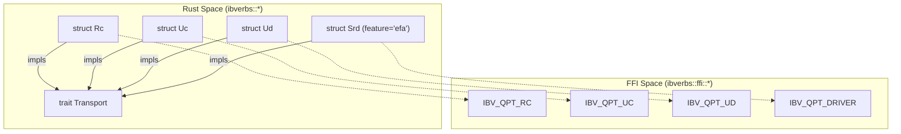

<!-- source: DeepWiki mcp.deepwiki.com · repo jonhoo/rust-ibverbs · page 4.1 Transport Types and QueuePair Lifecycle · fetched 2026-11-11 -->

# Transport Types and QueuePair Lifecycle

<details>
<summary>Relevant source files</summary>

The following files were used as context for generating this wiki page:

- [ibverbs/src/lib.rs](ibverbs/src/lib.rs)
- [ibverbs/src/qp.rs](ibverbs/src/qp.rs)
- [ibverbs/tests/loopback.rs](ibverbs/tests/loopback.rs)

</details>


This page details the `rust-ibverbs` abstraction for RDMA Queue Pairs (QPs). It covers how the library uses the Rust type system to enforce transport-specific invariants, the builder-based initialization flow, and the state machine transitions required to move a QP from creation to an active data-path state.

### Transport Types and Compile-Time Safety

`rust-ibverbs` types the Queue Pair family by its transport protocol using the `Transport` trait [ibverbs/src/qp.rs:146-146](). This ensures that transport-specific operations (like RDMA Reads or Atomic operations) are only available on QPs that support them, preventing runtime provider errors through compile-time checks [ibverbs/src/qp.rs:109-115]().

#### Transport Hierarchy
The library implements a sealed trait hierarchy to categorize transport capabilities:

| Trait | Implementation Markers | Capabilities |
| :--- | :--- | :--- |
| `Transport` | `Rc`, `Uc`, `Ud`, `Srd` | Base QP operations. |
| `Connected` | `Rc`, `Uc` | Handshake with a single remote peer. |
| `Reliable` | `Rc`, `Srd` | Retries, ACKs, and (for RC) RDMA Reads/Atomics. |
| `Datagram` | `Ud`, `Srd` | Individually addressed sends via `AddressHandle`. |

**Sources:** [ibverbs/src/qp.rs:146-158](), [ibverbs/src/qp.rs:160-177]()

#### Entity Mapping: Transports
The following diagram maps the high-level RDMA transport concepts to their specific Rust marker types and internal FFI representations.

**Transport Type Mapping**

**Sources:** [ibverbs/src/qp.rs:179-195](), [ibverbs/src/qp.rs:50-62]()

---

### QueuePair Lifecycle

The lifecycle of a Queue Pair involves three distinct stages: configuration via a builder, a "prepared" state for endpoint exchange, and finally an "active" state for data transfer.

#### 1. Configuration (QueuePairBuilder)
A `QueuePairBuilder` is obtained via `ProtectionDomain::create_qp<T>` [ibverbs/src/pd.rs:133-140](). It allows configuring hardware limits and capabilities:
* `max_send_wr` / `max_recv_wr`: The depth of the Send and Receive queues [ibverbs/src/qp.rs:1062-1072]().
* `gid_index`: The index in the GID table used for RoCE routing [ibverbs/src/qp.rs:1096-1100]().
* `set_access`: Sets `AccessFlags` (e.g., `REMOTE_WRITE`, `REMOTE_READ`) for one-sided operations [ibverbs/src/qp.rs:1130-1134]().

#### 2. Preparation (PreparedQueuePair)
Calling `.build()` on the builder transitions the QP to the `INIT` state and returns a `PreparedQueuePair` [ibverbs/src/qp.rs:1146-1165](). In this state, the QP is allocated on the hardware but not yet connected. Users can call `.endpoint()` to retrieve the `QueuePairEndpoint` [ibverbs/src/qp.rs:1255-1262](), which contains the LID, QPN, and GID required for the peer to connect [ibverbs/src/qp.rs:1416-1430]().

#### 3. Activation (Handshake vs. Activate)
The transition to the `RTS` (Ready to Send) state depends on the transport type:
* **Connected Transports (`Rc`, `Uc`)**: Require `.handshake(remote_endpoint)` [ibverbs/src/qp.rs:1283-1290](). This performs the multi-step state transition (`INIT` -> `RTR` -> `RTS`) using the peer's endpoint information.
* **Datagram Transports (`Ud`, `Srd`)**: Require `.activate()` [ibverbs/src/qp.rs:1335-1341](). Since they are connectionless, they do not need a remote endpoint to enter an active state.

**Lifecycle State Machine**
```mermaid
stateDiagram-v2
    [*] --> Builder : pd.create_qp()
    Builder --> PreparedQueuePair : .build()
    note right of PreparedQueuePair : State: INIT
    
    state PreparedQueuePair {
        [*] --> EndpointExchange : .endpoint()
    }
    
    PreparedQueuePair --> QueuePair : .handshake(remote) [Connected]
    PreparedQueuePair --> QueuePair : .activate() [Datagram]
    note right of QueuePair : State: RTS (Ready to Send)
    
    QueuePair --> [*] : drop()
```
**Sources:** [ibverbs/src/lib.rs:31-40](), [ibverbs/src/qp.rs:1255-1341](), [ibverbs/tests/loopback.rs:57-72]()

---

### Manual State Transitions and Wire Format

While the handshake/activate methods cover standard use cases, the library provides lower-level access for manual control.

#### QueuePairEndpoint Wire Format
The `QueuePairEndpoint` is designed to be easily serialized for out-of-band exchange (e.g., via TCP or a discovery service). It provides `to_bytes()` and `from_bytes()` methods [ibverbs/src/qp.rs:1437-1460]().

| Field | Description |
| :--- | :--- |
| `num` | The 24-bit Queue Pair Number (QPN) [ibverbs/src/qp.rs:1418-1418](). |
| `lid` | The Local Identifier (16-bit, InfiniBand specific) [ibverbs/src/qp.rs:1420-1420](). |
| `psn` | The Packet Sequence Number [ibverbs/src/qp.rs:1422-1422](). |
| `gid` | The Global Identifier (128-bit, required for RoCE) [ibverbs/src/qp.rs:1424-1424](). |

#### Manual Modification
Advanced users can use `QueuePair::modify` to manually drive the IB verbs state machine [ibverbs/src/qp.rs:806-813](). This requires a `QueuePairAttribute` struct and an `QueuePairAttributeMask` to specify which fields are being updated (e.g., `IBV_QP_STATE`, `IBV_QP_PATH_MTU`) [ibverbs/src/qp.rs:807-809]().

Current state can be retrieved via `QueuePair::query` [ibverbs/src/qp.rs:777-781](), which returns the hardware's view of the QP's configuration and status.

**Sources:** [ibverbs/src/qp.rs:1416-1460](), [ibverbs/src/qp.rs:777-813](), [ibverbs/src/lib.rs:36-37]()

---

