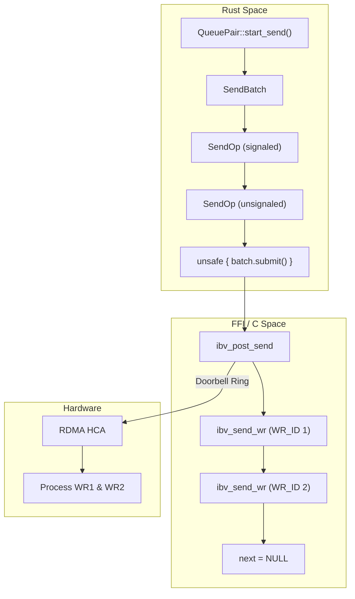
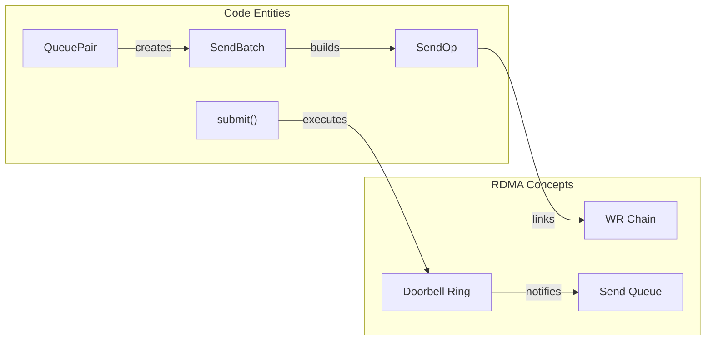

<!-- source: DeepWiki mcp.deepwiki.com · repo jonhoo/rust-ibverbs · page 4.2 Sending, Receiving, and Doorbell Batching · fetched 2026-11-11 -->

# Sending, Receiving, and Doorbell Batching

Relevant source files

The following files were used as context for generating this wiki page:

- [ibverbs/examples/doorbell_batching.rs](ibverbs/examples/doorbell_batching.rs)
- [ibverbs/src/qp.rs](ibverbs/src/qp.rs)
- [ibverbs/tests/loopback.rs](ibverbs/tests/loopback.rs)

This page describes the RDMA data-path operations in `rust-ibverbs`. It covers the mechanisms for posting receive requests and the specialized builder pattern used for sending work requests. A key focus is the "Doorbell Batching" performance model, which allows multiple operations to be submitted to the hardware in a single atomic action, minimizing CPU-to-device synchronization overhead.

## Receive Path: `post_recv`

The receive path is governed by the `post_recv` method on the `QueuePair`. Unlike the send path, which uses a complex builder to handle various operation types, the receive path is uniform: it consumes `RecvRequest` objects that point to local memory buffers where incoming data should be placed.

### `RecvRequest` and SGLs
A `RecvRequest` represents a single Work Request (WR) on the Receive Queue. It consists of:
1.  **Work Request ID (`wr_id`)**: A 64-bit user-defined value returned in the `WorkCompletion` when the receive finishes [ibverbs/src/qp.rs:1723-1725]().
2.  **Scatter/Gather List (SGL)**: An array of `LocalMemorySlice` objects. The hardware "scatters" the incoming message across these slices [ibverbs/src/qp.rs:1727-1730]().

### Posting Receives
The `post_recv` method is `unsafe` because the user must guarantee that the memory regions referenced in the SGL remain valid until the hardware produces a completion [ibverbs/src/qp.rs:1145-1152]().

**Sources:** [ibverbs/src/qp.rs:1145-1158](), [ibverbs/src/qp.rs:1712-1748]()

---

## Send Path: The `SendBatch` Pattern

The send path uses a **Batch Builder Pattern** to provide compile-time safety across different transport types (RC, UC, UD, SRD) while enabling performance optimizations like doorbell batching.

### Core Entities
-   **`SendBatch`**: The entry point for a batch of work requests. It manages the linked list of `ibv_send_wr` structures [ibverbs/src/qp.rs:1255-1262]().
-   **`SendOp`**: A builder for a single operation within a batch. It provides methods like `send`, `write`, and `read` [ibverbs/src/qp.rs:1493-1498]().
-   **`DatagramOp`**: A specialized builder for connectionless transports (UD/SRD) that requires an `AddressHandle` [ibverbs/src/qp.rs:1455-1460]().

### Data Flow: From Builder to Hardware
The following diagram illustrates how the `SendBatch` API translates Rust calls into the underlying C `ibv_send_wr` chain.

**Send Operation Data Flow**

**Sources:** [ibverbs/src/qp.rs:1120-1135](), [ibverbs/src/qp.rs:1367-1400](), [ibverbs/examples/doorbell_batching.rs:96-108]()

---

## Supported Send Operations

Operations are restricted based on the `Transport` type at compile time using traits like `Reliable`, `Connected`, and `Datagram` [ibverbs/src/qp.rs:146-158]().

| Operation | Transport | Description | Method |
| :--- | :--- | :--- | :--- |
| **Send** | All | Standard message passing. | `.send()` |
| **Write** | RC, UC | One-sided RDMA Write to remote memory. | `.write()` |
| **Write with Imm** | RC, UC | RDMA Write that consumes a Recv WR at the target. | `.write_with_imm()` |
| **Read** | RC | One-sided RDMA Read from remote memory. | `.read()` |
| **Atomic CmpSwap** | RC | Compare and Swap on remote 64-bit value. | `.atomic_cmp_swap()` |
| **Atomic FetchAdd** | RC | Fetch and Add on remote 64-bit value. | `.atomic_fetch_add()` |

### Per-Operation Modifiers
Modifiers are applied to the `SendOp` before calling the final operation method:
-   **`.signaled()`**: Generates a `WorkCompletion` when this specific WR finishes. If omitted, the operation is "unsignaled" and completes silently unless it fails [ibverbs/src/qp.rs:1516-1520]().
-   **`.fenced()`**: Ensures this WR does not start until all prior RDMA Reads and Atomics in the queue have completed [ibverbs/src/qp.rs:1527-1532]().
-   **`.solicited()`**: Sets the solicited event hint, triggering an event on the remote side if they are waiting on `req_notify` [ibverbs/src/qp.rs:1539-1544]().
-   **`.inline()`**: Hints to the driver to copy data directly into the WR, avoiding a DMA read from the memory region (useful for small payloads) [ibverbs/src/qp.rs:1551-1557]().

**Sources:** [ibverbs/src/qp.rs:1493-1678](), [ibverbs/src/qp.rs:106-145]()

---

## Doorbell Batching Performance Model

"Doorbell batching" refers to the practice of chaining multiple Work Requests together and submitting them to the NIC with a single MMIO write (the "doorbell"). This significantly reduces CPU overhead and PCI-Express contention.

### The Batching Pattern
1.  Call `qp.start_send()` to initialize the chain.
2.  Add operations via `.op()` or `.to()`.
3.  Only mark the *final* operation in a logical group as `.signaled()`.
4.  Call `submit()` to ring the doorbell once for the entire chain [ibverbs/examples/doorbell_batching.rs:96-108]().

**Entity Association: Doorbell Batching**

### Example: Chained Writes
In the `doorbell_batching.rs` example, multiple RDMA writes are queued to transfer segments of a string, followed by a single signaled `send` that notifies the receiver. The hardware processes all writes before the send, but the CPU only interacts with the NIC twice: once to post the receive, and once to post the entire send batch [ibverbs/examples/doorbell_batching.rs:99-108]().

**Sources:** [ibverbs/examples/doorbell_batching.rs:1-158](), [ibverbs/src/qp.rs:1367-1400]()

---

## Scatter/Gather Lists (SGL)

Both send and receive operations support Scatter/Gather lists. Instead of a single contiguous buffer, an operation can reference multiple `LocalMemorySlice` segments.

-   **Send Side**: The HCA "gathers" data from the slices to form a single outgoing packet.
-   **Receive Side**: The HCA "scatters" the incoming packet data into the provided slices in order [ibverbs/src/qp.rs:1727-1730]().

The maximum number of SGEs (Scatter/Gather Elements) per WR is configured during Queue Pair creation via `set_max_send_sge` and `set_max_recv_sge` [ibverbs/tests/loopback.rs:64-65]().

**Sources:** [ibverbs/src/qp.rs:1712-1748](), [ibverbs/tests/loopback.rs:60-66]()

---

