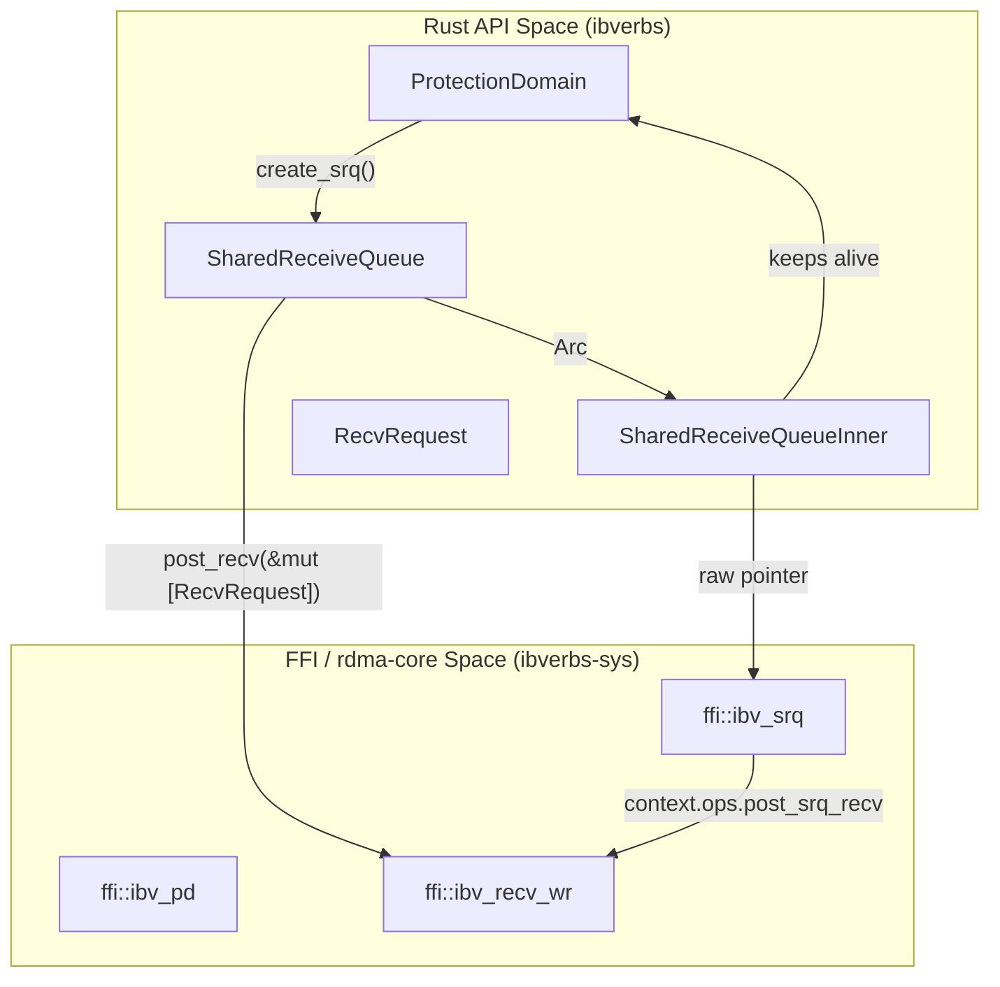
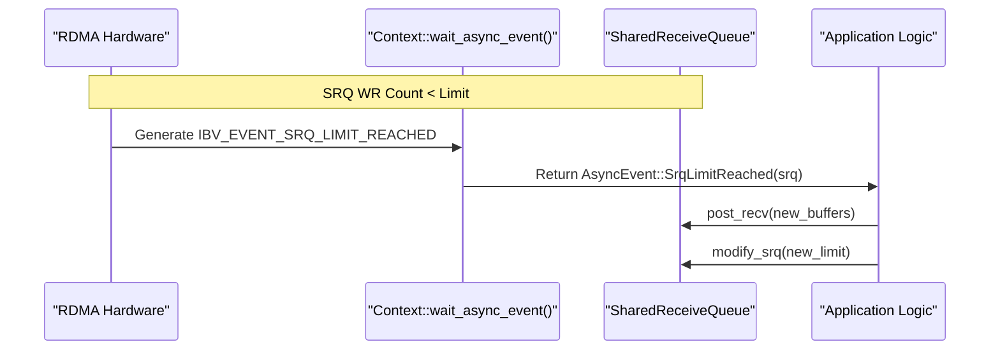

<!-- source: DeepWiki mcp.deepwiki.com · repo jonhoo/rust-ibverbs · page 4.3 Shared Receive Queues (SRQ) · fetched 2026-11-11 -->

# Shared Receive Queues (SRQ)

<details>
<summary>Relevant source files</summary>

The following files were used as context for generating this wiki page:

- [ibverbs/src/srq.rs](ibverbs/src/srq.rs)
- [ibverbs/tests/loopback.rs](ibverbs/tests/loopback.rs)

</details>


A Shared Receive Queue (SRQ) is an RDMA resource that allows multiple Queue Pairs (QPs) to share a common pool of receive buffers. Instead of allocating a fixed number of receive Work Requests (WR) per Queue Pair, an application can post receive buffers to a single SRQ, which are then consumed by any associated QP as incoming messages arrive. This significantly reduces the memory footprint for applications maintaining large numbers of connections.

## SRQ Creation and Configuration

SRQs are created within a `ProtectionDomain`. The creation process requires specifying the maximum number of outstanding receive requests and the maximum number of scatter/gather elements (SGE) per request.

### The `SharedReceiveQueue` Lifecycle
The `SharedReceiveQueue` struct manages the lifetime of the underlying `ibv_srq` using an `Arc`-based inner pattern to ensure the `ProtectionDomain` remains valid as long as the SRQ exists.

| Method | Description | File Reference |
|:---|:---|:---|
| `ProtectionDomain::create_srq` | Allocates a new SRQ with specified `max_wr` and `max_sge`. | [ibverbs/src/pd.rs:114-142]() |
| `SharedReceiveQueue::as_raw` | Provides an escape hatch to the underlying `ffi::ibv_srq`. | [ibverbs/src/srq.rs:39-41]() |
| `SharedReceiveQueueInner::drop` | Automatically calls `ibv_destroy_srq` when the last reference is dropped. | [ibverbs/src/srq.rs:17-25]() |

### Natural Language to Code Entity Mapping: SRQ Resources
This diagram illustrates how the high-level SRQ concept maps to specific code entities and the underlying FFI layer.


**Sources:** [ibverbs/src/srq.rs:9-32](), [ibverbs/src/pd.rs:114-142]()

## Associating Queue Pairs with an SRQ

To use an SRQ, a Queue Pair must be associated with it during creation. This is handled via the `QueuePairBuilder`. When a QP is associated with an SRQ, the `max_recv_wr` and `max_recv_sge` settings on the QP builder are ignored, as these limits are governed by the SRQ.

1.  **Initialize Builder**: Call `pd.create_qp::<T>(...)`. [ibverbs/src/pd.rs:77-112]()
2.  **Associate SRQ**: Use `builder.set_srq(&srq)`. [ibverbs/src/qp.rs:608-612]()
3.  **Build QP**: The resulting `QueuePair` will consume buffers from the SRQ for all incoming `RECV` operations.

**Sources:** [ibverbs/src/qp.rs:518-522](), [ibverbs/src/qp.rs:608-612]()

## Data Path: Posting Receives

Posting to an SRQ is performed using `SharedReceiveQueue::post_recv`. Unlike standard QP receives, these are posted directly to the shared pool.

*   **Batching**: The method accepts a slice of `RecvRequest` objects and links them into a linked list in-place before calling the provider-specific `post_srq_recv` function. [ibverbs/src/srq.rs:74-95]()
*   **Safety**: The caller must ensure that the memory regions referenced in the `RecvRequest` remain valid until a `WorkCompletion` is polled from the Completion Queue associated with the QP that consumed the buffer. [ibverbs/src/srq.rs:60-64]()
*   **UD Specifics**: If a Unreliable Datagram (UD) QP consumes an SRQ buffer, the first 40 bytes are reserved for the Global Routing Header (GRH). [ibverbs/src/srq.rs:52-56]()

**Sources:** [ibverbs/src/srq.rs:43-102](), [ibverbs/tests/loopback.rs:374-386]()

## Async Events and Low-Watermark Notification

SRQs support a "low-watermark" notification mechanism. If the number of Work Requests in the SRQ drops below a predefined limit, the RDMA device triggers an asynchronous event.

### SRQ Limit Event Flow
This diagram tracks the flow of an `IBV_EVENT_SRQ_LIMIT_REACHED` event from the hardware to the application.



### Handling the Event
Applications monitor these events using `Context::wait_async_event`. When an `AsyncEvent::SrqLimitReached` is received, it contains the `SharedReceiveQueue` that triggered the event, allowing the application to replenish the buffer pool.

| Event Type | Description | Code Identifier |
|:---|:---|:---|
| **SRQ Limit Reached** | Triggered when the number of WRs in SRQ falls below the limit. | `AsyncEvent::SrqLimitReached` [ibverbs/src/device.rs:602]() |
| **SRQ Catastrophic Error** | Triggered if the SRQ encounters a hardware error. | `AsyncEvent::SrqCatastrophicError` [ibverbs/src/device.rs:604]() |

**Sources:** [ibverbs/src/device.rs:585-610](), [ibverbs/src/srq.rs:1-32]()

## Example: Loopback with SRQ

In integration testing, an SRQ is used by creating the SRQ, posting a `RecvRequest` to it, and then creating a QP associated with that SRQ.

```rust
// 1. Create SRQ
let srq = pd.create_srq(16, 4).expect("failed to create SRQ");

// 2. Post Receive to SRQ
let mut recv_req = [RecvRequest::prepare(&[mr.slice()], 0xdeadbeef)];
unsafe { srq.post_recv(&mut recv_req).expect("failed to post SRQ recv") };

// 3. Create QP associated with SRQ
let mut builder = pd.create_qp::<Rc>(&cq, &cq, 1).unwrap();
builder.set_srq(&srq);
let qp = builder.build().unwrap().handshake(endpoint).unwrap();
```
**Sources:** [ibverbs/tests/loopback.rs:374-398](), [ibverbs/src/qp.rs:608-612]()

---

