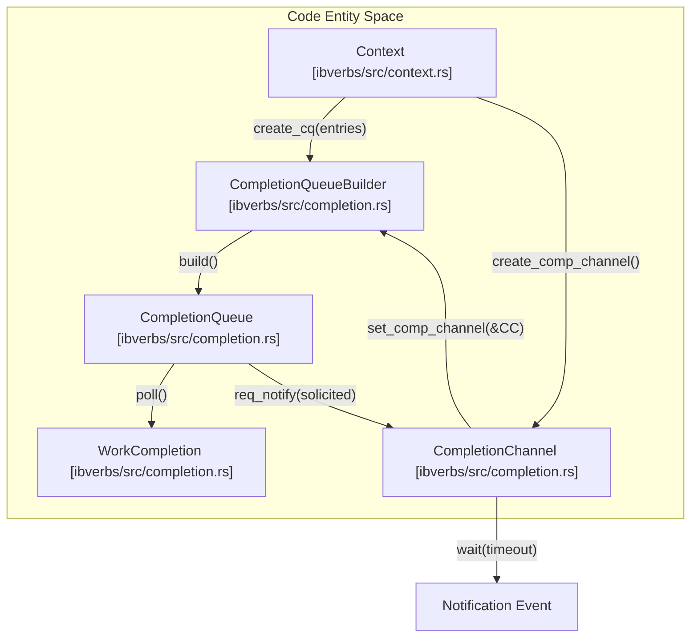
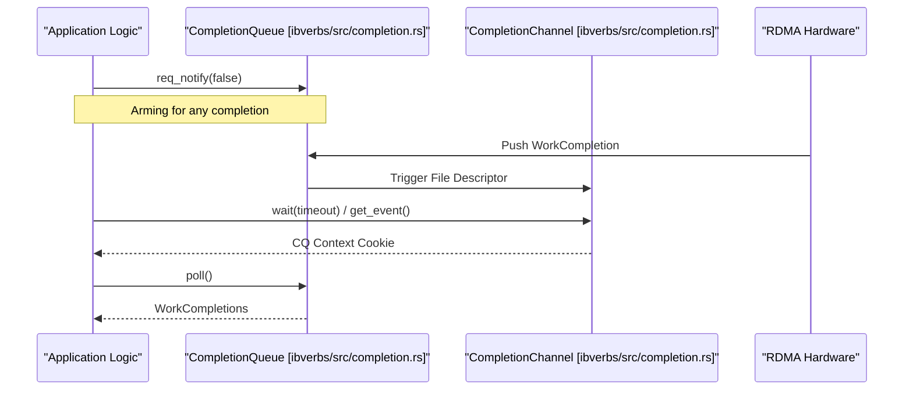

<!-- source: DeepWiki mcp.deepwiki.com · repo jonhoo/rust-ibverbs · page 5 Completion Queues and Event Handling · fetched 2026-11-11 -->

# Completion Queues and Event Handling

Relevant source files

The following files were used as context for generating this wiki page:

- [ibverbs/src/completion.rs](ibverbs/src/completion.rs)
- [ibverbs/src/lib.rs](ibverbs/src/lib.rs)

In RDMA, the results of work requests (sends, receives, reads, writes) are not returned immediately. Instead, the hardware places a `WorkCompletion` into a `CompletionQueue` (CQ) once the operation finishes. The `rust-ibverbs` crate provides two primary strategies for handling these completions: high-performance **polling** and resource-efficient **event-driven** notification.

### Strategy Overview

| Strategy | Mechanism | Performance | CPU Usage | Best For |
| :--- | :--- | :--- | :--- | :--- |
| **Polling** | Repeatedly calling `cq.poll()` in a loop. | Lowest Latency | 100% (Busy-wait) | High-frequency data path, dedicated cores. |
| **Event-Driven** | Blocking on a `CompletionChannel` file descriptor. | Higher Latency | Low (Interrupt-based) | Control plane, low-frequency traffic, or `epoll` integration. |

### Completion Management Architecture

The following diagram illustrates how the `CompletionQueue` interacts with the `Context` and the optional `CompletionChannel`.

**CQ and Event Relationship**

Sources: [ibverbs/src/completion.rs:43-45](), [ibverbs/src/completion.rs:252-258](), [ibverbs/src/completion.rs:334-340]()

---

### Polling and Work Completions

Polling is the default way to interact with a `CompletionQueue` [ibverbs/src/completion.rs:24-25](). When you call `poll()`, the crate returns a `Completions` iterator that provides access to `WorkCompletion` objects. These objects contain critical metadata about the operation, including the `wr_id` (Work Request ID), status, and opcode [ibverbs/src/completion.rs:563-585]().

The crate utilizes the extended CQ interface (`ibv_create_cq_ex`) to support advanced features like hardware timestamps via `HcaClock` and configurable completion flags [ibverbs/src/completion.rs:100-105]().

**Key Components:**
*   **`CompletionQueue`**: The primary handle for reaping completions [ibverbs/src/completion.rs:252-258]().
*   **`WorkCompletion`**: A lazy-read wrapper around the hardware completion entry [ibverbs/src/completion.rs:556-561]().
*   **`HcaClock`**: Used for converting hardware timestamps into system time [ibverbs/src/context.rs:484-489]().

For detailed polling patterns and metadata handling, see [CompletionQueue: Polling and WorkCompletions](#5.1).

---

### Event-Driven Completions and CompletionChannel

For applications that cannot afford to burn 100% CPU on a polling loop, `rust-ibverbs` supports event-driven notifications via the `CompletionChannel` [ibverbs/src/completion.rs:43-45](). A channel wraps a Linux file descriptor that becomes readable when a new completion is added to an associated CQ.

The event-driven flow follows a specific cycle:
1.  **Arm**: Call `req_notify` on the CQ to request a notification [ibverbs/src/completion.rs:453-459]().
2.  **Wait**: Block on the `CompletionChannel` using `wait()` or integrate its `AsFd` into an `epoll` reactor [ibverbs/src/completion.rs:145-155]().
3.  **Drain**: Once notified, `poll()` the CQ until it is empty [ibverbs/src/lib.rs:54-61]().
4.  **Rearm**: Repeat the process.

**Notification Flow**

Sources: [ibverbs/src/completion.rs:21-30](), [ibverbs/src/completion.rs:113-127]()

For details on `epoll` integration and multiplexing multiple CQs onto a single channel, see [Event-Driven Completions and CompletionChannel](#5.2).

---

### Sources
*   [ibverbs/src/lib.rs:1-80]()
*   [ibverbs/src/completion.rs:1-160]()
*   [ibverbs/src/completion.rs:250-460]()
*   [ibverbs/src/context.rs:480-500]()

---

