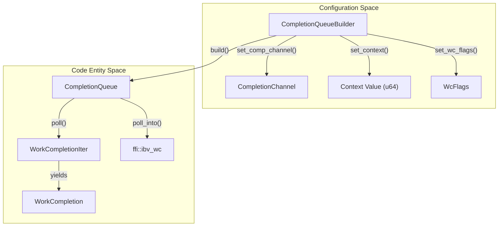
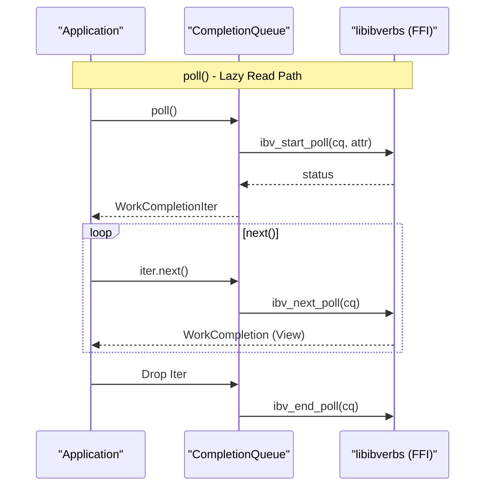

<!-- source: DeepWiki mcp.deepwiki.com · repo jonhoo/rust-ibverbs · page 5.1 CompletionQueue: Polling and WorkCompletions · fetched 2026-11-11 -->

# CompletionQueue: Polling and WorkCompletions

Relevant source files

The following files were used as context for generating this wiki page:

- [ibverbs/src/completion.rs](ibverbs/src/completion.rs)
- [ibverbs/tests/loopback.rs](ibverbs/tests/loopback.rs)

This page covers the management of RDMA completions through the `CompletionQueue` (CQ) abstraction. It details how to configure queues using the builder pattern, the differences between standard and extended polling interfaces, and how to consume `WorkCompletion` data using the lazy-read API.

## Overview of Completion Handling

A `CompletionQueue` is the destination for Work Completions (WCs) generated by a `QueuePair`. In `rust-ibverbs`, the CQ can be driven by high-performance polling or by an event-driven model using a `CompletionChannel`.

### Data Flow and Code Entities

The following diagram illustrates the relationship between the configuration entities and the resulting completion objects.

**Diagram: Completion Queue Entity Mapping**

**Sources:** [ibverbs/src/completion.rs:43-45](), [ibverbs/src/completion.rs:242-260](), [ibverbs/src/completion.rs:446-455](), [ibverbs/src/completion.rs:550-554]()

---

## Building a CompletionQueue

The `CompletionQueueBuilder` provides a fluent interface for configuring the CQ before allocation. This is particularly important for extended CQs (`ibv_create_cq_ex`), which support hardware timestamps and other advanced metadata.

### Configuration Methods
*   **`set_comp_channel`**: Associates the CQ with a `CompletionChannel` for event-driven notifications [ibverbs/src/completion.rs:275-279]().
*   **`set_context`**: Assigns a `u64` "cookie" that is returned by the channel when an event occurs, allowing demultiplexing of multiple CQs on one channel [ibverbs/src/completion.rs:284-288]().
*   **`set_wc_flags`**: Specifies which fields the hardware should populate in the work completion (e.g., timestamps, byte count) [ibverbs/src/completion.rs:293-297]().

**Sources:** [ibverbs/src/completion.rs:262-315]()

---

## Polling Interfaces

The crate supports two distinct polling paths: the standard batch path (`poll_into`) and the extended lazy-read path (`poll`).

### 1. Standard Batch Polling (`poll_into`)
This method uses the standard `ibv_poll_cq` FFI call. It requires the caller to provide a buffer of `ffi::ibv_wc` structs. It is suitable for high-throughput batching where metadata beyond standard fields is not required.

*   **Function**: `CompletionQueue::poll_into(&self, wc: &mut [ffi::ibv_wc])` [ibverbs/src/completion.rs:550-564]().
*   **Usage**: Typically used in a loop to drain the CQ into a pre-allocated vector [ibverbs/tests/loopback.rs:163-181]().

### 2. Extended Lazy-Read Polling (`poll`)
This method utilizes the extended verbs API (`ibv_start_poll`). It returns a `WorkCompletionIter` that allows for "lazy" reading of completion fields. This is the only way to access extended fields like hardware timestamps.

*   **Function**: `CompletionQueue::poll(&self)` [ibverbs/src/completion.rs:446-465]().
*   **Mechanism**: It returns a `WorkCompletionIter` which, when advanced, provides a `WorkCompletion` view [ibverbs/src/completion.rs:467-485]().

**Diagram: Polling Logic Flow**

**Sources:** [ibverbs/src/completion.rs:446-512](), [ibverbs/src/completion.rs:514-536]()

---

## WorkCompletion API

The `WorkCompletion` struct provides access to the details of a finished Work Request (WR).

### Field Access
The API distinguishes between standard fields and extended fields. Extended fields require specific flags to be set during CQ creation.

| Method | Description | Source |
| :--- | :--- | :--- |
| `wr_id()` | Returns the user-defined ID of the WR. | [ibverbs/src/completion.rs:601-604]() |
| `status()` | Returns the completion status (Success, LocalLenErr, etc.). | [ibverbs/src/completion.rs:615-618]() |
| `opcode()` | Returns the operation type (Send, Receive, etc.). | [ibverbs/src/completion.rs:633-636]() |
| `imm_data()` | Returns immediate data if present. | [ibverbs/src/completion.rs:664-672]() |
| `timestamp()` | Returns the hardware timestamp (requires `HcaClock`). | [ibverbs/src/completion.rs:687-695]() |

### Hardware Timestamps (`HcaClock`)
To convert raw hardware ticks into wall-clock time, the `WorkCompletion::timestamp()` method requires a reference to the `HcaClock` [ibverbs/src/completion.rs:687-690](). The clock is obtained from the `Context` [ibverbs/src/context.rs:252-255]().

**Sources:** [ibverbs/src/completion.rs:593-705](), [ibverbs/src/context.rs:252-255]()

---

## Safety and Lifecycle

*   **Iterators and Views**: The `WorkCompletion` yielded by `WorkCompletionIter` is a view into the CQ's internal FFI state. It cannot outlive the iterator, and the iterator's `Drop` implementation calls `ibv_end_poll` to release the CQ hardware lock [ibverbs/src/completion.rs:514-536]().
*   **Error Handling**: Completion errors are handled via the `ok()` method, which converts the status into a `Result<(), (WcStatus, u32)>`, where the second tuple element is the vendor-specific error code [ibverbs/src/completion.rs:620-631]().

**Sources:** [ibverbs/src/completion.rs:514-536](), [ibverbs/src/completion.rs:620-631]()

---

