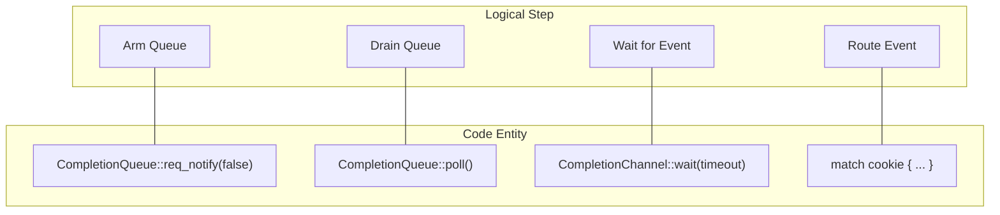
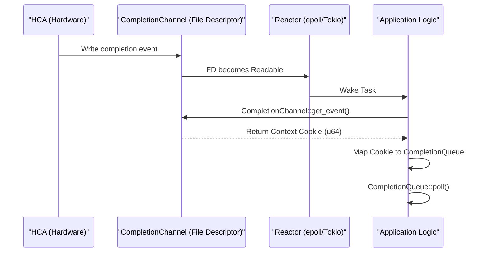

<!-- source: DeepWiki mcp.deepwiki.com · repo jonhoo/rust-ibverbs · page 5.2 Event-Driven Completions and CompletionChannel · fetched 2026-11-11 -->

# Event-Driven Completions and CompletionChannel

Relevant source files

The following files were used as context for generating this wiki page:

- [ibverbs/examples/event_loop.rs](ibverbs/examples/event_loop.rs)
- [ibverbs/src/completion.rs](ibverbs/src/completion.rs)
- [ibverbs/tests/loopback.rs](ibverbs/tests/loopback.rs)

This page describes the event-driven completion mechanism in `rust-ibverbs`. While high-performance RDMA applications often poll Completion Queues (CQs) in a tight loop to minimize latency, event-driven handling allows a thread to sleep or yield to a reactor (like `tokio` or `epoll`) until work completes. This is essential for power efficiency and for scaling to thousands of connections where constant polling is impractical.

## The CompletionChannel Abstraction

A `CompletionChannel` represents a file descriptor that delivers notifications when a `CompletionQueue` transitions from empty to having at least one new entry.

### Creation and Association

A channel is created from a `Context` [ibverbs/src/completion.rs:70-84]() and then associated with one or more CQs during the CQ building process [ibverbs/src/completion.rs:24-30]().

| Entity | Responsibility |
| :--- | :--- |
| `CompletionChannel` | Owns the `ibv_comp_channel` and its underlying file descriptor [ibverbs/src/completion.rs:47-51](). |
| `CompletionQueue` | Must be configured via `CompletionQueueBuilder::set_comp_channel` to emit events to a specific channel [ibverbs/src/completion.rs:26-27](). |
| **Context Cookie** | A `u64` value set via `set_context` that identifies which CQ triggered an event on a shared channel [ibverbs/src/completion.rs:100-101](). |

### Multiplexing Many CQs

Multiple CQs can share a single `CompletionChannel` [ibverbs/src/completion.rs:32-38](). This allows a single `epoll` registration or a single `wait` call to monitor many queue pairs simultaneously. When `get_event` or `wait` returns, it provides the "context cookie" previously assigned to the CQ, allowing the application to route the event to the correct handler [ibverbs/src/completion.rs:103-108]().

**Sources:** [ibverbs/src/completion.rs:21-45](), [ibverbs/examples/event_loop.rs:48-64]()

## The Arm-Drain-Rearm Cycle

RDMA completion events are edge-triggered. To avoid missing completions, applications must follow a strict cycle: **Arm → Poll (Drain) → Wait**.

### Implementation Logic Space to Code Space
The following diagram maps the logical steps of the event-driven cycle to the specific method calls in `rust-ibverbs`.

Title: Event-Driven Logic Mapping

**Sources:** [ibverbs/examples/event_loop.rs:81-116](), [ibverbs/src/completion.rs:135-140]()

### Step-by-Step Flow

1.  **Arm (`req_notify`)**: Call `cq.req_notify(false)` to request a notification on the next completion [ibverbs/examples/event_loop.rs:81-82](). If `solicited_only` is true, only work requests marked with the `solicited` flag will trigger the event.
2.  **Initial Drain**: You must `poll()` the CQ *after* arming but *before* waiting [ibverbs/src/completion.rs:136-138](). This prevents a race condition where a completion arrives between your last poll and the `req_notify` call.
3.  **Wait**: Call `channel.wait(timeout)` [ibverbs/src/completion.rs:145]() or `channel.get_event()` [ibverbs/src/completion.rs:113]().
4.  **Acknowledge**: The crate automatically handles `ibv_ack_cq_events` inside `get_event` to prevent resource leaks [ibverbs/src/completion.rs:124-126]().
5.  **Rearm**: Once an event is received, re-arm the CQ immediately [ibverbs/examples/event_loop.rs:104]() before draining the completions that just arrived.

**Sources:** [ibverbs/src/completion.rs:129-140](), [ibverbs/examples/event_loop.rs:94-116]()

## Integration with Async Reactors

`CompletionChannel` implements `AsFd` and `AsRawFd`, making it compatible with the standard Linux `poll`/`epoll`/`io_uring` subsystems and Rust async runtimes like `Tokio`.

### Non-blocking Operation
By default, `rust-ibverbs` sets the channel's file descriptor to `O_NONBLOCK` [ibverbs/src/completion.rs:70-83](). This ensures that `get_event` returns `Ok(None)` (mapping to `EWOULDBLOCK`) instead of stalling the thread if no events are ready [ibverbs/src/completion.rs:117-121]().

### Data Flow Diagram
The following diagram illustrates how a completion event moves from the hardware to a user-space reactor.

Title: Completion Event Data Flow

**Sources:** [ibverbs/src/completion.rs:28-38](), [ibverbs/src/completion.rs:87-97](), [ibverbs/examples/event_loop.rs:48-52]()

## Key Functions Reference

### `CompletionChannel::wait`
Blocks the current thread until an event occurs or the timeout expires [ibverbs/src/completion.rs:145](). It uses `nix::poll` internally to provide millisecond-granularity timeouts [ibverbs/src/completion.rs:150-155]().

### `CompletionChannel::get_event`
A non-blocking attempt to consume one event from the channel [ibverbs/src/completion.rs:113](). If multiple CQs are sharing the channel, this should be called in a loop until it returns `None` to ensure all pending notifications are cleared from the FD [ibverbs/src/completion.rs:103-107]().

### `CompletionQueue::req_notify`
Arms the CQ. It wraps the FFI call `ibv_req_notify_cq`.
- `solicited_only = false`: Any completion triggers an event.
- `solicited_only = true`: Only completions for Send WRs with the `solicited` flag set, or Receive completions, trigger an event.

**Sources:** [ibverbs/src/completion.rs:113-127](), [ibverbs/src/completion.rs:145-165](), [ibverbs/examples/event_loop.rs:81-82]()

---

