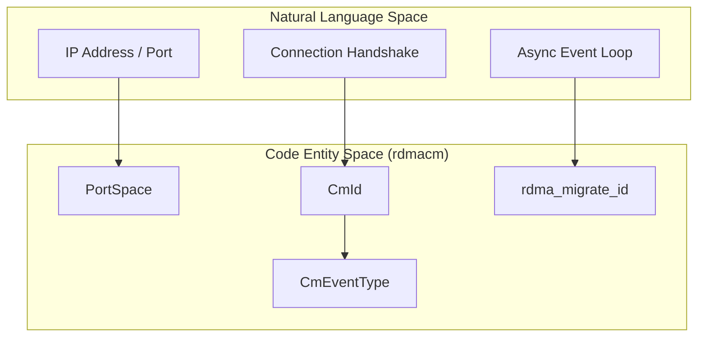
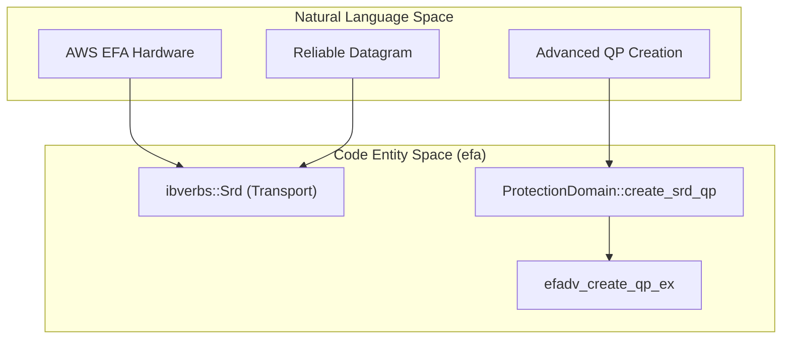

<!-- source: DeepWiki mcp.deepwiki.com · repo jonhoo/rust-ibverbs · page 6 Optional Features · fetched 2026-11-11 -->

# Optional Features

Relevant source files

The following files were used as context for generating this wiki page:

- [Cargo.lock](Cargo.lock)
- [ibverbs/Cargo.toml](ibverbs/Cargo.toml)
- [ibverbs/src/lib.rs](ibverbs/src/lib.rs)

The `ibverbs` crate provides core RDMA functionality by default, but certain specialized capabilities are gated behind Cargo features. These features allow the crate to support advanced hardware-specific protocols and high-level connection management while keeping the base dependency tree lean.

The two primary optional features are:
1.  **`rdmacm`**: Simplifies connection establishment using IP-based addressing.
2.  **`efa`**: Enables the Scalable Reliable Datagram (SRD) transport for AWS Elastic Fabric Adapter hardware.

### Feature Overview

| Feature | Description | Dependency |
| :--- | :--- | :--- |
| `rdmacm` | RDMA Connection Manager for IP-based handshakes. | `librdmacm`, `nix` [ibverbs/Cargo.toml:37-37]() |
| `efa` | AWS EFA specific extensions and SRD transport. | `libefa` [ibverbs/Cargo.toml:35-35]() |

Sources: [ibverbs/Cargo.toml:32-38]()

---

### RDMA Connection Manager (`rdmacm`)

The `rdmacm` feature provides a high-level alternative to manual "out-of-band" endpoint exchange [ibverbs/src/lib.rs:36-37](). While standard `ibverbs` requires users to exchange Queue Pair information (like LID/GID and QPN) manually, the RDMA CM uses standard IP addresses and port numbers to negotiate connections.

This module wraps `librdmacm` and introduces concepts such as the `CmId` (Connection Manager Identifier), which acts as a state machine for the connection lifecycle [ibverbs/src/lib.rs:82-84](). It supports both blocking and event-loop driven modes, making it suitable for integration with asynchronous reactors.

**Key capabilities include:**
*   **Address Resolution**: Converting IP/Port pairs into RDMA-specific routing information.
*   **Private Data Exchange**: Sending small amounts of application-specific data during the connection handshake.
*   **Event Migration**: Moving connection events between different event channels.

For details on state machines, event types, and non-blocking usage, see **[RDMA Connection Manager (rdmacm feature)](#6.1)**.

#### RDMA CM Code Entity Map
This diagram shows how the `rdmacm` feature bridges standard networking concepts (IP/Port) to RDMA entities.

Sources: [ibverbs/src/lib.rs:82-84](), [ibverbs/Cargo.toml:37-37]()

---

### AWS Elastic Fabric Adapter (`efa`)

The `efa` feature enables support for the AWS Elastic Fabric Adapter (EFA). The primary addition is the `Srd` (Scalable Reliable Datagram) transport type [ibverbs/src/lib.rs:85-86](). 

Unlike standard Reliable Connected (`Rc`) transports, `Srd` is connectionless but provides reliability and out-of-order delivery optimized for AWS VPC networking [ibverbs/src/lib.rs:110-112](). This feature allows users to create SRD-specific Queue Pairs via specialized constructors on the `ProtectionDomain`.

**Key capabilities include:**
*   **SRD Transport**: A specialized `Transport` trait implementation for EFA.
*   **Extended QP Creation**: Access to `efadv_create_qp_ex` for hardware-specific configuration.
*   **Scalability**: Optimized for high-performance computing (HPC) workloads on AWS.

For details on SRD semantics and EFA-specific QP builders, see **[AWS Elastic Fabric Adapter (efa feature)](#6.2)**.

#### EFA Entity Map
This diagram maps EFA hardware concepts to the specific code entities provided when the `efa` feature is enabled.

Sources: [ibverbs/src/lib.rs:85-86](), [ibverbs/src/lib.rs:110-112](), [ibverbs/Cargo.toml:35-35]()

---

### Feature Interaction

While both features can be enabled simultaneously [ibverbs/Cargo.toml:24-24](), they serve different parts of the RDMA stack:
*   `rdmacm` is a **control-path** enhancement for establishing connections over standard network topologies.
*   `efa` is a **transport-layer** enhancement for specific hardware capabilities.

Users often use `rdmacm` to negotiate the initial connection and then use `efa` (if on AWS) or standard `Rc`/`Ud` transports for the high-speed data path.

Sources: [ibverbs/src/lib.rs:5-10](), [ibverbs/src/lib.rs:107-115]()

---

