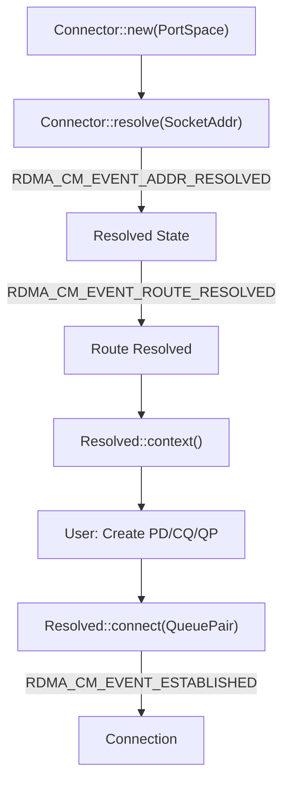
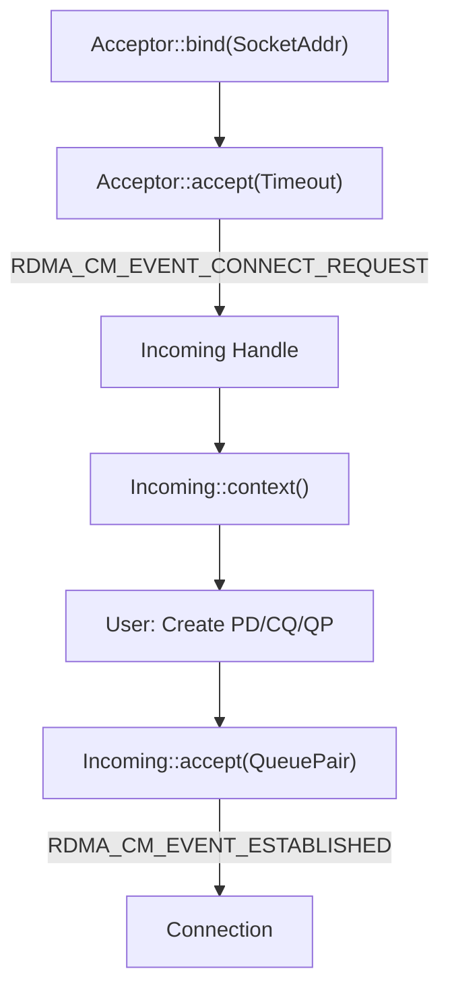
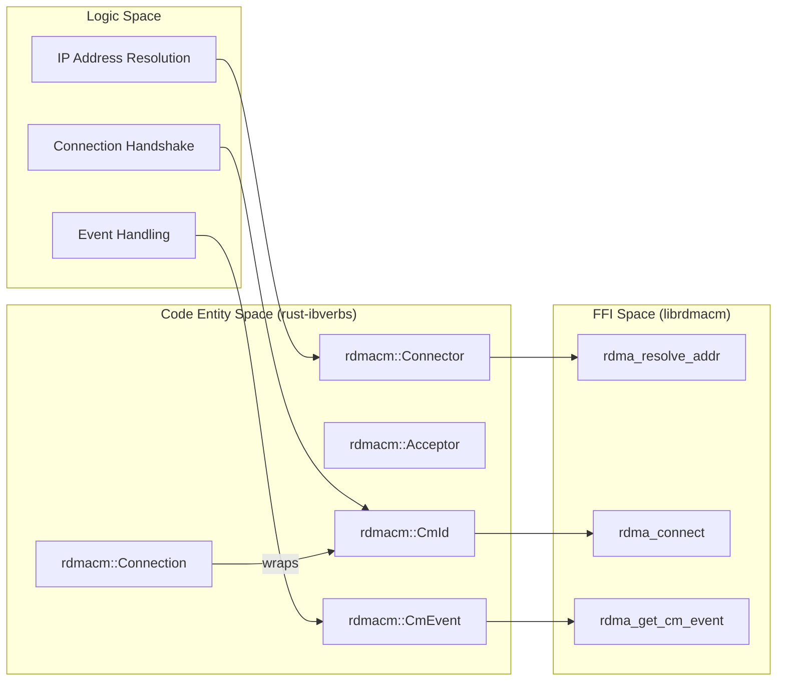

<!-- source: DeepWiki mcp.deepwiki.com · repo jonhoo/rust-ibverbs · page 6.1 RDMA Connection Manager (rdmacm feature) · fetched 2026-11-11 -->

# RDMA Connection Manager (rdmacm feature)

Relevant source files

The following files were used as context for generating this wiki page:

- [ibverbs/examples/rdmacm_connect.rs](ibverbs/examples/rdmacm_connect.rs)
- [ibverbs/src/rdmacm.rs](ibverbs/src/rdmacm.rs)
- [ibverbs/tests/rdmacm.rs](ibverbs/tests/rdmacm.rs)

The `rdmacm` module provides a high-level interface to `librdmacm`, allowing applications to establish RDMA connections using IP addresses rather than manual out-of-band exchange of `QueuePairEndpoint` data [ibverbs/src/rdmacm.rs:1-7](). It automates device selection, address resolution, and the transition of Queue Pairs to the Ready-to-Send (RTS) state [ibverbs/src/rdmacm.rs:7-17]().

## Overview and Port Spaces

The Connection Manager operates within specific `PortSpace` namespaces, which determine the transport protocol and how port numbers are allocated [ibverbs/src/rdmacm.rs:84-86]().

| PortSpace | Transport / Description |
| :--- | :--- |
| `Tcp` | Reliable Connection (RC). The most common choice [ibverbs/src/rdmacm.rs:92-93](). |
| `Udp` | Unreliable Datagram (UD) [ibverbs/src/rdmacm.rs:94-95](). |
| `Ipoib` | IP over InfiniBand [ibverbs/src/rdmacm.rs:90-91](). |
| `Ib` | InfiniBand port space for any port number [ibverbs/src/rdmacm.rs:96-97](). |

Sources: [ibverbs/src/rdmacm.rs:84-122]()

## Connection State Machine

The RDMA connection process is a multi-step handshake involving address resolution, route resolution, and parameter negotiation. The library provides two ways to drive this state machine:
1.  **Synchronous Helpers**: `Connector` and `Acceptor` provide a blocking, high-level API [ibverbs/src/rdmacm.rs:9-11]().
2.  **Low-level `CmId`**: Provides granular control, support for non-blocking I/O, and event migration [ibverbs/src/rdmacm.rs:47-60]().

### Active Side (Connector)
The active side initiates the connection. Because the specific RDMA device is only known after the destination IP is resolved, the process is split into two phases [ibverbs/src/rdmacm.rs:13-17]().

Title: Active Connection Flow (Connector)

Sources: [ibverbs/src/rdmacm.rs:19-39](), [ibverbs/src/rdmacm.rs:128-150]()

### Passive Side (Acceptor)
The passive side listens for incoming requests. It yields an `Incoming` handle which contains the peer's requirements (like private data) before the user chooses to accept the connection with a specific Queue Pair [ibverbs/src/rdmacm.rs:41-45]().

Title: Passive Connection Flow (Acceptor)

Sources: [ibverbs/src/rdmacm.rs:41-45](), [ibverbs/tests/rdmacm.rs:88-123]()

## Key Components

### CmId and Events
The `CmId` (Connection Manager Identifier) is the fundamental object in `rdmacm`. It encapsulates the underlying `rdma_cm_id` and an event channel [ibverbs/src/rdmacm.rs:51-54]().

*   **Event Migration**: Using `rdma_migrate_id`, a `CmId` can be moved to a different event channel, allowing multiple IDs to be processed by a single reactor [ibverbs/src/rdmacm.rs:59-60]().
*   **Non-blocking Mode**: Calling `set_nonblocking(true)` allows the `CmId` to be integrated into async runtimes like `tokio` by watching its file descriptor via `AsRawFd` [ibverbs/src/rdmacm.rs:54-56]().
*   **Private Data**: During `connect` or `accept`, applications can exchange `private_data` (up to 56 bytes for TCP/RC), which is visible to the peer in the `ConnectRequest` or `Established` events [ibverbs/src/rdmacm.rs:139-142]().

### Connection Parameters
The `ConnectionParameter` struct configures the RDMA-specific handshake details [ibverbs/src/rdmacm.rs:23]().
*   **Responder Resources**: Number of RDMA Reads/Atomics the local side can accept [ibverbs/src/rdmacm.rs:7-17]().
*   **Initiator Depth**: Number of RDMA Reads/Atomics the local side can have outstanding [ibverbs/src/rdmacm.rs:7-17]().
*   **Retry Count**: Number of times to retry a transmission [ibverbs/tests/rdmacm.rs:113-114]().

## Code Mapping: Entity Association

The following diagram maps high-level RDMA concepts to the specific Rust types and FFI calls used in the `rdmacm` implementation.

Title: RDMA-CM Entity Mapping

Sources: [ibverbs/src/rdmacm.rs:1-68](), [ibverbs/src/rdmacm.rs:128-171]()

## Example: `rdmacm_connect`
The `rdmacm_connect` example demonstrates a full client-server exchange [ibverbs/examples/rdmacm_connect.rs:1-9]().

1.  **Server**: Binds to a port using `Acceptor::bind`, calls `accept()` to get an `Incoming` request, creates a Queue Pair on the resolved context, and completes the handshake [ibverbs/examples/rdmacm_connect.rs:53-71]().
2.  **Client**: Uses `Connector::new` and `resolve()` to find the server, creates a Queue Pair, and calls `connect()` [ibverbs/examples/rdmacm_connect.rs:88-106]().
3.  **Data Path**: Once `Connection` is returned, the `queue_pair()` is already in the `RTS` state, allowing immediate `post_send` or `post_recv` operations [ibverbs/examples/rdmacm_connect.rs:73-78]().

Sources: [ibverbs/examples/rdmacm_connect.rs:1-117](), [ibverbs/tests/rdmacm.rs:82-164]()

---

