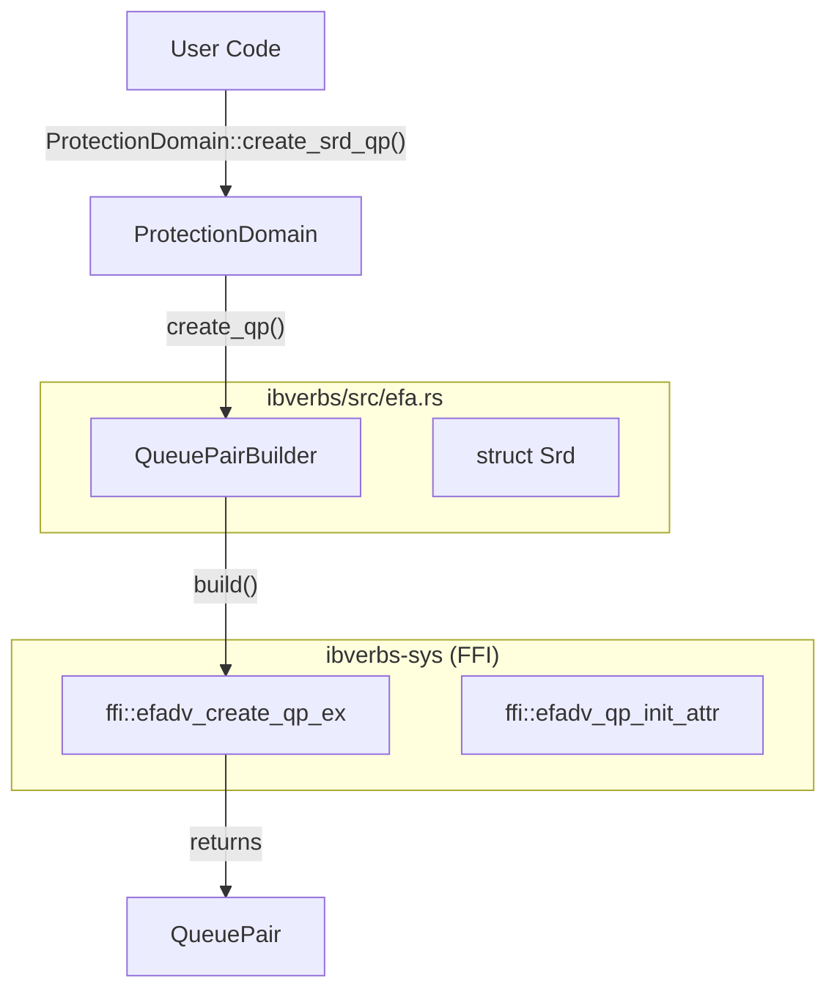
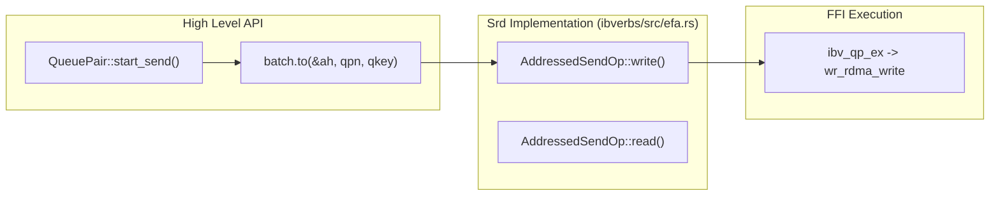

<!-- source: DeepWiki mcp.deepwiki.com · repo jonhoo/rust-ibverbs · page 6.2 AWS Elastic Fabric Adapter (efa feature) · fetched 2026-11-11 -->

# AWS Elastic Fabric Adapter (efa feature)

Relevant source files

The following files were used as context for generating this wiki page:

- [ibverbs-sys/Cargo.toml](ibverbs-sys/Cargo.toml)
- [ibverbs/examples/efa_srd.rs](ibverbs/examples/efa_srd.rs)
- [ibverbs/src/efa.rs](ibverbs/src/efa.rs)
- [ibverbs/src/pd.rs](ibverbs/src/pd.rs)

The `efa` feature in `rust-ibverbs` provides support for the AWS Elastic Fabric Adapter (EFA), specifically enabling the **Scalable Reliable Datagram (SRD)** transport type. SRD is a high-performance transport protocol designed by AWS that provides reliable delivery like Reliable Connected (RC) but is connectionless and multi-path, addressed similarly to Unreliable Datagram (UD) [ibverbs/src/efa.rs:4-8]().

## Overview of SRD Transport

The `Srd` transport type is unique to EFA hardware. It combines the reliability guarantees of RC with the scalability of UD.

| Feature | RC (Reliable Connected) | UD (Unreliable Datagram) | SRD (Scalable Reliable Datagram) |
| :--- | :--- | :--- | :--- |
| **Reliability** | Reliable | Unreliable | Reliable |
| **Connectivity** | Connected (1-to-1) | Connectionless (1-to-N) | Connectionless (1-to-N) |
| **Ordering** | Strict Ordering | No Ordering | Out-of-order delivery (typically) |
| **Addressing** | Via QP Number | Via Address Handle | Via Address Handle |

In `rust-ibverbs`, the `Srd` type is a sealed implementation of the `Transport` and `Datagram` traits [ibverbs/src/efa.rs:29-36]().

## Resource Creation and Implementation

Creating an EFA-capable Queue Pair requires specific driver-level initialization via `efadv_create_qp_ex` [ibverbs/src/efa.rs:58-61]().

### SRD Queue Pair Creation Flow

1.  **Allocation**: Use `ProtectionDomain::create_srd_qp` to initialize a `QueuePairBuilder<Srd>` [ibverbs/src/efa.rs:47-54]().
2.  **Configuration**: Set standard parameters like GID index and SGE limits [ibverbs/examples/efa_srd.rs:23-26]().
3.  **Build**: The `build()` method for `Srd` specifically populates `ibv_qp_init_attr_ex` with `IBV_QPT_DRIVER` and configures `efadv_qp_init_attr` [ibverbs/src/efa.rs:79-113]().
4.  **Activation**: Call `activate(qkey)` to transition the QP to the Ready-to-Send (RTS) state [ibverbs/src/efa.rs:157-159]().

### Code Entity Mapping: EFA Initialization
The following diagram illustrates how the Rust API maps to the underlying provider-specific FFI calls.

**EFA QP Creation Data Flow**

Sources: [ibverbs/src/efa.rs:29-54](), [ibverbs/src/efa.rs:99-113](), [ibverbs/src/pd.rs:11-13]()

## Data Path Operations

Once activated, an SRD Queue Pair uses the standard data path APIs, but supports extended operations usually reserved for connected transports, such as RDMA Write and RDMA Read [ibverbs/src/efa.rs:69-74]().

### Addressing
Because SRD is connectionless, every send operation must specify a destination. This is done using an `AddressHandle` and the remote `qp_num` [ibverbs/examples/efa_srd.rs:48-52]().

### Supported Operations
The `efa` feature enables the following operations on `Srd` queue pairs via the `AddressedSendOp` extension [ibverbs/src/efa.rs:162-180]():
*   **Send**: Standard datagram send.
*   **RDMA Write**: Writing to remote memory (Reliable).
*   **RDMA Read**: Reading from remote memory (Reliable).
*   **Immediate Data**: Appending 32-bit immediate values to writes or sends.

**SRD Send Operation Mapping**

Sources: [ibverbs/src/efa.rs:162-180](), [ibverbs/examples/efa_srd.rs:48-53]()

## Usage Example: `efa_srd.rs`

The `efa_srd` example demonstrates a self-contained loopback using two SRD QPs on a single EFA device.

1.  **Setup**: Open a device and allocate a PD and CQ [ibverbs/examples/efa_srd.rs:14-20]().
2.  **QP Creation**: Create `sender` and `receiver` QPs using `create_srd_qp` [ibverbs/examples/efa_srd.rs:23-34]().
3.  **Address Handle**: Create an `AddressHandle` using the receiver's GID to allow the sender to target it [ibverbs/examples/efa_srd.rs:36-40]().
4.  **Data Transfer**:
    *   Post a receive request on the receiver [ibverbs/examples/efa_srd.rs:47]().
    *   Submit a signaled send batch from the sender using `.to()` to specify the destination [ibverbs/examples/efa_srd.rs:48-53]().
5.  **Completion**: Poll the CQ for both the send and receive completions [ibverbs/examples/efa_srd.rs:58-72]().

Note: Datagram receives (including SRD) include a 40-byte Global Routing Header (GRH) at the start of the receive buffer [ibverbs/examples/efa_srd.rs:74-76]().

## Feature Gating

The EFA functionality is gated behind the `efa` Cargo feature. This feature:
1.  Links against `libefa` [ibverbs-sys/Cargo.toml:31-33]().
2.  Enables the `efadv_*` FFI bindings in `ibverbs-sys`.
3.  Exposes the `ibverbs::efa` module and the `Srd` transport type [ibverbs/src/efa.rs:1-8]().

Sources: [ibverbs-sys/Cargo.toml:30-33](), [ibverbs/src/efa.rs:1-10](), [ibverbs/examples/efa_srd.rs:1-8]()

---

