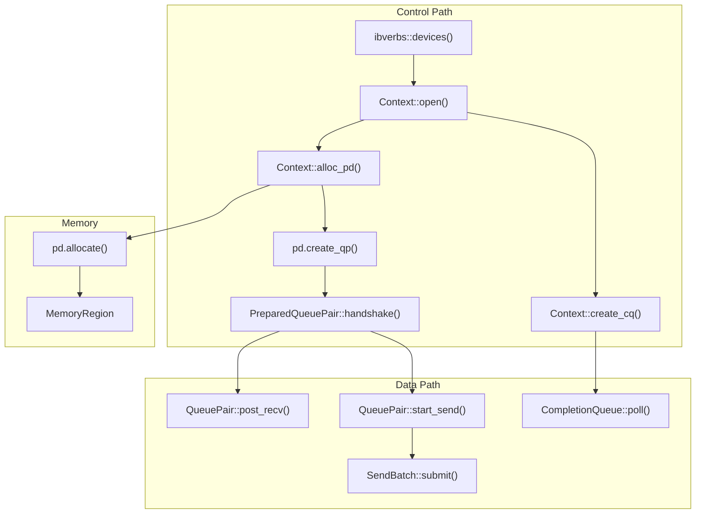
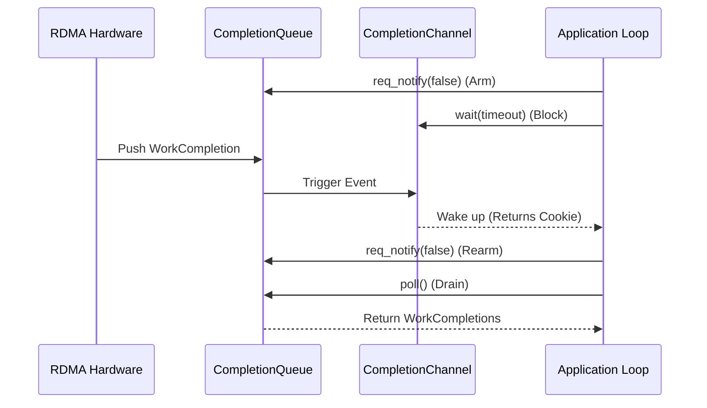

<!-- source: DeepWiki mcp.deepwiki.com · repo jonhoo/rust-ibverbs · page 7.1 Data-Path Examples (loopback, doorbell_batching, event_loop) · fetched 2026-11-11 -->

# Data-Path Examples (loopback, doorbell_batching, event_loop)

Relevant source files

The following files were used as context for generating this wiki page:

- [ibverbs/examples/doorbell_batching.rs](ibverbs/examples/doorbell_batching.rs)
- [ibverbs/examples/event_loop.rs](ibverbs/examples/event_loop.rs)
- [ibverbs/examples/loopback.rs](ibverbs/examples/loopback.rs)

This page provides a detailed walkthrough of three core data-path examples in the `rust-ibverbs` codebase. These examples demonstrate the fundamental mechanics of RDMA operations: connecting queue pairs, managing memory regions, batching work requests to minimize MMIO overhead, and handling completions through both polling and event-driven patterns.

## Loopback Example

The `loopback` example is the "Hello World" of RDMA. it demonstrates a self-connected Reliable Connected (`Rc`) Queue Pair (QP) that sends data to itself using a single `MemoryRegion`.

### Data Flow and Implementation
1.  **Device Discovery**: The program opens the first available RDMA device [ibverbs/examples/loopback.rs:7-14]().
2.  **Resource Allocation**: A `CompletionQueue` (CQ) and `ProtectionDomain` (PD) are created [ibverbs/examples/loopback.rs:16-17]().
3.  **GID Selection**: For RoCEv2 environments, it searches the GID table for an IPv4-mapped GID to ensure routability [ibverbs/examples/loopback.rs:23-30]().
4.  **QP Connection**: A `PreparedQueuePair` is created and connected to its own endpoint via the `handshake` method [ibverbs/examples/loopback.rs:32-42]().
5.  **Memory Setup**: A 16-byte `MemoryRegion` is allocated. The program uses the first 8 bytes for receiving and the last 8 bytes for sending [ibverbs/examples/loopback.rs:44-49]().
6.  **Posting Work**: 
    *   A receive request is posted via `post_recv` [ibverbs/examples/loopback.rs:49]().
    *   A send request is posted via the `SendBatch` builder, marked as `signaled()` to ensure a completion entry is generated [ibverbs/examples/loopback.rs:50-52]().
7.  **Polling**: The program enters a loop, calling `cq.poll()` until both the send and receive completions are processed [ibverbs/examples/loopback.rs:56-77]().

### Loopback Code-to-System Mapping
The following diagram maps the logical RDMA steps to the specific code entities used in `loopback.rs`.

Title: Loopback Entity Relationship

**Sources:** [ibverbs/examples/loopback.rs:7-78]()

---

## Doorbell Batching Example

The `doorbell_batching` example showcases performance optimization by chaining multiple Work Requests (WRs) into a single "doorbell" (MMIO write to the NIC). It uses RDMA Writes to scatter pieces of a string into a destination buffer and finishes with a single `signaled` Send to notify the receiver.

### Key Concepts
*   **Unsignaled Operations**: To save CPU cycles and CQ space, the intermediate RDMA Writes are not signaled [ibverbs/examples/doorbell_batching.rs:99-101](). They complete silently in the hardware.
*   **Signaled Tail**: Only the final `send` in the batch is marked `.signaled()` [ibverbs/examples/doorbell_batching.rs:103-106](). A completion for this WR guarantees that all prior WRs in the same batch (and on the same QP) have also completed.
*   **Doorbell Reduction**: By using `qp.start_send()` and `batch.submit()`, the driver only rings the hardware doorbell once for the entire chain [ibverbs/examples/doorbell_batching.rs:97-108]().

### Data Flow
1.  **Memory Partitioning**: The source string is split into slices. Each slice is mapped to a `LocalMemorySlice` and a corresponding `RemoteMemorySlice` in the destination buffer [ibverbs/examples/doorbell_batching.rs:79-87]().
2.  **Batch Construction**: A `SendBatch` is opened. A loop appends `write` operations for each segment [ibverbs/examples/doorbell_batching.rs:97-101]().
3.  **Completion Notification**: A final `send` is appended to the batch, carrying a payload that tells the receiver how many writes were performed [ibverbs/examples/doorbell_batching.rs:102-106]().
4.  **Verification**: The receiver (which is the same QP in loopback) polls for the `RECEIVE_NOTIFICATION_WR_ID` and verifies the contents of the destination buffer [ibverbs/examples/doorbell_batching.rs:138-157]().

**Sources:** [ibverbs/examples/doorbell_batching.rs:1-158]()

---

## Event Loop Example

The `event_loop` example demonstrates event-driven completion handling, which is essential for scaling to many connections without busy-waiting on the CPU.

### Implementation Details
*   **CompletionChannel**: A `CompletionChannel` is created to wrap a file descriptor that becomes readable when a completion is added to an associated CQ [ibverbs/examples/event_loop.rs:52]().
*   **Context Cookies**: Two CQs (`cq_ping` and `cq_pong`) are created, both sharing the same channel. Each is assigned a unique `u64` context cookie (`PING` and `PONG`) to identify which CQ triggered the event [ibverbs/examples/event_loop.rs:53-64]().
*   **Arm-Drain-Rearm Cycle**:
    1.  **Arm**: `cq.req_notify(false)` is called to tell the hardware to generate an event for the next completion [ibverbs/examples/event_loop.rs:81-82]().
    2.  **Wait**: The program blocks on `channel.wait()` [ibverbs/examples/event_loop.rs:95-98]().
    3.  **Rearm**: Upon waking, the CQ is immediately re-armed *before* polling to avoid race conditions where a completion arrives between draining and re-arming [ibverbs/examples/event_loop.rs:104]().
    4.  **Drain**: `cq.poll()` is called to process all available completions [ibverbs/examples/event_loop.rs:105-115]().

### Event Loop Logic Flow
Title: Event Loop Notification Cycle

### Asynchronous Events
The example also demonstrates `Context::poll_async_event()`, which checks for device-level events such as port state changes or catastrophic errors [ibverbs/examples/event_loop.rs:120-123](). Unlike completion events, these arrive on a separate descriptor (`ctx.async_fd()`).

**Sources:** [ibverbs/examples/event_loop.rs:1-126]()

---

