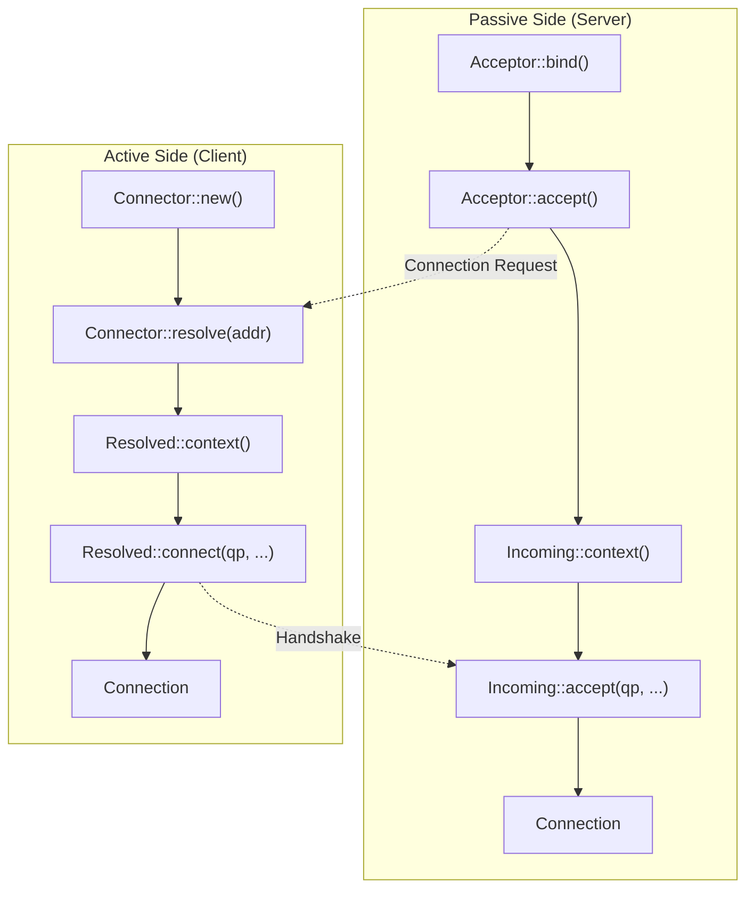
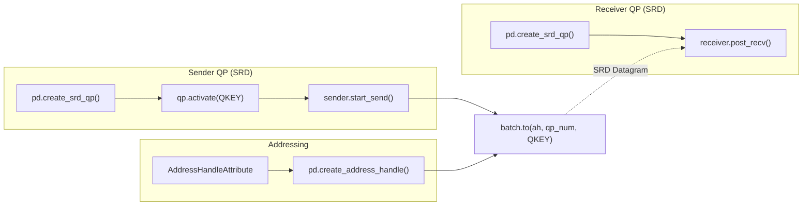

<!-- source: DeepWiki mcp.deepwiki.com · repo jonhoo/rust-ibverbs · page 7.2 Connection and Device Examples (rdmacm_connect, efa_srd, devinfo) · fetched 2026-11-11 -->

# Connection and Device Examples (rdmacm_connect, efa_srd, devinfo)

Relevant source files

The following files were used as context for generating this wiki page:

- [ibverbs/examples/devinfo.rs](ibverbs/examples/devinfo.rs)
- [ibverbs/examples/efa_srd.rs](ibverbs/examples/efa_srd.rs)
- [ibverbs/examples/rdmacm_connect.rs](ibverbs/examples/rdmacm_connect.rs)

This page provides a technical walkthrough of three key examples in the `rust-ibverbs` codebase. These examples demonstrate high-level connection management via IP addresses, hardware-specific optimizations for AWS EFA, and basic device introspection.

## 1. Connection Management (rdmacm_connect)

The `rdmacm_connect.rs` example demonstrates how to establish a Reliable Connected (`Rc`) transport session between a client and a server using the RDMA Connection Manager (librdmacm). Unlike manual IB verb handshakes which require out-of-band exchange of Queue Pair numbers and GIDs, `rdmacm` allows using standard `SocketAddr` (IP:Port) for resolution.

### Implementation Flow

The example implements both roles in a single binary, branching based on command-line arguments `server` or `client` [ibverbs/examples/rdmacm_connect.rs:20-31]().

#### Passive Side (Server)
1. **Bind**: The `Acceptor` binds to a `SocketAddr` and `PortSpace::Tcp` [ibverbs/examples/rdmacm_connect.rs:54]().
2. **Listen**: `acceptor.accept(None)` blocks until a connection request arrives, returning an `Incoming` object [ibverbs/examples/rdmacm_connect.rs:58]().
3. **Resource Allocation**: The server borrows the `Context` from the `Incoming` request to create its `ProtectionDomain`, `CompletionQueue`, and `QueuePair<Rc>` [ibverbs/examples/rdmacm_connect.rs:59-62]().
4. **Accept**: The `Incoming::accept` method transitions the QP to RTS (Ready to Send) and returns a `Connection` [ibverbs/examples/rdmacm_connect.rs:65-71]().

#### Active Side (Client)
1. **Resolve**: The `Connector` resolves the destination `SocketAddr` to an RDMA route within a timeout [ibverbs/examples/rdmacm_connect.rs:89-92]().
2. **Resource Allocation**: Similar to the server, the client uses the `Context` provided by the `Resolved` object to allocate verbs resources [ibverbs/examples/rdmacm_connect.rs:93-96]().
3. **Connect**: `Resolved::connect` initiates the three-way handshake and returns a `Connection` [ibverbs/examples/rdmacm_connect.rs:100-106]().

### Data Transfer and Synchronization
Both sides use a helper function `wait_for` which loops on `cq.poll()` until a specific `wr_id` is found in the `WorkCompletion` [ibverbs/examples/rdmacm_connect.rs:35-51](). The client submits a signaled send [ibverbs/examples/rdmacm_connect.rs:107-112](), while the server posts a receive request before the client sends [ibverbs/examples/rdmacm_connect.rs:74-78]().

**Sources:** [ibverbs/examples/rdmacm_connect.rs:1-117]()

---

## 2. AWS EFA and SRD Transport (efa_srd)

The `efa_srd.rs` example showcases the AWS-specific Scalable Reliable Datagram (SRD) transport. SRD is connectionless (like UD) but reliable (like RC), utilizing out-of-order delivery over multiple paths in the AWS network.

### SRD Queue Pair Creation
The primary differentiator is the use of `pd.create_srd_qp` [ibverbs/examples/efa_srd.rs:23-24](). While SRD is connectionless, the QP must still be "activated" with a `QKEY` to reach the ready state [ibverbs/examples/efa_srd.rs:27]().

### Addressing with Address Handles
Because SRD is connectionless, the sender must explicitly address the receiver for every send operation:
1. **Endpoint Exchange**: The receiver's `Gid` and `qp_num` are extracted from its `PreparedQueuePair` [ibverbs/examples/efa_srd.rs:29-33]().
2. **Address Handle**: An `AddressHandleAttribute` is configured with the receiver's GID and converted into an `AddressHandle` via the `ProtectionDomain` [ibverbs/examples/efa_srd.rs:38-40]().
3. **Send Operation**: The `SendBatch` uses `.to(&ah, qp_num, QKEY)` to target the specific receiver [ibverbs/examples/efa_srd.rs:48-50]().

### Datagram Layout
As with all datagram transports in IB/RDMA, the receiver's buffer must account for the Global Routing Header (GRH). The example notes that the payload starts at offset 40 in the receive buffer [ibverbs/examples/efa_srd.rs:74-76]().

### Entity Mapping: EFA SRD Workflow
| System Concept | Code Entity | File Reference |
|:---|:---|:---|
| **SRD Transport** | `ibverbs::Srd` | [ibverbs/examples/efa_srd.rs:23]() |
| **QP Creation** | `create_srd_qp` | [ibverbs/examples/efa_srd.rs:24]() |
| **Addressing** | `AddressHandle` | [ibverbs/examples/efa_srd.rs:40]() |
| **Data Path** | `post_recv` / `start_send` | [ibverbs/examples/efa_srd.rs:47-48]() |

**Sources:** [ibverbs/examples/efa_srd.rs:1-79]()

---

## 3. Device Introspection (devinfo)

The `devinfo.rs` example acts as a diagnostic tool, mimicking the standard `ibv_devinfo` utility. It demonstrates how to discover hardware and query its capabilities.

### Discovery and Attributes
1. **Device Enumeration**: `ibverbs::devices()` returns a list of available RDMA adapters [ibverbs/examples/devinfo.rs:7]().
2. **Device Attributes**: After opening a `Context`, `ctx.query_device()` retrieves the `DeviceAttr` struct, containing limits like `max_qp`, `max_mr`, and the `phys_port_cnt` [ibverbs/examples/devinfo.rs:22-24]().
3. **Port Attributes**: The example iterates through each physical port (1-indexed) and calls `ctx.query_port(port)` to retrieve `PortAttr`, which includes link state, MTU, and speed [ibverbs/examples/devinfo.rs:24-26]().

**Sources:** [ibverbs/examples/devinfo.rs:1-30]()

---

## 4. Technical Architecture Diagrams

### RDMA-CM Connection Lifecycle
This diagram maps the natural language steps of a connection to the specific Rust methods and types used in `rdmacm_connect.rs`.

**Sources:** [ibverbs/examples/rdmacm_connect.rs:53-116]()

### EFA SRD Data Flow
This diagram illustrates the association between the SRD transport type and the addressing mechanism required for connectionless reliability.

**Sources:** [ibverbs/examples/efa_srd.rs:23-53]()

---

