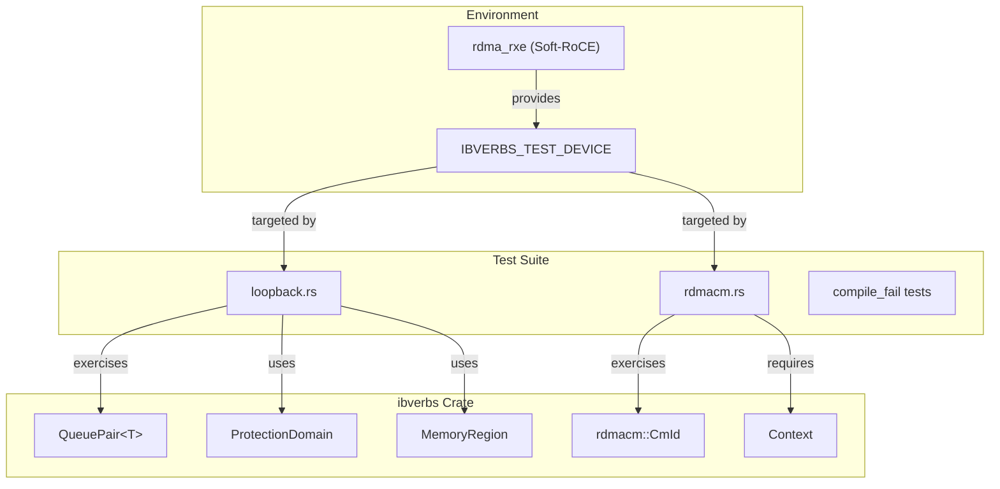
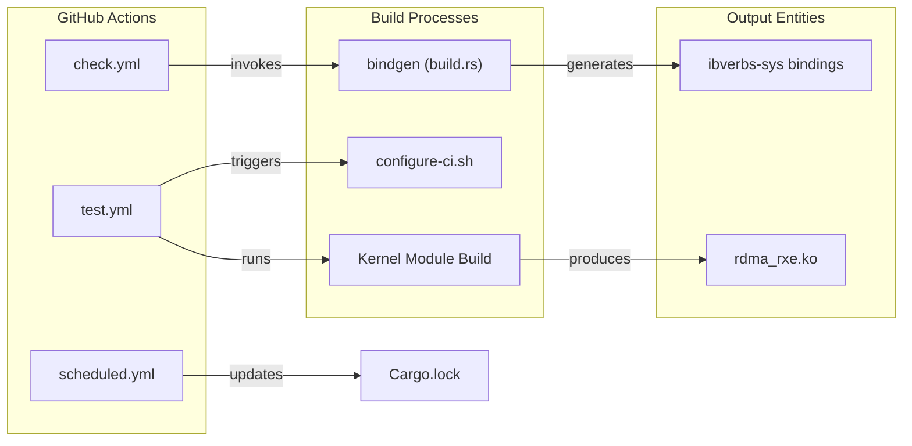

<!-- source: DeepWiki mcp.deepwiki.com · repo jonhoo/rust-ibverbs · page 8 Testing and CI · fetched 2026-11-11 -->

# Testing and CI

Relevant source files

The following files were used as context for generating this wiki page:

- [.github/workflows/check.yml](.github/workflows/check.yml)
- [.github/workflows/scheduled.yml](.github/workflows/scheduled.yml)
- [.github/workflows/test.yml](.github/workflows/test.yml)
- [ibverbs/tests/loopback.rs](ibverbs/tests/loopback.rs)
- [ibverbs/tests/rdmacm.rs](ibverbs/tests/rdmacm.rs)

This page provides a high-level overview of the testing strategies and continuous integration pipelines used in `rust-ibverbs`. The project combines standard Rust unit testing with specialized integration tests that exercise the RDMA data path using software-defined networking.

## Test Strategy

The codebase employs a multi-tiered testing strategy to ensure both the safety of the Rust wrappers and the correctness of the underlying FFI interactions with `libibverbs`.

### Unit and Compile-Fail Tests
Standard unit tests are distributed throughout the `ibverbs` crate. These verify internal logic, such as the `flags_newtype!` macro expansions and error code mapping. Compile-fail tests are used to ensure that transport-specific rules (e.g., attempting to use RC-only atomic operations on a UD Queue Pair) are caught by the compiler.

### Data-Path Integration Tests
Because RDMA requires specialized hardware or kernel drivers, the primary integration tests are located in `ibverbs/tests/loopback.rs` and `ibverbs/tests/rdmacm.rs`.

*   **Loopback Tests**: These tests utilize a single RDMA device to connect a Queue Pair to itself (self-loopback). This allows testing of `RC`, `UC`, and `UD` transports, one-sided operations (RDMA Read/Write), and Atomics without needing multiple physical machines [ibverbs/tests/loopback.rs:1-8]().
*   **RDMA-CM Tests**: When the `rdmacm` feature is enabled, these tests verify the connection manager state machine by spawning client and server threads that handshake over the device's IP address [ibverbs/tests/rdmacm.rs:1-7]().

For details on the specific test cases and how to run them locally, see **[Integration Test Suite](#8.1)**.

### Software-Defined Testing (Soft-RoCE)
To enable data-path testing in environments without InfiniBand or RoCE hardware (like GitHub Actions), the project uses **Soft-RoCE (`rxe`)**. This kernel module implements the RoCEv2 protocol over standard Ethernet interfaces. The CI pipeline dynamically builds and loads this module to provide a functional `ibv_device` for the test suite [.github/workflows/test.yml:64-72]().

#### Testing Space Overview
The following diagram maps the relationship between the testing infrastructure and the code entities they exercise.

**Test Infrastructure to Code Entity Mapping**

**Sources:** [ibverbs/tests/loopback.rs:25-42](), [ibverbs/tests/rdmacm.rs:24-37](), [.github/workflows/test.yml:98-103]()

---

## CI/CD Workflows

The project uses GitHub Actions to automate verification across different Rust toolchains, dependency versions, and hardware configurations.

### Main Test Workflow (`test.yml`)
The `test` workflow is the primary gatekeeper for pull requests. It includes:
*   **Required Jobs**: Runs the suite on `stable` and `beta` toolchains [.github/workflows/test.yml:20-27]().
*   **Minimal Versions**: Ensures compatibility with the oldest allowed versions of dependencies [.github/workflows/test.yml:117-122]().
*   **Integration Job**: The most complex job, which builds the `rdma_rxe` kernel module from source and runs the `#[ignore]`d data-path tests against it [.github/workflows/test.yml:48-56]().

### Verification and Compliance (`check.yml`)
This workflow focuses on code quality and API stability:
*   **MSRV**: Validates that the crate builds on the Minimum Supported Rust Version (currently 1.82.0) [.github/workflows/check.yml:130-138]().
*   **Semver**: Uses `cargo-semver-checks` to prevent accidental public API breakage [.github/workflows/check.yml:83-90]().
*   **Feature Powerset**: Uses `cargo-hack` to ensure that all combinations of features (e.g., `rdmacm`, `efa`) compile correctly [.github/workflows/check.yml:111-129]().

### CI System Architecture
The following diagram illustrates how the CI jobs interact with the codebase and the external `rdma-core` dependency.

**CI Workflow to Code/System Association**

**Sources:** [.github/workflows/test.yml:33-33](), [.github/workflows/test.yml:82-86](), [.github/workflows/check.yml:100-110](), [.github/workflows/scheduled.yml:55-57]()

For a deep dive into the specific configurations of these workflows, see **[CI/CD Workflows](#8.2)**.

---

## Summary Table: Testing Tools

| Tool | Purpose | Scope |
| :--- | :--- | :--- |
| `Soft-RoCE (rxe)` | Software RDMA provider | Data-path integration tests in CI |
| `cargo-hack` | Feature flag validation | Ensuring `rdmacm` and `efa` features are additive |
| `cargo-semver-checks` | API Stability | PR verification against `main` branch |
| `IBVERBS_TEST_DEVICE` | Environment Variable | Selecting the RDMA device for integration tests |

**Sources:** [.github/workflows/test.yml:99-99](), [.github/workflows/check.yml:111-113](), [.github/workflows/check.yml:83-85](), [ibverbs/tests/loopback.rs:25-30]()

---

