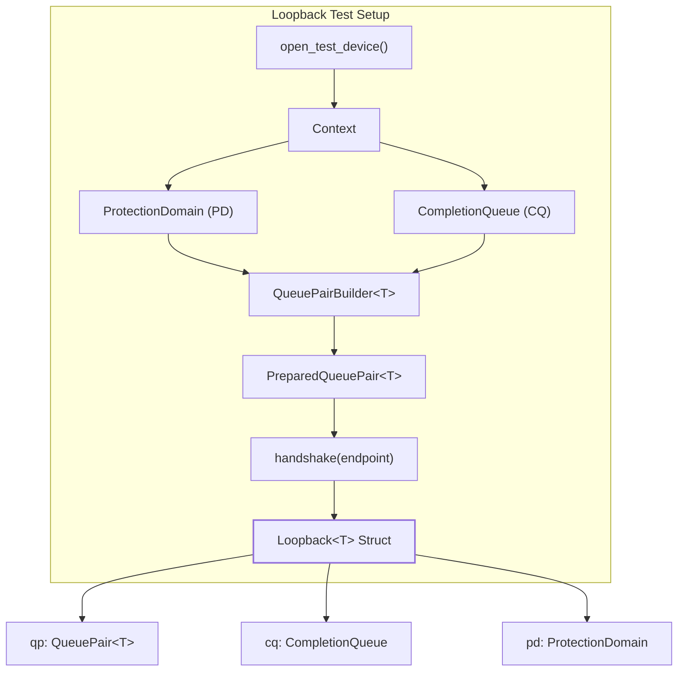
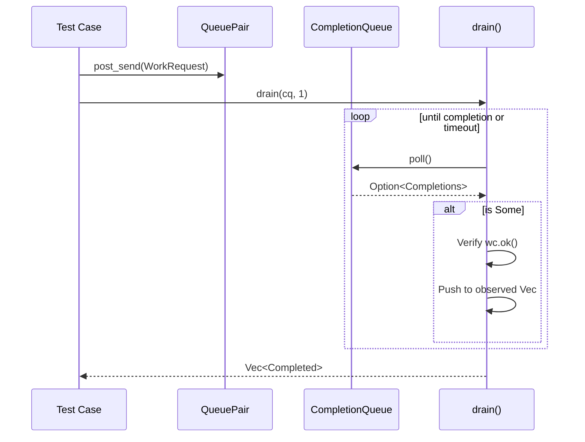
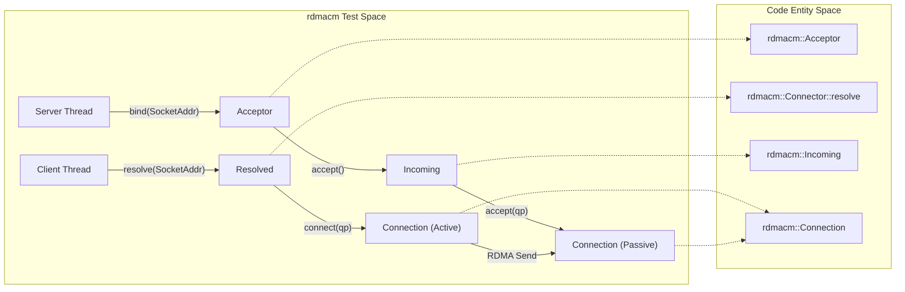

<!-- source: DeepWiki mcp.deepwiki.com · repo jonhoo/rust-ibverbs · page 8.1 Integration Test Suite · fetched 2026-11-11 -->

# Integration Test Suite

<details>
<summary>Relevant source files</summary>

The following files were used as context for generating this wiki page:

- [ibverbs/tests/loopback.rs](ibverbs/tests/loopback.rs)
- [ibverbs/tests/rdmacm.rs](ibverbs/tests/rdmacm.rs)

</details>


The `rust-ibverbs` integration test suite validates the RDMA data path and connection management logic against real or emulated hardware. These tests ensure that the safe abstractions correctly map to the underlying `libibverbs` and `librdmacm` behavior across various transport types and operation modes.

## Overview and Execution

The integration tests are located in the `ibverbs/tests/` directory. Because they require a functional RDMA device (or Soft-RoCE), they are marked with `#[ignore]` to prevent failures in standard environments [ibverbs/tests/loopback.rs:6-8]().

To run the suite, use the following command:
```bash
# Run loopback data-path tests
cargo test -- --ignored

# Run RDMA Connection Manager tests (requires feature)
cargo test --features rdmacm -- --ignored
```

### Environment Configuration
The tests utilize the `IBVERBS_TEST_DEVICE` environment variable to select a specific HCA. If not set, the suite defaults to the first available device found via `ibverbs::devices()` [ibverbs/tests/loopback.rs:27-42]().

| Variable | Description | Example |
| :--- | :--- | :--- |
| `IBVERBS_TEST_DEVICE` | The name of the RDMA device to use for testing. | `rxe0`, `mlx5_0` |

---

## Loopback Test Suite

The loopback suite [ibverbs/tests/loopback.rs:1-17]() focuses on the data-path by connecting a single Queue Pair (QP) to its own endpoint. This allows for testing `RC`, `UC`, and `UD` transports without requiring a second physical host.

### Implementation Pattern: The Loopback Struct
The `Loopback<T>` struct encapsulates the resources required for a self-connected test environment [ibverbs/tests/loopback.rs:19-23]().


**Sources:** [ibverbs/tests/loopback.rs:19-23](), [ibverbs/tests/loopback.rs:47-75]()

### Key Test Categories

1.  **Transport Types**: Tests cover Reliable Connected (`RC`), Unreliable Connected (`UC`), and Unreliable Datagram (`UD`) [ibverbs/tests/loopback.rs:47-86]().
2.  **One-Sided Operations**: Validates `RDMA WRITE`, `RDMA READ`, and `RDMA ATOMIC` (Compare-and-Swap, Fetch-and-Add) by targeting the QP's own registered memory [ibverbs/tests/loopback.rs:77-86]().
3.  **Completion Handling**:
    *   **Polling**: Uses `CompletionQueue::poll()` (lazy-read API) [ibverbs/tests/loopback.rs:133-159]().
    *   **Batch Polling**: Uses `CompletionQueue::poll_into()` for the standard `ibv_wc` array path [ibverbs/tests/loopback.rs:161-190]().
    *   **Event-Driven**: Utilizes `CompletionChannel` to wait for CQ events rather than busy-polling [ibverbs/tests/loopback.rs:89-109]().
4.  **Shared Receive Queues (SRQ)**: Verifies that multiple QPs can consume receive WQEs from a single SRQ pool.
5.  **Async Events**: Validates HCA event reporting, such as `SRQ_LIMIT_REACHED`.

### Data Flow: Work Request Completion
The `drain` function is a critical helper that polls the CQ until a specific number of completions arrive, asserting success for each [ibverbs/tests/loopback.rs:133-159]().


**Sources:** [ibverbs/tests/loopback.rs:133-159](), [ibverbs/tests/loopback.rs:113-130]()

---

## RDMA Connection Manager (rdmacm) Tests

The `rdmacm` integration tests [ibverbs/tests/rdmacm.rs:1-8]() verify the lifecycle of connections established over IP addresses. These tests use two threads within the same process to simulate a Client (Active) and Server (Passive) exchange.

### Client-Server Handshake Flow
The test `connect_and_send` demonstrates the full resolution and connection sequence [ibverbs/tests/rdmacm.rs:82-164]().

| Role | Code Entities | Primary Actions |
| :--- | :--- | :--- |
| **Server** | `Acceptor` [ibverbs/tests/rdmacm.rs:89](), `Incoming` [ibverbs/tests/rdmacm.rs:92]() | `bind()`, `accept()`, `Incoming::accept(qp, ...)` |
| **Client** | `Connector` [ibverbs/tests/rdmacm.rs:127](), `Resolved` [ibverbs/tests/rdmacm.rs:130]() | `new()`, `resolve()`, `connect(qp, ...)` |

### IP Address Discovery
RDMA-CM requires an IP address for routing. The tests programmatically locate a RoCEv2 IPv4-mapped GID from the device's GID table to use as the local bind address [ibverbs/tests/rdmacm.rs:42-52]().


**Sources:** [ibverbs/tests/rdmacm.rs:15-21](), [ibverbs/tests/rdmacm.rs:88-164]()

### Additional RDMACM Test Cases
*   **Timeout Handling**: Verifies that `Acceptor::accept` correctly returns `TimedOut` when no client connects within the specified duration [ibverbs/tests/rdmacm.rs:168-175]().
*   **Private Data**: Validates the exchange of `private_data` buffers during the connection handshake.
*   **Disconnect**: Ensures that `conn.disconnect()` transitions the QP state and cleans up `CmId` resources correctly [ibverbs/tests/rdmacm.rs:162]().

---

## Compile-Fail Transport Rules

Beyond runtime tests, the suite includes `compile_fail` tests (typically via `trybuild` or similar patterns in the crate) to ensure that the transport-layer safety is enforced at compile time. These verify that:
*   `UD` queue pairs cannot post `RDMA READ` or `ATOMIC` operations.
*   `UC` queue pairs cannot post `RDMA READ`.
*   Unconnected queue pairs cannot be used in `post_send` until they have been transitioned to `RTS` via the `handshake` or `activate` methods [ibverbs/tests/loopback.rs:70-72]().

**Sources:** [ibverbs/tests/loopback.rs:47-75](), [ibverbs/tests/loopback.rs:77-86]()

---

