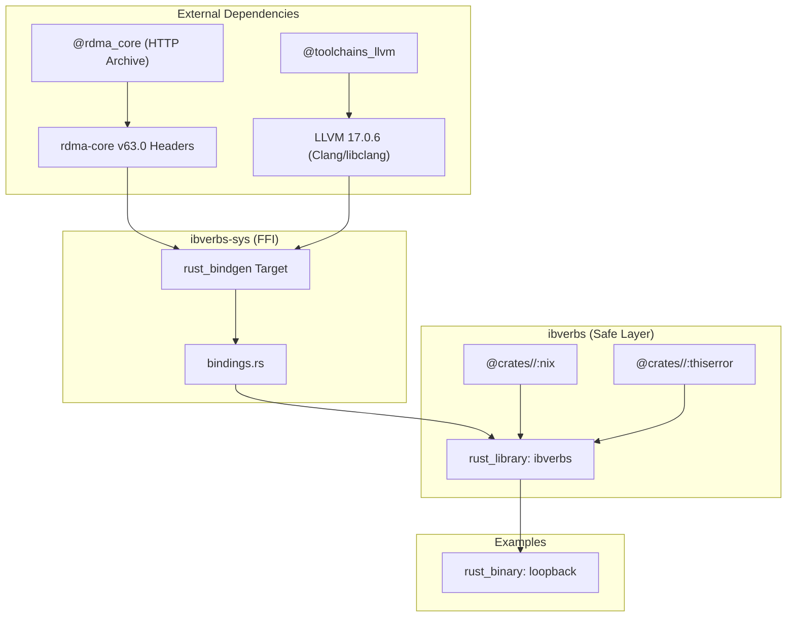
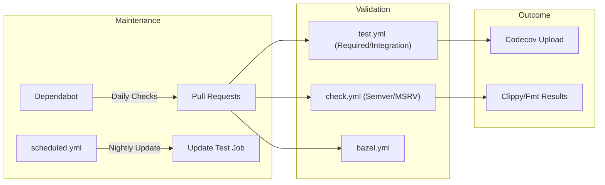

<!-- source: DeepWiki mcp.deepwiki.com · repo jonhoo/rust-ibverbs · page 8.2 CI/CD Workflows · fetched 2026-11-11 -->

# CI/CD Workflows

Relevant source files

The following files were used as context for generating this wiki page:

- [.github/DOCS.md](.github/DOCS.md)
- [.github/codecov.yml](.github/codecov.yml)
- [.github/dependabot.yml](.github/dependabot.yml)
- [.github/workflows/bazel.yml](.github/workflows/bazel.yml)
- [.github/workflows/check.yml](.github/workflows/check.yml)
- [.github/workflows/scheduled.yml](.github/workflows/scheduled.yml)
- [.github/workflows/test.yml](.github/workflows/test.yml)
- [BUILD.bazel](BUILD.bazel)
- [MODULE.bazel](MODULE.bazel)
- [ibverbs-sys/BUILD.bazel](ibverbs-sys/BUILD.bazel)
- [ibverbs/BUILD.bazel](ibverbs/BUILD.bazel)
- [third_party/rdma_core.BUILD.bazel](third_party/rdma_core.BUILD.bazel)

The `rust-ibverbs` codebase utilizes a comprehensive CI/CD pipeline implemented via GitHub Actions and Bazel. The infrastructure is designed to validate the safety contracts of the RDMA bindings, ensure compatibility across various Rust toolchains, and verify data-path operations using emulated RDMA hardware.

## GitHub Actions Workflows

The primary CI logic is distributed across four YAML workflows in `.github/workflows/`, each targeting a specific aspect of the development lifecycle.

### 1. Test Workflow (`test.yml`)
The `test` workflow is the primary gatekeeper for code quality, running on every push to `main` and all pull requests [ .github/workflows/test.yml:11-14 ](). It is partitioned into several specialized jobs.

*   **Required Job**: Validates the crate against `stable` and `beta` toolchains to prevent regressions on upcoming Rust releases [ .github/workflows/test.yml:20-27 ](). It executes both standard tests and documentation tests [ .github/workflows/test.yml:43-47 ]().
*   **Minimal Job**: Uses `-Zminimal-versions` (via `cargo-hack`) to ensure that the crate's `Cargo.toml` accurately reflects the oldest versions of dependencies required for successful compilation [ .github/workflows/test.yml:117-122 ]().
*   **Integration Job**: Stands up a virtual RDMA environment using **Soft-RoCE (`rdma_rxe`)**. Because GitHub-hosted runners do not provide RDMA hardware, this job builds the `rdma_rxe` kernel module from source and attaches it to the runner's Ethernet interface [ .github/workflows/test.yml:64-89 ]().
*   **Coverage Job**: Runs the test suite and uploads results to Codecov, enforcing an 85% coverage floor [ .github/workflows/test.yml:7 ](), [ .github/codecov.yml:2-4 ]().

### 2. Check Workflow (`check.yml`)
This workflow focuses on static analysis and maintenance of the crate's public interface.

*   **Semver Check**: Uses `cargo-semver-checks` to compare the current PR's API against the `main` branch. It ensures that any breaking changes are accompanied by a version bump [ .github/workflows/check.yml:83-90 ]().
*   **Feature Powerset**: Uses `cargo-hack` to verify that all combinations of features (`rdmacm`, `efa`) compile correctly, ensuring features remain additive [ .github/workflows/check.yml:111-129 ]().
*   **MSRV**: Explicitly validates that the code compiles on the **Minimum Supported Rust Version (1.82.0)**, which is required due to the use of `unsafe extern` in generated bindings [ .github/workflows/check.yml:130-138 ]().

### 3. Scheduled Workflow (`scheduled.yml`)
Runs nightly to detect regressions caused by external factors [ .github/workflows/scheduled.yml:10-11 ]().
*   **Nightly Job**: Tests against the Rust `nightly` channel [ .github/workflows/scheduled.yml:18-33 ]().
*   **Update Job**: Runs `cargo update` and executes tests to ensure that the latest semver-compatible dependency releases do not break the crate [ .github/workflows/scheduled.yml:35-62 ]().

### Soft-RoCE Setup and Data-Path Testing
The integration tests in `ibverbs/tests/loopback.rs` are marked with `#[ignore]` because they require a functional `ibv_context`. The `integration` job enables these tests by configuring a software-emulated RDMA device.

**Integration Job Data Flow**
1.  **Kernel Header Install**: Fetches headers for the Azure-tuned kernel [ .github/workflows/test.yml:70-73 ]().
2.  **JIT Module Build**: Clones the `linux-src` tree, extracts `drivers/infiniband/sw/rxe`, and compiles the `rdma_rxe.ko` module [ .github/workflows/test.yml:75-82 ]().
3.  **Device Attachment**: Links the `rxe0` device to the primary `eth0` interface using `rdma link add` [ .github/workflows/test.yml:87-89 ]().
4.  **Test Execution**: Runs `cargo test -- --ignored` with `IBVERBS_TEST_DEVICE=rxe0` [ .github/workflows/test.yml:98-99 ]().

**Sources:** [ .github/workflows/test.yml:1-117 ](), [ .github/workflows/check.yml:1-151 ](), [ .github/workflows/scheduled.yml:1-63 ](), [ .github/codecov.yml:1-12 ]()

---

## Bazel Build System

In addition to Cargo, the repository maintains Bazel build definitions to support monorepo environments and hermetic builds.

### Build Architecture
The Bazel build bypasses `build.rs` and instead uses `rules_rust_bindgen` to generate FFI bindings.

**Code Entity Mapping: Bazel to Codebase**
| System Name | Bazel Target | Code Entity / File |
| :--- | :--- | :--- |
| **FFI Bindings Generator** | `//ibverbs-sys:bindings` | `ibverbs-sys/src/lib.rs` [ ibverbs-sys/BUILD.bazel:19 ]() |
| **System Headers** | `@rdma_core//:ibverbs_headers` | `third_party/rdma_core.BUILD.bazel:34 ]() |
| **Safe Wrapper** | `//ibverbs:ibverbs` | `ibverbs/src/lib.rs` [ ibverbs/BUILD.bazel:6 ]() |
| **Example Binary** | `//ibverbs:loopback` | `ibverbs/examples/loopback.rs` [ ibverbs/BUILD.bazel:23 ]() |

### Bazel Configuration Flow
The build relies on a hermetic LLVM toolchain to ensure consistent `bindgen` output across different host environments.

**Sources:** [ MODULE.bazel:1-60 ](), [ BUILD.bazel:1-33 ](), [ ibverbs/BUILD.bazel:1-30 ](), [ ibverbs-sys/BUILD.bazel:1-78 ](), [ third_party/rdma_core.BUILD.bazel:1-41 ]()

---

## Dependency Management

Automated dependency maintenance is handled by Dependabot and the `scheduled` workflow.

*   **Dependabot**: Configured to check for `github-actions` and `cargo` updates daily [ .github/dependabot.yml:1-10 ](). For Cargo, it is specifically configured to ignore `semver-patch` and `semver-minor` updates, as library consumers typically manage their own lockfiles [ .github/dependabot.yml:11-20 ]().
*   **Cargo Update Job**: As noted in the Scheduled Workflow section, the `update` job forces a `cargo update` to verify that the latest allowable versions of dependencies do not introduce breaking changes or deprecation warnings (enforced via `RUSTFLAGS: -D deprecated`) [ .github/workflows/scheduled.yml:55-62 ]().

**CI Configuration Relationships**

**Sources:** [ .github/dependabot.yml:1-20 ](), [ .github/workflows/scheduled.yml:35-63 ](), [ .github/workflows/bazel.yml:1-30 ]()

---

